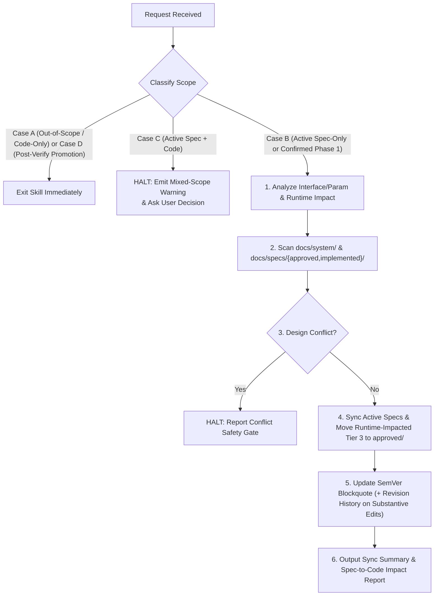

# Specification Lifecycle & Cross-Sync Manager

Enforces Single Source of Truth (SSOT) integrity, bidirectional cross-document synchronization, and Zero-Fallback deprecation discipline across active system specifications without interfering with normal codebase development, planning, or non-spec documentation.

---

## 1. Scope Dispatch & Pre-Execution Gates (EVALUATE FIRST)

Before modifying ANY file, classify the user's request into one of the four cases below and follow its gate strictly:

| Request Type | Condition | Mandatory Action |
| :--- | :--- | :--- |
| **Case A: Out-of-Scope / Codebase-Only** | Modifies ONLY `src/`, tests, scripts, configs, `docs/specs/{drafts,archived}/**`, `docs/specs/README.md`, `reports/**`, `GEMINI.md`/`.agent/**`, or `/plan` artifacts; OR reads active specs as read-only reference for coding/Q&A/`/grill-me`. | **EXIT SKILL IMMEDIATELY (No-op).** Apply none of the rules below. |
| **Case B: Active Spec-Only** | Creates (including promoting `drafts/` → `approved/`), modifies, deprecates (including retiring `{approved,implemented}/` → `archived/`), or explicitly audits active specs in `docs/system/*.md` or `docs/specs/{approved,implemented}/**/*.md` (`README.md` excluded). | **PROCEED TO SECTION 2.** Enforce full SSOT synchronization. Do NOT modify production `src/` files. |
| **Case C: Mixed-Scope (Active Spec + Codebase)** | Requests functional/schema edits to active specs (`docs/system/*.md` or `docs/specs/{approved,implemented}/**/*.md`) AND production `src/` code/tests in the same task. | **TRIGGER MIXED-SCOPE SAFETY INTERLOCK (Section 1.1).** Halt all file writes immediately, warn the user, and request explicit direction. |
| **Case D: Post-Verification Promotion** | Moves an already-implemented spec from `docs/specs/approved/` → `docs/specs/implemented/` and updates relative links in `docs/` immediately after `verification-before-completion` passes (no spec contract change). | **EXEMPT FROM MIXED-SCOPE & EXIT SKILL IMMEDIATELY.** Handled directly by the Completion Gate without 6-domain audit or Impact Report. |

### 1.1 Mixed-Scope Safety Interlock (Hard Stop)

Coupling specification mutations with runtime code edits in a single unreviewed pass risks implementing unverified schemas or propagating architectural conflicts into production code.

**When Case C is detected:**
1. **STOP BEFORE ANY WRITES**: Do NOT call file-creation or file-editing tools on EITHER specification files OR source code files. (Brief read-only inspection to identify affected files is permitted.)
2. **EMIT EXPLICIT WARNING**: Inform the user clearly that the request combines **Specification/ICD Lifecycle Modifications** with **Production Codebase Modifications**.
3. **REQUEST USER DECISION**: Ask the user how to proceed (using the `ask_question` tool if available, or structured plain-text options):
   - **Option 1 — Spec-First Only (Recommended)**: Update and synchronize all affected specifications first, output the Spec-to-Code Impact Report, and stop before touching production code.
   - **Option 2 — Sequential Two-Phase Execution**: Execute Phase 1 (full specification update, 6-domain cross-verification, and Conflict Safety Gate check) first, then immediately proceed to Phase 2 (codebase implementation strictly matching the newly synchronized specs, provided no spec conflicts arise).
   - **Option 3 — Codebase-Only (Skip Spec Changes)**: Leave all specification documents untouched and apply changes only to the codebase.

> **ANTI-RATIONALIZATION RULE**:
> - NEVER bypass this warning because *"the change is just renaming one field"* or *"the user explicitly asked for both in their prompt."* An explicit request to edit both spec and code IS the exact trigger for this warning.
> - **Continuation Exception**: Only bypass this warning when the user is directly replying to confirm an option from a Mixed-Scope Warning you raised in the immediately preceding turn.

---

## 2. Specification Maintenance Protocols

Execute all protocols below whenever editing or auditing specifications (Case B, or Phase 1 of user-approved Option 2).

### 2.1 Code Boundaries Inside Specifications
- Inside specification markdown files, restrict code blocks strictly to **packet/message envelopes, data structure schemas, enums/constants, interface signatures, and core algorithm pseudocode**.
- Never embed full runtime module implementations inside specification documents.

### 2.2 SSOT Hierarchy, Active Scan Scope & Directory Transition Rules
Maintain strict consistency across the three active specification tiers in `Create_Aeroneutics`:
1. **Tier 1 — Master ICD**: `docs/system/AUTONOMOUS_FLIGHT_SYSTEM_ARCHITECTURE_AND_ICD.md` (fixed in `docs/system/`).
2. **Tier 2 — System Architecture & Relation Diagrams**: `docs/system/SYSTEM_PROGRAM_RELATION_AND_PACKET_DIAGRAM.md` (fixed in `docs/system/`).
3. **Tier 3 — Active Subsystem / Component Specifications**: `docs/specs/{approved,implemented}/**/*.md` (`docs/specs/README.md` excluded).

- **Active Scan Boundary**: Scan and synchronize ONLY `docs/system/*.md` and `docs/specs/{approved,implemented}/**/*.md` in the same turn. `docs/specs/drafts/` and `docs/specs/archived/` are completely excluded from SSOT scanning (active synchronization triggers only when a draft is promoted into `approved/` or an active spec is retired out of `{approved,implemented}/` into `archived/`).
- **Runtime-Impact Directory Judgment (`implemented/` → `approved/`)**:
  - Move a Tier 3 spec from `docs/specs/implemented/<subpath>` to `docs/specs/approved/<subpath>` (preserving relative hierarchy) **ONLY WHEN** changes to its requirements, packet schemas, channels, FSM states, or control parameters require runtime code modifications in `src/`.
  - Keep peer `implemented/` specs in `docs/specs/implemented/` when they ONLY receive relative-link updates or cross-referenced version badge bumps with zero runtime code impact on that component.
  - Whenever any Tier 3 file moves directories, update all relative markdown links pointing to or from that file across `docs/system/*.md` and `docs/specs/{approved,implemented}/**/*.md`.

### 2.3 Zero-Fallback & Explicit Deprecation Policy (`Sender-Immediate-Patch`)
1. **Explicit `[DEPRECATED]` Retention**: When renaming or retiring a message type, API endpoint, payload field, or enum value, do NOT silently delete the legacy identifier from specifications. Retain it inline with a `[DEPRECATED]` badge, naming the exact replacement and reason:
   ```markdown
   | Field | Type | Range / Unit | Description |
   | :--- | :---: | :---: | :--- |
   | `padId` | string | Non-empty ID | Target landing pad identifier (Standard) |
   | `runwayId` `[DEPRECATED]` | string | Non-empty ID | Replaced by `padId`. Zero-Fallback applies. |
   ```
2. **Zero-Fallback Mandate**: Specify single-key parsing of the latest standard identifier ONLY. Never specify or permit dual-key fallback wrappers (e.g., `payload.newKey or payload.oldKey`, `data.padId or data.runwayId`) in specifications or downstream receiver code.
3. **Sender-Immediate-Patch Rule**: Specify that runtime deserialization or `nil`/null errors caused by legacy payloads must be fixed by immediately patching and redeploying the outdated **sender** component—never by adding legacy fallback shims to receivers.

### 2.4 Six-Domain Cross-Verification Checklist
Verify alignment across all modified and peer active specifications on all six dimensions:
1. **Protocol & Schemas**: Top-level message envelope fields (`ver`, `domainId`, `seq`, `type`, `time`, `payload`), exact message/event `type` string constants, payload key names, data types, and nesting structure.
2. **Channels, Ports & Addressing**: Shared infrastructure channels/topics (`30004`~`30007`), base channel offset formulas (`Base = 10000 + N*20`), node/service IDs, and physical/logical port bindings.
3. **Physical Units, Coordinates & Conventions**: Reference coordinate frames (NED), sign conventions (pitch nose-up +, roll right-bank +, yaw clockwise from North), physical units (`m/s`, `deg/s`, `blocks`, etc.), and actuator signal bounds (0~15).
4. **Metadata, Versioning & Cross-Links**:
   - Maintain the standard top blockquote header (`> **문서 버전**: vX.Y.Z (...)` and `> **최종 수정일**: YYYY-MM-DD`) on every modified active spec:
     - `Patch (+0.0.1)`: Cross-sync link/badge alignment, wording clarifications, typo fixes, or `[DEPRECATED]` badge formatting.
     - `Minor (+0.1.0)`: New/renamed packets, added payload fields, FSM state additions, or non-breaking interface extensions.
     - `Major (+1.0.0)`: Breaking top-level envelope changes or fundamental architectural restructuring.
   - **Conditional `Revision History` Table**: Add or append a `Revision History` table (version, `YYYY-MM-DD`, change summary, reason) directly below the top metadata blockquote **ONLY** on specs undergoing substantive functional/schema/parameter revisions (`approved/` transition targets). Do NOT add a `Revision History` table to peer specs that only receive link or version-badge updates.
   - Update cross-referenced document version badges and verify all relative markdown links (`../system/...`, `../specs/{approved,implemented}/...`) and section anchors.
5. **FSM & Algorithmic Parameters**: Exact FSM state identifiers, state transition conditions, control loop frequencies (20Hz / 50ms), watchdog timeouts, filter coefficients, and safety thresholds.
6. **Deprecation Hygiene**: Consistent `[DEPRECATED]` badges across Master ICD, diagrams, and active subsystem specs, with zero dual-key fallback logic.

### 2.5 Conflict Safety Gate (Architectural Contradiction Stop)
Distinguish between **routine synchronization** (updating peer specs to reflect an intentional interface change) and **design conflicts** (incompatible mathematical equations, contradictory control authority hierarchies, or mutually exclusive safety invariants across documents).

- **If a design conflict is detected**:
  1. **STOP IMMEDIATELY**. Do NOT overwrite peer documents by guessing architectural intent.
  2. Report the exact conflicting files, sections, and underlying contradiction to the user.
  3. Wait for explicit user resolution before applying edits.

---

## 3. Execution Workflow & Required Output



Upon completing specification updates, always conclude with two structured summaries:
1. **Specification Synchronization Summary**: Table listing every modified `.md` specification, directory state (`fixed` / `stayed implemented` / `moved to approved`), version bump (`vOld -> vNew`), and key synchronized items.
2. **Spec-to-Code Impact Report**: Read-only inventory of production source files in `src/`, structs/interfaces, and sender/receiver handlers that will require updates (highlighting any `Sender-Immediate-Patch` targets created by newly `[DEPRECATED]` identifiers).
