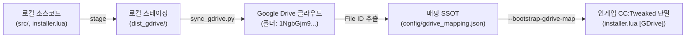

# Google Drive Deployment & Distribution Guide

> **문서 상태**: 활성 (Official Operational Guide)  
> **최종 갱신일**: 2026-11-09  
> **관할 도메인**: `0_development/installer` & 배포 인프라  
> **공식 클라우드 폴더**: [`Antigravity_Playground` (ID: `1NgbGjm9YY7lpIlo4sLs32cNE2NwjVVy9`)](https://drive.google.com/drive/folders/1NgbGjm9YY7lpIlo4sLs32cNE2NwjVVy9)

---

## 1. 개요 (Overview)

Create_Aeroneutics 생태계는 GitHub 원격 저장소(`Polimachi/Aeroneutics_Autopilot`)와 더불어 **Google Drive 클라우드 저장소**를 공식 바이너리/스크립트 배포 원천(Dual-Source Distribution)으로 지원합니다.
본 가이드는 로컬 스테이징 디렉토리(`dist_gdrive/`), 배포 매핑 파일(`config/gdrive_mapping.json`), 동기화 자동화 도구(`tools/sync_gdrive.py`), 그리고 인게임 컴퓨터에서의 설치·갱신 절차를 정의합니다.



---

## 2. 디렉토리 구조 및 파일 분류 (Directory Layout)

### 2.1 로컬 스테이징 영역 (`dist_gdrive/`)

`dist_gdrive/`는 저장소 루트의 소스코드와 `manifest.lua`에 선언된 배포 파일들을 범주별로 정제하여 보관하는 격리 스테이징 영역입니다. `.gitignore`에 등록되어 임시 산출물이 커밋되지 않도록 보호됩니다.

```text
dist_gdrive/
├── installer/
│   └── installer.lua             # 통합 인스톨러 루트 실행 파일
├── bootstrap/
│   ├── installer_app.lua         # TUI 앱 실행 엔진
│   ├── modules/
│   │   ├── manifest.lua          # 패키지 선언 레지스트리
│   │   ├── version_registry.lua  # 버전 및 파일 메타데이터
│   │   ├── migration_engine.lua  # 구버전 마이그레이션 모듈
│   │   ├── startup_generator.lua # /startup 바인딩 생성기
│   │   ├── downloader.lua        # 원자적 다운로더 및 리디렉트 파서
│   │   └── tui_view.lua          # 51x19 터미널 UI 뷰어
├── shared/
│   └── avionics_sensors.lua      # 전역 공용 CC:Avionics 센서 라이브러리
├── packages/                     # 12대 개별 모듈 패키지
│   ├── vas/                      # Node 01 자세 안정화 제어기
│   ├── tca/                      # Node 02 추력기 클러스터 어댑터
│   ├── fcp/                      # Node 04 비행 제어 및 가이던스
│   ├── alignment/                # 격납고 동역학 교정 콘솔
│   ├── gps_server/               # 위성 관제 서버
│   ├── gps_node/                 # 3D 편대 삼각측량 위성 노드
│   ├── gps_client/               # 온보드 GPS 클라이언트
│   ├── gac/                      # 지상 구역 관제사
│   ├── landing_pad/              # 착륙 패드 제어기
│   ├── amm/                      # 임무 관리자 및 조종석 MFD
│   └── gcs/                      # 지상 관제 콘솔
└── manifest.json                 # 스테이징 파일 인덱스 (크기, SHA-256)
```

### 2.2 배포 매핑 파일 (`config/gdrive_mapping.json`)

Google Drive에 업로드된 각 파일의 고유 식별자(`fileId`)를 관리하는 단일 진실 공급원(SSOT)입니다.

```json
{
  "version": "1.0.0",
  "folderId": "1NgbGjm9YY7lpIlo4sLs32cNE2NwjVVy9",
  "folderUrl": "https://drive.google.com/drive/folders/1NgbGjm9YY7lpIlo4sLs32cNE2NwjVVy9",
  "lastSync": "2026-11-09T23:30:00Z",
  "files": {
    "src/0_development/installer/installer_app.lua": {
      "id": "1j9NXsI05yH7msK3tKX-JX3nHDObRVCDx",
      "name": "installer_app.lua",
      "repoPath": "src/0_development/installer/installer_app.lua",
      "category": "bootstrap",
      "sizeBytes": 16190,
      "sha256": "...",
      "downloadUrl": "https://drive.usercontent.google.com/download?id=1j9NXsI05yH7msK3tKX-JX3nHDObRVCDx&export=download&confirm=t"
    }
  },
  "bootstrapMap": {
    "installer.lua": "1FSk8Fya18HXyPdL8lhhfBGqIV500D5UN",
    "src/0_development/installer/installer_app.lua": "1j9NXsI05yH7msK3tKX-JX3nHDObRVCDx"
  }
}
```

---

## 3. 동기화 CLI 도구 (`tools/sync_gdrive.py`)

Python 3 기반 CLI 도구로서 스테이징, 원격 업로드, 인-플레이스 갱신, 검증을 자동화합니다.

### 3.1 주요 서브명령어

| 명령어 | 설명 | 주요 옵션 |
| :--- | :--- | :--- |
| `stage` | 저장소 소스 파일을 `dist_gdrive/`로 수집·패키징 | `--staging-dir <경로>` |
| `sync` | Google Drive 폴더로 업로드 및 매핑 파일 갱신 | `--folder-id <ID>`, `--category <범주>`, `--dry-run`, `--embed` |
| `status` | 로컬 스테이징, 매핑 파일, 원격 드라이브 상태 요약 출력 | `--folder-id <ID>`, `--staging-dir <경로>` |
| `verify` | 필수 배포 파일들의 매핑 유효성 및 URL 형식 정적 검증 | `--mapping-file <경로>`, `--category <범주>` |

### 3.2 일반 운용 시나리오

```bash
# 1. 릴리스 파일 로컬 스테이징
python tools/sync_gdrive.py stage

# 2. 업로드 시뮬레이션 (Dry-Run)
python tools/sync_gdrive.py sync --dry-run --category bootstrap

# 3. Google Drive 실제 업로드 및 installer.lua 부트스트랩 ID 내장
python tools/sync_gdrive.py sync --folder-id 1NgbGjm9YY7lpIlo4sLs32cNE2NwjVVy9 --embed

# 4. 상태 및 무결성 검증
python tools/sync_gdrive.py status
python tools/sync_gdrive.py verify --category bootstrap
```

---

## 4. 인게임 설치 및 운용 워크플로우 (In-Game Workflow)

### 4.1 기본 부트스트래핑 (Out-of-the-box GDrive Install)
`installer.lua` 내부에는 7대 핵심 부트스트랩 파일의 Google Drive 고유 ID가 상시 내장되어 있습니다. 추가 인자 없이 바로 실행하여 소스를 전환할 수 있습니다.

```bash
# 인게임 CC:Tweaked 컴퓨터 단말
installer.lua

# TUI 상단에서 [S] 키를 눌러 소스를 [GDrive]로 전환
# -> Google Drive 클라우드로부터 직접 파일을 다운로드하여 설치 진행
```

### 4.2 매핑 파일 기반 전체 모듈 원격 배포
사용자 정의 빌드나 특정 패키지 매핑을 지정하려면 `--bootstrap-gdrive-map` 인자를 전달합니다.

```bash
# 플로피 디스크(/disk) 또는 로컬에 gdrive_mapping.json이 거치된 경우:
installer.lua --bootstrap-gdrive-map /disk/gdrive_mapping.json
```

---

## 5. 보안 및 문제 해결 (Troubleshooting & Invariants)

1. **Google Drive 대용량 다운로드 간이 경고(Interstitial) 대응**:
   - `downloader.lua`는 Google Drive 바이러스 검사 건너뛰기 경고 페이지(`confirm=...`, `uuid=...`)를 감지하면 자동으로 확인 토큰을 추출하여 1회 재요청하는 복구 로직을 갖추고 있습니다.
2. **권한 및 공유 설정**:
   - 대상 폴더는 링크를 가진 모든 사용자에게 "뷰어(Reader)" 권한이 부여되어 있어야 인게임 컴퓨터(User-Agent: CC:Tweaked)에서 무인증 HTTP 다운로드가 가능합니다.
3. **바이트 패리티 불변 원칙**:
   - `installer.lua`와 `src/0_development/installer/installer.lua`는 상시 100% 동일한 내용을 유지해야 하며, `tests/harness/test_installer_integrity.py` 검증을 통과해야 합니다.
