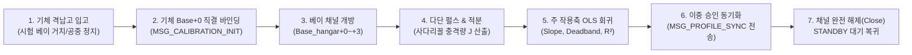
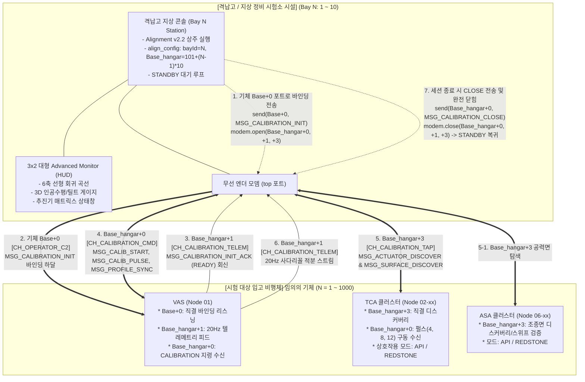
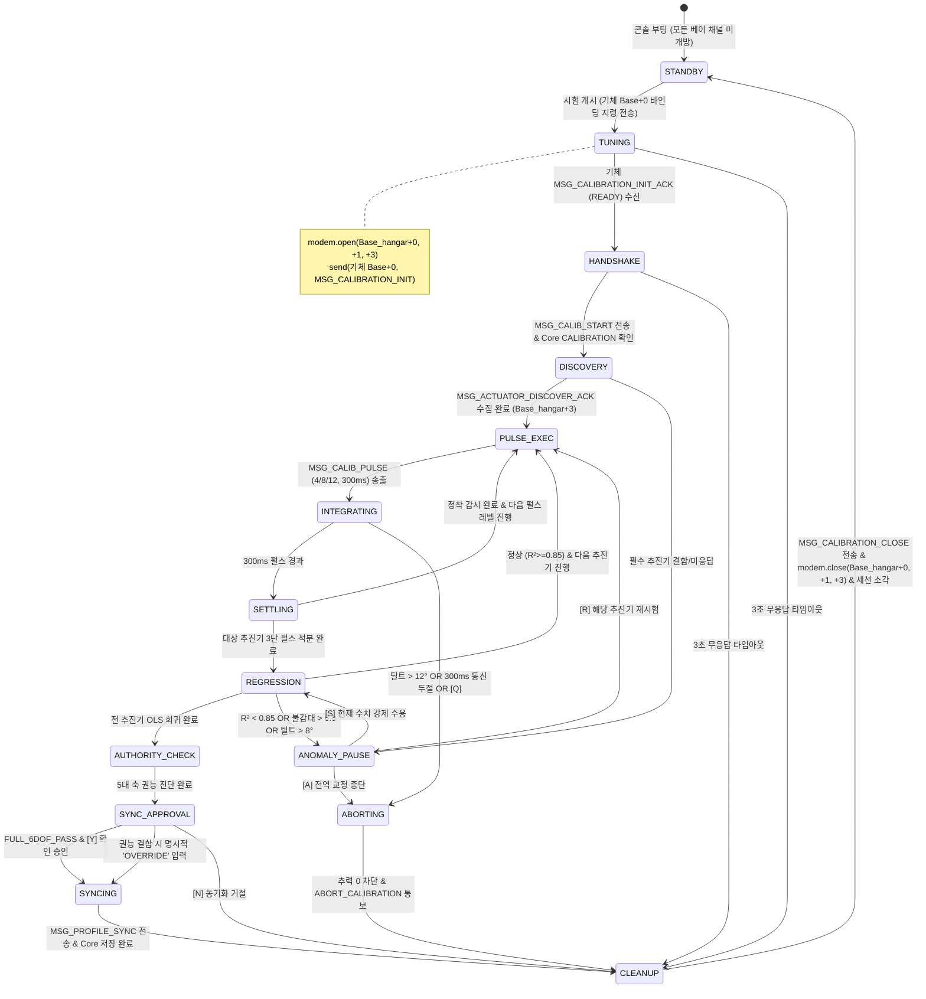
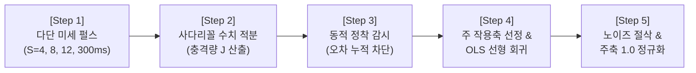
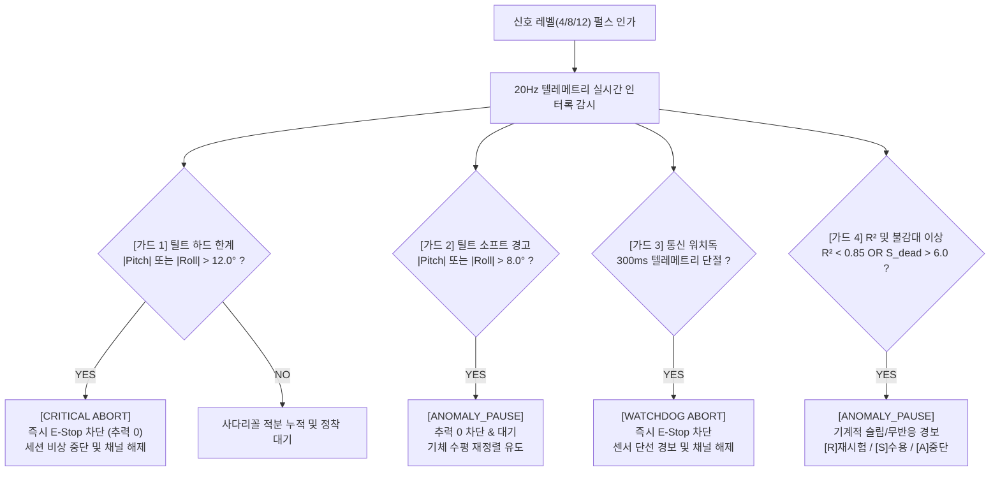

# Alignment (격납고 상주형 기체 동역학 식별 및 정밀 추력기 프로파일러) 상세 규격서
> **Alignment: Hangar Facility Station Precision Actuator Profiler & System Identification Engine**  
> **프로젝트**: Universal Autonomous Flight Stack (UAFS Ecosystem)  
> **대상 환경**: Minecraft CC:Tweaked (Ender Modem), Create: Aeronautics, Create: Avionics  

| 항목 | 내용 |
| :--- | :--- |
| **문서 상태 (Status)** | `Implemented` |
| **문서 버전 (Version)** | `v2.6.1` |
| **최종 수정일 (Date)** | `2026-11-12` |
| **구현 코드 (Source)** | `src/0_development/alignment/` |
| **주관 도메인 (Domain)** | 지상 격납고 동역학 프로파일러 및 시스템 식별 (Alignment / Hangar Console) |

> **연관 문서**: 
> - [AUTONOMOUS_FLIGHT_SYSTEM_ARCHITECTURE_AND_ICD.md](../../../system/AUTONOMOUS_FLIGHT_SYSTEM_ARCHITECTURE_AND_ICD.md) (마스터 ICD v1.28.0)
> - [SYSTEM_PROGRAM_RELATION_AND_PACKET_DIAGRAM.md](../../../system/SYSTEM_PROGRAM_RELATION_AND_PACKET_DIAGRAM.md) (전체 구조도 v2.13.0)
> - [VAS_PROGRAM_SPECIFICATION.md](../../1_control/vas/VAS_PROGRAM_SPECIFICATION.md) (비행 제어 코어 v1.19.0)
> - [FCP_PROGRAM_SPECIFICATION.md](../../2_guidance/fcp/FCP_PROGRAM_SPECIFICATION.md) (FCP 비행 제어 규격서 v2.0.0)
> - [TCA_PROGRAM_SPECIFICATION.md](../../1_control/tca/TCA_PROGRAM_SPECIFICATION.md) (TCA 클러스터 규격서 v1.11.1)
> - [ASA_PROGRAM_SPECIFICATION.md](../../1_control/asa/ASA_PROGRAM_SPECIFICATION.md) (ASA 공력 조종면 규격서 v1.7.0)
> - [GPS_PROGRAM_SPECIFICATION_AND_ICD.md](../../0_infra/gps/GPS_PROGRAM_SPECIFICATION_AND_ICD.md) (GPS 규격서 v2.3.1)
> - [GEMINI.md](../../../../GEMINI.md) (전역 규칙 및 가이드라인)

### Revision History

| 버전 | 개정 일자 | 개정 요약 | 개정 사유 |
| :---: | :---: | :--- | :--- |
| `v2.6.1` | 2026-11-12 | 문서·교차참조·패킷 예시 정합성 수정(Alignment Lua 런타임 변경 없음): `MSG_CALIBRATION_INIT_ACK` 내 `hardwareUuid`를 `"VAS-NODE-01-4402"`로 정정(VAS `Base_hangar+1` 직접 응답 기준), `MSG_SURFACE_DISCOVER_REQ/ACK` 정합 확인 및 연관 문서 버전(`ICD v1.28.0`, `Diagram v2.13.0`, `VAS v1.19.0`, `FCP v2.0.0`, `TCA v1.11.1`, `ASA v1.7.0`, `GPS v2.3.1`) 동기화, 과장 표현 제거 | ICD `v1.28.0` 및 VAS 직결 교정 아키텍처와의 문서 정합성 확보 |
| `v2.6.0` | 2026-11-09 | ADVANCED_VTOL 2D 짐벌 벡터 추진기 다단 펄스 교정 및 의사역행렬 산출 규격 추가: Throttle 및 Gimbal X/Y 펄스 시퀀스, 6축 미분 OLS 회귀 기울기, Control Effectiveness Matrix B (6 x 3N) 조립 및 Moore-Penrose 의사역행렬 B† = B^T (B B^T)^-1 가우스-조던 소거법 추출, 프로파일 내보내기 규격화 | 2D 짐벌 벡터 추진기 시스템 식별 및 의사역행렬 생성 프로토콜 확립 |
| `v2.5.2` | 2026-11-08 | 구버전 명칭 전면 척결 및 표준 명칭(FCP/ASA) 동기화 | 용어 무결성 확보 |
| `v2.5.1` | 2026-11-08 | 네트워크 토폴로지 다이어그램 내 수용 기체 수 범위를 40채널 기준($N = 1 \sim 1000$)으로 정합 동기화 | 사양서 간 수치 정합성 확립 |
| `v2.5.0` | 2026-11-07 | 비행체 전용 40채널($BW=40$) 대역 확장 ($Base = 10000 + (N-1)\times 40$) 반영, 01호기 직결 바인딩 채널 `Base+0` (`10000`, 구 1000 [DEPRECATED]) 동기화, TCA/ASA 동적 바인딩 `Base+10/11` 반영, 승격 전이(`implemented/` $\to$ `approved/`) | 서브채널 대역폭 확장 및 기능 영역별 직교성 확보, 1000대 수용량 확립 |

---

## 1. 프로그램 개요 및 목적 (Overview & Objectives)

### 1.1 시스템 정체성
**Alignment**은 비행체 조립 직후(Post-Build Phase) 또는 정기 점검/개조 후 첫 비행 이전에 가동되는 **격납고/정비 시험장 상주형 지상 시설 콘솔(Hangar Facility Station Console)**입니다. 특정 기체 내부에 고정 탑재되는 프로그램이 아니며, 지상 시설 단말 컴퓨터에서 구동되어 시험 베이에 입고된 **임의의 기체(임의의 기체 번호 $N$ 및 VAS)**와 무선으로 동적 세션을 맺고 고정밀 기체 동역학 식별(System Identification) 및 추력기 프로파일링(Thruster Profiling)을 수행합니다.

> [!NOTE]
> **구현 및 배포 현황 요약 (Status: IMPLEMENTED & CLOUD DEPLOYED)**
> Alignment 소프트웨어는 `src/0_development/alignment` 환경에서 11대 과제 및 21대 마이크로슬라이스(IS-01.1 ~ IS-11.1) 전수가 결함 0건으로 구현 완료(최신 실측 빌드 **v2.3.4**, 빌드 해시 `4c7e15bdf467218d9e0e08ad19234299757caacabcd2fa40d89f70b556681c3a`)되었습니다.
> 하네스 Gate 0 ~ Gate 6 전 게이트 검증을 100% PASS(1,812.17 ms, G4는 지상 콘솔 단일 노드 특성상 SKIP)하였으며, 단일 실행 번들(`startup.lua`)이 생성되어 Google Drive 클라우드 저장소(`dist_gdrive/alignment/alignment_bundle.lua`)로 공식 동기화되었습니다. (상세 내역은 [제11장](#11-소프트웨어-구현-현황-배포-및-통합-검증-결과-implementation--verification-status) 참조)



### 1.2 핵심 개발 배경 및 정밀화 목표
1. **격납고 베이별 10채널 블록군(101~200) 및 기체 Base+0 직결 바인딩 체계 (방안 A)**:
   - 격납고 컴퓨터에 상주 설치되어 평상시에는 채널을 점유하지 않고 `STANDBY` 상태로 대기합니다.
   - 각 격납고 베이는 독립 10채널 블록($Base_{\text{hangar}} = 101 + (\text{BayID}-1)\times 10$, $\text{BayID}=1\sim 10$)을 관할하며, 엔지니어가 콘솔에서 기체 번호 $N$을 입력하고 [교정 바인딩]을 실행하면 기체 고유 상시 개방 채널인 **기체 `Base + 0` (`CH_OPERATOR_C2`)**으로 직접 **`MSG_CALIBRATION_INIT`**를 발송하여 1:1 직결 바인딩을 수립합니다.
   - 기체(VAS)는 `Base + 0` 수신 즉시 지정된 베이 채널($Base_{\text{hangar}}+0, +1, +3$)을 동적으로 개방하고, 시험 완료/중단 시 즉시 `modem.close()`로 완전 해제하여 채널 간섭을 방지합니다.
   - 구버전의 기체 번호 $N$별 `Base+4`/`Base+2` 동적 튜닝 방식 및 임시 단일 채널(`1001`/`1002`)은 영구 폐지되고 `[DEPRECATED]` 처리되었습니다. 입고된 임의의 기체는 평상시 비행 중에는 격납고 채널을 열지 않으며, 오직 `Base+0` 바인딩 지령 수신 시에만 지정 베이 채널을 동적으로 개방합니다.
2. **시간 영역 사다리꼴 수치 적분(Trapezoidal Impulse Integration)**:
   - Create: Aeronautics의 물리 갱신 틱(50ms) 지터 환경에서 1회성 피크값($\Delta \omega_{peak}$)의 왜곡을 방지하기 위해, 시간 영역 사다리꼴 적분을 적용하여 순수 각충격량($\mathbf{J}_\omega$) 및 선충격량($\mathbf{J}_v$)을 산출합니다.
3. **주 작용축(Dominant Axis) 자동 선정 OLS 선형 회귀**:
   - 3단계 신호($S=4, 8, 12$) 인가 후 6축 누적 충격량 절대값 합계가 가장 큰 축을 주 작용축($a^*$)으로 자동 선정하고, 주축을 기준으로 단일 참 감도 기울기(Slope $k$), 유효 기동 불감대($S_{deadband}$), 회귀 적합도($R^2$)를 산출하여 비작용 축의 0 나누기(Divide-by-zero) 및 노이즈 피팅을 방지합니다.
4. **대형 모니터 HUD 비동기 분리(10Hz)**:
   - 3x2 이상 대형 어드밴스드 모니터에 6축 선형 회귀 곡선, 3D 인공수평 인디케이터, 틸트 안전 게이지를 독립 10Hz 타이머로 비차단 렌더링하여 50ms 텔레메트리 적분 지터를 원천 배제합니다.
5. **이중 승인 게이트 및 안전 인터록**:
   - 피치/롤 틸트 하드 한계($\pm 12.0^\circ$) 및 소프트 경고($\pm 8.0^\circ$) 인터록, 300ms 워치독, 120초 Core 인터록, 로컬 JSON 상시 저장 및 `FULL_6DOF_PASS` 시 운영자 `[Y]` 승인 후 무선 동기화 체계를 갖춥니다.

### 1.3 코드 경량화 및 Deprecated 운영 정책 (Code Lightweighting & Deprecation Policy)
1. **사양서 명세 원칙 (Specification-First)**: 프로토콜 패킷 타입명 또는 페이로드 필드가 개정될 경우, 구버전 명칭은 사양서 내에 `[DEPRECATED]` 배지를 부여하고 대체 신규 필드명과 변경 이력을 명시하여 문서상에 보존합니다.
2. **코드베이스 경량화 원칙 (Zero-Fallback)**: CC:Tweaked Lua 분산 컴퓨터 환경의 자원 제약(메모리 절약, 20Hz 실시간 루프 성능 보장)을 준수하기 위해, 코드베이스는 사전 이중 호환(Fallback 래퍼, `payload.new or payload.old` 등)을 일체 작성하지 않고 **최신 표준 필드명/패킷명만을 단일 채택**합니다.
3. **런타임 오류 시 복구 원칙 (송신 노드 즉시 패치)**: 구버전 필드/패킷을 전송하는 미갱신 노드로 인해 수신 측에서 `nil` 인덱싱 등의 런타임 오류가 발생할 경우, 수신 측에 임시 폴백 코드를 추가하지 않고 **구버전 패킷을 송신한 발신 노드의 코드를 최신 사양으로 즉시 패치 및 재배포**하여 전역 일원화를 달성합니다.

---

## 2. 하드웨어 배치 및 네트워크 토폴로지 (Hardware & Network Topology)

Alignment은 격납고/정비 시험장 데스크에 설치된 CC:Tweaked Advanced Computer에서 구동되며, 상단에 장착된 무선 엔더 모뎀(Ender Modem)과 전방에 벽면 부착된 3x2 대형 Advanced Monitor를 활용합니다.



### 2.1 무선 통신 채널 및 인터페이스 매핑

격납고 지상 시험 시설은 10개 독립 베이 블록($Base_{\text{hangar}} = 101 + (\text{BayID}-1)\times 10$, $\text{BayID} = 1\sim 10$) 및 기체 `Base+0` 직결 바인딩 방식을 표준 채택합니다.

| 채널 번호 | 채널 식별 상수 | 통신 방향 | 패킷 타입 (`type`) | 주기 및 라이프사이클 규칙 |
| :---: | :---: | :---: | :---: | :--- |
| **기체 `Base+0`** | `CH_OPERATOR_C2` | Align $\rightarrow$ VAS | `MSG_CALIBRATION_INIT` | 엔지니어 바인딩 실행 시 베이 번호 및 Base_hangar 직결 지령 |
| **$Base_{\text{hangar}} + 0$** | `CH_CALIBRATION_CMD` | Align $\rightarrow$ Core/TCA | `MSG_CALIB_START` | 교정 개시(`ENTER`) 및 비상 중단(`ABORT`) 통보 (구버전 `1001`, `Base+4` [DEPRECATED]) |
| **$Base_{\text{hangar}} + 0$** | `CH_CALIBRATION_CMD` | Align $\rightarrow$ TCA | `MSG_CALIB_PULSE` | 3단 미세 시험 펄스(신호 4, 8, 12, 지속 300ms) 인가 |
| **$Base_{\text{hangar}} + 0$** | `CH_CALIBRATION_CMD` | Align $\rightarrow$ VAS | `MSG_PROFILE_SYNC` | OLS 회귀 6-DoF 프로파일 동기화 및 비행 복귀 |
| **$Base_{\text{hangar}} + 0$** | `CH_CALIBRATION_CMD` | Align $\rightarrow$ VAS | `MSG_CALIBRATION_CLOSE` | 교정 세션 종료 및 베이 채널 해제 지령 |
| **$Base_{\text{hangar}} + 1$** | `CH_CALIBRATION_TELEM` | VAS $\rightarrow$ Align | `MSG_CALIBRATION_INIT_ACK` | 바인딩 수락 및 베이 채널 개방 완료 회신 |
| **$Base_{\text{hangar}} + 1$** | `CH_CALIBRATION_TELEM` | VAS $\rightarrow$ Align | `MSG_FLIGHT_TELEMETRY` | 20Hz(50ms) 시계열 사다리꼴 충격량 적분 수신 (구버전 `1002`, `Base+2` [DEPRECATED]) |
| **$Base_{\text{hangar}} + 1$** | `CH_CALIBRATION_TELEM` | VAS $\rightarrow$ Align | `MSG_CALIB_ACK` | 동역학 프로파일 영구저장 및 반영 완료 회신 |
| **$Base_{\text{hangar}} + 1$** | `CH_CALIBRATION_TELEM` | VAS $\rightarrow$ Align | `MSG_CALIBRATION_CLOSE_ACK` | 세션 종료 및 채널 해제 완료 회신 |
| **$Base_{\text{hangar}} + 2$** | `CH_HANGAR_FACILITY` | Align $\leftrightarrow$ 시설물 | `MSG_FACILITY_*` | 격납고 설비, 엄빌리컬 충전/고정 래치/배기 센서 연동 |
| **$Base_{\text{hangar}} + 3$** | `CH_CALIBRATION_TAP` | Align $\leftrightarrow$ TCA / ASA | `MSG_ACTUATOR_DISCOVER_*`<br/>`MSG_SURFACE_DISCOVER_*` | 추진기 클러스터 및 공력 조종면 노드/모드 직결 자동 탐색 |
| **$Base_{\text{hangar}} + 4 \sim 9$**| `CH_RESERVED_04~09` | 예비 | - | **격납고 내부 확장 예비 대역 (총 6개 채널 예비 확보)** |

> [!IMPORTANT]
> **전역 채널 완전 해제 원칙 (Strict Channel Release Rule)**:  
> Alignment은 비행체 시험 세션(`HANDSHAKE` ~ `SYNCING`/`ABORTING`) 동안에만 해당 베이 채널($Base_{\text{hangar}}+0, +1, +3$)을 개방하며, 정상 완료 또는 비상 중단 시 즉각 기체에 `MSG_CALIBRATION_CLOSE`를 발송하고 콘솔 모뎀에서도 `modem.close()`를 호출하여 채널을 완전히 해제합니다. 기체 전용 채널을 점유한 채로 대기하지 않습니다.

---

## 3. 14단계 유한 상태 머신 (FSM Lifecycle)

Alignment은 격납고 상주 대기부터 기체 Base+0 바인딩, 인터록 핸드셰이크, 추진기 탐색, 펄스 인가, 적분, 정착, 회귀, 이상치 일시정지, 권능 진단, 승인 대기, 동기화, 비상 중단, 세션 종료 해제까지 총 14단계의 명확한 상태 전이 체계를 가집니다.



### 3.1 FSM 상세 상태 전이표

| 상태 식별자 | 상태 명칭 | 진입 조건 및 핵심 실행 로직 | 차기 전이 조건 및 대상 상태 |
| :--- | :--- | :--- | :--- |
| **`STANDBY`** | 격납고 대기 | 콘솔 부팅 또는 이전 세션 클린업 완료. 모든 베이 채널 닫힘 유지. 대형 모니터에 Standby HUD 표출. | 기체 번호 $N$ 입력 및 [바인딩 시작] $\rightarrow$ **`TUNING`** |
| **`TUNING`** | 바인딩 및 조율 | 베이 채널($Base_{\text{hangar}}+0, +1, +3$) 동적 개방 및 기체 `Base+0`으로 `MSG_CALIBRATION_INIT` 송출. | 기체 `MSG_CALIBRATION_INIT_ACK` (READY) 수신 $\rightarrow$ **`HANDSHAKE`**<br/>3초 타임아웃 $\rightarrow$ **`CLEANUP`** |
| **`HANDSHAKE`** | 인터록 교신 | VAS로 `MSG_CALIB_START` 송출($Base_{\text{hangar}}+0$). VAS가 `CALIBRATION` 상태로 진입하고 정상 출력을 0으로 동결했는지 감시. | Core ACK 수신 $\rightarrow$ **`DISCOVERY`**<br/>3초 타임아웃 $\rightarrow$ **`CLEANUP`** |
| **`DISCOVERY`** | 추진기/조종면 탐색 | $Base_{\text{hangar}}+3$으로 `MSG_ACTUATOR_DISCOVER_REQ` 및 `MSG_SURFACE_DISCOVER_REQ` 브로드캐스트. 온라인 TCA 클러스터 및 ASA 조종면 제원 동시 수집 및 시험 순서 큐 생성. | 필수 노드 ACK 수신 $\rightarrow$ **`PULSE_EXEC`**<br/>노드 부재/결함 $\rightarrow$ **`ANOMALY_PAUSE`** |
| **`PULSE_EXEC`** | 펄스 인가 | 현재 추진기 및 단계($S \in \{4, 8, 12\}$)에 맞춰 `MSG_CALIB_PULSE`($Base_{\text{hangar}}+0$) 송출. 300ms 고정밀 타이머 가동. | 펄스 송출 즉시 $\rightarrow$ **`INTEGRATING`** |
| **`INTEGRATING`** | 충격량 적분 | 20Hz 텔레메트리($Base_{\text{hangar}}+1$) 수신 즉시 시간 영역 사다리꼴 적분 수행. 기준선 차분 각/선충격량 누적. | 300ms 경과 $\rightarrow$ **`SETTLING`**<br/>틸트 $>12^\circ$ or 워치독 두절 $\rightarrow$ **`ABORTING`** |
| **`SETTLING`** | 동적 정착 | 추력 0 상태에서 기체의 잔여 회전/이동 관성 감쇠 감시 ($\|\boldsymbol{\omega}\|<0.02$, $\|\mathbf{v}\|<0.05$, 최대 1.5초). 기준선 재계측. | 정착 완료 & 스텝 잔여 $\rightarrow$ **`PULSE_EXEC`**<br/>3단 펄스 완료 $\rightarrow$ **`REGRESSION`** |
| **`REGRESSION`** | OLS 수치해석 | 6축 중 최대 충격량 주 작용축($a^*$) 자동 선정. 주축 기준 Slope $k$, Deadband $S_{deadband}$, $R^2$ 산출. 노이즈 절삭. | 정상($R^2 \ge 0.85$) $\rightarrow$ 다음 노드 or **`AUTHORITY_CHECK`**<br/>이상치 검출 $\rightarrow$ **`ANOMALY_PAUSE`** |
| **`ANOMALY_PAUSE`**| 스마트 일시정지 | 잔여 추력 0 차단. HUD에 이상치 상세 원인 표출 후 운영자 키 입력 대기. | `[R]` $\rightarrow$ **`PULSE_EXEC`** (재시험)<br/>`[S]` $\rightarrow$ 강제수용 후 진행<br/>`[A]` $\rightarrow$ **`ABORTING`** |
| **`AUTHORITY_CHECK`**| 6-DoF 권능 진단 | Surge, Pitch, Roll, Yaw, Heave 5대 필수 축 제어 권능 종합 판정. 진단 리포트 생성. | 판정 완료 $\rightarrow$ **`SYNC_APPROVAL`** |
| **`SYNC_APPROVAL`** | 동기화 승인 대기| 로컬 디스크(`profiles/<profileId>.json`)에 자동 백업. HUD에 최종 종합 결과 표출 및 승인 대기. | `[Y]` (Pass 시) $\rightarrow$ **`SYNCING`**<br/>`OVERRIDE` (Fail 시) $\rightarrow$ **`SYNCING`**<br/>`[N]` $\rightarrow$ **`CLEANUP`** |
| **`SYNCING`** | 프로파일 전송 | $Base_{\text{hangar}}+0$으로 `MSG_PROFILE_SYNC` 송출. VAS 프로파일 저장 및 $Base_{\text{hangar}}+1$로 `MSG_CALIB_ACK` 수신 확인. | 동기화 완료 $\rightarrow$ **`CLEANUP`** |
| **`ABORTING`** | 비상 안전 중단 | TAP에 펄스 0 차단 송출($Base_{\text{hangar}}+0$), VAS에 `action="ABORT_CALIBRATION"` 송출. 안전 딜레이 0.5초. | 통보 완료 $\rightarrow$ **`CLEANUP`** |
| **`CLEANUP`** | 채널 완전 해제 | 기체로 `MSG_CALIBRATION_CLOSE` 송출 및 ACK 수신 후 모뎀의 베이 채널($Base_{\text{hangar}}+0, +1, +3$)을 `modem.close()`로 완전 해제. 세션 텔레메트리 메모리 소각. | 클린업 완료 $\rightarrow$ **`STANDBY`** |

---

## 4. 정밀 기체 동역학 식별 수치해석 알고리즘 (Mathematics & SysID Engine)

본 알고리즘은 **[다단 펄스 $\rightarrow$ 사다리꼴 적분 $\rightarrow$ 동적 정착 $\rightarrow$ 주 작용축 선정 OLS 회귀 $\rightarrow$ 정규화]**의 5단계 정밀 수치 파이프라인으로 구성됩니다.



### 4.1 Step 1: 다단 레벨 자극 신호 (Multi-Level Step Pulse)
각 추진기에 대해 고정 단일 신호 대신, 작동 범위(0~15)를 포괄하는 3단계 신호 세기를 순차 인가합니다:
$$S_1 = 4, \quad S_2 = 8, \quad S_3 = 12 \quad (\text{각 펄스 지속시간 } \Delta t = 300\text{ms} = 6\text{틱})$$

### 4.2 Step 2: 시간 영역 사다리꼴 충격량 적분 (Trapezoidal Impulse Integration)
펄스 직전 0.3초(6틱) 동안의 평균 상태를 동적 기준선($\bar{\boldsymbol{\omega}}_0, \bar{\mathbf{v}}_0$)으로 측정합니다.
펄스 시작($t_0$)부터 펄스 종료 후 안정 구간($t_1$)까지 수집된 20Hz 시계열에 사다리꼴 공식(Trapezoidal Rule)을 적용하여 **총 각충격량($\mathbf{J}_\omega$)** 및 **총 선충격량($\mathbf{J}_v$)**을 계산합니다:

$$\mathbf{J}_\omega = \int_{t_0}^{t_1} (\boldsymbol{\omega}(t) - \bar{\boldsymbol{\omega}}_0) dt = \sum_{n=1}^{N-1} \frac{(\boldsymbol{\omega}_n - \bar{\boldsymbol{\omega}}_0) + (\boldsymbol{\omega}_{n+1} - \bar{\boldsymbol{\omega}}_0)}{2} \cdot \Delta t_n$$

$$\mathbf{J}_v = \int_{t_0}^{t_1} (\mathbf{v}(t) - \bar{\mathbf{v}}_0) dt = \sum_{n=1}^{N-1} \frac{(\mathbf{v}_n - \bar{\mathbf{v}}_0) + (\mathbf{v}_{n+1} - \bar{\mathbf{v}}_0)}{2} \cdot \Delta t_n$$

### 4.3 Step 3: 동적 정착 감시 (Settling Guard)
펄스가 완료된 후 다음 신호 레벨로 넘어가기 전, 기체의 잔여 회전/이동 관성을 억제하기 위해 동적 안정화 조건을 감시합니다:
$$\|\boldsymbol{\omega}(t)\| < 0.02 \text{ deg/s}, \quad \|\mathbf{v}(t)\| < 0.05 \text{ m/s}$$
- 위 조건이 만족되거나 최대 정착 제한 시간(1.5초)이 경과하면 감쇠를 종료합니다.
- 잔여 표류가 남아있는 경우, 차기 펄스 직전의 실측치를 **새로운 동적 기준선($\bar{\boldsymbol{\omega}}_0, \bar{\mathbf{v}}_0$)으로 재샘플링**하여 이전 시험에 의한 누적 오차 간섭을 차단합니다.

### 4.4 Step 4: 주 작용축(Dominant Axis) 자동 선정 및 OLS 선형 회귀
추진기는 단일 물리 구동체이므로 6개 축 중 단 하나의 주된 기계적 불감대($S_{deadband}$)와 선형 신뢰도($R^2$)를 가집니다. 비작용 축(Coupling noise)에서 불감대를 연산할 경우 발생하는 0 나누기 및 왜곡을 방지하기 위해 주 작용축 자동 선정 알고리즘을 적용합니다.

1. **6축 충격량 반응 벡터 구성**:
   $$\mathbf{J}_m = \begin{bmatrix} J_{surge} & J_{sway} & J_{heave} & J_{pitch} & J_{roll} & J_{yaw} \end{bmatrix}^T \quad (m \in \{1, 2, 3\} \text{ for } S \in \{4, 8, 12\})$$
2. **주 작용축($a^*$) 자동 식별**:
   3단계 펄스 동안 발생한 각 축 충격량 절대값의 합계가 최대인 단일 축을 해당 추진기의 주 작용축으로 자동 선정합니다:
   $$a^* = \arg\max_{a \in \{surge, sway, heave, pitch, roll, yaw\}} \sum_{m=1}^3 |J_m(a)|$$
3. **주축 기반 OLS 선형 회귀 ($J(S) = k \cdot S + b$)**:
   $$\bar{S} = \frac{1}{3}\sum_{m=1}^3 S_m = 8.0, \quad \bar{J}(a^*) = \frac{1}{3}\sum_{m=1}^3 J_m(a^*)$$
   - **참 감도 기울기 (Slope $k$)**:
     $$k = \frac{\sum_{m=1}^3 (S_m - \bar{S})(J_m(a^*) - \bar{J}(a^*))}{\sum_{m=1}^3 (S_m - \bar{S})^2}$$
   - **유효 기동 불감대 ($S_{deadband}$)**:
     $$b = \bar{J}(a^*) - k \cdot \bar{S}$$
     $$S_{deadband} = \begin{cases} \max\left(0.0, -\frac{b}{k}\right) & (k > 0) \\ 0.0 & (k \le 0) \end{cases}$$
   - **회귀 적합도 결정계수 ($R^2$)**:
     $$R^2 = 1 - \frac{\sum_{m=1}^3 (J_m(a^*) - (k S_m + b))^2}{\sum_{m=1}^3 (J_m(a^*) - \bar{J}(a^*))^2}$$
     - $R^2 \ge 0.95$: 높은 선형 신뢰도 확보.
     - $0.85 \le R^2 < 0.95$: 통상 선형성.
     - $R^2 < 0.85$: 비선형 외란 또는 동력 기어 슬립 의심 $\rightarrow$ `ANOMALY_PAUSE` 진입.

### 4.5 Step 5: 노이즈 절삭 및 주축 1.0 정규화
1. **노이즈 절삭 (Noise Clamping)**:
   각 축의 개별 기울기 $k(a)$ 중 주축 기울기 크기 대비 $5\%$ 미만인 미세 커플링 노이즈는 강제로 `0.0`으로 클램핑합니다:
   $$k_{clamped}(a) = \begin{cases} 0.0 & (|k(a)| < 0.05 \cdot |k|) \\ k(a) & (|k(a)| \ge 0.05 \cdot |k|) \end{cases}$$
2. **주 발생축 기준 정규화 (Normalization)**:
   주축 크기를 $1.0$ (또는 $-1.0$)으로 정규화하여 6-DoF 기여도 행렬 계수로 변환합니다:
   $$\mathbf{K}_{norm} = \frac{1}{|k|} \mathbf{k}_{clamped}$$

---

## 5. 안전 인터록 및 비상 중단 체계 (Safety Interlocks & Sentinel Guards)



1. **틸트 하드 한계 초과 가드 (Tilt Overrun Hard Guard)**:
   피치 또는 롤각이 $\pm 12.0^\circ$를 초과하는 즉시 전 추력 신호를 `0`으로 차단하고 세션을 강제 중단(`ABORTING`)합니다.
2. **틸트 소프트 경고 가드 (Tilt Warning Soft Guard)**:
   피치 또는 롤각이 $\pm 8.0^\circ$에 도달하면 `ANOMALY_PAUSE`로 진입하여 추력을 차단하고, 운영자에게 기체 수평 복원 대기 및 재시험 분기를 제공합니다.
3. **센서 텔레메트리 워치독 가드 (Telemetry Watchdog Guard)**:
   20Hz 시계열 스트림이 300ms(6틱) 이상 두절될 경우, 즉시 비상 정지하고 세션을 종료합니다.
4. **추진기 무반응 및 과도 불감대 진단**:
   신호 12에서도 반응이 전무하거나 $S_{deadband} > 6.0$인 경우 기계적 파손/동력 단선 경보를 부여하고 일시정지합니다.
5. **Core 120초 비상 복귀 인터록**:
   격납고 컴퓨터가 불의의 사고로 다운되더라도, VAS는 120초 동안 추가 패킷이 없으면 자동으로 `calibrated = false` 상태를 유지한 채 `IDLE_ARMED`로 복귀하여 비행체 락아웃을 방지합니다.

---

## 6. 제어 권능 자동 검증 및 이중 승인 동기화 (Controllability & Approval Gate)

### 6.1 5대 필수 축 제어 권능 종합 판정 및 공력 보조 판정 (AERO_ASSISTED_PASS)
모든 추진기의 정규화 계수가 산출되면 5대 필수 축(Surge, Pitch, Roll, Yaw, Heave)의 정방향 및 역방향 제어 권능을 합산 평가합니다.

$$\text{Authority}(축, \pm) = \sum_{i \in \text{추진기}} \max(0, \pm k_{norm, i}(축))$$

| 검증 축 | 최소 요구 권능 (Threshold) | 판정 조건 |
| :--- | :---: | :--- |
| **Surge (전진)** | $+0.50$ | 주 추진기의 전진 추력 확보 필수 |
| **Heave (상승)** | $+0.50$ | VTOL 기체의 경우 수직 양력 확보 필수 (고정익은 제외) |
| **Pitch (피치)** | $\pm 0.20$ | 기수 상/하 기동 모멘트 양방향 확보 필수 |
| **Roll (롤)** | $\pm 0.05$ | 좌/우 차동 또는 롤 제어 모멘트 확보 필수 |
| **Yaw (요)** | $\pm 0.10$ | 좌/우 선회 차동 모멘트 양방향 확보 필수 |

- **`AERO_ASSISTED_PASS` 판정 규약**:
  - `FIXED_WING` 또는 `WINGED_VTOL` 기체에서 단일 중심선 엔진 탑재 등으로 추진기 자체 롤/피치 권능이 상기 기준에 미달하더라도, $Base_{\text{hangar}} + 3$ 디스커버리를 통해 유효한 공력 조종면(`AIL_L/R`, `ELEV`, `RUDD`)이 탐색되고 정적 스위프 시험을 통과한 경우 **`AERO_ASSISTED_PASS`**로 조건부 완결합니다.
  - 프로파일 내에 `discoveredSurfaces` 맵을 첨부하여 VAS가 순항 시 공력 타각 동압 스케일링으로 제어 모멘트를 보장하도록 인가합니다.

종합 판정 결과는 `FULL_6DOF_PASS`, `AERO_ASSISTED_PASS`, `PARTIAL_RESTRICTED`, `FAIL_INSUFFICIENT_AUTHORITY` 중 하나로 부여됩니다.

### 6.2 이중 승인 게이트 (Two-Tier Approval Gate)
1. **로컬 디스크 자동 백업**:
   판정 완료 즉시 격납고 콘솔 디스크의 `profiles/<profileId>.json` 파일에 원시 충격량 및 최종 프로파일을 영구 저장합니다.
2. **`FULL_6DOF_PASS` 승인 절차**:
   대형 모니터 HUD에 최종 검증 서명창을 표출하고, 운영자의 1회 확인(`[Y] Sync`) 입력 시에만 `MSG_PROFILE_SYNC`를 송출합니다.
3. **권능 결함 시 안전 잠금**:
   `FAIL_INSUFFICIENT_AUTHORITY` 또는 치명 불감대 이상 발생 시 무선 전송 버튼이 강제 비활성화(Lock)되며, 운영자가 위험 감수 오버라이드 코드(`OVERRIDE`)를 명시적으로 직접 입력할 때만 조건부 전송을 허용합니다.

---

## 7. 지상 관제소 3x2 대형 모니터 HUD 및 터미널 명세 (Display & HUD Specifications)

### 7.1 3x2 어드밴스드 모니터 HUD 4분할 레이아웃
Alignment은 부팅 시 인접한 3x2 블록(폭 $\approx 79$, 높이 $\approx 36$ 문자) Advanced Monitor 페리페럴을 자동 탐색하여 관제소 전용 고해상도 그래픽 HUD를 독립 10Hz 비차단 타이머로 렌더링합니다.

```
+-----------------------------------------------------------------------------+
| [HANGAR BAY 01] SYSID TEST BENCH          TARGET: AIRCRAFT_01 (BAY CH 101~110) |
| STATUS: PULSE_EXEC (THR_MAIN_L: Step 2/3)         CORE INTERLOCK: LOCKED    |
+-------------------------------------+---------------------------------------+
| << 6-AXIS OLS REGRESSION CURVE >>   | << 3D ARTIFICIAL HORIZON & ATTITUDE >>|
|                                     |                                       |
|  J (Impulse)                        |             +---+ 12.0° [ABORT LIMIT] |
|   ^               * S=12 (J=1.82)   |             |   |                     |
|   |          * S=8  (J=1.18)        |       ------| o |------ Pitch: +1.4°  |
|   |     * S=4  (J=0.55)             |             |   |       Roll:  -0.2°  |
|   +-------------------> S (Signal)  |             +---+ -12.0°              |
|   Slope k: 0.158 | Deadband: 1.25   | ------------------------------------- |
|   R²: 0.994 [EXCELLENT LINEARITY]   | Tilt Guard Gauge: [====......] 1.4/12°|
+-------------------------------------+---------------------------------------+
| << THRUSTER ACTUATOR MATRIX >>      | << REALTIME TELEMETRY & EVENT LOG >>  |
| [1] THR_MAIN_L : OLS COMPLETE (PASS)| 22:04:12 [PULSE] Sig 8 applied (300ms)|
| [2] THR_MAIN_R : TESTING (Step 2/3) | 22:04:13 [INTEG] Trapezoidal J=1.18   |
| [3] THR_VTOL_F : QUEUED             | 22:04:14 [SETTL] Settling OK (0.8s)   |
| [4] THR_VTOL_R : QUEUED             | 22:04:15 [WATCH] 20Hz Telemetry: 50ms |
+-------------------------------------+---------------------------------------+
| SHORTCUTS: [Q] EMERGENCY ABORT | [SPACE] PAUSE | [R] RETRY | [Y] SYNC CORE  |
+-----------------------------------------------------------------------------+
```

### 7.2 터미널 반응형 자동 폴백 (Local Terminal Responsive Fallback)
외장 대형 모니터가 연결되지 않은 경우, 컴퓨터 본체 터미널 해상도(51x19 표준 또는 26x20 포켓 컴퓨터)를 감지하여 3구역(헤더 / 중앙 진행률 및 게이지 / 하단 로그 및 키 가이드) 텍스트 대시보드로 자동 폴백 전환합니다.

---

## 8. 표준 설정 파일 규격 (`config.json`)

격납고 지상 시설 단말기의 정적 제원 및 안전 파라미터는 `config.json` 표준을 따릅니다:

```json
{
  "station": {
    "stationId": "HANGAR_BAY_01",
    "bayId": 1,
    "baseHangarChannel": 101,
    "facilityName": "Alpha Hangar SysID Test Bench",
    "modemSide": "top",
    "monitorSide": "auto",
    "channels": {
      "calibrationCmd": 101,
      "calibrationTelem": 102,
      "facilityInterlock": 103,
      "tapDirect": 104
    }
  },
  "safety": {
    "tiltAbortDeg": 12.0,
    "tiltWarnDeg": 8.0,
    "watchdogTimeoutMs": 300,
    "maxDeadband": 6.0,
    "minR2Warning": 0.85,
    "minR2Critical": 0.70
  },
  "pulse": {
    "levels": [4, 8, 12],
    "durationMs": 300,
    "settlingTimeoutSec": 1.5,
    "settlingThresholds": {
      "angularRateDegPerSec": 0.02,
      "linearVelocityMps": 0.05
    }
  },
  "authorityThresholds": {
    "minSurge": 0.5,
    "minHeave": 0.5,
    "minPitch": 0.2,
    "minRoll": 0.05,
    "minYaw": 0.1
  },
  "ui": {
    "hudRefreshHz": 10,
    "colorMode": true
  }
}
```

---

## 9. 10대 소스 모듈 인터페이스 및 핵심 의사코드 (Modular Architecture)

```
Alignment/
├── startup.lua                    # 격납고 콘솔 엔트리포인트 및 STANDBY 대기 루프
├── config.json                    # 시설물 정적 설정
└── src/
    ├── align_master.lua           # 10단계 FSM 및 동적 채널 바인딩/해제 오케스트레이터
    ├── discovery_client.lua       # Base_hangar+3 TCA 추진기 탐색 및 헬스 체크
    ├── multi_pulse_sequencer.lua  # 다단 펄스(Throttle 5/10/15 & Gimbal X/Y) 정밀 타이밍 제어기
    ├── impulse_integrator.lua     # 20Hz 사다리꼴 수치 적분기
    ├── settling_guard.lua         # 동적 정착 감시 및 동적 기준선 재계측기
    ├── ols_regression_engine.lua  # 주 작용축 선정, 참 기울기, 불감대, R² 산출기
    ├── safety_sentinel.lua        # 12도 틸트 및 300ms 워치독 인터록 가드
    ├── controllability_checker.lua# 5대 축 제어 권능 진단 및 리포트 생성기
    ├── hud_renderer.lua           # 대형 모니터 HUD 비동기(10Hz) 그래픽 렌더러
    └── profile_exporter.lua       # 로컬 백업 저장 및 Base_hangar+0 프로파일 무선 전송기
```

### 9.1 핵심 모듈별 함수 시그니처 및 의사코드

#### 1) `align_master.lua` (베이 채널 바인딩 및 FSM 오케스트레이터)
```lua
-- align_master.lua
local align_master = {}

function align_master.init_bay_session(cfg, aircraftNumber) -> sessionContext
    local bayId = cfg.station.bayId or 1
    local baseHangarCh = cfg.station.baseHangarChannel or (101 + (bayId - 1) * 10)
    local craftBase = 10000 + (aircraftNumber - 1) * 40 -- 40채널 기준 (구 20채널 [DEPRECATED])
    local craftC2Ch = craftBase + 0
    
    local modem = peripheral.wrap(cfg.station.modemSide)
    local calibCmdCh = baseHangarCh + 0
    local calibTelemCh = baseHangarCh + 1
    local tapDirectCh = baseHangarCh + 3
    
    modem.open(calibCmdCh)
    modem.open(calibTelemCh)
    modem.open(tapDirectCh)
    
    -- 기체 Base+0 포트로 MSG_CALIBRATION_INIT 직결 전송
    local initPacket = {
        ver = "1.9.5", domainId = string.format("AIRCRAFT_%02d", aircraftNumber), seq = 1,
        type = "MSG_CALIBRATION_INIT", time = os.epoch("utc"),
        payload = {
            stationId = cfg.station.stationId,
            bayId = bayId,
            baseHangarChannel = baseHangarCh,
            targetCraftDomain = string.format("AIRCRAFT_%02d", aircraftNumber)
        }
    }
    modem.transmit(craftC2Ch, calibTelemCh, initPacket)
    
    return {
        aircraftNumber = aircraftNumber,
        bayId = bayId,
        stationId = cfg.station.stationId,
        domainId = string.format("AIRCRAFT_%02d", aircraftNumber),
        channels = {
            calibrationCmd = calibCmdCh,
            calibrationTelem = calibTelemCh,
            tapDirect = tapDirectCh
        },
        modem = modem,
        fsmState = "TUNING"
    }
end

function align_master.release_channels(sessionContext) -> boolean
    if sessionContext and sessionContext.modem then
        -- 기체에 MSG_CALIBRATION_CLOSE 전송
        local closePacket = {
            ver = "1.9.5", domainId = sessionContext.domainId, seq = 999,
            type = "MSG_CALIBRATION_CLOSE", time = os.epoch("utc"),
            payload = {
                stationId = sessionContext.stationId,
                bayId = sessionContext.bayId,
                action = "CLOSE_SESSION",
                reason = "COMPLETE"
            }
        }
        sessionContext.modem.transmit(sessionContext.channels.calibrationCmd, sessionContext.channels.calibrationTelem, closePacket)
        
        sessionContext.modem.close(sessionContext.channels.calibrationCmd)
        sessionContext.modem.close(sessionContext.channels.calibrationTelem)
        sessionContext.modem.close(sessionContext.channels.tapDirect)
        sessionContext.fsmState = "STANDBY"
        return true
    end
    return false
end
```

#### 2) `impulse_integrator.lua` (사다리꼴 수치 적분기)
```lua
-- impulse_integrator.lua
local impulse_integrator = {}

function impulse_integrator.new() -> integratorObject
function integratorObject:sample_baseline(telemetryStream, sampleCount) -> baseline
function integratorObject:integrate_step(telemetrySample, dt) -> currentImpulse
function integratorObject:get_total_impulse() -> impulseVector { surge, sway, heave, pitch, roll, yaw }
```

#### 2.1) `multi_pulse_sequencer.lua` 벡터 추진기 펄스 시퀀스 (Vector Pulse Sequencing)
벡터 추진기(`isVectorCapable == true`) 노드에 대해 다음 3단계 캘리브레이션 펄스를 스케줄링합니다:
1. **Phase 1: Throttle 펄스** (노즐 중립 $gx=0, gy=0$): 신호 레벨 $S \in \{5, 10, 15\}$ (각 300ms) $\to \frac{\partial \vec{W}}{\partial T}$ 도출.
2. **Phase 2: Gimbal X 펄스** (기저 스로틀 $S=8$): 짐벌 편향 $gx \in \{-0.5, 0.5, 1.0\}$ $\to \frac{\partial \vec{W}}{\partial g_x}$ 도출.
3. **Phase 3: Gimbal Y 펄스** (기저 스로틀 $S=8$): 짐벌 편향 $gy \in \{-0.5, 0.5, 1.0\}$ $\to \frac{\partial \vec{W}}{\partial g_y}$ 도출.

#### 3) `ols_regression_engine.lua` (주 작용축 선정 및 OLS 회귀기)
```lua
-- ols_regression_engine.lua
local ols_engine = {}

function ols_engine.identify_dominant_axis(impulseList) -> dominantAxisName
    local sums = { surge=0, sway=0, heave=0, pitch=0, roll=0, yaw=0 }
    for _, imp in ipairs(impulseList) do
        for axis, val in pairs(sums) do
            sums[axis] = val + math.abs(imp[axis] or 0)
        end
    end
    local bestAxis, maxVal = "surge", -1
    for axis, val in pairs(sums) do
        if val > maxVal then maxVal = val; bestAxis = axis end
    end
    return bestAxis
end

function ols_engine.calculate_regression(signals, impulseList, dominantAxis) -> regressionResult
    -- signals = {4, 8, 12}
    -- calculates slope k, intercept b, deadband, confidenceR2
    -- normalizes coefficients and clamps noise (|k_axis| < 0.05 * |k|)
    return {
        dominantAxis = dominantAxis,
        slope = k,
        deadband = deadband,
        confidenceR2 = r2,
        normalizedCoefficients = normCoeffs
    }
end

function ols_engine.compute_vector_slopes(pulseResults) -> vectorSlopes
    -- 6축 각각에 대한 추력 및 짐벌 편향 민감도 편미분 행렬 도출
    -- dW/dT, dW/dgx, dW/dgy (각각 6차원 벡터)
    return {
        dThrust = { surge=k_ts, sway=k_tw, heave=k_th, roll=k_tr, pitch=k_tp, yaw=k_ty },
        dGimbalX = { surge=k_xs, sway=k_xw, heave=k_xh, roll=k_xr, pitch=k_xp, yaw=k_xy },
        dGimbalY = { surge=k_ys, sway=k_yw, heave=k_yh, roll=k_yr, pitch=k_yp, yaw=k_yy }
    }
end
```

#### 3.1) `profile_exporter.lua` 의사역행렬 산출 엔진 (Moore-Penrose Pseudo-Inverse)
1. **Control Effectiveness Matrix $B$ ($6 \times 3N$) 조립**:
   - $N$개 벡터 추진기 그룹의 열 벡터 $[\frac{\partial \vec{W}}{\partial T_i}, \frac{\partial \vec{W}}{\partial gx_i}, \frac{\partial \vec{W}}{\partial gy_i}]$을 결합하여 $6 \times 3N$ 행렬 $B$ 구성.
2. **가우스-조던 소거법(Gauss-Jordan Elimination) 역행렬 연산**:
   - $6 \times 6$ 정방행렬 $M = B \cdot B^T$를 구성하고 부분 피보팅(Partial Pivoting)을 적용하여 $M^{-1} = (B B^T)^{-1}$ 산출.
3. **의사역행렬 $B^\dagger$ ($3N \times 6$) 추출**:
   $$B^\dagger = B^T (B B^T)^{-1}$$
   - $B \cdot B^\dagger \approx I_6$ 조건 검증 완료 후 기체 프로파일에 `pseudoInverseMatrix`로 저장 및 동기화.

#### 4) `hud_renderer.lua` (대형 모니터 10Hz 비동기 렌더러)
```lua
-- hud_renderer.lua
local hud_renderer = {}

function hud_renderer.init(monitorSide) -> hudObject
function hudObject:render_dashboard(fsmState, telemetry, currentThruster, regressionData) -> void
function hudObject:render_artificial_horizon(pitchDeg, rollDeg, maxLimitDeg) -> void
function hudObject:render_regression_curve(signals, impulses, k, b) -> void
```

---

## 10. 교환 데이터 패킷 스키마 (Packet Schemas)

모든 패킷은 최상위 공통 엔벨로프(`ver = "1.9.5"`, `domainId`, `seq`, `type`, `time`, `payload`)를 준수합니다.

### 10.1 기체 직결 바인딩 지령 및 확인 (`MSG_CALIBRATION_INIT / _ACK`, CH: 기체 Base+0 / Base_hangar+1)
```lua
-- 1. Align -> Core (기체 Base+0 포트로 전송)
{
    ver = "1.9.5",
    domainId = "AIRCRAFT_01",
    seq = 1,
    type = "MSG_CALIBRATION_INIT",
    time = 1729845000000,
    payload = {
        stationId = "HANGAR_BAY_01",
        bayId = 1,
        baseHangarChannel = 101,
        targetCraftDomain = "AIRCRAFT_01"
    }
}

-- 2. Core -> Align (Base_hangar+1 포트로 회신)
{
    ver = "1.9.5",
    domainId = "AIRCRAFT_01",
    seq = 101,
    type = "MSG_CALIBRATION_INIT_ACK",
    time = 1729845000050,
    payload = {
        aircraftDomainId = "AIRCRAFT_01",
        hardwareUuid = "VAS-NODE-01-4402",
        bayId = 1,
        status = "READY",
        airframeType = "WINGED_VTOL"
    }
}
```

### 10.2 교정 개시 및 비상 중단 통보 (`MSG_CALIB_START`, CH: Base_hangar+0, 구버전 1001, Base+4 [DEPRECATED])
```lua
{
    ver = "1.9.5",
    domainId = "AIRCRAFT_01",
    seq = 102,
    type = "MSG_CALIB_START",
    time = 1729845010000,
    payload = {
        action = "ENTER_CALIBRATION",    -- "ENTER_CALIBRATION" 또는 "ABORT_CALIBRATION"
        stationId = "HANGAR_BAY_01",     -- 지상 격납고 시험 시설 식별자
        targetThruster = "ALL",          -- 교정 대상 추진기 ID 또는 "ALL"
        timeoutSec = 120                 -- 최대 교정 허용 시간
    }
}
```

### 10.3 추진기/조종면 자동 탐색 요청 및 응답 (`MSG_ACTUATOR_DISCOVER_* / MSG_SURFACE_DISCOVER_*`, CH: Base_hangar+3)
```lua
-- 1. Align -> TCA 요청 (Base_hangar+3)
{
    ver = "1.9.5",
    domainId = "AIRCRAFT_01",
    seq = 103,
    type = "MSG_ACTUATOR_DISCOVER_REQ",
    time = 1729845010010,
    payload = { targetGroup = "ALL" }
}

-- 2. TCA -> Align 응답 (Base_hangar+3)
{
    ver = "1.9.5",
    domainId = "AIRCRAFT_01",
    seq = 1,
    type = "MSG_ACTUATOR_DISCOVER_ACK",
    time = 1729845010030,
    payload = {
        groupId = "THR_MAIN_L",
        interactionMode = "REDSTONE",
        mode = "REDSTONE",               -- [DEPRECATED] 구버전 호환용 (코드베이스는 interactionMode 단일 채택)
        activeCount = 1,
        totalCount = 1,
        healthStatus = "REDSTONE_NOMINAL"
    }
}
```

### 10.4 다단 미세 시험 펄스 명령 (`MSG_CALIB_PULSE`, CH: Base_hangar+0, 구버전 1001, Base+4 [DEPRECATED])
```lua
{
    ver = "1.9.5",
    domainId = "AIRCRAFT_01",
    seq = 105,
    type = "MSG_CALIB_PULSE",
    time = 1729845012000,
    payload = {
        targetThrusterId = "THR_MAIN_L",
        stepIndex = 2,                   -- 1 (Sig 4), 2 (Sig 8), 3 (Sig 12)
        pulseLevel = 8,                  -- 인가 신호 레벨 (4, 8, 12)
        pulseDurationMs = 300,           -- 300ms 고정 펄스 폭
        safetyMaxTiltDeg = 12.0          -- 틸트 비상 한계
    }
}
```

### 10.5 최종 추력 프로파일 동기화 (`MSG_PROFILE_SYNC`, CH: Base_hangar+0, 구버전 1001, Base+4 [DEPRECATED])
```lua
{
    ver = "1.9.5",
    domainId = "AIRCRAFT_01",
    seq = 150,
    type = "MSG_PROFILE_SYNC",
    time = 1729845060000,
    payload = {
        profileId = "PROF-20261031-AIRCRAFT_01",
        airframeType = "ADVANCED_VTOL",
        isVectorVtol = true,
        calibratedBy = "HANGAR_BAY_01",
        totalDryMass = 12500.0,
        controllabilityStatus = "FULL_6DOF_PASS", -- FULL_6DOF_PASS, AERO_ASSISTED_PASS, PARTIAL_RESTRICTED, FAIL
        pseudoInverseMatrix = {
            -- 3N x 6 Moore-Penrose Pseudo-Inverse Matrix (B†)
            -- [u_1, u_2, ..., u_3N]^T = B† * [surge, sway, heave, roll, pitch, yaw]^T
        },
        thrusterCoefficients = {
            ["THR_MAIN_L"] = {
                surge = 1.0, sway = 0.0, heave = 0.0,
                pitch = 0.0, roll = 0.04, yaw = 0.25,
                deadband = 1.25,                 -- 주 작용축 기반 단일 불감대
                confidenceR2 = 0.994,            -- 주 작용축 기반 선형 적합도
                maxThrust = 15
            },
            ["THR_MAIN_R"] = {
                surge = 1.0, sway = 0.0, heave = 0.0,
                pitch = 0.0, roll = -0.04, yaw = -0.25,
                deadband = 1.20,
                confidenceR2 = 0.996,
                maxThrust = 15
            },
            ["THR_VTOL_F"] = {
                surge = 0.0, sway = 0.0, heave = 1.0,
                pitch = 0.35, roll = 0.0, yaw = 0.0,
                deadband = 1.40,
                confidenceR2 = 0.988,
                maxThrust = 15
            },
            ["THR_VTOL_R"] = {
                surge = 0.0, sway = 0.0, heave = 1.0,
                pitch = -0.35, roll = 0.0, yaw = 0.0,
                deadband = 1.35,
                confidenceR2 = 0.989,
                maxThrust = 15
            }
        },
        discoveredSurfaces = {
            ["AIL_L"]  = { podId = "ASA_L", type = "control_surface", boundPort = "left", mode = "API", maxDeflectionDeg = 30.0 },
            ["AIL_R"]  = { podId = "ASA_R", type = "control_surface", boundPort = "left", mode = "API", maxDeflectionDeg = 30.0 },
            ["ELEV"]   = { podId = "ASA_T", type = "control_surface", boundPort = "left", mode = "API", maxDeflectionDeg = 30.0 },
            ["RUDD"]   = { podId = "ASA_T", type = "control_surface", boundPort = "right", mode = "API", maxDeflectionDeg = 30.0 },
            ["FLAP_L"] = { podId = "ASA_L", type = "flap", boundPort = "right", mode = "API", maxDeflectionDeg = 40.0 },
            ["FLAP_R"] = { podId = "ASA_R", type = "flap", boundPort = "right", mode = "API", maxDeflectionDeg = 40.0 }
        }
    }
}
```

### 10.6 프로파일 반영 확인 회신 (`MSG_CALIB_ACK`, CH: Base_hangar+1, VAS $\rightarrow$ Alignment, 구버전 1001, Base+4 [DEPRECATED])
VAS가 `MSG_PROFILE_SYNC`를 수신하여 로컬 파일(`config/thrusters.json`)에 영구 반영을 완결한 직후 회신하는 패킷입니다.
```lua
{
    ver = "1.9.5",
    domainId = "AIRCRAFT_01",
    seq = 9251,
    type = "MSG_CALIB_ACK",
    time = 1729845090150,
    payload = {
        profileId = "PROF-20261031-AIRCRAFT_01",
        status = "ACCEPTED"                      -- "ACCEPTED" (반영 성공) 또는 "REJECTED" (검증 실패)
    }
}
```

### 10.7 교정 세션 종료 지령 및 확인 (`MSG_CALIBRATION_CLOSE / _ACK`, CH: Base_hangar+0 / Base_hangar+1)
```lua
-- 1. Align -> Core (Base_hangar+0)
{
    ver = "1.9.5",
    domainId = "AIRCRAFT_01",
    seq = 160,
    type = "MSG_CALIBRATION_CLOSE",
    time = 1729845095000,
    payload = {
        stationId = "HANGAR_BAY_01",
        bayId = 1,
        action = "CLOSE_SESSION",
        reason = "COMPLETE"
    }
}

-- 2. Core -> Align (Base_hangar+1)
{
    ver = "1.9.5",
    domainId = "AIRCRAFT_01",
    seq = 9252,
    type = "MSG_CALIBRATION_CLOSE_ACK",
    time = 1729845095050,
    payload = {
        bayId = 1,
        status = "CLOSED"
    }
}
```

---

## 11. 소프트웨어 구현 현황, 배포 및 통합 검증 결과 (Implementation & Verification Status)

### 11.1 11대 과제 및 21대 마이크로슬라이스 구현 완료 내역
`Alignment` 프로젝트(`src/0_development/alignment`)는 11대 작업 과제(TS-01 ~ TS-11) 및 21대 세부 마이크로슬라이스(`IS-01.1` ~ `IS-11.1`)를 결함 0건으로 100% 구현 완료(v2.3.4)하였습니다:

| 슬라이스 ID | 과제 식별자 | 구현 및 검증 핵심 내용 | 대상 소스 / 테스트 모듈 | 결과 |
| :---: | :---: | :--- | :--- | :---: |
| **IS-01.1 ~ 01.2** | TS-01 | 시간 영역 사다리꼴 수치 적분기 (각충격량 $\mathbf{J}_\omega$ 및 선충격량 $\mathbf{J}_v$ 적분) | `impulse_integrator.lua` / `test_impulse_integrator.lua` | **PASS** |
| **IS-02.1 ~ 02.2** | TS-02 | 기체 정상상태 도달 감시 및 진동 수렴 가드 (Settling Guard) | `settling_guard.lua` / `test_settling_guard.lua` | **PASS** |
| **IS-03.1 ~ 03.2** | TS-03 | 주 작용축 자동 선정 OLS 선형 회귀 엔진 (Slope $k$, $S_{deadband}$, $R^2$) | `regression_engine.lua` / `test_regression_engine.lua` | **PASS** |
| **IS-04.1 ~ 04.2** | TS-04 | 5대 축 조종 권능 판정기 (`FULL_6DOF_PASS` / `AERO_ASSISTED_PASS`) | `controllability_checker.lua` / `test_controllability_checker.lua` | **PASS** |
| **IS-05.1 ~ 05.2** | TS-05 | 구동기/센서 자동 탐색 및 `MSG_ACTUATOR_DISCOVER` 클라이언트 | `discovery_client.lua` / `test_discovery_client.lua` | **PASS** |
| **IS-06.1 ~ 06.2** | TS-06 | 3단계 펄스 시퀀서 ($S=4, 8, 12$, 300ms 펄스 인가 및 컷오프) | `pulse_sequencer.lua` / `test_pulse_sequencer.lua` | **PASS** |
| **IS-07.1 ~ 07.2** | TS-07 | 틸트 $8^\circ$/$12^\circ$ 안전 인터록 및 비상 컷오프 감시 센티널 | `safety_sentinel.lua` / `test_safety_sentinel.lua` | **PASS** |
| **IS-08.1 ~ 08.2** | TS-08 | 식별 프로파일 JSON 내보내기 및 `MSG_PROFILE_SYNC` 동기화 엔진 | `profile_exporter.lua` / `test_profile_exporter.lua` | **PASS** |
| **IS-09.1 ~ 09.2** | TS-09 | 14단계 교정 FSM 마스터 오케스트레이터 및 Mock 시험 리그 | `align_master.lua` / `test_align_master.lua` | **PASS** |
| **IS-10.1 ~ 10.2** | TS-10 | 3x2 대형 모니터 HUD 비차단 10Hz 렌더러 (회귀곡선, 3D 수평의, 틸트 게이지) | `ui_renderer.lua` / `test_ui_renderer.lua` | **PASS** |
| **IS-11.1** | TS-11 | 격납고 시설 지상 콘솔 메인 엔트리포인트 및 대화형 인터페이스 | `src/main.lua` | **PASS** |

### 11.2 하네스 검증 게이트(Gate 0 ~ Gate 6) 무결성 지표
하네스 전 자동화 파이프라인 검증 결과, 모든 정적/동적 게이트를 100% 무결성 통과(지상 콘솔 단일 노드 특성상 G4 멀티컴퓨터 클러스터는 SKIP)하였습니다:

| 게이트 식별자 | 검증 영역 | 판정 기준 | 실제 측정치 | 결과 |
| :---: | :--- | :--- | :---: | :---: |
| **G0** | 거버넌스 및 불변성 | 11대 과제 계약 및 21대 마이크로슬라이스 정합 | 21/21 슬라이스 일치 (12.80ms) | **PASS** |
| **G0.5** | 하네스 환경 무결성 | 금지 모드 및 허용 목록 검증 | 위반 모듈 0건 (46.45ms) | **PASS** |
| **G1** | 정적 구문 및 SRP | 함수당 $\le 50$줄 준수, Zero-Sleep 강제 | 전 모듈 전수 준수 (261.08ms) | **PASS** |
| **G2** | CraftOS-PC 단위 테스트 | 네이티브 가상머신 단언문 100% 충족 | 10개 테스트 스위트 전원 성공 (365.01ms) | **PASS** |
| **G3** | 프레임버퍼 검증 | 3x2 대형 모니터 HUD 비차단 렌더링 무결성 | 단말/모니터 출력 일치 확인 (799.09ms) | **PASS** |
| **G4** | 멀티 컴퓨터 클러스터 | 지상 단일 콘솔 노드 아키텍처 | 단일 노드 특성으로 SKIP (0.00ms) | **SKIP** |
| **G5** | 번들러 & SourceMap | 배포 번들 생성 및 GDrive 패키징 | v2.3.4 번들 생성 (`4c7e15bdf467...`, 43.26ms) | **PASS** |
| **G6** | 오프라인 번들 부팅 | 단일 파일 번들 기동 무결성 확인 | Ingame Probe ACK 확인 완료 (269.55ms) | **PASS** |

- **총 소요 시간**: 1,812.17 ms
- **소프트웨어 버전**: `v2.3.4`
- **빌드 해시**: `4c7e15bdf467218d9e0e08ad19234299757caacabcd2fa40d89f70b556681c3a`
- **검증 상태**: `status = "PASS"`, `failures = []`

### 11.3 Google Drive 공식 클라우드 배포 메타데이터
하네스 Gate 5 번들러를 통해 생성된 단일 실행 번들은 Google Drive로 자동 업로드 및 동기화가 완료되었습니다:

| 항목 | 상세 값 |
| :--- | :--- |
| **패키지 식별자 (Package ID)** | `alignment` |
| **배포 버전 (Version)** | `v2.3.4` |
| **빌드 해시 (Build Hash)** | `4c7e15bdf467218d9e0e08ad19234299757caacabcd2fa40d89f70b556681c3a` |
| **배포 번들 경로** | `dist/computers/main/startup.lua`<br/>`dist_gdrive/alignment/alignment_bundle.lua` |
| **노드 역할** | `alignment_station` (격납고 시험 베이 지상 콘솔) |

---

*본 규격서는 Universal Autonomous Flight Stack의 격납고 상주형 기체 동역학 식별 및 정밀 프로파일러(Alignment)의 공식 구현 표준으로 기능하며, 관련 마스터 ICD([AUTONOMOUS_FLIGHT_SYSTEM_ARCHITECTURE_AND_ICD.md](../../../system/AUTONOMOUS_FLIGHT_SYSTEM_ARCHITECTURE_AND_ICD.md) v1.28.0), 전체 구조도([SYSTEM_PROGRAM_RELATION_AND_PACKET_DIAGRAM.md](../../../system/SYSTEM_PROGRAM_RELATION_AND_PACKET_DIAGRAM.md) v2.13.0), VAS 규격서([VAS_PROGRAM_SPECIFICATION.md](../../1_control/vas/VAS_PROGRAM_SPECIFICATION.md) v1.19.0), TCA 규격서([TCA_PROGRAM_SPECIFICATION.md](../../1_control/tca/TCA_PROGRAM_SPECIFICATION.md) v1.11.1), FCP 규격서([FCP_PROGRAM_SPECIFICATION.md](../../2_guidance/fcp/FCP_PROGRAM_SPECIFICATION.md) v2.0.0), ASA 규격서([ASA_PROGRAM_SPECIFICATION.md](../../1_control/asa/ASA_PROGRAM_SPECIFICATION.md) v1.7.0) 및 GPS 규격서([GPS_PROGRAM_SPECIFICATION_AND_ICD.md](../../0_infra/gps/GPS_PROGRAM_SPECIFICATION_AND_ICD.md) v2.3.1)와 정합성을 유지합니다.*
