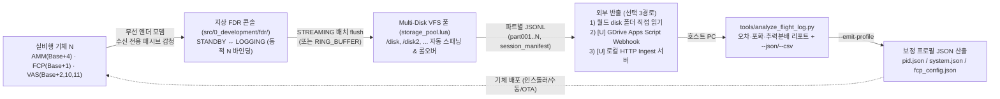

# FDR (지상 상주형 실환경 비행 식별·계측기 및 오프라인 프로파일러) 상세 규격서

> **FDR: Ground In-Flight Aligner, Multi-Disk VFS Telemetry Recorder & Offline Profile Tuner**  
> **프로젝트**: Universal Autonomous Flight Stack (UAFS Ecosystem)  
> **대상 환경**: Minecraft CC:Tweaked (Wireless Ender Modem, Wired Disk Array), Create: Aeronautics, Create: Avionics, Python 3.10+ (Host PC)

| 항목 | 내용 |
| :--- | :--- |
| **문서 상태 (Status)** | `Implemented` |
| **문서 버전 (Version)** | `v0.3.0` |
| **최종 수정일 (Date)** | `2026-11-14` |
| **구현 코드 (Source)** | `src/0_development/fdr/ & tools/analyze_flight_log.py` |
| **주관 도메인 (Domain)** | 지상 상주형 실환경 비행 동역학 식별·계측 및 PID/트림 프로파일 튜닝 콘솔 (FDR / In-Flight Aligner) |

> **연관 문서**:
> - [AUTONOMOUS_FLIGHT_SYSTEM_ARCHITECTURE_AND_ICD.md](../../../system/AUTONOMOUS_FLIGHT_SYSTEM_ARCHITECTURE_AND_ICD.md) (마스터 ICD v1.31.0)
> - [SYSTEM_PROGRAM_RELATION_AND_PACKET_DIAGRAM.md](../../../system/SYSTEM_PROGRAM_RELATION_AND_PACKET_DIAGRAM.md) (전체 구조도 v2.15.1)
> - [ALIGNMENT_PROGRAM_SPECIFICATION.md](../alignment/ALIGNMENT_PROGRAM_SPECIFICATION.md) (격납고 지상 교정 콘솔 v2.7.0)
> - [VAS_PROGRAM_SPECIFICATION.md](../../1_control/vas/VAS_PROGRAM_SPECIFICATION.md) (비행 제어 코어 v1.21.0)
> - [TCA_PROGRAM_SPECIFICATION.md](../../1_control/tca/TCA_PROGRAM_SPECIFICATION.md) (TCA 클러스터 규격서 v1.12.0)
> - [ASA_PROGRAM_SPECIFICATION.md](../../1_control/asa/ASA_PROGRAM_SPECIFICATION.md) (ASA 공력 조종면 규격서 v1.8.0)
> - [FCP_PROGRAM_SPECIFICATION.md](../../2_guidance/fcp/FCP_PROGRAM_SPECIFICATION.md) (FCP 외루프 유도 규격서 v2.1.0)
> - [AMM_PROGRAM_SPECIFICATION.md](../../3_planning/amm/AMM_PROGRAM_SPECIFICATION.md) (AMM 임무·궤적 규격서 v2.0.1)
> - [GDRIVE_DEPLOYMENT_GUIDE.md](../../../guides/GDRIVE_DEPLOYMENT_GUIDE.md) (Google Drive 배포 가이드)
> - [GEMINI.md](../../../../GEMINI.md) (전역 규칙 및 가이드라인)

### Revision History

| 버전 | 개정 일자 | 개정 요약 | 개정 사유 |
| :---: | :---: | :--- | :--- |
| `v0.3.0` | 2026-11-14 | **`Draft` $\to$ `Approved` 승격 및 사용자 결정 확정**: ① `VAS` Opt-in `telemetryDiag` 포함 확정 (`VAS v1.21.0` 및 `ICD v1.31.0` 양방향 동기화), ② `config/fdr_config.json`의 `export.mode` 기본값을 `"GDRIVE_WEBHOOK"`으로 전환하고 대상 Google Drive 폴더 `FDR_Reports` (`gdriveFolderId = "1C3ZWMoXjsba1QE8ksgWG0LSfxzW_nMWI"`) 지정 및 `webhookUrl` 미설정 시 안내 가드 명문화 | 사용자 설계 리뷰 승인 (`TASK-120` 구현 착수) |
| `v0.2.0` | 2026-11-14 | **실환경 Alignmenter 모델 전면 재정의 (`Draft`)**: (1) 지상 콘솔·다중 디스크 어레이(`drive` 페리페럴 `/disk*` Spanned VFS `storage_pool.lua`, 파트 롤오버·핫플러그·세션 매니페스트) 추가, (2) `Alignment`형 `STANDBY` $\leftrightarrow$ `LOGGING` 동적 기체 인덱스 $N$ 바인딩(`[N]` 핫키) 및 `domainId` 자동 탐지 추가, (3) `tools/analyze_flight_log.py --emit-profile` 기반 `VAS` `pid.json`/`system.json` 및 `FCP` `fcp_config.json` 보정 패치·신규 프로필 JSON 산출 알고리즘 명세, (4) CC:Tweaked `http.post` 기반 외부 전송(`GDRIVE_WEBHOOK` Google Apps Script / `HTTP_POST` / 로컬 월드 디스크 직결) 아키텍처 추가 | 블랙박스 중심에서 지상 상주형 실환경 비행 식별·프로파일 튜닝 콘솔(In-Flight Aligner) 방향으로 정렬 |
| `v0.1.0` | 2026-11-14 | `TASK-120` 신규 사양서 초안(`Draft`) 작성: 수신 전용 패시브 감청(`Base+1`/`Base+2`/`Base+10` 필수 + 선택 `Base+11`/`Base+4`), `STREAMING` 기본 및 `RING_BUFFER` 선택 이중 기록 모드, 배치 `flush()`·디스크 여유 공간 가드, `VAS` Opt-in `telemetryDiag` 진단 필드 확장, `tools/analyze_flight_log.py` 통합 리포트(`--json`/`--csv`) 명세 | `TASK-120` (`/grill-me` 5대 설계 결정 반영) 기반 구현 착수 전 Spec-First 사양 수립 |

---

## 1. 프로그램 개요 및 실환경 Alignmenter 아키텍처 (Overview & Ground Aligner Architecture)

### 1.1 시스템 정체성: 지상 상주형 실환경 비행 식별기 (In-Flight Aligner)
**Alignment**(`src/0_development/alignment/`)가 격납고 지상 거치 상태에서 다단 펄스로 기체 추력 행렬(`thrusters.json`)을 식별·산출하는 **정적 지상 교정기**라면, **FDR**(`src/0_development/fdr/` + `tools/analyze_flight_log.py`)은 실제 비행 중 발생하는 **미세 자세 진동, PID 적분항 포화, 짐벌/조종면 포화, 호버 추력·트림 편차, 외루프 궤적 오차**를 계측해 **실환경 제어 프로필(`pid.json`, `system.json`, `fcp_config.json`)을 보정·산출하는 동적 비행 식별기(In-Flight Aligner & Telemetry Profiler)**입니다.

1. **지상 관제소 + 디스크 서버 표준 배치**: 지상 기지 컴퓨터에 **무선 엔더 모뎀(Ender Modem)**과 **유선 모뎀 기반 다중 디스크 드라이브 어레이(Disk Server / RAID Pool)**를 연결해 상주 가동합니다(단독 온보드 컴퓨터 배치도 동일 코드로 호환).
2. **수신 전용 비간섭 원칙 (Passive Receive-Only Invariant)**: `FDR`은 타겟 기체의 채널을 **청취(`modem.open`)만** 수행하며, 어떤 상황에서도 `modem.transmit(...)`을 호출하지 않습니다. `FDR`의 연결 전환, 디스크 만석, 예외 발생이 비행 중인 `AMM`, `FCP`, `VAS`, `TCA`, `ASA` 루프에 영향을 주지 않습니다.
3. **동적 기체 연결 (`STANDBY` $\leftrightarrow$ `LOGGING`)**: `Alignment`와 동일하게 평시 `STANDBY`로 대기하다가, 지상 엔지니어가 `[N]` 핫키로 임의 기체 번호 $N \in [1, 1000]$을 지정하면 해당 기체의 `Base+1..11` 채널에 동적 바인딩하여 실비행 로그를 수집합니다.
4. **오프라인 분석 및 프로필 환류**: 수집된 다중 디스크 파트 JSONL을 호스트 PC(`world/computercraft/disk/*` 직접 접근 또는 Google Drive Webhook / HTTP 전송)로 반출한 뒤 `tools/analyze_flight_log.py --emit-profile`로 튜닝된 프로필 JSON을 생성하여 기체에 반영합니다.



### 1.2 멀티 코드베이스 독립성
- `src/0_development/fdr/`는 타 서브시스템의 내부 Lua 모듈을 직접 `require()`하지 않는 독립 완결형 코드베이스입니다.
- `manifest.lua` 내 `category = "development"`로 등록하며, `verify_manifest_sync.py` 규약에 따라 `/lib/avionics_sensors.lua` 공용 번들 항목을 포함합니다.

---

## 2. 동적 기체 바인딩 및 감청 채널 매트릭스 (Dynamic Binding & Tapped Channels)

### 2.1 동적 기체 인덱스 바인딩 (`STANDBY` $\leftrightarrow$ `LOGGING`)
- **베이스 채널 공식**: 기체 인덱스 $N \in [1, 1000]$에 대해 $\text{Base} = 10000 + (N - 1) \times 40$ ($10000 \sim 49960$, `Bandwidth = 40`).
- **동적 전환 프로토콜 (`bind_aircraft(N, domainIdOrWildcard)`)**:
  1. 기존 열려 있던 기체 감청 채널(`oldBase + offset`)을 모두 `modem.close(...)`하고 활성 스트리밍 세션을 안전하게 `close()`(`FOOTER` 기록)합니다.
  2. 새 $N$의 감청 채널을 `modem.open(...)`으로 개방합니다.
  3. `domainId`가 `"*"`(기본 자동 탐지)이면, 해당 `Base+2`에서 최초로 수신되는 유효 `ver == "1.9.5"` `MSG_FLIGHT_TELEMETRY` 패킷의 `pkt.domainId`를 세션 `lockedDomainId`로 자동 잠금하여 타 기체 혼선을 방지합니다.
  4. 부팅 직후 `autoStartOnBoot == true` 설정 시 마지막/기본 `aircraftIndexN`으로 즉시 `LOGGING`을 시작하고, `false` 시 `STANDBY` 대기 후 `[N]` 입력 시 시작합니다.

### 2.2 채널별 감청 대상 및 활성 기본값

| 오프셋 | 채널명 (`ICD`) | 필수 여부 | `fdr_config.json` 토글 (기본값) | 감청 패킷 타입 (`type`) | 주요 분석 및 프로필 산출 용도 |
| :---: | :--- | :---: | :--- | :--- | :--- |
| **`Base + 1`** | `CH_FLIGHT_GUIDANCE` (`[I-2]`) | **필수** | 상시 활성 | `MSG_ATTITUDE_CMD`, `MSG_EMERGENCY_OVERRIDE`, `MSG_EMERGENCY_ALERT` | 목표 쿼터니언/각속도/집합추력 지령, `ACRO` 전환, `E_STOP` 트리거 |
| **`Base + 2`** | `CH_TELEMETRY` (`[I-1]`) | **필수** | 상시 활성 | `MSG_FLIGHT_TELEMETRY` | 실제 자세/각속도/속도/고도, `dynamicLoad`, `controlState`, 선택 `diag` |
| **`Base + 10`** | `CH_THRUST_ACTUATION` (`[I-3]`) | **필수** | 상시 활성 | `MSG_THRUST_CMD`, `MSG_ACTUATOR_STATUS` | 추력기 그룹별 분배율, `ADVANCED_VTOL` 짐벌 각도, `isSaturated`/`gimbalSaturated` |
| **`Base + 11`** | `CH_SURFACE_ACTUATION` (`[I-10]`) | 선택 | `tapOptions.aero = true` | `MSG_AERO_CMD`, `MSG_AERO_STATUS` | 공력 조종면(`AIL`/`ELEV`/`RUDD`/`FLAP`) 타각, 동압 스케줄링, 타각 포화/`isJammed` |
| **`Base + 4`** | `CH_TRAJECTORY_CMD` (`[I-12]`) | 선택 | `tapOptions.trajectory = true` | `MSG_TRAJECTORY_SETPOINT`, `MSG_OUTER_LOOP_STATUS` | 외루프 3D 위치/속도 오차(`posError`/`velError`), `saturated`, `navStale` |

> [!IMPORTANT]
> **구버전 채널 및 레거시 필드 Zero-Fallback 배제**: 구 `Base + 6`·`Base + 7` `[DEPRECATED]`, `"ATTITUDE_ANGLE"`, `angleTargets`, `rateTargets`, `targetThrottle` 및 `mode` `[DEPRECATED]` 레거시 필드는 감청·보정하지 않습니다.

### 2.3 엔벨로프 검증 규칙
`packet_tap.classify_packet(tap, channel, pkt, rxMs)`는 다음 조건을 모두 만족하는 패킷만 통과시킵니다:
1. `type(pkt) == "table"` 및 `pkt.ver == "1.9.5"`
2. `lockedDomainId == "*"`이거나 `pkt.domainId == lockedDomainId`
3. `type(pkt.type) == "string"` 및 `type(pkt.payload) == "table"`
4. 채널 오프셋별 허용 `msgType` 매칭 (`tapOptions.includeControlEvents == false` 시 `MSG_CHANNEL_REBIND*` 등 비계측 패킷 제외)

---

## 3. 다중 디스크 통합 VFS 및 디스크 서버 규격 (Multi-Disk Pooling / VFS)

CC:Tweaked는 Lua 측 네이티브 `fs.mount()` API를 공식 제공하지 않으며, 기본 플로피 디스크(`floppy_space_limit = 125000` bytes $\approx 125\text{ KB}$)와 컴퓨터 로컬 저장소($1\text{ MB}$)에 용량 제한이 존재합니다. 이를 극복하기 위해 **`storage_pool.lua` (Lua-Side Spanned VFS / JBOD Disk Pool)**를 정의합니다.

### 3.1 물리 디스크 어레이 스캔 및 마운트 우선순위
`storage_pool.scan_volumes(cfg)`는 아래 순서로 가용 볼륨 목록을 구성합니다:
1. **외부 `drive` 페리페럴 어레이 탐색**: `peripheral.getNames()` 중 `peripheral.getType(name) == "drive"`인 모든 장치(직접 인접 + 유선 모뎀 네트워크 연결 드라이브 일체)를 순회하며, `disk.isPresent(name) == true`이고 `disk.hasData(name) == true` (오디오 디스크 제외)이며 `disk.getMountPath(name)`이 유효한 마운트(`/disk`, `/disk2`, ...)를 수집합니다.
2. **로컬 fallback 볼륨**: `storage.allowLocalFallback == true` (기본 `true`)일 때 로컬 `"/logs"`를 최저 우선순위 예비 볼륨으로 포함합니다 (`storage.preferExternalDisk == true` 기본 시 외부 디스크 어레이가 모두 소진된 뒤에만 사용).
3. **볼륨 선택 정책 (`select_best_volume`)**:
   - 각 볼륨의 `fs.getFreeSpace(mountRoot)`를 조회해 `freeBytes >= minFreeSpaceBytes` (기본: 플로피/소형 볼륨 호환 `16384` bytes, 로컬/대용량 설정 가능)인 볼륨 중 **여유 공간이 가장 큰 볼륨**을 현재 쓰기 대상(`activeVolume`)으로 선택합니다.

### 3.2 청크 스패닝(Chunk-Sharded Spanning) 및 무중단 파트 롤오버
한 JSONL 파일을 여러 물리 디스크에 바이트 단위로 쪼개면 단일 디스크 탈착 시 JSON 파싱이 깨지므로, **자기 완결형 파트 파일 단위 스패닝(Session Part Spanning)**을 채택합니다:
- **파트 파일명 규약**: `<mountRoot>/fdr_logs/<domainId>_<sessionEpochMs>_part<NNN>.jsonl` (예: `/disk2/fdr_logs/AIRCRAFT_01_1731589200000_part001.jsonl`).
- **파트 크기 및 여유 공간 롤오버 트리거**:
  - 현재 파트의 누적 기록 바이트 $\ge$ `maxPartBytes` (기본 `100000` bytes — 125KB 기본 플로피 호환 및 HTTP Webhook 청크 업로드 최적 크기) **또는**
  - 현재 활성 볼륨의 `fs.getFreeSpace(activeMount) <= rollOverReserveBytes` (기본 `16384` bytes) 도달 시:
    1. 현재 파트 끝에 `FOOTER` 레코드(`"rolloverReason": "PART_LIMIT" | "DISK_LOW_SPACE"`, `"nextPart": N+1`)를 기록하고 `close()`합니다.
    2. `scan_volumes()`를 재실행해 다음 가용 디스크(여유 공간 최대 볼륨)를 선택하고 `part(N+1)`을 즉시 개시합니다(인메모리 쓰기 큐는 중단 없이 새 파트로 연속 기록).
- **세션 인덱스 (`session_manifest.json`)**:
  - 로컬 `/logs/sessions/<sessionId>.json` (및 각 볼륨 루트의 index)에 파트 목록(`[{ part, peripheralName, mountPath, filePath, frames, bytes, shaHint }]`)을 기록해 다중 디스크에 흩어진 파트를 일괄 조회·반출할 수 있습니다.
- **디스크 핫플러그 (`disk` / `disk_eject` 이벤트)**:
  - 비행 중 가득 찬 플로피를 빼고 새 플로피를 삽입하면 `disk` 이벤트를 감지해 즉시 `scan_volumes()`를 갱신하고, `DISK_FULL` 상태였더라도 새 여유 디스크 감지 시 자동 복구 재개합니다.

### 3.3 구파일 순환 삭제 및 `DISK_FULL` 안전 중단
1. 풀 내 전체 볼륨이 `minFreeSpaceBytes` 미만일 때 `storage.autoPruneOldest == true`이면, **현재 세션의 파트를 제외한 가장 오래된 타 세션 파트 파일부터** `fs.delete()`로 순환 삭제해 공간을 확보합니다(`maxLogFilesPerVolume` 또는 `maxTotalSessions` 기준).
2. 순환 삭제 후에도 가용 볼륨이 `0`개이면 활성 핸들을 `close()`하고 `state.diskFull = true`, `state.recordingActive = false`로 전환하며, 패시브 감청 루프나 기체 제어에는 영향을 주지 않고 TUI에 `DISK_FULL (Insert Disk / [C]Clear)` 경고를 표출합니다.

---

## 4. JSONL 레코드 포맷, 기록 모드 및 `VAS` Opt-In 진단 확장

### 4.1 JSONL 레코드 스키마 (`META` / `FRAME` / `FOOTER`)
각 줄은 단일 JSON 객체이며 내부 개행(`\r`, `\n`)을 금지합니다:
- **`META` (각 파트 파일 첫 줄)**: `recordType="META"`, `schemaVersion="1.1.0"`, `sessionId`, `partIndex`, `domainId`, `baseChannel`, `recordMode`, `startedAtMs`, `trigger`, `tapOptions`, `volumeMount`.
- **`FRAME`**: `recordType="FRAME"`, `seqIdx`, `rxMs`, `txMs`, `pktSeq`, `channel`, `offset`, `msgType`, `payload`.
- **`FOOTER` (파트 마감/롤오버/`E_STOP`/종료)**: `recordType="FOOTER"`, `endedAtMs`, `trigger`, `frameCount`, `bytesWritten`, `rolloverReason`, `nextPart`.

### 4.2 `STREAMING` 기본 + `RING_BUFFER` 선택 이중 모드
- **`STREAMING` (기본값)**: 오픈된 append 핸들에 `flushIntervalFrames` (기본 `20`프레임) 또는 `flushIntervalSec` (기본 `1.0`초)마다 일괄 `writeLine` + `flush()`. `E_STOP` 상태 전이 엣지(`estopFlushed` 래치), `[D]`(즉시 flush), `[S]`(수동 파트 분할), `[N]`(기체 전환), `[Q]`/`terminate` 시 즉시 flush 후 마감.
- **`RING_BUFFER` (선택값)**: `O(1)` 순환 버퍼(`capacity`, 기본 `1500` 프레임)에 유지하다 `E_STOP` 엣지·`[D]`·`terminate` 시 현재 최적 VFS 볼륨에 덤프.

### 4.3 `VAS` Opt-In 진단 필드 확장 (`telemetryDiag`, Option A 확정)
`VAS` `config/system.json`의 `telemetryDiag`가 `false`(또는 미설정)일 때는 기존 20Hz `MSG_FLIGHT_TELEMETRY` 페이로드를 그대로 송출합니다(이 경우 FDR 분석기는 `MSG_ACTUATOR_STATUS.isSaturated`, `gimbalSaturated`, `MSG_AERO_STATUS.isSaturated`, `dynamicLoad >= 0.95`로 포화를 추정합니다). 튜닝 비행 시 `telemetryDiag = true`로 설정하면 `VAS` `telemetry_feeder.lua`가 `MSG_FLIGHT_TELEMETRY.payload`에 아래 선택 진단 필드를 추가합니다 (`Zero-Fallback` 준수 — 기존 필드 대체 없이 신규 선택 서브테이블 추가):

```lua
-- VAS config/system.json 에 telemetryDiag = true 설정 시 추가 송출
satFlags = {
    axisSaturatedPos = { surge = false, sway = false, heave = false, pitch = false, roll = false, yaw = false },
    axisSaturatedNeg = { surge = false, sway = false, heave = false, pitch = false, roll = false, yaw = false }
},
diag = {
    integrators = { pitch = 0.42, roll = -0.18, yaw = 0.05, climb = 0.0 },
    integralLimits = { pitch = 4.0, roll = 4.0, yaw = 2.5, climb = 3.0 },
    saturationFreeze = false,
    lastDemands = { pitch = 1.24, roll = -0.88, yaw = 0.15 }
}
```

---

## 5. 호스트 PC 오프라인 분석기 및 프로필 자동 산출 (`tools/analyze_flight_log.py`)

### 5.1 CLI 인터페이스 (다중 파트 입력 + 프로필 산출)
Python 3.10+ 표준 라이브러리 전용으로 동작하며, **단일 파일·글롭 파트·디스크 풀 디렉토리**를 모두 입력으로 받습니다:

```bash
python tools/analyze_flight_log.py <logfile_or_dir>... \
    [--json] [--csv <out.csv>] \
    [--window <start_ms>:<end_ms>] [--top <N>] [--strict] \
    [--emit-profile <out_dir>] \
    [--baseline-pid <pid.json>] [--baseline-system <system.json>] [--baseline-fcp <fcp_config.json>]
```

- 다중 파일 또는 `--session-dir` 입력 시 모든 파트의 `FRAME`을 `(rxMs, seqIdx)` 기준으로 병합·중복 제거 후 시간순 정렬합니다.

### 5.2 정량 계측 지표 (진단 리포트, `--json`, `--csv`)
1. **쿼터니언-오일러 변환 (`src/1_control/vas/modules/quat.lua` 축 규약 일치)**:
   ```python
   sinp = max(-1.0, min(1.0, 2.0 * (w * y - z * x)))
   pitch_deg = math.degrees(math.asin(sinp))
   roll_deg = math.degrees(math.atan2(2.0 * (w * x + y * z), 1.0 - 2.0 * (x * x + y * y)))
   yaw_deg = math.degrees(math.atan2(2.0 * (w * z + x * y), 1.0 - 2.0 * (y * y + z * z))) % 360.0
   ```
2. **목표치 대비 실제 측정치 추종 오차 (`Base+1` $\leftrightarrow$ `Base+2`)**: `pitch`/`roll`/`yaw`(wrap `[-180, 180)`) 및 `pitchRate`/`rollRate`/`yawRate`의 **RMSE, MAE, 최대 절대 오차(`maxAbsErr`), 부호 반전 진동 주파수(Zero-Crossing Hz)** (`RATE_COMMAND` 구간은 각속도만 집계).
3. **PID 적분항 포화 및 슬루율 제한 진단**: `diag` 존재 시 축별 `|integrator| / integralLimit` 평균/피크 및 포화(`>= 0.99`) 프레임 비율(%), `saturationFreeze` 비율(%); 부재 시 `MSG_ACTUATOR_STATUS.isSaturated`, `gimbalSaturated`, `MSG_AERO_STATUS.isSaturated`, `dynamicLoad >= 0.95` 기반 포화 분석.
4. **추력 분배율 및 짐벌 편향 (`Base+10`)**: 스칼라(`0..15`) 및 `ADVANCED_VTOL`(`{ thrust, gimbalX, gimbalY }`) 다형성 출력 모두 지원하여 그룹별 평균 추력, 피크, 전체 분배 share %, 포화/짐벌 포화 횟수 산출.
5. **외루프 및 공력면 (`Base+4` / `Base+11`)**: `posError`, `velError`, `navStale` 비율, `AIL`/`ELEV`/`RUDD`/`FLAP` 타각 및 `dynamicPressureFactor` 최소/평균 집계.

### 5.3 튜닝 프로필 JSON 자동 산출 규격 (`--emit-profile <out_dir>`)
실측 지표와 기준 설정(`--baseline-*` 미지정 시 `manifest.lua` 표준 기본값 사용)을 바탕으로 `<out_dir>` 아래에 **보정 패치와 즉시 적용 가능한 전체 JSON**을 함께 출력합니다:

| 산출 파일명 | 대상 온보드 파일 | 산출 파라미터 및 보정 규칙 |
| :--- | :--- | :--- |
| **`pid_tuned.json`** | `VAS` `config/pid.json` | `attitude.{pitch,roll,yaw}.{kp, ki, kd, integralLimit}`, `climb.{kp, ki, kd, integralLimit}`, `thrustScale`: <br>• **진동 억압**: 진동 주파수 $\ge 1.5\text{ Hz}$ 및 `maxAbsErr` 초과 시 `kp *= 0.85`, `kd *= 1.15` <br>• **응답 지연**: 진동 없이 `RMSE` 과다 시 `kp *= 1.12` <br>• **적분 포화/편차**: 구동기 비포화 상태에서 `|I|/limit >= 0.99` 비율 $\ge 10\%$이면 `integralLimit *= 1.25` (상한 클램프); 구동기 포화(`isSaturated >= 15%`) 시 `ki` 상향 억제 및 `AUTHORITY_LIMITED` 경고 <br>• **정상 편향**: 평균 부호 편향 지속 시 `ki *= 1.10` |
| **`system_patch.json`** | `VAS` `config/system.json` | `trim.pitchTrim`, `trim.antiTorqueCoeff`, `envelope.maxTiltDeg`: <br>• **트림 식별**: 정상 수평 비행 구간(`|vy| < 0.3 m/s`, `|pitchRate| < 1.0 deg/s`, `|rollRate| < 1.0 deg/s`)의 평균 피치/요 요구 토크 및 적분 잔여 편차로 `pitchTrim`/`antiTorqueCoeff` 오프셋 보정치 제안 <br>• **최대 틸트 안전캡**: 틸트 포화 빈발 시 `envelope.maxTiltDeg` 하향 권고 |
| **`fcp_patch.json`** | `FCP` `config/fcp_config.json` | `se3.{hoverThrustRatio, kp, kd, ki, drag, tiltSlewRateDegPerSec, gimbalSlewRate}`: <br>• **호버 추력비(`hoverThrustRatio`)**: 정지 호버 구간(`|vy| < 0.25 m/s`, `|pitch| < 5°`, `|roll| < 5°`, `|vx| < 0.5, |vz| < 0.5`)의 `mean(collectiveThrust)` 실측값으로 산출 <br>• **슬루율 제한**: `gimbalSaturated` 또는 `FCP` `saturated` 급증 구간의 실효 각변화율에 맞춰 `tiltSlewRateDegPerSec` / `gimbalSlewRate` 하향 권고 <br>• **항력·외루프**: `Base+4` 순항 `velError` 편향 기반 `se3.kp`/`kd`/`drag` 보정 제안 |
| **`tuning_summary.json`** | 메타 리포트 | 변경 전/후 비교표(`before`, `after`, `reason`, `confidence`, `sampleCount`, `warnings`) |

> [!WARNING]
> **프로필 안전 가드레일**: 모든 자동 보정 계수는 단일 회차 변화폭을 기준값 대비 $[0.70\times, 1.35\times]$ 안전 범위로 클램핑하며, 최소 샘플 수(`minSamples = 100`, 5초 @ 20Hz) 미달 또는 센서 불량(`sensorOk == false` > 20%) 로그에서는 프로필 산출을 거부하고 경고만 출력합니다(`--force-profile` 시에만 강제 생성).

---

## 6. CC:Tweaked → 외부 보고서/로그 반출 아키텍처 (External Export)

CC:Tweaked 인게임 컴퓨터의 로그/프로필 반출 환경(싱글플레이 vs 멀티플레이 서버)에 따라 **3가지 상호 보완 경로**를 지원합니다:

| 반출 경로 | 적용 환경 | 동작 방식 및 장점 | 제약 및 필수 설정 |
| :--- | :--- | :--- | :--- |
| **1. 월드 디스크 폴더 직접 읽기 (Zero-Network)** | 싱글플레이어 / 로컬 전용 서버 | `<world>/computercraft/disk/<id>/fdr_logs/`를 호스트 `analyze_flight_log.py --session-dir`로 직접 열람. 전송 지연·페이로드 제한 `0`. | 멀티플레이 원격 서버에서는 호스트 파일시스템 접근 불가. |
| **2. Google Apps Script Webhook (`GDRIVE_WEBHOOK`)** | **기본값 / 멀티플레이 원격 서버 권장** | `cloud_exporter.lua`가 `[U]` 핫키 시 VFS 파트 파일(`<= 100KB` 청크)을 `http.post()` JSON(`{ authToken, gdriveFolderId, gdriveFolderName, sessionId, partIndex, fileName, content, chunkIndex, totalChunks }`)으로 사용자 배포 Google Apps Script Web App (`doPost`)에 전송 $\rightarrow$ 지정 Google Drive 폴더 **`FDR_Reports`** ([폴더 ID `1C3ZWMoXjsba1QE8ksgWG0LSfxzW_nMWI`](https://drive.google.com/drive/folders/1C3ZWMoXjsba1QE8ksgWG0LSfxzW_nMWI)) 자동 저장. | `computercraft-server.toml` `http.enabled = true`, Apps Script `Anyone` 배포 + `webhookUrl`/`authToken` 설정 필요 (`webhookUrl == ""` 시 비크래시 경고 안내 후 로컬/디스크 파일 보존). |
| **3. 로컬/사설 HTTP Ingest 서버 (`HTTP_POST`)** | LAN / 터널링(`ngrok`/CF Tunnel) 가능 환경 | 호스트 PC에 경량 수신기 실행 후 `[U]` 핫키로 `http.post()` 전송 즉시 `analyze_flight_log.py` 자동 트리거 가능. | `computercraft-server.toml` `http.rules`에서 사설/로컬 IP 차단 규칙 예외 허용 필요. |

- **수신 전용 불변식 준수**: `cloud_exporter.lua`는 **HTTP(`http.post`)**만 사용하며, CC:Tweaked 무선 모뎀(`modem.transmit`)은 여전히 0회 호출을 유지합니다.
- **표준 대상 Google Drive 폴더 (`FDR_Reports`)**: 기본 저장 대상은 `FDR_Reports` (`gdriveFolderId = "1C3ZWMoXjsba1QE8ksgWG0LSfxzW_nMWI"`)이며, 다중 파트(`part001`, `part002`, ...) 및 `session_manifest.json`을 세션 ID 접두사로 저장해 호스트에서 일괄 다운로드·분석(`tools/analyze_flight_log.py --emit-profile`)할 수 있습니다.

---

## 7. 설정 스키마 및 51×19 TUI / 헤드리스 운용 규격

### 7.1 `config/fdr_config.json` 기본 스키마

```json
{
  "schemaVersion": "1.1.0",
  "aircraftIndexN": 1,
  "baseChannel": 10000,
  "bandwidth": 40,
  "domainId": "*",
  "modemSide": "top",
  "autoStartOnBoot": true,
  "recordMode": "STREAMING",
  "tapOptions": {
    "aero": true,
    "trajectory": true,
    "includeControlEvents": false
  },
  "streaming": {
    "flushIntervalFrames": 20,
    "flushIntervalSec": 1.0
  },
  "ringBuffer": {
    "capacity": 1500
  },
  "storage": {
    "preferExternalDisk": true,
    "allowLocalFallback": true,
    "localDumpDir": "/logs",
    "diskSubDir": "fdr_logs",
    "maxPartBytes": 100000,
    "rollOverReserveBytes": 16384,
    "minFreeSpaceBytes": 16384,
    "autoPruneOldest": true,
    "maxTotalSessions": 10,
    "autoFlushOnEstop": true
  },
  "export": {
    "mode": "GDRIVE_WEBHOOK",
    "webhookUrl": "",
    "gdriveFolderId": "1C3ZWMoXjsba1QE8ksgWG0LSfxzW_nMWI",
    "gdriveFolderName": "FDR_Reports",
    "authToken": "",
    "timeoutSec": 15
  },
  "debug": true
}
```

### 7.2 51×19 TUI 및 핫키 컨트롤
- `debug == false` 또는 `--headless` 실행 시 TUI 없이 콘솔 1줄 상태 출력 후 패시브 감청만 구동합니다.
- `debug == true` 시 `parallel.waitForAny`로 감청·스패닝 I/O 코루틴과 1Hz TUI 코루틴을 격리하며, 모든 `term.blit` 행은 `51`자(`#text == #fg == #bg == 51`)를 유지합니다.
- **표시 정보**: 연결 기체 (`N` / `Base` / 잠금 `domainId`), 상태 (`STANDBY` | `LOGGING` | `PAUSED` | `DISK_FULL`), 활성 VFS 볼륨 (`disk2` / 잔여 KB / 풀 총 여유 KB), 현재 파트(`part003`), 수신 카운터 (`B+1/2/10/11/4`).
- **운용 핫키**:
  - `[N]`: 대상 기체 인덱스 $N$ 입력 및 동적 채널 재바인딩 (Alignment형 연결)
  - `[D]`: 즉시 `flush()` (`STREAMING`) 또는 즉시 덤프 (`RING_BUFFER`)
  - `[S]`: 수동 파트 분할 롤오버 (`STREAMING`)
  - `[U]`: 현재 세션 파트 파일 외부 업로드 (`export.mode ~= "NONE"`)
  - `[C]`: 버퍼/`estopFlushed`/`DISK_FULL` 상태 리셋
  - `[P]`: `LOGGING` $\leftrightarrow$ `PAUSED` 토글
  - `[Q]` / `terminate`: 최종 `flush()` + `FOOTER` + `session_manifest.json` 저장 후 안전 종료

---

## 8. 검증 및 합격 기준 (Verification & Acceptance Gates)

| 검증 계층 | 대상 및 도구 | 합격 기준 |
| :--- | :--- | :--- |
| **Lua 5.2 정적 문법 & 가드** | `python tools/validate_lua_syntax.py` | `src/0_development/fdr/**/*.lua` 및 `tests/0_development/fdr/**/*.lua` 100% 통과, 금지 API/Lua 5.3 연산자 0건, 모든 함수 $\le 50$줄 |
| **패시브 무송신 불변식** | `tests/0_development/fdr/test_fdr_*.lua` | 모의 모뎀 `transmit` 호출 횟수 `0`회 검증, `[N]` 동적 전환 시 구채널 close·신규채널 open 검증 |
| **Multi-Disk VFS 풀링 & 핫플러그** | `tests/0_development/fdr/test_fdr_storage_pool.lua` | 다중 모의 `drive`(`/disk`, `/disk2`) 여유 공간 최대 선택, `maxPartBytes` 롤오버 시 `FOOTER`+`nextPart` 무중단 전환, 오디오 디스크 무시, `DISK_FULL` 안전 중단 |
| **외부 업로드 (`cloud_exporter`)** | `tests/0_development/fdr/test_fdr_exporter.lua` | 모의 `http.post` 청크 업로드·토큰 헤더·실패 시 로컬 데이터 보존 검증 |
| **매니페스트 3자 정합성** | `python tools/verify_manifest_sync.py` | `0 Errors, 0 Warnings` (`fdr` 모듈·`/lib/avionics_sensors.lua`·`fdr_config.json` 정합) |
| **CraftOS-PC 단위·E2E 테스트** | `run_unit_tests.py`, `run_e2e_tests.py` | 전 타겟 100% PASS (`test_e2e_fdr_blackbox.lua` 패시브 감청 → 다중 파트 기록 → Python 분석·프로필 생성 라운드트립) |
| **Python CLI & 프로필 산출 테스트** | `python -m unittest discover -s tests/harness -p "test_*.py"` | `test_analyze_flight_log.py`·`test_tools_integrity.py` 100% PASS (`quat_to_euler_deg`, 다중 파트 병합, `--json`/`--csv`, `--emit-profile` 안전 클램프 & 최소 샘플 가드) |
| **사양서·컨텍스트 정합성** | `verify_all_specs.py --check-readmes`, `verify_spec_status.py`, `verify_context_docs.py` | `0 Errors, 0 Warnings`, `0 findings` |
