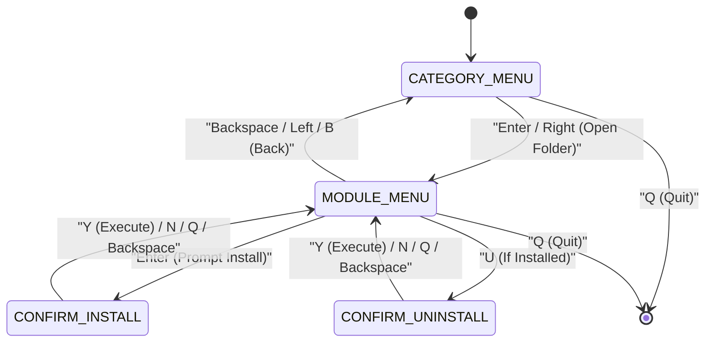

# Unified Codebase Installer (통합 코드베이스 인스톨러) 상세 규격서
> **Unified Installer: 3-Mode CC:Tweaked Bootstrapper, Dual-Source Package Manager & Hierarchical TUI**  
> **프로젝트**: Universal Autonomous Flight Stack (UAFS Ecosystem)  
> **대상 환경**: Minecraft CC:Tweaked 1.109+ (Cobalt Lua 5.2)

| 항목 | 내용 |
| :--- | :--- |
| **문서 상태 (Status)** | `Approved` |
| **문서 버전 (Version)** | `v1.1.0` |
| **최종 수정일 (Date)** | `2026-11-10` |
| **구현 코드 (Source)** | `src/0_development/installer/` |
| **주관 도메인 (Domain)** | 통합 코드베이스 배포 및 계층형 패키지 매니저 (`0_development/installer`) |

> **연관 문서**:
> - [AUTONOMOUS_FLIGHT_SYSTEM_ARCHITECTURE_AND_ICD.md](../../../system/AUTONOMOUS_FLIGHT_SYSTEM_ARCHITECTURE_AND_ICD.md) (마스터 ICD v1.25.0)
> - [SYSTEM_PROGRAM_RELATION_AND_PACKET_DIAGRAM.md](../../../system/SYSTEM_PROGRAM_RELATION_AND_PACKET_DIAGRAM.md) (전체 구조도 v2.11.0)
> - [GPS_PROGRAM_SPECIFICATION_AND_ICD.md](../../0_infra/gps/GPS_PROGRAM_SPECIFICATION_AND_ICD.md) (GPS 규격서 §9 통합 인스톨러 연계)
> - [GDRIVE_DEPLOYMENT_GUIDE.md](../../../guides/GDRIVE_DEPLOYMENT_GUIDE.md) (Google Drive 배포 운영 가이드)
> - [GEMINI.md](../../../../GEMINI.md) (전역 프로젝트 컨텍스트 및 불변 규칙)

### Revision History

| 버전 | 개정 일자 | 개정 요약 | 개정 사유 |
| :---: | :---: | :--- | :--- |
| `v1.1.0` | 2026-11-10 | 역할/도메인별 2계층 TUI 폴더 탐색(`CATEGORY_MENU` $\leftrightarrow$ `MODULE_MENU`), 12행 뷰포트 스크롤링(`computeViewport`), `manifest.CATEGORY_ORDER`·`CATEGORIES`·조회 API(`getCategory`, `listCategories`, `listModulesByCategory`) 규격 추가 | 12개 이상 모듈 확장에 따른 `51x19` TUI 메뉴 행 포화 해소 (`TASK-116`) |
| `v1.0.0` | 2026-11-08 | 통합 코드베이스 인스톨러 제정: 3종 배포 경로(`/installer.lua`, `/disk/installer.lua`, `wget run`), GitHub/GDrive 이중 소스, 스테이징 원자적 다운로드, Deep-Merge 설정 마이그레이션, 멀티부트 `/startup/00_<id>.lua` 후크 및 `/.version.json` 고아 파일 정리 (`TASK-005`) | 개별 서브시스템 배포 일원화 및 구 `gps/installer.lua` `[DEPRECATED]` 대체 |

---

## 1. 프로그램 개요 및 3종 실행 컨텍스트 (Overview & Execution Contexts)

**Unified Codebase Installer**는 UAFS 생태계의 모든 CC:Tweaked 컴퓨터 코드베이스를 단일 진입점(`installer.lua`)으로 설치, 업데이트, 설정 마이그레이션 및 제거하는 패키지 매니저입니다. 저장소 루트 [installer.lua](../../../../installer.lua)와 소스 미러(`src/0_development/installer/installer.lua`)는 바이트 단위로 동일해야 하며, 외부 의존성 없이 단독 부트스트래핑을 수행합니다.

### 1.1 3종 배포 실행 모드 (`bootstrapper.detectContext`)

| 실행 모드 (`mode`) | 호출 경로 패턴 | 대상 루트 (`targetRoot`) | 자기 보존 (`preserveSelf`) | 동작 요약 |
| :--- | :--- | :---: | :---: | :--- |
| `direct_root` | `/installer.lua` 또는 일반 로컬 경로 | `/` | `true` | 로컬 코어 탐색 후 미존재 시 `/.installer_cache`에 HTTP 부트스트랩 |
| `disk` | `/disk*/installer.lua` (`^/?disk`) | `/` | `true` | 플로피·엔더 디스크 파일 불변 보존, 컴퓨터 루트 `/`에 격리 설치 |
| `remote_wget` | `wget`, `_tmp_wget`, `/rom/programs/http/wget.lua` | `/` | `false` | 원격 메모리 실행, 종료 시 임시 다운로드 파일 및 캐시 정리 |

### 1.2 CLI 비대화형 인터페이스

- `installer.lua install <moduleId> [--source github|gdrive] [--bootstrap-gdrive-map <path>]`
- `installer.lua update <moduleId> [--source github|gdrive]`
- `installer.lua uninstall <moduleId>` (별칭 `remove`)
- 대화형 TUI는 CLI 서브커맨드가 전달되지 않은 기본 실행 시 기동합니다.

---

## 2. 이중 원격 소스 및 부트스트랩 규격 (Dual Sources & Bootstrap)

### 2.1 원격 소스 URL 규칙

| 소스 식별자 | 기본 베이스 URL | 파일 경로 해석 규칙 |
| :--- | :--- | :--- |
| `github` (기본값) | `https://raw.githubusercontent.com/Polimachi/Aeroneutics_Autopilot/main/` | `<baseUrl> .. fileEntry.repoPath` |
| `gdrive` (미러) | `https://drive.usercontent.google.com/download?id=` | `<baseUrl> .. fileId .. "&export=download&confirm=t"` |

- `gdriveId` 해석 우선순위: `gdriveOverrides[repoPath]`(`--bootstrap-gdrive-map` JSON 매핑) $\to$ `fileEntry.gdriveId` $\to$ 미설정 시 `nil, "GDRIVE_ID_UNCONFIGURED"` 반환.
- HTTP 다운로드 리다이렉트는 최대 `MAX_REDIRECTS = 5`회까지 대소문자 무관(`Location`/`location`) 추적하며, 중간 HTTP 핸들을 즉시 `close()` 합니다.
- Google Drive 바이러스 경고 HTML 페이지(`<!DOCTYPE html` / `<html`) 수신 시 `confirm=`·`uuid=` 토큰을 1회 추출 재시도하며, 실패 시 `"GDRIVE_HTML_INTERSTITIAL"` 오류로 중단합니다.

### 2.2 7종 핵심 부트스트랩 파일 (`BOOTSTRAP_FILES`)

로컬에 코어 모듈이 없는 환경에서는 실행 시작 시 아래 7개 파일을 `<targetRoot>/.installer_cache/`에 임시 다운로드하여 `package.path`에 적재하고, 종료(`pcall` 오류 포함) 시 캐시 디렉토리를 삭제합니다.

1. `src/0_development/installer/installer_app.lua` (`cacheRelPath = "installer_app.lua"`)
2. `src/0_development/installer/modules/manifest.lua` (`cacheRelPath = "modules/manifest.lua"`)
3. `src/0_development/installer/modules/version_registry.lua` (`cacheRelPath = "modules/version_registry.lua"`)
4. `src/0_development/installer/modules/migration_engine.lua` (`cacheRelPath = "modules/migration_engine.lua"`)
5. `src/0_development/installer/modules/startup_generator.lua` (`cacheRelPath = "modules/startup_generator.lua"`)
6. `src/0_development/installer/modules/downloader.lua` (`cacheRelPath = "modules/downloader.lua"`)
7. `src/0_development/installer/modules/tui_view.lua` (`cacheRelPath = "modules/tui_view.lua"`)

---

## 3. 선언적 매니페스트 및 도메인 카테고리 분류 (`manifest.lua`)

### 3.1 6대 도메인 계층 카테고리 (`CATEGORY_ORDER`, `CATEGORIES`)

인스톨러 카테고리는 저장소 디렉토리 계층(`src/<layer>_<domain>/`) 및 `tools/verify_manifest_sync.py` 3자 검증 규칙과 1:1 일치해야 합니다.

| 순서 | 카테고리 ID (`id`) | 계층 코드 (`code`) | 표시 명칭 (`name`) | 요약 명칭 (`shortName`) | 관할 서브시스템 예시 |
| :---: | :--- | :--- | :--- | :--- | :--- |
| 1 | `development` | `0_development` | `Development & Calibration` | `Dev & Align` | `alignment`, `sensors` |
| 2 | `infra` | `0_infra` | `Ground Infrastructure` | `Ground Infra` | `gps_server`, `gps_node`, `gps_client`, `gac`, `landing_pad`, `gcs` |
| 3 | `control` | `1_control` | `Flight Control` | `Flight Control` | `vas`, `tca` |
| 4 | `guidance` | `2_guidance` | `Guidance & Navigation` | `Guidance (FCP)` | `fcp` |
| 5 | `planning` | `3_planning` | `Mission Planning & MFD` | `Planning (AMM)` | `amm` |
| 6 | `mission` | `4_mission` | `Swarm & Payload Mission` | `Swarm Mission` | Phase 2 편대/임무 패키지 (미등록 시 빈 폴더) |

### 3.2 카테고리 조회 인터페이스 시그니처

- `manifest.getCategory(categoryId: string) -> table|nil`: `manifest.CATEGORIES[categoryId]` 메타데이터 테이블 반환.
- `manifest.listModulesByCategory(categoryId: string) -> list<table>`: `manifest.MODULE_ORDER` 순서를 보존하여 `mod.category == categoryId`인 모듈 테이블 목록 반환. 미존재 또는 빈 카테고리는 `{}` 반환.
- `manifest.listCategories(includeEmpty: boolean|nil) -> list<table>`: `manifest.CATEGORY_ORDER` 순서로 각 카테고리 정의의 얕은 사본에 `modules = manifest.listModulesByCategory(id)` 및 `moduleCount = #modules`를 부여해 반환. 기본값(`includeEmpty`가 `false` 또는 `nil`)에서는 `moduleCount == 0`인 빈 카테고리(예: 현재 `mission`)를 제외하여 TUI 내 빈 막다른 폴더 진입을 차단하며, `includeEmpty == true`일 때만 6개 전체 계층을 반환합니다.

### 3.3 패키지 독립성 범위 제한

- 인스톨러는 단일 CC:Tweaked 컴퓨터 루트(`/`)에 하나의 독립 완결형 서브시스템을 배포하는 원칙을 따르며, 단일 컴퓨터용 복합 패키지 프리셋 일괄 설치 기능은 제공하지 않습니다.
- 모든 모듈은 공용 센서 API(`src/0_development/sensors/avionics_sensors.lua` $\to$ `/lib/avionics_sensors.lua`)를 함께 번들링합니다.

---

## 4. `51x19` 2계층 폴더 TUI 및 뷰포트 스크롤 규격 (`tui_view.lua`, `installer_app.lua`)

표준 CC:Tweaked 터미널(`51x19`)에서 `renderHeader`(1~3행)와 하단 구분선·조작 안내·메시지 바(`h-3`~`h`, 16~19행) 사이의 **메뉴 뷰포트(`y = 4 .. h-4`, 최대 12행)** 안에서 12개 초과 패키지 목록도 화면 이탈 없이 탐색할 수 있어야 합니다.

### 4.1 2계층 상태 머신 (`installer_app.run`)

### 4.2 화면 레이아웃 및 잔상(Ghost Row) 방지 규칙

1. **루트 폴더 화면 (`CATEGORY_MENU` — `tui_view.renderCategoryMenu`)**:
   - 헤더: `title = "Create: Aeronautics"`, `subtitle = "Select domain folder to browse"`, `contextLabel = "Folders"`.
   - 행 포맷(`y = 4 .. h-4`): `string.format("%s[DIR] %-13s %-16s [%d/%d inst]", prefix, catCode, catShort, instCount, totalCount)` (`w = 51` 패딩/절단).
   - 하단 힌트: `h-2` = `" [Up/Down] Select   [Enter] Open Folder"`, `h-1` = `" [S] Toggle Source  [Q] Quit"`.
2. **폴더 내부 모듈 화면 (`MODULE_MENU` — `tui_view.renderMenu`)**:
   - `categoryInfo` 전달 시 헤더 `subtitle`은 `"Folder: " .. code .. " - " .. name`, `contextLabel`은 `code`로 표시합니다 (`categoryInfo == nil` 호출 시 기존 평면 헤더 호환 유지).
   - 행 포맷(`y = 4 .. h-4`): `string.format("%s%-14s %s", prefix, modName, statusStr)` (`[INSTALLED vX.Y.Z]` 또는 `[Available vX.Y.Z]`).
   - 하단 힌트: `h-2` = `" [Up/Down] Select   [Enter] Install   [U] Uninstall"`, `h-1` = `" [Bksp/B] Folders   [S] Source        [Q] Quit"` (`categoryInfo == nil` 시 기존 힌트 유지).
3. **뷰포트 스크롤링 (`tui_view.computeViewport`)**:
   - 시그니처: `computeViewport(totalItems, selectedIndex, maxVisibleRows, currentScrollOffset) -> firstIdx, lastIdx, nextScrollOffset`.
   - `selectedIndex`를 `[1, totalItems]`로 클램핑하고, `selectedIndex < scrollOffset + 1`이면 위로 스크롤, `selectedIndex > scrollOffset + maxVisibleRows`이면 아래로 스크롤하여 커서가 항상 `[firstIdx, lastIdx]` 안에 머물도록 계산합니다.
   - `#items > maxVisibleRows`인 경우 `h-3` 구분선 우측/중앙에 ` [firstIdx-lastIdx of totalItems] ` 범위 지표를 표기합니다.
4. **잔상 제거 및 상태 유지**:
   - `renderCategoryMenu`와 `renderMenu`는 실제 항목 렌더링 이후 `y = startY + drawnCount .. h - 4`의 모든 미사용 뷰포트 행과 최하단 상태 행 `y = h`를 공백(`w` 폭)으로 초기화하여 폴더 전환 시 이전 화면 잔상이 남지 않도록 합니다.
   - 모듈 설치/제거 완료 시 `installedMap`을 즉시 갱신하고, `CATEGORY_MENU` 복귀 시 기존 `categoryIndex`와 `categoryScroll`을 유지해 `[x/y inst]` 카운터를 최신 상태로 표시합니다.

---

## 5. 원자적 설치 파이프라인 및 데이터 보존 (`downloader.lua`, `migration_engine.lua`, `startup_generator.lua`, `version_registry.lua`)

### 5.1 설치 파이프라인 순서 (`installer_app.installModule`)

1. **사전 검증**: 대상 모듈 조회, `http`/`fs` API 가용성 점검, 배치 내 모든 파일의 URL 사전 해석(실패 시 디스크 무변경 중단).
2. **스테이징 배치 다운로드 (`downloader.downloadBatch`)**: `<targetRoot>/.installer_stage` 아래에 각 파일을 `.tmp` 경유 원자적 다운로드 후, 전체 파일 성공 시에만 최종 목적지로 일괄 이동 커밋 (실패 시 `.installer_stage` 전체 삭제 롤백).
3. **설정 Deep-Merge 마이그레이션 (`migration_engine.migrateFile`)**: `defaultConfigs` / `configTemplate` 대상 JSON 파일이 이미 존재하면 임의 깊이 사용자 설정값을 보존하고 누락 키만 기본값으로 백필 (순차 배열은 요소 병합 대신 사용자 배열 우선 교체).
4. **멀티부트 스타트업 후크 (`startup_generator.installHook`)**: `mod.startup.enabled == true`인 모듈에 한해 `/startup/00_<id>.lua`를 생성하며, `cc.require.make` 기반으로 `modules/`, `modules/drivers/`, `hal/`, `tools/`, `/lib/`, `/apis/` 검색 경로와 `args`(예: `fcp`의 `"--daemon"`)를 주입합니다. 기존 루트 `/startup.lua`는 덮어쓰지 않습니다.
5. **안전한 고아 파일 정리 (`version_registry.getOrphanFiles`)**: 이전 설치 파일 목록 중 신규 목록에 없고 `/.version.json` 내 타 공존 모듈(`gps_client` 등)이 소유하지 않는 파일만 선별 삭제합니다.
6. **레지스트리 커밋 (`version_registry.save`)**: `/.version.json.tmp`를 거쳐 `/.version.json`을 원자적으로 갱신합니다.

---

## 6. 정적 검증 및 안전/페일세이프 매트릭스 (Verification & Fail-Safe Matrix)

| 검증/장애 항목 | 감지 주체 | 기대 동작 및 페일세이프 |
| :--- | :--- | :--- |
| 루트·소스 `installer.lua` 불일치 | `verify_manifest_sync.py` / `test_installer_integrity.py` | `INSTALLER_BYTE_PARITY_MISMATCH` 오류 반환 (바이트 100% 일치 강제) |
| 미등록 `.lua`/`.json` 또는 누락 파일 | `verify_manifest_sync.py` | `ORPHAN_SRC_FILE` / `MISSING_DISK_FILE` 오류 반환 |
| 카테고리 ID와 `src/<layer>/` 불일치 | `verify_manifest_sync.py` | `INVALID_MODULE_CATEGORY` 오류 반환 (`development`/`infra`/`control`/`guidance`/`planning`/`mission`) |
| HTTP API 비활성화 (`http == nil`) | `downloader.checkHttpAvailable` | `"HTTP_DISABLED"` 반환 후 즉시 종료 (파일 시스템 무변경) |
| 배치 중 네트워크 오류 / GDrive HTML 경고 | `downloader.downloadBatch` | `.installer_stage` 삭제 롤백, 기존 설정·고아 파일·`/.version.json` 보존 |
| 부트스트랩 중 런타임 예외 발생 | `bootstrapper.bootstrapAndRun` | `pcall` 포착 후 `/.installer_cache` 삭제 및 오류 메시지 반환 |
| `51x19` 뷰포트 초과 또는 `printError` 호출 | `runner_lib.lua` UI Auditor | `computeViewport`로 12행 제한 및 `renderMessage`로 19행 출력 (`printError` 금지) |
