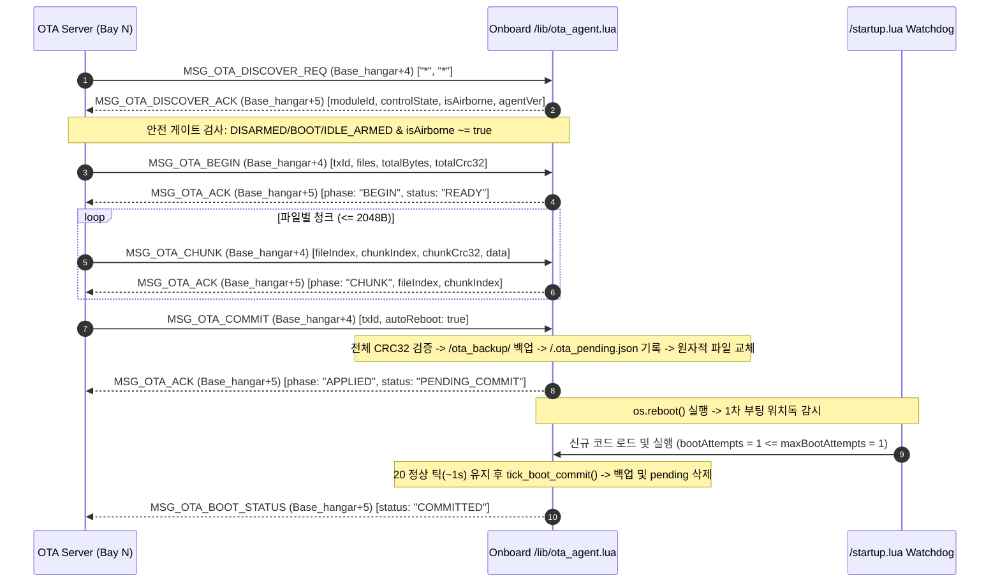

# OTA (격납고 무선 배포 서버 및 슬레이브 원자적 롤백 가드) 상세 규격서

> **OTA: Hangar Wireless Deployment Server, Slave Safety Gate & 2-Stage Atomic Rollback Guard**  
> **프로젝트**: Universal Autonomous Flight Stack (UAFS Ecosystem)  
> **대상 환경**: Minecraft CC:Tweaked 1.109+ (Cobalt Lua 5.2, Wireless Ender Modem, HTTP API), Create: Aeronautics, Create: Avionics

| 항목 | 내용 |
| :--- | :--- |
| **문서 상태 (Status)** | `Implemented` |
| **문서 버전 (Version)** | `v0.1.0` |
| **작성일 (Created)** | `2026-11-15` |
| **최종 수정일 (Date)** | `2026-11-15` |
| **구현 코드 (Source)** | `src/0_development/ota/ & /lib/ota_agent.lua` |
| **주관 도메인 (Domain)** | 격납고 무선 OTA 배포 서버 및 온보드 원자적 롤백 에이전트 (`0_development/ota` / Interface `I-13`) |

> **연관 문서**:
> - [AUTONOMOUS_FLIGHT_SYSTEM_ARCHITECTURE_AND_ICD.md](../../../system/AUTONOMOUS_FLIGHT_SYSTEM_ARCHITECTURE_AND_ICD.md) (마스터 ICD v1.32.0)
> - [SYSTEM_PROGRAM_RELATION_AND_PACKET_DIAGRAM.md](../../../system/SYSTEM_PROGRAM_RELATION_AND_PACKET_DIAGRAM.md) (전체 구조도 v2.16.0)
> - [INSTALLER_PROGRAM_SPECIFICATION.md](../installer/INSTALLER_PROGRAM_SPECIFICATION.md) (통합 인스톨러 & 2단계 부팅 워치독 v1.2.0)
> - [ALIGNMENT_PROGRAM_SPECIFICATION.md](../alignment/ALIGNMENT_PROGRAM_SPECIFICATION.md) (격납고 지상 교정 콘솔 v2.7.1)
> - [VAS_PROGRAM_SPECIFICATION.md](../../1_control/vas/VAS_PROGRAM_SPECIFICATION.md) (비행 제어 코어 v1.22.0)
> - [TCA_PROGRAM_SPECIFICATION.md](../../1_control/tca/TCA_PROGRAM_SPECIFICATION.md) (TCA 클러스터 규격서 v1.13.0)
> - [FCP_PROGRAM_SPECIFICATION.md](../../2_guidance/fcp/FCP_PROGRAM_SPECIFICATION.md) (FCP 외루프 유도 규격서 v2.2.0)
> - [AMM_PROGRAM_SPECIFICATION.md](../../3_planning/amm/AMM_PROGRAM_SPECIFICATION.md) (AMM 임무·궤적 규격서 v2.1.0)
> - [GEMINI.md](../../../../GEMINI.md) (전역 규칙 및 가이드라인)

### Revision History

| 버전 | 개정 일자 | 개정 요약 | 개정 사유 |
| :---: | :---: | :--- | :--- |
| `v0.1.0` | 2026-11-15 | **초기 `Approved` 규격 제정**: `[I-13]` 무선 OTA 와이어 프로토콜 10종 패킷(`ver = "1.9.5"`), 격납고 채널 할당(`Base_hangar + 4` `CH_OTA_CMD` / `Base_hangar + 5` `CH_OTA_ACK`), 슬레이브 안전 게이트(`DISARMED`/`BOOT`/`IDLE_ARMED` & `isAirborne ~= true`), 설정 보존 및 고아 `.lua` 백업·정리, 2단계 부팅 커밋 워치독(`maxBootAttempts = 1`, `20` 틱 커밋) 및 `/ota_packages/` 원격 동기화 규격 수립 | `TASK-117-1` 무선 OTA 배포 서버 및 슬레이브 원자적 롤백 가드 사양 확정 |

---

## 1. 프로그램 개요 및 아키텍처 (Overview & Architecture)

### 1.1 시스템 정체성 및 설계 원칙
**OTA (`src/0_development/ota/` + `/lib/ota_agent.lua`)**는 격납고 베이에 주기된 비행체의 다중 온보드 컴퓨터(`VAS`, `TCA`, `FCP`, `AMM`)에 무선 엔더 모뎀으로 소프트웨어를 배포하고, 업데이트 실패·구문 오류·런타임 크래시·조기 재부팅 시 이전 정상 파일과 버전 메타데이터를 자동 복구하는 **무선 OTA 배포 서버 및 슬레이브 원자적 롤백 가드**입니다.

1. **독립 완결형 공용 에이전트 (`/lib/ota_agent.lua`)**:
   - `src/0_development/ota/ota_agent.lua`는 외부 `require()` 의존성이 전혀 없는 단일 모듈로 설계되며, 각 대상 노드의 `/lib/ota_agent.lua`에 배치됩니다.
   - Pure-Lua + `bit32` IEEE 802.3 CRC32(`0xEDB88320`, `bit32` 부재 환경용 Lua 5.2 폴백 포함)와 ICD `1.9.5` 엔벨로프 프레이밍을 제공합니다.
2. **비간섭·안전 우선 게이트 (Safety Gate Invariant)**:
   - 온보드 노드가 `DISARMED`, `BOOT`, `IDLE_ARMED` 중 하나이고 동시에 `isAirborne ~= true`인 경우에만 상태 변경성 OTA 트랜잭션(`MSG_OTA_BEGIN`, `MSG_OTA_CHUNK`, `MSG_OTA_COMMIT`, `MSG_OTA_REBOOT`)을 허용합니다.
   - 비행 중이거나 무장·교정·비상 상태인 노드는 즉시 `MSG_OTA_NACK` (`reason = "NOT_DISARMED"`)를 반환하고 디스크를 전혀 변경하지 않습니다.
3. **2단계 자가 복구 워치독 (`startup_generator.lua` 연계)**:
   - OTA가 `/lib/ota_agent.lua` 자체를 손상시킨 경우에도 복구가 동작하도록, `startup_generator.lua`가 생성하는 `/startup.lua` 후크 내부에 외부 `require()` 없는 자체 복구 로직을 내장합니다.
4. **동결 경계 (`ASA` 제외)**:
   - `src/1_control/asa/**`는 동결 영역(`0 diff`, `TASK-105` 재개 시까지 대기)이므로 본 규격 및 구현에서 OTA 연동을 추가하지 않습니다.
5. **Cobalt Lua 5.2 및 UI 제약 준수**:
   - Lua 5.3+ 연산자(`//`, `&`, `|`, `~`, `<<`, `>>`, `goto`) 및 CC `printError` 호출을 금지합니다.


---

## 2. 격납고 채널 할당 및 다중 노드 주소 지정 (Channel Allocation & Addressing)

### 2.1 격납고 베이 채널 공식 및 오프셋 (`Base_hangar + 4 / +5`)
- **격납고 베이 베이스 채널**:
  $$Base_{\text{hangar}} = 101 + (\text{BayID} - 1) \times 10 \quad (\text{BayID} \in \{1, 2, \dots, 10\})$$
- **채널 경계 불변식**: 모든 무선 OTA 채널은 `101 ~ 200` 대역 내에 위치하며, 유선·내부 IPC 예약 대역 `0 ~ 100` 및 기체 비행 대역 `10000 ~ 49999`를 침범하지 않습니다.

| 오프셋 | 채널 상수 | Bay 1 | Bay 10 | 방향 | 용도 |
| :---: | :--- | :---: | :---: | :--- | :--- |
| **`Base_hangar + 0`** | `CH_CALIBRATION_CMD` (`[I-4]`) | `101` | `191` | Align $\rightarrow$ VAS/TCA | 지상 교정 지령 (`Alignment` 전담) |
| **`Base_hangar + 1`** | `CH_CALIBRATION_TELEM` (`[I-4]`) | `102` | `192` | VAS $\rightarrow$ Align | 지상 교정 텔레메트리/ACK |
| **`Base_hangar + 2`** | `CH_HANGAR_FACILITY` (`[I-4]`) | `103` | `193` | Align $\leftrightarrow$ 시설 | 격납고 설비/엄빌리컬 인터록 |
| **`Base_hangar + 3`** | `CH_CALIBRATION_TAP` (`[I-4]`) | `104` | `194` | Align $\leftrightarrow$ TCA/ASA | 교정 액추에이터 탐색 |
| **`Base_hangar + 4`** | **`CH_OTA_CMD`** (`[I-13]`) | **`105`** | **`195`** | **OTA Server $\rightarrow$ Onboard** | **OTA 탐색·전송·커밋·중단·재부팅 지령** |
| **`Base_hangar + 5`** | **`CH_OTA_ACK`** (`[I-13]`) | **`106`** | **`196`** | **Onboard $\rightarrow$ OTA Server** | **OTA 탐색 응답·ACK/NACK·부팅 상태 보고** |
| **`Base_hangar + 6 ~ +9`** | `CH_RESERVED_06 ~ 09` | `107~110` | `197~200` | 예비 | 격납고 내부 확장 예비 (4개 채널) |

### 2.2 베이 바인딩 및 다중 노드 식별 규칙
1. **온보드 노드 베이 바인딩**:
   - 각 온보드 노드(`VAS`, `TCA`, `FCP`, `AMM`)는 설정의 `ota.bayId` (기본값 `1` $\rightarrow$ `CH_OTA_CMD = 105`, `CH_OTA_ACK = 106`)를 부팅 시 상시 개방(`modem.open`)합니다.
   - 선택 설정 `ota.bayIds` 배열이 존재하면 지정된 모든 베이의 `Base_hangar + 4`를 추가 개방하며, 요청이 수신된 베이의 `Base_hangar + 5`로 응답을 회신합니다.
2. **OTA 서버 베이 선택**:
   - 서버는 `config/ota_config.json`의 `ota.bayId`, CLI 인자 `--bay=N`, 또는 TUI `[B]ay` 전환(`1..10`)을 통해 대상 베이를 선택합니다.
3. **도메인 + 모듈 이중 필터링 (`targetDomainId`, `targetModuleId`)**:
   - 동일 격납고 채널을 여러 온보드 컴퓨터(`vas`, `tca`, `fcp`, `amm`)가 공유하므로, 모든 OTA 명령은 `targetDomainId`와 `targetModuleId`를 명시합니다.
   - `MSG_OTA_DISCOVER_REQ`에서는 `"*"` 와일드카드 매칭을 허용하여 베이 내 모든 온라인 노드를 열거합니다.
   - `MSG_OTA_BEGIN`, `MSG_OTA_CHUNK`, `MSG_OTA_COMMIT`, `MSG_OTA_ABORT`, `MSG_OTA_REBOOT`에서 `targetModuleId` 또는 `targetDomainId`가 자신의 값과 불일치할 경우: 타 노드 대상 브로드캐스트를 방해하지 않기 위해 `targetModuleId`가 다르면 조용히 무시(`ignore`)하며, `targetModuleId`가 일치하나 `txId` 소유 도메인/모듈이 모순된 경우 `MSG_OTA_NACK` (`MODULE_MISMATCH` / `DOMAIN_MISMATCH`) 규약을 따릅니다.
4. **버전 메타데이터 조회 (`/.version.json`)**:
   - 에이전트는 `/.version.json`의 `modules` 테이블에서 설치된 모듈 목록과 버전을 조회합니다. `/.version.json`이 없거나 해당 모듈 엔트리가 누락된 경우에도 크래시 없이 노드의 기본 설정(`moduleId`, `"0.0.0-untracked"`)으로 폴백 보고합니다.

---

## 3. `[I-13]` 무선 OTA 와이어 프로토콜 규격 (ICD `1.9.5`)

### 3.1 공통 엔벨로프 및 Zero-Fallback 원칙
모든 `[I-13]` 패킷은 마스터 ICD `v1.9.5` 최상위 엔벨로프를 엄격히 준수합니다. 구버전 키 폴백(`pkt.ver or pkt.version` 등)을 일체 금지합니다.

```lua
{
    ver = "1.9.5",
    domainId = "AIRCRAFT_01", -- 송신측 도메인 ID (서버 또는 대상 기체)
    seq = 1,                  -- 단조 증가 시퀀스 번호
    type = "MSG_OTA_*",       -- 아래 10종 표준 패킷 타입
    time = 1763210000000,     -- UTC epoch ms (os.epoch("utc"))
    payload = { ... }
}
```

### 3.2 10종 표준 패킷 명세 (`config/protocol_contracts.json` SSOT 일치)

| 패킷 타입 (`type`) | 방향 | 채널 | `payload` 필수 키 | `payload` 선택 키 / 열거형 |
| :--- | :---: | :---: | :--- | :--- |
| **`MSG_OTA_DISCOVER_REQ`** | Server $\rightarrow$ Node | `+4` | `targetModuleId`, `targetDomainId` | `"*"` 와일드카드 또는 특정 ID 문자열 |
| **`MSG_OTA_DISCOVER_ACK`** | Node $\rightarrow$ Server | `+5` | `moduleId`, `versions`, `filesCount`, `controlState`, `isAirborne`, `freeSpace`, `agentVer` | `versions`: `{ [modId] = ver }` 테이블 |
| **`MSG_OTA_BEGIN`** | Server $\rightarrow$ Node | `+4` | `txId`, `targetDomainId`, `targetModuleId`, `targetVersion`, `files`, `totalBytes`, `totalCrc32` | `overwriteConfig` (boolean, 기본 `false`); `files`: `{{ path, size, crc32, chunkCount }, ...}` |
| **`MSG_OTA_CHUNK`** | Server $\rightarrow$ Node | `+4` | `txId`, `targetDomainId`, `targetModuleId`, `fileIndex`, `chunkIndex`, `chunkCrc32`, `data` | `fileIndex`/`chunkIndex` 1-based; `data` $\le 2048$ bytes |
| **`MSG_OTA_COMMIT`** | Server $\rightarrow$ Node | `+4` | `txId`, `targetDomainId`, `targetModuleId`, `autoReboot` | `autoReboot`: boolean |
| **`MSG_OTA_ABORT`** | Server $\rightarrow$ Node | `+4` | `txId`, `targetDomainId`, `targetModuleId`, `reason` | 진행 중 스테이징 정리 요청 |
| **`MSG_OTA_REBOOT`** | Server $\rightarrow$ Node | `+4` | `txId`, `targetDomainId`, `targetModuleId` | 원격 재부팅 지령 (안전 게이트 통과 시 실행) |
| **`MSG_OTA_ACK`** | Node $\rightarrow$ Server | `+5` | `txId`, `moduleId`, `phase`, `status` | `fileIndex`, `chunkIndex` (선택); `phase` $\in \{\text{"BEGIN"}, \text{"CHUNK"}, \text{"APPLIED"}\}$ |
| **`MSG_OTA_NACK`** | Node $\rightarrow$ Server | `+5` | `txId`, `moduleId`, `phase`, `reason` | `expectedIndex` (선택); `reason` $\in \{\text{"NOT\_DISARMED"}, \text{"MODULE\_MISMATCH"}, \text{"DOMAIN\_MISMATCH"}, \text{"CRC\_MISMATCH"}, \text{"SEQ\_OUT\_OF\_ORDER"}, \text{"DISK\_ERROR"}, \text{"TX\_NOT\_FOUND"}\}$ |
| **`MSG_OTA_BOOT_STATUS`** | Node $\rightarrow$ Server | `+5` | `txId`, `moduleId`, `status`, `version` | `rollbackReason` (선택); `status` $\in \{\text{"COMMITTED"}, \text{"ROLLED\_BACK"}\}$ |

### 3.3 트랜잭션 교환 시퀀스



---

## 4. 슬레이브 안전 게이트 규격 (Slave Safety Gate)

`ota_agent.is_safe_for_ota(status)`는 모든 온보드 노드에서 다음 진리표에 따라 단일 판정합니다.

| 조건 항목 | 허용 값 | 거부 값 (즉시 `MSG_OTA_NACK`, `reason = "NOT_DISARMED"`) |
| :--- | :--- | :--- |
| **`status.isAirborne`** | `false` 또는 `nil` (`~= true`) | `true` |
| **`status.controlState`** | `"DISARMED"`, `"BOOT"`, `"IDLE_ARMED"` | `"ARMING"`, `"NORMAL"`, `"AIRBORNE_RECOVERY_HOLD"`, `"CALIBRATION"`, `"FAILSAFE_HOLD"`, `"EMERGENCY_LAND"`, `"AIRBORNE_EMERGENCY"`, `"E_STOP"`, `"ACTIVE_TRACKING"`, `"PASSIVE_TRACKING"`, `"AMM_TIMEOUT_HOLD"`, 기타 미지 문자열 |

### 4.1 서브시스템별 상태 매핑 (`getStatusFn`)
| 노드 | `moduleId` | `controlState` 출처 | `isAirborne` 판정 기준 |
| :--- | :---: | :--- | :--- |
| **VAS** | `"vas"` | `state.fsm.currentState` | `state.fsm.isAirborne == true` |
| **TCA** | `"tca"` | `inst.lastControlState or "DISARMED"` | `(inst.adapterState and inst.adapterState.lastSignal or 0) > 0` |
| **FCP** | `"fcp"` | `ctx.fsm.currentState` | `ctx.lastTelemPayload.isAirborne == true` 또는 `lastTelemPayload.controlState` $\in \{\text{"NORMAL"}, \text{"AIRBORNE\_RECOVERY\_HOLD"}, \text{"FAILSAFE\_HOLD"}, \text{"EMERGENCY\_LAND"}, \text{"AIRBORNE\_EMERGENCY"}\}$ |
| **AMM** | `"amm"` | `(app.arbiter and app.arbiter.fsmState) or "DISARMED"` | `app.arbiter.latest_telem.isAirborne == true` 또는 `latest_telem.controlState == "AIRBORNE_RECOVERY_HOLD"` |

---

## 5. 원자적 스테이징, 설정 보존 및 2단계 롤백 워치독

### 5.1 스테이징, 무결성 검증 및 설정/고아 파일 처리
1. **청크 스테이징 (`/ota_staging/<txId>/`)**:
   - `MSG_OTA_BEGIN` 수신 시 디스크 여유 공간(`fs.getFreeSpace`)을 확인하여 부족 시 `DISK_ERROR`를 회신합니다.
   - 각 `MSG_OTA_CHUNK`는 `fileIndex` 및 `chunkIndex` 순서를 검증(불일치 시 `SEQ_OUT_OF_ORDER` + `expectedIndex`)하고, `ota_agent.crc32(data) == chunkCrc32` 일치 시에만 스테이징 버퍼/파일에 기록합니다(불일치 시 `CRC_MISMATCH`).
   - `MSG_OTA_COMMIT` 시 스테이징된 각 파일의 크기·CRC32 및 전체 패키지 `totalCrc32`를 최종 대조합니다. 검증 실패 시 라이브 파일과 `/.version.json`을 전혀 수정하지 않고 스테이징을 정리한 뒤 `CRC_MISMATCH`를 회신합니다.
2. **설정 파일 보존 및 공유 라이브러리 보호**:
   - 대상 파일 경로가 `config/*.json` 패턴에 해당하고 대상 파일이 이미 존재할 경우, `MSG_OTA_BEGIN.payload.overwriteConfig ~= true`이면 기존 설정을 보존하고 덮어쓰지 않습니다.
   - 패키지 파일 목록에 포함되지 않은 기존 `/lib/*` 공용 라이브러리 파일은 삭제하지 않습니다.
3. **고아 `.lua` 파일 백업 및 정리**:
   - `/.version.json`의 해당 `moduleId.files`에 기록되어 있었으나 새 패키지의 `files` 목록에서 제외된 모듈 전용 `.lua` 고아 파일은 `/ota_backup/<txId>/`에 원본을 백업한 뒤 라이브 경로에서 삭제합니다. 롤백 시 해당 고아 파일도 함께 복원됩니다.
4. **원자적 백업 및 펜딩 마커 (`/.ota_pending.json`)**:
   - 덮어쓸 라이브 파일과 `/.version.json`을 `/ota_backup/<txId>/` 및 `/.version.json.bak`에 복사한 뒤, 아래 스키마의 `/.ota_pending.json`을 기록합니다.
   - 그 후 스테이징 파일을 라이브 경로로 원자적 교체하고 `/.version.json`을 새 버전으로 갱신합니다.

```json
{
  "txId": "tx-1763210000-01",
  "moduleId": "vas",
  "targetVersion": "1.22.0",
  "backupDir": "/ota_backup/tx-1763210000-01",
  "versionBackupPath": "/ota_backup/tx-1763210000-01/.version.json.bak",
  "restoredFiles": ["/vas/main.lua", "/vas/modules/legacy.lua"],
  "files": ["/vas/main.lua", "/lib/ota_agent.lua"],
  "bootAttempts": 0,
  "maxBootAttempts": 1,
  "status": "PENDING_COMMIT"
}
```

### 5.2 2단계 부팅 커밋 워치독 (`startup_generator.lua` 연계)
1. **Stage 1 — `/startup.lua` 부팅 선행 감시 (`startup_generator.generateHookContent`)**:
   - 외부 `require()` 의존성 없이 CC `fs` + `textutils`만으로 동작하는 자가 복구 블록을 생성 후크에 내장합니다.
   - `/.ota_pending.json` 존재 시:
     - `bootAttempts >= maxBootAttempts` (`1` 이상)이면 커밋 전 크래시 루프/행으로 판단하여 `target` 실행 전 즉시 `/ota_backup/<txId>/` 및 `/.version.json`을 복원하고, `/.ota_pending.json`을 삭제하며, `/.ota_rollback.json` (`reason = "BOOT_WATCHDOG_TIMEOUT"`)을 기록한 뒤 복원된 `target`을 기동합니다.
     - `bootAttempts < maxBootAttempts`이면 `bootAttempts = bootAttempts + 1`로 갱신 저장한 뒤 `loadfile(target, nil, env)` 및 `pcall`로 본 프로그램을 실행합니다.
     - `loadfile` 실패(`BOOT_LOAD_ERROR`) 또는 실행 예외(`BOOT_RUNTIME_CRASH`)가 발생하고 `/.ota_pending.json`이 남아 있으면 즉시 백업 및 `/.version.json`을 복원하고, `/.ota_rollback.json`을 기록한 뒤 `os.reboot()`를 호출합니다.
2. **Stage 2 — 온보드 데몬 안정화 커밋 (`tick_boot_commit` / `confirm_boot_commit`)**:
   - 각 온보드 노드(`VAS`, `TCA`, `FCP`, `AMM`)는 초기화 완료 후 메인 루프에서 매 정상 틱마다 `agent:tick_boot_commit()`을 호출합니다.
   - 연속 `bootConfirmTicks` (기본 `20` 틱, 20Hz 기준 약 1초) 정상 동작 시 `confirm_boot_commit()`을 실행하여 `/ota_backup/<txId>/` 및 `/.ota_pending.json`을 삭제하고, `Base_hangar + 5`로 `MSG_OTA_BOOT_STATUS` (`status = "COMMITTED"`)를 송신합니다.
   - 만약 Stage 1에 의해 롤백된 상태로 복원 부팅된 경우(`/.ota_rollback.json` 존재 시), `tick_boot_commit()` / `confirm_boot_commit()` 첫 호출 시 `MSG_OTA_BOOT_STATUS` (`status = "ROLLED_BACK"`, `rollbackReason`)를 송신하고 마커를 정리합니다.

---

## 6. OTA 서버, 원격 동기화 및 설정 스키마 (`src/0_development/ota/`)

### 6.1 패키지 스테이징 SSOT 및 원격 동기화
- **로컬 스테이징 SSOT**: `/ota_packages/<moduleId>/ota_package.json` 및 해당 모듈 파일들.
- **원격 동기화 (`sync_remote`)**: CC `http` API가 활성화된 경우, `config/ota_config.json`의 `manifestUrl`과 `githubRawBase`에서 원격 `manifest.lua` 및 대상 모듈 파일을 다운로드하여 `/ota_packages/<moduleId>/`에 스테이징합니다.
  - `autoSyncOnBoot == true` 설정 시 서버 기동 시 자동 수행하며, 수동 실행은 CLI `sync [moduleId]` 또는 TUI `[S]ync` 단축키로 수행합니다.

### 6.2 `config/ota_config.json` 표준 스키마
```json
{
  "version": "0.1.0",
  "ota": {
    "bayId": 1,
    "chunkSize": 2048,
    "ackTimeoutSec": 1.5,
    "maxRetries": 3,
    "defaultSourceDir": "/ota_packages",
    "autoSyncOnBoot": false,
    "manifestUrl": "https://raw.githubusercontent.com/sjmik1004/Create_Aeroneutics/main/src/0_development/installer/modules/manifest.lua",
    "githubRawBase": "https://raw.githubusercontent.com/sjmik1004/Create_Aeroneutics/main/"
  },
  "network": {
    "domainId": "HANGAR-OTA-01"
  }
}
```

### 6.3 CLI 및 `51x19` TUI 인터페이스
- **CLI 모드**:
  - `main.lua discover [--bay=N]`: 지정 베이 내 온라인 온보드 노드 탐색 결과 출력.
  - `main.lua sync [moduleId]`: 원격 `manifest.lua` 및 모듈 파일을 `/ota_packages/`로 동기화.
  - `main.lua deploy <moduleId> <domainId> <packageDir> [--bay=N]`: 지정 대상에 단일 배포 실행 및 결과 코드 반환.
- **대화형 `51x19` TUI 모드** (인자 없이 기동 시; `--headless` 또는 `os.shutdown` 이벤트 수신 시 안전 종료):
  - 탐색된 노드 목록(`domainId`, `moduleId`, 버전, 안전 게이트 상태 배지), 청크 전송 진행률 바, 단축키(`[D]iscover`, `[S]ync`, `[U]pdate`, `[B]ay`, `[Q]uit`) 제공.
