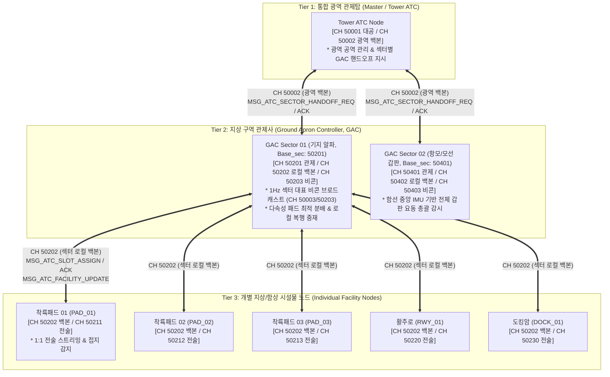
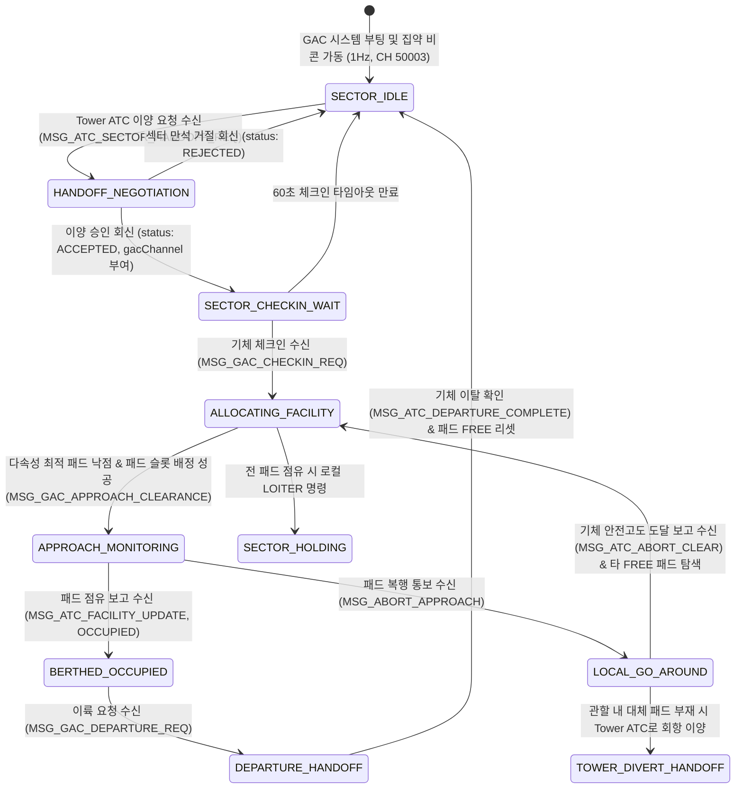
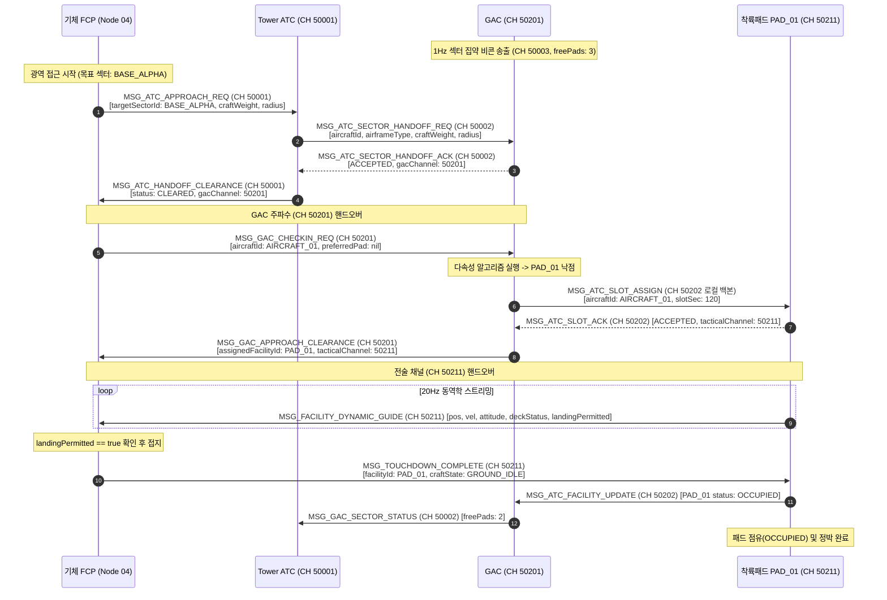
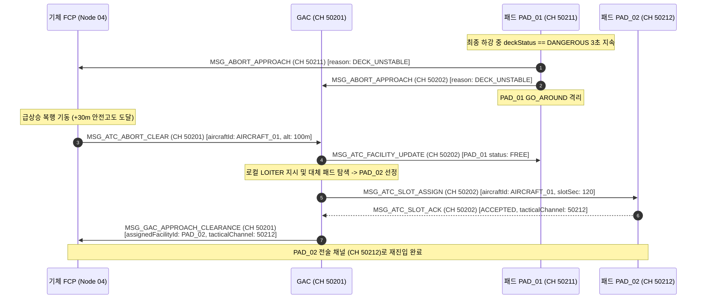
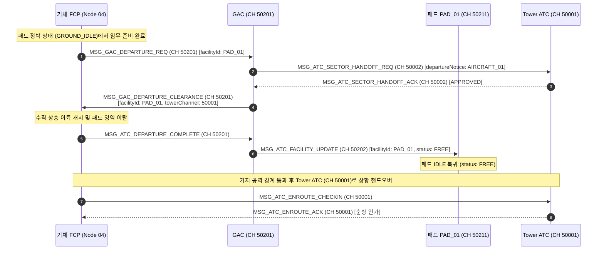

# 지상 구역 및 에이프런 관제사(GAC) 시스템 및 통신 인터페이스 제어 규격서 (ICD)
> **Ground Apron Controller (GAC) System Specification & Interface Control Document (ICD)**  
> **프로젝트**: Universal Autonomous Flight Stack (FCP · VAS · Ground Infrastructure)  
> **대상 환경**: Minecraft CC:Tweaked (Ender Modem), Create: Aeronautics, Create: Avionics  

| 항목 | 내용 |
| :--- | :--- |
| **문서 상태 (Status)** | `Implemented` |
| **문서 버전 (Version)** | `v1.3.0` |
| **최종 수정일 (Date)** | `2026-11-08` |
| **구현 코드 (Source)** | `src/0_infra/gac/` |
| **주관 도메인 (Domain)** | 국지 에이프런 총괄 관제사 (Ground Apron Controller / GAC) |

### Revision History

| 버전 | 일자 | 개정 요약 | 개정 사유 |
| :--- | :--- | :--- | :--- |
| `v1.3.0` | 2026-11-08 | GAC 관제 콘솔 TUI(듀얼 디스플레이, 3-Tab 관제 대시보드, 시설 등록/관리 및 비상동결/상태강제변경 수동 조작, 설정 영속화) 규격 신설 | 관제사 현장 상태 감시 및 수동 오버라이드 인터페이스 표준화 |
| `v1.2.0` | 2026-11-08 | 구 SAS 식별자 FCP 전면 개편, 연관 규격서 버전 동기화, 이륙 완료(`MSG_ATC_DEPARTURE_COMPLETE`) 및 섹터 상태(`MSG_GAC_SECTOR_STATUS`) 스키마 명시, Base_sec+5 GPS 응답 채널 및 동적 시설물 1Hz 위치 동기화 필드 반영, Revision History 신설 | Phase 1 GAC 제어기 구현(TASK-101) 및 착륙패드(v2.4.0) 연동 무결성 확보 |
| `v1.1.4` | 2026-11-07 | 40채널 규격 및 영구 단일 경로 반영 | 지상 인프라 및 전역 통신 규격 일원화 |

> **연관 규격서**: 
> - [AUTONOMOUS_FLIGHT_SYSTEM_ARCHITECTURE_AND_ICD.md](../../../system/AUTONOMOUS_FLIGHT_SYSTEM_ARCHITECTURE_AND_ICD.md) (마스터 ICD v1.22.0)
> - [SYSTEM_PROGRAM_RELATION_AND_PACKET_DIAGRAM.md](../../../system/SYSTEM_PROGRAM_RELATION_AND_PACKET_DIAGRAM.md) (전체 관계도 v2.9.0)
> - [FCP_PROGRAM_SPECIFICATION.md](../../2_guidance/fcp/FCP_PROGRAM_SPECIFICATION.md) (FCP 비행 제어 규격서 v1.11.0)
> - [VAS_PROGRAM_SPECIFICATION.md](../../1_control/vas/VAS_PROGRAM_SPECIFICATION.md) (비행 제어 코어 v1.13.0)
> - [LANDING_PAD_SPECIFICATION_AND_ICD.md](../landing_pad/LANDING_PAD_SPECIFICATION_AND_ICD.md) (착륙패드 규격서 v2.4.0)
> - [RUNWAY_SPECIFICATION_AND_ICD.md](../runway/RUNWAY_SPECIFICATION_AND_ICD.md) (활주로 규격서 v1.10.5)
> - [DOCKING_ARM_SPECIFICATION_AND_ICD.md](../docking_arm/DOCKING_ARM_SPECIFICATION_AND_ICD.md) (도킹암 규격서 v1.10.5)
> - [GPS_PROGRAM_SPECIFICATION_AND_ICD.md](../gps/GPS_PROGRAM_SPECIFICATION_AND_ICD.md) (GPS 규격서 v2.2.1)

---

## 1. 개요 및 계층형 시스템 범위 (Overview & Hierarchical Scope)

본 문서는 자율 비행체 시스템과 지상 시설물 간의 대규모 교통 체증을 해소하고, 특정 기지·버티포트·함선 섹터 내의 시설물 군(착륙패드, 활주로 유도로, 도킹 에이프런)을 총괄 관리·분배하는 **지상 구역 관제사(Ground Apron Controller, 이하 GAC) 노드**의 통신 프로토콜, 계층형 핸드오프 절차, 다속성 분배 알고리즘 및 상태 머신(FSM)을 정의한 세부 규격서입니다.

### 1.1 3대 관제 계층 (3-Tier Air Traffic & Ground Architecture)
본 규격 체계는 대공 공역 관리와 지상 국지 시설물 관리를 명확히 분리하는 3계층 아키텍처를 채택합니다:

1. **Tier 1: 통합 광역 관제탑 (Master / Tower ATC)**:
   - 기지/공항 공역을 총괄하며, 장거리 접근 기체의 진입 인가 및 적정 기지/섹터로의 관제 이양(Handoff)을 지휘합니다.
2. **Tier 2: 지상 구역 관제사 (Ground Apron Controller, GAC)**:
   - 특정 기지, 버티포트, 또는 함선 비행갑판의 지상 시설물 군을 총괄하는 중간 관리자 노드입니다.
   - 섹터 집약 비콘 송출, 다속성 최적 시설물 분배, 로컬 복행 중재, 지상 정박 및 이륙 상향 핸드오프를 전담합니다.
3. **Tier 3: 개별 시설물 노드 (Individual Facility Nodes)**:
   - 착륙패드(`PAD_xx`), 활주로(`RWY_xx`), 도킹암(`DOCK_xx`) 등 실제 물리 접지/결합을 담당하는 말단 노드입니다.
   - 직속 GAC와 로컬 백본망으로 연동되며, 기체와 1:1 전술 정밀 유도 스트리밍 및 물리 접지 감지에 집중합니다.

---

### 1.2 핵심 설계 원칙
1. **섹터 집약 비콘화 (Sector Aggregated Beacon, CH 50003 / Base_sec+2)**:
   - 개별 패드/시설물이 독립적으로 송출하던 1Hz 비콘을 상위 GAC 노드가 흡수·통합합니다.
   - GAC 노드가 관할 구역 내 시설물 전체의 가용 현황(`freePads`, `maxWeight`, `maxRadius`, 국지풍)을 집약한 단일 섹터 비콘(`MSG_FACILITY_BEACON`)을 CH 50003(Sector 0 대표) 또는 섹터 전용 비콘($Base_{\text{sec}}+2$)에 1Hz로 송출하여 CC:Tweaked 무선 모뎀의 패킷 트래픽을 극적으로 절감합니다.
2. **2단계 주파수 핸드오프 (Two-Stage Frequency Handoff)**:
   - 기체는 광역 접근 시 Tower ATC(`CH 50001`)와 교신하여 섹터 관제 채널($Base_{\text{sec}} + 0$)을 하달받고, GAC 주파수로 핸드오버하여 최종 착륙 시설물과 전술 채널($Base_{\text{sec}} + 10 + \text{Idx}$)을 배정받습니다.
3. **네트워크 채널 완전 격리 (Strict Network Channel Isolation)**:
   - 광역 대공(`CH 50001`), 광역 백본(`CH 50002`), 대표 비콘(`CH 50003`), GAC 디스패치(`CH 50004`), 및 섹터별 200개 채널 블록($Base_{\text{sec}} = 50001 + S \times 200$, 섹터 관제 $+0$, **섹터 로컬 백본 $+1$**, 전술 채널 $+10 \sim +199$)으로 주파수 스펙트럼을 엄격히 계층 분리하여 채널 혼잡과 패킷 간섭을 원천 차단합니다.
4. **다속성 최적 패드 분배 알고리즘 (Multi-Attribute Allocation)**:
   - GAC는 하드 제약(FREE 상태, 중량 한계, 유효 반경)을 1차 필터링한 후, 맞바람 정렬도($\cos(\Delta \psi)$), 진입거리 최소화, 하중 여유 마진을 다속성 가중 평가하여 관할 내 최적의 착륙 패드를 자동 낙점합니다.
5. **국지 복행(Go-Around) 중재 및 대체 패드 즉시 재배정**:
   - 패드 요동이나 장애물로 복행이 발생하면, GAC가 현장에서 패드를 즉시 격리하고 기체에 로컬 선회(`LOITER`)를 지시하며, 관할 내 다른 가용 패드를 즉각 재배정합니다. 섹터 내 모든 패드가 불가할 때만 상위 Tower ATC로 회항을 이양합니다.
6. **간이 점유 정박 모델 및 이륙 관제**:
   - VTOL 기체는 착륙 패드에 정박 대기(`OCCUPIED`)하며, 이륙 준비 완료 시 GAC에 이륙을 요청합니다. GAC가 이륙 인가(`MSG_GAC_DEPARTURE_CLEARANCE`) 및 패드 개방을 집행하고, 기지 공역 이탈 시 Tower ATC(`CH 50001`)로 상향 핸드오프합니다.
7. **동적 모선/함대 통합 갑판 감시**:
   - 항공모함이나 이동 모선에서 GAC는 선체 중앙 관성 센서(IMU)를 연동하여 전체 비행갑판의 요동을 총괄 감시하며, 위험 시 섹터 단위 진입 동결(`DECK_DANGEROUS`)을 선언합니다.

---

### 1.3 코드 경량화 및 Deprecated 운영 정책 (Code Lightweighting & Deprecation Policy)
1. **사양서 명세 원칙 (Specification-First)**: 프로토콜 패킷 타입명 또는 페이로드 필드가 개정될 경우, 구버전 명칭은 사양서 내에 `[DEPRECATED]` 배지를 부여하고 대체 신규 필드명과 변경 이력을 명시하여 문서상에 보존합니다.
2. **코드베이스 경량화 원칙 (Zero-Fallback)**: CC:Tweaked Lua 분산 컴퓨터 환경의 자원 제약(메모리 절약, 20Hz 실시간 루프 성능 보장)을 준수하기 위해, 코드베이스는 사전 이중 호환(Fallback 래퍼, `payload.new or payload.old` 등)을 일체 작성하지 않고 **최신 표준 필드명/패킷명만을 단일 채택**합니다.
3. **런타임 오류 시 복구 원칙 (송신 노드 즉시 패치)**: 구버전 필드/패킷을 전송하는 미갱신 노드로 인해 수신 측에서 `nil` 인덱싱 등의 런타임 오류가 발생할 경우, 수신 측에 임시 폴백 코드를 추가하지 않고 **구버전 패킷을 송신한 발신 노드의 코드를 최신 사양으로 즉시 패치 및 재배포**하여 전역 일원화를 달성합니다.

---

## 2. 네트워크 채널 및 3대 계층 토폴로지 (Network Channels & Topology)



### 2.1 마스터 채널 할당 표
| 채널 번호 | 채널 식별자 | 송신자 | 수신자 | 전송 주기 | 통신 목적 및 내용 |
| :---: | :---: | :---: | :---: | :---: | :--- |
| **`50001`** | `CH_ATC_COMM` | FCP / Tower ATC | Tower ATC / FCP | 이벤트 | 광역 접근 요청(`MSG_ATC_APPROACH_REQ`), 섹터 핸드오프 인가(`MSG_ATC_HANDOFF_CLEARANCE`), 광역 이탈 관제 |
| **`50002`** | `CH_ATC_FACILITY` | Tower ATC / GAC | GAC / Tower ATC | 이벤트 / 1Hz | 광역 관제탑과 GAC 간 섹터 관제 이양 협상(`MSG_ATC_SECTOR_HANDOFF_REQ/ACK`), 광역 상태 동기화 |
| **`50003`** | `CH_FACILITY_BEACON` | GAC Node (대표) | All (FCP, MFD) | 1Hz | **Sector 0 대표 집약 비콘**: 섹터 ID, 가용 패드 수, 최대 스펙, 국지풍, GAC 관제 채널 |
| **`50004`** | `CH_GAC_DISPATCH` | GAC Node | All (FCP, GCS) | 1Hz | 공용 지상 관제 안내 디스패치 (섹터 목록 및 활성 채널 디렉터리 브로드캐스트) |
| **$Base_{\text{sec}} + 0$** | `CH_GAC_COMM` | FCP / GAC | GAC / FCP | 이벤트 | 섹터 체크인(`MSG_GAC_CHECKIN_REQ`), 최종 패드 배정 인가(`MSG_GAC_APPROACH_CLEARANCE`), 이륙 교신, 로컬 복행 ($Base_{\text{sec}} = 50001 + S \times 200$) |
| **$Base_{\text{sec}} + 1$** | `CH_SECTOR_FACILITY`| GAC / 시설물 노드 | 시설물 노드 / GAC | 이벤트 / 1Hz | **섹터 로컬 백본 격리망**: GAC와 관할 패드 간 슬롯 배정(`MSG_ATC_SLOT_ASSIGN/ACK`), 점유/위치 동기화(`MSG_ATC_FACILITY_UPDATE`), 리셋 |
| **$Base_{\text{sec}} + 2$** | `CH_SECTOR_BEACON` | GAC Node | All | 1Hz | 개별 섹터 독립 집약 비콘 |
| **$Base_{\text{sec}} + 5$** | `CH_SECTOR_GPS_REPLY`| GPS 위성/서버 | 관할 시설물 노드 | 1회 / 1Hz / 5Hz | **섹터 관할 시설물 전용 GPS 응답 수신**: 착륙패드 등 시설물 GPS 위치 질의 응답 (`MSG_GPS_RESPONSE`, targetClient 필터링) |
| **$Base_{\text{sec}} + 10 + \text{Idx}$**| `CH_TACTICAL_GUIDANCE`| 시설물 노드 / FCP| FCP / 시설물 노드 | 1Hz(정적) / 20Hz(동적) | 1:1 정밀 유도 스트리밍 (`MSG_FACILITY_STATIC/DYNAMIC_GUIDE`), 접지 통보 (`MSG_TOUCHDOWN_COMPLETE`) |
| **`Base + 5`** | `CH_EXTERNAL_COMM` | FCP / 관제 노드 | 관제 노드 / FCP | 이벤트 | 기체 전용 응답 채널 |

---

## 3. 통신 패킷 상세 규격 (Message Envelope & Payload Specification)

모든 메시지는 표준 공통 Lua 테이블 엔벨로프(`ver`, `domainId`, `seq`, `type`, `time`, `payload`)를 준수하며, Zero-Fallback 원칙에 따라 표준 필드명만을 단일 채택합니다.

### 3.1 광역 섹터 집약 비콘 (`MSG_FACILITY_BEACON`, CH 50003, 1Hz)
GAC 노드가 관할하는 지상 시설물들의 상태를 집약하여 광역 대공으로 송출합니다. 개별 패드는 본 패킷을 송출하지 않습니다.
```lua
{
    ver = "1.9.5",
    domainId = "GAC_ALPHA_01",
    seq = 3001,
    type = "MSG_FACILITY_BEACON",
    time = 1729850000000,
    payload = {
        sectorId = "BASE_ALPHA_SECTOR_01",
        sectorName = "Alpha Base Central Vertiport",
        sectorType = "VERTIPORT",            -- "VERTIPORT", "AIRPORT", "CARRIER_DECK", "OUTPOST"
        towerAtcChannel = 50001,             -- 상위 Tower ATC 교신 채널
        gacChannel = 50201,                  -- 지상 구역 관제 교신 채널 (Base_sec + 0)
        facilitiesSummary = {
            totalLandingPads = 4,
            freeLandingPads = 3,
            totalRunways = 0,
            freeRunways = 0,
            maxSupportWeight = 40000.0,      -- 수용 가능 최대 이륙 중량 (kg)
            maxSupportRadius = 12.0          -- 수용 가능 최대 패드 반경 (m)
        },
        surfaceWind = {
            speed = 2.4,                     -- 풍속 (m/s)
            direction = 195.0                -- 풍향 (풍상 방위각, deg)
        },
        mobility = "STATIC",                 -- "STATIC" | "DYNAMIC"
        status = "OPERATIONAL"               -- "OPERATIONAL", "DECK_DANGEROUS", "MAINTENANCE"
    }
}
```

---

### 3.2 Tower ATC $\leftrightarrow$ GAC 관제 이양 협상 패킷 (CH 50002)

#### 1. 섹터 이양 요청 (`MSG_ATC_SECTOR_HANDOFF_REQ`, Tower ATC $\to$ GAC)
Tower ATC가 접근 기체의 기본 제원을 전달하며 섹터 수용 가능 여부를 질의합니다.
```lua
{
    ver = "1.9.5",
    domainId = "ATC_TOWER_01",
    seq = 601,
    type = "MSG_ATC_SECTOR_HANDOFF_REQ",
    time = 1729850005000,
    payload = {
        sectorId = "BASE_ALPHA_SECTOR_01",
        aircraftId = "AIRCRAFT_01",
        airframeType = "VECTORED_VTOL",
        craftWeight = 18500.0,
        craftRadius = 5.2,
        preferredFacilityId = nil,           -- 선택적 특정 패드 요청 (nil 시 GAC가 자동 배정)
        isEmergency = false
    }
}
```

#### 2. 섹터 이양 응답 (`MSG_ATC_SECTOR_HANDOFF_ACK`, GAC $\to$ Tower ATC)
GAC가 섹터 수용 가능 여부를 회신합니다.
```lua
{
    ver = "1.9.5",
    domainId = "GAC_ALPHA_01",
    seq = 3005,
    type = "MSG_ATC_SECTOR_HANDOFF_ACK",
    time = 1729850005100,
    payload = {
        sectorId = "BASE_ALPHA_SECTOR_01",
        aircraftId = "AIRCRAFT_01",
        status = "ACCEPTED",                 -- "ACCEPTED" | "REJECTED"
        rejectReason = nil,                  -- "SECTOR_ALL_OCCUPIED", "OVERWEIGHT", "DECK_DANGEROUS"
        assignedGacChannel = 50201           -- 기체가 전환할 GAC 관제 채널 (Base_sec + 0)
    }
}
```

---

#### 3. 광역 섹터 상태 동기화 (`MSG_GAC_SECTOR_STATUS`, GAC $\to$ Tower ATC, CH 50002)
GAC가 관할 구역 내 시설물 점유 변동 또는 주기적 동기화 시 Tower ATC로 섹터 총괄 현황을 보고합니다.
```lua
{
    ver = "1.9.5",
    domainId = "GAC_ALPHA_01",
    seq = 3020,
    type = "MSG_GAC_SECTOR_STATUS",
    time = 1729850025200,
    payload = {
        sectorId = "BASE_ALPHA_SECTOR_01",
        totalPads = 4,
        freePads = 2,
        occupiedPads = 2,
        maintenancePads = 0,
        sectorStatus = "OPERATIONAL"         -- "OPERATIONAL", "DECK_DANGEROUS", "MAINTENANCE"
    }
}
```

---

### 3.3 Tower ATC $\to$ 기체 핸드오프 인가 (`MSG_ATC_HANDOFF_CLEARANCE`, CH 50001 / Base+5)
Tower ATC가 기체에게 관제 이양을 지시하며 전환할 GAC 주파수를 하달합니다.
```lua
{
    ver = "1.9.5",
    domainId = "ATC_TOWER_01",
    seq = 605,
    type = "MSG_ATC_HANDOFF_CLEARANCE",
    time = 1729850005200,
    payload = {
        aircraftId = "AIRCRAFT_01",
        targetSectorId = "BASE_ALPHA_SECTOR_01",
        status = "CLEARED",                  -- "CLEARED" | "DENIED"
        assignedGacChannel = 50201,          -- 핸드오버할 GAC 관제 채널 (Base_sec + 0)
        holdingAltitude = 100.0,             -- 섹터 진입 시 안전 유지 고도 (m)
        reason = nil
    }
}
```

---

### 3.4 FCP $\leftrightarrow$ GAC 섹터 체크인 및 패드 배정 패킷 ($Base_{\text{sec}} + 0$)

#### 1. 섹터 체크인 요청 (`MSG_GAC_CHECKIN_REQ`, FCP $\to$ GAC)
기체가 GAC 주파수로 전환 후 체크인을 수행하며 세부 제원을 보고합니다.
```lua
{
    ver = "1.9.5",
    domainId = "AIRCRAFT_01",
    seq = 710,
    type = "MSG_GAC_CHECKIN_REQ",
    time = 1729850006000,
    payload = {
        sectorId = "BASE_ALPHA_SECTOR_01",
        aircraftId = "AIRCRAFT_01",
        airframeType = "VECTORED_VTOL",
        craftWeight = 18500.0,
        craftRadius = 5.2,
        currentPos = { x = 1200.0, y = 100.0, z = -750.0 },
        preferredFacilityId = nil,
        isEmergency = false
    }
}
```

#### 2. 최종 접근 인가 (`MSG_GAC_APPROACH_CLEARANCE`, GAC $\to$ FCP)
GAC가 다속성 알고리즘으로 선정한 최적 패드 ID와 전술 유도 채널을 하달합니다.
```lua
{
    ver = "1.9.5",
    domainId = "GAC_ALPHA_01",
    seq = 3012,
    type = "MSG_GAC_APPROACH_CLEARANCE",
    time = 1729850006300,
    payload = {
        sectorId = "BASE_ALPHA_SECTOR_01",
        aircraftId = "AIRCRAFT_01",
        status = "CLEARED",                  -- "CLEARED" | "HOLD" | "DENIED"
        assignedFacilityId = "PAD_BRAVO_01", -- GAC가 최종 선정한 최적 패드
        assignedTacticalChannel = 50211,     -- 패드 전술 채널 (Base_sec + 10 + PadID)
        touchdownPoint = { x = 1250.0, y = 65.0, z = -820.0 },
        safeDescentRate = 1.0,
        clearanceZoneRadius = 5.0,
        holdingArea = nil,                   -- HOLD 시 선회 중심점 및 고도
        reason = nil
    }
}
```

---

### 3.5 GAC $\leftrightarrow$ 시설물 로컬 백본 패킷 ($Base_{\text{sec}} + 1$)

#### 1. 로컬 슬롯 배정 (`MSG_ATC_SLOT_ASSIGN`, GAC $\to$ Pad Node)
GAC가 낙점된 개별 패드 노드에 슬롯을 배정합니다.
```lua
{
    ver = "1.9.5",
    domainId = "GAC_ALPHA_01",
    seq = 3010,
    type = "MSG_ATC_SLOT_ASSIGN",
    time = 1729850006100,
    payload = {
        facilityId = "PAD_BRAVO_01",
        aircraftId = "AIRCRAFT_01",
        airframeType = "VECTORED_VTOL",
        slotDurationSec = 120,
        tacticalChannel = 50211
    }
}
```

#### 2. 로컬 슬롯 응답 (`MSG_ATC_SLOT_ACK`, Pad Node $\to$ GAC)
패드 노드가 슬롯 배정을 승인합니다.
```lua
{
    ver = "1.9.5",
    domainId = "PAD_BRAVO_01",
    seq = 10501,
    type = "MSG_ATC_SLOT_ACK",
    time = 1729850006200,
    payload = {
        facilityId = "PAD_BRAVO_01",
        aircraftId = "AIRCRAFT_01",
        status = "ACCEPTED",
        tacticalChannel = 50211
    }
}
```

#### 3. 로컬 상태 동기화 (`MSG_ATC_FACILITY_UPDATE`, GAC $\leftrightarrow$ Pad Node)
패드가 접지 완료 시 점유를 보고하고, GAC가 패드 개방을 명령할 때 상호 수수합니다. 동적 패드의 경우 1Hz 주기 위치 동기화 필드(`touchdownPoint`, `heading`, `velocity`)를 수신하여 GAC 내부 시설물 테이블을 실시간 갱신합니다.
```lua
{
    ver = "1.9.5",
    domainId = "PAD_BRAVO_01",              -- 또는 GAC_ALPHA_01
    seq = 10505,
    type = "MSG_ATC_FACILITY_UPDATE",
    time = 1729850025100,
    payload = {
        facilityId = "PAD_BRAVO_01",
        status = "OCCUPIED",                -- "FREE", "RESERVED", "OCCUPIED", "MAINTENANCE"
        currentCraft = "AIRCRAFT_01",       -- FREE 리셋 시 nil
        faultCode = nil,                    -- MAINTENANCE 상태 시 오류 사유 ("SENSOR_UNAVAILABLE", "CALIBRATION_PENDING" 등)
        -- 동적 패드 1Hz 평시 측위 동기화 선택 필드
        touchdownPoint = {                  -- 실시간 터치다운 중심 3D 좌표 (동적 시설물)
            x = 840.25,
            y = 62.10,
            z = 1120.80
        },
        heading = 85.0,                     -- 실시간 방위각 (deg, 동적 시설물)
        velocity = {                        -- 실시간 속도 벡터 (m/s, 동적 시설물)
            vx = 6.20,
            vy = -0.15,
            vz = 1.10
        }
    }
}
```

---

### 3.6 복행(Go-Around) 및 이탈 보고 패킷

#### 1. 긴급 복행 지시 (`MSG_ABORT_APPROACH`, Pad $\to$ FCP & GAC)
```lua
{
    ver = "1.9.5",
    domainId = "PAD_BRAVO_01",
    seq = 10510,
    type = "MSG_ABORT_APPROACH",
    time = 1729850020000,
    payload = {
        facilityId = "PAD_BRAVO_01",
        aircraftId = "AIRCRAFT_01",
        reason = "DECK_UNSTABLE",            -- "DECK_UNSTABLE", "OBSTACLE_DETECTED", "GAC_ORDER"
        recommendedClimbAltitude = 100.0
    }
}
```

#### 2. 복행 안전 고도 도달 통보 (`MSG_ATC_ABORT_CLEAR`, FCP $\to$ GAC, $Base_{\text{sec}}+0$)
기체가 안전 복행 고도(+30m)에 도달하여 패드 상공을 벗어났음을 GAC에 보고합니다.
```lua
{
    ver = "1.9.5",
    domainId = "AIRCRAFT_01",
    seq = 725,
    type = "MSG_ATC_ABORT_CLEAR",
    time = 1729850024000,
    payload = {
        sectorId = "BASE_ALPHA_SECTOR_01",
        facilityId = "PAD_BRAVO_01",
        aircraftId = "AIRCRAFT_01",
        currentAltitude = 100.0,
        fuelRatio = 0.45
    }
}
```

---

### 3.7 정박 기체 이륙 및 상향 핸드오프 패킷

#### 1. 이륙 요청 (`MSG_GAC_DEPARTURE_REQ`, FCP $\to$ GAC, $Base_{\text{sec}}+0$)
```lua
{
    ver = "1.9.5",
    domainId = "AIRCRAFT_01",
    seq = 750,
    type = "MSG_GAC_DEPARTURE_REQ",
    time = 1729850100000,
    payload = {
        sectorId = "BASE_ALPHA_SECTOR_01",
        facilityId = "PAD_BRAVO_01",
        aircraftId = "AIRCRAFT_01",
        destination = "SECTOR_BRAVO_02"
    }
}
```

#### 2. 이륙 인가 (`MSG_GAC_DEPARTURE_CLEARANCE`, GAC $\to$ FCP, $Base_{\text{sec}}+0$)
```lua
{
    ver = "1.9.5",
    domainId = "GAC_ALPHA_01",
    seq = 3050,
    type = "MSG_GAC_DEPARTURE_CLEARANCE",
    time = 1729850100500,
    payload = {
        sectorId = "BASE_ALPHA_SECTOR_01",
        facilityId = "PAD_BRAVO_01",
        aircraftId = "AIRCRAFT_01",
        status = "CLEARED",
        initialClimbAltitude = 100.0,
        towerAtcChannel = 50001              -- 이탈 후 교신할 Tower ATC 채널
    }
}
```

#### 3. 이륙 및 패드 이탈 완료 통보 (`MSG_ATC_DEPARTURE_COMPLETE`, FCP $\to$ GAC, $Base_{\text{sec}}+0$)
기체가 패드 상공으로 안전하게 수직 상승하여 패드 영역을 벗어났음을 GAC에 보고합니다. GAC는 본 통보를 수신하고 즉시 해당 패드를 `FREE`로 리셋합니다.
```lua
{
    ver = "1.9.5",
    domainId = "AIRCRAFT_01",
    seq = 755,
    type = "MSG_ATC_DEPARTURE_COMPLETE",
    time = 1729850105000,
    payload = {
        sectorId = "BASE_ALPHA_SECTOR_01",
        facilityId = "PAD_BRAVO_01",
        aircraftId = "AIRCRAFT_01",
        departureStatus = "AIRBORNE",
        currentAltitude = 100.0
    }
}
```

#### 4. 기지 이탈 확인 및 관제 인수 (`MSG_ATC_ENROUTE_CHECKIN`, FCP $\to$ Tower ATC, CH 50001)
기체가 기지 공역 경계를 통과하며 Tower ATC로 체크인하여 광역 항법 관제로 복귀합니다.
```lua
{
    ver = "1.9.5",
    domainId = "AIRCRAFT_01",
    seq = 760,
    type = "MSG_ATC_ENROUTE_CHECKIN",
    time = 1729850115000,
    payload = {
        aircraftId = "AIRCRAFT_01",
        departedSectorId = "BASE_ALPHA_SECTOR_01",
        currentPos = { x = 1100.0, y = 100.0, z = -600.0 },
        flightPlan = "CRUISE_WAYPOINT_B"
    }
}
```

---

## 4. 유한 상태 기계 및 동작 시퀀스 (FSM & Sequences)

### 4.1 GAC FSM 상태 전이 다이어그램



---

### 4.2 정상 진입 및 패드 배정 시퀀스 다이어그램


---

### 4.3 국지 복행 및 대체 패드 재배정 시퀀스 다이어그램


---

### 4.4 정박 기체 이륙 및 Tower ATC 상향 핸드오프 시퀀스 다이어그램


---

## 5. 수치해석 및 최적 분배 알고리즘 (Mathematical Modeling & Algorithms)

### 5.1 다속성 최적 시설물 분배 2단계 수치 모델

GAC는 기체의 접근 요청 수신 시 관할 패드 인벤토리 $\mathcal{P} = \{P_1, P_2, \dots, P_n\}$에 대해 2단계 수치 알고리즘을 수행합니다:

#### 1단계: 하드 제약 필터 (Hard Constraint Filter)
후보 패드군 $\mathcal{P}_{valid}$ 추출:
$$\mathcal{P}_{valid} = \left\{ P_i \in \mathcal{P} \;\middle|\; \text{status}(P_i) == \text{"FREE"} \;\land\; W_{max}(P_i) \ge W_{craft} \;\land\; R_{pad}(P_i) \ge R_{craft} \right\}$$
- 기체가 `preferredFacilityId`를 명시했고 해당 패드가 $\mathcal{P}_{valid}$에 포함되어 있다면 즉시 해당 패드로 단독 결정.
- $\mathcal{P}_{valid} == \emptyset$인 경우, GAC는 기체에 `HOLD` 통보 후 로컬 체공 궤도로 유도.

#### 2단계: 소프트 스코어링 함수 (Soft Scoring Function)
$\mathcal{P}_{valid}$의 후보 패드들에 대해 맞바람 정렬도, 진입거리, 하중 여유 마진을 종합 평가:
$$J(P_i) = w_1 \cos(\psi_{wind} - \psi_{approach}(P_i)) - w_2 \frac{\|\vec{p}_{craft} - \vec{p}_{pad}(P_i)\|}{D_{norm}} + w_3 \frac{W_{max}(P_i) - W_{craft}}{W_{craft}}$$
- 가중치 기본값: $w_1 = 0.50$ (풍향 정렬), $w_2 = 0.35$ (접근 거리 최소화), $w_3 = 0.15$ (하중 여유도)
- 정규화 기준 거리: $D_{norm} = 200.0\text{ m}$
- **최종 최적 패드 결정**:
  $$P^* = \arg\max_{P_i \in \mathcal{P}_{valid}} J(P_i)$$

---

### 5.2 동적 함선/모선 갑판 요동 총괄 감시 수치 모델
이동형 해상 플랫폼 상의 GAC는 선체 중앙 IMU 계측값으로 섹터 안전성을 20Hz로 판정합니다:
1. **함선 전체 경사각**:
   $$\theta_{deck\_fleet} = \sqrt{\theta_{pitch}^2 + \theta_{roll}^2} \quad [\text{deg}]$$
2. **섹터 운영 상태 판정**:
   $$\text{sectorStatus} = \begin{cases} \text{"OPERATIONAL"}, & \text{if } \theta_{deck\_fleet} \le 10.0^\circ \text{ and } |v_{y,ship}| \le 2.5\text{ m/s} \\ \text{"DECK_DANGEROUS"}, & \text{otherwise} \end{cases}$$
3. $\text{sectorStatus} == \text{"DECK_DANGEROUS"}$ 지속 시, GAC는 광역 비콘의 `status`를 갱신하고 상위 Tower ATC에 섹터 진입 중단을 통보합니다.

---

### 5.3 페일세이프 및 타임아웃 대응 매트릭스
| 이상 상황 | 감지 조건 | 조치 주체 | 페일세이프 조치 |
| :--- | :--- | :---: | :--- |
| **GAC 체크인 타임아웃** | Tower ATC 핸드오프 인가 후 $60\text{초}$ 내 체크인 무수신 | GAC / Tower | GAC는 섹터 슬롯 예약 취소, Tower ATC는 기체 실종/통신두절 판정 |
| **패드 슬롯 만료** | 패드 접근 인가 후 $120\text{초}$ 동안 접지 미보고 | GAC / Pad | 패드 `GO_AROUND` 격리 후 GAC에 슬롯 만료 보고, 패드 `FREE` 리셋 |
| **섹터 전 패드 만석** | 접근 요청 시 $\mathcal{P}_{valid} == \emptyset$ | GAC | 기체에 로컬 $+30\text{m}$ LOITER 지시, 15초 주기 재탐색, 10회 실패 시 Tower ATC 회항 이양 |
| **동적 갑판 위험 요동** | $\theta_{deck\_fleet} > 10.0^\circ$ 또는 Heave $> 2.5\text{ m/s}$ | GAC | 전 접근 기체에 즉시 `MSG_ABORT_APPROACH` 발령, 대기 선회 지시 |
| **광역 비상 기체 진입** | Tower ATC `MSG_ATC_EMERGENCY_ALERT` 수신 | GAC | 일반 접근 기체 전원 로컬 LOITER/복행 명령, 비상 기체에 최적 패드 즉시 강제 징발 |

---

## 6. 관제사 터미널 UI 및 수동 조작 규격 (TUI Console & Operator Interface)

본 섹션은 GAC 컴퓨터 콘솔 및 관제실 모니터에서 관제사가 관할 구역 내 지상 시설물과 비행체 교통 상황을 실시간으로 감시하고, 이상 상황 시 시설물 제원 등록, 상태 강제 오버라이드, 비상 동결을 신속히 집행할 수 있는 전용 TUI(Terminal User Interface) 대시보드와 수동 조작 인터페이스를 정의합니다.

### 6.1 듀얼 디스플레이 및 화면 규격 (Dual Display Specification)
1. **기본 터미널 모드 (`term`)**:
   - Advanced Computer의 기본 화면($51 \times 19$ 문자 해상도)을 기본 출력 타깃으로 삼아 별도 외장 모니터 없이도 독립 완결적으로 운용됩니다.
2. **외장 어드밴스드 모니터 자동 연동 (`peripheral.find("monitor")`)**:
   - 부팅 시 또는 런타임에 유선/무선으로 연결된 외장 컬러 모니터를 자동 탐색하여 감지 시 대시보드를 자동 미러링하거나 확장 렌더링합니다.
   - 모니터 터치 이벤트(`monitor_touch`)를 지원하여 마우스 클릭만으로 탭 전환 및 긴급 명령을 실행할 수 있습니다.
3. **색상 및 렌더링 정책**:
   - `colors.black`(배경), `colors.blue`/`colors.cyan`(헤더 및 활성 탭), `colors.green`(정상 `FREE`/`OPERATIONAL`), `colors.yellow`(예약 `RESERVED`/`HOLD`), `colors.orange`(점유 `OCCUPIED`), `colors.red`(경고 `MAINTENANCE`/`DECK_DANGEROUS`/`GO_AROUND`)의 표준 시각화 팔레트를 준수합니다.

---

### 6.2 3-Tab 관제 대시보드 구조 (Information Architecture)

화면 상단(Y=1~2)에는 섹터 요약 및 탭 바가 배치되며, 숫자키 `1`~`3` 또는 터치로 탭을 전환합니다.

```
+-----------------------------------------------------------------------------------+
| GAC CONSOLE | SECTOR: BASE_ALPHA [50201] | WIND: 195@2.4m/s | STATUS: OPERATIONAL |
| [1: OVERVIEW]   [2: FACILITIES]   [3: LOGS & COMMS]                               |
+-----------------------------------------------------------------------------------+
```

1. **Tab 1: 관제 총괄 (Overview)**:
   - **섹터 핵심 지표**: 관할 섹터 ID, 관제 채널($Base_{\text{sec}}+0$), 상위 관제탑 채널, 총 시설물/가용 패드 수, 국지풍, 갑판 상태.
   - **활성 교통 큐 (Active Traffic Queue)**: 현재 관제 중인 기체의 5단계 생명주기 표출:
     - `APPROACHING`: GAC 체크인 및 슬롯 배정 완료 후 진입 중인 기체.
     - `LOITERING`: 패드 만석 또는 요동으로 안전 고도 대기 선회 중인 기체.
     - `TOUCHDOWN`: 최종 패드 접지 완료 및 점유 중인 기체.
     - `BERTHED`: 패드 정박 대기 중인 기체.
     - `DEPARTING`: 이륙 인가 수령 후 상승 중인 기체.
2. **Tab 2: 시설물 상세 (Facilities)**:
   - 관할 착륙패드, 활주로, 도킹암의 개별 테이블 뷰:
     - `ID`: 시설물 식별자 (예: `PAD_01`, `PAD_02`, `RWY_01`).
     - `TYPE`: 시설물 종류 (`LANDING_PAD`, `RUNWAY`, `DOCKING_ARM`).
     - `STATUS`: 현재 운영 상태 (`FREE`, `RESERVED`, `OCCUPIED`, `MAINTENANCE`, `GO_AROUND`).
     - `CRAFT`: 현재 배정/점유 기체 ID.
     - `TACTICAL CH`: 1:1 전술 유도 채널 ($Base_{\text{sec}}+10+\text{Idx}$).
     - `MAX SPEC`: 수용 최대 중량(kg) 및 유효 반경(m).
     - `COORDINATES`: 패드 중심 절대 좌표 (X, Y, Z).
3. **Tab 3: 무선·이벤트 로그 (Logs & Comms)**:
   - 최근 패킷 수수 및 관제 상태 전이 타임스탬프 감사 로그 (최대 50건 링버퍼):
     - 예: `[14:22:01] RECV MSG_GAC_CHECKIN_REQ from AIRCRAFT_01`
     - 예: `[14:22:02] SEND MSG_ATC_SLOT_ASSIGN to PAD_01 (AIRCRAFT_01)`
     - 예: `[14:22:03] SEND MSG_GAC_APPROACH_CLEARANCE to AIRCRAFT_01`

---

### 6.3 관제사 수동 조작 기능 (Operator Control Set)

GAC TUI는 전자동 다속성 분배 알고리즘에 우선하여 관제사가 현장 물리 상황에 즉각 개입할 수 있는 4대 수동 조작 기능을 제공합니다:

1. **시설 등록 및 제원 관리 (`[A]` Add, `[D]` Delete, `[P]` Parameters)**:
   - 신규 시설물 동적 등록 모달: 시설물 ID, 타입, 전술 채널 오프셋, 상대/절대 좌표, 최대 수용 중량($W_{max}$), 유효 반경($R_{pad}$) 입력 및 즉시 인벤토리 반영.
   - 기존 시설물 등록 해제 및 파라미터 수정.
2. **시설 상태 강제 변경 (Forced State Override, `[Enter]` on Facility)**:
   - 관제사가 특정 시설물의 상태를 강제로 전환:
     - `FREE`: 유령 점유 또는 비정상 잠금 즉시 해제 및 가용 복귀.
     - `MAINTENANCE`: 정비/장애물 점검을 위해 해당 시설물을 자동 배정 풀에서 즉시 격리.
     - `OCCUPIED`: 기체 수동 정박 또는 비인가 점유 반영.
     - `GO_AROUND`: 해당 패드로 접근 중인 기체에 강제 복행(`MSG_ABORT_APPROACH`) 즉각 송출 및 패드 격리.
3. **시설 비상 동결 (Emergency Sector Lockdown, `[E]` Toggle)**:
   - 악천후, 적대적 위협 또는 함선 급격한 요동 발생 시 섹터 전체 비상 락다운 선언.
   - 접근 중인 모든 기체에 즉시 `MSG_ABORT_APPROACH`를 송출하여 안전 고도 대기 선회 지시.
   - 상위 Tower ATC 및 섹터 집약 비콘의 상태를 `DECK_DANGEROUS`로 강제 전이하고 신규 섹터 진입 차단.
4. **섹터 환경 및 운영 관리 (`[S]` Sector Config)**:
   - 섹터 운영 파라미터 실시간 조정: 섹터 명칭, 국지풍 풍향/풍속 수동 오버라이드, 집약 비콘 송출 주기/on-off, 모선/육상 모빌리티 모드(`STATIC`/`DYNAMIC`) 전환.

---

### 6.4 키보드 및 터치 조작 인터페이스 (Keymap & Touch Bindings)

| 키/액션 | 기능 | 동작 설명 |
| :---: | :--- | :--- |
| **`1` ~ `3`** | 탭 전환 | `[1: Overview]`, `[2: Facilities]`, `[3: Logs]` 탭 즉시 전환 (상단 탭 터치 동일) |
| **`↑` / `↓`** | 시설물 선택 | 시설물 목록(Tab 2) 및 교통 큐(Tab 1)에서 항목 커서 이동 |
| **`Enter`** | 액션 메뉴 호출 | 선택된 시설물에 대한 상태 변경 / 제원 보기 컨텍스트 모달 팝업 |
| **`M`** | 정비 격리 토글 | 선택된 시설물의 `FREE` $\leftrightarrow$ `MAINTENANCE` 상태 즉시 토글 |
| **`F`** | 강제 FREE 리셋 | 선택된 시설물의 잠금/점유 상태를 강제로 `FREE`로 초기화 |
| **`W`** | 강제 복행(Wave-off) | 선택된 패드로 진입 중인 기체에 즉각 복행 명령 송출 |
| **`A`** | 시설물 신규 등록 | 신규 착륙패드/활주로/도킹암 등록 팝업 모달 호출 |
| **`D`** | 시설물 등록 삭제 | 선택된 시설물을 관할 인벤토리에서 제거 확인 |
| **`E`** | 전 시설 비상 동결 | 섹터 비상 동결 및 락다운 토글 (확인 팝업 후 즉시 발동) |
| **`S`** | 섹터 환경 설정 | 기상/비콘/섹터 속성 편집 팝업 모달 호출 |
| **`R`** | 화면 강제 갱신 | TUI 화면 버퍼 즉시 리페인트 |
| **`Q`** | 백그라운드 전환 | TUI 포그라운드 루프 종료 및 백그라운드 데몬 관제 모드로 전환 |

- 화면 하단(Y=19)에는 컨텍스트에 따라 유효한 단축키 힌트 바가 상시 표출됩니다:  
  `[1-3]Tab [↑↓]Select [Enter]Action [M]aint [F]ree [E]merge [S]ector [Q]Quit`

---

### 6.5 설정 영속성 및 동기화 메커니즘 (Configuration Persistence)
1. **설정 파일 실시간 커밋**:
   - TUI 상에서 시설물 등록/수정/삭제 또는 섹터 기본 파라미터를 변경하면, 런타임 메모리 적용과 동시에 GAC 로컬 설정 파일(`config.lua`)의 인벤토리 및 섹터 섹션에 자동 직렬화되어 디스크로 즉시 기록됩니다.
2. **무중단 재부팅 복원**:
   - 컴퓨터 재부팅, 청크 언로드 후 리로드 발생 시 `config.lua`에 보존된 관할 시설물 목록 및 오프셋 좌표, 채널 매핑이 100% 원복되어 무인 연속 관제를 보장합니다.
3. **네트워크 백본 동기화**:
   - TUI에서 시설물 상태를 `MAINTENANCE`나 `FREE`로 강제 변경 시, GAC는 즉시 섹터 로컬 백본 채널($Base_{\text{sec}}+1$)로 해당 시설물 노드에 `MSG_ATC_FACILITY_UPDATE`를 송신하여 물리 패드 노드의 로컬 FSM과 동기화합니다.

