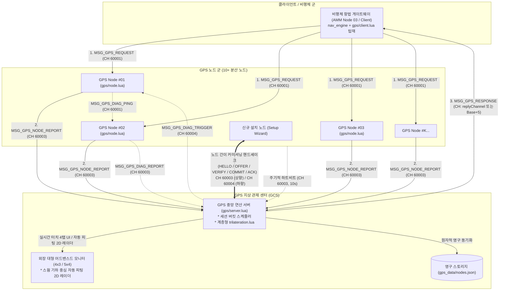
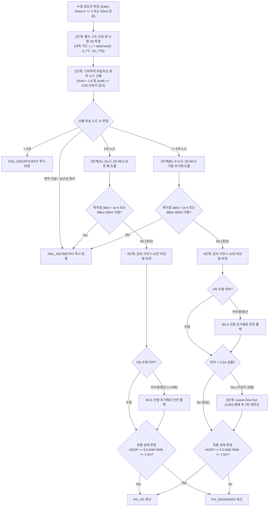
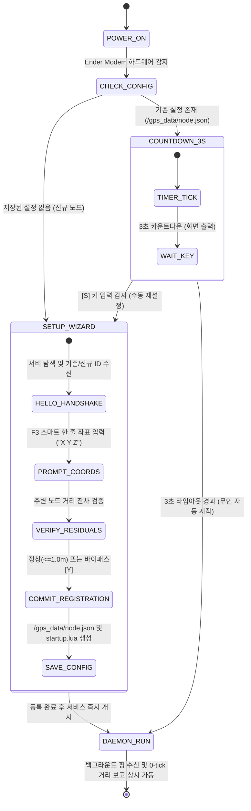

# 중앙 연산형 고정밀 GPS 체계 아키텍처 및 통신 규격서 (ICD)
> **Centralized High-Precision GPS System Architecture & Interface Control Document (ICD)**  
> **프로젝트**: Universal Autonomous Flight Stack (AMM · FCP · VAS · Central GPS Server · GPS Swarm Nodes · GCS)  
> **대상 환경**: Minecraft CC:Tweaked (Ender Modem, Advanced Monitor), Create: Aeronautics, Create: Avionics

| 항목 | 내용 |
| :--- | :--- |
| **문서 상태 (Status)** | `Implemented` |
| **문서 버전 (Version)** | `v2.3.2` |
| **최종 수정일 (Date)** | `2026-11-14` |
| **구현 코드 (Source)** | `src/0_infra/gps/` |
| **주관 도메인 (Domain)** | 중앙 고정밀 GPS 서버 및 분산 노드 군 (GPS Infrastructure) |


### Revision History

| 버전 | 개정 일자 | 개정 요약 | 개정 사유 |
| :---: | :---: | :--- | :--- |
| `v2.3.2` | 2026-11-14 | 고부하 경합 및 지연 보고 방어 강화 (`Implemented` $\to$ `Approved`, `TASK-123`): ① `session_scheduler.lua`의 `ingestReport` 내 동일 클라이언트 구형 활성 세션(`clientSeq < seq`) 즉시 축출·툼스톤 전환, ② `flushExpired` 만료 3노드 해법 성공 시 HWM(`client_last_solved`) 갱신 및 만료 루프 HWM 재검사, ③ `client_core.lua`의 `lastReceivedSeq` 단조 증가 수신 가드(구형/중복 `MSG_GPS_RESPONSE` 폐기 및 시퀀스 래핑 리셋), ④ 클라이언트(`AMM nav_engine` · `landing_pad gps_client`) `computerId` 기반 결정론적 송출 위상 분산(`offset = computerId % interval`) 및 착륙패드 `CH 60001` 송신 전용(Listen 제거) 규격 동기화 | TASK-123 다중 클라이언트/고부하 GPS 경합 및 스테일 세션 잔류 문제 해소 |
| `v2.3.1` | 2026-11-12 | FCP-AMM 역할 분리(마스터 ICD v1.28.0) 동기화: 비행체 GPS 클라이언트 주체를 `AMM (Node 03)`(`nav_engine` + `gps/client.lua` 관리 모드)으로 일원화하고 `5,000ms` DR 로이터·`HDOP > 5.0` 정밀 착륙 잠금 주체를 `AMM`으로 정렬, 구 `10045` `[DEPRECATED]` 잔재 예시 정리 및 연관 규격서 버전 동기화 (`src/0_infra/gps/` 런타임 무변경, `Implemented` 유지) | AMM 외부 게이트웨이·항법 융합 전담 및 FCP 순수 외루프 제어기 역할 분리 정합화 |
| `v2.3.0` | 2026-11-11 | `FAIL_GEOMETRY` 세션 만료 응답 및 150ms 단기 툼스톤(HWM 비갱신으로 250ms 재시도 허용), `CH 60002` 상태 조회 API(`requestStatus`/`pollStatus`/`queryStatus`), `isManaged` 50% 타임아웃 재시도 동등성, 멀티 코드베이스 독립 완결 클라이언트 와이어 호환 규칙 및 `/gps_data/node.json` 설정 경로 명시 (`Implemented` $\to$ `Approved`) | TASK-122 GPS ↔ 클라이언트 프로토콜 정합화 및 런타임 누락 보완 |
| `v2.2.2` | 2026-11-08 | 구버전 명칭 전면 척결 및 표준 명칭(FCP/ASA) 동기화 | 용어 무결성 확보 |
| `v2.2.1` | 2026-11-08 | 지상 시설물 전용 응답 채널($Base_{\text{sec}}+5$) 및 클라이언트 타입(`"FACILITY"`) 규격 명시 | 지상 인프라 착륙패드(v2.4.0) 및 GAC(v1.2.0) 연동 동기화 |
| `v2.2.0` | 2026-11-08 | 독자 `gps/installer.lua` 및 `installer_core.lua` 폐기(`[DEPRECATED]`), 전역 통합 코드베이스 인스톨러(`installer.lua` / `src/0_development/installer/`) 연계 규격화 (직접 업로드, `/disk/installer.lua`, `wget run`, GitHub/Google Drive 이중 소스, `/.version.json` 추적) | 단일 진입점 기반 전역 모듈 일괄 설치 및 버전 관리 체계 확립 |
| `v2.1.0` | 2026-11-07 | 비행체 전용 40채널($BW=40$) 대역 확장 반영, 01호기 회신 채널 `Base+5` (`10005`, 구 10045 [DEPRECATED]) 동기화, 승격 전이(`implemented/` $\to$ `approved/`) | 서브채널 대역폭 확장 및 기능 영역별 직교성 확보, 1000대 수용량 확립 |
  
> **연계 규격**: 
> - [AUTONOMOUS_FLIGHT_SYSTEM_ARCHITECTURE_AND_ICD.md](../../../system/AUTONOMOUS_FLIGHT_SYSTEM_ARCHITECTURE_AND_ICD.md) Interface I-7 표준 상호 호환 (v1.29.0 동기화)  
> - [GAC_PROGRAM_SPECIFICATION_AND_ICD.md](../../0_infra/gac/GAC_PROGRAM_SPECIFICATION_AND_ICD.md) GAC 지상 구역 관제사 규격서 (v1.4.2 동기화)  
> - [AMM_PROGRAM_SPECIFICATION.md](../../3_planning/amm/AMM_PROGRAM_SPECIFICATION.md) AMM 비행체 측위/항법 클라이언트 연계 (v2.0.0 동기화)  
> - [FCP_PROGRAM_SPECIFICATION.md](../../2_guidance/fcp/FCP_PROGRAM_SPECIFICATION.md) FCP 외루프 제어기 규격서 연계 (v2.0.0 동기화)  
> - [VAS_PROGRAM_SPECIFICATION.md](../../1_control/vas/VAS_PROGRAM_SPECIFICATION.md) VAS 고도/센서 규격서 호환 (v1.19.0 동기화)  
> - [SYSTEM_PROGRAM_RELATION_AND_PACKET_DIAGRAM.md](../../../system/SYSTEM_PROGRAM_RELATION_AND_PACKET_DIAGRAM.md) 전역 통신 및 패킷 흐름도 호환 (v2.14.0 동기화)  
> - [TCA_PROGRAM_SPECIFICATION.md](../../1_control/tca/TCA_PROGRAM_SPECIFICATION.md) TCA 클러스터 규격서 연계 (v1.11.1 동기화)  
> - [ALIGNMENT_PROGRAM_SPECIFICATION.md](../../0_development/alignment/ALIGNMENT_PROGRAM_SPECIFICATION.md) Alignment 규격서 연계 (v2.6.1 동기화)  
> - [DOCKING_ARM_SPECIFICATION_AND_ICD.md](../docking_arm/DOCKING_ARM_SPECIFICATION_AND_ICD.md) 도킹암 규격서 연계 (v1.11.2 동기화)  
> - [LANDING_PAD_SPECIFICATION_AND_ICD.md](../landing_pad/LANDING_PAD_SPECIFICATION_AND_ICD.md) 착륙패드 규격서 연계 (v2.4.4 동기화)  
> - [RUNWAY_SPECIFICATION_AND_ICD.md](../runway/RUNWAY_SPECIFICATION_AND_ICD.md) 활주로 규격서 연계 (v1.10.7 동기화)  

---

## 1. 개요 및 시스템 목적 (Overview & System Objectives)

본 문서는 자율 비행체(AMM), 이동체(터틀, 로버), 관제 컴퓨터(GCS, 모니터 대시보드) 및 지상/공중 분산 GPS 노드 군(Node Swarm) 간의 **측위 핑, 거리 보고, 중앙 연산, 상호 교정, 노드 동적 커미셔닝(등록/검증), 클라이언트 프로그래밍 API 및 통합 배포를 정의하는 공식 표준 인터페이스 제어 문서(ICD)**입니다.

### 1.1 핵심 설계 목표
1. **역할별 모듈 분리 및 공유 라이브러리 구조 (Modular Architecture)**:
   - 서버, 노드, 클라이언트 API 및 공통 수학/프로토콜 라이브러리가 명확한 디렉터리 체계(`gps/`)로 분리되어 코드 중복을 최소화하고 유지보수성을 극대화합니다.
2. **단방향 중앙 집중 연산 (Centralized Server Architecture)**:
   - 비행체 연산 부하를 0에 수렴시키기 위해 지상 고성능 메인 서버(`gps/server.lua`)가 2D 가중 최소제곱법(WLS) 및 감쇠 가우스-뉴턴(Damped Gauss-Newton) 최적화를 전담합니다.
3. **비행체 필수 고도 주입 기반 왜곡 없는 2D 수평 측위 및 0 나눗셈 방지**:
   - 비행체는 온보드 고도계(VAS 3D 레버암 보정치) 실측 Y고도를 요청 패킷에 필수 전달합니다.
   - 서버는 $\Delta y = |Y_{\text{node}} - Y_{\text{craft}}|$를 차감하여 3D 거리를 **순수 수평 거리($r_i = \sqrt{\max(0, d_i^2 - \Delta y_i^2)}$)**로 정밀 투영합니다.
   - 직상방 통과($r \to 0$) 시의 WLS 발산 및 야코비안 0 나눗셈을 방지하기 위해 가중치 상한($w_i = 1/\max(r_i, 1.0)$) 및 야코비안 분모 직접 클램핑($\text{denom}_i = \max(\rho_i, 10^{-6})$)을 의무 적용합니다 (인공 편향 및 도넛 구멍 척력을 유발하는 0.5m 외곽 클램핑은 완전 배제).
4. **동적 세션 버킷, 0ms 조기 연산, 1024-슬롯 LRU 툼스톤 캐시 및 하이워터마크 필터**:
   - 시속 20m/s(1 block/tick)의 고속 자율 비행을 지원하기 위해, 기하학적 유효 노드 4개 이상 수집 즉시 타이머 대기 없이 0ms 즉각 조기 풀이(Early-Solve)를 수행합니다.
   - Early-Solve 완료 즉시 최근 1024개 세션 키(`targetClient:clientSeq`)를 LRU 툼스톤 캐시에 1.0초간 유지하고, 클라이언트별 `lastSolvedSeq` 단조 증가 하이워터마크 필터를 병용하여 뒤늦게 도착하는 5~10번 노드의 지연 보고(Late Reports)가 신규 세션을 오생성하거나 오류 응답을 발송하는 레이스 컨디션을 구조적 차단합니다.
   - 미충족 세션은 단일 50ms(1틱) 통합 타이머로 일괄 만료 처리(Window-Solve)합니다.
5. **계층형 안전 폴백 연산 엔진 및 상태 판정 표준**:
   - 4노드 이상: WLS 초기해 + 감쇠 가우스-뉴턴 + 1.5m 초과 이상치 배제(LOO) 1회 재연산.
   - 3노드: WLS + 가우스-뉴턴 해법 (LOO 미적용).
   - 비선형 최적화 발산($\ge 8$회 미수렴) 시 선형 2D WLS 해로 안전 폴백(Fail-Soft).
   - **상태 코드(`status`) 판정 규칙**: 연산 성공 시 최종 $\text{HDOP} \le 5.0$ 및 사후 잔차 $\text{RMS}_{\text{res}} \le 1.5\text{m}$ 동시 충족 시 `FIX_OK`, $\text{HDOP} > 5.0$ 또는 $\text{RMS}_{\text{res}} > 1.5\text{m}$ 시 `FIX_DEGRADED`를 부여합니다.
   - 특이행렬($|\det| < 10^{-4}$), 공선성($|\sin\theta| < 0.05$), 또는 노드 Bounding Box 반경 500m 이탈 시 `FAIL_GEOMETRY`, 노드 $<3$개 시 `FAIL_INSUFFICIENT`를 반환합니다.
6. **외장 Advanced Monitor GCS (헤드리스 폴백 및 동적 핫플러그 지원) 및 격리된 3-코루틴 엔진**:
   - 외장 Advanced Monitor(4x3 또는 5x4) 연결을 기본 지원하되, 미연결 시 로컬 터미널 헤드리스(Headless) 모드로 안전 폴백하고 런타임 동적 핫플러그(`peripheral` / `peripheral_detach`)를 완전히 지원합니다.
   - 서버는 `supervisedLoop` 기반의 `pcall` 예외 격리와 `parallel.waitForAll`을 통해 1) 패킷 수신 및 Early-Solve, 2) 50ms 세션 만료 및 헬스 타이머, 3) 모니터 터치 및 디커플링 프레임 렌더링의 3개 코루틴을 완전 분리 운용하여 UI 예외 크래시가 네트워크 및 타이머 코루틴에 전파되지 않도록 보장합니다.
   - 모든 활성 노드의 Bounding Box와 기하 중심을 실시간 계산하여 전체 스웜 군집이 화면에 한눈에 들어오도록 2D 레이더를 자동 스케일링(Auto-Fitting) 렌더링합니다.
7. **컴퓨터 ID 기반 영구 바인딩 및 `/gps_data/` 통합 설정 관리**:
   - `/gps_data/nodes.json`에 `computerId`를 영구 바인딩하여 기존 노드 재설치 시 기존 ID를 자동 복원하고, 신규 설치 시 결번(Gap)을 우선 채번하며 원자적 파일 저장을 보장합니다. 스웜 노드 역시 `/gps_data/node.json`으로 디렉터리 경로를 일원화합니다.
8. **스웜 상호 진단(Cross-Calibration) 순수 로깅 모니터링 정책**:
   - 60초 주기 또는 수동 진단 시 실측 거리와 이론 거리 간의 잔차를 GCS 로그 및 모니터에 정밀 기록하되, 서버가 노드를 강제 격리하지 않고 연산 엔진의 런타임 LOO가 이상치를 능동 배제합니다.
9. **하이브리드 클라이언트 프로그래밍 API 및 패킷 직접 주입 (`gps/client.lua`)**:
   - 동기식 `gpsClient.locate(alt, timeout)` 편의 함수(기본 500ms 타임아웃, 250ms 경과 시 1회 자동 재전송, 20Hz 비행 제어 루프 내 호출 엄격 금지)와 20Hz 제어루프용 비동기 `request(alt)` / `poll(seq)` 함수를 동시 제공합니다.
   - `AMM (Node 03)` 등 멀티 채널을 운용하는 상위 항법 스택과의 연동 시 이벤트 큐 오염을 방지하기 위해 외부 수신 패킷 직접 주입 인터페이스(`gpsClient.handleMessage(...)`) 및 관리 모드(`isManaged`)를 제공합니다.
10. **전역 통합 코드베이스 인스톨러 및 기존 데이터 보존 업데이트 (`installer.lua`, 구 `gps/installer.lua` [DEPRECATED])**:
    - 플로피 디스크(`/disk/installer.lua`), 웹 다운로드(`wget run`), 또는 루트 직접 업로드(`/installer.lua`) 환경에서 Unified Installer를 통해 3대 GPS 타겟(`gps_server`, `gps_node`, `gps_client`)을 일괄 설치 및 `startup/00_gps.lua` 분리 등록을 완료하며, 재설치/업데이트 시 기존 `/gps_data/` 설정 파일(`nodes.json`, `node.json`, 구 `node_cfg.json` `[DEPRECATED]`)을 안전하게 보존합니다.

### 1.2 코드 경량화 및 Deprecated 운영 정책 (Code Lightweighting & Deprecation Policy)
1. **사양서 명세 원칙 (Specification-First)**: 프로토콜 패킷 타입명 또는 페이로드 필드가 개정될 경우, 구버전 명칭은 사양서 내에 `[DEPRECATED]` 배지를 부여하고 대체 신규 필드명과 변경 이력을 명시하여 문서상에 보존합니다.
2. **코드베이스 경량화 원칙 (Zero-Fallback)**: CC:Tweaked Lua 분산 컴퓨터 환경의 자원 제약(메모리 절약, 20Hz 실시간 루프 성능 보장)을 준수하기 위해, 코드베이스는 사전 이중 호환(Fallback 래퍼, `payload.new or payload.old` 등)을 일체 작성하지 않고 **최신 표준 필드명/패킷명만을 단일 채택**합니다.
3. **런타임 오류 시 복구 원칙 (송신 노드 즉시 패치)**: 구버전 필드/패킷을 전송하는 미갱신 노드로 인해 수신 측에서 `nil` 인덱싱 등의 런타임 오류가 발생할 경우, 수신 측에 임시 폴백 코드를 추가하지 않고 **구버전 패킷을 송신한 발신 노드의 코드를 최신 사양으로 즉시 패치 및 재배포**하여 전역 일원화를 달성합니다.

---

## 2. 엔더 모뎀 통신 채널 대역 및 네트워크 매트릭스 (Channel Allocation Matrix)

CC:Tweaked 환경의 엔더 모뎀(Ender Modem) 전송 특성을 고려하여, 공용 인프라 채널 대역(`60001 ~ 60004`)을 체계적으로 분리 할당하고 동적 회신(`replyChannel`)을 지원합니다.



### 2.1 공식 채널 할당 표
| 채널 번호 | 심볼명 | 발신자 | 수신자 | 전송 주기 | 용도 및 설명 |
| :---: | :--- | :---: | :---: | :---: | :--- |
| **`60001`** | `CH_GPS_PING` | 클라이언트 / AMM | 노드 군 전체 | 5~10Hz (측위 시) | **노드 거리 측정용 핑 브로드캐스트 전용** (모든 노드 상시 청취, CC 모뎀 이벤트 3D 거리 획득) |
| **`60002`** | `CH_GPS_SERVICE` | 클라이언트 / GCS / AMM | 중앙 연산 서버 | 이벤트 기반 | **GPS 중앙 서버 상태 조회 및 서비스 관리 전용 포트** (`MSG_GPS_STATUS_REQ` / `RESP`) |
| **`60003`** | `CH_GPS_NODE_IN` | 노드 군 / 신규 노드 | 중앙 연산 서버 | 틱당 다수 / 10s 주기 / 등록 시 | 노드 거리 보고(`NODE_REPORT`), 노드 생존 하트비트, **노드 커미셔닝 요청/검증/커밋** |
| **`60004`** | `CH_GPS_MGMT` | 중앙 연산 서버 | 노드 군 전체 / 신규 노드 | 60s / 등록 시 | 노드 상호 교정 지시(`DIAG_TRIGGER`), **노드 ID 발급 제안 및 검증 회신(`NODE_OFFER`, `NODE_VERIFY_RESP`, `NODE_REG_ACK`)** |
| **`replyChannel`**<br>*(Base+5, $Base_{\text{sec}}+5$ 등)* | `CH_CLIENT_REPLY` | 중앙 연산 서버 | 클라이언트 / AMM / 시설물 | 요청 직후 ($\le 50\text{ms}$) | 계산된 최종 (X, Z) 좌표 응답 (`MSG_GPS_RESPONSE`, 기체: `Base+5`, 지상 시설물: $Base_{\text{sec}}+5$) |

---

## 3. 공통 메시지 엔벨로프 및 패킷 상세 명세 (Packet Specifications)

모든 통신 패킷은 상위 엔벨로프 규격을 엄격히 준수하며, `type`에 따라 `payload`의 구조가 결정됩니다.

> [!IMPORTANT]
> **프로토콜 버전 엄격 일치 정책**: 모든 패킷은 `ver == "1.9.5"` 일치가 강제됩니다. 필수 필드(`altitudeY` 등) 누락 또는 버전 불일치 감지 시 오류 로그를 출력하고, 통합 인스톨러(`installer.lua`, 구 `gps/installer.lua` [DEPRECATED])를 통한 버전 업데이트 및 재부팅을 유도합니다.

### 3.1 공통 패킷 엔벨로프 (Common Message Envelope)
```lua
{
    ver = "1.9.5",                -- 전역 프로토콜 규격 버전 ("1.9.5" 엄격 일치)
    domainId = "AIRCRAFT_01",      -- 발신 기체/노드/서버 고유 도메인 식별자 (string)
    seq = 50412,                   -- 발신자 기준 단조 증가 시퀀스 번호 (uint32)
    type = "MSG_GPS_REQUEST",      -- 패킷 타입 식별자 (string)
    time = 1729900000000,          -- 발신 시각 (ms, os.epoch("utc"))
    payload = { ... }              -- 메시지 세부 데이터 테이블 (table)
}
```

---

### 3.2 [Client $\rightarrow$ Swarm] 측위 요청 핑 (`MSG_GPS_REQUEST`)
- **채널**: `CH_GPS_PING` (`60001`) (거리 측정 전용 브로드캐스트)
- **전송 주기**: 5 ~ 10Hz (비행 기동 시)
- **필드 명세**:
  | 필드 경로 | 타입 | 필수 | 설명 |
  | :--- | :---: | :---: | :--- |
  | `payload.replyChannel` | uint16 | 필수 | 서버가 연산 완료 후 좌표를 회신할 전용 채널 (기체: `Base+5`, 지상 시설물: `$Base_{\text{sec}}+5$`) |
  | `payload.altitudeY` | float | **필수** | 온보드 고도계 실측 Y 좌표 (2D 정밀 수평 투영의 기준) |
  | `payload.clientType` | string | 필수 | 클라이언트 분류 (`"AIRCRAFT"`, `"TURTLE"`, `"POCKET"`, `"ROVER"`, `"FACILITY"`) |
  | `payload.clientSeq` | uint32 | 필수 | 클라이언트가 부여한 요청 고유 일련번호 (응답 매칭용) |

```lua
-- 비행체 AMM (Node 03) -> GPS 노드 군 요청 패킷 예시
{
    ver = "1.9.5",
    domainId = "AIRCRAFT_01",
    seq = 10425,
    type = "MSG_GPS_REQUEST",
    time = 1729900000050,
    payload = {
        replyChannel = 10005,              -- 비행체 01 전용 수신 채널 (Base+5)
        altitudeY = 125.40,                -- 온보드 실측 고도 (VAS)
        clientType = "AIRCRAFT",
        clientSeq = 8412
    }
}
```

---

### 3.3 [Node $\rightarrow$ Server] 노드 실측 거리 보고 (`MSG_GPS_NODE_REPORT`)
- **채널**: `CH_GPS_NODE_IN` (`60003`)
- **전송 시점**: 노드가 `MSG_GPS_REQUEST`를 수신한 즉시 발신 (0-tick 반응)
- **필드 명세**:
  | 필드 경로 | 타입 | 필수 | 설명 |
  | :--- | :---: | :---: | :--- |
  | `payload.targetClient` | string | 필수 | 핑을 발신한 클라이언트 `domainId` |
  | `payload.clientSeq` | uint32 | 필수 | 해당 클라이언트의 요청 일련번호 |
  | `payload.nodeId` | string | 필수 | 노드 고유 식별자 (예: `"NODE_04"`) |
  | `payload.nodePos` | table | 필수 | 노드 설치 좌표 `{ x = 1200.0, y = 140.0, z = -350.0 }` |
  | `payload.measuredDistance` | float | 필수 | CC:Tweaked 모뎀 이벤트 실측 유클리드 3D 거리 ($d$) |
  | `payload.clientAltitudeY` | float | 필수 | 클라이언트 요청에서 전달받은 `altitudeY` 전달 |
  | `payload.replyChannel` | uint16 | 필수 | 클라이언트가 지정한 `replyChannel` 중계 |

```lua
-- GPS 노드 -> 중앙 연산 서버 보고 패킷 예시
{
    ver = "1.9.5",
    domainId = "NODE_04",
    seq = 3302,
    type = "MSG_GPS_NODE_REPORT",
    time = 1729900000055,
    payload = {
        targetClient = "AIRCRAFT_01",
        clientSeq = 8412,
        nodeId = "NODE_04",
        nodePos = { x = 1200.0, y = 140.0, z = -350.0 },
        measuredDistance = 64.25,
        clientAltitudeY = 125.40,
        replyChannel = 10005
    }
}
```

---

### 3.4 [Server $\rightarrow$ Client] 최종 정밀 측위 응답 (`MSG_GPS_RESPONSE`)
- **채널**: 클라이언트가 지정한 `replyChannel` (예: `10005` [N=1 `Base+5`], 구 `10045` `[DEPRECATED]`)
- **전송 시점**: Early-Solve 만족 즉시 또는 50ms 윈도우 마감 직후
- **필드 명세**:
  | 필드 경로 | 타입 | 필수 | 설명 |
  | :--- | :---: | :---: | :--- |
  | `payload.targetClient` | string | 필수 | 수신 클라이언트 식별자 (`"AIRCRAFT_01"`) |
  | `payload.clientSeq` | uint32 | 필수 | 요청 시 전달받았던 요청 일련번호 매칭 |
  | `payload.status` | string | 필수 | 상태 코드 (`"FIX_OK"`, `"FIX_DEGRADED"`, `"FAIL_INSUFFICIENT"`, `"FAIL_GEOMETRY"`) |
  | `payload.position.x` | float | 조건부 | 계산된 절대 X 수평 좌표 (마인크래프트 월드 기준) |
  | `payload.position.z` | float | 조건부 | 계산된 절대 Z 수평 좌표 (마인크래프트 월드 기준) |
  | `payload.accuracy` | float | 조건부 | 1-sigma 잔차 오차 반경 (m / 블록 단위, 낮을수록 정밀) |
  | `payload.hdop` | float | 조건부 | 수평 기하 정밀도 저하율 (HDOP, $\le 2.0$ 우수, $\le 5.0$ 양호, $> 5.0$ 저하) |
  | `payload.nodeCount` | uint8 | 필수 | 측위 연산에 최종 사용된 노드 수 (3 ~ 6) |
  | `payload.selectedNodes` | table | 필수 | 연산에 채택된 노드 ID 목록 (이상치 배제 노드 제외) |

```lua
-- 중앙 연산 서버 -> 비행체 AMM (Node 03) 최종 응답 패킷 예시
{
    ver = "1.9.5",
    domainId = "GPS_BASE_NET",
    seq = 90214,
    type = "MSG_GPS_RESPONSE",
    time = 1729900000075,
    payload = {
        targetClient = "AIRCRAFT_01",
        clientSeq = 8412,
        status = "FIX_OK",
        position = { x = 1245.82, z = -398.15 },
        accuracy = 0.12,
        hdop = 1.08,
        nodeCount = 4,
        selectedNodes = { "NODE_01", "NODE_04", "NODE_07", "NODE_09" }
    }
}
```

---

### 3.5 [Node $\rightarrow$ Server] 노드 생존 하트비트 (`MSG_GPS_NODE_HEARTBEAT`)
- **채널**: `CH_GPS_NODE_IN` (`60003`)
- **전송 주기**: 10초 주기
- **필드 명세**:
  ```lua
  {
      ver = "1.9.5",
      domainId = "NODE_04",
      seq = 1205,
      type = "MSG_GPS_NODE_HEARTBEAT",
      time = 1729900010000,
      payload = {
          nodeId = "NODE_04",
          computerId = 15,
          pos = { x = 1200.0, y = 140.0, z = -350.0 },
          status = "ONLINE",
          uptime = 3600,
          reportsSent = 1482
      }
  }
  ```

---

### 3.6 [Server $\leftrightarrow$ Nodes] 상호 진단 프로토콜 (Cross-Calibration)
서버가 60초 주기 또는 GCS 버튼 조작 시 발행하며, 실측 거리와 이론 거리를 대조하여 오차를 진단합니다.

1. **진단 지시 (`MSG_GPS_DIAG_TRIGGER`, CH 60004)**:
   ```lua
   payload = { diagId = "DIAG-20261027-01", targetNode = "NODE_01" }
   ```
2. **진단 핑 방출 (`MSG_GPS_DIAG_PING`, CH 60001)**:
   ```lua
   payload = { diagId = "DIAG-20261027-01", originNode = "NODE_01", originPos = {x=1050, y=120, z=-280} }
   ```
3. **진단 실측 보고 (`MSG_GPS_DIAG_REPORT`, CH 60003)**:
   ```lua
   payload = {
       diagId = "DIAG-20261027-01",
       senderNode = "NODE_02",
       targetNode = "NODE_01",
       measuredDistance = 142.35
   }
   ```

---

### 3.7 [Node $\leftrightarrow$ Server / Client $\leftrightarrow$ Server] 관리 및 커미셔닝 핸드셰이크
- **서버 상태 조회 (CH 60002)**:
  - `MSG_GPS_STATUS_REQ` (CH 60002): 클라이언트 또는 GCS가 중앙 서버 가동 상태 및 활성 노드 수 조회.
  - `MSG_GPS_STATUS_RESP` (CH 60002 또는 지정 채널): 서버 상태(`activeNodes`, `uptime`, `totalSolved`, `version`) 응답.
- **노드 등록 및 커미셔닝 (CH 60003 / 60004)**:
  - `MSG_GPS_NODE_HELLO` (CH 60003): 신규/재설정 노드가 `computerId`를 동봉하여 서버 탐색.
  - `MSG_GPS_NODE_OFFER` (CH 60004): 서버가 해당 컴퓨터의 기존 ID 복원 또는 신규 채번된 `nodeId` 제안.
  - `MSG_GPS_NODE_VERIFY_REQ` (CH 60003): F3 좌표를 전송하여 기존 노드들과의 거리 잔차 분석 요청.
  - `MSG_GPS_NODE_VERIFY_RESP` (CH 60004): 잔차 검증 결과 통보 (`passed = (residual <= 1.0m)`).
  - `MSG_GPS_NODE_REG_COMMIT` (CH 60003): 오퍼레이터 정상/바이패스 승인 후 최종 등록 요청.
  - `MSG_GPS_NODE_REG_ACK` (CH 60004): 영구 DB 반영 완료 통보.

---

## 4. 수학적 측위 알고리즘 및 계층형 안전 연산 엔진 명세 (`gps/lib/trilateration.lua`)

중앙 서버의 연산 엔진(`gps/lib/trilateration.lua`)은 비행체의 고속성과 마인크래프트 월드의 비유클리드 노이즈를 상쇄하고 특이 상황에서도 결코 멈추지 않는 계층형 안전 폴백(Fail-Soft) 파이프라인을 실행합니다.



### 4.1 1단계: 필수 고도 차감 기반 정밀 2D 수평 투영 (Exact Horizontal Projection)
클라이언트의 요청 패킷에 포함된 실측 `altitudeY`와 각 노드의 설치 높이 $Y_i$의 고도차 $\Delta y_i = |Y_i - \text{altitudeY}|$를 구하고, 모뎀 실측 3D 구면 거리 $d_i$를 2D 평면 원거리 $r_i$로 정밀 투영합니다:
$$r_i = \sqrt{\max\left(0,\, d_i^2 - (Y_i - \text{altitudeY})^2\right)}$$

- **외곽 $0.5\text{m}$ 클램핑 제거 및 수학적 근거 (Removal of Artificial Bias & Donut Hole Repulsion)**:
  - 기존 규격의 $r_i = \max(0.5\text{m}, \dots)$ 외곽 클램핑은 비행체가 노드 직상방을 통과할 때 심각한 인공 편향(Artificial Bias)을 초래합니다.
  - **WLS 우변 상수 벡터 편향**: 비행체가 $N_1$ 상공 $0.05\text{m}$를 통과할 때 참값 $r_1^2 \approx 0.0025\text{m}^2$ 대신 $0.25\text{m}^2$가 대입되어, 상수 벡터 $\mathbf{b}$의 모든 행에 $+0.2475\text{m}^2$의 인공 오프셋을 균일 주입함으로써 초기해를 반대 방향으로 $0.25 \sim 0.35\text{m}$ 강제 왜곡시킵니다.
  - **가우스-뉴턴 "도넛 구멍" 반발 아티팩트 (Donut Hole Repulsion)**: 참 위치 직상방에서 모델 계산 거리 $\hat{r}_1 = 0$이나 관측값 $r_1 = 0.5\text{m}$로 클램핑되어 잔차 $f_1 = -0.5\text{m}$가 잔류하며, 알고리즘이 이를 0으로 맞추기 위해 비행체 추정 위치를 노드 반경 $0.5\text{m}$ 외곽으로 강하게 밀어내어 노드 상공마다 진입 불가능한 인공 척력장을 형성합니다.
  - **0 나눗셈 방지 근거의 반박**:
    1. 3단계 WLS 가중치: $w_i = 1/\max(r_i, 1.0)$이므로 $r_i = 0$이어도 분모는 $1.0$으로 안전합니다.
    2. 4단계 야코비안: 분모는 추정 위치 기준 거리 $\rho_i = \sqrt{(X_i - x)^2 + (Z_i - z)^2}$이므로 관측값 $r_i$와 무관합니다.
    3. WLS 우변 벡터: $r_i^2$만이 곱해지므로 $r_i = 0$ 대입 시 전혀 문제가 없습니다.
  - 따라서 외곽 $0.5\text{m}$ 클램핑을 완전 제거하고, 순수 내측 음수 방지 가드 $\max(0, d_i^2 - \Delta y_i^2)$만을 취합니다.

### 4.2 2단계: 최적 기하 노드 선별 및 스케일 불변 공선성 검사 (`selectOptimalNodes`)
정밀도 저하(특이행렬 및 Collinearity)를 방지하기 위해 최대 4개의 노드를 기하 규칙으로 선별합니다.
1. **1번 노드 ($N_1$)**: 유효 수평 거리 $r_i$가 가장 가까운 최단거리 노드.
2. **2번 노드 ($N_2$)**: $N_1$과 수평 위치가 동일하지 않은 노드 중 최단거리 노드.
3. **3번 노드 ($N_3$)**: $N_1, N_2$와 이루는 2D 삼각형의 면적 및 사잇각이 유효 임계치 이상인 비일직선(Non-collinear) 노드.
   - **스케일 불변 사잇각 검사 결합**: 순수 면적 검사($\text{Area} > 1.0$)는 500m 대형 기저선에서 사잇각 $0.002^\circ$의 완전 일직선 노드군($N_1(-500,0), N_2(0,0), N_3(500, 0.02)$)이 $\text{Area} = 10.0 > 1.0$으로 통과하여 특이행렬 폭발을 유발합니다. 반대로 2m 초협소 착륙 패드에서는 양호한 기하($\theta = 10^\circ$)임에도 $\text{Area} = 0.69 < 1.0$으로 거짓 기각됩니다.
   - 이를 방지하기 위해 정규화된 무차원 사잇각 사인값($|\sin\theta|$) 검사를 이중 결합합니다:
     $$\kappa_{\text{collinear}} = |\sin\theta| = \frac{|(X_2 - X_1)(Z_3 - Z_1) - (X_3 - X_1)(Z_2 - Z_1)|}{\sqrt{(X_2 - X_1)^2 + (Z_2 - Z_1)^2} \sqrt{(X_3 - X_1)^2 + (Z_3 - Z_1)^2}} \ge 0.05 \quad (\theta \ge 2.86^\circ)$$
4. **4번 노드 ($N_4$)**: $N_1 \sim N_3$에 의해 형성된 평면의 기하학적 배치(GDOP)를 최대로 보강하는 노드.

- **통합 중단 논리 (Explicit Logical OR Formulation)**:
  다음 조건 중 어느 하나라도 참일 경우 연산을 즉시 중단하고 `status = "FAIL_GEOMETRY"`를 반환합니다:
  $$(\text{Area} \le 1.0) \lor (|\sin\theta| < 0.05) \lor (|\det(\mathbf{M})| < 10^{-4}) \lor (\mathbf{x}_{\text{WLS}} \notin \text{BBox}_{\text{swarm}} + 500\text{m}) \implies \mathbf{FAIL\_GEOMETRY}$$

### 4.3 3단계: 2D 가중 최소제곱법 (WLS 2D Closed-Form Solution)
선별된 노드($i = 2, \dots, n$)에 대해 1번 기준 노드($X_1, Z_1$)를 원점으로 차분 방정식을 구성합니다:
$$2(X_i - X_1)x + 2(Z_i - Z_1)z = (r_1^2 - r_i^2) + (X_i^2 - X_1^2) + (Z_i^2 - Z_1^2)$$
행렬 형태:
$$\mathbf{A} \mathbf{x} = \mathbf{b}, \quad \mathbf{x}_{\text{WLS}} = (\mathbf{A}^T \mathbf{W} \mathbf{A})^{-1} \mathbf{A}^T \mathbf{W} \mathbf{b}$$

- **가중치 상한 클램핑 ($w_i = 1/\max(r_i, 1.0)$) 이론적 정당성**:
  - 3D 거리 $d_i$와 고도차 $\Delta y_i$의 오차를 $\sigma_d, \sigma_y$라 할 때, 1차 테일러 오차 전파에 따른 수평 투영 분산은:
    $$\sigma_{r_i}^2 = \left(\frac{d_i}{r_i}\right)^2 \sigma_d^2 + \left(\frac{\Delta y_i}{r_i}\right)^2 \sigma_y^2 \implies \lim_{r_i \to 0} \sigma_{r_i}^2 = \infty$$
  - 접선 특이성(Tangency Singularity)으로 인해 직상방 노드는 수평 오차 증폭($\sigma_r \propto \frac{\Delta y}{r}\sigma_y$)으로 신뢰도가 가장 낮습니다.
  - 가중치에 $1/r$을 무제한 적용할 경우 $r=0.01\text{m}$인 노드에 $w=100$이 부여되어 정규방정식 조건수가 붕괴합니다.
  - $w_i = 1/\max(r_i, 1.0)$은 $r_i < 1.0\text{m}$에서 가중치 상한을 $1.0$으로 단단히 캡핑하여 접선 특이 노이즈 폭발을 방어하고 수치적 안정성을 보장합니다.

### 4.4 4단계: 감쇠 가우스-뉴턴(Damped Gauss-Newton) 비선형 정밀 보정
선형 초기해 $\mathbf{x}^{(0)} = [x_0, z_0]^T$로부터 비선형 기하 잔차를 최소화하기 위해 최대 8회 반복 계산을 수행합니다.

- **하강 방향 잔차 부호 표준화 (Descent Direction Standardization)**:
  잔차 벡터를 **측정값 - 모델값**으로 엄격히 정의합니다:
  $$\mathbf{r}_i = r_i - \sqrt{(X_i - x)^2 + (Z_i - z)^2} = r_i - \rho_i$$
  이로써 $\mathbf{J}^T \mathbf{r}$ 연산이 수학적으로 정확한 목적함수 감소 방향(Descent Direction)을 가리키도록 보장합니다:
  $$\Delta \mathbf{x} = (\mathbf{J}^T \mathbf{J} + \lambda \mathbf{I})^{-1} \mathbf{J}^T \mathbf{r}$$
  $$\mathbf{x}^{(k+1)} = \mathbf{x}^{(k)} + \alpha \Delta \mathbf{x} \quad (\lambda = 0.01,\, \alpha = 0.8)$$

- **야코비안 분모 직접 클램핑 (Direct Denominator Clamping)**:
  기존 수식의 $\sqrt{\rho_i^2 + 10^{-4}}$는 노드 $1\text{cm}$ 근접 시 야코비안 노름을 $1/\sqrt{2} \approx 0.7071$로 **29.3% 감쇄**시키고, $2\text{mm}$에서 **80.4% 기울기를 소실**시켜 중심부 불감대(Dead-zone)를 유발합니다.
  이를 제거하기 위해 계산된 분모 자체를 하한 제한합니다:
  $$\rho_i = \sqrt{(X_i - x)^2 + (Z_i - z)^2}, \quad \text{denom}_i = \max(\rho_i,\, 10^{-6})$$
  $$J_{i,1} = \frac{x - X_i}{\text{denom}_i}, \quad J_{i,2} = \frac{z - Z_i}{\text{denom}_i}$$
  $\rho_i \ge 10^{-6}\text{m}$ (1 마이크로미터)인 전 영역에서 $\|\mathbf{J}_i\| \equiv 1.0000$의 완전한 단위 방향 벡터를 유지하며 기울기 왜곡을 근원 차단합니다.
- **수렴 및 안전 폴백**: $\|\Delta \mathbf{x}\| < 0.01\text{m}$ 시 수렴 판정. 8회 내 미수렴 시 3단계의 **선형 WLS 해($\mathbf{x}_{\text{WLS}}$)로 안전 폴백(Fail-Soft)**합니다.

### 4.5 5단계: 계층형 안전 폴백 및 이중 게이트 상태 판정 매트릭스

#### 4.5.1 폐형 2D HDOP 계산 수식 (Closed-Form Formula)
최종 추정점 $(x^*, z^*)$에서 각 노드로의 시선 단위 방향 행렬 $\mathbf{G}_{n \times 2}$를 구성합니다:
$$G_{i, 1} = \frac{x^* - X_i}{\hat{r}_i}, \quad G_{i, 2} = \frac{z^* - Z_i}{\hat{r}_i} \quad (\hat{r}_i = \max(\sqrt{(x^* - X_i)^2 + (z^* - Z_i)^2},\, 10^{-6}))$$
$$\mathbf{H} = \mathbf{G}^T \mathbf{G} = \begin{bmatrix} \sum_{i=1}^n G_{i,1}^2 & \sum_{i=1}^n G_{i,1} G_{i,2} \\ \sum_{i=1}^n G_{i,1} G_{i,2} & \sum_{i=1}^n G_{i,2}^2 \end{bmatrix} = \begin{bmatrix} h_{11} & h_{12} \\ h_{12} & h_{22} \end{bmatrix}$$
$$\det(\mathbf{H}) = h_{11} h_{22} - h_{12}^2$$
$$\text{If } \det(\mathbf{H}) \le 10^{-6}: \quad \text{HDOP} = 99.9; \quad \text{Else}: \quad \mathbf{HDOP} = \sqrt{\frac{h_{11} + h_{22}}{\det(\mathbf{H})}}$$

#### 4.5.2 사후 잔차 RMS 게이트 결합 상태 판정
HDOP는 순수 기하학적 배치 민감도만 반영하므로, WLS 폴백 또는 3노드 이상치 유입 시 HDOP는 양호하나 심각한 오차가 존재할 수 있습니다. 따라서 **사후 잔차 RMS($\text{RMS}_{\text{res}} \le 1.5\text{m}$)**를 결합하여 판정합니다:
$$\text{RMS}_{\text{res}} = \sqrt{\frac{1}{n}\sum_{i=1}^n \left(\sqrt{(X_i - x^*)^2 + (Z_i - z^*)^2} - r_i\right)^2}$$
$$\mathbf{status} = \begin{cases} \mathbf{FIX\_OK} & \text{if } \text{HDOP} \le 5.0 \text{ AND } \text{RMS}_{\text{res}} \le 1.5\text{m} \\ \mathbf{FIX\_DEGRADED} & \text{if } \text{HDOP} > 5.0 \text{ OR } \text{RMS}_{\text{res}} > 1.5\text{m} \end{cases}$$

| 수집 노드 수 | LOO 이상치 배제 | 비선형 최적화 | HDOP 및 사후 잔차 조건 | 최종 `status` 코드 |
| :---: | :---: | :---: | :---: | :--- |
| **$\ge 4$개** | 정상 또는 1회 LOO | 수렴 또는 WLS 폴백 | $\text{HDOP} \le 5.0 \text{ AND } \text{RMS}_{\text{res}} \le 1.5\text{m}$ | **`FIX_OK`** |
| **$\ge 4$개** | 정상 또는 1회 LOO | 수렴 또는 WLS 폴백 | $\text{HDOP} > 5.0 \text{ OR } \text{RMS}_{\text{res}} > 1.5\text{m}$ | **`FIX_DEGRADED`** |
| **3개** | 미적용 | 수렴 또는 WLS 폴백 | $\text{HDOP} \le 5.0 \text{ AND } \text{RMS}_{\text{res}} \le 1.5\text{m}$ | **`FIX_OK`** |
| **3개** | 미적용 | 수렴 또는 WLS 폴백 | $\text{HDOP} > 5.0 \text{ OR } \text{RMS}_{\text{res}} > 1.5\text{m}$ | **`FIX_DEGRADED`** |
| **특이 기하 / 공선성** | - | Area $\le 1.0 \lor |\sin\theta| < 0.05 \lor |\det| < 10^{-4} \lor \text{BBox} > 500\text{m}$ | - | **`FAIL_GEOMETRY`** |
| **$< 3$개** | - | - | - | **`FAIL_INSUFFICIENT`** |

### 4.6 `gps/lib/trilateration.lua` 완전 의사코드 명세 (Complete Pseudocode)

```lua
-- gps/lib/trilateration.lua
-- Rigorous, Unbiased 2D Trilateration Engine for CC:Tweaked

local trilateration = {}

-- 1. Exact Unbiased 2D Horizontal Projection
function trilateration.projectHorizontal(nodes, craftAlt)
    local proj = {}
    for i, node in ipairs(nodes) do
        local dy = math.abs(node.y - craftAlt)
        -- Exact ML orthogonal projection: 0 if d < dy, else sqrt(d^2 - dy^2)
        local r2 = math.max(0, node.distance^2 - dy^2)
        proj[i] = {
            id = node.id,
            x = node.x,
            y = node.y,
            z = node.z,
            r = math.sqrt(r2)
        }
    end
    return proj
end

-- 2. Scale-Invariant Collinearity & Geometry Verification
function trilateration.checkGeometry(n1, n2, n3)
    local ux, uz = n2.x - n1.x, n2.z - n1.z
    local vx, vz = n3.x - n1.x, n3.z - n1.z
    
    local cross = math.abs(ux * vz - vx * uz) -- Parallelogram Area
    local lenU = math.sqrt(ux * ux + uz * uz)
    local lenV = math.sqrt(vx * vx + vz * vz)
    
    if lenU < 0.5 or lenV < 0.5 then
        return false, "BASELINES_TOO_SHORT"
    end
    
    local sinTheta = cross / (lenU * lenV)
    -- Dual Gate: Scale-invariant opening angle >= 2.86 deg AND Parallelogram Area > 1.0
    if cross <= 1.0 or sinTheta < 0.05 then
        return false, "COLLINEAR_GEOMETRY"
    end
    return true
end

-- 3. Closed-Form 2D HDOP Calculation
function trilateration.computeHDOP(nodes, x, z)
    local h11, h12, h22 = 0, 0, 0
    for _, n in ipairs(nodes) do
        local dx = x - n.x
        local dz = z - n.z
        local rho = math.sqrt(dx * dx + dz * dz)
        local denom = math.max(rho, 1e-6)
        local g1 = dx / denom
        local g2 = dz / denom
        h11 = h11 + g1 * g1
        h12 = h12 + g1 * g2
        h22 = h22 + g2 * g2
    end
    local det = h11 * h22 - h12 * h12
    if det <= 1e-6 then
        return 99.9 -- Singular geometry
    end
    return math.sqrt((h11 + h22) / det)
end

-- 4. Gauss-Newton Iteration Step with Denominator Safeguard & Descent Sign
function trilateration.gaussNewtonStep(nodes, x, z, lambda, alpha)
    local jtj11, jtj12, jtj22 = lambda, 0, lambda
    local jtr1, jtr2 = 0, 0
    local sumSqRes = 0
    
    for _, n in ipairs(nodes) do
        local dx = x - n.x
        local dz = z - n.z
        local rho = math.sqrt(dx * dx + dz * dz)
        local denom = math.max(rho, 1e-6) -- Exact unit vector down to 1 um
        local j1 = dx / denom
        local j2 = dz / denom
        
        -- Measured minus Model (Correct descent direction)
        local res = n.r - rho
        sumSqRes = sumSqRes + res * res
        
        jtj11 = jtj11 + j1 * j1
        jtj12 = jtj12 + j1 * j2
        jtj22 = jtj22 + j2 * j2
        
        jtr1 = jtr1 + j1 * res
        jtr2 = jtr2 + j2 * res
    end
    
    local det = jtj11 * jtj22 - jtj12 * jtj12
    if det <= 1e-8 then
        return nil, "SINGULAR_NORMAL_MATRIX"
    end
    
    local dxStep = (jtj22 * jtr1 - jtj12 * jtr2) / det
    local dzStep = (-jtj12 * jtr1 + jtj11 * jtr2) / det
    
    return {
        x = x + alpha * dxStep,
        z = z + alpha * dzStep,
        stepNorm = math.sqrt(dxStep * dxStep + dzStep * dzStep),
        rms = math.sqrt(sumSqRes / #nodes)
    }
end

-- 5. Unified 2D Solver Pipeline with Dual-Condition Status Gate
function trilateration.solve(nodes, craftAlt, swarmBBox)
    if #nodes < 3 then return nil, "FAIL_INSUFFICIENT" end
    
    -- Step 1: Projection
    local proj = trilateration.projectHorizontal(nodes, craftAlt)
    
    -- Step 2: Geometry Check
    local okGeo = trilateration.checkGeometry(proj[1], proj[2], proj[3])
    if not okGeo then return nil, "FAIL_GEOMETRY" end
    
    -- Step 3: Linear WLS Initial Guess (with w_i = 1 / max(r_i, 1.0))
    local x0, z0, detM = trilateration.solveLinearWLS(proj)
    if not x0 or math.abs(detM) < 1e-4 then return nil, "FAIL_GEOMETRY" end
    
    -- Wild Estimate Gate (Swarm BBox + 500m)
    if x0 < swarmBBox.minX - 500 or x0 > swarmBBox.maxX + 500 or
       z0 < swarmBBox.minZ - 500 or z0 > swarmBBox.maxZ + 500 then
        return nil, "FAIL_GEOMETRY"
    end
    
    -- Step 4: Damped Gauss-Newton Iterations
    local curX, curZ = x0, z0
    local finalRMS = 999.0
    local converged = false
    for iter = 1, 8 do
        local step, err = trilateration.gaussNewtonStep(proj, curX, curZ, 0.01, 0.8)
        if not step then break end
        curX, curZ = step.x, step.z
        finalRMS = step.rms
        if step.stepNorm < 0.01 then
            converged = true
            break
        end
    end
    
    -- Fallback to WLS if not converged
    local solX, solZ = curX, curZ
    if not converged then
        solX, solZ = x0, z0
        -- Recompute RMS for linear WLS solution
        local sRes = 0
        for _, n in ipairs(proj) do
            local rModel = math.sqrt((solX - n.x)^2 + (solZ - n.z)^2)
            sRes = sRes + (n.r - rModel)^2
        end
        finalRMS = math.sqrt(sRes / #proj)
    end
    
    -- Step 5: Compute HDOP & Dual Status Determination
    local hdop = trilateration.computeHDOP(proj, solX, solZ)
    local status = "FIX_OK"
    if hdop > 5.0 or finalRMS > 1.5 then
        status = "FIX_DEGRADED"
    end
    
    return {
        x = solX,
        z = solZ,
        status = status,
        hdop = hdop,
        accuracy = finalRMS
    }
end

return trilateration
```

---

## 5. 지상 관제 센터(GCS) 외장 Advanced Monitor 전용 UI 및 3-코루틴 런타임 엔진 (`gps/server.lua`)

GPS 중앙 서버는 고해상도 시각 관제를 위해 외장 Advanced Monitor(4x3 또는 5x4 블록 크기) 연결을 기본 지원하되, 모니터가 없는 환경에서도 로컬 터미널 헤드리스(Headless) 모드로 안전하게 폴백 가동되며, 결함 전파가 차단된 고성능 `supervisedLoop` 3-코루틴 격리 이벤트 아키텍처로 구동됩니다.

### 5.1 하드웨어 감지 인터록 (헤드리스 폴백 & 핫플러그) 및 코루틴 격리 아키텍처
1. **하드웨어 감지 및 헤드리스 콘솔 폴백 / 동적 핫플러그 지원**:
   - 서버 프로그램 기동 시 `peripheral.find("monitor")`를 스캔합니다.
   - 외장 어드밴스드 모니터 미감지 시 Fatal 에러로 중단하지 않고, **로컬 터미널 텍스트 헤드리스(Headless) 모드로 자동 진입**하여 측위 및 시간 관리 서비스를 100% 정상 제공합니다.
   - **동적 핫플러그(Dynamic Hot-Plug)**: 런타임에 `peripheral` (모니터 연결) 이벤트 수신 시 즉시 4-탭 GCS 대시보드를 전개하고, `peripheral_detach` 감지 시 크래시 없이 헤드리스 콘솔 로깅 모드로 안전하게 복귀합니다.
   - **모니터 사양 검증 인터록**: 모니터 감지 시 `mon.isColor()` 및 해상도($W \ge 80, H \ge 30$)를 검증하여 텍스트 깨짐 및 화면 왜곡을 방지합니다.

2. **코루틴 슈퍼바이저 격리 아키텍처 (`supervisedLoop` + `parallel.waitForAll`)**:
   - 기존 `parallel.waitForAny`는 모니터 블록 분리 또는 `uiLoop` 예외 발생 시 전체 코루틴을 강제 사살(Abort)하여 비행 중인 전 항공기의 측위 서비스가 즉각 전면 마비되는 치명적 취약점이 있었습니다.
   - 이를 근원적으로 방지하기 위해 모든 서브 루프를 `pcall` 기반의 자가 복구 슈퍼바이저(`supervisedLoop`)로 감싸고, `parallel.waitForAll`로 구동하여 UI 크래시가 네트워크 및 타이머 루프에 절대 전파되지 않도록 완전히 격리합니다:

   ```lua
   local function supervisedLoop(name, loopFn, coolDown)
       return function()
           while serverRunning do
               local ok, err = pcall(loopFn)
               if not ok then
                   printError(string.format("[%s ERROR] %s", name, tostring(err)))
                   os.sleep(coolDown or 0.1) -- 쿨다운 후 즉시 자동 재기동
               end
           end
       end
   end

   -- 완전 무결 3-코루틴 격리 실행 (UI 크래시가 Network에 전파 차단)
   parallel.waitForAll(
       supervisedLoop("NETWORK", networkLoop, 0.05),
       supervisedLoop("TIMER", timerLoop, 0.05),
       supervisedLoop("UI", uiLoop, 0.5)
   )
   ```

   - **`networkLoop()`**: CH 60002, 60003, 60004 수신 전담. 노드 보고 수합, 1024-슬롯 LRU 툼스톤 캐시 및 하이워터마크 필터링, 4노드 도달 즉시 0ms Early-Solve 실행 및 응답 발송.
   - **`timerLoop()`**: 단일 50ms 틱 디스패처(Window-Solve 세션 일괄 만료 회수), 10초 노드 생존 워치독(35초 미수신 시 OFFLINE 전환), 60초 주기 스웜 상호 교정 트리거 관리.
   - **`uiLoop()`**: 헤드리스 콘솔 로그 출력, 모니터 연결 시 `monitor_touch` 이벤트 감지, 4개 탭 전환 및 버튼 조작 처리, 디커플링된 5Hz(200ms) 주기 렌더링 스케줄러로 UI 화면 갱신.

### 5.2 모니터 4탭 인터페이스 구조 및 터치 히트박스 명세
외장 4x3 Advanced Monitor(텍스트 스케일 `0.5`, 가로 79 × 세로 36 문자 그리드)를 기준으로 고밀도 4개 탭 화면을 렌더링하며, 모든 렌더링 라인은 `#text == #fg and #fg == #bg`의 Blit 길이 일치성을 엄격히 준수합니다.

```text
+-----------------------------------------------------------------------------------------+
| [1: OVERVIEW]       [2: CLIENTS]       [3: NODES]             [4: RADAR]                | 01
|-----------------------------------------------------------------------------------------| 02
|  GPS ADVANCED CENTRAL GCS - SYSTEM OVERVIEW                                             | 03
|  ------------------------------------------------------------                           | 04
|  Total Solved Requests : 142                                                            | 05
|  Active Swarm Nodes    : 4 online                                                       | 06
|  Tracked Clients       : 2 active                                                       | 07
|  Channel Freq          : 60002 (Listen) / 60003 (Data)                                  | 08
|  System Health         : OPTIMAL                                                        | 09
|  ------------------------------------------------------------                           | 10
|  Swarm Constellation   : 3D Spherical Trilateration Active                              | 11
|  Watchdog Status       : 35s Auto-Purge Running                                         | 12
|                                                                                         |
|  [ REFRESH ]    [ CALIBRATE ]    [ CLEAR ]    [ REFIT ]                                 | 35
|  STATUS: ACTIVE | AUTO-REFIT 5HZ | TOUCH TO NAVIGATE                                    | 36
+-----------------------------------------------------------------------------------------+
```

#### 표: Advanced Monitor 터치 히트박스(Hitbox) 라우팅 표
| 영역 구분 | Y 좌표 (행) | X 좌표 (열) 범위 | 트리거 이벤트 / 동작 | 설명 |
| :--- | :---: | :---: | :---: | :--- |
| **탭 1 (Overview)** | 1 ~ 2 | 1 ~ 18 | `ui:setTab(1)` | 시스템 총괄 메트릭 표출 |
| **탭 2 (Clients)** | 1 ~ 2 | 19 ~ 36 | `ui:setTab(2)` | 활성 클라이언트 위치/경과시간 표출 |
| **탭 3 (Nodes)** | 1 ~ 2 | 37 ~ 56 | `ui:setTab(3)` | 스웜 노드 3D 좌표 및 핑 상태 표출 |
| **탭 4 (Radar)** | 1 ~ 2 | 57 ~ 76 | `ui:setTab(4)` | 2D 레이더 자동 스케일링 맵 표출 |
| **[ REFRESH ]** | 34 ~ 36 | 3 ~ 14 | `ACTION_REFRESH` | 노드 레지스트리 및 캐시 즉시 갱신 |
| **[ CALIBRATE ]** | 34 ~ 36 | 17 ~ 30 | `ACTION_CALIBRATE` | 스웜 상호 교정 진단 핑 즉각 송출 |
| **[ CLEAR ]** | 34 ~ 36 | 33 ~ 42 | `ACTION_CLEAR` | 콘솔 및 화면 버퍼 클리어 |
| **[ REFIT ]** | 34 ~ 36 | 45 ~ 54 | `ACTION_REFIT` | 2D 레이더 기하 중심 및 1.2x 스팬 재계산 |

### 5.3 4번 탭 [2D RADAR MAP] 스웜 기하 중심(Centroid) 자동 피팅 렌더링
관리자가 수동으로 줌을 조작할 필요 없이, 서버가 등록된 모든 활성 노드 및 비행체의 실시간 좌표를 분석하여 자동으로 화면에 피팅합니다.

1. **경계 상자(Bounding Box) 및 기하 중심 산출**:
   $$X_{\min} = \min(X_i), \quad X_{\max} = \max(X_i), \quad Z_{\min} = \min(Z_i), \quad Z_{\max} = \max(Z_i)$$
   $$X_c = \frac{X_{\min} + X_{\max}}{2}, \quad Z_c = \frac{Z_{\min} + Z_{\max}}{2}$$
   $$\text{Span}_X = (X_{\max} - X_{\min}) \times 1.2, \quad \text{Span}_Z = (Z_{\max} - Z_{\min}) \times 1.2$$
2. **모니터 문자 격자 픽셀 매핑**:
   모니터 가로 폭 $W$, 세로 높이 $H$에 대해 스케일 팩터 $S = \max(\text{Span}_X / W,\, \text{Span}_Z / H)$를 산출하여 투영:
   $$\text{ScreenX} = \text{round}\left( \frac{W}{2} + \frac{X - X_c}{S} \right)$$
   $$\text{ScreenZ} = \text{round}\left( \frac{H}{2} + \frac{Z - Z_c}{S} \right)$$
3. **심볼 표기**:
   - 노드: 녹색 `N` (온라인), 황색 `N` (잔차 경고), 적색 `N` (오프라인)
   - 비행체/클라이언트: 청색 `▲` 및 식별 번호 표출
   - 화면 하단에 현재 자동 피팅 반경(`Span: ±XXXm, Center: (Xc, Zc)`) 표시

### 5.4 상호 교정 순수 진단 로깅 모니터링 정책
- 60초 주기 타이머 또는 모니터의 `[CALIBRATE SWARM]` 터치 버튼으로 진단이 수행됩니다.
- 이론 거리와 실측 거리 간의 잔차가 $1.0\text{m}$를 초과하더라도 **서버가 해당 노드를 삼변측량 풀에서 강제 격리하지 않습니다.**
- 대신 진단 로그 탭에 상세 잔차(`[WARN] NODE_04 residual: 3.25m > 1.0m`)를 기록하고 노드 탭 상태를 황색 `RESIDUAL_WARN`으로 표출합니다. 실제 측위 시의 노이즈 배제는 연산 엔진의 런타임 LOO 파이프라인에 안전하게 위임합니다.

---

## 6. 스웜 노드 수명주기, 3초 부팅 핫키 및 경량 콘솔 로깅 데몬 (`gps/node.lua`)

신규 노드 컴퓨터 설치 시 복잡한 파일 편집 없이 원스톱 셋업 마법사를 제공하며, 일상 가동 시에는 CPU 부하가 극히 적은 경량 콘솔 텍스트 로깅 모드로 상시 가동됩니다.

### 6.1 3초 핫키 부팅 상태 머신 (Boot Countdown FSM)



### 6.2 대화형 CLI 마법사 화면 예시
```text
=======================================================================
[ CC:TWEAKED GPS NODE RAPID SETUP WIZARD v1.9.5 ]
=======================================================================
[1/4] Scanning Attached Peripherals...
  > Ender Modem detected on 'back' (CH: 60001-60004 opened)
  > Connecting to Central Server (CH: 60003)...
  > Server Found: 'GPS_BASE_NET' (Swarm Active Nodes: 4)
  > Bound Node ID: [ NODE_05 ] (Computer ID: 15)

-----------------------------------------------------------------------
[2/4] Enter Node Position (Minecraft F3 Coordinates):
  * Enter separated by space: "X Y Z" (e.g. 1200 140 -350)
  > Enter Pos: 1200 140 -350

-----------------------------------------------------------------------
[3/4] Cross-Verifying with Swarm Anchors...
  > Pinging NODE_01 (1050, 120, -280) ... RF Dist: 172.5m (Residual: 0.12m) [OK]
  > Pinging NODE_02 (1320, 150, -410) ... RF Dist: 134.8m (Residual: 0.18m) [OK]
  > Max Residual: 0.18m (Threshold: 1.00m)
  >> [VERIFICATION PASSED: NOMINAL]

-----------------------------------------------------------------------
[4/4] Finalizing Registration:
  > Committing to Central GPS Server... [SUCCESS]
  > Saved configuration to '/gps_data/node.json'
  > Registered auto-start hook to '/startup.lua'

>> Node [NODE_05] is now ONLINE in Lightweight Console Logging Mode!
=======================================================================
```

### 6.3 경량 콘솔 텍스트 로깅 데몬 모드 (`DAEMON_RUN`)
마법사 완료 또는 부팅 3초 타임아웃 경과 시, 터미널 전체 렌더링 부하를 배제하고 실시간 타임스탬프 1줄 콘솔 로그를 출력하는 고효율 로깅 모드로 진입합니다.
- **화면 출력 스트림**:
  ```text
  [10:25:00] [NODE_05] DAEMON STARTED (Pos: 1200, 140, -350 | CompID: 15)
  [10:25:01] [PING] AIRCRAFT_01 req#8412 -> RF Dist: 64.25m -> REPORT SENT
  [10:25:02] [PING] AIRCRAFT_01 req#8413 -> RF Dist: 63.80m -> REPORT SENT
  [10:25:10] [HEARTBEAT] Sent to CH 60003 (Uptime: 60s, Reports: 14)
  [10:25:45] [DIAG] Ping received from NODE_01 -> Reported dist: 172.48m
  ```
- **중단 및 제어**: 오퍼레이터가 노드 컴퓨터 화면에서 표준 `Ctrl+T` 키 입력으로 즉시 프로세스를 안전 중단할 수 있습니다.

### 6.4 노드 로컬 설정 파일 스키마 (`/gps_data/node.json`)
```json
{
    "version": "1.9.5",
    "nodeId": "NODE_05",
    "computerId": 15,
    "position": {
        "x": 1200.0,
        "y": 140.0,
        "z": -350.0
    },
    "channels": {
        "ping": 60001,
        "service": 60002,
        "nodeIn": 60003,
        "mgmt": 60004
    },
    "modemSide": "back",
    "registeredAt": 1729900015050,
    "bypassUsed": false
}
```

---

## 7. 서버 세션 버킷 스케줄러, 지연 보고 툼스톤 캐시 및 영구 노드 DB (`gps/server.lua`)

### 7.1 동적 세션 버킷 스케줄러, 1024-슬롯 LRU 툼스톤 캐시 및 단조 증가 하이워터마크 필터
다수 비행체가 5~10Hz로 동시 핑을 발송할 때, 서버는 타이머 이벤트 과부하 없이 마이크로초 단위 조기 연산을 달성하기 위해 `active_sessions` 해시 테이블, `completed_tombstones` 1024-슬롯 LRU 링 버퍼, 및 클라이언트별 단조 증가 하이워터마크(`client_last_solved`)를 병행 운용합니다.

```lua
-- 서버 내부 세션 버킷 데이터 구조
active_sessions[sessionKey] = {
    targetClient = "AIRCRAFT_01",
    clientSeq = 8412,
    clientAltitudeY = 125.40,
    replyChannel = 10005,
    reports = {
        -- [nodeId] = { nodePos = {x,y,z}, distance = 64.25 }
    },
    reportCount = 3,
    firstSeenEpoch = 1729900000050,
    expireTick = 10452               -- 현재 틱 + 1틱 (50ms)
}

-- 제1방어선: 지연 보고 방어용 LRU 툼스톤 캐시 (최대 1024개 키 유지, TTL 1.0초)
completed_tombstones[sessionKey] = expireEpochMs  -- 완료 시각 + 1000ms

-- 제2방어선: 클라이언트별 단조 증가 하이워터마크 영구 필터
client_last_solved[targetClient] = maxSolvedClientSeq
```

#### 스케줄링 및 지연 보고 필터링 규칙 (2-Tier Defense Architecture)
1. **보고 수신 (0-tick Event) 및 2단계 지연 보고 방어선**:
   - 노드로부터 `MSG_GPS_NODE_REPORT` 수신 시 `sessionKey = targetClient .. ":" .. clientSeq` 생성.
   - **제2방어선 (하이워터마크 영구 필터)**: 유입된 `clientSeq`가 `client_last_solved[targetClient]` 이하인 경우, 이미 과거에 해결 완료된 구형 요청의 지연 보고(Late Report)로 확정 판정하여 세션 생성 없이 침묵 폐기(Silent Drop)합니다.
   - **제1방어선 (1024-슬롯 LRU 툼스톤 캐시)**: 만약 `completed_tombstones[sessionKey]`에 등록되어 있고 만료되지 않았다면, 완료 직후 유입된 지연 보고이므로 즉시 침묵 폐기합니다.
   - **선행 미완료 구형 활성 세션 즉시 축출 (Superseded Active Session Eviction)**: `ingestReport`가 동일 `targetClient`에 대해 더 큰 `clientSeq`의 새 활성 세션을 생성할 때, `active_sessions`에 남아 있는 구형 활성 세션(`oldSess.clientSeq < seq`)을 즉시 삭제하고 단조 툼스톤(`completed_tombstones[oldKey]`)으로 전환합니다. 이를 통해 먼저 발신되었으나 아직 3~4노드가 모이지 않은 구형 시퀀스로 지연 보고가 유입되어 구형 세션이 재개되거나 만료 실패 응답을 양산하는 경합을 차단합니다.
   - 유효 보고만 `active_sessions[sessionKey].reports` 테이블에 적재하고 유효 기하 노드 수를 검사합니다.
2. **0ms Early-Solve 트리거**:
   - 수집된 유효 비일직선 노드가 **4개 이상 도달한 즉시**, 대기 타이머 없이 `trilateration.solve()`를 즉각 호출하고 `MSG_GPS_RESPONSE`를 `replyChannel`로 회신합니다.
   - **하이워터마크 갱신**: `client_last_solved[targetClient] = math.max(client_last_solved[targetClient] or 0, clientSeq)`를 즉시 기록합니다.
   - 해당 `sessionKey`를 `completed_tombstones` 1024-슬롯 링 버퍼에 등록(유효 기간 1.0초)한 후, `active_sessions` 풀에서 즉시 삭제합니다.
3. **단일 틱 통합 타이머 만료 (50ms Tick Dispatcher)**:
   - 서버 메인 루프는 50ms(1틱) 주기 타이머를 단 1개만 상시 순환 가동합니다.
   - 타이머 발화 시 만료 틱에 도달한 미완료 세션들을 일괄 수합:
     - **만료 직전 HWM 재검사**: 만료 처리 루프 진입 시 `session.clientSeq <= client_last_solved[targetClient]`인 세션은 이미 상위 시퀀스로 측위가 완료되었으므로 연산 및 응답을 건너뛰고 정규 툼스톤(`nowMs + tombstoneTtlMs`)으로 즉시 정리합니다.
     - 수집 노드가 3개 이상이고 연산에 성공한 경우: WLS + 가우스-뉴턴 해법으로 연산 후 최종 HDOP 판정($\text{HDOP} \le 5.0 \text{ AND } \text{RMS}_{\text{res}} \le 1.5\text{m} \implies \text{FIX\_OK}$, 그 외 $\text{FIX\_DEGRADED}$) 회신, **`client_last_solved[targetClient] = session.clientSeq` 및 `client_last_solve_time[targetClient] = nowMs` 하이워터마크 갱신**, 그리고 1.0초 정규 툼스톤을 등록합니다.
     - 수집 노드가 3개 이상이나 `trilateration.solve()`가 기하 결함으로 실패(`FAIL_GEOMETRY`)한 경우: `status = "FAIL_GEOMETRY"`, `position = nil`, `nodeCount = count`, `selectedNodes = {}` 회신, **150ms 단기 툼스톤(`nowMs + 150`) 등록**, 그리고 **`client_last_solved[targetClient]`를 갱신하지 않음**(클라이언트의 250ms 재시도가 동일 `clientSeq`로 유입될 때 하이워터마크에 의해 조기 폐기되지 않고 재평가받을 수 있도록 허용).
     - 수집 노드가 $< 3$개인 경우: `status = "FAIL_INSUFFICIENT"`, `position = nil`, `nodeCount = count`, `selectedNodes = {}` 회신, **150ms 단기 툼스톤(`nowMs + 150`) 등록**, 및 `client_last_solved[targetClient]` 비갱신.
   - 처리 완료된 세션은 해당 툼스톤(정규 1.0초 또는 단기 150ms)에 등록 후 `active_sessions`에서 메모리를 일괄 회수합니다.

### 7.2 컴퓨터 ID 기반 영구 바인딩 및 결번 우선 재사용 DB (`gps_data/nodes.json`)
서버는 스웜 노드 목록을 영구 보존하며, 원자적 저장(Atomic File Write)을 통해 전원 차단 시에도 DB 무결성을 보장합니다.

```json
{
    "version": "1.9.5",
    "updatedAt": 1729900015050,
    "nodes": {
        "NODE_01": {
            "nodeId": "NODE_01",
            "computerId": 3,
            "position": { "x": 1050.0, "y": 120.0, "z": -280.0 },
            "status": "ONLINE",
            "lastHeartbeat": 1729900010000,
            "reportsCount": 14820,
            "bypassUsed": false,
            "lastResidual": 0.12
        },
        "NODE_05": {
            "nodeId": "NODE_05",
            "computerId": 15,
            "position": { "x": 1200.0, "y": 140.0, "z": -350.0 },
            "status": "ONLINE",
            "lastHeartbeat": 1729900012000,
            "reportsCount": 14,
            "bypassUsed": false,
            "lastResidual": 0.18
        }
    }
}
```

#### 노드 ID 채번 및 복원 알고리즘
1. **기존 컴퓨터 재등록**:
   - `computerId`가 DB 내에 이미 존재하는 경우, 기존 할당되었던 `nodeId`(예: `NODE_05`)를 그대로 유지하고 좌표 및 상태만 갱신 제안.
2. **신규 컴퓨터 채번**:
   - 기존 활성 노드 번호 중 결번(Gap)을 먼저 스캔 (예: `NODE_01`, `NODE_02`, `NODE_04` 존재 시 결번인 `NODE_03` 우선 채번).
   - 결번이 없을 경우 최댓값 + 1 단조 증가 채번 (`NODE_{N+1}`).
3. **원자적 저장 (Atomic Save)**:
   - 파일 쓰기 시 `gps_data/nodes.json.tmp`에 완전 직렬화 기록 후 `fs.delete("gps_data/nodes.json")` 및 `fs.move("gps_data/nodes.json.tmp", "gps_data/nodes.json")`를 수행하여 쓰기 중 크래시 방지.

---

## 8. 클라이언트 라이브러리 하이브리드 프로그래밍 인터페이스 (`gps/client.lua`)

비행체 항법 컴퓨터(`AMM`, Node 03), 채굴 터틀, 탐사 로버가 GPS 시스템을 손쉽게 연동할 수 있도록 동기식 편의 함수와 20Hz 비행 제어용 비동기 함수를 동시 제공합니다.

### 8.1 API 시그니처 요약
```lua
local gpsClient = require("gps.client")

-- 1. 라이브러리 초기화
gpsClient.init(clientDomainId, [clientType], [replyChannel])

-- 2. 동기식 블로킹 편의 함수 (기본 500ms 타임아웃, 250ms 경과 시 1회 자동 재전송)
local x, y, z, meta = gpsClient.locate(altitudeY, [timeoutSec])

-- 3. 고속 20Hz 제어루프용 비동기 요청/폴링 인터페이스
local clientSeq = gpsClient.request(altitudeY)
local fixData = gpsClient.poll(clientSeq) -- 도착 시 fixData 테이블, 미도착 시 nil 반환

-- 4. 외부 수신 패킷 직접 주입 (AMM network_manager / nav_engine 등 다중 채널 수신 스택과의 큐 충돌 방지)
local handled = gpsClient.handleMessage(side, channel, replyChannel, message, distance)

-- 5. 클라이언트 상태 및 연결 진단
local status = gpsClient.getStatus()

-- 6. CH 60002 서비스 상태 조회 인터페이스 (비동기 요청 / 폴링 / 동기 편의 함수)
gpsClient.requestStatus([queryType], [replyChannel])                -- CH 60002 MSG_GPS_STATUS_REQ 송출
local statusData = gpsClient.pollStatus()                           -- MSG_GPS_STATUS_RESP 도착 시 테이블, 미도착 시 nil 반환
local statusData = gpsClient.queryStatus([timeoutSec], [queryType]) -- 동기 블로킹 상태 조회 (기본 1.0초 타임아웃)
```

### 8.2 동기식 편의 함수 `gpsClient.locate(altitudeY, timeout)` 동작 규격 및 20Hz 비행 루프 호출 엄격 금지
- **기본 타임아웃**: 500ms (0.5초).
- **자동 1회 재시도 정책**: 250ms 경과 시까지 응답 미수신 시, 동일 `clientSeq`로 핑 패킷을 1회 즉시 재전송하여 CC 무선 모뎀의 순간적 패킷 드롭을 보정합니다.
- **반환값**:
  - 성공 시: `x, y, z, { status = "FIX_OK" / "FIX_DEGRADED", accuracy = 0.12, hdop = 1.08, nodeCount = 4, selectedNodes = {...} }`
  - 실패 시: `nil, nil, nil, { status = "TIMEOUT" / "FAIL_INSUFFICIENT" / "FAIL_GEOMETRY" }`

- **🚨 [CRITICAL INTERLOCK] AMM 20Hz 항법·궤적 생성 루프 내 `locate()` 호출 절대 금지**:
  1. **ComputerCraft 단일 이벤트 큐 오염 및 패킷 가로채기 (Event Swallowing)**:
     - CC는 컴퓨터당 단일 전역 이벤트 큐를 가집니다. `locate()` 내부에서 `os.pullEvent("modem_message")`를 호출하면 큐 최상단의 메시지를 무조건 꺼냅니다.
     - 만약 `AMM (Node 03)`에 ATC/GAC 관제 통신, 시설물 자동 착륙 비콘, C2 명령(`Base+0`) 또는 `VAS` 텔레메트리(`Base+2`) 등이 수신된 순간 `locate()`가 이를 꺼내면, 비-GPS 패킷으로 판정하고 버리므로 **타 시스템의 핵심 통신 패킷이 영구 유실(Swallowed & Dropped)**됩니다.
  2. **500ms 블로킹으로 인한 20Hz 항법·궤적 루프 지연**:
     - `locate()`는 재전송 포함 최대 500ms(10틱) 동안 호출 스레드를 완전히 블로킹합니다.
     - 50ms(20Hz) 항법 및 궤적 생성 루프를 도는 `AMM`에서 500ms 블로킹이 발생하면 10틱 동안 `nav_engine` 위치 융합 및 `Base+4`(`CH_TRAJECTORY_CMD`) 궤적 갱신이 중단되어 `FCP (Node 04)` `AMM_TIMEOUT` 발동 또는 동적 착륙/도킹 타임아웃이 발생합니다.
  - **강제 조항**: `gpsClient.locate()`는 정지 상태의 초기화 스크립트나 저속 지상 이동체에서만 호출해야 하며, **20Hz 비행 항법 루프 내에서는 반드시 비동기 `poll()` 또는 `handleMessage()` 직접 주입만을 사용**해야 합니다.

### 8.3 비동기 인터페이스 및 관리 모드 (`managedMode` & `handleMessage`)
- **`request(altitudeY) -> clientSeq`**:
  - `CH_GPS_PING` (`60001`)으로 `MSG_GPS_REQUEST`를 방출하고 즉시 단조 증가 일련번호(`clientSeq`)를 반환합니다 (소요 시간 0ms).
- **`poll(clientSeq) -> fixData or nil`**:
  - 수신 패킷 큐에서 해당 `clientSeq`와 일치하는 `MSG_GPS_RESPONSE`가 존재하는지 검사합니다.
  - 응답이 도착했으면 파싱된 테이블을 반환하고, 아직 미도착 상태면 `nil`을 반환하여 비행 제어 루프가 블로킹 없이 추측항법(DR)을 병행할 수 있도록 합니다.
- **`requestStatus([queryType], [replyChannel])` 및 `pollStatus()`**:
  - `CH_GPS_SERVICE` (`60002`)으로 `MSG_GPS_STATUS_REQ`를 방출하고, 수신 큐에 도착한 `MSG_GPS_STATUS_RESP`를 비차단 폴링합니다.
- **`queryStatus([timeoutSec], [queryType]) -> statusData or nil`**:
  - `requestStatus` 후 지정 타임아웃(기본 1.0초) 동안 `pollStatus`를 수행하는 동기 편의 함수입니다.
- **`setManaged(isManaged)` 및 관리 모드 인터록**:
  - `AMM (Node 03)` 환경에서 실수로 `locate()`를 호출하여 `os.pullEvent`가 작동하는 것을 차단하기 위해 관리 모드 플래그(`isManaged`)를 지원합니다.
  - `isManaged == true`일 때 `locate()`는 `os.pullEvent` 대신 비동기 poll 루프로 자동 전환되며, `standaloneLocate`와 동등하게 50% 타임아웃(`totalTimeout * 0.5`) 시점에 동일 `clientSeq`로 1회 재전송을 수행하여 이벤트 가로채기 방지와 패킷 드롭 보정을 동시 지원합니다:

  ```lua
  local isManaged = false
  function gpsClient.setManaged(managed)
      isManaged = managed
  end

  function gpsClient.locate(altitudeY, timeoutSec)
      if isManaged then
          -- Managed 모드: os.pullEvent 대신 비동기 poll 루프 운용 및 50% 타임아웃 시 1회 동일 clientSeq 재전송
          local totalTimeout = tonumber(timeoutSec) or 0.5
          local retryDelay = totalTimeout * 0.5
          local seq = gpsClient.request(altitudeY)
          local startTime = os.epoch and os.epoch("utc") or 0
          local deadline = startTime + totalTimeout * 1000
          local retryTime = startTime + retryDelay * 1000
          local retried = false

          while (os.epoch and os.epoch("utc") or 0) < deadline do
              local fix = gpsClient.poll(seq)
              if fix then
                  if fix.position then
                      return fix.position.x, altitudeY, fix.position.z, fix
                  end
                  return nil, nil, nil, fix
              end

              if not retried and (os.epoch and os.epoch("utc") or 0) >= retryTime then
                  local nowMs = os.epoch and os.epoch("utc") or 0
                  local _, retryPkt = instance:nextRequestPacket(altitudeY, nowMs, seq)
                  modem.transmit(protocol.CH_GPS_PING, instance.replyChannel, retryPkt)
                  retried = true
              end
              os.sleep(0.05)
          end
          return nil, nil, nil, { status = "TIMEOUT" }
      else
          return standaloneLocate(altitudeY, timeoutSec)
      end
  end
  ```

- **`handleMessage(side, channel, replyChannel, message, distance) -> boolean`**:
  - `AMM (Node 03)`의 전담 `network_manager` 또는 상위 네트워크 데몬이 모든 모뎀 이벤트를 일원화 수신하고, GPS 관련 패킷만 `gpsClient.handleMessage()`로 주입합니다.
  - **단조 증가 응답 시퀀스 가드 (`client_core.lua` `lastReceivedSeq`)**: `MSG_GPS_RESPONSE` 수신 시 `clientSeq <= lastReceivedSeq`인 구형/중복 지연 응답은 즉시 폐기하고 `false`를 반환하며, 최신 시퀀스(`clientSeq > lastReceivedSeq`)만 `lastReceivedSeq`를 전진시키고 측위 큐에 적재하여 `true`를 반환합니다. (`init()` 호출 또는 `nextRequestPacket`에 명시적 `overrideSeq < lastReceivedSeq`가 주어지면 `lastReceivedSeq = 0`으로 초기화합니다.)
  - 수신된 메시지가 자신의 `replyChannel` 또는 `CH_GPS_SERVICE`(`60002`)이고 `type == "MSG_GPS_STATUS_RESP"`인 경우 상태 응답 큐에 적재하고 `true`를 반환합니다.
  - 이를 통해 `client.lua`가 독자적으로 `os.pullEvent`를 호출하지 않으므로 CC 이벤트 큐 오염을 방지합니다.

- **다중 클라이언트 결정론적 위상 분산 (Deterministic Phase Staggering, `TASK-123`)**:
  - 다수의 비행체(`AMM`)와 이동형 지상 시설물(`LANDING_PAD`)이 동일 틱에 `CH 60001`으로 동시 질의하여 중앙 서버와 스웜 노드의 50ms 버킷에 폭주(Thundering Herd)를 일으키는 것을 완화하기 위해, 각 클라이언트는 자신의 `computerId` 기반 결정론적 송출 오프셋을 적용합니다.
  - **`LANDING_PAD` (`gps_client.lua`)**: `offset = (computerId or 0) % interval` 틱 위상을 적용하며(`STATIC` 및 기본 `DYNAMIC` `interval = 20`, `RESERVED`/`APPROACH_DYNAMIC` `interval = 4`, `computerId == 0`이면 `offset = 0`), `CH 60001`은 **송신 전용(Transmit-Only)**으로 운용해 `modem.open(60001)`을 호출하지 않습니다.
  - **`AMM` (`nav_engine.lua`)**: 10Hz(`interval = 100ms`) 등 주기적 질의 시 `computerId > 0`이면 50ms 틱 슬롯 기반 위상 오프셋(`offset_ms = (cid % slots) * 50`, `cid == 0`이면 `0`)으로 초기 질의 시점을 분산합니다.

- **멀티 코드베이스 독립 완결 클라이언트 와이어 호환 규칙 (Multi-Codebase Isolation & Wire Contract)**:
  - `AMM`(`src/3_planning/amm/modules/network_manager.lua` + `nav_engine.lua`) 및 착륙패드(`src/0_infra/landing_pad/modules/gps_client.lua`) 등 타 도메인 노드는 저장소 전역 아키텍처 원칙에 따라 `/apis/gps_client.lua`를 교차 참조(`require`)하지 않고 독립 완결 구조를 유지합니다.
  - 이들 독립 클라이언트는 중앙 GPS 서버 및 노드 스웜과 통신할 때 본 ICD에 정의된 표준 `v1.9.5` 와이어 프로토콜 계약(`MSG_GPS_REQUEST` 필수 필드 `altitudeY`, `clientSeq`, `clientType`, `replyChannel`, 그리고 `MSG_GPS_RESPONSE` 수신 필드 `targetClient`, `clientSeq`, `status`, `position`, `time` 등)을 각자 내부 구현체에서 직접 준수하여 전역 호환성을 유지합니다.

---

## 9. 통합 코드베이스 인스톨러 배포 및 파일 패키징 규격

저장소 전역 통합 코드베이스 인스톨러(`installer.lua`, `src/0_development/installer/`) 체계에 따라 GPS 구성 요소는 통합 인스톨러를 통해 단일 진입점으로 배포 및 관리됩니다.  
기존 독자 인스톨러인 `gps/installer.lua` 및 `gps/modules/installer_core.lua`는 `[DEPRECATED — Zero-Fallback 제거]` 처리되어 전역 인스톨러 체계로 완전히 통합되었습니다.

### 9.1 소프트웨어 디렉터리 레이아웃 및 분리 원칙
모듈형 아키텍처 원칙에 따라 순수 알고리즘(`src/0_infra/gps/modules/`), 하드웨어 추상화 계층(`src/0_infra/gps/hal/`), 그리고 실행 데몬 진입점으로 엄격히 분리 패키징됩니다.

```text
src/0_infra/gps/
├── modules/                         -- 순수 기능 코어 (Zero-Sleep, 무종속 단위 테스트 전용)
│   ├── protocol.lua                 -- 패킷 직렬화, 엔벨로프, 검증 및 채널 상수
│   ├── trilateration.lua            -- 2D WLS, 감쇠 가우스-뉴턴, LOO 잔차 연산
│   ├── session_scheduler.lua        -- 0ms Early-Solve, 1024 툼스톤 캐시 및 HWM
│   ├── config_store.lua             -- CLI 인수 파싱 및 JSON 스토리지 동기화
│   ├── client_core.lua              -- 순수 클라이언트 상태 머신 및 타임아웃
│   ├── commissioning.lua            -- 노드 3초 부팅 FSM 및 5단계 커미셔닝 핸드셰이크
│   └── radar_math.lua               -- BBox 기하중심, 1.2x 스팬 및 모니터 격자 투영
├── hal/                             -- CC:Tweaked 하드웨어 추상화 계층
│   ├── storage_hal.lua              -- 원자적 파일 I/O 및 JSON 파서
│   ├── gps_client.lua               -- 동기/비동기 하이브리드 CC 클라이언트 API
│   └── wizard_cli.lua               -- 터미널 대화형 셋업 마법사 UI
├── server.lua                       -- 중앙 연산 서버 (4탭 모니터 GCS & 3-코루틴 감시자)
├── node.lua                         -- 스웜 노드 데몬 (부팅 FSM + 10s 하트비트)
└── client_entry.lua                 -- 비행체/클라이언트 독립 실행형 측위 CLI

(참고: 구 gps/installer.lua, gps/modules/installer_core.lua [DEPRECATED — Zero-Fallback 제거])

/gps_data/                           -- 영구 설정 디렉터리 (재설치/업데이트 시 안전 보존)
├── nodes.json                       -- 서버 전용 노드 레지스트리 DB (computerId 바인딩)
└── node.json                        -- 스웜 노드 전용 로컬 설정 파일 (좌표 및 역할, 구 node_cfg.json [DEPRECATED])

/startup/00_gps.lua                  -- 멀티부트 분리 후크 (기존 startup.lua 보존 공존)
/.version.json                       -- 설치된 타겟, 버전, 설치 일시, 체크섬 메타데이터 추적
```

### 9.2 배포 경로 3종 및 원격 소스 이중화 규격
통합 인스톨러는 다양한 CC:Tweaked 실행 환경을 지원하기 위해 3종 배포 경로와 이중 소스 전환을 제공합니다:

1. **로컬 직접 실행 (`/installer.lua`)**: 호스트 디렉터리 마운트 또는 컴퓨터 루트에 업로드된 `installer.lua` 직접 실행.
2. **플로피/엔더 디스크 (`/disk/installer.lua`)**: 디스크 드라이브 마운트 후 `/disk/installer.lua` 실행을 통한 오프라인 배포.
3. **웹 원격 실행 (`wget run .../installer.lua`)**: CC:Tweaked HTTP API 활성화 환경에서 원격 인스톨러 스크립트 즉시 다운로드 및 메모리 실행.

**원격 소스 이중화 (Dual Sources)**:
- **GitHub Raw (`primary`)**: 저장소 메인 브랜치 원격 파일 소스.
- **Google Drive (`mirror`)**: 대체 미러 저장소 소스.
- 실행 중 `[S]` 키 토글로 원격 소스를 실시간 전환할 수 있습니다.

**버전 메타데이터 추적 (`/.version.json`)**:
- 설치 완료 시 `/.version.json`에 `installedTarget`, `version`, `installedAt`, `files` 목록을 기록하여 향후 업데이트 및 무결성 점검에 활용합니다.

### 9.3 통합 인스톨러 CLI 화면 및 3대 GPS 번들 타겟 매트릭스
인스톨러 실행 시 표출되는 대화형 CLI 레이아웃과 GPS 3대 타겟 번들 구성 매트릭스는 다음과 같습니다:

```text
==================================================
        UNIFIED CODEBASE INSTALLER v1.0.0         
   Source: [GitHub Raw] (Press [S] to switch)     
==================================================
Select target to install:
 [1] GPS Central Server   (gps_server)
 [2] GPS Swarm Node       (gps_node)
 [3] GPS Client API       (gps_client)
 [4] Other Targets...
 [Q] Quit
--------------------------------------------------
Enter target: 2

Installing [gps_node] ...
  > Preserving existing config in /gps_data/node.json ... [OK]
  > Preserving existing config in /gps_data/nodes.json ... [OK]
  > Writing /gps/node.lua ... [OK]
  > Registering boot hook in /startup/00_gps.lua ... [OK]
  > Updating /.version.json ... [OK]
[SUCCESS] Installation complete.
```

| 타겟 식별자 (Target ID) | 대상 역할 (Role Bundle) | 배포 및 복사 파일 목록 | `startup` 자동 등록 경로 | 설정 보존 정책 및 비고 |
| :--- | :--- | :--- | :--- | :--- |
| `gps_server` | 중앙 연산 서버 (Central Server) | `/gps/server.lua`, `/gps/modules/*`, `/gps/hal/*` | `/startup/00_gps.lua` (`shell.run("/gps/server.lua")`) | `/gps_data/nodes.json` 및 `node.json` 안전 보존 |
| `gps_node` | 스웜 측위 비콘 노드 (Swarm Node) | `/gps/node.lua`, `/gps/modules/*`, `/gps/hal/*` | `/startup/00_gps.lua` (`shell.run("/gps/node.lua")`) | `/gps_data/node.json` 및 `nodes.json` 안전 보존 |
| `gps_client` | 비행체 클라이언트 API (Client API) | `/apis/gps_client.lua`, `/gps/modules/client_core.lua`, `/gps/modules/protocol.lua` | 자동 실행 등록 없음 (`require("gps_client")`) | 설정 파일 없음 |

> [!NOTE]
> 구 `gps/installer.lua` 및 `gps/modules/installer_core.lua`는 `[DEPRECATED]` 처리되어 저장소에서 영구 제거(Zero-Fallback)되었으며, 전역 통합 인스톨러(`installer.lua`)가 모든 GPS 구성 요소의 배포와 업데이트를 일원화하여 수행합니다.

---

## 10. 통신 타임아웃, 안전 및 페일세이프 매트릭스 (Safety & Fail-Safe)

| 감시 항목 | 임계치 | 감지 주체 | 시스템 동작 및 페일세이프 트리거 |
| :--- | :---: | :---: | :--- |
| **외장 모니터 미감지** | **기동 즉시** | GPS 서버 | **헤드리스 콘솔 폴백**: Fatal 중단 없이 터미널 로깅 모드로 정상 기동하며 동적 핫플러그 지원 |
| **부팅 핫키 카운트다운** | **3.0초** | 노드 컴퓨터 | 매 부팅 시 카운트다운 중 `[S]` 누르면 마법사 진입, 타임아웃 시 데몬 자동 기동 |
| **커미셔닝 핸드셰이크 타임아웃** | **3.0초** | 노드 마법사 | 서버 무응답 시 재시도 안내 및 임시 오프라인 스탠드얼론 설정 모드 제공 |
| **거리 잔차 허용 오차** | **1.0m** | 노드/서버 | 오차 $\le 1.0\text{m}$ 시 자동 패스, 초과 시 경고 표출 및 오퍼레이터 $[Y]$ 바이패스 요구 |
| **Early-Solve 조기 연산 조건** | **4개 노드** | GPS 서버 | 기하 유효 4개 노드 수집 즉시 대기 타이머 취소 및 0ms 즉각 연산 회신 |
| **지연 보고 레이스 방지** | **1.0초 (1024슬롯) & HWM** | GPS 서버 | **1024-슬롯 LRU & 하이워터마크**: Early-Solve 완료 후 구형 지연 보고 무조건 침묵 폐기하여 좀비 세션 구조적 차단 |
| **최대 수집 대기 시간** | **50ms (1틱)** | GPS 서버 | 단일 틱 통합 타이머 발화, 현재까지 모인 노드로 즉시 강제 연산 회신 |
| **3개 노드 수집 만료** | **50ms 도달** | GPS 서버 | WLS + 가우스-뉴턴 연산 후 이중 판정 ($\text{HDOP} \le 5.0 \text{ AND } \text{RMS}_{\text{res}} \le 1.5\text{m} \implies \text{FIX\_OK}$, 그 외 $\text{FIX\_DEGRADED}$) 회신 |
| **유효 노드 부족 ($<3$개)** | **50ms 도달** | GPS 서버 | `status = "FAIL_INSUFFICIENT"`, 좌표 nil 반환 |
| **특이 기하 일직선 / 이탈** | **연산 즉시** | GPS 서버 | Area $\le 1.0$ 또는 $\|\sin\theta\| < 0.05$ 또는 $|\det| < 10^{-4}$ 또는 BBox 500m 초과 시 `status = "FAIL_GEOMETRY"`, 좌표 nil 반환 |
| **비선형 최적화 미수렴 ($\ge 8$회)** | **연산 즉시** | GPS 서버 | **선형 WLS 안전 폴백**: WLS 해석해를 위치로 채택하여 Fail-Soft 동작 유지 (이중 게이트 기준 status 결정) |
| **수평 거리 영점 도달 ($r \to 0$)** | **연산 즉시** | 연산 엔진 | **바이어스 없는 정밀 투영**: $r_i = \sqrt{\max(0, d_i^2 - \Delta y_i^2)}$, $w_i = 1/\max(r_i, 1.0)$, 야코비안 분모 직접 클램핑 $\max(\rho, 10^{-6})$ 적용 |
| **노드 하트비트 두절** | **35초** | GPS 서버 | 해당 노드 상태 `OFFLINE` 전환, 연산 후보군에서 즉시 제명 |
| **상호 진단 오차 감지 ($> 1.0\text{m}$)**| **진단 시** | GPS 서버 | **순수 진단 로깅**: 모니터/로그에 기록, 노드 강제 배제 없이 런타임 LOO에 위임 |
| **클라이언트 동기 핑 타임아웃** | **500ms** | gpsClient | 250ms 경과 시 1회 자동 재전송, 500ms 초과 시 nil 및 TIMEOUT 반환 (20Hz 비행 루프 내 locate 호출 금지) |
| **비행체 GPS 응답 두절** | **5,000ms** | AMM (Node 03) | **추측항법(Dead Reckoning) 전환**: `nav_engine`이 `Base+2` 속도/방위 기반 DR로 전환하고 반경 30m 자율 체공(LOITER) 궤적을 `Base+4`로 하달 |
| **HDOP 저하 또는 잔차 초과** | **연산 즉시** | AMM (Node 03) | **경고 상태 표출 및 정밀 착륙 잠금**: $\text{HDOP} > 5.0$ 또는 $\text{RMS}_{\text{res}} > 1.5\text{m}$ 시 `GPS_DEGRADED` 경보, 정밀 착륙 절차 진입 금지 |

---

## 11. 인터페이스 추적성 매트릭스 (Interface Traceability)

본 규격서는 비행체 통합 규격서의 [Interface I-7]과 1:1 완전 대응됩니다.

| 통합 ICD 인터페이스 | 본 규격서 대응 절 | 통신 채널 | 핵심 페이로드 | 비고 |
| :--- | :--- | :---: | :--- | :--- |
| **Interface I-7: GPS 질의** | **제 3.2절 / 제 8절** | `60001` (`CH_GPS_PING`) | `MSG_GPS_REQUEST` (`altitudeY`, `replyChannel`) | 노드군 브로드캐스트 (필수 고도 전달) |
| **GPS 서버 상태 조회** | **제 3.7절** | `60002` (`CH_GPS_SERVICE`) | `MSG_GPS_STATUS_REQ / RESP` | 중앙 서버 상태 조회 및 관리 포트 |
| **Interface I-7: GPS 응답** | **제 3.4절 / 제 4절** | `replyChannel` (`Base+5`) | `MSG_GPS_RESPONSE` (`position.x/z`, `accuracy`, `hdop`) | 0ms Early-Solve / 50ms Window 정밀 측위 |
| **스웜 노드 보고** | **제 3.3절 / 제 6절** | `60003` (`CH_GPS_NODE_IN`) | `MSG_GPS_NODE_REPORT` (`measuredDistance`, `nodePos`) | 내부 인프라망 |
| **스웜 상호 진단** | **제 3.6절 / 제 5.4절** | `60001 / 60003 / 60004` | `MSG_GPS_DIAG_*` (3단계 상호 핑 및 거리 잔차 모니터링) | 순수 로깅 진단 |
| **노드 간이 커미셔닝** | **제 3.7절 / 제 6.2절** | `60003 / 60004` | `MSG_GPS_NODE_HELLO` / `OFFER` / `VERIFY_*` / `REG_*` | **컴퓨터ID 영구 바인딩 및 /gps_data/ 통일** |
| **클라이언트 API 라이브러리** | **제 8절** | API 호출 / handleMessage | `locate()`, `request()`, `poll()`, `handleMessage()` | 하이브리드 프로그래밍 & 큐 가로채기 방지 |
| **통합 배포 인스톨러** | **제 9절** | 로컬/디스크/웹 | `installer.lua` (구 `gps/installer.lua` [DEPRECATED]) | 3대 GPS 타겟(`gps_server`, `gps_node`, `gps_client`) 통합 설치 및 설정 보존 |

---
*본 규격서는 CC:Tweaked 자율 비행 시스템의 위치 기반 항법(PNT) 단일 진실 공급원(SSOT)으로 기능합니다.*
