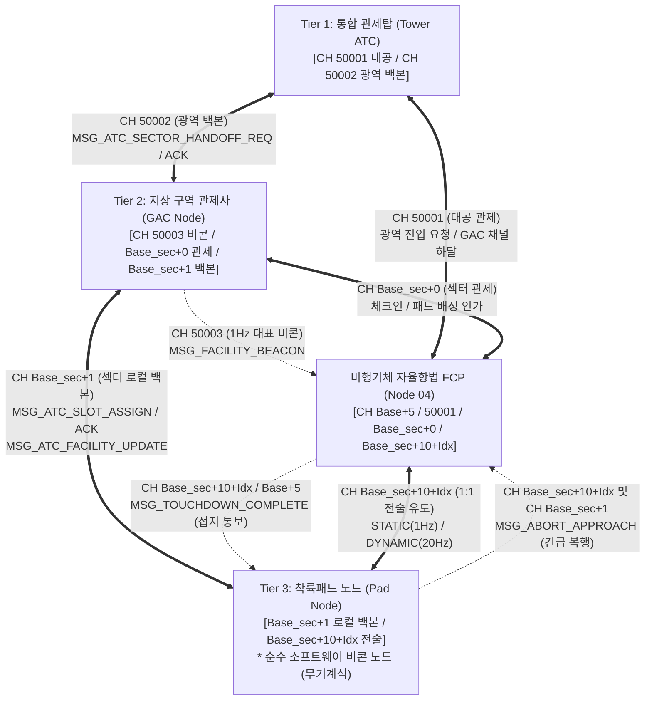
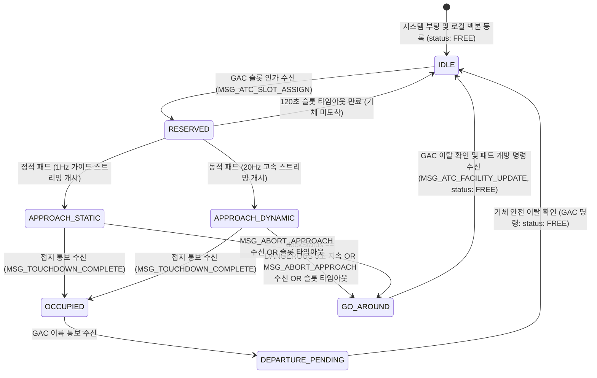
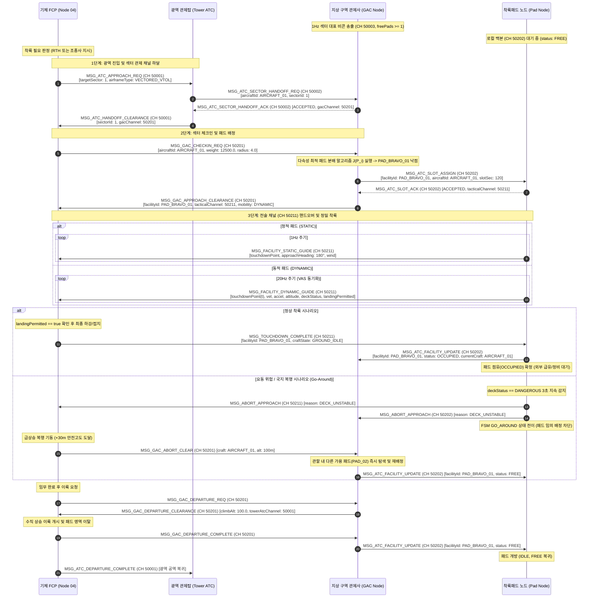

# 착륙패드 시스템 및 통신 인터페이스 제어 규격서 (ICD)
> **Landing Pad System Specification & Interface Control Document (ICD)**  
> **프로젝트**: Universal Autonomous Flight Stack (SAS · VAS · Ground Infrastructure)  
> **대상 환경**: Minecraft CC:Tweaked (Ender Modem), Create: Aeronautics, Create: Avionics  

| 항목 | 내용 |
| :--- | :--- |
| **문서 상태 (Status)** | `Approved` |
| **문서 버전 (Version)** | `v2.2.5` |
| **최종 수정일 (Date)** | `2026-11-07` |
| **구현 코드 (Source)** | `src/0_infra/landing_pad/` |
| **주관 도메인 (Domain)** | 지상 인프라 수직이착륙 착륙패드 비콘 (Landing Pad) |

### Revision History

| 버전 | 일자 | 개정 요약 | 개정 사유 |
| :--- | :--- | :--- | :--- |
| `v2.2.5` | 2026-11-07 | 사양서 및 코드 디렉토리 `0_ground` → `0_infra` 통합 이동 및 경로 동기화 | 지상 인프라 체계 단일화 구조 개편 |
| `v2.2.4` | 2026-11-07 | 40채널 확장 및 표준 메타데이터 표 적용 | Phase 0 ICD 동기화 |


> **연관 규격서**: 
> - [AUTONOMOUS_FLIGHT_SYSTEM_ARCHITECTURE_AND_ICD.md](../../../system/AUTONOMOUS_FLIGHT_SYSTEM_ARCHITECTURE_AND_ICD.md) (마스터 ICD v1.20.1)
> - [GAC_PROGRAM_SPECIFICATION_AND_ICD.md](../gac/GAC_PROGRAM_SPECIFICATION_AND_ICD.md) (GAC 관제사 규격서 v1.1.4)
> - [SYSTEM_PROGRAM_RELATION_AND_PACKET_DIAGRAM.md](../../../system/SYSTEM_PROGRAM_RELATION_AND_PACKET_DIAGRAM.md) (전체 관계도 v2.6.0)
> - [GPS_PROGRAM_SPECIFICATION_AND_ICD.md](../gps/GPS_PROGRAM_SPECIFICATION_AND_ICD.md) (GPS 규격서 v2.0.4)
> - [FCP_PROGRAM_SPECIFICATION.md](../../2_guidance/fcp/FCP_PROGRAM_SPECIFICATION.md) (FCP 비행 제어 규격서 v1.9.0)
> - [VAS_PROGRAM_SPECIFICATION.md](../../1_control/vas/VAS_PROGRAM_SPECIFICATION.md) (비행 제어 코어 v1.11.0)
> - [RUNWAY_SPECIFICATION_AND_ICD.md](../runway/RUNWAY_SPECIFICATION_AND_ICD.md) (활주로 규격서 v1.10.5)
> - [DOCKING_ARM_SPECIFICATION_AND_ICD.md](../docking_arm/DOCKING_ARM_SPECIFICATION_AND_ICD.md) (도킹암 규격서 v1.10.5)

---

## 1. 개요 및 시스템 범위 (Overview & System Scope)

본 문서는 수직이착륙(VTOL) 기체의 안전한 지상 접근, 정밀 수직 하강 터치다운 및 공역 점유 관리를 관할하는 **착륙패드(Landing Pad) 노드**의 통신 프로토콜, 동역학 스트리밍, 상위 관제 백본 인터페이스, 상태 머신(FSM) 및 갑판 안정성 판정 알고리즘을 정의한 단독 완결형 세부 규격서입니다.

### 1.1 핵심 설계 원칙
1. **순수 가상 좌표 비콘화 및 광역 비콘 상위 위임 (Pure Virtual Coordinate & Aggregated Beacon)**:
   - 착륙패드는 복잡한 기계식 클램프, 갠트리, 피스톤 또는 바닥 물리 센서(압력판 등)를 일절 두지 않는 **순수 경량 항법 및 통신 노드**로 동작합니다.
   - CC:Tweaked 무선 모뎀 큐 과부하 및 채널 간섭을 방지하기 위해, 패드 노드는 `CH 50003` 광역 비콘을 직접 송출하지 않고 **상위 지상 구역 관제사(GAC)에게 섹터 집약 비콘(`MSG_FACILITY_BEACON`) 송출을 위임**합니다.
   - 모든 점유/진입 제어는 무선 모뎀 패킷 교신(`MSG_TOUCHDOWN_COMPLETE`, `MSG_ATC_SLOT_ASSIGN`)을 통해서만 소프트웨어적으로 관리됩니다.
2. **지상 구역 관제사(GAC) 관할 및 3-Tier 계층 제어 모델**:
   - 패드는 최상위 광역 관제탑(Tower ATC)과 직접 교신하지 않고, 직속 **지상 구역 관제사(GAC)**의 섹터 로컬 백본망(`CH_SECTOR_FACILITY` = $Base_{\text{sec}} + 1$)을 통해서만 슬롯 예약 및 상태 갱신을 수행합니다.
   - 패드는 1회 1기체 독점 점유(**FIFO 점유 모델**)로 운영되며, 착륙한 기체가 이륙할 때까지 무기한 `OCCUPIED`를 유지합니다. 후속 진입 기체는 GAC에 의해 공중 선회 대기(Loiter) 또는 관할 내 가용 타 패드로 자동 분산됩니다.
3. **유도 역할 분담 경계 (Guidance Responsibility Boundary)**:
   - **착륙패드 노드**: 터치다운 중심 좌표(`touchdownPoint`), 기본 물리 제원(`dimensions`, `maxWeight`), 접근 권장 헤딩(`approachHeading`), 최대 허용 하강률(`safeDescentRate`), 안전 반경(`clearanceZoneRadius`) 및 지상풍(`surfaceWind`) 등 환경 구속조건만을 브로드캐스트합니다.
   - **기체 FCP (Node 04)**: 패드가 제공한 구속조건을 바탕으로 다단계 수직 강하(상공 진입 정렬 $\to$ 정속 수직 강하 $\to$ 지면효과 감속 플레어 $\to$ 접지) 및 스로틀/추력 자세 제어를 전담합니다.
4. **정적(Static) / 동적(Dynamic) 시설물 분리 모델링**:
   - **고정형 착륙패드 (Static Pad)**: 육상 기지 고정 패드. 좌표 불변이므로 속도/가속도 벡터 필드를 전송하지 않고 1Hz 하트비트만 유지하여 무선 트래픽을 최적화합니다.
   - **이동형 착륙패드 (Dynamic Pad)**: 해상 바지선, 기동 모선, 열차 상부 패드. 실시간 3D 위치, 속도 벡터($\vec{v}$), 가속도 벡터($\vec{a}$), 요동(Pitch/Roll)과 함께 **갑판 안정성 판정 플래그(`deckStatus`, `landingPermitted`)**를 20Hz로 스트리밍하여 기체의 랑데부 항법을 지원합니다.
5. **소프트웨어 중심 접지 판정 및 지상 서비스 분리**:
   - 기체의 온보드 센서(고도계 하강 정지 $v_y \approx 0$ 또는 바퀴 센서)가 접지를 확인하고 무선 패킷(`MSG_TOUCHDOWN_COMPLETE`)을 송출하면 즉시 패드 점유(`OCCUPIED`)로 전환하고 직속 GAC에 상태를 보고합니다.
   - 연료 급유 및 배터리 충전 등 지상 서비스(Ground Servicing)는 패드 노드의 기계 구동 인터록에서 분리되어, 착륙 후 독립된 외부 지상 요원/장비에 의해 선택적으로 수행됩니다.
6. **페일세이프 및 GAC 경유 국지 복행(Go-Around) 안전 인터록**:
   - 동적 패드 20Hz 구간에서 패킷 두절 발생 시 기체 UAP가 즉시 300ms 타임아웃을 감지하여 복행합니다. 패드는 요동 위험(`deckStatus == "DANGEROUS"`) 3초 지속, 명시적 `MSG_ABORT_APPROACH` 수신 또는 슬롯 타임아웃(120초) 시 `GO_AROUND` 상태로 전이합니다.
   - 패드는 복행 기체가 안전 복행 고도로 이탈하여 GAC가 패드 개방 명령(`MSG_ATC_FACILITY_UPDATE`, status: `FREE`)을 하달할 때까지 `GO_AROUND` 격리 상태를 유지하여 공역 경쟁 상태(Race Condition)를 영구 차단합니다.

---

### 1.2 GPS 광역 항법 $\rightarrow$ 계층 관제 $\rightarrow$ 수직 착륙 전술 유도 연계 인터페이스 (Hierarchical Transition)
1. **광역 항법 단계 (GPS Waypoint Navigation)**:
   - 기체 UAP는 `CH_FACILITY_BEACON` (50003)에서 GAC가 집약 송출하는 섹터 대표 비콘을 수신하고, 중앙 GPS 체계(`CH_GPS_PING` 60001 / `Base+5`)를 이용하여 목적지 섹터 상공 50~100m 지점(Initial Approach Fix)까지 장거리 자율 비행을 수행합니다.
2. **2단계 관제 인가 및 핸드오프 (Two-Stage Handoff)**:
   - 기체 UAP는 Tower ATC(`CH 50001`)로 진입을 요청하여 관할 GAC 섹터 채널($Base_{\text{sec}} + 0$)을 하달받습니다.
   - UAP는 섹터 채널로 주파수를 변경하여 GAC에 체크인(`MSG_GAC_CHECKIN_REQ`)하고, GAC는 다속성 분배를 통해 가용 착륙패드에 슬롯을 배정(`MSG_ATC_SLOT_ASSIGN` via $Base_{\text{sec}} + 1$)한 후 UAP에 패드 전술 채널(`CH_TACTICAL_GUIDANCE` = $Base_{\text{sec}} + 10 + \text{Idx}$)을 최종 하달합니다.
3. **전술 정밀 착륙 및 GPS 안전 백업**:
   - UAP는 전술 채널로 핸드오버하여 1Hz(정적 패드) 또는 20Hz(동적 패드)의 전술 가이드(`MSG_FACILITY_STATIC/DYNAMIC_GUIDE`)를 수신하며 수직 하강을 완수합니다.
   - **GPS 페일소프트 백업**: 정적 고정 패드의 경우 전술 무선 통신이 일시 두절되더라도 기체는 사전에 수신된 패드 정적 좌표와 중앙 GPS 수평 좌표($X, Z$), 온보드 고도계($Y$)를 결합하여 비상 복행 없이 안전 착륙을 완수합니다 (타임아웃 복행 면제 규격 준수).

---

### 1.3 코드 경량화 및 Deprecated 운영 정책 (Code Lightweighting & Deprecation Policy)
1. **사양서 명세 원칙 (Specification-First)**: 프로토콜 패킷 타입명 또는 페이로드 필드가 개정될 경우, 구버전 명칭은 사양서 내에 `[DEPRECATED]` 배지를 부여하고 대체 신규 필드명과 변경 이력을 명시하여 문서상에 보존합니다.
2. **코드베이스 경량화 원칙 (Zero-Fallback)**: CC:Tweaked Lua 분산 컴퓨터 환경의 자원 제약(메모리 절약, 20Hz 실시간 루프 성능 보장)을 준수하기 위해, 코드베이스는 사전 이중 호환(Fallback 래퍼, `payload.new or payload.old` 등)을 일체 작성하지 않고 **최신 표준 필드명/패킷명만을 단일 채택**합니다.
3. **런타임 오류 시 복구 원칙 (송신 노드 즉시 패치)**: 구버전 필드/패킷을 전송하는 미갱신 노드로 인해 수신 측에서 `nil` 인덱싱 등의 런타임 오류가 발생할 경우, 수신 측에 임시 폴백 코드를 추가하지 않고 **구버전 패킷을 송신한 발신 노드의 코드를 최신 사양으로 즉시 패치 및 재배포**하여 전역 일원화를 달성합니다.

---

## 2. 네트워크 채널 및 노드 토폴로지 (Network Channels & Topology)

착륙패드 시스템은 물리 구동 장치 없이 컴퓨터 본체와 무선 모뎀(Ender Modem)만으로 구성된 순수 무선(All-Wireless) 경량 네트워크를 사용하며, 직속 GAC가 관할하는 섹터 로컬 백본망에 귀속됩니다.



### 2.1 채널 할당 표
| 채널 번호 | 채널 식별자 | 송신자 | 수신자 | 전송 주기 | 통신 목적 및 내용 |
| :---: | :---: | :---: | :---: | :---: | :--- |
| **`50001`** | `CH_ATC_COMM` | SAS / Tower ATC | Tower ATC / SAS | 이벤트 | 대공 광역 관제 및 관할 GAC 섹터 채널 이양 교신 |
| **`50002`** | `CH_ATC_FACILITY` | Tower ATC / GAC | GAC / Tower ATC | 1Hz / 이벤트 | 광역 관제탑과 GAC 간 섹터 핸드오프 교신 |
| **`50003`** | `CH_FACILITY_BEACON` | GAC Node (대표) | All (SAS, MFD) | 1Hz | **Sector 0 대표 집약 비콘**: 관할 구역 요약 정보 및 가용 현황 송출 (개별 패드는 직접 송출 중단) |
| **$Base_{\text{sec}} + 0$** | `CH_GAC_COMM` | SAS / GAC | GAC / SAS | 이벤트 | 기체 체크인(`MSG_GAC_CHECKIN_REQ`), 패드 배정 인가(`MSG_GAC_APPROACH_CLEARANCE`), 로컬 복행 ($Base_{\text{sec}} = 50001 + S \times 200$) |
| **$Base_{\text{sec}} + 1$** | `CH_SECTOR_FACILITY` | Pad Node / GAC | GAC / Pad Node | 1Hz / 이벤트 | **직속 섹터 로컬 백본**: GAC와 패드 간 슬롯 예약(`MSG_ATC_SLOT_ASSIGN/ACK`), 상태 동기화(`MSG_ATC_FACILITY_UPDATE`), 복행 제어 |
| **$Base_{\text{sec}} + 10 + \text{Idx}$** | `CH_TACTICAL_GUIDANCE` | Pad Node / SAS | SAS / Pad Node | 1Hz (정적)<br/>20Hz (동적) | **1:1 정밀 전술 유도 스트리밍** (`MSG_FACILITY_STATIC/DYNAMIC_GUIDE`), 접지 통보 (`MSG_TOUCHDOWN_COMPLETE`), 복행 지시 (`MSG_ABORT_APPROACH`) |
| **`Base + 5`** | `CH_EXTERNAL_COMM` | Pad Node | FCP (Node 04) | 이벤트 | 기체 전용 응답 채널 (점유 확인 통보) |

---

## 3. 통신 패킷 상세 규격 (Message Envelope & Payload Specification)

모든 통신은 표준 공통 Lua 테이블 엔벨로프(`ver`, `domainId`, `seq`, `type`, `time`, `payload`)를 필수 준수합니다.

### 3.1 광역 상태 비콘 (`MSG_FACILITY_BEACON`, CH 50003, 1Hz)
> [!NOTE]
> **GAC 집약 송출 원칙**: 본 패킷은 개별 패드가 독립 송출하지 않고, 상위 지상 구역 관제사(GAC)가 관할 구역 내 시설물 전체 현황을 수집하여 단일 대표 패킷으로 송출합니다. 패드 노드는 평시 CH 50003을 열지 않아 무선 모뎀 수신 큐를 절약합니다.
```lua
{
    ver = "1.9.5",
    domainId = "GAC_APRON_01",
    seq = 10021,
    type = "MSG_FACILITY_BEACON",
    time = 1729850000000,
    payload = {
        sectorId = 1,
        gacChannel = 50201,                  -- 해당 섹터 관제 채널 (Base_sec + 0)
        totalPads = 4,
        freePads = 3,
        maxSupportedWeight = 45000.0,
        maxClearanceRadius = 6.0,
        surfaceWind = { speed = 2.4, direction = 195.0 }
    }
}
```

---

### 3.2 고정 패드 정밀 유도 패킷 (`MSG_FACILITY_STATIC_GUIDE`, $Base_{\text{sec}}+10+\text{Idx}$, 1Hz)
좌표가 불변인 육상 고정 패드 전용 패킷입니다. 속도/가속도 필드가 제외되어 대역폭을 절감합니다.
```lua
{
    ver = "1.9.5",
    domainId = "PAD_BRAVO_01",
    seq = 10450,
    type = "MSG_FACILITY_STATIC_GUIDE",
    time = 1729850010000,
    payload = {
        facilityId = "PAD_BRAVO_01",
        targetAircraft = "AIRCRAFT_01",
        touchdownPoint = {                   -- 정밀 터치다운 중심 좌표 (Minecraft World Coordinates: X_MC, Y_MC, Z_MC)
            x = 1250.0,
            y = 65.0,
            z = -820.0
        },
        approachHeading = 180.0,             -- 권장 진입 헤딩 (deg, 진북 0°)
        safeDescentRate = 1.0,               -- 최대 허용 수직 하강률 (m/s)
        clearanceZoneRadius = 5.0,           -- 안전 반경 (m)
        surfaceWind = {                      -- 지상 국지풍 정보
            speed = 2.4,                     -- 풍속 (m/s)
            direction = 195.0                -- 풍향 (풍상 방위각, deg)
        },
        abortAlert = false                   -- 긴급 복행 요구 플래그 (true 시 즉시 Go-Around)
    }
}
```

---

### 3.3 동적 패드 실시간 동역학 스트리밍 (`MSG_FACILITY_DYNAMIC_GUIDE`, $Base_{\text{sec}}+10+\text{Idx}$, 20Hz)
바지선, 항공모함, 열차 등 이동 플랫폼 상의 패드 전용 패킷입니다. 실시간 3축 동역학과 함께 **갑판 안정성 판정 결과(`deckStatus`, `landingPermitted`)**를 포함하여 20Hz로 송출됩니다.
```lua
{
    ver = "1.9.5",
    domainId = "BARGE_PAD_02",
    seq = 45100,
    type = "MSG_FACILITY_DYNAMIC_GUIDE",
    time = 1729850020050,
    payload = {
        facilityId = "BARGE_PAD_02",
        targetAircraft = "AIRCRAFT_01",
        touchdownPoint = {                   -- 현재 시각 t에서의 패드 중심 3D 위치
            x = 840.25,
            y = 62.10,
            z = 1120.80
        },
        velocity = {                         -- 패드 3축 이동 속도 벡터 (m/s)
            vx = 6.20,
            vy = -0.15,                      -- 파도에 의한 상하 요동 (Heave)
            vz = 1.10
        },
        acceleration = {                     -- 패드 3축 이동 가속도 벡터 (m/s²)
            ax = 0.05,
            ay = 0.85,
            az = -0.02
        },
        attitude = {                         -- 패드 갑판 3축 자세각 (deg)
            pitch = 1.2,
            roll = -2.5,
            yaw = 85.0
        },
        angularRates = {                     -- 3축 각속도 (deg/s)
            pitchRate = 0.4,
            rollRate = -0.8,
            yawRate = 0.05
        },
        -- 갑판 요동 실시간 안전 판정 플래그 (Section 5.2 수식 연동)
        deckStatus = "STABLE",               -- "STABLE" (θ_tilt <= 10.0° and |vy| <= 2.5m/s) | "DANGEROUS"
        landingPermitted = true,             -- true: 최종 접지 허용, false: 호버 유지/접지 보류
        tiltAngleDeg = 2.77,                 -- 현재 합성 경사각 sqrt(pitch^2 + roll^2)
        heaveRateMps = -0.15,                -- 현재 수직 요동 속도 vy
        abortAlert = false                   -- 복행 발동 플래그
    }
}
```

---

### 3.4 접지 통보 인터페이스 (`MSG_TOUCHDOWN_COMPLETE`, $Base_{\text{sec}}+10+\text{Idx}$ / Base+5 $\rightarrow$ Pad / GAC)
기체의 온보드 제어기(수직 하강 정지 $v_y \approx 0$)가 물리 접지를 판정했을 때 송출하여 패드 상태를 즉시 `OCCUPIED`로 전이시키고 직속 GAC에 통보합니다.
```lua
{
    ver = "1.9.5",
    domainId = "AIRCRAFT_01",
    seq = 512,
    type = "MSG_TOUCHDOWN_COMPLETE",
    time = 1729850025000,
    payload = {
        facilityId = "PAD_BRAVO_01",
        touchdownTime = 1729850025000,
        craftState = "GROUND_IDLE"
    }
}
```

---

### 3.5 GAC 섹터 로컬 백본 통신 패킷 규격 ($Base_{\text{sec}} + 1$)

#### 1. GAC 슬롯 할당 (`MSG_ATC_SLOT_ASSIGN`, $Base_{\text{sec}}+1$, GAC $\rightarrow$ Pad)
직속 GAC가 기체에게 최종 접근 인가를 내리기 전 패드 노드에 슬롯을 배정합니다.
```lua
{
    ver = "1.9.5",
    domainId = "GAC_APRON_01",
    seq = 501,
    type = "MSG_ATC_SLOT_ASSIGN",
    time = 1729850005000,
    payload = {
        facilityId = "PAD_BRAVO_01",
        aircraftId = "AIRCRAFT_01",
        airframeType = "VECTORED_VTOL",
        slotDurationSec = 120,               -- 유효 슬롯 제한시간 (초)
        tacticalChannel = 50211              -- 전술 채널 (Base_sec + 10 + FacilityID)
    }
}
```

#### 2. 패드 슬롯 응답 (`MSG_ATC_SLOT_ACK`, $Base_{\text{sec}}+1$, Pad $\rightarrow$ GAC)
패드 노드가 직속 GAC의 슬롯 배정 요청을 승인 또는 거절합니다.
```lua
{
    ver = "1.9.5",
    domainId = "PAD_BRAVO_01",
    seq = 10451,
    type = "MSG_ATC_SLOT_ACK",
    time = 1729850005100,
    payload = {
        facilityId = "PAD_BRAVO_01",
        aircraftId = "AIRCRAFT_01",
        status = "ACCEPTED",                 -- "ACCEPTED" | "REJECTED"
        rejectReason = nil,                  -- "OCCUPIED", "MAINTENANCE", "OVERWEIGHT"
        tacticalChannel = 50211
    }
}
```

#### 3. 패드 상태 갱신 통보 (`MSG_ATC_FACILITY_UPDATE`, $Base_{\text{sec}}+1$, Pad $\leftrightarrow$ GAC 양방향)
공유 로컬 백본 상에서 시설물 간 충돌을 방지하기 위해 엄격한 `facilityId` 타겟팅 단일 스키마를 적용합니다.
```lua
{
    ver = "1.9.5",
    domainId = "PAD_BRAVO_01",              -- 발신자에 따라 PAD_BRAVO_01 또는 GAC_APRON_01
    seq = 10452,
    type = "MSG_ATC_FACILITY_UPDATE",
    time = 1729850025100,
    payload = {
        facilityId = "PAD_BRAVO_01",
        status = "OCCUPIED",                 -- "FREE", "RESERVED", "OCCUPIED", "MAINTENANCE"
        currentCraft = "AIRCRAFT_01"         -- FREE 전환 시 nil
    }
}
```

#### 4. 긴급 복행 지시 (`MSG_ABORT_APPROACH`, $Base_{\text{sec}}+10+\text{Idx}$ 및 $Base_{\text{sec}}+1$)
패드 또는 GAC가 접근 중인 기체에 즉시 복행을 하달합니다.
```lua
{
    ver = "1.9.5",
    domainId = "PAD_BRAVO_01",              -- 패드 발신 시 PAD_BRAVO_01, GAC 발신 시 GAC_APRON_01
    seq = 10455,
    type = "MSG_ABORT_APPROACH",
    time = 1729850022000,
    payload = {
        facilityId = "PAD_BRAVO_01",
        aircraftId = "AIRCRAFT_01",
        reason = "DECK_UNSTABLE",            -- "DECK_UNSTABLE", "OBSTACLE_DETECTED", "GAC_ORDER", "TIMEOUT"
        recommendedClimbAltitude = 100.0     -- 안전 복행 권장 고도 (m)
    }
}
```

> [!NOTE]
> **무기계식 경량화 원칙**: 본 착륙패드는 순수 가상 좌표 비콘으로 운영되므로, 물리 클램프 체결(`MSG_PAD_CLAMP_STATUS`) 및 자동 급유/충전 스트리밍(`MSG_PAD_SERVICE_STATUS`) 패킷 시퀀스가 배제되었습니다. 급유 및 정비는 착륙 완료 후 별도의 외부 지상 지원 장비 또는 작업자에 의해 수동/선택적으로 처리됩니다.

---

## 4. 유한 상태 기계 및 동작 시퀀스 (FSM & Sequence)

### 4.1 착륙패드 FSM 상태 전이도



### 4.2 착륙 및 이륙 3-Tier 관제 시퀀스 다이어그램



---

## 5. 수치해석 및 페일세이프 알고리즘 (Algorithms & Failsafe)

### 5.1 동적 패드 2차 추측항법 보간 (Dead Reckoning Extrapolation)
동적 패드 모드에서 기체 UAP는 지연 시간 $\Delta t = (t_{current} - t_{packet})$ 동안 테일러 2차 확장을 적용하여 실시간 유도 오차를 산출합니다.

$$\vec{p}_{pad}(t) = \vec{p}_0 + \vec{v}_0 \Delta t + \frac{1}{2} \vec{a}_0 \Delta t^2$$

$$\vec{v}_{pad}(t) = \vec{v}_0 + \vec{a}_0 \Delta t$$

기체 요구 가속도 피드포워드 벡터:
$$\vec{a}_{cmd} = \vec{a}_{pad}(t) + K_p (\vec{p}_{pad}(t) - \vec{p}_{craft}) + K_d (\vec{v}_{pad}(t) - \vec{v}_{craft})$$

---

### 5.2 동적 패드 갑판 안정성(Deck Stability) 수학적 모델

동적 착륙패드는 20Hz 실행 루프에서 센서 텔레메트리(Pitch, Roll, 수직속도 $v_y$)를 기반으로 갑판 요동 안정성을 매 틱 평가합니다:

1. **합성 경사각 연산 (Combined Deck Tilt)**:
   $$\theta_{tilt} = \sqrt{\theta_{pitch}^2 + \theta_{roll}^2} \quad [\text{deg}]$$

2. **안정성 상태 평가 (Stability State Evaluation)**:
   $$\text{deckStatus} = \begin{cases} \text{"STABLE"}, & \text{if } \theta_{tilt} \le 10.0^\circ \text{ and } |v_{y,pad}| \le 2.5\text{ m/s} \\ \text{"DANGEROUS"}, & \text{otherwise} \end{cases}$$

3. **최종 접지 인가 플래그 (Landing Permitted Flag)**:
   $$\text{landingPermitted} = (\text{deckStatus} == \text{"STABLE"})$$

- 기체 UAP는 `landingPermitted == true`일 때만 최종 지면 접지 터치다운을 수행하며, `deckStatus == "DANGEROUS"` 상태에서는 상공 3~5m 지점에서 호버 홀드(Hover Hold)를 유지합니다. 만약 위험 상태가 3.0초 이상 지속되면 패드 노드가 `MSG_ABORT_APPROACH`를 송출하여 강제 복행을 발동합니다.

---

### 5.3 페일세이프 임계값 및 대응 매트릭스
| 이상 상황 | 감지 조건 | 적용 대상 | 페일세이프 조치 |
| :--- | :--- | :---: | :--- |
| **무선 하트비트 두절** | 최종 접근 중 $300\text{ms}$ 무수신 (기체 SAS 단독 감지) | 동적 패드 | 즉시 수직 상승 가속, 복행 명령 발동, GAC 섹터 관제선 복귀 |
| **무선 하트비트 두절** | 무신호 지속 | 고정 패드 | **복행 면제**: 정적 좌표 기반 GPS/고도계로 착륙 강행 |
| **갑판 동역학 위험 요동** | $\theta_{tilt} > 10.0^\circ$ 또는 $\|v_{y,pad}\| > 2.5\text{ m/s}$ 3.0초 지속 | 동적 패드 | 패드가 `MSG_ABORT_APPROACH` 발신, 기체 급상승 복행 |
| **지상 장애물 감지** | 초음파/적외선/관제 센서 차폐 | 공통 | 패드 노드가 `MSG_ABORT_APPROACH` 즉시 송출, 기체 급상승 복행 |
| **접지 미확인 타임아웃** | 최저 강하 고도 도달 후 $10.0\text{초}$ 초과 | 공통 | 착륙 중단, 복행 고도로 상승 후 체공 선회 |
| **슬롯 만료 타임아웃** | 슬롯 인가 후 $120\text{초}$ 동안 접지 미보고 | 공통 | 패드 `GO_AROUND` 전이 후 GAC에 슬롯 만료 보고 및 `FREE` 리셋 |
