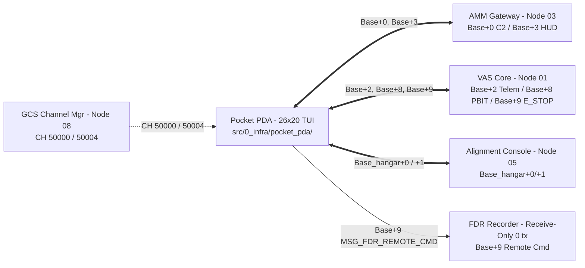
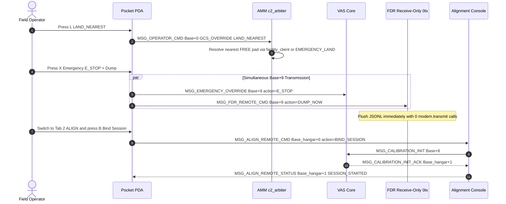

# Pocket PDA (휴대용 원격 관제·지상 콘솔 링크·비상 E_STOP 단말) 상세 규격서

> **Pocket PDA: Portable Remote C2, Telemetry HUD, Ground Alignment/FDR Link & Instant E_STOP Terminal**  
> **프로젝트**: Universal Autonomous Flight Stack (UAFS Ecosystem)  
> **대상 환경**: Minecraft CC:Tweaked (Pocket Computer `26×20`, Wireless/Ender Modem), Create: Aeronautics, Create: Avionics

| 항목 | 내용 |
| :--- | :--- |
| **문서 상태 (Status)** | `Approved` |
| **문서 버전 (Version)** | `v1.0.0` |
| **최종 수정일 (Date)** | `2026-11-21` |
| **구현 코드 (Source)** | `src/0_infra/pocket_pda/` |
| **주관 도메인 (Domain)** | 휴대용 원격 관제·지상 콘솔 링크·비상 E_STOP 단말 (Pocket PDA) |

> **연관 문서**:
> - [AUTONOMOUS_FLIGHT_SYSTEM_ARCHITECTURE_AND_ICD.md](../../../system/AUTONOMOUS_FLIGHT_SYSTEM_ARCHITECTURE_AND_ICD.md) (마스터 ICD)
> - [SYSTEM_PROGRAM_RELATION_AND_PACKET_DIAGRAM.md](../../../system/SYSTEM_PROGRAM_RELATION_AND_PACKET_DIAGRAM.md) (전체 구조도)
> - [AMM_PROGRAM_SPECIFICATION.md](../../3_planning/amm/AMM_PROGRAM_SPECIFICATION.md) (임무 관리자 및 C2 중재 게이트웨이)
> - [VAS_PROGRAM_SPECIFICATION.md](../../1_control/vas/VAS_PROGRAM_SPECIFICATION.md) (비행 제어 코어)
> - [GCS_PROGRAM_SPECIFICATION_AND_ICD.md](../gcs/GCS_PROGRAM_SPECIFICATION_AND_ICD.md) (GCS 채널 관리자 및 관제 콘솔)
> - [ALIGNMENT_PROGRAM_SPECIFICATION.md](../../0_development/alignment/ALIGNMENT_PROGRAM_SPECIFICATION.md) (격납고 지상 교정 콘솔)
> - [FDR_PROGRAM_SPECIFICATION.md](../../0_development/fdr/FDR_PROGRAM_SPECIFICATION.md) (지상 실환경 비행 식별·계측기)
> - [GDRIVE_DEPLOYMENT_GUIDE.md](../../../guides/GDRIVE_DEPLOYMENT_GUIDE.md) (Google Drive 배포 가이드)
> - [GEMINI.md](../../../../GEMINI.md) (전역 컨텍스트 및 불변식)

### Revision History

| 버전 | 개정 일자 | 개정 요약 | 개정 사유 |
| :---: | :---: | :--- | :--- |
| `v1.0.0` | `2026-11-21` | **신규 사양서 제정 및 `/grill-me` 결정(`R1`–`R5`) 기반 `Approved` 승격**: ① `26×20` 3-탭(`HUD`/`ALIGN`/`FDR`) Pocket TUI 및 듀얼 기체 선택(`[ < > ]`/`[Tab]`) 규격 수립, ② 글로벌 단일키 `[X]` 즉시 `E_STOP`(`MSG_EMERGENCY_OVERRIDE`) + `FDR` `DUMP_NOW`(`MSG_FDR_REMOTE_CMD`) 동시 송출 및 `FDR` 무송신 불변식(`0 tx`) 명문화, ③ `[L]` `LAND_NEAREST` 온보드 `AMM` `c2_arbiter` 최근접 빈 시설 자동 선택 및 `EMERGENCY_LAND` 폴백 규약 수립, ④ `[I-4]` `MSG_ALIGN_REMOTE_CMD`/`MSG_ALIGN_REMOTE_STATUS` 전 생명주기 원격 격납고 교정 제어 프로토콜 신설 | `TASK-302` (`TASK-302-1..4`) Spec-First 아키텍처 기준선 확립 |

---

## 1. 프로그램 개요 및 휴대용 운용 역할 (Overview & Portable Operational Role)

**Pocket PDA**는 조종사·비행시험 엔지니어가 월드 내에서 직접 휴대하는 **CC:Tweaked Pocket Computer(`26×20`) 기반 원격 C2·실시간 계측·지상 콘솔 통합 링크·비상 E_STOP 단말**입니다. 고정형 `51×19` 데스크톱 콘솔(`GCS`)과 별도로 현장 이동 중에도 즉시 기체 상태를 확인하고, 단일 키로 `E_STOP` 및 비행 데이터 덤프를 트리거하며, 격납고 `Alignment`와 `FDR` 지상 서버를 원격 제어하도록 설계되었습니다.

### 1.1 핵심 운용 역할 4대 축
1. **실시간 텔레메트리 HUD 및 무선 링크 품질 감시 (`[1]HUD`)**:
   - 대상 기체 $N \in [1, 1000]$의 `Base + 3` (`MSG_MFD_STATE`)과 `Base + 2` (`MSG_FLIGHT_TELEMETRY`)를 수신하여 자세(쿼터니언 → 오일러 변환 지원), 고도/승강률/대지속도, 연료, FSM 상태를 `26×20` 화면에 표출합니다.
   - `modem_message` 이벤트의 `senderDistance` 및 마지막 수신 경과 시간(`age_ms`)을 바탕으로 링크 품질 계층(`STRONG` / `GOOD` / `WEAK` / `LOST` / `ENDER`)을 실시간 산출합니다.
   - `CH 50000` (`MSG_BLOCK_ASSIGN`) 및 `CH 50004` (`MSG_MISSION_ACK`)를 수동 스누핑하여 편대 기체 목록을 자동 발견하고 `[Tab]`으로 순환 선택합니다.
2. **글로벌 단일 키 `[X]` 비상 차단 및 즉시 `FDR` 덤프 (`R1`, `R2`)**:
   - 어느 탭에서든 `[X]` 입력 시 확인 프롬프트 없이 `Base + 9` (`CH_EMERGENCY_CORE`)로 `MSG_EMERGENCY_OVERRIDE` (`action = "E_STOP"`)와 `MSG_FDR_REMOTE_CMD` (`action = "DUMP_NOW"`)를 동시 송출합니다.
   - `FDR`이 다른 기체 인덱스(`fdrBoundIndexN ~= N`)에 바인딩된 상태에서도 `fdrBoundBase + 9`와 `targetBase + 9` 양쪽으로 `DUMP_NOW`를 이중 송신하여 `RING_BUFFER`/`PAUSED`/기존 `estopFlushed` 여부와 무관하게 즉각 JSONL 디스크 플러시를 실행합니다.
3. **전술 C2 지휘 및 최근접 빈 착륙 시설 자동 귀환 (`R3`)**:
   - `[H]` (`HOVER_HOLD`), `[R]` (`RTB` → `FAILSAFE_RTH`), `[L]` (`LAND_NEAREST`)를 `Base + 0` (`MSG_OPERATOR_CMD`, `authority = "GCS_OVERRIDE"`)으로 송출합니다.
   - `LAND_NEAREST`는 Pocket PDA가 시설물 좌표를 직접 연산하지 않고, 기체 온보드 `AMM` `c2_arbiter`가 보유한 `facility_client` 비콘 인벤토리에서 가장 가까운 `FREE` 착륙 패드/활주로를 선별하며, 가용 시설이 없으면 즉시 `EMERGENCY_LAND`로 폴백합니다.
4. **지상 인프라 원격 세션 제어 (`[2]ALIGN`, `[3]FDR`, `R1`, `R4`)**:
   - **`Alignment` 원격 제어 (`[I-4]`)**: $Base_{\text{hangar}} + 0$으로 `MSG_ALIGN_REMOTE_CMD`를 송출하고 $Base_{\text{hangar}} + 1$에서 `MSG_ALIGN_REMOTE_STATUS`, `MSG_CALIBRATION_INIT_ACK`, `MSG_CALIB_ACK`, `MSG_CALIBRATION_CLOSE_ACK`를 수신하여 세션 바인딩부터 펄스·일시정지·재시도·승인 동기화·중단·채널 해제까지 전 생명주기를 원격 조종합니다.
   - **`FDR` 원격 제어 (`[I-2]`)**: `FDR`의 `modem.transmit == 0` 무송신 불변식을 유지한 채 `Base + 9`로 `MSG_FDR_REMOTE_CMD`를 단방향 송신하고, Pocket PDA 내부 `link_state.fdr`를 낙관적으로 동기화합니다.

### 1.2 멀티 코드베이스 독립성 및 모뎀 해석 규격
- **코드베이스 격리**: `src/0_infra/pocket_pda/`는 타 서브시스템(`amm`, `vas`, `gcs`, `alignment`, `fdr`)의 Lua 모듈을 직접 `require()`하지 않는 독립 완결형 코드베이스입니다.
- **인스톨러 매니페스트 정합**: `src/0_development/installer/modules/manifest.lua`에 `id = "pocket_pda"`, `category = "infra"`로 등록하며, `verify_manifest_sync.py` 규약에 따라 `/lib/avionics_sensors.lua` 번들 항목을 포함합니다.
- **모뎀 페리페럴 안전 탐색 (`resolve_modem`)**: `cfg.modemSide`(기본 `"back"`) 래핑 전 반드시 `peripheral.getType(side) == "modem"` 여부를 검사합니다. 만약 `back` 슬롯이 모니터 등 타 페리페럴이면(예: `run_boot_smoke.py` 모의 환경), `peripheral.find("modem")`으로 무선 모뎀을 폴백 탐색합니다.
- **Zero-Fallback 규율**: 모든 수신 패킷은 공통 엔벨로프 `ver == "1.9.5"`와 표준 필드명만을 단일 파싱하며, 구형 필드 이중 키 폴백을 허용하지 않습니다.

---

## 2. 40채널 및 격납고 채널 맵 (40-Channel & Hangar Channel Map)

### 2.1 채널 공식 및 도메인 라우팅
- **기체 40채널 블록 공식**: 기체 인덱스 $N \in [1, 1000]$에 대해
  $$\text{Base} = 10000 + (N - 1) \times 40 \quad (10000 \sim 49960,\ \text{BW} = 40)$$
- **격납고 10채널 블록 공식**: 격납고 베이 번호 $B \in [1, 10]$에 대해
  $$Base_{\text{hangar}} = 101 + (B - 1) \times 10 \quad (101 \sim 191,\ \text{BW} = 10)$$
- **대상 기체 `domainId` 라우팅 규칙**:
  - 기체 전용 채널(`Base + 0`, `Base + 8`, `Base + 9`)로 송신하는 모든 패킷은 최상위 엔벨로프 `ver = "1.9.5"`와 `domainId = ctx.targetDomainId` (기본 `"AIRCRAFT_01"`, 또는 `Base + 2` / `Base + 3` / `50000`에서 자동 잠금된 기체 `domainId`)를 설정합니다. 이를 통해 `VAS` `network_manager.verify_envelope()`와 `AMM` `channel_sentinel`이 정상 인가 패킷으로 수락합니다.
  - 단말 발신 주체 식별은 `payload.source = "POCKET_PDA"`(및 `MSG_OPERATOR_CMD`의 `payload.authority = "GCS_OVERRIDE"`)로 구분합니다.

### 2.2 Pocket PDA 개방 및 사용 채널 매트릭스

| 채널 번호 / 오프셋 | 채널 식별 상수 | 개방 여부 (`modem.open`) | 방향 | 연관 패킷 (`MSG_*`) | 용도 |
| :---: | :--- | :---: | :---: | :--- | :--- |
| **`Base + 0`** | `CH_OPERATOR_C2` (`[I-6]`) | **상시 개방** | PDA $\leftrightarrow$ AMM | `MSG_OPERATOR_CMD`, `MSG_MISSION_ACK` | `HOLD`/`RTB`/`LAND_NEAREST`/`ARM`/`TAKEOFF` 송출 및 미션 ACK 수신 |
| **`Base + 2`** | `CH_TELEMETRY` (`[I-1]`) | **상시 개방** | VAS $\rightarrow$ PDA | `MSG_FLIGHT_TELEMETRY`, `MSG_PBIT_REPORT` | 20Hz 원시 동역학(쿼터니언 자세 포함)·상태 및 PBIT 결과 수신 |
| **`Base + 3`** | `CH_MFD_STATE` (`[I-6]`) | **상시 개방** | AMM/VAS $\rightarrow$ PDA | `MSG_MFD_STATE` | 평시 5Hz 통합 MFD / ACRO 20Hz HUD 다운링크 수신 |
| **`Base + 8`** | `CH_CALIBRATION_INIT` (`[I-4]`) | **상시 개방** | PDA $\leftrightarrow$ VAS | `MSG_PBIT_REQ`, `MSG_PBIT_REPORT` | 비행 전 자가진단 PBIT 요청 및 응답 감청 |
| **`Base + 9`** | `CH_EMERGENCY_CORE` (`[I-2]`) | **상시 개방** | PDA $\leftrightarrow$ VAS/FDR | `MSG_EMERGENCY_OVERRIDE`, `MSG_EMERGENCY_ALERT`, `MSG_FDR_REMOTE_CMD` | 즉시 `E_STOP`, 공중 비상 경보 수신, `FDR` 원격 제어/덤프 단방향 송출 |
| **$Base_{\text{hangar}} + 0$** | `CH_CALIBRATION_CMD` (`[I-4]`) | 송신 전용 | PDA $\rightarrow$ Alignment | `MSG_ALIGN_REMOTE_CMD` | 격납고 `Alignment` 콘솔 원격 세션 제어 명령 송출 |
| **$Base_{\text{hangar}} + 1$** | `CH_CALIBRATION_TELEM` (`[I-4]`) | **상시 개방** | Alignment/VAS $\rightarrow$ PDA | `MSG_ALIGN_REMOTE_STATUS`, `MSG_CALIBRATION_INIT_ACK`, `MSG_CALIB_ACK`, `MSG_CALIBRATION_CLOSE_ACK` | 교정 진행 상태·$R^2$·권능 판정·완료 ACK 감청 |
| **`50000`** | `CH_BOOTSTRAP` (`[I-8]`) | **상시 개방** | GCS $\rightarrow$ AMM (스누핑) | `MSG_BLOCK_ASSIGN` | 편대 기체 블록 할당 패시브 스누핑 및 기체 목록 자동 발견 |
| **`50004`** | `CH_GAC_DISPATCH` (`[I-5]`/`[I-6]`) | **상시 개방** | AMM/GAC $\rightarrow$ GCS (스누핑) | `MSG_MISSION_ACK` | 광역 미션 응답 스누핑 및 `AMM` 온라인 상태 갱신 |

- **동적 기체 전환 (`rebind_aircraft(ctx, new_n, domain_override)`)**: 기존 기체 블록 `oldBase + {0, 2, 3, 8, 9}`를 모두 `modem.close()`한 뒤 새 기체 `newBase + {0, 2, 3, 8, 9}`를 즉시 `modem.open()`합니다(`50000`, `50004`, `Base_hangar + 1`은 유지).
- **동적 격납고 베이 전환 (`rebind_hangar_bay(ctx, new_bay_id)`)**: 기존 `oldHangarBase + 1`을 `modem.close()`하고 새 `newHangarBase + 1`을 `modem.open()`합니다.

---

## 3. 텔레메트리 HUD 및 RSSI/거리 링크 품질 분류기 (Telemetry HUD & Link Quality Classifier)

### 3.1 RSSI 및 거리 기반 링크 품질 분류 (`classify_link_quality`)
`os.pullEvent("modem_message")`의 6번째 반환 인자 `senderDistance` (`distance_m`)와 마지막 수신 경과 시간 `age_ms = now_ms - lastRxMs`를 결합하여 4단계 링크 품질을 산출합니다:

| 등급 (`tier`) | 조건 (`age_ms`, `distance_m`) | `rssiPct` 범위 | `distanceStr` 표기 | 운용 의미 |
| :---: | :--- | :---: | :---: | :--- |
| **`LOST`** | `lastRxMs == nil` 또는 `age_ms > telemetryTimeoutMs` (`2500ms`) | `0` | `"---"` | 텔레메트리 두절 상태 (기체 미가동 또는 RF 범위 이탈) |
| **`STRONG`** | `age_ms <= timeout` 및 `distance_m == nil` (차원 간 Ender 전송) | `100` | `"ENDER"` | Ender Modem 교차 차원/장거리 링크 또는 거리 무제한 연결 |
| **`STRONG`** | `age_ms <= timeout` 및 `distance_m <= rssiThresholds.strongMaxM` (`64m`) | `75 ~ 100` | `string.format("%.1fm", d)` | 근거리 강신호 |
| **`GOOD`** | `age_ms <= timeout` 및 `strongMaxM < distance_m <= goodMaxM` (`192m`) | `40 ~ 74` | `string.format("%.1fm", d)` | 중거리 양호 링크 |
| **`WEAK`** | `age_ms <= timeout` 및 `distance_m > goodMaxM` (`> 192m`) | `10 ~ 39` | `string.format("%.1fm", d)` | 원거리 약신호 (접근 또는 복귀 권고) |

### 3.2 쿼터니언-오일러 변환 및 텔레메트리 병합 (`ingest_packet`)
- **`Base + 3` (`MSG_MFD_STATE`)**: `fsmState`, `flightMode`, `controlState`, `attitude`, `dynamics`, `fuel`, `actuatorHealth`, `source`를 갱신하며, `source == "AMM_INTEGRATED"` 시 `AMM` 온라인 플래그를, `"CORE_ACRO_TAKEOVER"` 시 `VAS` 직결 활성 플래그를 설정합니다.
- **`Base + 2` (`MSG_FLIGHT_TELEMETRY`)**: `attitude`가 `{ w, x, y, z }` 쿼터니언이면 `VAS` `quat.lua` 동일 축 규약(`sinp = clamp(2*(w*y - z*x), -1, 1)`, `pitch = deg(asin(sinp))`, `roll = deg(atan2(...))`, `yaw = deg(atan2(...)) % 360`)으로 오일러각을 변환하고, `dynamics`, `fuel`, `controlState`, `actuatorHealth`를 갱신합니다.
- **`Base + 9` (`MSG_EMERGENCY_ALERT`)**: 공중 비상 경보 수신 시 `lastAlert` 배너를 즉시 갱신합니다.
- **`CH 50000` (`MSG_BLOCK_ASSIGN`)**: `status`가 `"ASSIGNED"` 또는 `"REASSIGNED"`이고 유효 `blockId`/`baseChannel`이 포함되면 `discoveredCrafts[blockId]`를 등록하고, 현재 선택 기체의 `targetDomainId`가 미확정(`"*"`)인 경우 자동 잠금합니다.
- **노드 온라인 판정 (`update_link_timeouts`)**: `AMM`, `VAS`, `GCS`, `ALN`, `FDR` 노드의 마지막 수신(또는 낙관적 확인) 시각을 `nodeTimeoutMs` (`5000ms`) 기준으로 점검하여 HUD 상태 매트릭스를 갱신합니다.

---

## 4. 비상 E_STOP + 즉시 FDR 덤프 및 전술 C2 (Emergency E_STOP+Dump & Tactical C2)

### 4.1 글로벌 단일 키 `[X]` `E_STOP` + `FDR` `DUMP_NOW` 동시 송출 (`R2`)
어느 탭(`HUD`, `ALIGN`, `FDR`)에 있든 사용자가 `[X]`를 누르면 확인 절차로 인한 지연 없이 두 패킷을 즉시 연쇄 송출합니다:
1. **기체 비상 정지 (`Base + 9`, `CH_EMERGENCY_CORE`)**:
   - 패킷: `MSG_EMERGENCY_OVERRIDE`
   - 페이로드: `{ action = "E_STOP", authKey = "ESTOP_CONFIRM_KEY", source = "POCKET_PDA", targetCraft = ctx.targetDomainId, reason = "PDA_OPERATOR_ESTOP" }`
2. **FDR 즉시 JSONL 덤프 (`Base + 9`, `CH_EMERGENCY_CORE`)**:
   - 패킷: `MSG_FDR_REMOTE_CMD`
   - 페이로드: `{ action = "DUMP_NOW", targetAircraftIndexN = ctx.aircraftIndexN, targetDomainId = ctx.targetDomainId, source = "POCKET_PDA", reason = "PDA_ESTOP_DUMP" }`
   - **이중 타겟 라우팅 (`R1`)**: 현재 선택 기체의 `ctx.baseChannel + 9`로 송출하고, `FDR`이 바인딩된 `fdrBoundIndexN`의 `fdrBoundBase + 9`가 다를 경우 해당 채널에도 동일 `DUMP_NOW` 패킷을 추가 송출합니다.

### 4.2 전술 C2 및 자가진단 명령 (`[I-6]`, `[I-4]`)
- **공통 채널 및 권한**: 모든 전술 기동 명령은 기체 `Base + 0` (`CH_OPERATOR_C2`)로 `MSG_OPERATOR_CMD`를 송출하며 `authority = "GCS_OVERRIDE"`를 부여합니다.

| 단축키 | 명령 (`command`) | `flightMode` | 주요 `params` | `AMM` `c2_arbiter` 거동 (`R3`) |
| :---: | :--- | :--- | :--- | :--- |
| **`[H]`** | `"HOLD"` | `"HOVER_HOLD"` | `{ source = "POCKET_PDA" }` | 미션 일시 중단(`SUSPENDED`) 후 현 위치 수평 정지 호버링 |
| **`[R]`** | `"RTB"` | `"FAILSAFE_RTH"` | `{ source = "POCKET_PDA" }` | `"RTH"`와 동일 별칭 처리, 등록 홈 패드로 자동 귀환 |
| **`[L]`** | `"LAND_NEAREST"` | `"LANDING"` | `{ source = "POCKET_PDA", facilityTypeFilter = "ANY" }` | `facility_client.find_nearest_free_landing_facility`로 현 위치 기준 최근접 `FREE` 착륙패드/활주로 선별 및 착륙 유도; 빈 시설 부재 시 즉시 `EMERGENCY_LAND` 폴백 |
| **`[A]`** | `"ARM"` | `"IDLE_ARMED"` | `{ source = "POCKET_PDA" }` | 기체 무장 요청 |
| **`[T]`** | `"TAKEOFF"` | `"TAKEOFF"` | `{ source = "POCKET_PDA" }` | 수직 이륙 개시 (PBIT 인터록 준수) |
| **`[P]`** | `MSG_PBIT_REQ` (`Base+8`) | - | `{ requestId, source = "POCKET_PDA", runWiggle = false }` | `VAS` 자가진단 요청 후 `MSG_PBIT_REPORT` (`Base+2`/`Base+8`) 수신·표출 |

---

## 5. 원격 `Alignment` 및 `FDR` 제어 프로토콜 (`[I-4]`, `[I-2]`)

### 5.1 원격 `Alignment` 제어 프로토콜 (`MSG_ALIGN_REMOTE_CMD` / `MSG_ALIGN_REMOTE_STATUS`, `R4`)
Pocket PDA는 `[2]ALIGN` 탭에서 격납고 베이 $B \in [1, 10]$을 선택한 뒤 $Base_{\text{hangar}} + 0$으로 `MSG_ALIGN_REMOTE_CMD`를 송출합니다. `Alignment` 콘솔은 `STANDBY` 및 세션 중 $Base_{\text{hangar}} + 0$을 청취하여 전 생명주기 명령을 수행하고 $Base_{\text{hangar}} + 1$로 `MSG_ALIGN_REMOTE_STATUS`를 회신합니다.

#### 1) `MSG_ALIGN_REMOTE_CMD` (`PDA -> Alignment`, $Base_{\text{hangar}} + 0$)
| 필드 경로 | 타입 | 범위 / 열거형 | 필수 | 설명 |
| :--- | :---: | :--- | :---: | :--- |
| `payload.action` | string | `"BIND_SESSION"` \| `"START_PULSE"` \| `"PAUSE_SESSION"` \| `"RETRY_STEP"` \| `"APPROVE_SYNC"` \| `"ABORT_SESSION"` \| `"RELEASE_SESSION"` | 필수 | 원격 교정 세션 제어 액션 |
| `payload.stationId` | string | 예: `"HANGAR_BAY_01"` | 필수 | 대상 격납고 스테이션 식별자 |
| `payload.bayId` | integer | `1 ~ 10` | 필수 | 격납고 베이 번호 |
| `payload.aircraftIndexN` | integer | `1 ~ 1000` | 필수 | 교정 대상 기체 번호 $N$ (`BIND_SESSION` 시 기체 `Base+8` 바인딩 산출 기준) |
| `payload.targetCraftDomain` | string | 도메인 ID (예: `"AIRCRAFT_01"`) | 선택 | 대상 기체 도메인 필터 |
| `payload.baseHangarChannel` | uint16 | `101 ~ 191` | 선택 | 해당 베이 베이스 채널 |
| `payload.reason` | string | 사유 문자열 | 선택 | 중단/거절 사유 (`"PDA_REMOTE_ABORT"` 등) |
| `payload.saveProfile` | boolean | `true` \| `false` | 선택 | `RELEASE_SESSION`/`APPROVE_SYNC` 시 프로파일 저장 여부 |
| `payload.source` | string | `"POCKET_PDA"` | 선택 | 원격 제어 발신 식별자 |

```lua
-- PDA -> Alignment (Base_hangar + 0)
{
    ver = "1.9.5",
    domainId = "AIRCRAFT_02",
    seq = 42,
    type = "MSG_ALIGN_REMOTE_CMD",
    time = 1732170000000,
    payload = {
        action = "BIND_SESSION",
        stationId = "HANGAR_BAY_01",
        bayId = 1,
        aircraftIndexN = 2,
        targetCraftDomain = "AIRCRAFT_02",
        baseHangarChannel = 101,
        source = "POCKET_PDA"
    }
}
```

#### 2) `MSG_ALIGN_REMOTE_STATUS` (`Alignment -> PDA`, $Base_{\text{hangar}} + 1$)
| 필드 경로 | 타입 | 범위 / 열거형 | 필수 | 설명 |
| :--- | :---: | :--- | :---: | :--- |
| `payload.stationId` | string | 스테이션 ID | 필수 | 응답 격납고 스테이션 식별자 |
| `payload.bayId` | integer | `1 ~ 10` | 필수 | 격납고 베이 번호 |
| `payload.aircraftIndexN` | integer | `1 ~ 1000` | 필수 | 세션에 바인딩된 기체 번호 |
| `payload.fsmState` | string | `Alignment` 14단계 FSM 상태 | 필수 | 현재 콘솔 FSM 상태 (`"STANDBY"`, `"TUNING"`, `"ANOMALY_PAUSE"` 등) |
| `payload.status` | string | `"SESSION_STARTED"` \| `"PULSE_STARTED"` \| `"PAUSED"` \| `"RETRYING"` \| `"SYNCING"` \| `"ABORTED"` \| `"RELEASED"` \| `"REJECTED"` | 필수 | 원격 명령 처리 결과 상태 |
| `payload.targetCraftDomain` | string | 도메인 ID | 선택 | 바인딩된 기체 도메인 |
| `payload.baseHangarChannel` | uint16 | `101 ~ 191` | 선택 | 베이 베이스 채널 |
| `payload.craftBaseChannel` | uint16 | `10000 ~ 49960` | 선택 | 기체 베이스 채널 |
| `payload.activeThruster` | string | 추진기 ID | 선택 | 현재 시험 중인 추진기 그룹/ID |
| `payload.controllabilityStatus` | string | `"FULL_6DOF_PASS"` \| `"AERO_ASSISTED_PASS"` 등 | 선택 | 6-DoF 제어 권능 판정 결과 |
| `payload.confidenceR2` | number | `0.0 ~ 1.0` | 선택 | 최근 OLS 회귀 적합도 $R^2$ |
| `payload.reason` | string | 사유 문자열 | 선택 | 거부/중단 상세 사유 |

```lua
-- Alignment -> PDA (Base_hangar + 1)
{
    ver = "1.9.5",
    domainId = "AIRCRAFT_02",
    seq = 43,
    type = "MSG_ALIGN_REMOTE_STATUS",
    time = 1732170000050,
    payload = {
        stationId = "HANGAR_BAY_01",
        bayId = 1,
        aircraftIndexN = 2,
        fsmState = "TUNING",
        status = "SESSION_STARTED",
        targetCraftDomain = "AIRCRAFT_02",
        baseHangarChannel = 101,
        craftBaseChannel = 10040
    }
}
```

### 5.2 원격 `FDR` 제어 프로토콜 (`MSG_FDR_REMOTE_CMD`, `[I-2]`, `R1`)
`FDR`은 어떤 동작 경로에서도 `modem.transmit(...)`을 **0회** 호출하는 수신 전용 불변식(`0 tx`)을 준수합니다. 따라서 Pocket PDA는 `Base + 9` (`CH_EMERGENCY_CORE`)로 `MSG_FDR_REMOTE_CMD`를 단방향 송신하며, `FDR`은 `STANDBY`/`PAUSED`/`LOGGING`/`DISK_FULL` 모든 상태에서 현재 바인딩된 `state.tap.baseChannel + 9`의 명령을 즉시 실행합니다(RF 응답 패킷 없음).

| 필드 경로 | 타입 | 범위 / 열거형 | 필수 | 설명 |
| :--- | :---: | :--- | :---: | :--- |
| `payload.action` | string | `"BIND_AIRCRAFT"` \| `"SET_MODE"` \| `"DUMP_NOW"` \| `"EXPORT_NOW"` \| `"ROLLOVER_NOW"` \| `"CLEAR_BUFFER"` | 필수 | 원격 `FDR` 제어 액션 |
| `payload.targetAircraftIndexN` | integer | `1 ~ 1000` | 필수 | 대상 기체 인덱스 $N$ (`BIND_AIRCRAFT` 시 새 감청 기체 번호) |
| `payload.source` | string | `"POCKET_PDA"` | 필수 | 송신 단말 식별자 |
| `payload.targetDomainId` | string | 도메인 ID 또는 `"*"` | 선택 | `BIND_AIRCRAFT` 시 잠금할 기체 도메인 |
| `payload.recordMode` | string | `"LOGGING"` \| `"STANDBY"` \| `"PAUSED"` | 선택 | `SET_MODE` 시 전환 목표 기록 상태 |
| `payload.autoStartLogging` | boolean | `true` \| `false` | 선택 | `BIND_AIRCRAFT` 직후 즉시 `LOGGING` 개시 여부 |
| `payload.reason` | string | 사유 문자열 | 선택 | 원격 제어 사유 (`"PDA_ESTOP_DUMP"`, `"PDA_REMOTE_CMD"` 등) |

```lua
-- PDA -> FDR (Base + 9, 단방향 송신, FDR 무응답)
{
    ver = "1.9.5",
    domainId = "AIRCRAFT_01",
    seq = 88,
    type = "MSG_FDR_REMOTE_CMD",
    time = 1732170001200,
    payload = {
        action = "BIND_AIRCRAFT",
        targetAircraftIndexN = 2,
        source = "POCKET_PDA",
        targetDomainId = "AIRCRAFT_02",
        autoStartLogging = true,
        reason = "PDA_REMOTE_REBIND"
    }
}
```

---

## 6. `26×20` 3-탭 Pocket TUI, 키바인딩 및 설정 스키마 (`R5`)

### 6.1 `26×20` 고정 화면 레이아웃 (3-Tab Architecture)
모든 행은 정확히 26열(`#line == 26`) × 20행(`SCREEN_W = 26, SCREEN_H = 20`)으로 클램핑·패딩되어 `term.blit` 호출 시 줄바꿈이나 스크롤이 발생하지 않습니다.

```text
+--------------------------+
|N:001 CH10000 AIRCRAFT_01 | Row 1: 선택 기체 N, Base, domainId
|FSM:CRUISE   LNK:STRG 38m | Row 2: FSM, 링크 등급 + 거리/ENDER
|TAB:[1]HUD  [2]ALN [3]FDR | Row 3: 3-탭 전환 바
|--------------------------| Row 4: 본문 시작 (Rows 4~17, 14행)
|ALT: 125.4m  VSPD: +0.2m/s| Row 5 (Tab 1 HUD 예시)
|SPD:  18.5m/s FUEL:[|||.] | Row 6
|PIT:+2.1  ROL:-4.5 Y:092.4| Row 7
|MOD:AUTO_NAV SRC:AMM_INT  | Row 8
|ACT:OK  SEN:OK  PBIT:PASS | Row 9
|FLEET:03 DISCOVERED       | Row 10
|NOD: AMM* VAS* GCS* ALN.  | Row 11
|FDR: LOGGING N:001        | Row 12
|ALN: BAY01 STANDBY        | Row 13
|LAST: PBIT_OK (1.2s)      | Row 14
|                          | Row 15
|                          | Row 16
|HUD:[A]RM [T]KOF [P]BIT   | Row 17: 탭 전용 핫키 안내
|--------------------------| Row 18: 글로벌 하단 바 시작 (Rows 18~20)
|[X]ESTP+DMP [H]LD [R]RTB  | Row 19
|[L]LND [< >]N [Tab]F [Q]X | Row 20
+--------------------------+
```

- **Tab 2 (`[2]ALIGN`) 본문**: 격납고 베이 번호(`BAY:01` `CH:101`), 대상 기체(`N`), `Alignment` FSM 상태, 원격 상태(`SESSION_STARTED`/`PAUSED`/`SYNCING` 등), 현재 추진기, $R^2$/권능 판정(`FULL_6DOF_PASS`), 탭 전용 핫키(`[-]Bay [+] [B]ind [G]o [P]au [Y]Sync [A]bt [K]Rel`).
- **Tab 3 (`[3]FDR`) 본문**: 현재 PDA 바인딩 기체(`N`) vs `FDR` 바인딩 기체(`fdrBoundIndexN`), `FDR` 모드(`LOGGING`/`STANDBY`/`PAUSED`), 마지막 원격 명령(`DUMP_NOW`/`EXPORT_NOW`/`ROLLOVER_NOW`/`CLEAR_BUFFER`), 무송신(`0 tx`) 안내, 탭 전용 핫키(`[B]ind [M]ode [D]ump [U]p [S]plit [C]lr`).

### 6.2 전역 및 탭별 키바인딩 매트릭스

| 범위 | 키 입력 | 실행 동작 | 송신 패킷 및 채널 |
| :--- | :--- | :--- | :--- |
| **전역** | `1` / `2` / `3` | 활성 탭 전환 (`HUD` / `ALIGN` / `FDR`) | 로컬 UI 전환 |
| **전역** | `x` | 즉시 `E_STOP` + `FDR` JSONL 덤프 (`R2`) | `MSG_EMERGENCY_OVERRIDE` (`Base+9`) + `MSG_FDR_REMOTE_CMD` (`DUMP_NOW`, `Base+9`/`fdrBoundBase+9`) |
| **전역** | `h` | 수평 정지 호버 홀드 (`HOVER_HOLD`) | `MSG_OPERATOR_CMD` (`Base+0`) |
| **전역** | `r` | 홈 패드 귀환 (`RTB` → `FAILSAFE_RTH`) | `MSG_OPERATOR_CMD` (`Base+0`) |
| **전역** | `l` | 최근접 빈 시설 자동 착륙 (`LAND_NEAREST` / `EMERGENCY_LAND` 폴백, `R3`) | `MSG_OPERATOR_CMD` (`Base+0`) |
| **전역** | `[` / `,` / `Left` | 기체 인덱스 감소 ($N \leftarrow \max(1, N-1)$) | 동적 채널 재바인딩 |
| **전역** | `]` / `.` / `Right` | 기체 인덱스 증가 ($N \leftarrow \min(1000, N+1)$) | 동적 채널 재바인딩 |
| **전역** | `Tab` | `CH 50000` 발견 편대 기체 순환 선택 | 동적 채널 재바인딩 |
| **전역** | `q` | 모든 개방 채널 닫기 및 안전 종료 | `modem.close()` |
| **Tab 1 (`HUD`)** | `a` / `t` / `p` | `ARM` / `TAKEOFF` / `PBIT` 요청 | `MSG_OPERATOR_CMD` (`Base+0`) / `MSG_PBIT_REQ` (`Base+8`) |
| **Tab 2 (`ALIGN`)** | `-` / `=` | 격납고 베이 번호 $B \pm 1$ ($1 \dots 10$) | `Base_hangar+1` 재바인딩 |
| **Tab 2 (`ALIGN`)** | `b`/`g`/`p`/`y`/`a`/`k` | `BIND_SESSION`/`START_PULSE`/`PAUSE_SESSION`/`APPROVE_SYNC`/`ABORT_SESSION`/`RELEASE_SESSION` (추가 `RETRY_STEP`) | `MSG_ALIGN_REMOTE_CMD` ($Base_{\text{hangar}}+0$) |
| **Tab 3 (`FDR`)** | `b`/`m`/`d`/`u`/`s`/`c` | `BIND_AIRCRAFT`/`SET_MODE`(`LOGGING`↔`STANDBY`)/`DUMP_NOW`/`EXPORT_NOW`/`ROLLOVER_NOW`/`CLEAR_BUFFER` | `MSG_FDR_REMOTE_CMD` (`fdrBoundBase+9` / `Base+9`) |

### 6.3 설정 파일 스키마 (`src/0_infra/pocket_pda/config/pda_config.json`)

```json
{
  "schemaVersion": "1.0.0",
  "terminalId": "POCKET_PDA_01",
  "modemSide": "back",
  "defaultAircraftIndexN": 1,
  "defaultTargetDomainId": "AIRCRAFT_01",
  "defaultHangarBayId": 1,
  "defaultFdrBoundIndexN": 1,
  "stationIdPrefix": "HANGAR_BAY_",
  "uiRefreshRateHz": 5,
  "telemetryTimeoutMs": 2500,
  "nodeTimeoutMs": 5000,
  "rssiThresholds": {
    "strongMaxM": 64,
    "goodMaxM": 192
  }
}
```

---

## 7. 아키텍처 및 시퀀스 다이어그램 (Architecture & Sequence Diagrams)

### 7.1 시스템 연결 토폴로지



### 7.2 `[X]` 비상 정지·`FDR` 덤프 및 원격 `Alignment`/`LAND_NEAREST` 시퀀스


