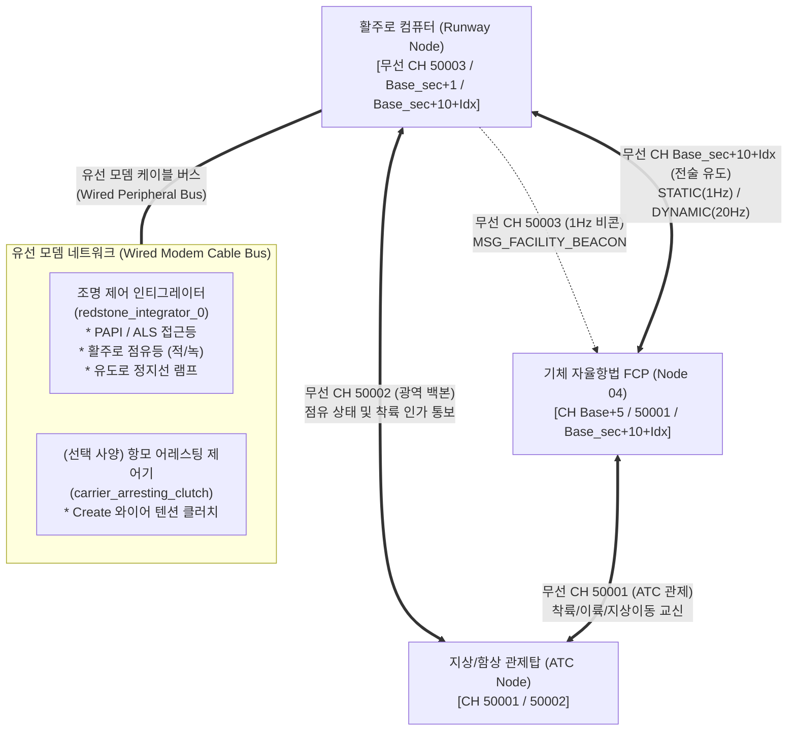
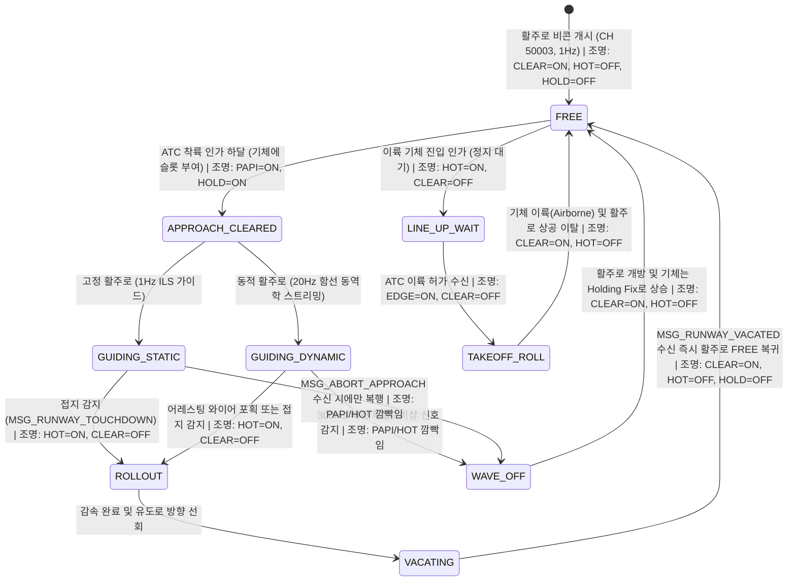
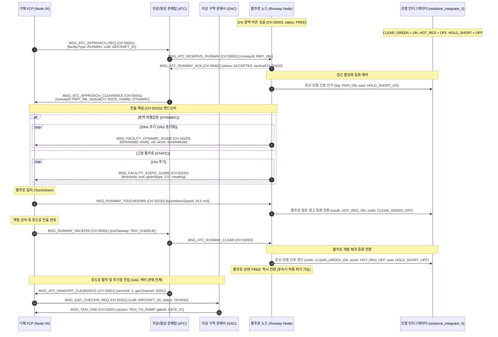

# 활주로 시스템 및 통신 인터페이스 제어 규격서 (ICD)
> **Runway System Specification & Interface Control Document (ICD)**  
> **프로젝트**: Universal Autonomous Flight Stack (SAS · VAS · Ground Infrastructure)  
> **대상 환경**: Minecraft CC:Tweaked (Ender Modem, Wired Modem), Create: Aeronautics, Create: Avionics  

| 항목 | 내용 |
| :--- | :--- |
| **문서 상태 (Status)** | `Approved` |
| **문서 버전 (Version)** | `v1.10.5` |
| **최종 수정일 (Date)** | `2026-11-08` |
| **구현 코드 (Source)** | `src/0_infra/runway/` |
| **주관 도메인 (Domain)** | 지상 인프라 활주로 유도 비콘 및 진입 제어 (Runway) |

### Revision History

| 버전 | 일자 | 개정 요약 | 개정 사유 |
| :--- | :--- | :--- | :--- |
| `v1.10.5` | 2026-11-07 | 사양서 및 코드 디렉토리 `0_ground` → `0_infra` 통합 이동 및 경로 동기화 | 지상 인프라 체계 단일화 구조 개편 |
| `v1.10.4` | 2026-11-07 | 40채널 확장 및 표준 메타데이터 표 적용 | Phase 0 ICD 동기화 |


> **연관 규격서**: 
> - [AUTONOMOUS_FLIGHT_SYSTEM_ARCHITECTURE_AND_ICD.md](../../../system/AUTONOMOUS_FLIGHT_SYSTEM_ARCHITECTURE_AND_ICD.md) (마스터 ICD v1.23.0)
> - [GAC_PROGRAM_SPECIFICATION_AND_ICD.md](../gac/GAC_PROGRAM_SPECIFICATION_AND_ICD.md) (GAC 관제사 규격서 v1.4.0)
> - [SYSTEM_PROGRAM_RELATION_AND_PACKET_DIAGRAM.md](../../../system/SYSTEM_PROGRAM_RELATION_AND_PACKET_DIAGRAM.md) (전체 관계도 v2.10.0)
> - [GPS_PROGRAM_SPECIFICATION_AND_ICD.md](../gps/GPS_PROGRAM_SPECIFICATION_AND_ICD.md) (GPS 규격서 v2.2.1)
> - [FCP_PROGRAM_SPECIFICATION.md](../../2_guidance/fcp/FCP_PROGRAM_SPECIFICATION.md) (FCP 비행 제어 규격서 v1.13.0)
> - [VAS_PROGRAM_SPECIFICATION.md](../../1_control/vas/VAS_PROGRAM_SPECIFICATION.md) (비행 제어 코어 v1.16.0)
> - [LANDING_PAD_SPECIFICATION_AND_ICD.md](../landing_pad/LANDING_PAD_SPECIFICATION_AND_ICD.md) (착륙패드 규격서 v2.4.1)
> - [DOCKING_ARM_SPECIFICATION_AND_ICD.md](../docking_arm/DOCKING_ARM_SPECIFICATION_AND_ICD.md) (도킹암 규격서 v1.11.0)

---

## 1. 개요 및 시스템 범위 (Overview & System Scope)

본 문서는 고정익(CTOL/STOL) 기체의 장거리 계기 접근, 접지 활주, 활주로 이탈(Vacate), 유도로(Taxiway) 지상 이동 및 이륙 활주 관제를 관할하는 **활주로(Runway) 노드**의 통신 프로토콜, 유도 알고리즘, 유선 모뎀 조명 제어망, 안전 인터록 및 상태 머신(FSM)을 정의한 세부 규격서입니다.

### 1.1 핵심 설계 원칙
1. **무선 패킷 기반 상태 전환 (Pure Packet-Driven Tracking)**:
   - 활주로 표면에 물리 센서(광전 센서, 트립와이어 등)를 배치하지 않고, 기체의 무선 패킷 보고(`MSG_RUNWAY_TOUCHDOWN`, `MSG_RUNWAY_VACATED`) 및 ATC 관제 신호에 의해서만 활주로 상태(`FREE`, `OCCUPIED`, `VACATING`)를 전이합니다.
2. **유선 모뎀(Wired Modem) 기반 조명 및 시각 유도망 제어**:
   - 활주로 컴퓨터는 외장 유선 모뎀(Wired Modem) 케이블로 연결된 레드스톤 인티그레이터(Redstone Integrator) 및 Create 닉시 튜브(Nixie Tube)를 통해 활주로 진입등(ALS/PAPI), 점유등(적/녹), 유도로 정지선(Hold Short) 램프를 정밀 제어합니다.
3. **정적 육상 활주로 vs 동적 항공모함(Carrier Deck) 분리**:
   - **고정형 활주로 (Static Runway)**: 지상 고정 비행장. 활주로 시단(Threshold), 종단(End), 표고, 중심선 방위각, 글라이드슬로프($3.0^\circ$)를 정적으로 송출하며 1Hz 상태 하트비트만 유지합니다.
   - **동적 활주로 (Dynamic Runway)**: 항진 중인 항공모함(Carrier) 또는 대형 이동 모선의 비행갑판. 비행갑판 시단/종단 좌표뿐만 아니라 모선의 실시간 이동 속도($\vec{v}$), 가속도($\vec{a}$), 방위각/요동(Pitch/Roll)을 20Hz로 스트리밍하며, 기체 UAP가 이동 좌표계 상에서 접근 경로를 동적으로 연산하여 추종합니다. (선택적으로 항모 어레스팅 와이어 클러치 연동 지원)
4. **독자적 지상 이동 관제 프로토콜 및 GAC 연계**: 착륙 활주 후 유도로 진출선 통과 시 기체가 즉시 활주로 이탈(`MSG_RUNWAY_VACATED`)을 보고하여 활주로 점유를 해제하고, 유도로 지상 활주 및 에이프런 진입은 지상 구역 관제사(GAC, $Base_{\text{sec}}+0$)와 섹터 로컬 백본망($Base_{\text{sec}}+1$)에 의해 계층화되어 관제됩니다. 유도로 정지선(Hold Short) 및 이륙 대기열(Line Up and Wait) FSM은 GAC와 유기적으로 연동됩니다.
5. **페일세이프 및 파도/횡풍 복행(Wave-Off)**:
   - 동적 활주로 20Hz 스트리밍 중 300ms 패킷 두절 시 기체 즉시 복행(Wave-Off).
   - 고정형 활주로는 통신이 두절되더라도 기체 탑재 GPS/ILS 연산으로 착륙 지속(타임아웃 복행 면제), 활주로 방해물 감지 시에만 비상 복행(`MSG_ABORT_APPROACH`) 발동.

### 1.2 GPS 광역 항법 $\rightarrow$ 활주로 ILS 전술 접근 연계 인터페이스 (GPS to ILS Transition)
1. **광역 정렬 단계 (GPS Waypoint to IAF)**:
   - 기체 UAP는 `CH_FACILITY_BEACON` (50003)에서 취득한 활주로 시단 좌표(`thresholdPos`) 및 중심선 방위각을 바탕으로, 활주로 전방 1,000~1,500m 지점의 진입 정렬점(Initial Approach Fix, IAF)까지 중앙 GPS 체계(`CH_GPS_PING` 60001 / `Base+5`)를 이용하여 항법 비행을 수행합니다.
2. **관제 인가 및 ILS 전술 채널 인계 (Terminal Handoff)**:
   - IAF 도달 시 `CH_ATC_COMM` (50001)로 `MSG_ATC_APPROACH_REQ`를 송신하여 착륙 허가를 요청합니다.
   - ATC로부터 접근 인가(`MSG_ATC_APPROACH_CLEARANCE`) 및 전술 채널(`CH_TACTICAL_GUIDANCE` = $Base_{\text{sec}} + 10 + \text{Idx}$)을 수신하면, 기체는 $3.0^\circ$ 글라이드슬로프 및 로컬라이저 정밀 계기 유도(`MSG_FACILITY_STATIC/DYNAMIC_GUIDE`) 추종 모드로 전환합니다.
3. **GPS 상호 대조 및 다단계 조명 인터록**:
   - 하강 중 GPS 수평 좌표와 전술 ILS 유도 좌표를 상호 대조(Cross-Check)하여 단일 센서 이상을 능동 감시합니다.
   - 접지 순간 `MSG_RUNWAY_TOUCHDOWN` 송신 시 유선 모뎀 조명 제어기(`redstone_integrator_0`)가 점유 적색등을 켜고, 유도로 진출 완료(`MSG_RUNWAY_VACATED`) 시 녹색 진입등으로 자동 복귀합니다.

### 1.3 코드 경량화 및 Deprecated 운영 정책 (Code Lightweighting & Deprecation Policy)
1. **사양서 명세 원칙 (Specification-First)**: 프로토콜 패킷 타입명 또는 페이로드 필드가 개정될 경우, 구버전 명칭은 사양서 내에 `[DEPRECATED]` 배지를 부여하고 대체 신규 필드명과 변경 이력을 명시하여 문서상에 보존합니다.
2. **코드베이스 경량화 원칙 (Zero-Fallback)**: CC:Tweaked Lua 분산 컴퓨터 환경의 자원 제약(메모리 절약, 20Hz 실시간 루프 성능 보장)을 준수하기 위해, 코드베이스는 사전 이중 호환(Fallback 래퍼, `payload.new or payload.old` 등)을 일체 작성하지 않고 **최신 표준 필드명/패킷명만을 단일 채택**합니다.
3. **런타임 오류 시 복구 원칙 (송신 노드 즉시 패치)**: 구버전 필드/패킷을 전송하는 미갱신 노드로 인해 수신 측에서 `nil` 인덱싱 등의 런타임 오류가 발생할 경우, 수신 측에 임시 폴백 코드를 추가하지 않고 **구버전 패킷을 송신한 발신 노드의 코드를 최신 사양으로 즉시 패치 및 재배포**하여 전역 일원화를 달성합니다.

---

## 2. 네트워크 채널 및 하드웨어 토폴로지 (Network Channels & Hardware Topology)

활주로 시스템은 대공/관제용 무선 네트워크(Ender Modem)와 지상 조명 설비 제어용 유선 모뎀(Wired Modem) 네트워크의 2중 버스로 구성됩니다.



### 2.1 무선 채널 할당 표
| 채널 번호 | 채널 식별자 | 송신자 | 수신자 | 전송 주기 | 통신 목적 및 내용 |
| :---: | :---: | :---: | :---: | :---: | :--- |
| **`50001`** | `CH_ATC_COMM` | SAS / ATC | ATC / SAS | 이벤트 기반 | 최종 접근 인가(`APPROACH_REQ`), 이륙 허가, 유도로 지상 유도 지시 |
| **`50002`** | `CH_ATC_FACILITY` | Runway / ATC | ATC / Runway | 1Hz / 이벤트 | 활주로 폐쇄/개방 상태 동기화, 긴급 복행(Wave-off) 지시 전달 |
| **`50003`** | `CH_FACILITY_BEACON` | GAC Node (대표) | All (SAS, MFD) | 1Hz | Sector 0 대표 비콘: 활주로 기본 제원 (활주로 번호, 길이, 폭, 표면 상태, 이동성 플래그) |
| **$Base_{\text{sec}} + 0$** | `CH_GAC_COMM` | SAS / GAC | GAC / SAS | 이벤트 | 유도로 지상 활주 인가(`MSG_TAXI_CMD`), 주기장/에이프런 배정 및 출항 제어 ($Base_{\text{sec}} = 50001 + S \times 200$) |
| **$Base_{\text{sec}} + 1$** | `CH_SECTOR_FACILITY` | Runway / GAC | GAC / Runway | 이벤트 | 활주로 노드와 관할 GAC 간 활주로 이탈/유도로 진입 상태 동기화 |
| **$Base_{\text{sec}} + 10 + \text{Idx}$** | `CH_TACTICAL_GUIDANCE` | Runway Node | FCP (Node 04) | 1Hz (정적)<br/>20Hz (동적) | 시단/종단 좌표, 방위각, 동적 속도/가속도 벡터 스트리밍 |
| **`Base + 5`** | `CH_EXTERNAL_COMM` | SAS | Runway / ATC | 이벤트 | 터치다운 완료, 활주로 이탈(`MSG_RUNWAY_VACATED`) 통보 |

### 2.2 유선 모뎀 하드웨어 매핑 및 조명 제어 진리표 (Hardware Mapping & Lighting Truth Table)

#### 1. 유선 모뎀 주변기기 매핑
| 주변기기 식별자 (Peripheral Name) | 장치 타입 | 제어 목적 | 신호 및 데이터 형식 |
| :--- | :---: | :--- | :--- |
| **`redstone_integrator_0`** | Redstone Integrator | 활주로 등화 및 유도로 정지선 램프 통합 제어 | 디지털 레드스톤 On/Off (6채널/방향) |
| **`carrier_arresting_clutch`** *(옵션)* | Create Clutch | 항공모함 비행갑판 어레스팅 와이어 텐션 잠금 | 레드스톤 15 (체결) / 0 (자유 회전) |
| **`wind_display_link`** *(옵션)* | Display Link / Nixie | 조종석 가시 풍향·풍속 및 활주로 번호 표출 | 문자열/수치 스트리밍 |

#### 2. 레드스톤 인티그레이터 출력 채널 매핑 (`redstone_integrator_0`)
| 핀 방향 (Side) | 제어 회선명 | 대상 장비 | 정상 상태 (FREE) | 접근 인가 (APPROACH) | 활주 점유 (OCCUPIED) | 긴급 복행 (WAVE-OFF) |
| :---: | :---: | :--- | :---: | :---: | :---: | :---: |
| **`top`** | `LIGHT_PAPI_ALS` | PAPI 및 접근 진입등(ALS) | OFF | **ON** | **ON** | **깜빡임 (Blink)** |
| **`bottom`** | `LIGHT_RUNWAY_EDGE` | 활주로 외곽 백색 유도등 | OFF (주간) / ON (야간) | **ON** | **ON** | **ON** |
| **`north`** | `LIGHT_RUNWAY_CLEAR` | 활주로 진입 허용 녹색등 | **ON** | **ON** | OFF | OFF |
| **`south`** | `LIGHT_RUNWAY_HOT` | 활주로 점유 경고 적색등 | OFF | OFF | **ON** | **깜빡임 (Blink)** |
| **`east`** | `LIGHT_HOLD_SHORT` | 유도로 정지선 적색 바(Stop Bar) | OFF | **ON** | **ON** | **ON** |
| **`west`** | `SPARE_LINE` | 예비 제어 회선 | OFF | OFF | OFF | OFF |

---

## 3. 통신 패킷 상세 규격 (Message Envelope & Payload Specification)

### 3.1 광역 상태 비콘 (`MSG_FACILITY_BEACON`, CH 50003, 1Hz)
```lua
{
    ver = "1.9.5",
    domainId = "RWY_ALPHA_09L",
    seq = 20010,
    type = "MSG_FACILITY_BEACON",
    time = 1729850000000,
    payload = {
        facilityId = "RWY_ALPHA_09L",
        facilityType = "RUNWAY",
        mobility = "STATIC",                 -- "STATIC" (육상) | "DYNAMIC" (항공모함 갑판)
        atcChannel = 50001,
        tacticalChannel = 50220,             -- 전술 채널 (Base_sec + 10 + 9)
        status = "FREE",                     -- "FREE", "APPROACH_ACTIVE", "OCCUPIED", "CLOSED"
        runwayDesignator = "09L",            -- 활주로 번호
        dimensions = {
            length = 350.0,                  -- 활주로 길이 (m)
            width = 30.0                     -- 활주로 폭 (m)
        },
        surfaceCondition = "DRY",            -- "DRY", "WET", "ICY", "OBSTRUCTED"
        ilsAvailable = true,
        arrestingGearActive = false          -- 어레스팅 와이어 가동 여부
    }
}
```

---

### 3.2 고정 활주로 정밀 가상 ILS 패킷 (`MSG_FACILITY_STATIC_GUIDE`, Base_sec + 10 + Idx, 1Hz)
정적 육상 비행장 전용 패킷입니다(예: CH 50220). 시단/종단 좌표 및 글라이드슬로프 정보가 포함되며, 속도/가속도 필드는 제외됩니다.
```lua
{
    ver = "1.9.5",
    domainId = "RWY_ALPHA_09L",
    seq = 20500,
    type = "MSG_FACILITY_STATIC_GUIDE",
    time = 1729850015000,
    payload = {
        facilityId = "RWY_ALPHA_09L",
        targetAircraft = "AIRCRAFT_01",
        runwayHeading = 92.5,                -- 활주로 중심선 방위각 (deg)
        thresholdPoint = {                   -- 활주로 시단(착륙 진입점) 3D 좌표 (Minecraft World Coordinates: X_MC, Y_MC, Z_MC)
            x = -1500.0,
            y = 70.0,
            z = 450.0
        },
        endPoint = {                         -- 활주로 종단 3D 좌표 (Minecraft World Coordinates: X_MC, Y_MC, Z_MC)
            x = -1150.0,
            y = 70.0,
            z = 465.0
        },
        glideSlopeAngle = 3.0,               -- 표준 강하각 (deg)
        touchdownZoneLength = 80.0,          -- 권장 접지 구간 길이 (m)
        surfaceWind = {
            speed = 4.2,
            direction = 085.0                -- 맞바람(Headwind) 성분 우세
        },
        abortAlert = false                   -- 활주로 침범 등 비상 복행 경보
    }
}
```

---

### 3.3 동적 활주로 실시간 동역학 스트리밍 (`MSG_FACILITY_DYNAMIC_GUIDE`, Base_sec + 10 + Idx, 20Hz)
항공모함 또는 해상 기동 플랫폼 비행갑판 전용 패킷입니다(예: CH 50220). 항진 속도, 가속도 및 갑판 동역학을 20Hz로 스트리밍합니다.
```lua
{
    ver = "1.9.5",
    domainId = "CARRIER_CVN_01_DECK",
    seq = 85200,
    type = "MSG_FACILITY_DYNAMIC_GUIDE",
    time = 1729850020100,
    payload = {
        facilityId = "CARRIER_CVN_01_DECK",
        targetAircraft = "AIRCRAFT_01",
        runwayHeading = 120.0,               -- 함선 항진 방위각 또는 경사갑판 각도 (deg)
        thresholdPoint = {                   -- 현재 시각 t에서의 비행갑판 착함 시단 좌표
            x = 2100.5,
            y = 18.2,
            z = -3400.1
        },
        endPoint = {                         -- 비행갑판 종단 좌표
            x = 2280.2,
            y = 18.4,
            z = -3295.8
        },
        velocity = {                         -- 함선 항진 속도 벡터 (m/s) (예: 25 knots ≒ 12.8 m/s)
            vx = 11.1,
            vy = 0.05,                       -- 파도에 의한 갑판 Heave 속도
            vz = 6.4
        },
        acceleration = {                     -- 함선 가속도 벡터 (m/s²)
            ax = 0.01,
            ay = 0.40,
            az = 0.02
        },
        deckAttitude = {                     -- 함선 갑판 롤/피치 동역학
            pitch = 0.8,
            roll = -1.2,
            yaw = 120.0
        },
        arrestingWires = {                   -- 어레스팅 와이어 4선 상태
            wire1 = "READY",
            wire2 = "READY",
            wire3 = "READY",
            wire4 = "READY"
        },
        opticalMeatballOffset = 0.0,         -- 광학 착함 유도장치(FLOLS) 편차각
        abortAlert = false                   -- 함장/LSO 강제 Wave-Off 신호
    }
}
```

---

### 3.4 접지 활주, 이탈 및 지상 유도 패킷

#### 1. 접지 및 활주 감속 통보 (`MSG_RUNWAY_TOUCHDOWN`, Base_sec + 10 + Idx $\rightarrow$ Runway)
```lua
{
    ver = "1.9.5",
    domainId = "AIRCRAFT_01",
    type = "MSG_RUNWAY_TOUCHDOWN",
    time = 1729850025000,
    payload = {
        facilityId = "RWY_ALPHA_09L",
        touchdownSpeed = 24.5,               -- 접지 순간 대지속도 (m/s)
        arrestedWire = 3                     -- 포획된 어레스팅 와이어 번호 (항모 착함 시, 지상은 nil)
    }
}
```

#### 2. 활주로 이탈 통보 (`MSG_RUNWAY_VACATED`, CH 50001 $\rightarrow$ ATC)
기체가 활주로 안전 경계선을 통과하여 유도로로 완전 진입했을 때 송출하여 활주로 점유를 해제합니다.
```lua
{
    ver = "1.9.5",
    domainId = "AIRCRAFT_01",
    type = "MSG_RUNWAY_VACATED",
    time = 1729850040000,
    payload = {
        facilityId = "RWY_ALPHA_09L",
        exitTaxiway = "TAXI_CHARLIE",        -- 진출한 유도로 식별자
        runwayCleared = true                 -- 후속기 착륙 허가 가능 상태 전환
    }
}
```

#### 3. 유도로 지상 이동 관제 (`MSG_TAXI_CMD`, CH 50001 / Base_sec + 0, ATC/GAC $\rightarrow$ SAS)
```lua
{
    ver = "1.9.5",
    domainId = "ATC_GROUND",
    type = "MSG_TAXI_CMD",
    time = 1729850042000,
    payload = {
        targetAircraft = "AIRCRAFT_01",
        action = "HOLD_SHORT",               -- "TAXI_TO_RAMP", "HOLD_SHORT", "LINE_UP_AND_WAIT"
        assignedTaxiway = "TAXI_CHARLIE",
        holdPoint = { x = -1300.0, y = 70.0, z = 480.0 },
        maxTaxiSpeed = 6.0                   -- 최대 지상 주행 속도 (m/s)
    }
}
```

#### 4. 이륙 허가 패킷 (`MSG_ATC_DEPARTURE_CLEARANCE`, CH 50001, ATC $\rightarrow$ SAS)
> [!NOTE]
> 본 패킷은 마스터 ICD(v1.16.0) 및 전역 시설물 표준 규격에 따라 `MSG_ATC_DEPARTURE_CLEARANCE`로 단일화되었습니다.
> 구버전 패킷 식별자 `MSG_RUNWAY_TAKEOFF_CLEARANCE`는 `[DEPRECATED]` 상태이며, 코드베이스는 사전 이중 호환(Fallback) 코드를 작성하지 않고 최신 명칭만을 단일 채택합니다. 미갱신 송신 노드로 인한 런타임 통신 오류 발생 시 해당 송신 노드의 코드를 즉시 패치합니다.

```lua
{
    ver = "1.9.5",
    domainId = "ATC_TOWER",
    type = "MSG_ATC_DEPARTURE_CLEARANCE",    -- 표준 출발 허가 (구버전 알리아스: MSG_RUNWAY_TAKEOFF_CLEARANCE [DEPRECATED])
    time = 1729850120000,
    payload = {
        targetAircraft = "AIRCRAFT_01",
        runwayId = "RWY_ALPHA_09L",
        wind = { speed = 4.0, direction = 090.0 },
        initialClimbAltitude = 250.0,
        departureHeading = 092.5
    }
}
```

---

## 4. 유한 상태 기계 및 동작 시퀀스 (FSM & Sequence)

### 4.1 활주로 FSM 상태 전이도



### 4.2 계기 접근, 착륙 활주 및 유선 모뎀 조명 연동 시퀀스



---

## 5. 수치해석 및 가상 ILS 유도 알고리즘 (ILS Guidance & Algorithms)

### 5.1 이동 좌표계 가상 로컬라이저 및 글라이드슬로프 편차 연산
동적 활주로(함선 비행갑판) 모드에서 기체 UAP는 활주로 시단 $\vec{p}_{th}(t)$와 단위 방위각 벡터 $\vec{u}_{rwy}(t)$를 기준으로 상대 위치 벡터 $\vec{r}(t) = \vec{p}_{craft}(t) - \vec{p}_{th}(t)$를 기하 투영합니다.

- **종방향 활주로 진입 잔여 거리 ($d_{along}$)**:
  $$d_{along} = \vec{r} \cdot \vec{u}_{rwy}$$
- **수평 중심선 로컬라이저 편차 ($\Delta y_{loc}$)**:
  $$\Delta y_{loc} = \vec{r} \cdot \vec{u}_{cross} \quad (\vec{u}_{cross} = \vec{u}_{rwy} \times \hat{k}_{down})$$
- **수직 글라이드슬로프 편차 ($\Delta z_{gs}$)**:
  $$\Delta z_{gs} = (z_{craft} - z_{th}) - (-d_{along} \cdot \tan 3.0^\circ)$$

기체 UAP는 항모의 이동 속도 벡터 $\vec{v}_{ship}$을 피드포워드 상쇄하여 진입 속도를 합성 제어합니다:
$$\vec{v}_{approach\_cmd} = \vec{v}_{ship} + \vec{v}_{airspeed\_glideslope}$$
