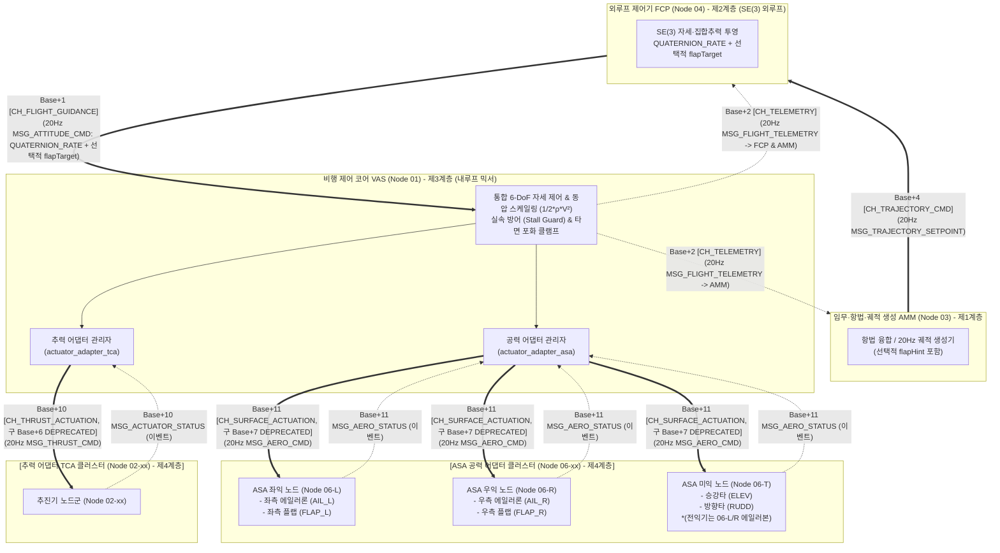
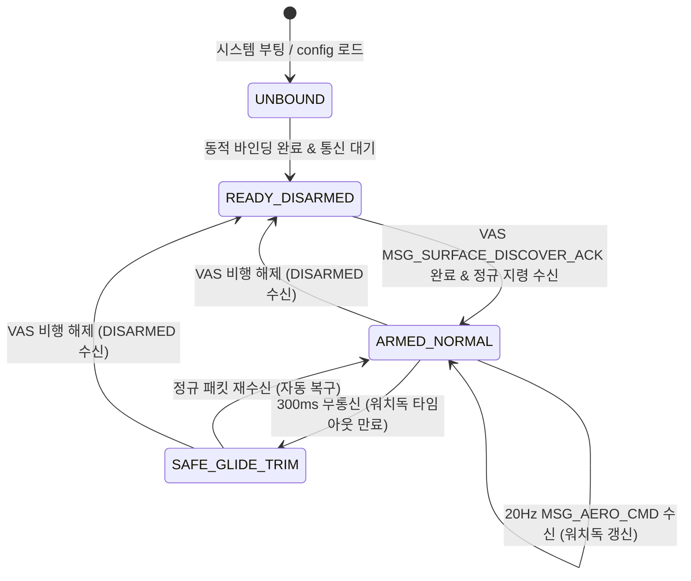
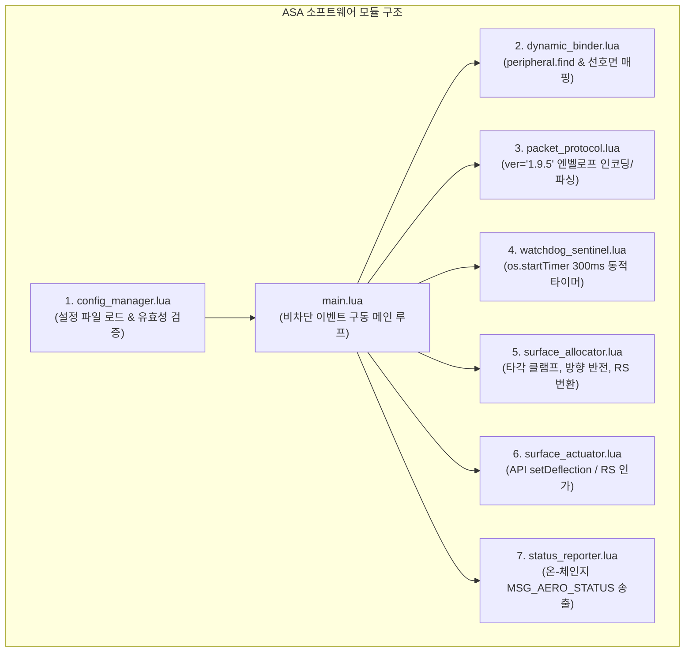

# ASA (Aerodynamic Surface Adapter) 공력 날개 및 조종면 분산 어댑터 상세 규격서
> **ASA: Wing & Aerodynamic Surface Actuator Pod Distributed Cluster Program Specification**  
> **프로젝트**: Universal Autonomous Flight Stack (UAFS Ecosystem)  
> **대상 환경**: Minecraft CC:Tweaked (CraftOS-PC, Lua 5.1/5.2), Create: Aeronautics, Create: Avionics  

| 항목 | 내용 |
| :--- | :--- |
| **문서 상태 (Status)** | `Approved` |
| **문서 버전 (Version)** | `v1.7.0` |
| **최종 수정일 (Date)** | `2026-11-12` |
| **구현 코드 (Source)** | `src/1_control/asa/` |
| **주관 도메인 (Domain)** | 공력 조종면 및 날개 구동기 분산 클러스터 (ASA / Node 06-xx) |

> **연관 문서**:
> - [AUTONOMOUS_FLIGHT_SYSTEM_ARCHITECTURE_AND_ICD.md](../../../system/AUTONOMOUS_FLIGHT_SYSTEM_ARCHITECTURE_AND_ICD.md) (마스터 ICD v1.28.0)
> - [SYSTEM_PROGRAM_RELATION_AND_PACKET_DIAGRAM.md](../../../system/SYSTEM_PROGRAM_RELATION_AND_PACKET_DIAGRAM.md) (전체 구조도 v2.13.0)
> - [AMM_PROGRAM_SPECIFICATION.md](../../3_planning/amm/AMM_PROGRAM_SPECIFICATION.md) (AMM 임무 관리자 및 조종석 단말 규격서 v1.3.0)
> - [FCP_PROGRAM_SPECIFICATION.md](../../2_guidance/fcp/FCP_PROGRAM_SPECIFICATION.md) (FCP 비행 제어 규격서 v2.0.0)
> - [VAS_PROGRAM_SPECIFICATION.md](../vas/VAS_PROGRAM_SPECIFICATION.md) (비행 제어 코어 v1.19.0)
> - [TCA_PROGRAM_SPECIFICATION.md](../tca/TCA_PROGRAM_SPECIFICATION.md) (추력기 어댑터 v1.11.1)
> - [ALIGNMENT_PROGRAM_SPECIFICATION.md](../../0_development/alignment/ALIGNMENT_PROGRAM_SPECIFICATION.md) (격납고 상주형 동역학 프로파일러 v2.6.1)
> - [GPS_PROGRAM_SPECIFICATION_AND_ICD.md](../../0_infra/gps/GPS_PROGRAM_SPECIFICATION_AND_ICD.md) (GPS 규격서 v2.3.2)
> - [GEMINI.md](../../../../GEMINI.md) (전역 규칙 및 가이드라인)

### Revision History

| 버전 | 개정 일자 | 개정 요약 | 개정 사유 |
| :---: | :---: | :--- | :--- |
| `v1.7.0` | 2026-11-12 | FCP-AMM 역할 분리(ICD v1.28.0) 및 채널/스키마 정합화: FCP 순수 `SE(3)` 외루프 `QUATERNION_RATE` + 선택적 `flapTarget`(`Base+1` $\to$ `VAS`) 및 `AMM` 궤적/C2 역할 반영, `Base+2` `FCP`/`AMM` 수신 명시, `top` 모뎀 `VAS (Node 01)` 및 `Alignment` 전용 포트 정정, `config.json` `surfaceActuation`(`10011`) 및 `MSG_CHANNEL_REBIND`(`bandwidth = 40`, `oldBase + 11`, `newBaseChannel + 11`) 결함 수정, `MSG_AERO_CMD` 스키마(`controlState`, `dynamicPressureFactor`) ICD 정합화, 구 `Base+7` `[DEPRECATED]` 이력 정정 및 과장 표현 제거 | AMM-FCP-VAS 계층 분리 동기화 및 `Base+11` 채널·패킷 결함 해소 |
| `v1.6.0` | 2026-11-08 | 포드 ID(podId) ASA_L/R/T 완전 단일화, 구 명칭(구버전 명칭) 잔재 전면 척결 | 포드 명칭 표준화 및 잔재 제거 |
| `v1.5.0` | 2026-11-08 | 비동기 진단 TUI(`config.json` 내 `debug: true` 기본값, CC `parallel.waitForAny` 기반 이벤트 루프 + 진단 뷰 분리) 및 `debug: false` 헤드리스 직결 모드 명세 반영, baseChannel 수식 정합화 | 제어 지연 방지 및 헤드리스 런타임 호환성 확보 |
| `v1.4.0` | 2026-11-08 | ASA 관할 기체 범위 축소: VECTORED_VTOL 및 드론(QUADROTOR, HEXAROTOR) 기체 배제 규격 명시, FIXED_WING 및 WINGED_VTOL 전용 구동계로 한정 | 비공력 순수 추력형 기체에서 공력 타면 및 불필요한 제어 연산·통신 배제 |
| `v1.3.0` | 2026-11-07 | 비행체 전용 40채널($BW=40$) 대역 확장($Base = 10000 + (N-1)\times 40$) 반영, 조종면 버스 Zone 2 이관(`Base+11`: `CH_SURFACE_ACTUATION`, 구 `Base+7` [DEPRECATED]) | 서브채널 대역폭 확장 및 기능 영역별 직교성 확보, 1000대 수용량 확립 |

---

## 1. 프로그램 개요 및 목적 (Overview & Architecture)

### 1.1 시스템 정체성 및 설계 목적
**ASA (Aerodynamic Surface Adapter / Program)**은 고정익(`FIXED_WING`) 및 날개형 VTOL(`WINGED_VTOL`) 비행체의 공력 조종면(에일러론, 승강타, 방향타, 에일러본)과 고양력 장치(플랩)를 직접 물리 구동하는 **제3계층(Layer 3) 독립 분산형 공력 구동계 제어기(Distributed Aerodynamic Surface Controller)**입니다.

UAFS 단일 3계층 비행 제어 아키텍처 개편에 따라, ASA는 **VAS (Node 01)** 산하 분산 액추에이터 계층으로 완전 편입되었습니다.
상위 외루프 제어기인 **FCP (Node 04)**는 **AMM (Node 03)**이 `Base + 4`로 하달한 궤적 세트포인트로부터 산출한 순수 `SE(3)` `QUATERNION_RATE`(`targetQuaternion`, `targetAngularRates`, `collectiveThrust`) 지령과 선택적 플랩 요구율(`flapTarget`)만을 `Base + 1`을 통해 VAS에 하달하며, 조종면에 직접 관여하지 않습니다.
비행 제어 코어인 **VAS (Node 01)**는 2계층 내루프 통합 믹싱기에서 동압 스케일링($\frac{1}{2}\rho V^2$), 타면 포화 방지(`satCombined`), 단일 실속 가드($V \le 10\text{ m/s}$) 및 플랩 전개 속도 제한($V > 15\text{ m/s}$)을 거쳐 공력 타각을 최종 확정하고, 전용 무선 채널 `Base + 11` (구 `Base + 7` [DEPRECATED]) (`CH_SURFACE_ACTUATION`)을 통해 ASA 클러스터(`Node 06-L, 06-R, 06-T`)로 20Hz `MSG_AERO_CMD`를 송출하여 지휘합니다.



### 1.2 핵심 설계 특징 6대 원칙
1. **3구역 분할 노드 토폴로지 (Zone-based 3-Pod Cluster)**:
   - 기체 기하 구조에 맞추어 좌익(`Node 06-L`), 우익(`Node 06-R`), 미익(`Node 06-T`)에 CC:Tweaked 컴퓨터를 1:1 독립 배치하여 복잡한 물리 배선을 배제하고 피탄/충돌 피해를 국소 격리합니다.
2. **`peripheral.find` 기반 동적 하드웨어 바인딩**:
   - 고정 포트 강제를 배제하고, `config.json`의 선호 면(`preferredSide`)을 1차 검사하되 `peripheral.find()`를 통해 전 방향 및 유선 버스를 동적 스캔하여 장치 타입에 부합하는 페리페럴을 자동 바인딩합니다.
3. **듀얼 구동 모드 및 자동 폴백 (`API` vs `REDSTONE`)**:
   - Create: Avionics 조종면/플랩 페리페럴 발견 시 정밀 API 모드(`setDeflection(deg)`)로 구동하며, 페리페럴이 없는 기계식 링크 환경에서는 선호 면의 $0 \sim 15$ 아날로그 레드스톤(RS) 모드로 자동 폴백합니다.
4. **전용 무선 채널 분리 (`Base + 11` (구 `Base + 7` [DEPRECATED]))**:
   - 추진기 버스(`Base + 10`, 구 `Base + 6` [DEPRECATED]) 및 상위 유도 명령 버스(`Base + 1`)와의 무선 간섭을 방지하기 위해 기체별 전용 채널 `Base + 11` (구 `Base + 7` [DEPRECATED]) (`CH_SURFACE_ACTUATION`)을 단독 점유하여 VAS와 통신합니다.
5. **동적 타이머 기반 300ms 안전 활공 트림 (Safe Glide Trim Sentinel)**:
   - VAS 지령(`MSG_AERO_CMD`)이 300ms(6틱) 이상 두절될 경우, 스핀/스파이럴 다이브를 방지하기 위해 에일러론 0.0, 방향타 0.0, 승강타 +0.1(약 $+3.0^\circ$ 미세 기수 유지 완만 활공), 플랩 0.0으로 즉시 강제 클램프합니다.
6. **비동기 진단 뷰 및 헤드리스 백그라운드 데몬 (Asynchronous Diagnostic View & Headless Daemon)**:
   - **기본 구동 모드 (`debug: true`)**: `config.json` 내 `debug: true`(기본값) 가동 시 ComputerCraft `parallel.waitForAny`를 통해 메인 제어 루프와 비동기 단말 진단 뷰를 상호 독립된 코루틴으로 분리 실행하여 화면 갱신이 50ms 제어 루프에 지연을 유발하지 않도록 격리합니다.
   - **순수 헤드리스 모드 (`debug: false`)**: `debug: false` 명시 시 TUI 출력을 완전히 배제하고 순수 비차단(Non-blocking) 코루틴 데몬으로 직결 가동되어 50ms 틱당 처리 시간을 $\le 0.4\text{ ms}$ 이내로 극소화합니다.

### 1.3 코드 경량화 및 Deprecated 운영 정책 (Code Lightweighting & Deprecation Policy)
1. **사양서 명세 원칙 (Specification-First)**: 프로토콜 패킷 타입명 또는 페이로드 필드가 개정될 경우, 구버전 명칭은 사양서 내에 `[DEPRECATED]` 배지를 부여하고 대체 신규 필드명과 변경 이력을 명시하여 문서상에 보존합니다.
2. **코드베이스 경량화 원칙 (Zero-Fallback)**: CC:Tweaked Lua 분산 컴퓨터 환경의 자원 제약(메모리 절약, 20Hz 실시간 루프 성능 보장)을 준수하기 위해, 코드베이스는 사전 이중 호환(Fallback 래퍼, `payload.new or payload.old` 등)을 일체 작성하지 않고 **최신 표준 필드명/패킷명만을 단일 채택**합니다.
3. **런타임 오류 시 복구 원칙 (송신 노드 즉시 패치)**: 구버전 필드/패킷을 전송하는 미갱신 노드로 인해 수신 측에서 `nil` 인덱싱 등의 런타임 오류가 발생할 경우, 수신 측에 임시 폴백 코드를 추가하지 않고 **구버전 패킷을 송신한 발신 노드의 코드를 최신 사양으로 즉시 패치 및 재배포**하여 전역 일원화를 달성합니다.

### 1.4 비행체 적용 대상 및 관할 범위 (Airframe Applicability & Scope Boundary)
- **지원 비행체 (Supported Airframes)**:
  - `FIXED_WING`: 고정익기 (에일러론, 승강타, 방향타, 플랩 또는 에일러본 직접 구동)
  - `WINGED_VTOL`: 양력 날개 보유 하이브리드 VTOL (호버/순항 모드 공력 타면 및 플랩 구동)
- **관할 배제 비행체 (Excluded Airframes)**:
  - `VECTORED_VTOL`: 다축 추력 벡터 VTOL (공력 타면 없음, 전 축 TCA 추력 벡터로 제어)
  - `QUADROTOR` / `HEXAROTOR`: 4-T / 6-T 멀티로터 드론 (공력 타면 없음, 차동 로터 추력으로 제어)
- **관할 배제 원칙 및 연계 제어기 비활성화**:
  - `VECTORED_VTOL` 및 드론 기체는 물리적 공력 타면과 플랩이 일체 존재하지 않으므로 온보드 ASA 소프트웨어 클러스터(`Node 06-xx`)를 배치하지 않습니다.
  - 상위 외루프 제어기인 **FCP**는 해당 기체 운용 시 `SE(3)` `QUATERNION_RATE` 지령만 생성하고 `flapTarget` 등 공력 타면 지령 생성을 배제하며(미전송 또는 `0.0`), **AMM** 역시 `flapHint` 송출을 생략합니다.
  - 내루프 제어 코어인 **VAS**는 해당 기체 운용 시 `actuator_adapter_asa`의 타면 믹싱/할당을 생략하고 전용 채널 `Base + 11` (`CH_SURFACE_ACTUATION`)으로의 `MSG_AERO_CMD` 송출을 비활성화하며, 텔레메트리 헬스 진단에서 ASA 검사를 배제(Bypass)합니다.

---

## 2. 하드웨어 구성 및 동적 포트 할당 메커니즘

### 2.1 물리 포트 기준 배치 및 권장 매핑
ASA 컴퓨터는 담당 조종면 기구 인접부에 설치되며, 표준 6개 면(Face)의 권장 할당은 다음과 같습니다:

| 포트 위치 | 물리 장치 | 작동 모드 | 신호 규약 및 상세 설명 |
| :---: | :---: | :---: | :--- |
| **`top`** | 무선 모뎀 (`modem`) | 공통 통신 | VAS (Node 01) 및 Alignment 지상 교정 무선 통신 전용 포트. `Base + 11` (구 `Base + 7` [DEPRECATED]) (`CH_SURFACE_ACTUATION`) 개방 (교정 시 $Base_{\text{hangar}}+0, +3$ 동적 개방) |
| **`bottom`** | Create 아날로그 변속기 / 베어링 | `REDSTONE` | 중립 7 또는 8을 기준으로 $0 \sim 15$ 아날로그 RS 출력 직결 인가 |
| **`left`** | 주 조종면 (에일러론 / 승강타) | `API` / `RS` | `avionics:control_surface` 페리페럴 API 또는 선호 RS 포트 |
| **`right`** | 보조면 (플랩 / 방향타) | `API` / `RS` | `avionics:flap` 페리페럴 API 또는 보조 기구 제어 포트 |
| **`front` / `back`** | 확장 조종면 / 유선 모뎀 | `API` / `RS` | 다단 플랩, 에어브레이크, 스포일러 등 추가 기구 확장용 |

### 2.2 `peripheral.find` 동적 하드웨어 바인딩 알고리즘
ASA 노드는 부팅 시 또는 런타임 블록 결속/탈락(`peripheral`, `peripheral_detach` 이벤트) 발생 시 다음 시퀀스를 실행하여 조종면 슬롯을 재구성합니다.

```lua
-- 동적 바인딩 의사코드 (Dynamic Peripheral Binding Logic)
function dynamic_binder.resolve_slot(slotName, slotCfg)
    local targetType = slotCfg.type
    local prefSide = slotCfg.preferredSide

    -- 1단계: 선호 면(preferredSide) 우선 검사
    if prefSide and peripheral.isPresent(prefSide) then
        if peripheral.getType(prefSide) == targetType then
            return { mode = "API", side = prefSide, handle = peripheral.wrap(prefSide) }
        end
    end

    -- 2단계: peripheral.find()를 통한 전 방향 및 유선 네트워크 스캔
    local foundList = { peripheral.find(targetType) }
    if #foundList > 0 then
        -- 미할당된 첫 번째 일치 페리페럴 바인딩
        for _, dev in ipairs(foundList) do
            local devSide = peripheral.getName(dev)
            if not dynamic_binder.is_already_bound(devSide) then
                return { mode = "API", side = devSide, handle = dev }
            end
        end
    end

    -- 3단계: 일치 페리페럴 부재 시 아날로그 레드스톤(RS) 모드로 자동 폴백
    local fallbackSide = prefSide or "bottom"
    return { mode = "REDSTONE", side = fallbackSide, handle = nil }
end
```

---

## 3. 노드 설정 관리 체계 (`config.json`)

각 ASA 노드는 부팅 시 루트의 `config.json` 파일을 로드하여 담당 구역, 통신 채널, 슬롯별 선호 면 및 타각 변환 파라미터를 확정합니다.

### 3.1 단일 표준 설정 스키마 (`config.json`)
```json
{
  "version": "1.0.0",
  "podId": "ASA_L",
  "aircraftDomainId": "AIRCRAFT_01",
  "aircraftIndexN": 1,
  "baseChannel": 10000,
  "debug": true,
  "channels": {
    "surfaceActuation": 10011
  },
  "legacyChannels": {
    "calibration": 1001
  },
  "ports": {
    "modemSide": "top"
  },
  "watchdogTimeoutMs": 300,
  "safeGlideTrim": {
    "AIL_L": 0.0,
    "FLAP_L": 0.0
  },
  "slots": {
    "AIL_L": {
      "type": "avionics:control_surface",
      "preferredSide": "left",
      "fallbackMode": "REDSTONE",
      "maxDeflectionDeg": 30.0,
      "neutralSignalRS": 7,
      "direction": 1.0
    },
    "FLAP_L": {
      "type": "avionics:flap",
      "preferredSide": "right",
      "fallbackMode": "REDSTONE",
      "maxDeflectionDeg": 40.0,
      "neutralSignalRS": 0,
      "direction": 1.0
    }
  }
}
```

| 필드명 | 타입 | 기본값 | 단위/범위 | 설명 |
| :--- | :---: | :---: | :---: | :--- |
| `podId` | string | (필수) | `"ASA_L"`, `"ASA_R"`, `"ASA_T"` | ASA 구역 노드 고유 식별자 |
| `aircraftDomainId` | string | `"AIRCRAFT_01"` | 식별 문자열 | 기체 네트워크 도메인 ID |
| `baseChannel` | uint16 | `10000` | $10000 \sim 49960$ | 기체 고유 베이스 채널 ($Base = 10000 + (N - 1) \times 40$, $N=1\sim 1000$, 구버전 $10000+N\times 20$ [DEPRECATED]) |
| `debug` | boolean | `true` | `true`, `false` | `true` 시 `parallel.waitForAny` 기반 비동기 진단 TUI 가동(기본값), `false` 시 터미널 렌더링 0% 순수 헤드리스 모드 가동 |
| `channels.surfaceActuation` | uint16 | `Base + 11` (구 `Base + 7` [DEPRECATED]) | $10011 \sim 49971$ | 20Hz 실시간 조종면 명령 및 피드백 채널 |
| `legacyChannels.calibration` `[DEPRECATED]` | uint16 | `1001` | `1001` | 구버전 지상 교정 직결 채널 (격납고 101~200 블록화 및 기체 Base+0 바인딩으로 폐지됨) |
| `watchdogTimeoutMs` | integer | `300` | $100 \sim 1000\text{ ms}$ | 통신 두절 시 안전 활공 트림 전환 제한 시간 |
| `slots.<id>.type` | string | 페리페럴 타입 | 문자열 | 동적 탐색 대상 Create: Avionics 페리페럴 ID |
| `slots.<id>.preferredSide` | string | `"left"` | CC 6개 면 | 1차 우선 검사 대상 물리 포트 면 |
| `slots.<id>.fallbackMode` | string | `"REDSTONE"` | `"REDSTONE"` | 페리페럴 부재 시 자동 전환 모드 |
| `slots.<id>.maxDeflectionDeg`| number | `30.0` | $10.0 \sim 60.0^\circ$ | 정규화 타각 $\pm 1.0$에 대응하는 물리 최대 각도 |
| `slots.<id>.neutralSignalRS` | integer | `7` | $0 \sim 15$ | 아날로그 RS 구동 시 중립($0.0$)에 인가할 신호값 |

---

## 4. 통신 프로토콜 및 패킷 스키마

최상위 엔벨로프는 UAFS 공통 표준 규약(`ver = "1.9.5"`, `domainId`, `seq`, `type`, `time`, `payload`)을 엄격히 준수합니다.

### 4.1 실시간 20Hz 조종면 지령 (`MSG_AERO_CMD`, VAS $\rightarrow$ ASA 클러스터)
- **통신 채널**: `CH_SURFACE_ACTUATION` (`Base + 11` (구 `Base + 7` [DEPRECATED]))
- **전송 주기**: 20Hz (매 50ms 상시 무조건 브로드캐스트)
- **송신 주체**: [VAS_PROGRAM_SPECIFICATION.md](../vas/VAS_PROGRAM_SPECIFICATION.md) `actuator_adapter_asa` 모듈
- **수치 범위**: 에일러론/승강타/방향타 정규화 실수 $[-1.0, +1.0]$, 플랩 $[0.0, 1.0]$
- **사양서 Deprecated 이력**: 구버전 `MSG_SURFACE_CMD`는 **`[DEPRECATED]`** 되었으며, 신규 아키텍처는 `MSG_AERO_CMD`로 일원화합니다.

```lua
-- VAS가 20Hz 브로드캐스트하는 MSG_AERO_CMD 예시
{
    ver = "1.9.5",
    domainId = "AIRCRAFT_01",
    seq = 51204,
    type = "MSG_AERO_CMD",
    time = 1729860000050,
    payload = {
        watchdogSeq = 2410,
        controlState = "NORMAL", -- "DISARMED", "ARMING", "IDLE_ARMED", "NORMAL", "FAILSAFE_HOLD", "EMERGENCY_LAND", "E_STOP"
        surfaces = {
            ["AIL_L"]  = -0.28,  -- 좌측 에일러론 (-1.0 ~ +1.0, 음수: 좌측 다운/우롤)
            ["AIL_R"]  = 0.28,   -- 우측 에일러론 (-1.0 ~ +1.0, 양수: 우측 업/우롤)
            ["ELEV"]   = 0.08,   -- 승강타 (-1.0 ~ +1.0, 양수: Nose-Up)
            ["RUDD"]   = -0.04,  -- 방향타 (-1.0 ~ +1.0, 양수: Nose-Right)
            ["FLAP_L"] = 0.00,   -- 좌측 플랩 (0.0: 완전 수납 ~ 1.0: 최대 전개)
            ["FLAP_R"] = 0.00    -- 우측 플랩 (0.0: 완전 수납 ~ 1.0: 최대 전개)
        },
        dynamicPressureFactor = 0.75
    }
}
```

### 4.2 이벤트 기반 예외 상태 피드백 (`MSG_AERO_STATUS`, ASA $\rightarrow$ VAS)
- **통신 채널**: `CH_SURFACE_ACTUATION` (`Base + 11` (구 `Base + 7` [DEPRECATED]))
- **전송 조건**: 물리 타각 포화(`isSaturated == true/false`), 기구 고착/단선(`isJammed`), 런타임 핫플러그 바인딩 변경 시 즉시 단발 발신.
- **수신 반응**: [VAS_PROGRAM_SPECIFICATION.md](../vas/VAS_PROGRAM_SPECIFICATION.md)는 `isSaturated == true` 수신 시 내루프 자세 PID 적분기 안티와인드업(`satCombined.pitch/roll/yaw`)을 즉각 발동하며, `isJammed == true` 또는 `healthStatus == "TOTAL_LOSS"` 감지 시 `actuatorHealth.asa = false`로 갱신하여 `Base + 2` 텔레메트리를 통해 상위 FCP 및 AMM으로 통보합니다.
- **사양서 Deprecated 이력**: 구버전 `MSG_SURFACE_STATUS`는 **`[DEPRECATED]`** 되었으며, `MSG_AERO_STATUS`로 통합 대체되었습니다.

```lua
-- ASA 노드가 상태 변동 시 VAS로 발신하는 MSG_AERO_STATUS 예시
{
    ver = "1.9.5",
    domainId = "AIRCRAFT_01",
    seq = 42,
    type = "MSG_AERO_STATUS",
    time = 1729860000058,
    payload = {
        podId = "ASA_L",
        surfaceId = "AIL_L",
        boundSide = "left",
        mode = "API",
        appliedDeflection = -1.0, -- 실제 인가된 정규화 타각
        isSaturated = true,        -- 최대 타각 포화 여부
        isJammed = false,          -- 기계적 고착/단선 여부
        healthStatus = "NOMINAL"   -- NOMINAL, DEGRADED, TOTAL_LOSS
    }
}
```

### 4.3 부팅 및 시동 검증 핸드셰이크 (`MSG_SURFACE_DISCOVER_REQ/ACK`)
- **통신 채널**: `CH_SURFACE_ACTUATION` (`Base + 11` (구 `Base + 7` [DEPRECATED]))
- **질의 (`MSG_SURFACE_DISCOVER_REQ`)**: [VAS_PROGRAM_SPECIFICATION.md](../vas/VAS_PROGRAM_SPECIFICATION.md) 시동(`ARMING`) 단계 또는 시스템 무결성 점검 시 VAS가 브로드캐스트.
- **응답 (`MSG_SURFACE_DISCOVER_ACK`)**: 온라인 상태인 각 ASA 노드가 관할 조종면 목록, 바인딩 포트 및 헬스 상태를 1:1 회신.

```lua
-- ASA 노드의 디스커버리 응답 패킷 예시
{
    ver = "1.9.5",
    domainId = "AIRCRAFT_01",
    seq = 1,
    type = "MSG_SURFACE_DISCOVER_ACK",
    time = 1729860000010,
    payload = {
        podId = "ASA_L",
        managedSurfaces = {"AIL_L", "FLAP_L"},
        boundPorts = {
            ["AIL_L"] = { side = "left", mode = "API" },
            ["FLAP_L"] = { side = "right", mode = "API" }
        },
        healthStatus = "NOMINAL"
    }
}
```

### 4.4 격납고 정적/동적 프로파일링 바인딩 (`MSG_CALIB_BAY_BIND`, Core $\rightarrow$ ASA, Base + 11, 구 Base + 7 [DEPRECATED])
- **통신 채널**: `CH_SURFACE_ACTUATION` (`Base + 11` (구 `Base + 7` [DEPRECATED]))
- **전송 조건**: 기체가 정비 격납고에 입고되어 [ALIGNMENT_PROGRAM_SPECIFICATION.md](../../0_development/alignment/ALIGNMENT_PROGRAM_SPECIFICATION.md) 베이에 결합될 때 VAS가 수신한 `MSG_CALIB_BAY_BIND`를 중계 전파.
- **수신 동작**:
  1. ASA는 지정된 격납고 베이스 채널 $Base_{\text{hangar}} + 0$ (명령) 및 $Base_{\text{hangar}} + 3$ (측위/응답)을 동적 개방.
  2. Alignment의 12대 시험 항목 중 공력면 스위프 시험(`AERO_ASSISTED_PASS`) 시 각 조종면의 물리 편향 각도와 응답 지연을 측정하여 무결성을 검증.
  3. 교정 완료 후 VAS의 격납고 이탈 신호 수신 시 해당 격납고 채널을 즉시 닫고 비행 채널(`Base + 11` (구 `Base + 7` [DEPRECATED]))로 복귀.

```lua
-- VAS가 Base+11로 중계하는 격납고 베이 바인딩 지령 패킷
{
    ver = "1.9.5",
    domainId = "AIRCRAFT_01",
    seq = 205,
    type = "MSG_CALIB_BAY_BIND",
    time = 1729860000000,
    payload = {
        stationId = "HANGAR_BAY_01",
        bayBaseChannel = 101, -- Base_hangar (101~200 블록)
        testPass = "AERO_ASSISTED_PASS"
    }
}
```

### 4.5 계층적 동적 채널 재바인딩 핸들러 (`MSG_CHANNEL_REBIND`, Core $\rightarrow$ ASA, oldBase + 11, 구 oldBase + 7 [DEPRECATED])
- **통신 채널**: `CH_SURFACE_ACTUATION` (`oldBase + 11`, 구 `oldBase + 7` [DEPRECATED])
- **전송 조건**: GCS가 AMM에 기체 Base 채널 재할당을 발령하고, AMM이 FCP $\to$ VAS를 거쳐 하위 액추에이터 버스로 중계 전파할 때 수신.
- **2단계 트랜잭션 수신 시퀀스**:
  1. **Phase 1 (PREPARE)**: `action = "PREPARE"`, `newBaseChannel` 수신 시 `newBase + 11` 채널 (구 newBase + 7 [DEPRECATED])을 백그라운드 수신 상태로 대기 개방하고 `oldBase + 11`로 ACK 회신 (구 `oldBase + 7` [DEPRECATED]).
  2. **Phase 2 (COMMIT)**: `action = "COMMIT"` 수신 즉시 기존 `oldBase + 11` 채널을 닫고 `newBase + 11`을 주 통신 소켓으로 공식 확정.
  3. **타임아웃 및 ROLLBACK**: 500ms 이내에 `COMMIT` 미수신 또는 `action = "ROLLBACK"` 수신 시 임시 개방한 `newBase + 11`을 즉시 파기하고 `oldBase + 11`을 유지 (구 oldBase+7 [DEPRECATED]).

```lua
-- ASA가 Core로부터 수신하는 채널 재바인딩 지령
{
    ver = "1.9.5",
    domainId = "AIRCRAFT_01",
    seq = 902,
    type = "MSG_CHANNEL_REBIND",
    time = 1729845010010,
    payload = {
        transactionId = "REBIND-TX-10080-10120",
        action = "PREPARE", -- PREPARE, COMMIT, ROLLBACK
        oldBaseChannel = 10080,
        newBaseChannel = 10120,
        bandwidth = 40
    }
}
```

---

## 5. FSM 상태 머신 및 안전 센티넬 (Safe Glide Trim)

ASA 데몬은 4대 유한 상태 기계(FSM)로 동작하며, 300ms 동적 타이머 워치독을 통해 패킷 두절 시 항공 역학적 안전 상태로 즉각 이행합니다.



### 5.1 FSM 상태 정의
| 상태 식별자 | 물리 구동 동작 | 진입 조건 및 상세 설명 |
| :--- | :--- | :--- |
| **`UNBOUND`** | 전 조종면 출력 0 (RS 0, API 중립) | 부팅 직후 또는 페리페럴 스캔 중 상태 |
| **`READY_DISARMED`**| 전 조종면 중립 트림 유지 | 하드웨어 바인딩 완료, 지상 안전 대기 상태 |
| **`ARMED_NORMAL`** | 20Hz 정규 타각 실시간 인가 | VAS 시동 승인 완료, 실시간 비행 제어 상태 |
| **`SAFE_GLIDE_TRIM`**| **안전 활공 트림 강제 고정** | **300ms 패킷 두절 시 자동 발동, 스핀/다이브 방지** |

### 5.2 안전 활공 트림(Safe Glide Trim) 파라미터 규약
통신 두절 시 기체의 공력적 자연 복원력(Static Stability)을 극대화하기 위해 다음과 같이 타각을 강제 고정합니다:
- **에일러론 (`AIL_L`, `AIL_R`)**: $0.00$ (Wings-Level 수평 유지)
- **방향타 (`RUDD`)**: $0.00$ (Yaw 대칭 중립)
- **승강타 (`ELEV`)**: $+0.10$ (물리 각도 약 $+3.0^\circ$ Nose-Up 미세 기수 유지 완만 활공)
- **플랩 (`FLAP_L`, `FLAP_R`)**: $0.00$ (유해 항력 최소화를 위한 완전 수납)

---

## 6. 소프트웨어 모듈 아키텍처 및 의사코드

ASA 소프트웨어는 단일 책임 원칙에 따라 7개의 모듈과 메인 데몬으로 구성됩니다.



### 6.1 핵심 알고리즘 의사코드 (Main Daemon Event Loop)
```lua
-- main.lua 의사코드: ASA 메인 비차단 이벤트 루프
function asa_main()
    local config = config_manager.load("config.json")
    local state = {
        fsm = "READY_DISARMED",
        slots = dynamic_binder.init_all(config.slots),
        watchdogTimerId = nil,
        lastWatchdogSeq = -1,
        hangarBayChannel = nil
    }

    local modem = peripheral.wrap(config.ports.modemSide or "top")
    modem.open(config.channels.surfaceActuation)

    state.watchdogTimerId = os.startTimer(config.watchdogTimeoutMs / 1000)

    local function run_daemon()
        while true do
            local event, p1, p2, p3, p4, p5 = os.pullEvent()

            if event == "modem_message" then
                local channel, replyChannel, msg = p2, p3, p4
                if channel == config.channels.surfaceActuation or channel == state.hangarBayChannel then
                    local ok, pkt = packet_protocol.verify_envelope(msg, config.aircraftDomainId)
                    if ok then
                        if pkt.type == "MSG_AERO_CMD" then
                            -- 1. 워치독 리셋 및 상태 갱신
                            os.cancelTimer(state.watchdogTimerId)
                            state.watchdogTimerId = os.startTimer(config.watchdogTimeoutMs / 1000)
                            state.fsm = "ARMED_NORMAL"

                            -- 2. 조종면 인가 및 포화 검출
                            for slotId, slotDev in pairs(state.slots) do
                                local targetNorm = pkt.payload.surfaces[slotId] or 0.0
                                local isSat = surface_actuator.apply(slotDev, targetNorm)
                                status_reporter.check_and_emit(modem, config, slotId, slotDev, isSat)
                            end

                        elseif pkt.type == "MSG_SURFACE_DISCOVER_REQ" then
                            -- VAS 시동 및 무결성 디스커버리 핸드셰이크 회신
                            packet_protocol.send_discover_ack(modem, replyChannel, config, state.slots)

                        elseif pkt.type == "MSG_CALIB_BAY_BIND" then
                            -- Alignment 격납고 동적 베이 바인딩
                            local bayBase = pkt.payload.bayBaseChannel
                            state.hangarBayChannel = bayBase + 0
                            modem.open(bayBase + 0)
                            modem.open(bayBase + 3)

                        elseif pkt.type == "MSG_CHANNEL_REBIND" then
                            -- 2단계 Base 채널 재바인딩 트랜잭션
                            if pkt.payload.action == "PREPARE" then
                                local tempCh = pkt.payload.newBaseChannel + 11
                                modem.open(tempCh)
                                packet_protocol.send_rebind_ack(modem, replyChannel, config, "PREPARED")
                            elseif pkt.payload.action == "COMMIT" then
                                modem.close(config.channels.surfaceActuation)
                                config.channels.surfaceActuation = pkt.payload.newBaseChannel + 11
                                config_manager.save(config)
                            end
                        end
                    end
                end

            elseif event == "timer" and p1 == state.watchdogTimerId then
                -- 300ms 타임아웃 만료 시 안전 활공 트림 강제 집행
                state.fsm = "SAFE_GLIDE_TRIM"
                for slotId, slotDev in pairs(state.slots) do
                    local safeVal = config.safeGlideTrim[slotId] or 0.0
                    surface_actuator.apply(slotDev, safeVal)
                end
                status_reporter.emit_degraded(modem, config)
                state.watchdogTimerId = os.startTimer(config.watchdogTimeoutMs / 1000)

            elseif event == "peripheral" or event == "peripheral_detach" then
                -- 핫플러그 감지 시 슬롯 재바인딩
                state.slots = dynamic_binder.init_all(config.slots)
            end
        end
    end

    local function run_tui()
        while true do
            -- 2Hz 비동기 조종면 진단 뷰 표출
            render_surface_diagnostic(state, config)
            os.sleep(0.5)
        end
    end

    if config.debug ~= false then
        parallel.waitForAny(run_daemon, run_tui)
    else
        run_daemon()
    end
end
```

---

## 7. 교차 참조 및 버전 메타데이터

- 본 규격서 시맨틱 버전: **v1.7.0**
- 연계 상위 마스터 ICD: **v1.28.0**
- 연계 AMM 규격서: **v1.3.0**
- 연계 FCP 비행 제어 규격서: **v2.0.0**
- 연계 VAS 규격서: **v1.19.0**
- 연계 전체 구조도: **v2.13.0**
- 연계 TCA 규격서: **v1.11.1**
- 연계 Alignment 규격서: **v2.6.1**
- 연계 GPS 체계 규격서: **v2.3.2**
