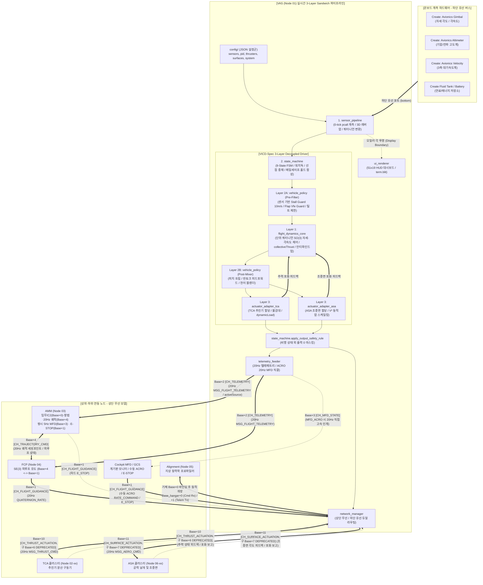
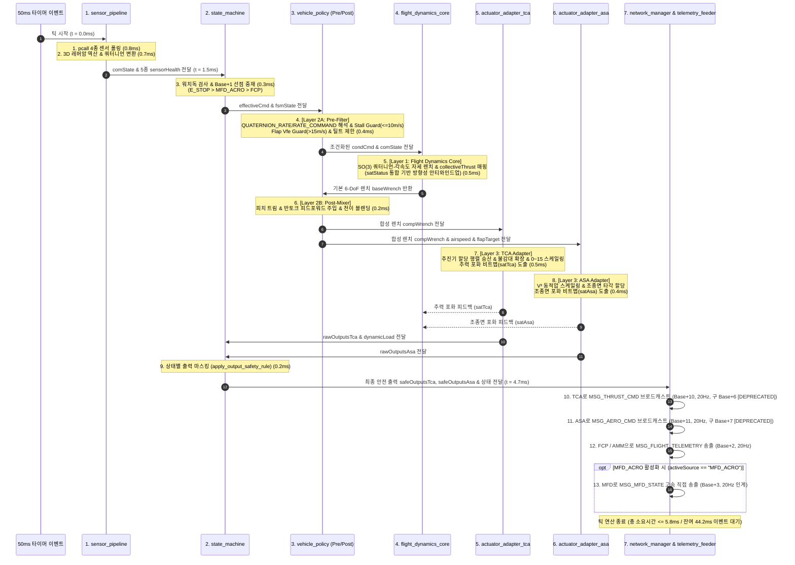
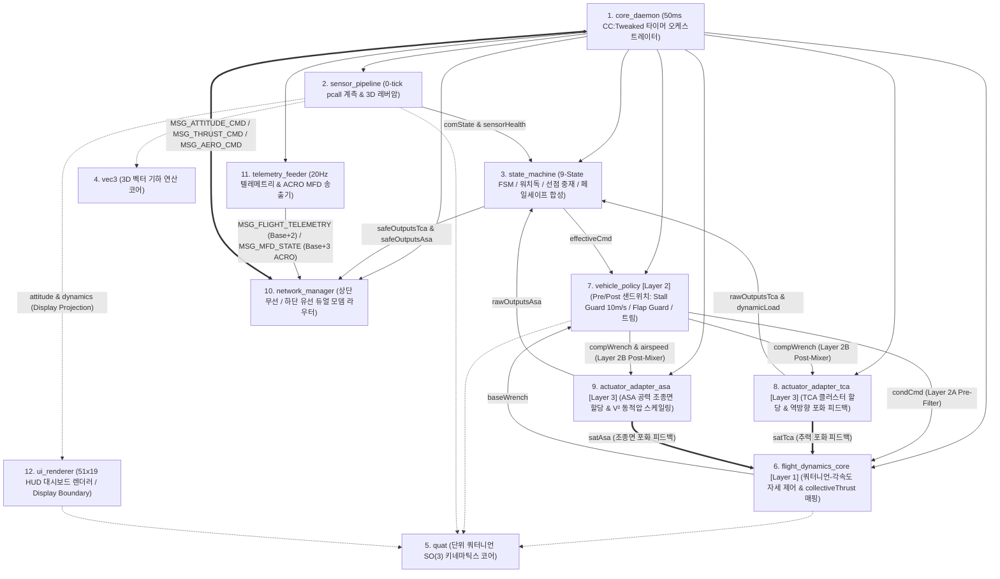
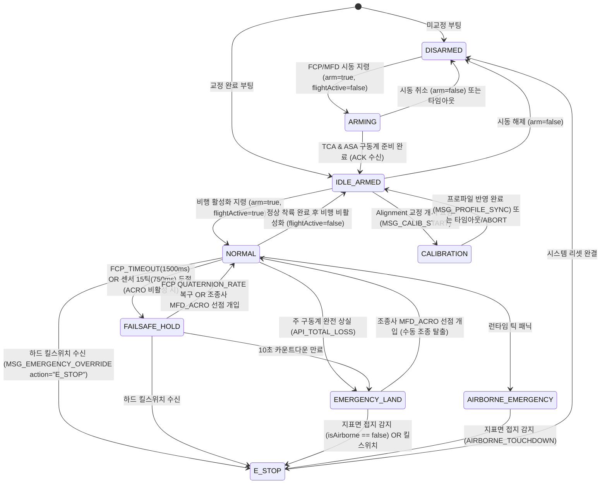

# VAS (비행 제어 및 고정밀 계측 코어) 상세 규격서
> **VAS: Realtime Flight Control & Precision Dynamics/Energy Acquisition Engine**  
> **프로젝트**: Universal Autonomous Flight Stack (UAFS Ecosystem)  
> **대상 환경**: Minecraft CC:Tweaked, Create: Aeronautics, Create: Avionics  

| 항목 | 내용 |
| :--- | :--- |
| **문서 상태 (Status)** | `Approved` |
| **문서 버전 (Version)** | `v1.19.0` |
| **최종 수정일 (Date)** | `2026-11-12` |
| **구현 코드 (Source)** | `src/1_control/vas/` |
| **주관 도메인 (Domain)** | 온보드 실시간 비행 제어 및 고정밀 계측 코어 (VAS / Node 01) |


### Revision History

| 버전 | 개정 일자 | 개정 요약 | 개정 사유 |
| :---: | :---: | :--- | :--- |
| `v1.19.0` | 2026-11-12 | FCP-AMM 역할 분리 및 `QUATERNION_RATE` 단일화 개정(`Implemented` $\to$ `Approved`): 마스터 ICD(`v1.28.0`)에 맞춰 상위 제어 계층(`AMM` $\to$ `FCP` $\to$ `VAS`) 및 `top` 무선 모뎀 채널 범위(`Base+0/+1/+2/+3[ACRO]/+10/+11`) 정합화, 일반 비행 `compute_climb_wrench` 수직 속도 PI 루프 제거(고도/승강률 홀드는 `FCP_TIMEOUT` 1,500ms 시 `FAILSAFE_HOLD`/`EMERGENCY_LAND` 내부에서만 가동), 6대 기체 `QUATERNION_RATE`(`targetQuaternion`, `targetAngularRates`, `collectiveThrust`, 선택적 `flapTarget`/`translationBias{surge,sway}`) 및 `E_STOP > MFD_ACRO > FCP` 선점 중재 규격화, `Base+3` 평시 `AMM` 5Hz 양보 및 `MFD_ACRO` 시 20Hz 직결 인계 명세, `Base+11` `MSG_SURFACE_DISCOVER_REQ/ACK`·`system.json` 채널 오프셋(`4/10/11`) 정정 및 구버전 유도 타임아웃 설정 키를 `fcpCommandTimeoutMs`로 정규화, 잔존 레거시 식별자(구형 어댑터·구동기 축약 접미어 및 소문자 유도기 표기 등) 일괄 정비 | FCP-AMM-VAS 계층 직교성 확립 및 Zero-Fallback 와이어 계약 일원화 |
| `v1.18.0` | 2026-11-09 | ADVANCED_VTOL 2D 짐벌 벡터 추진 비행체 지원: 제어 효율성 행렬(Control Effectiveness Matrix B) 및 Moore-Penrose 의사역행렬(B†) 기반 동적 렌치 믹싱, 다형성 MSG_THRUST_CMD 출력(outputs[groupId] = {thrust, gimbalX, gimbalY}), 짐벌 포화 피드백 기반 방향성 안티 와인드업, 비공력 특성(flapTarget=0.0, ASA 바이패스) 규격화 | 6-DoF 짐벌 추력 분배 믹서 알고리즘 및 비공력 자세 제어 확립 |
| `v1.17.0` | 2026-11-08 | ASA 어댑터를 ASA 어댑터로 정식 일원화, FCP 타임아웃 사유 및 텔레메트리 헬스 키 동기화, 구 명칭 전면 척결 | 용어 무결성 및 ASA/FCP 표준화 |
| `v1.16.0` | 2026-11-08 | 비동기 디버그 TUI(`system.json` 내 `debug: true` 기본값, CC `parallel.waitForAny` 기반 20Hz 제어 코어 + 5Hz HUD 렌더러 분리) 및 `debug: false` 헤드리스 직결 모드 명세 신설, Approved 전이 | 제어 지연 방지 및 헤드리스 런타임 호환성 확보 |
| `v1.15.0` | 2026-11-08 | CC:Avionics 센서 공용 표준 라이브러리(`/lib/avionics_sensors.lua`) 연동 명세 반영, altitude_sensor 공식 `getHeight()` 및 velocity_sensor 3축 합성(`read_vector3`), gimbal_sensor `getAngularRates()` 공식 API 정합화 | 공식 CC:Avionics 센서 API 규격 일원화 및 정밀 동역학 계측 무결성 확립 |
| `v1.14.0` | 2026-11-08 | 비공력 기체(VECTORED_VTOL, QUADROTOR, HEXAROTOR) 대상 ASA 조종면 믹싱/할당 및 MSG_AERO_CMD 송출 비활성화, 텔레메트리 ASA 헬스 체크 바이패스 명시 | 순수 추력형 기체에서 불필요한 공력 통신 및 결함 오경보 배제 |
| `v1.13.0` | 2026-11-07 | 상위 자율 유도 컴퓨터 구 명칭 → FCP(Flight Control Program) 개정에 따른 제어 권한 중재('E_STOP > MFD_ACRO > FCP') 및 텔레메트리/상태머신 activeSource('FCP') 동기화, 상대 링크 갱신 | FCP 명칭 전면 개정 동기화 |
| `v1.12.0` | 2026-11-07 | 비행체 전용 40채널($BW=40$) 대역 확장($Base = 10000 + (N-1)\times 40$) 반영, 구동계 버스 Zone 2 이관(`Base+10`: TCA, `Base+11`: ASA, `Base+12~19`: 구동계 예비), 구버전 `Base+10` (구 `Base+6` [DEPRECATED]), `Base+11` (구 `Base+7` [DEPRECATED])에 `[DEPRECATED]` 부여, `Base+0` C2 상시 개방 명세 확립, 승격 전이(`implemented/` $\to$ `approved/`) | 서브채널 대역폭 확장 및 기능 영역별 직교성 확보, 1000대 수용량 확립 |

> **연관 문서**: 
> - [AUTONOMOUS_FLIGHT_SYSTEM_ARCHITECTURE_AND_ICD.md](../../../system/AUTONOMOUS_FLIGHT_SYSTEM_ARCHITECTURE_AND_ICD.md) (마스터 ICD v1.28.0)
> - [SYSTEM_PROGRAM_RELATION_AND_PACKET_DIAGRAM.md](../../../system/SYSTEM_PROGRAM_RELATION_AND_PACKET_DIAGRAM.md) (전체 구조도 v2.13.0)
> - [AMM_PROGRAM_SPECIFICATION.md](../../3_planning/amm/AMM_PROGRAM_SPECIFICATION.md) (AMM 임무 관리자 및 조종석 통합 단말 규격서 v1.3.0)
> - [FCP_PROGRAM_SPECIFICATION.md](../../2_guidance/fcp/FCP_PROGRAM_SPECIFICATION.md) (FCP 자율 비행 제어 규격서 v2.0.0)
> - [ASA_PROGRAM_SPECIFICATION.md](../../1_control/asa/ASA_PROGRAM_SPECIFICATION.md) (ASA 공력 날개 및 조종면 규격서 v1.7.0)
> - [TCA_PROGRAM_SPECIFICATION.md](../tca/TCA_PROGRAM_SPECIFICATION.md) (TCA 클러스터 상세 규격서 v1.11.1)
> - [ALIGNMENT_PROGRAM_SPECIFICATION.md](../../0_development/alignment/ALIGNMENT_PROGRAM_SPECIFICATION.md) (격납고 상주형 동역학 프로파일러 v2.6.1)
> - [GPS_PROGRAM_SPECIFICATION_AND_ICD.md](../../0_infra/gps/GPS_PROGRAM_SPECIFICATION_AND_ICD.md) (GPS 규격서 v2.3.1)

---

## 1. 프로그램 개요 및 통합 아키텍처 (Overview & Architecture)

### 1.1 시스템 정체성 및 통합 배경
**VAS (Node 01)**는 비행체 온보드 컴퓨터(CC:Tweaked Advanced Computer)에 탑재되어 **20Hz(50ms) 실시간 주기**로 가동되는 비행 제어 및 고정밀 계측의 내루프 실행 코어입니다.
기존 센서 어댑터(SAP)의 모든 계측 및 신호 처리 파이프라인이 VAS 내부로 완전 통합되었으며, **차량 독립형 제어 드라이버 규격(VICD-Spec, SPEC-VICD-001 v1.1.0)**에 따라 **3계층 디커플링 샌드위치 드라이버 구조**를 표준으로 채택하여 비행 제어 및 안전 감시에 직결되는 다음 핵심 기능들을 단일 루프 내에서 완결합니다:

> [!NOTE]
> **구현 및 사양 개정 현황 요약 (Baseline v1.18.0 Implemented $\to$ v1.19.0 Approved)**
> 기존 `v1.18.0` 사양 기준 VAS 소프트웨어는 `src/1_control/vas` 환경에서 7대 핵심 과제 및 16개 마이크로슬라이스(IS-00.1 ~ IS-05.6)가 구현 완료(빌드 **v1.1.5**, 해시 `948bcbb3f2da4188502f951fcfc225d9ff0785de4abc921980a1c895b5a0a407`, Gate 0 ~ Gate 6 및 51x19 HUD 터미널·클러스터 시뮬레이션 통과, 총 소요시간 4,950.07 ms)되었으며, 단일 배포 번들(`dist_gdrive/vas/vas_bundle.lua`)로 패키징되었습니다. (과거 검증 이력은 [제12장](#12-소프트웨어-구현-현황-및-하네스통합-검증-결과-implementation--verification-status) 참조)  
> 현재 문서는 FCP-AMM 역할 분리에 맞춰 `QUATERNION_RATE` 내루프 단일화, 일반 비행 수직 속도 PI 제거, `E_STOP > MFD_ACRO > FCP` 선점 중재, `Base+3` ACRO 양보 규칙을 확정한 **`v1.19.0` (`Approved`)** 개정 사양입니다.

1. **비행 동역학 센서 계측 및 3D 기하 보정**: 3축 자세(Gimbal), 고도(Altimeter), 3차원 속도(Velocity) 실측, 3D 레버암 회전 유도 속도/고도 보정 및 단위 쿼터니언($\mathbf{q} \in SO(3)$) 변환.
2. **연료/에너지 잔량 계측 (`fuel`)**: Create 유체 탱크(`FLUID_TANK`) 및 축전지/배터리(`BATTERY`)의 최대 용량 대비 잔여량($0.0 \sim 1.0$) 정규화.
3. **추력기 동적 부하율 산출 (`dynamicLoad`)**: 6-DoF 할당 연산 결과 인가되는 모든 추력기 신호의 정격 합산 가동률($\frac{\sum S_{eff, i}}{15 \cdot M}$) 실시간 도출 및 TCA 피드백 연동 보정.
4. **통합 센서 유효성 플래그 (`sensorHealth` & `sensorOk`)**: 개별 유효성(`isAttitudeValid`, `isAltitudeValid`, `isVelocityValid`, `isFuelValid`, `isAirspeedValid`) 및 4종 센서 논리곱(`sensorOk`)을 통한 안전 포락선 감시.
5. **VICD-Spec 3계층 샌드위치 제어 파이프라인**:
   - **Layer 2A (Pre-Filter)**: `QUATERNION_RATE` / `RATE_COMMAND` 유도 명령 조건화, 센서 유효성 기반 실속 방지(Stall Guard, $\le 10\text{ m/s}$), 플랩 한계 속도 가드($V_{fe} > 15\text{ m/s}$ 플랩 강제 접음), 틸트 각도 제한 및 FSM 비상 유도 합성.
   - **Layer 1 (Flight Dynamics Core)**: 순수 수학적 단위 쿼터니언($SO(3)$) 자세/각속도 추종 조절기(오일러 특이점 배제), `collectiveThrust` 정규화 집합 추력 매핑, 추진기(TCA) 및 공력면(ASA) 구동계 역방향 포화 피드백(`satStatus`)에 연동된 방향성 안티 와인드업. *(일반 비행 수직 속도 PI 루프는 제거되었으며, 고도/수직 속도 홀드는 `FCP_TIMEOUT`(1,500ms) 시 `state_machine`의 `FAILSAFE_HOLD` / `EMERGENCY_LAND` 내부에서만 제한 가동)*
   - **Layer 2B (Post-Mixer)**: 피치 트림 및 반토크 피드포워드($\tau_{yaw} = \tau_{yaw} + F_{heave} \cdot K_{antiTorque}$) 주입, `WINGED_VTOL` 천이 블렌더(`transition_blend`).
   - **Layer 3 (Platform Actuator Adapters - Dual Adapter Architecture)**: 
     - **`actuator_adapter_tca`**: TCA 클러스터 제어 할당 행렬($0 \sim 15$ 이산 정수 스케일링, 불감대 확장), `dynamicLoad` 실시간 산출, 채널 `Base+10` (구 `Base+6` [DEPRECATED]) 20Hz `MSG_THRUST_CMD` 송출.
     - **`actuator_adapter_asa`**: ASA 공력 조종면(Aileron, Elevator, Rudder, Flap) 제어 할당, 동적압($V^2$) 역비례 게인 스케일링($\eta_q$), 채널 `Base+11` (구 `Base+7` [DEPRECATED]) 20Hz `MSG_AERO_CMD` 송출 (`FIXED_WING`, `WINGED_VTOL` 전용).
     - 양 구동계의 역방향 포화 상태(`axisSaturatedPos`, `axisSaturatedNeg`)를 Layer 1으로 통합 피드백하여 방향성 적분 동결 집행.
6. **비동기 51x19 HUD 대시보드 (`ui_renderer`) 및 런타임 분리**: 설정 파일(`config/system.json`)의 `debug: true`(기본값) 가동 시 ComputerCraft `parallel.waitForAny` 기반으로 20Hz 실시간 제어 코어 루프와 5Hz 비동기 HUD 렌더러 루틴을 상호 독립적인 코루틴으로 분리 격리하여 터미널 I/O로 인한 제어 지연을 방지합니다. 오일러 각도 변환은 제어 루프 내부가 아닌 디스플레이 경계에서만 한정 수행되며, `term.blit` 무깜빡임 고속 TUI 게이지를 표출합니다. `debug: false` 설정 시 TUI 렌더링을 완전히 배제하고 0% 오버헤드의 순수 헤드리스 모드로 직결 구동됩니다. *(일반 비행 시 MFD는 `AMM`(Node 03)의 `Base+3` 5Hz 통합 패킷을 수신하며, 조종석 수동 급기동 `MFD_ACRO` 진입 시에만 VAS가 `Base+2` `activeSource = "MFD_ACRO"`를 통보하고 `Base+3` 20Hz 직접 저지연 송출을 인계)*



### 1.2 코드 경량화 및 Deprecated 운영 정책 (Code Lightweighting & Deprecation Policy)
1. **사양서 명세 원칙 (Specification-First)**: 프로토콜 패킷 타입명 또는 페이로드 필드가 개정될 경우, 구버전 명칭은 사양서 내에 `[DEPRECATED]` 배지를 부여하고 대체 신규 필드명과 변경 이력을 명시하여 문서상에 보존합니다.
2. **코드베이스 경량화 원칙 (Zero-Fallback)**: CC:Tweaked Lua 분산 컴퓨터 환경의 자원 제약(RAM/토큰 절약, 파싱 오버헤드 최소화, 20Hz 실시간 루프 성능 유지)을 준수하기 위해, 코드베이스는 사전 이중 호환(Fallback 래퍼, `payload.new or payload.old` 등)을 일체 작성하지 않고 **최신 표준 필드명/패킷명만을 단일 채택**합니다.
3. **런타임 오류 시 복구 원칙 (송신 노드 즉시 패치)**: 구버전 필드/패킷을 전송하는 미갱신 노드로 인해 수신 측에서 `nil` 인덱싱 등의 런타임 오류가 발생할 경우, 수신 측에 임시 폴백 코드를 추가하지 않고 **구버전 패킷을 송신한 발신 노드의 코드를 최신 사양으로 즉시 패치 및 재배포**하여 전역 일원화를 달성합니다.

---

## 2. 하드웨어 구성 및 물리 인터페이스 (Hardware Interfaces)

### 2.0 물리 포트 배치 규격 (Physical Hardware Interfaces)
VAS 컴퓨터는 상하 듀얼 모뎀 구성을 표준으로 채택하여 유무선 트래픽을 물리적으로 엄격히 격리합니다:
- **`top` (상단 포트)**: **무선 모뎀 (Wireless Ender Modem)** — 온보드 비행 제어·구동 및 격납고 교정 무선 패킷 송수신 전담 (`Base+0` Alignment 교정 바인딩 개시, `Base+1` FCP `QUATERNION_RATE` 유도 / MFD `ACRO` / `AMM·MFD·GCS` 하드 `E_STOP`, `Base+2` 20Hz `MSG_FLIGHT_TELEMETRY` [FCP·AMM·Alignment 수신], `Base+3` `MFD_ACRO` 시 20Hz HUD 직접 송출, `Base+10` (구 `Base+6` [DEPRECATED]) TCA 추력, `Base+11` (구 `Base+7` [DEPRECATED]) ASA 조종면). *(외부 GCS·Tower ATC·GAC·GPS·스마트 시설물 도메인 통신은 `AMM (Node 03)`이 전담하며 VAS는 외부 도메인 채널을 개방하지 않음)*
- **`bottom` (하단 포트)**: **유선 모뎀 (Wired Modem)** — 기체 내부 폐쇄형 센서 네트워크 버스 연결 (`avionics:*`, `create:fluid_tank`, `battery`).
- **`left`, `right`, `front`, `back`**: 센서 및 액추에이터 직결 금지 (신호 간섭 차단 및 배선 단순화).

#### 타입 기반 모뎀 자동 식별 및 동적 폴백 탐색 (`resolve_typed_modem`)
v1.0.22에서는 기체 조립 시 포트 장착 방향 오설정 또는 반전으로 인한 통신 두절을 방지하기 위해, 페리페럴 타입 검사 알고리즘을 도입하였습니다:
1. 설정 파일(`config/system.json`)에 지정된 포트(`wirelessModemSide`, `wiredSensorBusSide`)를 우선 검사합니다.
2. 페리페럴 API `m.isWireless()`를 호출하여 요구 모드(`expectWireless`)와 일치하는지 단언 검증합니다.
3. 포트가 비어있거나 불일치할 경우, 반대쪽 포트 및 컴퓨터 외곽 전 포트(`peripheral.getNames()`)를 동적 스캔(`peripheral.find("modem", filter)`)하여 올바른 모뎀 객체(`wirelessModem`, `wiredModem`)를 자동 바인딩합니다.

### 2.1 지원 계측 롤(Measurement Roles) 및 규격
| 롤 식별자 (`role`) | 대상 페리페럴 타입 | 산출 물리량 | 필수 여부 |
| :--- | :--- | :--- | :---: |
| `gimbal` | `avionics:gimbal_sensor`, `gimbal_sensor` | `getAngles()`(Pitch/Roll/Yaw $^\circ$), `getAngularRates()`(3축 각속도 $^\circ$/s), 중력 벡터 | **필수** |
| `altitude` | `avionics:altitude_sensor`, `altitude_sensor` | `getHeight()`(월드 고도 $m$), 수직 요동 속도 $v_y$ ($m/s$) | **필수** |
| `velocity` | `avionics:velocity_sensor`, `velocity_sensor` | 1축 스칼라 `getVelocity()` 및 3축 분산 배치 시 `read_vector3()` 합성 3차원 속도 벡터 $\mathbf{v} = \{vx, vy, vz\}$ ($m/s$) | **필수** |
| `fuel` | `create:fluid_tank`, `battery`, 에너지 저장소 | 총 잔여량, 최대 용량, 정규화 잔여율($0.0 \sim 1.0$) | **필수** |

---

## 3. 고정밀 센서 획득 및 수치해석 파이프라인 (Sensor Processing Pipeline)

VAS는 매 50ms 틱 시작 시 다음 정밀 파이프라인을 거쳐 센서 신호, 단위 쿼터니언($SO(3)$) 자세 및 내부 동역학 메트릭을 산출합니다.

### 3.1 Step 1: `pcall` 논블로킹 일괄 샘플링 및 통합 헬스 평가 (Fault-Tolerant Polling)
1. **0틱 논블로킹 보호 호출**:
   - 모든 외부 페리페럴 호출은 Lua의 `pcall` (Protected Call) 블록으로 래핑됩니다.
   - 단절 또는 청크 언로드로 인해 페리페럴이 소멸하더라도 20Hz 제어 루프 크래시를 방지합니다.
2. **다계층 헬스 맵(Health Map) 및 5종 유효성 플래그 갱신 (`sensorHealth`)**:
   - `sensorHealth = { gimbal = bool, altitude = bool, velocity = bool, fuel = bool, isAttitudeValid = bool, isAltitudeValid = bool, isVelocityValid = bool, isFuelValid = bool, isAirspeedValid = bool }`
   - 전체 정상 플래그 `sensorOk`는 **4종 기본 센서의 논리곱**으로 판정됩니다:
     $$\text{sensorOk} = \text{health.gimbal} \land \text{health.altitude} \land \text{health.velocity} \land \text{health.fuel}$$
   - **센서 고장 격리 안전 인터록**: 실속 방지 가드(Stall Guard)는 `isAirspeedValid == true`일 때만 개입하도록 격리되어, 대기속도계 고장(0 m/s) 시 오조작으로 인한 급격한 기수 강하 다이브 사고를 방지합니다.
3. **1초 주기(20틱) 자동 재연결(Auto-Reconnect)**:
   - 비정상 플래그가 설정된 센서에 한해, 매 20틱(1초)마다 1회 `peripheral.find(pType)`를 백그라운드 재호출하여 핫플러그 복구를 시도합니다.

### 3.2 Step 2: 3D 기하·동역학 레버암 보정 및 단위 쿼터니언 변환 (Lever-Arm & Quaternion)
센서가 기체의 무게중심(Center of Mass, CoM)과 이격된 위치($\mathbf{r}_{NED} = [dx, dy, dz]^T$, 기체 전방 $+dx$, 우측 $+dy$, 하방 $+dz$)에 장착되어 있을 때 발생하는 회전 유도 물리 왜곡을 완전 상쇄합니다.

#### 1) 선속도 벡터 레버암 보정 및 텔레메트리 좌표축 정합 (Velocity Lever-Arm Correction)
기체 국소 NED 좌표계에서 각속도 벡터 $\boldsymbol{\omega}_{rad} = [p_{rad}, q_{rad}, r_{rad}]^T$ (롤 $p$, 피치 $q$, 요 $r$)와 레버암 $\mathbf{r}_{NED} = [dx, dy, dz]^T$의 외적 $\boldsymbol{\omega}_{rad} \times \mathbf{r}_{NED}$에 의해 유도되는 접선 속도 성분은 다음과 같습니다:
- **전방(Surge, $+x$) 회전 속도**: $\Delta v_{surge} = q_{rad} \cdot dz - r_{rad} \cdot dy$
- **우측(Sway, $+y$) 회전 속도**: $\Delta v_{sway} = r_{rad} \cdot dx - p_{rad} \cdot dz$
- **하방(Down, $+z$) 회전 속도**: $\Delta v_{down} = p_{rad} \cdot dy - q_{rad} \cdot dx$
- **상방(Up/Climb, $+Y = -z$) 회전 속도**: $\Delta v_{up} = -\Delta v_{down} = q_{rad} \cdot dx - p_{rad} \cdot dy$

> [!WARNING]
> **1. 각속도 라디안 단위 변환 필수 ($\text{deg/s} \to \text{rad/s}$)**  
> 짐벌 센서가 출력하는 각속도 $p, q, r$은 도(Degrees, $^\circ/\text{s}$) 단위이므로, 선속도 외적 보정 전 반드시 라디안 단위로 변환해야 합니다($p_{rad} = \text{math.rad}(p)$ 등). 미변환 시 $57.3\times$ 배의 레버암 증폭 왜곡이 발생합니다.  
> **2. 텔레메트리 `{vx, vy, vz}` 축 매핑 주의 (`vy` = 수직 상승 속도 $+Y$)**  
> 마스터 ICD 텔레메트리의 `dynamics.velocity = {vx, vy, vz}`에서 `vy`는 마인크래프트 수직 축(Up $+$, `verticalSpeed`와 동일)이며, `vx`는 전방/주축, `vz`는 횡방향/보조축입니다. 따라서 `vy`에는 반드시 **상방 회전 속도($\Delta v_{up} = q_{rad} \cdot dx - p_{rad} \cdot dy$)**를 차감하고, `vz`에는 **횡방향 회전 속도($\Delta v_{sway} = r_{rad} \cdot dx - p_{rad} \cdot dz$)**를 차감해야 합니다.

$$
\begin{bmatrix}
vx_{CoM} \text{ (전방/X)} \\
vy_{CoM} \text{ (수직 상방/Y)} \\
vz_{CoM} \text{ (측방/Z)}
\end{bmatrix}
=
\begin{bmatrix}
vx_{sensor} \\
vy_{sensor} \\
vz_{sensor}
\end{bmatrix}
-
\begin{bmatrix}
q_{rad} \cdot dz - r_{rad} \cdot dy \\
q_{rad} \cdot dx - p_{rad} \cdot dy \\
r_{rad} \cdot dx - p_{rad} \cdot dz
\end{bmatrix}
$$

보정된 CoM 속도 벡터로부터 파생 동역학 지표를 산출합니다:
$$\text{verticalSpeed} = vy_{CoM}, \quad \text{airspeed} = \sqrt{vx_{CoM}^2 + vy_{CoM}^2 + vz_{CoM}^2}$$

#### 2) 고도계 레버암 기하 보정 (Altitude Geometric Correction)
Nose-Up 피치($\theta > 0$) 시 CoM 전방($dx > 0$)에 위치한 센서는 고도가 상승하므로, 실측 고도 $h_{sensor}$에서 양의 변위 $\Delta h_{lever}$를 차감하여 참 CoM 고도를 역산합니다:
$$\Delta h_{lever} = dx \cdot \sin\theta_{rad} - dy \cdot \sin\phi_{rad} \cos\theta_{rad} - dz \cdot (\cos\theta_{rad} \cos\phi_{rad} - 1)$$
$$h_{CoM} = h_{sensor} - \Delta h_{lever} - \text{zeroBias}_{alt}$$

#### 3) 단위 쿼터니언 $SO(3)$ 변환 (Quaternion Synthesis)
측정된 오일러 각도(피치 $\theta$, 롤 $\phi$, 요 $\psi$)를 바탕으로 단위 쿼터니언 $\mathbf{q}_{att} \in SO(3)$을 합성하여 제어 코어에 무왜곡 3D 회전 상태를 제공합니다:
$$\mathbf{q}_{att} = \text{quat.from\_euler}(\theta, \phi, \psi)$$

### 3.3 Step 3: 각속도 산출 및 EMA 저역통과 필터링 (Angular Rates & Filtering)
1. **페리페럴 고유 API 우선 탐색**: `/lib/avionics_sensors.lua` 및 `avionics:gimbal_sensor`의 `getAngularRates()` 우선 사용.
2. **수치 미분 및 EMA 필터링**: API 미제공 시 실측 경과 시간($\Delta t$) 기반 각도 차분(Yaw는 $\pm 180^\circ$ 최단거리 차분 적용) 및 지수이동평균(EMA, $\alpha=0.35$) 필터 적용:
   $$\bar{\omega}_k = \alpha \cdot \omega_{meas} + (1 - \alpha) \cdot \bar{\omega}_{k-1}$$

### 3.4 Step 4: 연료 잔량 및 추력기 동적 부하율 산출 (Fuel & Dynamic Workload)
1. **연료 잔량비 (`fuel`)**:
   - `FLUID_TANK`: $\text{fuel} = \frac{\sum_{i=1}^N \text{tank}_i.\text{getFluidAmount()}}{\max(1.0, \sum_{i=1}^N \text{tank}_i.\text{getCapacity()})}$
   - `BATTERY`: $\text{fuel} = \frac{\sum_{j=1}^K \text{batt}_j.\text{getEnergyStored()}}{\max(1.0, \sum_{j=1}^K \text{batt}_j.\text{getMaxEnergyStored()})}$
2. **추력기 동적 부하율 (`dynamicLoad`) 연속 산출 및 피드백 보정**:
   - TCA 노드의 `MSG_ACTUATOR_STATUS`는 상태 변화(포화, 활성 개수 변동, 상호작용 모드 전환) 시에만 이벤트성으로 송출됩니다.
   - 따라서 VAS의 `actuator_adapter_tca`은 각 추진기 그룹 $i$의 최신 상태(`interactionMode`, `activeCount`, `totalCount`, `healthStatus`)를 메모리에 유지하고, 매 20Hz 틱마다 인가 명령 $S_{cmd, i} \in [0, 15]$에 대한 **유효 인가 추정치 $S_{eff, i}$**를 연속 계산하여 참 `dynamicLoad`를 도출합니다:
     $$S_{eff, i} = \begin{cases} 0.0 & (\text{healthStatus}_i \in \{\text{"API\_TOTAL\_LOSS"}, \text{"API\_TIMEOUT"}, \text{"REDSTONE\_TIMEOUT"}, \text{"TOTAL\_LOSS"}\}) \\ \min\left(15.0, S_{cmd, i} \times \frac{\text{totalCount}_i}{\text{activeCount}_i}\right) & (\text{interactionMode}_i == \text{"API"} \land \text{activeCount}_i > 0) \\ S_{cmd, i} & (\text{그 외 REDSTONE\_NOMINAL 또는 기본 상태}) \end{cases}$$
     *(참고: 구버전 필드 `mode`는 `[DEPRECATED]` 상태이며, 코드베이스는 무폴백 원칙에 따라 `interactionMode`만 단일 판별함)*
     $$\text{dynamicLoad} = \frac{\sum_{i=1}^M S_{eff, i}}{15.0 \times \max(1, M)} \quad (0.0 \sim 1.0)$$

---

## 4. 실시간 제어 루프 실행 생명주기 (20Hz Execution Lifecycle)

VAS는 CC:Tweaked 타이머 이벤트를 통해 매 50ms마다 깨어나며, VICD-Spec 3계층 디커플링 파이프라인을 정밀 시간 예산 내에 완결합니다.



### 4.1 틱 시간 예산 (Timing Budget)
| 처리 단계 | 담당 모듈 | 상세 내용 | 소요 시간 예산 |
| :--- | :--- | :--- | :---: |
| **센서 획득** | `sensor_pipeline` | 4종 센서(자세/고도/속도/연료) `pcall` 일괄 읽기 및 유효성 검사 | $\le 0.8 \text{ ms}$ |
| **기하/쿼터니언** | `sensor_pipeline`<br>`vec3` / `quat` | 3D 레버암 좌표 변환, EMA 각속도 필터, $SO(3)$ 쿼터니언 합성, 헬스맵 갱신 | $\le 0.7 \text{ ms}$ |
| **FSM/선점 중재** | `state_machine` | 듀얼 워치독 만료 판정, 9-State 전이, `Base+1` 선점 중재(`E_STOP > MFD_ACRO > FCP`) | $\le 0.3 \text{ ms}$ |
| **Layer 2A: Pre-Filter** | `vehicle_policy` | `QUATERNION_RATE`/`RATE_COMMAND` 해석, Stall Guard($\le 10\text{ m/s}$), Flap $V_{fe}$ 가드, 틸트 클램프 | $\le 0.4 \text{ ms}$ |
| **Layer 1: Core** | `flight_dynamics_core` | 단위 쿼터니언-각속도 오차 토크, `collectiveThrust` 정규화 매핑, 이중 구동계 포화 안티와인드업 | $\le 0.5 \text{ ms}$ |
| **Layer 2B: Post-Mixer** | `vehicle_policy` | 피치 트림 및 반토크 피드포워드 주입, `WINGED_VTOL` 천이 블렌딩 | $\le 0.2 \text{ ms}$ |
| **Layer 3: TCA Adapter** | `actuator_adapter_tca` | 추진기 할당 행렬곱, 불감대 확장, 0~15 이산 정수화, `satTca` 역피드백 | $\le 0.5 \text{ ms}$ |
| **Layer 3: ASA Adapter** | `actuator_adapter_asa` | $V^2$ 동적압 역비례 스케일링, 조종면 타각 할당, `satAsa` 역피드백 | $\le 0.4 \text{ ms}$ |
| **출력/안전/통신** | `core_daemon`<br>`network_manager`<br>`telemetry_feeder` | 출력 마스킹, `MSG_THRUST_CMD` (`Base+10` (구 `Base+6` [DEPRECATED])), `MSG_AERO_CMD` (`Base+11` (구 `Base+7` [DEPRECATED])), `MSG_FLIGHT_TELEMETRY` (`Base+2`), ACRO MFD (`Base+3`) | $\le 1.8 \text{ ms}$ |
| **총 연산 시간** | **전체 파이프라인** | **전체 50ms 주기 중 실제 CPU 점유 시간** | **$\le 5.6 \text{ ms}$ (여유율 $> 88\%$)** |

---

## 5. 12대 핵심 소프트웨어 모듈 아키텍처 (Modular Architecture & Signatures)

VAS의 소프트웨어는 관심사 분리(SoC), 단일 책임 원칙(SRP) 및 VICD-Spec 3계층 아키텍처에 따라 **12개의 독립 모듈**로 구성됩니다.



### 5.1 모듈 1: `core_daemon` (메인 20Hz 실행 스케줄러 & 4단계 파이프라인 오케스트레이터)
- **역할**: CC:Tweaked `os.startTimer(0.05)` 이벤트를 기반으로 정밀 20Hz(50ms) 루프를 구동하고, `pcall`로 전체 서브시스템을 보호하며 안전 셧다운을 집행합니다.
- **핵심 시그니처**:
  ```lua
  function core_daemon.init(configDir) -> daemonStateTable
  function core_daemon.tick(state) -> boolean
  function core_daemon.handle_event(state, event, p1, p2, p3, p4) -> boolean
  function core_daemon.run(configDir) -> daemonStateTable
  function core_daemon.shutdown(state, reason) -> nil
  ```
- **핵심 의사코드 (`src/modules/core_daemon.lua`)**:
  ```lua
  local function step_kinematics(state, dt, nowMs)
      local raw = sensor_pipeline.sample_all(state.sensors)
      local comState, healthMap, sensorOk = sensor_pipeline.process_kinematics(state.sensors, raw, dt)
      if state.tickCount % (state.cfg.sensors.reconnectTicks or 20) == 0 then
          sensor_pipeline.reconnect_faulty(state.sensors, healthMap)
      end
      state_machine.update_watchdogs(state.fsm, nowMs, comState, healthMap, sensorOk)
      return comState, healthMap, sensorOk
  end

  local function step_actuation(state, comState, dt)
      local effectiveCmd = state_machine.get_effective_command(state.fsm, comState)
      local condCmd = vehicle_policy.pre_process_guidance(state.policy, comState, effectiveCmd, state.fsm.currentState)

      -- TCA 및 ASA 구동계 통합 포화 비트맵 합성 (어느 한쪽이라도 포화 시 안티와인드업 발동)
      local satCombined = {
          axisSaturatedPos = {
              pitch = state.adapterTca.saturationStatus.axisSaturatedPos.pitch or state.adapterAsa.saturationStatus.axisSaturatedPos.pitch,
              roll  = state.adapterTca.saturationStatus.axisSaturatedPos.roll  or state.adapterAsa.saturationStatus.axisSaturatedPos.roll,
              yaw   = state.adapterTca.saturationStatus.axisSaturatedPos.yaw   or state.adapterAsa.saturationStatus.axisSaturatedPos.yaw
          },
          axisSaturatedNeg = {
              pitch = state.adapterTca.saturationStatus.axisSaturatedNeg.pitch or state.adapterAsa.saturationStatus.axisSaturatedNeg.pitch,
              roll  = state.adapterTca.saturationStatus.axisSaturatedNeg.roll  or state.adapterAsa.saturationStatus.axisSaturatedNeg.roll,
              yaw   = state.adapterTca.saturationStatus.axisSaturatedNeg.yaw   or state.adapterAsa.saturationStatus.axisSaturatedNeg.yaw
          }
      }

      local baseWrench = flight_dynamics_core.compute(state.fdCore, comState, condCmd, dt, satCombined)
      local compWrench = vehicle_policy.post_process_wrench(state.policy, baseWrench, comState, condCmd)

      -- Layer 3: TCA 추진기 및 ASA 공력 조종면 할당 (기종별 분기)
      local rawOutputsTca, satStatusTca = actuator_adapter_tca.allocate(state.adapterTca, compWrench)
      local rawOutputsAsa, satStatusAsa = nil, nil
      local isAero = (state.policy.vehicleType == "FIXED_WING" or state.policy.vehicleType == "WINGED_VTOL")
      if isAero then
          rawOutputsAsa, satStatusAsa = actuator_adapter_asa.allocate(state.adapterAsa, compWrench, comState.airspeed, condCmd.flapTarget)
      end

      local safeOutputsTca, safeOutputsAsa = state_machine.apply_output_safety_rule(state.fsm, rawOutputsTca, rawOutputsAsa)
      local dynLoad = actuator_adapter_tca.compute_dynamic_load(state.adapterTca, safeOutputsTca)

      state.fdCore.lastDemands = { pitch = compWrench.pitchTorque, roll = compWrench.rollTorque, yaw = compWrench.yawTorque }
      state.fdCore.saturationFreeze = satCombined.axisSaturatedPos.pitch or satCombined.axisSaturatedNeg.pitch
      return safeOutputsTca, safeOutputsAsa, dynLoad, isAero
  end

  function core_daemon.tick(state)
      local nowMs = os.epoch("utc")
      local dt = math.max(0.005, math.min(0.25, (nowMs - state.lastTickMs) / 1000.0))
      state.lastTickMs = nowMs
      state.tickCount = state.tickCount + 1

      local comState, healthMap, sensorOk = step_kinematics(state, dt, nowMs)
      local safeOutputsTca, safeOutputsAsa, dynLoad, isAero = step_actuation(state, comState, dt)

      -- 1. Base+10 TCA 추진기 지령 브로드캐스트 (20Hz)
      network_manager.send_packet(state.net, state.net.channels.actuation, "MSG_THRUST_CMD", {
          watchdogSeq = state.tickCount,
          controlState = state.fsm.currentState,
          outputs = safeOutputsTca
      })

      -- 2. Base+11 ASA 공력 조종면 지령 브로드캐스트 (20Hz, 공력 기체 전용)
      if isAero and safeOutputsAsa then
          network_manager.send_packet(state.net, state.net.channels.asaActuation, "MSG_AERO_CMD", {
              watchdogSeq = state.tickCount,
              controlState = state.fsm.currentState,
              surfaces = safeOutputsAsa
          })
      end

      -- 3. Base+2 텔레메트리 (20Hz) 및 Base+3 ACRO MFD 직접 송출 (activeSource == "MFD_ACRO" 시 20Hz 인계)
      telemetry_feeder.tick(state.feeder, state.net, comState, state.fsm, dynLoad, {
          sensorOk = sensorOk,
          sensorHealth = healthMap,
          acroActive = (state.fsm.activeSource == "MFD_ACRO")
      })
      return true
  end
  ```

### 5.2 모듈 2: `sensor_pipeline` (센서 수집, 3D 레버암 기하 보정 및 쿼터니언 합성)
- **역할**: 하단 유선 모뎀망의 센서 4종을 전역 공용 표준 라이브러리 `/lib/avionics_sensors.lua` (`require("avionics_sensors")`) 기반으로 0-tick 논블로킹 수집하고, 3D 레버암 기하 보정, 단위 쿼터니언 합성 및 5종 유효성 플래그 헬스 평가를 완결합니다.
- **핵심 시그니처**:
  ```lua
  function sensor_pipeline.init(sensorsConfig) -> pipelineState
  function sensor_pipeline.sample_all(state) -> rawSampleTable
  function sensor_pipeline.evaluate_health(raw) -> healthMap, sensorOkBool
  function sensor_pipeline.compensate_lever_arm(raw, lastCom, cfg, dt) -> comState
  function sensor_pipeline.process_kinematics(state, rawSamples, dt) -> comState, healthMap, sensorOk
  function sensor_pipeline.reconnect_faulty(state, healthMap) -> count
  ```

### 5.3 모듈 3: `state_machine` (9-State 유한 상태 기계, 2단계 시동 및 C2 선점 중재기)
- **역할**: 기체의 9대 제어 상태를 관리하고, 2단계 시동 시퀀스(`DISARMED` $\to$ `ARMING` $\to$ `IDLE_ARMED` $\to$ `NORMAL`), `Base+1` C2 선점 중재(`E_STOP` > `MFD_ACRO` > `FCP`), 듀얼 워치독(FCP 1,500ms, 교정 120s, Failsafe 10s) 감시, 센서 두절 15틱(750ms) 디바운스, **`FAILSAFE_HOLD` / `EMERGENCY_LAND` 시 고도·수직 속도 홀드/강하 비상 유도 합성** 및 TCA/ASA 출력 안전 마스킹(공중 E_STOP 쿠션 추력 포함)을 집행합니다.
- **핵심 시그니처**:
  ```lua
  function state_machine.init(systemConfig, isCalibrated) -> fsmState
  function state_machine.transition_to(state, nextState, reason) -> boolean
  function state_machine.update_watchdogs(state, nowMs, comState, healthMap, sensorOk) -> nil
  function state_machine.arbitrate_c2_preemption(state, fcpCmd, acroCmd, eStopCmd) -> effectiveCmd, activeSource
  function state_machine.get_effective_command(state, comState) -> effectiveCmd
  function state_machine.apply_output_safety_rule(state, rawOutputsTca, rawOutputsAsa) -> safeOutputsTca, safeOutputsAsa
  ```

### 5.4 모듈 4: `vec3` (3D 불변 벡터 연산자)
- **역할**: 순수 함수형 불변 3D 벡터 산술 및 기하 연산을 제공합니다.
- **핵심 시그니처**:
  ```lua
  function vec3.new(x, y, z) -> vec3Table
  function vec3.zero() -> vec3Table
  function vec3.add(a, b) -> vec3Table
  function vec3.sub(a, b) -> vec3Table
  function vec3.scale(v, s) -> vec3Table
  function vec3.dot(a, b) -> number
  function vec3.cross(a, b) -> vec3Table
  function vec3.length(v) -> number
  function vec3.normalize(v) -> vec3Table
  function vec3.dist(a, b) -> number
  ```

### 5.5 모듈 5: `quat` (단위 쿼터니언 $SO(3)$ 키네마틱스 & 디스플레이 오일러 변환)
- **역할**: 짐벌락을 배제하는 $SO(3)$ 4원수 회전 키네마틱스, 최단거리 쿼터니언 오차 연산, 그리고 **디스플레이 경계 전용** 오일러 변환을 제공합니다.
- **핵심 시그니처**:
  ```lua
  function quat.new(w, x, y, z) -> quatTable
  function quat.identity() -> quatTable
  function quat.normalize(q) -> quatTable
  function quat.conjugate(q) -> quatTable
  function quat.multiply(a, b) -> quatTable
  function quat.rotate_vector(q, v) -> vec3Table
  function quat.error_quaternion(targetQ, measQ) -> errQuatTable
  function quat.from_euler(pitchDeg, rollDeg, yawDeg) -> quatTable
  function quat.to_euler(q) -> { pitch, roll, yaw }
  ```

### 5.6 모듈 6: `flight_dynamics_core` [Layer 1] (단위 쿼터니언 $SO(3)$ 자세/각속도 제어기)
- **역할**: 순수 수학적 닫힌 루프 $SO(3)$ 쿼터니언-각속도 자세 조절기(`QUATERNION_RATE` / `RATE_COMMAND`) 및 `collectiveThrust` 정규화 집합 추력 매핑을 수행하며, Layer 3 구동계 포화 피드백(`satStatus`)에 연동된 방향성 적분기 안티 와인드업을 집행합니다. *(정상 비행용 `compute_climb_wrench` 수직 속도 PI 루프는 `FCP` `SE(3)` 외루프로 이관되어 제거되었으며, 고도/수직 속도 홀드 제어는 `FCP_TIMEOUT`(1,500ms) 발생 시 `state_machine`의 `FAILSAFE_HOLD` / `EMERGENCY_LAND` 페일세이프 내부에서만 제한적으로 작동합니다.)*
- **핵심 시그니처**:
  ```lua
  function flight_dynamics_core.init(config) -> coreState
  function flight_dynamics_core.reset_integrators(state) -> nil
  function flight_dynamics_core.compute_attitude_wrench(state, targetQ, measQ, targetRates, measRates, dt, satStatus) -> attWrench
  function flight_dynamics_core.compute_rate_wrench(state, targetRates, measRates, dt, satStatus) -> rateWrench
  function flight_dynamics_core.compute(state, telem, guidance, dt, satStatus) -> baseWrench
  ```

### 5.7 모듈 7: `vehicle_policy` [Layer 2] (기종별 포락선 보호 / Stall Guard / Flap Guard / 트림 주입 / 천이 블렌더)
- **역할**: Layer 1을 감싸는 샌드위치 래퍼로, Pre-Filter(`QUATERNION_RATE` / `RATE_COMMAND` 해석, 대기속도 유효 기반 단일화 Stall Guard 10m/s, 플랩 구조 한계 Vfe 15m/s 가드, 틸트 한계 클램프, 미교정 감쇄 모드 20도 제한)와 Post-Mixer(적분기 왜곡 없는 피치 트림 및 반토크 피드포워드 주입), 6대 기체별 `collectiveThrust` 및 `WINGED_VTOL` `transitionAlpha` 블렌딩을 집행합니다.
- **기종별 정책 (Airframe Policy)**: `ADVANCED_VTOL`은 `VECTORED_VTOL`, `QUADROTOR`, `HEXAROTOR`와 함께 비공력 순수 추력형 기종으로 분류되어 `transitionAlpha = 0.0`, `resolve_flap_target = 0.0`, Stall Guard 및 Flap Guard가 바이패스되며 `translationBias { surge, sway }` 기반 수평 병진 제어가 활성화됩니다.
- **핵심 시그니처**:
  ```lua
  function vehicle_policy.init(policyConfig) -> policyState
  function vehicle_policy.resolve_guidance_targets(cmd) -> targetQ, targetRates, collectiveThrust
  function vehicle_policy.clamp_tilt_limits(policy, targetQ, isDerated) -> clampedQ
  function vehicle_policy.apply_stall_guard(policy, telem, conditionedCmd) -> nil
  function vehicle_policy.apply_flap_speed_guard(policy, telem, flapTarget) -> safeFlapTarget
  function vehicle_policy.pre_process_guidance(policy, telem, rawCmd, fsmState) -> conditionedCmd
  function vehicle_policy.post_process_wrench(policy, baseWrench, telem, conditionedCmd) -> compositeWrench
  function vehicle_policy.transition_blend(hoverWrench, cruiseWrench, alpha) -> blendedWrench
  ```

### 5.8 모듈 8: `actuator_adapter_tca` [Layer 3] (TCA 클러스터 추진기 어댑터 & 역방향 포화 피드백)
- **역할**: 6-DoF 합성 렌치를 각 추진기 그룹 신호로 변환(할당 행렬곱, 불감대 확장, $0 \sim 15$ 이산 정수화)하고, 축별 포화 비트맵(`axisSaturatedPos`, `axisSaturatedNeg`)을 Layer 1로 역피드백하며, `dynamicLoad`를 연속 산출하고 프로파일 동적 핫 리로드를 수행합니다.
- **핵심 시그니처**:
  ```lua
  function actuator_adapter_tca.init(profileOrConfig) -> adapterState
  function actuator_adapter_tca.reload_coefficients(state, profileOrCoeffs, isFallback) -> boolean
  function actuator_adapter_tca.allocate(state, wrench) -> outputsTable, satStatus
  function actuator_adapter_tca.compute_dynamic_load(state, outputs) -> number
  function actuator_adapter_tca.update_actuator_feedback(state, payload) -> isPrimaryLossBool
  ```

### 5.9 모듈 9: `actuator_adapter_asa` [Layer 3] (ASA 공력 조종면 어댑터 & 동적압 V² 스케일링)
- **역할**: 6-DoF 회전 렌치를 공력 조종면(에일러론, 엘리베이터, 러더) 및 양력 증강면(플랩) 타각으로 매핑하고, 대기속도 동적압($V_{air}^2$) 역비례 게인 스케일링($\eta_q = \text{clamp}(0.25, 2.50, (V_{ref}/V_{air})^2)$) 및 불감대 확장을 적용하여 정규화 타각 신호를 생성하며, 조종면 포화 비트맵(`axisSaturatedPos`, `axisSaturatedNeg`)을 Layer 1으로 역피드백합니다.
- **핵심 시그니처**:
  ```lua
  function actuator_adapter_asa.init(surfacesConfig) -> asaAdapterState
  function actuator_adapter_asa.allocate(state, wrench, airspeed, flapTarget) -> outputsTable, satStatus
  function actuator_adapter_asa.compute_q_scaling(state, airspeed) -> qScale
  function actuator_adapter_asa.update_feedback(state, payload) -> nil
  ```

### 5.10 모듈 10: `network_manager` (듀얼 모뎀 라우터, 프로토콜 파서 및 동적 채널 관리자)
- **역할**: 상단 무선 모뎀 온보드 채널(`Base+0` Alignment 교정 바인딩 개시, `Base+1` `FCP` 유도/`MFD_ACRO`/`E_STOP`, `Base+10` (구 `Base+6` [DEPRECATED]) TCA 추력, `Base+11` (구 `Base+7` [DEPRECATED]) ASA 조종면, `Base+2` 텔레메트리, `Base+3` ACRO HUD)과 하단 유선 모뎀을 바인딩하며, 격납고 바인딩(`MSG_CALIBRATION_INIT`) 수신 시 베이 채널을 동적 개방하고 하위 노드(TCA, ASA)로 `MSG_CALIB_BAY_BIND`를 중계 전파하며, `FCP`(`Base+1`)로부터 수신한 동적 채널 재바인딩(`MSG_CHANNEL_REBIND`) 2단계 트랜잭션(`PREPARE` $\to$ `MSG_REBIND_ACK` $\to$ `COMMIT`)을 처리하여 TCA/ASA으로 계단식 포워딩합니다.
- **핵심 시그니처**:
  ```lua
  function network_manager.init(systemConfig) -> netState
  function network_manager.verify_envelope(pkt, expectedDomain) -> okBool, errCode
  function network_manager.send_packet(state, channel, pktType, payload) -> boolean
  function network_manager.send_emergency_alert(state, alertData) -> boolean
  function network_manager.handle_channel_rebind(state, payload, fsm) -> ackPayload
  function network_manager.dispatch(state, fsm, controller, mixer, channel, replyChannel, rawPacket) -> boolean
  ```

### 5.11 모듈 11: `telemetry_feeder` (20Hz 텔레메트리 & ACRO MFD 직결 송출기)
- **역할**: 20Hz 비행 텔레메트리(`MSG_FLIGHT_TELEMETRY`, `activeSource` 포함)를 채널 `Base+2`로 브로드캐스트(`FCP`, `AMM`, `Alignment` 수신)합니다. 평시(`activeSource == "FCP"`)에는 **`AMM (Node 03)`이 `Base+3` 5Hz 통합 HUD 다운링크를 전담**하므로 `VAS`는 `Base+3` 송출을 유예(Yield/Silence)하며, 조종석 수동 급기동(`activeSource == "MFD_ACRO"`) 진입 시에만 `Base+2`로 `"MFD_ACRO"` 점유를 통보(`AMM` 양보 유도)하고 **`VAS`가 `Base+3`으로 `MSG_MFD_STATE` 20Hz 고속 직접 송출을 인계**합니다. *(단, 비행 중 `FCP_TIMEOUT` 1,500ms 발생 시 MFD 블랙아웃 방지를 위해 임시 5Hz 폴백 HUD를 송출)*
- **핵심 시그니처**:
  ```lua
  function telemetry_feeder.init(systemConfig) -> feederState
  function telemetry_feeder.tick(state, netState, comState, fsmState, dynLoad, diagState) -> nil
  ```

### 5.12 모듈 12: `ui_renderer` (51x19 HUD 대시보드 및 터미널 프레임버퍼 렌더러)
- **역할**: CC:Tweaked Advanced Computer 51x19 텍스트 터미널 상에 `term.blit` 무깜빡임 방식으로 실시간 비행 HUD 게이지 및 시스템 상태를 렌더링합니다. `debug: true`(기본값) 구동 시 `parallel.waitForAny`를 통해 5Hz 비동기 루프로 독립 실행되며, `debug: false` 시 완전히 비활성화됩니다. (오일러 각도 변환은 디스플레이 경계에서만 수행)
- **핵심 시그니처**:
  ```lua
  function ui_renderer.make_gauge(val, minV, maxV, width) -> string
  function ui_renderer.render_dashboard(surf, state) -> nil
  function ui_renderer.run_loop(stateSupplier, intervalSec) -> nil
  ```
---

## 6. 정밀 제어 및 동역학 수치해석 알고리즘 (Dynamics & Control Algorithms)

### 6.1 단위 쿼터니언 $SO(3)$ 키네마틱스 및 최단거리 오차 연산 (Unit Quaternion SO(3) Kinematics)
오일러 각도 제어 시 발생하는 피치 $\pm 90^\circ$ 짐벌락(Gimbal Lock) 및 특이점을 제거하기 위해, 비행체의 3차원 자세 제어는 **단위 쿼터니언($\mathbf{q} \in SO(3), \|\mathbf{q}\| = 1$)** 공간에서 연산됩니다.

#### 1) 쿼터니언 곱셈 및 켤레 (Conjugate & Multiplication)
단위 쿼터니언 $\mathbf{q} = [w, x, y, z]^T = [w, \mathbf{v}^T]^T$에 대해:
- **켤레 쿼터니언 (역회전)**: $\mathbf{q}^{-1} = \mathbf{q}^* = [w, -x, -y, -z]^T$
- **해밀턴 쿼터니언 곱**:
  $$\mathbf{a} \otimes \mathbf{b} = \begin{bmatrix} a_w b_w - a_x b_x - a_y b_y - a_z b_z \\ a_w b_x + a_x b_w + a_y b_z - a_z b_y \\ a_w b_y - a_x b_z + a_y b_w + a_z b_x \\ a_w b_z + a_x b_y - a_y b_x + a_z b_w \end{bmatrix}$$

#### 2) 최단거리 회전 오차 쿼터니언 산출 (Shortest-Path Error Quaternion)
현재 측정 쿼터니언 $\mathbf{q}_{meas}$에서 목표 쿼터니언 $\mathbf{q}_{target}$으로의 회전 변환 오차 $\mathbf{q}_{err}$는 다음과 같이 유도됩니다:
$$\mathbf{q}_{err} = \text{normalize}(\mathbf{q}_{target}) \otimes \mathbf{q}_{meas}^*$$

만일 $w_{err} < 0$일 경우, $2\pi$ 반대편의 더 먼 회전 경로를 추종하지 않도록 전체 성분의 부호를 반전하여 **최단 회전 경로(Shortest Geodesic Path)**를 선택합니다:
$$\mathbf{q}_{err} = \begin{cases} \mathbf{q}_{err} & (w_{err} \ge 0) \\ -\mathbf{q}_{err} & (w_{err} < 0) \end{cases}$$

각 축별 소각도(Small Angle) 오차 벡터 $\vec{e}_{rot} = [e_{roll}, e_{pitch}, e_{yaw}]^T$는 쿼터니언 벡터부의 2배로 선형화됩니다:
$$e_{roll} = 2.0 \cdot x_{err}, \quad e_{pitch} = 2.0 \cdot y_{err}, \quad e_{yaw} = 2.0 \cdot z_{err}$$

### 6.2 Layer 1 Flight Dynamics Core 제어 법칙 및 방향성 안티 와인드업 (Layer 1 Control Laws)
순수 수학적 자세·각속도 제어 법칙 및 집합 추력(`collectiveThrust`) 정규화 매핑을 집행하며, 자이로 센서 실측 각속도($p, q, r$)와 목표 각속도 피드포워드($p_{target}, q_{target}, r_{target}$)를 결합하여 미분 킥을 배제합니다.

#### 1) 3축 자세/각속도 토크 렌치 ($\tau_{att}$)
- **`QUATERNION_RATE` 모드 (`FCP` 표준 지령)**: `targetQuaternion` 기반 자세 오차($e_{roll}, e_{pitch}, e_{yaw}$)와 `targetAngularRates` 피드포워드를 결합하여 3축 회전 토크를 산출합니다:
  - **롤 토크 ($\tau_{roll}$)**: $\tau_{roll} = K_p^{roll} \cdot e_{roll} + K_i^{roll} \cdot I_{roll} + K_d^{roll} \cdot (p_{target} - p_{meas})$
  - **피치 토크 ($\tau_{pitch}$)**: $\tau_{pitch} = K_p^{pitch} \cdot e_{pitch} + K_i^{pitch} \cdot I_{pitch} + K_d^{pitch} \cdot (q_{target} - q_{meas})$
  - **요 토크 ($\tau_{yaw}$)**: $\tau_{yaw} = K_p^{yaw} \cdot e_{yaw} + K_i^{yaw} \cdot I_{yaw} + K_d^{yaw} \cdot (r_{target} - r_{meas})$
- **`RATE_COMMAND` 모드 (`MFD_ACRO` 직결 지령)**: 자세 오차항($e_{roll}, e_{pitch}, e_{yaw}$)을 비활성화하고 `targetAngularRates`와 실측 각속도 간 오차($p_{target} - p_{meas}$ 등)만을 직접 추종하여 급기동 각속도 제어를 수행합니다.

#### 2) 6대 기체 `collectiveThrust` 매핑 및 비상 페일세이프 수직 제어
정상 비행 중 수직 속도 PI 루프는 제거되었으며(`FCP` `SE(3)` 외루프가 고도·승강률을 `collectiveThrust`로 변환해 하달), `VAS`는 `collectiveThrust`($0.0 \sim 1.0$) 및 `translationBias { surge, sway }`($-1.0 \sim +1.0$)를 기체 타입별로 직결 할당합니다:
- **`QUADROTOR` / `HEXAROTOR`**: `collectiveThrust` $\to$ 기체 수직 양력/상승 추력($F_{heave} = 15.0 \cdot \text{collectiveThrust}$).
- **`VECTORED_VTOL` / `ADVANCED_VTOL`**: `collectiveThrust` $\to$ 기체 수직 양력(`heave`) + 선택적 `translationBias { surge, sway }` 병진 추력(`STRICT_LEVEL` 무경사 정밀 기동 또는 `TILT_ASSISTED` 피치 보조 가속).
- **`FIXED_WING`**: `collectiveThrust` $\to$ 전진 추진력(`surge`, $F_{surge} = 15.0 \cdot \text{collectiveThrust}$). `vehicle_policy`의 Stall Guard($V_{air} \le 10.0\text{ m/s}$), Flap $V_{fe}$ Guard($V_{air} > 15.0\text{ m/s}$), `maxTiltDeg` 클램프를 동시 적용합니다.
- **`WINGED_VTOL`**: 천이 계수 $\alpha = \text{transitionAlpha} \in [0.0, 1.0]$에 따라 `collectiveThrust`와 피치 틸트를 수직 양력(`heave`) $\leftrightarrow$ 전진 순항 추력(`surge`)으로 가중 배분합니다.
- **비상 페일세이프 전용 수직 홀드/강하 & 공중 `E_STOP` 쿠션**: `FCP_TIMEOUT`(1,500ms) 또는 센서 두절로 `state_machine`이 `FAILSAFE_HOLD` / `EMERGENCY_LAND`에 진입한 경우에 한해, 내부 페일세이프 합성기가 목표 수직 속도($0.0\text{ m/s}$ 홀드 또는 $-1.5 / -1.0\text{ m/s}$ 강하)를 자체 추산하여 수직 추력을 생성합니다. 공중(`isAirborne == true`)에서 `E_STOP`이 인가될 경우 지표면 접지 전까지 쿠션 스로틀을 적용합니다:
  $$S_{cushion} = \lfloor \text{hoverBaseThrottle} \times 0.6 + 0.5 \rfloor \quad (\text{기본값 } 5)$$

#### 3) 이중 구동계 역방향 포화 피드백(`satCombined`)에 연동된 방향성 적분기 안티 와인드업 (Directional Anti-Windup)
Layer 3의 추진기 어댑터(`actuator_adapter_tca`)와 공력 조종면 어댑터(`actuator_adapter_asa`) 양측으로부터 축별 양/음 포화 상태(`axisSaturatedPos`, `axisSaturatedNeg`)를 수집하여 통합 포화 플래그를 산출합니다. 어느 한 구동계라도 해당 방향으로 포화된 경우, **해당 축의 추가 적분 누적만을 선별 동결**합니다:
$$I_{k} = \begin{cases} I_{k} & (\Delta I_k > 0 \land (\text{satTcaPos}_k \lor \text{satAsaPos}_k)) \\ I_{k} & (\Delta I_k < 0 \land (\text{satTcaNeg}_k \lor \text{satAsaNeg}_k)) \\ \text{clamp}(-L_k, L_k, I_k + \Delta I_k) & (\text{정상 적분 허용}) \end{cases} \quad (\Delta I_k = e_k \cdot \Delta t)$$

```lua
local function update_axis_integrator(currentVal, err, dt, limit, isSatPos, isSatNeg)
    local lim = tonumber(limit) or 4.0
    local delta = err * dt
    if delta > 0.0 and isSatPos then
        return currentVal
    elseif delta < 0.0 and isSatNeg then
        return currentVal
    end
    local nextVal = currentVal + delta
    return math.max(-lim, math.min(lim, nextVal))
end
```

### 6.3 Layer 2 Vehicle Policy 샌드위치 알고리즘 (Pre/Post Wrapper)

#### 1) Pre-Filter: 포락선 보호, Stall Guard 및 Flap Guard (`pre_process_guidance`)
- **유도 목표 쿼터니언·각속도 해석**: `FCP`가 전달한 `QUATERNION_RATE` 지령(`targetQuaternion`, `targetAngularRates`, `collectiveThrust`) 또는 `MFD_ACRO`가 전달한 `RATE_COMMAND` 지령(`targetAngularRates`, `collectiveThrust`)을 단일 표준 스키마로 해석합니다(Zero-Fallback).
- **틸트 각도 제한 (`clamp_tilt_limits`)**: 기체 전복을 방지하기 위해 오일러 피치/롤 각도를 설정값($\text{maxTiltDeg} = 35.0^\circ$, 미교정 감쇄 시 $20.0^\circ$) 내로 클램핑합니다.
- **단일화된 실속 방지 가드 (Single Stall Guard)**: `FIXED_WING` 및 `WINGED_VTOL` 천이 구간에서 대기속도가 한계 이하($V_{air} \le 10.0\text{ m/s}$)로 떨어질 때, **오직 `isAirspeedValid == true`일 때만** 개입하여:
  - 목표 피치각을 수평 이하($\le 0.0^\circ$)로 강제 클램프하여 기수 들림(Nose-Up) 실속을 방지합니다.
  - `collectiveThrust` 최소 전진 추진 하한을 $\ge 0.60$(정수값 $\ge 9$)으로 강제 부스트합니다.
  - *(`FCP`는 중복 실속 연산을 수행하지 않고 순수 유도 목표만을 출력하며, 실속 방지는 `VAS` Layer 2A에서 단일 완결)*
- **플랩 구조 한계 속도 가드 (Flap $V_{fe}$ Guard)**: 대기속도가 플랩 전개 한계 속도($V_{fe} > 15.0\text{ m/s}$)를 초과할 경우, 상위 `FCP`의 플랩 요구치(`flapTarget`)를 무시하고 플랩 타각을 강제로 $0.0$(완전 접힘)으로 클램핑하여 고속 비행 시 날개 구조 파손을 방지합니다.
- **고정익 비상 비행 프로파일 (Fixed-Wing Emergency Profiles)**:
  - `FAILSAFE_HOLD`: 고정익 기체는 제자리 호버링이 불가능하므로, $18.0^\circ$ 뱅크각의 협조 선회 체공(Coordinated Loiter Orbit)을 비행 속도 $V_{air} \ge 1.3 V_{stall}$ ($13.0\text{ m/s}$)로 자동 유지.
  - `EMERGENCY_LAND`: 안전 진입 속도 $V_{air} \ge 1.25 V_{stall}$ ($12.5\text{ m/s}$) 및 정속 완경사 강하($V_y = -1.0\text{ m/s}$) 활공각 유도.

#### 2) Post-Mixer: 트림 및 반토크 피드포워드 주입 (`post_process_wrench`)
Layer 1의 적분기 내부를 왜곡하지 않고 구동계로 전달되는 최종 합성 렌치에 직접 주입합니다:
$$\tau_{pitch, final} = \tau_{pitch, base} + \tau_{trim}$$
$$\tau_{yaw, final} = \tau_{yaw, base} + F_{heave} \cdot K_{antiTorque}$$

#### 3) 천이 블렌더 (`transition_blend`)
`WINGED_VTOL` 호버링 렌치 $\mathbf{W}_{hover}$와 순항 렌치 $\mathbf{W}_{cruise}$를 무차원 천이 계수 $\alpha \in [0.0, 1.0]$로 선형 가중 블렌딩합니다:
$$\mathbf{W}_{composite} = (1.0 - \alpha) \cdot \mathbf{W}_{hover} + \alpha \cdot \mathbf{W}_{cruise}$$

### 6.4 Layer 3 Platform Actuator Adapter: TCA 추진기 할당 (`actuator_adapter_tca`)
각 추진기 그룹 $i$의 기여도 계수 벡터 $\mathbf{M}_i$와 6-DoF 합성 렌치 $\mathbf{W}$의 내적 $S_{raw, i} = \mathbf{M}_i \cdot \mathbf{W}$에 대해 불감대($deadband$) 선형 확장을 적용하여 $0 \sim 15$ 이산 정수 신호를 생성합니다:
$$S_{cmd, i} = \begin{cases} 0 & (S_{raw, i} \le 0.05) \\ \text{clamp}\left(\lceil \text{deadband}_i \rceil, \; \text{maxThrust}_i, \; \left\lfloor \text{deadband}_i + (15 - \text{deadband}_i) \cdot \frac{\min(15.0, S_{raw, i})}{15.0} + 0.5 \right\rfloor\right) & (S_{raw, i} > 0.05) \end{cases}$$

#### 6.4.1 ADVANCED_VTOL 의사역행렬 제어 할당 (`thrust_mixer.allocate_vector_vtol`)
2D 짐벌 벡터 추진기를 탑재한 `ADVANCED_VTOL` 기체는 노즐 편향$(gx, gy)$과 스칼라 추력 $T$의 동시 배분을 위해 **제어 효율성 행렬(Control Effectiveness Matrix) $B$ ($6 \times 3N$)** 및 **Moore-Penrose 의사역행렬 $B^\dagger = B^T (B B^T)^{-1}$**을 사용합니다:

1. **6-DoF 렌치 요구 벡터**:
   $$\vec{w} = [\text{surge}, \text{sway}, \text{heave}, \text{rollTorque}, \text{pitchTorque}, \text{yawTorque}]^T$$
2. **제어 입력 벡터 산출**:
   $$\vec{u} = B^\dagger \cdot \vec{w} \quad (\vec{u} \in \mathbb{R}^{3N})$$
3. **그룹별 다형성 지령 매핑**:
   각 벡터 추진기 그룹 $i$ ($i=1 \dots N$)에 대해:
   - 추력 지령: $S_i = \text{clamp}(\lfloor u_{3i-2} + 0.5 \rfloor, 0, 15)$
   - 2D 노즐 편향 지령: $gx_i = \text{clamp}(u_{3i-1}, -1.0, 1.0)$, $gy_i = \text{clamp}(u_{3i}, -1.0, 1.0)$
   - 출력 테이블: `outputs[groupId] = { thrust = S_i, gimbalX = gx_i, gimbalY = gy_i }`
4. **결측 폴백 (Missing Pseudo-Inverse Fallback)**:
   기체 프로파일에 `pseudoInverseMatrix`가 부재할 경우 시스템 중단을 방지하기 위해 경고 로그를 남기고 선형 스칼라 믹서(`decoupled linear mixer`)로 안전 전환합니다.
5. **짐벌 포화 및 방향성 안티 와인드업 (Directional Anti-Windup)**:
   노즐 편향이 물리적 한계 $|gx| \ge 1.0$ 또는 $|gy| \ge 1.0$에 도달하거나 TCA 피드백 패킷에 `gimbalSaturated = true`가 수신되면, 기여 축의 적분기(`axisSaturatedPos`, `axisSaturatedNeg`)를 즉각 동결하여 적분 누적으로 인한 제어 지연 및 오버슈트를 방지합니다.

### 6.5 Layer 3 Platform Actuator Adapter: ASA 조종면 할당 & 동적압($V^2$) 스케일링 (`actuator_adapter_asa`)
> **기종별 가동 정책 (Airframe Gating Rule)**:
> - 본 모듈은 공력 날개/타면을 보유한 `FIXED_WING` 및 `WINGED_VTOL` 기체에서만 활성화됩니다.
> - `VECTORED_VTOL`, `ADVANCED_VTOL`, `QUADROTOR`, `HEXAROTOR` 등 순수 추력형 비행체에서는 본 모듈 할당 연산 및 `Base+11` `MSG_AERO_CMD` 송출이 배제(Bypass)되며, 포화 비트맵 및 텔레메트리 헬스 진단 시 ASA를 평가하지 않습니다.

공력 조종면(에일러론, 엘리베이터, 러더)의 공력 효과는 대기속도 동적압($q = \frac{1}{2}\rho V^2$)에 비례하므로, 고속 시에는 작은 타각으로 충분한 조종 모멘트가 발생하고 저속 시에는 큰 타각이 필요합니다. 따라서 기준 속도 $V_{ref} = 20.0\text{ m/s}$를 기준으로 동적압 역비례 스케일링 계수 $\eta_q$를 적용합니다:
$$\eta_q = \text{clamp}\left(0.25, \; 2.50, \; \left(\frac{V_{ref}}{\max(5.0, V_{air})}\right)^2\right)$$

각 조종면 $j$의 요구 타각 $\delta_{surf, j}$는 렌치 및 플랩 지령에 스케일링과 불감대를 적용하여 $0 \sim 15$ 이산 타각 신호로 산출됩니다:
$$\delta_{surf, j} = \text{clamp}\left(0, \; 15, \; \left\lfloor \eta_q \cdot (\mathbf{M}_{aero, j} \cdot \mathbf{W}) + \text{trim}_{surf, j} + 0.5 \right\rfloor\right)$$

### 6.6 구동계 역방향 포화 비트맵 감지 및 부하율 산출
1. **포화 비트맵 감지**: 인가 신호가 최대값($15$) 또는 최소값($0$)에 도달했을 때 기여 축의 부호를 분석하여 12개 역방향 포화 플래그(`axisSaturatedPos`, `axisSaturatedNeg`)를 산출하고 Layer 1으로 즉시 반환.
2. **참 동적 부하율 (`dynamicLoad`) 연속 산출**:
   $$dynamicLoad = \frac{\sum_{i=1}^M S_{eff, i}}{15.0 \times \max(1, M)} \quad (0.0 \sim 1.0)$$

### 6.7 비동기 디버그 TUI 및 헤드리스 런타임 스케줄링 (Asynchronous Debug TUI & Headless Execution)
1. **기본 구동 모드 (`debug: true`)**:
   - `config/system.json` 내 `debug` 필드의 기본값은 `true`입니다.
   - 메인 엔트리포인트(`main.lua`)는 ComputerCraft `parallel.waitForAny`를 호출하여 **20Hz 실시간 제어 코어 데몬**(`core_daemon.run_loop`)과 **5Hz 비동기 HUD 대시보드 렌더러**(`ui_renderer.run_loop`)를 상호 분리된 코루틴으로 동시 스케줄링합니다.
   - 비동기 렌더러 코루틴은 매 렌더링 주기(`os.sleep(0.2)`)마다 시스템 자원 제어권을 이벤트 루프로 반환하므로, 50ms 주기의 실시간 센서 폴링 및 액추에이터 제어 명령 송출 루프에 터미널 I/O 블로킹 오버헤드가 전파되지 않습니다.
2. **순수 헤드리스 모드 (`debug: false`)**:
   - `config/system.json`에 `"debug": false`가 명시된 경우, `parallel` 코루틴 분기를 생략하고 `core_daemon.run_loop`를 단독 직결 구동합니다.
   - 터미널 초기화 및 화면 렌더링 오버헤드가 0%로 완전히 배제되어 최소 자원 소모 및 극대화된 실시간 제어 신뢰성을 제공합니다.

---

---

## 7. 유한 상태 기계(FSM) 및 상태 전이 매트릭스 (Finite State Machine)

### 7.1 9대 제어 상태 정의
> [!IMPORTANT]
> **전 상태 20Hz `MSG_THRUST_CMD` 및 `MSG_AERO_CMD` 상시 브로드캐스트 및 출력 마스킹 규칙**  
> VAS는 아래 9개 전 상태에서 매 50ms마다 `MSG_THRUST_CMD` (`Base+10` (구 `Base+6` [DEPRECATED])) 및 `MSG_AERO_CMD` (`Base+11` (구 `Base+7` [DEPRECATED])) 패킷을 중단 없이 송출합니다.
> - **비행 가능 상태 (`isFlight = true`)**: `NORMAL`, `FAILSAFE_HOLD`, `EMERGENCY_LAND`, `AIRBORNE_EMERGENCY`에서는 계산된 제어 출력이 인가됩니다.
> - **비비행 안전 차단 상태**: `DISARMED`, `ARMING`, `IDLE_ARMED`, `CALIBRATION`에서는 모든 액추에이터 출력이 `0`으로 강제 마스킹됩니다.
> - **비상 정지 (`E_STOP`) 쿠션 스로틀**: 기체가 공중(`isAirborne == true`)에 있을 때 `E_STOP`이 발동되면, 자유낙하 추락 충격을 완화하기 위해 바닥 접지 전까지 쿠션 스로틀($\lfloor \text{hoverBaseThrottle} \times 0.6 + 0.5 \rfloor$, 기본값 $5$)을 인가한 뒤 접지 시 0으로 차단합니다.

| 상태 식별자 | 상태 명칭 | 설명 및 액추에이터 출력 규칙 |
| :--- | :--- | :--- |
| **`DISARMED`** | 미시동 (미교정) | 미교정 기체 부팅 초기 상태. 계측만 수행하며 모든 액추에이터 출력 0 (`outputs = 0`). |
| **`ARMING`** | 시동 점검 (1단계) | `arm = true, flightActive = false` 수신 시 진입. TCA/ASA 온라인 탐색 및 액추에이터 헬스 검증, 출력 0 유지. |
| **`IDLE_ARMED`** | 대기 (시동 완료) | 액추에이터 준비 완료 후 비행 대기 상태. 스로틀 0, 출력 0 유지, 적분기 0 리셋 동결. |
| **`NORMAL`** | 정상 비행 (2단계) | `arm = true, flightActive = true` 활성화 및 20Hz 폐루프 PID/이중 할당 활성화. FCP 명령 또는 MFD ACRO 추종. |
| **`CALIBRATION`** | 지상 동역학 식별 | Alignment 지상 교정 모드. 비행 제어 출력 0 고정, 120초 타임아웃 감시. |
| **`FAILSAFE_HOLD`** | 1차 페일세이프 (호버/선회) | `FCP_TIMEOUT` 명령 두절(1,500ms) 또는 15틱(750ms) 이상 센서 두절. Pitch/Roll $0^\circ$ 수평 호버(고정익은 $18^\circ$ 뱅크 선회 체공 $V_{air} \ge 13.0\text{ m/s}$) + 10초 카운트다운. *(수직 속도 홀드는 본 페일세이프 내부에서만 가동)* |
| **`EMERGENCY_LAND`** | 2차 비상 착륙 | `FAILSAFE_HOLD` 10초 초과 또는 구동계 치명 상실. 회전익/VTOL 수직 강하($V_y = -1.5\text{ m/s}$), 고정익 활공 강하($V_y = -1.0\text{ m/s}$). |
| **`AIRBORNE_EMERGENCY`** | 공중 비상 개입 | 런타임 패닉 또는 비상 유도 시 진입. 완경사 강하 후 접지 시 `E_STOP` 전이. |
| **`E_STOP`** | 비상 정지 | 비행 종료 및 치명적 비상 킬스위치. 공중 시 쿠션 스로틀 인가, 지상 안착 시 전 구동계 0 차단 (하드 래치). |

### 7.2 Base+1 C2 선점 중재 및 2단계 시동 프로토콜
1. **`Base + 1` 다중 발신원 선점 중재 매트릭스 (Preemption Arbitration — `E_STOP > MFD_ACRO > FCP`)**:
   - **우선순위 1 (`E_STOP` / `EMERGENCY_DIRECT`)**: `MSG_EMERGENCY_OVERRIDE` (`action == "E_STOP"`, `authKey == "ESTOP_CONFIRM_KEY"`). 발신처(`AMM`, 조종석 `MFD`, 지상 `GCS`) 불문 최우선 선점하여 즉시 `controlState = "E_STOP"` 전이 및 물리 구동계 차단을 집행합니다.
   - **우선순위 2 (`MFD_ACRO` / `RATE_COMMAND`)**: 조종석 `MFD`가 발신한 `MSG_ATTITUDE_CMD` (`commandType == "RATE_COMMAND"`, `acroActive == true`). `FCP` 명령을 선점 차단하고 20Hz 각속도 직접 조종을 인계합니다. 동시에 `Base+2` `MSG_FLIGHT_TELEMETRY.activeSource = "MFD_ACRO"`를 송출하여 **`FCP`를 `PASSIVE_TRACKING` 상태로 전환시키고 `AMM`의 `Base+3` 5Hz 송출을 양보(Mute)시킨 뒤**, `VAS`가 `Base+3` 20Hz 직접 HUD 송출로 전환합니다.
   - **우선순위 3 (`FCP` / `QUATERNION_RATE`)**: `source == "FCP"`, `commandType == "QUATERNION_RATE"` 자율 외루프 지령 추종 (`activeSource = "FCP"`).
   - **공중 복구 정책**: `FAILSAFE_HOLD` 및 `EMERGENCY_LAND` 상태에서도 조종사의 `MFD_ACRO` 개입 또는 `FCP` `QUATERNION_RATE` 명령 정상 복구(`flightActive == true`) 시 `NORMAL`로 복귀 허용(`activeSource = "FCP"` 통보 시 `FCP` 2.0s 범프리스 복귀 및 `AMM` `Base+3` 5Hz 재개). 단, `E_STOP`은 시스템 리셋 전까지 해제 불가(Hard-Latched).
2. **2단계 시동 프로토콜 (2-Stage Arming Protocol)**:
   - **1단계 (Arming)**: `MSG_ATTITUDE_CMD` (`arm = true`, `flightActive = false`) 수신 $\to$ `ARMING` 전이 $\to$ TCA/ASA 디스커버리 완료 시 `IDLE_ARMED` 대기 (출력 0 마스킹).
   - **2단계 (Flight Active)**: `MSG_ATTITUDE_CMD` (`arm = true`, `flightActive = true`) 수신 $\to$ `NORMAL` 전이 $\to$ 폐루프 제어 출력 즉시 인가.
   - **시동 해제 (Disarm)**: `arm = false` 수신 시 즉시 `DISARMED` 복귀 및 출력 0 차단.

### 7.3 FSM 상태 전이 다이어그램


### 7.4 상태 전이 매트릭스
| 현재 상태 | 트리거 이벤트 | 가드 조건 | 전이 액션 | 다음 상태 | 출력 안전 규칙 |
| :--- | :--- | :--- | :--- | :--- | :---: |
| `DISARMED` | `MSG_ATTITUDE_CMD` | `arm == true, flightActive == false` | 구동계 탐색 핸드셰이크 개시 | `ARMING` | 출력 0 고정 |
| `DISARMED` | `MSG_ATTITUDE_CMD` | `arm == true, flightActive == true` | 즉시 제어 루프 가동 | `NORMAL` | 정상 제어 출력 |
| `DISARMED` | `MSG_CALIB_START` | `action != "ABORT"` | 120s 타이머 가동, 출력 차단 | `CALIBRATION` | 출력 0 고정 |
| `ARMING` | `ACTUATOR_READY` | TCA & ASA 응답 확인 | 지상 대기 전환, 적분기 0 동결 | `IDLE_ARMED` | 출력 0 고정 |
| `ARMING` | `MSG_ATTITUDE_CMD` | `arm == false` | 시동 해제 | `DISARMED` | 출력 0 고정 |
| `IDLE_ARMED` | `MSG_ATTITUDE_CMD` | `arm == true, flightActive == true` | 20Hz 폐루프 PID/이중 할당 가동 | `NORMAL` | 정상 제어 출력 |
| `IDLE_ARMED` | `MSG_ATTITUDE_CMD` | `arm == false` | 시동 해제 | `DISARMED` | 출력 0 고정 |
| `IDLE_ARMED` | `MSG_CALIB_START` | `action != "ABORT"` | 120s 타이머 가동, 출력 차단 | `CALIBRATION` | 출력 0 고정 |
| `CALIBRATION` | `MSG_PROFILE_SYNC` | 유효 계수 수신 | `save_json` 영구저장, `MSG_CALIB_ACK` 송출 | `IDLE_ARMED` | 출력 0 고정 |
| `CALIBRATION` | `CALIB_TIMEOUT` | 120s 초과 또는 `ABORT` | 베이 채널 닫기, 타이머 리셋 | `IDLE_ARMED` | 출력 0 고정 |
| `NORMAL` | `FCP_TIMEOUT` | 최신 명령 > 1,500ms & ACRO 미가동 | 자체 호버(고정익 18° 선회) 홀드, 10s 타이머 시작 | `FAILSAFE_HOLD` | 자체 홀드 합성 |
| `NORMAL` | `SENSOR_HEALTH_DROP` | sensorOk 실패 $\ge 15$틱 | 자체 호버(고정익 18° 선회) 홀드, 10s 타이머 시작 | `FAILSAFE_HOLD` | 자체 홀드 합성 |
| `NORMAL` | `ACTUATOR_TOTAL_LOSS`| TCA/ASA 치명 상실 | 즉시 비상 착륙 유도 개시 | `EMERGENCY_LAND` | 회전 $-1.5$ / 고정익 $-1.0\text{ m/s}$ |
| `NORMAL` | `MFD_ACRO_ENGAGE` | `acroActive == true` (`RATE_COMMAND`) | `Base+2` `activeSource="MFD_ACRO"` 통보 (`FCP` `PASSIVE_TRACKING`·`AMM` 양보), `Base+3` 20Hz 인계 | `NORMAL` | 조종석 직접 제어 |
| `NORMAL` | `E_STOP_TRIGGER` | `MSG_EMERGENCY_OVERRIDE` (`action="E_STOP"`) | 하드 킬스위치 발동, 공중 쿠션 스로틀 | `E_STOP` | 공중: 쿠션, 지상: 0 |
| `NORMAL` | `TOUCHDOWN` | `flightActive == false` 착륙 완료 | 스로틀 0 마스킹, 지상 대기 | `IDLE_ARMED` | 출력 0 고정 |
| `FAILSAFE_HOLD`| `CMD_RECOVER` | 10s 이내 FCP 유효 명령 OR ACRO 개입 | PID 적분기 동기화 후 복귀 | `NORMAL` | 정상 제어 출력 |
| `FAILSAFE_HOLD`| `HOLD_TIMEOUT` | 10s 초과 미복구 | 정속 비상 강하 유도 개시 | `EMERGENCY_LAND` | 회전 $-1.5$ / 고정익 $-1.0\text{ m/s}$ |
| `EMERGENCY_LAND`| `PILOT_RECOVER` | 조종사 MFD ACRO 선점 조작 개입 | 수동 탈출 허용, `Base+2` 통보 및 20Hz 직결 | `NORMAL` | 조종석 직접 제어 |
| `EMERGENCY_LAND`| `TOUCHDOWN` | 접지 (`isAirborne == false`) | 비상 정지 및 출력 차단 | `E_STOP` | 출력 0 차단 |
| `AIRBORNE_EMERGENCY` | `TOUCHDOWN` | 접지 (`isAirborne == false`) | 비상 정지 및 출력 차단 | `E_STOP` | 출력 0 차단 |
| 전 상태 | `CORE_SHUTDOWN` | 공중 시 비상 경보 송출 | `MSG_EMERGENCY_ALERT` 전송 | `E_STOP` | 공중: 쿠션, 지상: 0 |

---

## 8. 데이터 패킷 인터페이스 명세 (Interface Specifications)

### 8.1 [Interface I-1] 비행 텔레메트리 (`VAS` $\rightarrow$ `FCP`, `AMM` & `Alignment`)
- **채널**: `CH_TELEMETRY` (`Base + 2`, 지상 교정 시 $Base_{\text{hangar}} + 1$)
- **전송 주기**: 20Hz (매 50ms)
- **수신자**: `FCP` (Node 04, `SE(3)` 외루프 유도 및 워치독), `AMM` (Node 03, `nav_engine` 추측항법, 미션 조건/연료 평가, `activeSource == "MFD_ACRO"` 양보 감지 및 5Hz HUD 다운샘플링), `Alignment` (Node 05, 지상 교정 동역학 적분)
- **패킷 타입**: `MSG_FLIGHT_TELEMETRY`

```lua
{
    ver = "1.9.5",
    domainId = "AIRCRAFT_01",
    seq = 44021,
    type = "MSG_FLIGHT_TELEMETRY",
    time = 1729845000045,
    payload = {
        attitude = {
            pitch = 2.15,          -- CoM 기준 자세 피치각 (deg)
            roll = -4.50,          -- CoM 기준 자세 롤각 (deg)
            yaw = 92.40,           -- 진북 기준 방위각 (deg)
            heading = 92.40
        },
        angularRates = {
            pitchRate = 0.02,      -- EMA 필터링된 피치 각속도 (deg/s, 단일화 표준)
            rollRate = -0.08,      -- EMA 필터링된 롤 각속도 (deg/s, 단일화 표준)
            yawRate = 0.05         -- EMA 필터링된 요 각속도 (deg/s, 단일화 표준)
        },
        dynamics = {
            altitudeY = 125.40,    -- 3D 레버암 보정된 CoM 절대 Y고도 (m)
            verticalSpeed = 0.20,  -- 승강 속도 (m/s, vy와 동일)
            velocity = {           -- 3D 레버암 보정된 CoM 속도 벡터
                vx = 18.40,        -- 전방/주축 속도 (m/s)
                vy = 0.20,         -- 수직 상방 속도 (m/s)
                vz = 1.80          -- 측방/보조축 속도 (m/s)
            }
        },
        fuel = 0.85,               -- 잔여 연료/에너지 게이지 비율 (최상위 평탄화)
        dynamicLoad = 0.42,        -- 전체 추력기 총 구동 부하율 (0.0~1.0, 최상위 평탄화)
        controlState = "NORMAL",   -- 9-State FSM 상태 코드 (최상위 평탄화)
        activeSource = "FCP",      -- 현재 제어권 점유 주체 ("FCP", "MFD_ACRO", "EMERGENCY_DIRECT")
        sensorOk = true,           -- 4종 센서(자세/고도/속도/연료) 통합 정상 여부
        sensorHealth = {           -- 개별 센서 상세 헬스 맵
            gimbal = true,
            altitude = true,
            velocity = true,
            fuel = true
        },
        actuatorHealth = {         -- 구동계 서브시스템 통합 헬스
            tap = true,            -- TCA 추진기 클러스터 정상 여부
            asa = true             -- ASA 공력 조종면 클러스터 정상 여부
        }
    }
}
```

### 8.2 [Interface I-2] 외루프 유도 및 조종사 직결 명령 (`FCP` / `MFD` $\rightarrow$ `VAS`)
- **채널**: `CH_FLIGHT_GUIDANCE` (`Base + 1`)
- **수신 주기**: 20Hz (매 50ms)
- **패킷 타입**: `MSG_ATTITUDE_CMD` (`"QUATERNION_RATE"` / `"RATE_COMMAND"`; `"ATTITUDE_ANGLE"` **`[DEPRECATED]`**)
- **선점 중재 규칙**: `E_STOP` (`AMM`/`MFD`/`GCS`) > `MFD_ACRO` (`RATE_COMMAND`, `acroActive = true`) > `FCP` (`QUATERNION_RATE`). `MFD_ACRO` 발신 시 `FCP` 지령을 선점 차단하고 `Base+2` `activeSource = "MFD_ACRO"`를 통보(`FCP` `PASSIVE_TRACKING` · `AMM` `Base+3` 양보)하며 `VAS` 20Hz 직접 추종.
- **타임아웃 감시**: `NORMAL` 상태에서 `FCP` 명령 1,500ms 무수신 시 `FAILSAFE_HOLD` 전이.
- **Zero-Fallback 레거시 폐기**: `"ATTITUDE_ANGLE"`, `angleTargets`, `rateTargets`, `targetClimbRate`, `targetThrottle`, `translationBias.heave`는 모두 **`[DEPRECATED]`** 처리되었으며, `VAS`는 단일 표준 `QUATERNION_RATE` / `RATE_COMMAND` 스키마만 파싱합니다.

```lua
-- 1. FCP -> VAS 20Hz 표준 지령 (QUATERNION_RATE)
{
    ver = "1.9.5",
    domainId = "AIRCRAFT_01",
    seq = 10426,
    type = "MSG_ATTITUDE_CMD",
    time = 1729845000050,
    payload = {
        source = "FCP",                    -- 명령 발신 주체 ("FCP" 또는 "MFD_DIRECT")
        arm = true,                        -- 시동 승인 플래그 (true: Arm, false: Disarm)
        flightActive = true,               -- 2단계 시동: 실 비행 폐루프 제어 활성화 플래그 (false 시 IDLE_ARMED 대기)
        flightMode = "CRUISE",             -- IDLE_ARMED, TAKEOFF, CRUISE, LOITER, LANDING, DOCKING, ACRO, STRICT_LEVEL, TILT_ASSISTED
        commandType = "QUATERNION_RATE",   -- "QUATERNION_RATE" (FCP 표준) 또는 "RATE_COMMAND" (MFD_ACRO); "ATTITUDE_ANGLE" [DEPRECATED]
        targetQuaternion = {               -- QUATERNION_RATE 시 필수 (단위 쿼터니언 ||q|| = 1.0)
            w = 0.7031, x = 0.0642, y = -0.7028, z = 0.0649
        },
        targetAngularRates = {             -- QUATERNION_RATE 피드포워드 또는 RATE_COMMAND 직접 각속도 (deg/s)
            pitchRate = 0.0,
            rollRate = 0.0,
            yawRate = 1.2
        },
        collectiveThrust = 0.75,           -- 정규화 집합 추력 (0.0~1.0; 회전익/VTOL 양력 또는 고정익 전진 추력)
        flapTarget = 0.0,                  -- 선택: 플랩 전개 요구율 (0.0~1.0, Vfe 초과 시 L2A에서 0 강제, 비공력 기체 미전송)
        acroActive = false,                -- 선택: 조종석 MFD 수동 급기동 직결 활성화 플래그
        translationBias = {                -- 선택: 무경사 6-DoF 수평 병진 바이어스 (-1.0 ~ +1.0)
            surge = 0.0,
            sway = 0.0
        }
        -- [DEPRECATED] Zero-Fallback 폐기 필드 (송수신 금지):
        -- angleTargets = ..., rateTargets = ..., targetThrottle = ..., targetClimbRate = ..., translationBias.heave = ...
    }
}

-- 2. Cockpit MFD -> VAS 직결 급기동 지령 (MFD_DIRECT, RATE_COMMAND)
{
    ver = "1.9.5",
    domainId = "AIRCRAFT_01",
    seq = 301,
    type = "MSG_ATTITUDE_CMD",
    time = 1729845000150,
    payload = {
        source = "MFD_DIRECT",
        arm = true,
        flightActive = true,
        flightMode = "ACRO",
        commandType = "RATE_COMMAND",
        targetAngularRates = {
            pitchRate = 15.0,
            rollRate = -30.0,
            yawRate = 0.0
        },
        collectiveThrust = 0.90,
        flapTarget = 0.0,
        acroActive = true
    }
}
```

### 8.3 [Interface I-3] 구동계 지령 및 피드백 (`VAS` $\leftrightarrow$ `TCA 클러스터`)
- **채널**: `CH_THRUST_ACTUATION` (`Base + 10`, 구버전 `Base + 6` [DEPRECATED])
- **실시간 지령 (`MSG_THRUST_CMD`, 20Hz)**: VAS $\rightarrow$ TCA 클러스터
- **상태 피드백 (`MSG_ACTUATOR_STATUS`, 이벤트 즉시)**: TCA 클러스터 $\rightarrow$ VAS

```lua
-- 1. VAS -> TCA 브로드캐스트 지령 (MSG_THRUST_CMD)
{
    ver = "1.9.5",
    domainId = "AIRCRAFT_01",
    seq = 33015,
    type = "MSG_THRUST_CMD",
    time = 1729845000055,
    payload = {
        watchdogSeq = 8402,                -- 틱마다 1씩 증가하는 워치독 번호 (0~65535)
        controlState = "NORMAL",           -- 9-State FSM 제어 상태 코드
        outputs = {
            ["THR_MAIN_L"]  = 11,          -- 0~15 정수 목표 추력값 (ADVANCED_VTOL 시 {thrust, gimbalX, gimbalY})
            ["THR_MAIN_R"]  = 11,
            ["THR_VTOL_F"]  = 4,
            ["THR_VTOL_R"]  = 5,
            ["THR_YAW_RCS_L"] = 0,
            ["THR_YAW_RCS_R"] = 2
        }
    }
}

-- 2. TCA -> VAS 이벤트 상태 피드백 (MSG_ACTUATOR_STATUS)
{
    ver = "1.9.5",
    domainId = "AIRCRAFT_01",
    seq = 512,
    type = "MSG_ACTUATOR_STATUS",
    time = 1729845000060,
    payload = {
        groupId = "THR_VTOL_F",
        interactionMode = "API",
        mode = "API", -- [DEPRECATED] 구버전 호환용 (코드베이스는 interactionMode 단일 채택)
        appliedSignal = 4.0,               -- 실인가 보정값
        appliedRatio = 0.2667,             -- 정규화 인가 비율 (4/15)
        isSaturated = false,               -- 추력 포화 여부 (단일화 표준, true 시 안티와인드업 발동)
        activeCount = 2,
        totalCount = 2,
        healthStatus = "API_NOMINAL"       -- API_NOMINAL, API_DEGRADED, API_TOTAL_LOSS, REDSTONE_NOMINAL, *_TIMEOUT
    }
}
```

### 8.4 [Interface I-10] 공력 제어면 지령 및 피드백 (`VAS` $\leftrightarrow$ `ASA 클러스터`)
- **채널**: `CH_SURFACE_ACTUATION` (`Base + 11`, 구버전 `Base + 7` [DEPRECATED])
- **실시간 지령 (`MSG_AERO_CMD`, 20Hz; 구 `MSG_SURFACE_CMD` `[DEPRECATED]`)**: VAS $\rightarrow$ ASA 클러스터 (`FIXED_WING`, `WINGED_VTOL` 전용)
- **상태 피드백 (`MSG_AERO_STATUS`, 이벤트 즉시; 구 `MSG_SURFACE_STATUS` `[DEPRECATED]`)**: ASA 클러스터 $\rightarrow$ VAS

```lua
-- 1. VAS -> ASA 브로드캐스트 지령 (MSG_AERO_CMD, 20Hz, 구 MSG_SURFACE_CMD [DEPRECATED])
{
    ver = "1.9.5",
    domainId = "AIRCRAFT_01",
    seq = 33016,
    type = "MSG_AERO_CMD",
    time = 1729845000055,
    payload = {
        watchdogSeq = 8402,                -- 틱마다 1씩 증가하는 워치독 번호 (0~65535)
        controlState = "NORMAL",           -- 9-State FSM 제어 상태 코드
        surfaces = {
            ["AIL_L"]  = -0.28,            -- 좌측 에일러론 정규화 타각 (-1.0 ~ +1.0)
            ["AIL_R"]  = 0.28,             -- 우측 에일러론 정규화 타각 (-1.0 ~ +1.0)
            ["ELEV"]   = 0.08,             -- 승강타 (-1.0 ~ +1.0, 양수: Nose-Up)
            ["RUDD"]   = -0.04,            -- 방향타 (-1.0 ~ +1.0, 양수: Nose-Right)
            ["FLAP_L"] = 0.00,             -- 좌측 플랩 (0.0: 수납 ~ 1.0: 최대 전개)
            ["FLAP_R"] = 0.00              -- 우측 플랩 (0.0: 수납 ~ 1.0: 최대 전개)
        },
        dynamicPressureFactor = 0.75       -- 대기속도 동압 스케일링 계수
    }
}

-- 2. ASA -> VAS 이벤트 상태 피드백 (MSG_AERO_STATUS, 구 MSG_SURFACE_STATUS [DEPRECATED])
{
    ver = "1.9.5",
    domainId = "AIRCRAFT_01",
    seq = 412,
    type = "MSG_AERO_STATUS",
    time = 1729845000062,
    payload = {
        podId = "ASA_L",
        surfaceId = "AIL_L",
        boundSide = "left",
        mode = "API",
        appliedDeflection = -1.0,          -- 실인가 정규화 타각 (-1.0 ~ +1.0)
        isSaturated = true,                -- 타각 포화 여부 (true 시 Layer 1 안티와인드업 발동)
        isJammed = false,
        healthStatus = "NOMINAL"           -- NOMINAL, DEGRADED, TOTAL_LOSS
    }
}
```

### 8.5 [Interface I-4] 지상 교정 및 프로파일 수신 (`Alignment` $\leftrightarrow$ `VAS`)
- **격납고 베이 채널 공식**: $Base_{\text{hangar}} = 101 + (\text{BayID}-1)\times 10$ ($\text{BayID} = 1 \dots 10$)
- **바인딩 개시 채널**: 기체 상시 개방 채널 `Base + 0` (`CH_OPERATOR_C2`)
- **교정 명령 채널**: $Base_{\text{hangar}} + 0$ (`CH_CALIBRATION_CMD`, 교정 모드 시 동적 개방, 구버전 `1001` 및 `Base + 4` [DEPRECATED])
- **교정 텔레메트리 채널**: $Base_{\text{hangar}} + 1$ (`CH_CALIBRATION_TELEM`, 교정 모드 시 동적 개방, 구버전 `1002` 및 `Base + 2` [DEPRECATED])
- **교정 세션 수명주기 (기체 Base+0 직결 바인딩 및 하위 노드 전파)**:
  1. **바인딩 개시**: Alignment 콘솔이 기체 고유 포트 `Base + 0`으로 `MSG_CALIBRATION_INIT` 발송 $\rightarrow$ VAS 수신 즉시 FSM `CALIBRATION` 전이 및 베이 채널($Base_{\text{hangar}}+0, +1, +3$) 동적 개방, 하위 구동계 TCA(`Base+10` (구 `Base+6` [DEPRECATED])) 및 ASA(`Base+11` (구 `Base+7` [DEPRECATED]))으로 `MSG_CALIB_BAY_BIND` 중계 전파 후 $Base_{\text{hangar}}+1$로 `MSG_CALIBRATION_INIT_ACK` 회신.
  2. **교정 제어/프로파일 동기화**: 콘솔이 $Base_{\text{hangar}}+0$으로 `MSG_CALIB_START`, `MSG_PROFILE_SYNC` 송출 $\rightarrow$ VAS가 $Base_{\text{hangar}}+1$로 20Hz `MSG_FLIGHT_TELEMETRY` 및 반영 완료 `MSG_CALIB_ACK` 회신.
  3. **바인딩 종료**: 콘솔이 $Base_{\text{hangar}}+0$으로 `MSG_CALIBRATION_CLOSE` 발송 $\rightarrow$ VAS가 베이 채널 즉시 해제(`modem.close()`) 및 지상 대기(`IDLE_ARMED`) 복귀 후 $Base_{\text{hangar}}+1$로 `MSG_CALIBRATION_CLOSE_ACK` 회신.

```lua
-- 1. 격납고 교정 바인딩 개시 (MSG_CALIBRATION_INIT, Alignment -> VAS Base+0)
{
    ver = "1.9.5",
    domainId = "AIRCRAFT_01",
    seq = 1,
    type = "MSG_CALIBRATION_INIT",
    time = 1729845000000,
    payload = {
        hangarId = "HANGAR_ALPHA",
        bayId = 1,
        stationId = "HANGAR_BAY_01",
        timeoutSec = 120,
        targetThruster = "ALL"
    }
}

-- 1-1. 베이 채널 바인딩 하위 전파 (MSG_CALIB_BAY_BIND, VAS -> TCA Base+10 & ASA Base+11, 구 Base+6/7 [DEPRECATED])
{
    ver = "1.9.5",
    domainId = "AIRCRAFT_01",
    seq = 2,
    type = "MSG_CALIB_BAY_BIND",
    time = 1729845000010,
    payload = {
        stationId = "HANGAR_BAY_01",
        baseHangarChannel = 101,      -- Base_hangar (Bay 1 기준: 101)
        bayDiagChannel = 104,         -- Base_hangar + 3 (104) 동적 개방 지시
        timeoutSec = 120
    }
}

-- 2. 바인딩 수락 및 베이 채널 개방 응답 (MSG_CALIBRATION_INIT_ACK, VAS -> Alignment Base_hangar+1)
{
    ver = "1.9.5",
    domainId = "AIRCRAFT_01",
    seq = 1,
    type = "MSG_CALIBRATION_INIT_ACK",
    time = 1729845000020,
    payload = {
        status = "READY",
        bayId = 1,
        domainId = "AIRCRAFT_01",
        baseChannel = 10000
    }
}

-- 3. 교정 개시/중단 인터록 지령 (MSG_CALIB_START, Alignment -> VAS Base_hangar+0)
{
    ver = "1.9.5",
    domainId = "AIRCRAFT_01",
    seq = 101,
    type = "MSG_CALIB_START",
    time = 1729845001000,
    payload = {
        action = "ENTER_CALIBRATION",      -- "ENTER_CALIBRATION" 또는 "ABORT_CALIBRATION"
        stationId = "HANGAR_BAY_01",
        targetThruster = "ALL",
        timeoutSec = 120                   -- 미완료 시 IDLE_ARMED 안전 복귀 타임아웃
    }
}

-- 4. 6-DoF 프로파일 동기화 (MSG_PROFILE_SYNC, Alignment -> VAS Base_hangar+0)
{
    ver = "1.9.5",
    domainId = "AIRCRAFT_01",
    seq = 109,
    type = "MSG_PROFILE_SYNC",
    time = 1729845035000,
    payload = {
        profileId = "PROF-20261027-AIRCRAFT_01",
        calibratedBy = "05_align",
        totalDryMass = 12500.0,
        controllabilityStatus = "FULL_6DOF_PASS", -- "FULL_6DOF_PASS", "AERO_ASSISTED_PASS"
        discoveredSurfaces = { "AIL_L", "AIL_R", "ELEV", "RUDDER", "FLAP_L", "FLAP_R" },
        thrusterCoefficients = {
            ["THR_MAIN_L"] = {
                surge = 1.0, sway = 0.0, heave = 0.0,
                pitch = 0.0, roll = 0.04, yaw = 0.25,
                deadband = 1.25, confidenceR2 = 0.992, maxThrust = 15
            },
            ["THR_MAIN_R"] = {
                surge = 1.0, sway = 0.0, heave = 0.0,
                pitch = 0.0, roll = -0.04, yaw = -0.25,
                deadband = 1.20, confidenceR2 = 0.994, maxThrust = 15
            },
            ["THR_VTOL_F"] = {
                surge = 0.0, sway = 0.0, heave = 1.0,
                pitch = 0.35, roll = 0.0, yaw = 0.0,
                deadband = 1.40, confidenceR2 = 0.985, maxThrust = 15
            },
            ["THR_VTOL_R"] = {
                surge = 0.0, sway = 0.0, heave = 1.0,
                pitch = -0.35, roll = 0.0, yaw = 0.0,
                deadband = 1.35, confidenceR2 = 0.987, maxThrust = 15
            }
        }
    }
}

-- 5. 프로파일 반영 확인 회신 (MSG_CALIB_ACK, VAS -> Alignment Base_hangar+1)
-- 프로파일 config/thrusters.json 저장 완료 즉시 단발 회신
{
    ver = "1.9.5",
    domainId = "AIRCRAFT_01",
    seq = 9251,
    type = "MSG_CALIB_ACK",
    time = 1729845090150,
    payload = {
        profileId = "PROF-20261031-AIRCRAFT_01",
        status = "ACCEPTED"                      -- "ACCEPTED" (반영 완결) 또는 "REJECTED" (검증 실패)
    }
}

-- 6. 격납고 교정 세션 종료 지령 (MSG_CALIBRATION_CLOSE, Alignment -> VAS Base_hangar+0)
{
    ver = "1.9.5",
    domainId = "AIRCRAFT_01",
    seq = 150,
    type = "MSG_CALIBRATION_CLOSE",
    time = 1729845095000,
    payload = {
        reason = "COMPLETE",
        saveProfile = true
    }
}

-- 7. 교정 세션 종료 및 채널 해제 완료 응답 (MSG_CALIBRATION_CLOSE_ACK, VAS -> Alignment Base_hangar+1)
{
    ver = "1.9.5",
    domainId = "AIRCRAFT_01",
    seq = 9252,
    type = "MSG_CALIBRATION_CLOSE_ACK",
    time = 1729845095050,
    payload = {
        status = "CLOSED",
        currentFsmState = "IDLE_ARMED"
    }
}
```

### 8.6 [Interface I-3 / I-10] 추진기 및 공력면 디스커버리 핸드셰이크 (`VAS` $\leftrightarrow$ `TCA` & `ASA`)
- **채널**: `CH_THRUST_ACTUATION` (`Base + 10`, 구버전 `Base + 6` [DEPRECATED]) 및 `CH_SURFACE_ACTUATION` (`Base + 11`, 구버전 `Base + 7` [DEPRECATED])
- **시동(Arming 1단계) 시 1회 집행**: 전체 필수 TCA 및 ASA 노드의 온라인 생존 및 헬스 검증 (`FIXED_WING`, `WINGED_VTOL` 외 비공력 기종은 ASA 핸드셰이크 자동 바이패스).

```lua
-- 1. VAS -> TCA 브로드캐스트 요청 (MSG_ACTUATOR_DISCOVER_REQ, Base+10, 구 Base+6 [DEPRECATED])
{
    ver = "1.9.5",
    domainId = "AIRCRAFT_01",
    seq = 1,
    type = "MSG_ACTUATOR_DISCOVER_REQ",
    time = 1729845000000,
    payload = {
        targetGroup = "ALL"
    }
}

-- 2. 개별 TCA -> VAS 유니캐스트 응답 (MSG_ACTUATOR_DISCOVER_ACK, Base+10, 구 Base+6 [DEPRECATED])
{
    ver = "1.9.5",
    domainId = "AIRCRAFT_01",
    seq = 1,
    type = "MSG_ACTUATOR_DISCOVER_ACK",
    time = 1729845000020,
    payload = {
        groupId = "THR_MAIN_L",
        interactionMode = "REDSTONE",
        mode = "REDSTONE", -- [DEPRECATED] 구버전 호환용 (코드베이스는 interactionMode 단일 채택)
        activeCount = 1,
        totalCount = 1,
        healthStatus = "REDSTONE_NOMINAL"
    }
}

-- 3. VAS -> ASA 브로드캐스트 요청 (MSG_SURFACE_DISCOVER_REQ, Base+11, 구 Base+7 [DEPRECATED]; 구 MSG_AERO_DISCOVER_REQ [DEPRECATED])
{
    ver = "1.9.5",
    domainId = "AIRCRAFT_01",
    seq = 1,
    type = "MSG_SURFACE_DISCOVER_REQ",
    time = 1729845000005,
    payload = {
        targetPod = "ALL"
    }
}

-- 4. 개별 ASA -> VAS 유니캐스트 응답 (MSG_SURFACE_DISCOVER_ACK, Base+11, 구 Base+7 [DEPRECATED]; 구 MSG_AERO_DISCOVER_ACK [DEPRECATED])
{
    ver = "1.9.5",
    domainId = "AIRCRAFT_01",
    seq = 1,
    type = "MSG_SURFACE_DISCOVER_ACK",
    time = 1729845000025,
    payload = {
        podId = "ASA_L",
        managedSurfaces = { "AIL_L", "FLAP_L" },
        boundPorts = {
            ["AIL_L"] = { side = "left", mode = "API" },
            ["FLAP_L"] = { side = "right", mode = "API" }
        },
        healthStatus = "NOMINAL"
    }
}
```

### 8.7 [Interface I-6] 조종석 MFD 상태 피드 (`VAS` $\rightarrow$ `Cockpit MFD`)
- **채널**: `CH_MFD_STATE` (`Base + 3`)
- **다운링크 인계 규칙**:
  - **일반 비행 모드 (`activeSource == "FCP"`)**: **`AMM (Node 03)`이 `Base+3` 5Hz 통합 비행/항법 패킷 송출을 전담**하며, `VAS`는 `Base+3` 송출을 유예(Yield/Silence)합니다.
  - **수동 급기동 모드 (`activeSource == "MFD_ACRO"`)**: 조종석 MFD가 `acroActive = true` (`RATE_COMMAND`)를 선점 인가하는 즉시 `VAS`가 `Base+2` `MSG_FLIGHT_TELEMETRY.activeSource = "MFD_ACRO"`를 송출하여 **`AMM`의 `Base+3` 송출을 중단(Yield)시키고 `FCP`를 `PASSIVE_TRACKING`으로 전환시킨 뒤**, `VAS`가 `Base+3`을 인계하여 20Hz 고속 저지연 HUD 프레임을 직접 송출합니다.
  - **외루프 두절 폴백**: 비행 중 `FCP_TIMEOUT`(1,500ms) 발생 시 MFD 계기판 블랙아웃을 방지하기 위해 `VAS`가 임시 5Hz 폴백 HUD를 송출합니다.

```lua
{
    ver = "1.9.5",
    domainId = "AIRCRAFT_01",
    seq = 1102,
    type = "MSG_MFD_STATE",
    time = 1729845000200,
    payload = {
        source = "CORE_ACRO_TAKEOVER",
        fsmState = "ACRO",
        flightMode = "ACRO",
        acroActive = true,                 -- ACRO 모드 직접 송출 식별 플래그
        attitude = { pitch = 2.1, roll = -4.5, yaw = 92.4 },
        angularRates = { pitchRate = 14.8, rollRate = -29.5, yawRate = 0.1 },
        dynamics = {
            altitudeY = 125.4,
            verticalSpeed = 0.20,
            groundSpeed = 18.5
        },
        fuel = 0.85,
        dynamicLoad = 0.42,
        sensorHealth = {
            gimbal = true,
            altitude = true,
            velocity = true,
            fuel = true
        },
        actuatorHealth = {
            tap = true,
            asa = true
        }
    }
}
```

### 8.8 [Interface I-2] 비상 상태 경보 및 하드 킬스위치 (`VAS` $\leftrightarrow$ `AMM` / `FCP` / `MFD` / `GCS`)
- **채널**: `CH_FLIGHT_GUIDANCE` (`Base + 1`)
- **비상 정지 선점 중재 (`E_STOP > MFD_ACRO > FCP`)**: `AMM`, 조종석 `MFD`(`PILOT_PRIMARY`) 또는 지상 `GCS`(`GCS_OVERRIDE`)가 발신하는 `MSG_EMERGENCY_OVERRIDE` (`action = "E_STOP"`)는 `FCP` 및 `AMM`의 연산 생존 여부와 무관하게 최우선 선점되어 즉각 물리 구동계 컷오프(공중 쿠션 정지 포함)를 집행합니다. *(참고: `HOVER_HOLD(긴급홀드)` 및 `EMERGENCY_LAND(비상착륙)`는 `AMM`이 `Base+0` 수신/자체판단 후 `Base+4`(`[I-12]`)를 통해 `FCP` 외루프로 하달하여 수행)*

```lua
-- 1. 공중 비상 셧다운 경보 (MSG_EMERGENCY_ALERT, VAS -> AMM/FCP/MFD/GCS)
{
    ver = "1.9.5",
    domainId = "AIRCRAFT_01",
    seq = 451,
    type = "MSG_EMERGENCY_ALERT",
    time = 1729845000250,
    payload = {
        reason = "ENGINE_FIRE",       -- 셧다운/패닉 사유 문자열
        isAirborne = true,            -- 공중 비행 여부 플래그
        fsmState = "NORMAL",          -- 셧다운 직전 FSM 제어 상태
        altitude = 142.5              -- 발생 시점 CoM 고도 (m)
    }
}

-- 2. 하드 비상 정지 킬스위치 (MSG_EMERGENCY_OVERRIDE, AMM/MFD/GCS -> VAS Base+1)
{
    ver = "1.9.5",
    domainId = "AIRCRAFT_01",
    seq = 890,
    type = "MSG_EMERGENCY_OVERRIDE",
    time = 1729845000300,
    payload = {
        action = "E_STOP",            -- 하드 비상 정지 킬스위치 지령
        authKey = "ESTOP_CONFIRM_KEY",-- 오조작 방지 보안 확인 토큰
        source = "AMM",               -- "AMM", "MFD", "GCS"
        descentRate = -1.0,           -- [DEPRECATED] 비상착륙은 AMM -> FCP 외루프로 대체됨 (Zero-Fallback)
        targetOrientation = { w = 1.0, x = 0.0, y = 0.0, z = 0.0 } -- [DEPRECATED]
    }
}
```

### 8.9 [Interface I-4] 동역학 프로파일 수신 확인 응답 (`VAS` $\rightarrow$ `Alignment`)
- **채널**: $Base_{\text{hangar}} + 1$ (`CH_CALIBRATION_TELEM`, 구버전 `1001`, `1002` 및 `Base + 4` [DEPRECATED])
- **전송 시점**: Alignment의 `MSG_PROFILE_SYNC` 수신 후 디스크 저장(`save_json`) 및 어댑터 리로드 완료 즉시 1회 회신.

```lua
{
    ver = "1.9.5",
    domainId = "AIRCRAFT_01",
    seq = 95,
    type = "MSG_CALIB_ACK",
    time = 1729845000500,
    payload = {
        profileId = "PROF-20261025-AIRCRAFT_01", -- 수신 반영된 프로파일 고유 식별자
        status = "ACCEPTED"                      -- "ACCEPTED" (반영 완료) 또는 "REJECTED"
    }
}
```

### 8.10 [Interface I-9] 계단식 동적 채널 재바인딩 프로토콜 (`AMM` $\rightarrow$ `FCP` $\rightarrow$ `VAS` $\rightarrow$ `TCA/ASA`)
- **수신 채널**: `CH_FLIGHT_GUIDANCE` (`Base + 1`) (`AMM` $\rightarrow$ `FCP` on `Base + 4` $\rightarrow$ `VAS` on `Base + 1`)
- **전파 채널**: `CH_THRUST_ACTUATION` (`Base + 10`), `CH_SURFACE_ACTUATION` (`Base + 11`) (TCA/ASA 전파, 구 `Base+6/7` [DEPRECATED])
- **트랜잭션 절차**: 4계층 2단계 커밋(`PREPARE` $\to$ `MSG_REBIND_ACK` $\to$ `COMMIT` / `ROLLBACK`). `AMM`이 `Base+4`로 개시해 `FCP`가 `Base+1`로 `PREPARE`를 전달하면 `VAS`는 하위 `TCA`/`ASA`로 계단식 전파 후 응답을 취합해 `FCP`로 `MSG_REBIND_ACK`를 회신(`FCP`가 `AMM`으로 상향 보고)하고, `COMMIT` 수신 시 일제히 새 40채널 베이스(`bandwidth = 40`)로 스위칭합니다.

```lua
-- 1. FCP -> VAS 채널 재바인딩 준비 요청 (MSG_CHANNEL_REBIND, Stage 1: PREPARE, Base_old+1)
{
    ver = "1.9.5",
    domainId = "AIRCRAFT_01",
    seq = 801,
    type = "MSG_CHANNEL_REBIND",
    time = 1729845001000,
    payload = {
        phase = "PREPARE",                       -- "PREPARE" -> "COMMIT" -> "ROLLBACK"
        oldBase = 10000,
        newBase = 10040,                         -- 40채널 표준 증분 (N=2)
        bandwidth = 40,
        switchTimeoutMs = 1000
    }
}

-- 2. VAS -> FCP 준비 완료 응답 (MSG_REBIND_ACK, Base_old+1 -> FCP가 Base_old+4로 AMM에 상향 보고)
{
    ver = "1.9.5",
    domainId = "AIRCRAFT_01",
    seq = 802,
    type = "MSG_REBIND_ACK",
    time = 1729845001060,
    payload = {
        phase = "PREPARE",
        nodeId = "01_core",
        status = "READY",
        subnodesReady = {
            tap = true,
            asa = true
        }
    }
}
```

---

## 9. 설정 파일(JSON) 표준 데이터 스키마 (Configuration Schemas)

### 9.1 하드웨어 센서 매핑 (`config/sensors.json`)
```json
{
  "pollingIntervalMs": 50,
  "reconnectTicks": 20,
  "roles": {
    "gimbal": {
      "peripheralType": "avionics:gimbal_sensor",
      "preferredSide": "bottom",
      "required": true,
      "rateFilterAlpha": 0.35
    },
    "altitude": {
      "peripheralType": "avionics:altitude_sensor",
      "preferredSide": "bottom",
      "required": true,
      "leverArmOffset": { "dx": 0.0, "dy": 0.0, "dz": -0.5 },
      "zeroBias": 0.0
    },
    "velocity": {
      "peripheralType": "avionics:velocity_sensor",
      "preferredSide": "bottom",
      "required": true,
      "leverArmOffset": { "dx": 1.2, "dy": 0.0, "dz": -0.2 }
    },
    "fuel": {
      "peripheralType": "create:fluid_tank",
      "preferredSide": "bottom",
      "required": true,
      "warningThreshold": 0.20,
      "criticalThreshold": 0.08
    }
  }
}
```

### 9.2 3축 자세 및 페일세이프 승강 PID 제어 파라미터 (`config/pid.json`)
*(참고: `"climb"` 항목은 정상 `QUATERNION_RATE` 비행에서는 사용되지 않으며, `FCP_TIMEOUT`(1,500ms) 발생 시 `state_machine`의 `FAILSAFE_HOLD` / `EMERGENCY_LAND` 비상 홀드/강하 루프에서만 제한적으로 사용됩니다.)*
```json
{
  "attitude": {
    "pitch": { "kp": 3.2, "ki": 0.15, "kd": 0.45, "integralLimit": 4.0 },
    "roll":  { "kp": 3.5, "ki": 0.12, "kd": 0.48, "integralLimit": 4.0 },
    "yaw":   { "kp": 2.8, "ki": 0.08, "kd": 0.35, "integralLimit": 2.5 }
  },
  "rate": {
    "pitchRate": { "kp": 1.2, "kd": 0.08 },
    "rollRate":  { "kp": 1.4, "kd": 0.09 },
    "yawRate":   { "kp": 1.0, "kd": 0.06 }
  },
  "climb": {
    "kp": 2.0, "ki": 0.10, "kd": 0.00, "integralLimit": 3.0
  }
}
```

### 9.3 콜드 스타트 정적 추진기 계수 (`config/thrusters.json`)
```json
{
  "profileVersion": "1.4.1",
  "generatedAt": "2026-10-28T00:00:00Z",
  "confidenceScore": 0.985,
  "isStaticFallback": true,
  "coefficients": {
    "THR_VTOL_F": {
      "surge": 0.0, "sway": 0.0, "heave": 1.0,
      "pitch": 0.35, "roll": 0.0, "yaw": 0.0,
      "deadband": 1.40, "confidenceR2": 0.985, "maxThrust": 15
    },
    "THR_VTOL_R": {
      "surge": 0.0, "sway": 0.0, "heave": 1.0,
      "pitch": -0.35, "roll": 0.0, "yaw": 0.0,
      "deadband": 1.35, "confidenceR2": 0.987, "maxThrust": 15
    },
    "THR_MAIN_L": {
      "surge": 1.0, "sway": 0.0, "heave": 0.0,
      "pitch": 0.0, "roll": 0.0, "yaw": 0.25,
      "deadband": 1.20, "confidenceR2": 0.992, "maxThrust": 15
    },
    "THR_MAIN_R": {
      "surge": 1.0, "sway": 0.0, "heave": 0.0,
      "pitch": 0.0, "roll": 0.0, "yaw": -0.25,
      "deadband": 1.20, "confidenceR2": 0.992, "maxThrust": 15
    },
    "THR_RCS_PORT": {
      "surge": 0.0, "sway": -1.0, "heave": 0.0,
      "pitch": 0.0, "roll": -0.40, "yaw": -0.30,
      "deadband": 1.10, "confidenceR2": 0.981, "maxThrust": 15
    },
    "THR_RCS_STBD": {
      "surge": 0.0, "sway": 1.0, "heave": 0.0,
      "pitch": 0.0, "roll": 0.40, "yaw": 0.30,
      "deadband": 1.10, "confidenceR2": 0.981, "maxThrust": 15
    }
  }
}
```

### 9.4 시스템 설정, 채널 및 포락선 정책 (`config/system.json`)
```json
{
  "aircraftDomainId": "AIRCRAFT_01",
  "vehicleType": "VTOL",
  "baseChannel": 10000,
  "debug": true,
  "subchannels": {
    "c2Command": 0,
    "guidance": 1,
    "telemetry": 2,
    "mfd": 3,
    "trajectory": 4,
    "actuation": 10,
    "asaActuation": 11
  },
  "bayDynamicAllocation": {
    "blockStart": 101,
    "channelsPerBay": 10,
    "offsetCmd": 0,
    "offsetTelem": 1,
    "offsetTap": 3
  },
  "envelope": {
    "maxTiltDeg": 35.0
  },
  "stallGuard": {
    "stallSpeed": 10.0,
    "minThrottle": 6.0,
    "flapVfeLimit": 15.0
  },
  "trim": {
    "pitchTrim": 0.0,
    "antiTorqueCoeff": 0.0
  },
  "timeouts": {
    "fcpCommandTimeoutMs": 1500,
    "calibrationTimeoutSec": 120,
    "tapHeartbeatTimeoutMs": 300,
    "reconnectIntervalSec": 1.0
  },
  "physicalPorts": {
    "wirelessModemSide": "top",
    "wiredSensorBusSide": "bottom"
  }
}
```
> **채널 개방 경계**: `subchannels.trajectory` (`4`)는 전역 40채널 맵(`CH_TRAJECTORY_CMD`, `[I-12]`) 참조용 오프셋이며, `VAS`는 런타임에 `c2Command(0)`(Alignment 교정 개시), `guidance(1)`, `telemetry(2)`, `mfd(3)`(`MFD_ACRO` 시 송출), `actuation(10)`, `asaActuation(11)` 채널만 개방합니다.

### 9.5 공력 날개 및 조종면 설정 스키마 (`config/surfaces.json`)
```json
{
  "surfaceGeometry": {
    "AIL_L": { "axis": "roll", "sign": 1.0, "maxDeflectionDeg": 25.0, "deadband": 1.0 },
    "AIL_R": { "axis": "roll", "sign": -1.0, "maxDeflectionDeg": 25.0, "deadband": 1.0 },
    "ELEV":  { "axis": "pitch", "sign": 1.0, "maxDeflectionDeg": 20.0, "deadband": 1.0 },
    "RUDDER": { "axis": "yaw", "sign": 1.0, "maxDeflectionDeg": 30.0, "deadband": 1.0 },
    "FLAP_L": { "axis": "lift", "sign": 1.0, "maxDeflectionDeg": 40.0, "deadband": 1.0 },
    "FLAP_R": { "axis": "lift", "sign": 1.0, "maxDeflectionDeg": 40.0, "deadband": 1.0 }
  },
  "speedLimits": {
    "vStall": 10.0,
    "vFe": 15.0,
    "vRef": 20.0,
    "vNe": 45.0
  },
  "coefficients": {
    "qScalingRefSpeed": 20.0,
    "minQScale": 0.25,
    "maxQScale": 2.5
  }
}
```

---

## 10. 소프트웨어 모듈 레이아웃 및 배포 구조 (Module Layout)

실제 `VAS` 프로젝트(`src/1_control/vas`)에 구현 및 빌드 완료된 표준 모듈 레이아웃과 배포 산출물 구조입니다:

```
src/1_control/vas/
├── src/
│   ├── main.lua                       # 진입점: core_daemon.run("config/")
│   ├── config/
│   │   ├── sensors.json               # 센서 하드웨어 매핑 및 3D 레버암 오프셋
│   │   ├── pid.json                   # 3축 자세 및 페일세이프 승강 PID 게인 및 한계치
│   │   ├── thrusters.json             # 6-DoF 할당 행렬 및 불감대 계수
│   │   ├── surfaces.json              # 공력 조종면 배치, 속도 한계치 및 V² 스케일링 계수
│   │   └── system.json                # 도메인 ID, 채널 오프셋(0,1,2,3,10,11), 타임아웃, 포락선 정책
│   ├── modules/
│   │   ├── core_daemon.lua            # 20Hz CC:Tweaked 타이머 및 pcall 4단계 수명주기
│   │   ├── sensor_pipeline.lua        # 0-tick 센서 수집, 3D 레버암, 쿼터니언 합성, 헬스맵
│   │   ├── state_machine.lua          # 9-State FSM, 2단계 시동, 선점 중재 및 페일세이프 합성
│   │   ├── vec3.lua                   # 3D 불변 벡터 산술 및 기하 연산 코어
│   │   ├── quat.lua                   # 단위 쿼터니언 SO(3) 키네마틱스 & 최단 오차 연산
│   │   ├── flight_dynamics_core.lua   # Layer 1: 쿼터니언-각속도 자세 제어 & collectiveThrust 매핑
│   │   ├── vehicle_policy.lua         # Layer 2: Pre/Post Stall Guard 10m/s, Flap Guard, 트림
│   │   ├── actuator_adapter_tca.lua   # Layer 3: TCA 클러스터 할당, 불감대 확장, 포화 피드백
│   │   ├── actuator_adapter_asa.lua   # Layer 3: ASA 공력 조종면 할당, V² 동적압 스케일링
│   │   ├── network_manager.lua        # 듀얼 모뎀 라우터, 채널 분리, ICD 엔벨로프 검증
│   │   ├── telemetry_feeder.lua       # 20Hz 텔레메트리 및 ACRO MFD 직결 송출기
│   │   └── ui_renderer.lua            # 51x19 HUD 대시보드 렌더러 (term.blit)
│   ├── node_tap.lua                   # 클러스터 시뮬레이션용 Mock TCA 노드 (레거시 파일명 유지)
│   └── node_fcp.lua                   # 클러스터 시뮬레이션용 Mock FCP 노드
├── tests/
│   ├── test_vec3.lua                  # 3D 벡터 모듈 단위 테스트
│   ├── test_quat.lua                  # 단위 쿼터니언 모듈 단위 테스트
│   ├── test_flight_dynamics_core.lua  # Layer 1 제어 코어 단위 테스트
│   ├── test_vehicle_policy.lua        # Layer 2 차량 정책 모듈 단위 테스트
│   ├── test_actuator_adapter_tap.lua  # Layer 3 액추에이터 어댑터 단위 테스트
│   ├── test_actuator_adapter_asa.lua  # Layer 3 ASA 공력 어댑터 단위 테스트
│   ├── test_sensor_pipeline.lua       # 센서 파이프라인 단위 테스트
│   ├── test_state_machine.lua         # FSM 상태 전이 단위 테스트
│   ├── test_network_manager.lua       # 듀얼 모뎀 라우팅 단위 테스트
│   ├── test_telemetry_feeder.lua      # 텔레메트리 송출 단위 테스트
│   ├── test_core_daemon.lua           # 메인 데몬 루프 및 수명주기 단위 테스트
│   └── test_ui_renderer.lua           # 51x19 HUD 렌더러 단위 테스트
├── dist/                              # 하네스 Gate 5 자동 번들링 산출물
│   ├── computers/vas/startup.lua # Node 01 컴퓨터 바인딩 실행 번들
│   └── sourcemap.json                 # 디버깅용 역방향 SourceMap
└── dist_gdrive/                       # 배포 아티팩트
    └── vas/
        ├── vas_bundle.lua        # 버전 v1.0.22 올인원 자가추출 번들
        ├── version.json               # Google Drive 동기화 및 릴리즈 메타데이터
        └── autoupdate.lua             # 부팅 시 스테이징 자체 갱신 모듈 (수동 재부팅 모드)
```

---

## 11. 결함 대응 및 안전 인터록 (Fault Tolerance & Safety Rules)

### 11.1 센서 결함별 격리 및 제어 페일세이프 정책
| 발생 결함 | 감지 방식 | 시스템 반응 및 안전 동작 |
| :--- | :--- | :--- |
| **Gimbal 센서 단절** | `pcall` 실패 / `nil` 반환 | 1. `sensorHealth.gimbal = false`, `sensorHealth.isAttitudeValid = false`, `sensorOk = false` 통보<br/>2. Layer 2A에서 목표 쿼터니언을 수평 단위 쿼터니언($\mathbf{q}_{identity}$)으로 강제 고정<br/>3. `FAILSAFE_HOLD` 진입: 수평 자세 유지 및 10초 카운트다운 개시 |
| **고도계(Altimeter) 단절** | `pcall` 실패 / `nil` 반환 | 1. `sensorHealth.altitude = false`, `sensorHealth.isAltitudeValid = false`, `sensorOk = false` 통보<br/>2. 비상 고도 유지 루프 해제, 직전 승강 속도 추정치 유지<br/>3. `FCP` 및 `AMM`으로 비상 지표면 이격 경고 발령 |
| **속도계(Velocity) 단절** | `pcall` 실패 / `nil` 반환 | 1. `sensorHealth.velocity = false`, `sensorHealth.isVelocityValid = false`, `isAirspeedValid = false` 통보<br/>2. 레버암 선속도 보정 항을 0으로 차단, `translationBias` 강제 무효화<br/>3. **Stall Guard 개입 차단**: 대기속도 신뢰 불가 상태이므로 오조작 기수 강하 다이브 방지 |
| **연료(`fuel`) 센서 단절** | `pcall` 실패 / `nil` 반환 | 1. `sensorHealth.fuel = false`, `sensorHealth.isFuelValid = false`, `sensorOk = false` 통보<br/>2. **엄격 페일세이프 발동**: 안전 착륙(Landing) 또는 RTH 복귀 강제 트리거 |
| **추력기 과부하 (`dynamicLoad > 0.90`)** | 추력기 총합 부하율 | 1. `FCP`, `AMM` 및 `MFD`에 추진 한계 임박 경보 표출<br/>2. 급격한 추가 기동 지시 시 선회율 제한(Rate Clamping) 적용 |
| **추력기 포화 (`isSaturated == true`)** | `MSG_ACTUATOR_STATUS` 피드백 | 1. Layer 3 `actuator_adapter_tca`이 `axisSaturatedPos`/`axisSaturatedNeg` 비트맵을 Layer 1으로 즉시 반환<br/>2. Layer 1의 해당 축 적분항(I-Gain)을 방향성 동결(Directional Freeze)하여 추가 와인드업 발산 억제 |
| **보조 추진기 손실 (`API_TOTAL_LOSS`)** | `MSG_ACTUATOR_STATUS` (`actCount=0`) | 1. 비필수 보조/RCS 추진기일 경우 6-DoF 할당 행렬 동적 재할당(Reconfiguration) 시도<br/>2. MFD에 구동계 성능 저하(DEGRADED) 경보 표출 |
| **주 추진/양력 축 상실 (`API_TOTAL_LOSS`)** | `MSG_ACTUATOR_STATUS` (`actCount=0`) | 1. 어댑터 재할당 불능 판정 즉시 `EMERGENCY_LAND` 강제 전이<br/>2. 전 기체 안전 하강 시퀀스 즉시 돌입 |
| **기동 디스커버리 미응답** | `MSG_ACTUATOR_DISCOVER_ACK` 누락 | 1. 필수 추진기 노드 부팅 실패로 판정하여 비행 시동(Arming) 거부<br/>2. `DISARMED` 복귀 및 MFD에 하드웨어 결함 코드 경보 표출 |

---

## 12. 소프트웨어 구현 현황 및 하네스/통합 검증 결과 (Implementation & Verification Status)

### 12.1 7대 작업 과제 및 16대 마이크로슬라이스 구현 완료 내역 (v1.18.0 베이스라인 이력)
`VAS` 워크스페이스는 점진적 TDD 방법론에 따라 `v1.18.0` 사양 기준 7대 작업 과제(`TS-00`, `TS-01`, `TS-02A`, `TS-03A`, `TS-04A`, `TS-02`, `TS-05`) 및 16대 세부 마이크로슬라이스(`IS-00.1` ~ `IS-05.6`)를 구현·검증 완료(v1.1.5)하였습니다 *(v1.19.0 `QUATERNION_RATE` / `collectiveThrust` 단일화 코드 반영 예정)*:

| 슬라이스 ID | 과제 식별자 | 구현 및 검증 핵심 내용 | 대상 소스 / 테스트 모듈 | 결과 |
| :---: | :---: | :--- | :--- | :---: |
| **IS-00.1** | TS-00 | 순수 함수형 불변 3D 벡터 기하 연산 (`new`, `add`, `dot`, `cross` 등) | `vec3.lua` / `test_vec3.lua` | **PASS** |
| **IS-00.2** | TS-00 | 단위 쿼터니언 $SO(3)$ 키네마틱스, 최단거리 쿼터니언 오차, 오일러 변환 | `quat.lua` / `test_quat.lua` | **PASS** |
| **IS-02A.1**| TS-02A| Layer 1: 단위 쿼터니언 자세 조절기, 승강률 렌치 및 방향성 안티와인드업 | `flight_dynamics_core.lua` / `test_flight_dynamics_core.lua` | **PASS** |
| **IS-03A.1**| TS-03A| Layer 2: 유도 명령 조건화, 센서 유효성 기반 Stall Guard, 트림 주입, 미교정 감쇄 모드($20^\circ$) | `vehicle_policy.lua` / `test_vehicle_policy.lua` | **PASS** |
| **IS-04A.1**| TS-04A| Layer 3: TCA 클러스터 제어 할당 행렬, 불감대 확장, 역방향 포화 피드백, 프로파일 핫 리로드 | `actuator_adapter_tca.lua` / `test_actuator_adapter_tap.lua` | **PASS** |
| **IS-04A.2**| TS-04A| Layer 3: ASA 공력 조종면(에일러론/엘리베이터/러더/플랩) 제어 할당 및 동적압($V^2$) 역비례 게인 스케일링 | `actuator_adapter_asa.lua` / `test_actuator_adapter_asa.lua` | **PASS** |
| **IS-01.1** | TS-01 | 0-tick pcall 센서 샘플링 및 다계층 헬스 맵(`sensorHealth`, `sensorOk`) 산출 | `sensor_pipeline.lua` / `test_sensor_pipeline.lua` | **PASS** |
| **IS-01.2** | TS-01 | 3D 레버암 기하 동역학 보정 (`math.rad` 각속도 변환, 고도 부호 교정) | `sensor_pipeline.lua` / `test_sensor_pipeline.lua` | **PASS** |
| **IS-02.1** | TS-02 | 8-State FSM 상태 전이 매트릭스, 듀얼 워치독(FCP 1500ms, 교정 120s), 센서 두절 15틱 디바운스 | `state_machine.lua` / `test_state_machine.lua` | **PASS** |
| **IS-02.2** | TS-02 | Failsafe 목표치 자체 합성기, 공중 E_STOP 쿠션 스로틀 및 출력 안전 마스킹 | `state_machine.lua` / `test_state_machine.lua` | **PASS** |
| **IS-05.1** | TS-05 | 듀얼 모뎀(상단 무선 `top`, 하단 유선 `bottom`) 타입 모뎀 자동 탐색, ICD 엔벨로프, 비상/교정 패킷 | `network_manager.lua` / `test_network_manager.lua` | **PASS** |
| **IS-05.2** | TS-05 | 20Hz 텔레메트리(`Base+2`) 및 5Hz MFD 다운샘플(`Base+3`) 피더 | `telemetry_feeder.lua` / `test_telemetry_feeder.lua` | **PASS** |
| **IS-05.3** | TS-05 | 20Hz CC:Tweaked 타이머 메인 데몬, 공중 비상 알림, 프로파일 영구저장(`save_json`) | `core_daemon.lua` / `test_core_daemon.lua` | **PASS** |
| **IS-05.4** | TS-05 | 메인 진입점(`main.lua`) 및 클러스터 시뮬레이션용 Mock FCP 노드 | `src/main.lua`, `src/node_fcp.lua` | **PASS** |
| **IS-05.5** | TS-05 | Mock TCA 구동기 노드 및 클러스터 통합 검증 | `src/node_tap.lua` | **PASS** |
| **IS-05.6** | TS-05 | 51x19 HUD 대시보드 렌더러 및 프레임버퍼 게이지 출력 (`term.blit`) | `ui_renderer.lua` / `test_ui_renderer.lua` | **PASS** |

### 12.2 하네스 검증 게이트(Gate 0 ~ Gate 6) 무결성 지표
하네스 전 자동화 파이프라인 실행 결과, 모든 정적/동적 게이트를 100% 통과하였습니다:

| 게이트 식별자 | 검증 영역 | 판정 기준 | 실제 측정치 | 결과 |
| :---: | :--- | :--- | :---: | :---: |
| **G0** | 거버넌스 및 불변성 | 7대 과제 계약 및 16대 마이크로슬라이스 정합 | 16/16 슬라이스 일치 (39.09ms) | **PASS** |
| **G0.5** | 하네스 환경 무결성 | 금지 모드 및 허용 목록 검증, 파일 표류 감지 | 위반 모듈 0건 (117.68ms) | **PASS** |
| **G1** | 정적 구문 및 SRP | 함수당 $\le 50$줄 준수, Zero-Sleep 강제, 네이티브 컴파일 | 25개 파일 전수 준수 (565.24ms) | **PASS** |
| **G2** | CraftOS-PC 단위 테스트 | 네이티브 가상머신 단언문 100% 충족 | 11개 스위트 총 66개 단위 테스트 전원 성공 (418.72ms) | **PASS** |
| **G3** | 프레임버퍼 검증 | 51x19 HUD 터미널 프레임버퍼 렌더링 무결성 | 터미널 문자열/색상 일치 (660.70ms) | **PASS** |
| **G4** | 멀티 컴퓨터 클러스터 | 3개 노드(Core, TCA, FCP) 20Hz 패킷 폐루프 | 3개 노드 통신 및 상태 일치 (2,777.52ms) | **PASS** |
| **G5** | 번들러 & SourceMap | 배포 번들 생성 및 해시 봉인 | v1.1.5 생성 (`948bcbb3f2da...`, 98.65ms) | **PASS** |
| **G6** | 오프라인 번들 부팅 | 단일 파일 번들 기동 무결성 확인 | Ingame Probe ACK 확인 완료 (236.23ms) | **PASS** |

- **소프트웨어 버전**: `v1.1.5`
- **빌드 해시**: `948bcbb3f2da4188502f951fcfc225d9ff0785de4abc921980a1c895b5a0a407`
- **배포 번들 경로**: `dist/computers/vas/startup.lua`<br/>`dist_gdrive/vas/vas_bundle.lua`
- **총 소요 시간**: 4,950.07 ms
- **검증 상태**: `status = "PASS"`, `failures = []`

### 12.3 VAS & TCA 폐루프 통합 검증 (`VAS_TCA_Integration`)
실제 3개 독립 컴퓨터 노드를 연동한 폐루프 통합 테스트(`VAS_TCA_Integration`)를 통해 비행 제어 및 추진 구동계의 닫힌 루프 안정성을 입증하였습니다:

| 검증 단계 (Phase) | 검증 항목 | 기대 동작 | 실제 측정 결과 | 판정 |
| :---: | :--- | :--- | :--- | :---: |
| **Phase 1** | 추진기 탐색 핸드셰이크 | VAS 브로드캐스트에 TCA 노드 전원 ACK 응답 | Core가 REDSTONE/API 2개 노드 전원 ACK 수신 완료 | **PASS** |
| **Phase 2** | 20Hz 실시간 동시 인가 | Core 추력 지령(10, 8)을 하단 RS 및 페리페럴에 인가 | 하단 RS=10 인가 완료, 페리페럴 Ratio=0.5333 인가 완료 | **PASS** |
| **Phase 3** | 활성 추진기 1기 단선 시 자율 보상 | API 노드 출력 $2\times$ 부스트 ($8 \to 16 \to 15$ 클램프), Core 부하 갱신 | Signal=15, Ratio=1.0 인가, Core `dynamicLoad`=0.2778 동기화 | **PASS** |
| **Phase 4** | 300ms 워치독 페일세이프 | Core 지령 중단 시 TCA 전 노드 즉각 출력 차단(`cut_thrust()`) | 300ms 후 하단 RS=0, 페리페럴 Ratio=0.0 강제 차단 | **PASS** |

---

*본 규격서는 Universal Autonomous Flight Stack의 핵심 비행 컴퓨터(VAS)의 센서 및 제어 소프트웨어 구현 표준으로 기능하며, 관련 마스터 ICD([AUTONOMOUS_FLIGHT_SYSTEM_ARCHITECTURE_AND_ICD.md](../../../system/AUTONOMOUS_FLIGHT_SYSTEM_ARCHITECTURE_AND_ICD.md) v1.28.0), 전체 구조도([SYSTEM_PROGRAM_RELATION_AND_PACKET_DIAGRAM.md](../../../system/SYSTEM_PROGRAM_RELATION_AND_PACKET_DIAGRAM.md) v2.13.0), AMM 규격서([AMM_PROGRAM_SPECIFICATION.md](../../3_planning/amm/AMM_PROGRAM_SPECIFICATION.md) v1.3.0), TCA 규격서([TCA_PROGRAM_SPECIFICATION.md](../tca/TCA_PROGRAM_SPECIFICATION.md) v1.11.1), FCP 규격서([FCP_PROGRAM_SPECIFICATION.md](../../2_guidance/fcp/FCP_PROGRAM_SPECIFICATION.md) v2.0.0), ASA 규격서([ASA_PROGRAM_SPECIFICATION.md](../../1_control/asa/ASA_PROGRAM_SPECIFICATION.md) v1.7.0), Alignment 규격서([ALIGNMENT_PROGRAM_SPECIFICATION.md](../../0_development/alignment/ALIGNMENT_PROGRAM_SPECIFICATION.md) v2.6.1) 및 GPS 규격서([GPS_PROGRAM_SPECIFICATION_AND_ICD.md](../../0_infra/gps/GPS_PROGRAM_SPECIFICATION_AND_ICD.md) v2.3.1)와 정합성을 유지합니다.*
