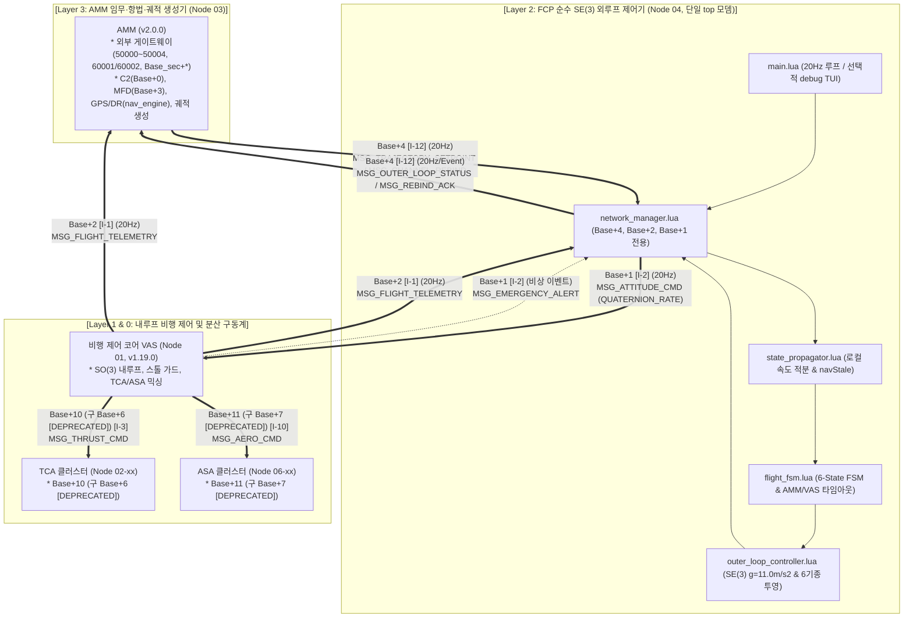
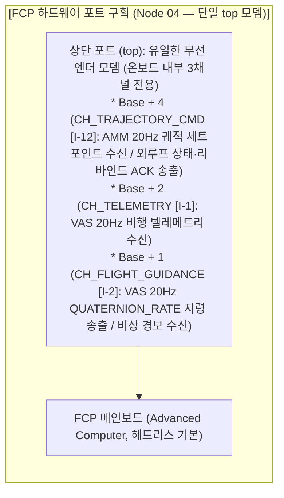
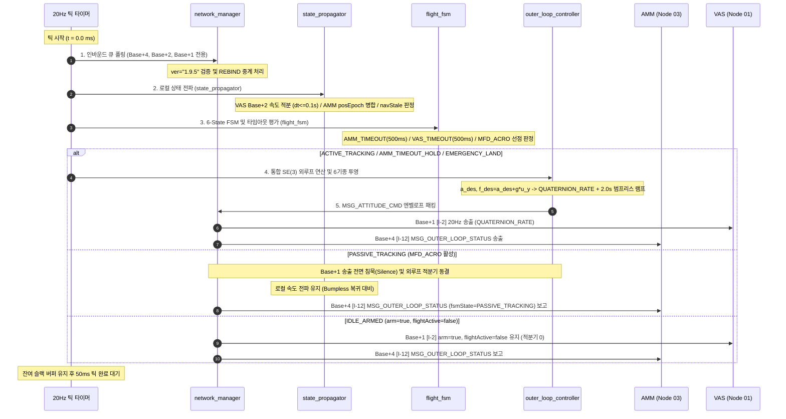
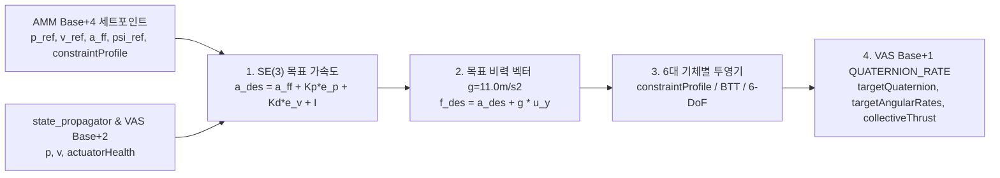
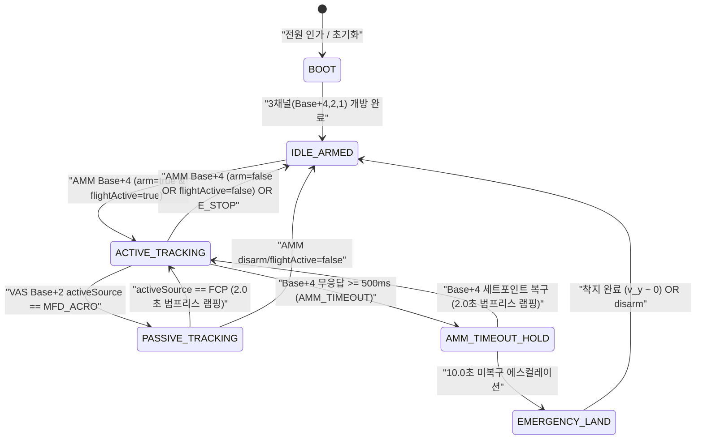

# FCP (비행 제어 프로그램) 상세 규격서
> **FCP: Flight Control Program (Pure Onboard SE(3) Outer-Loop Controller)**  
> **프로젝트**: Universal Autonomous Flight Stack (UAFS Ecosystem)  
> **운영 환경**: Minecraft CC:Tweaked, Create: Aeronautics, Create: Avionics  

| 항목 | 내용 |
| :--- | :--- |
| **문서 상태 (Status)** | `Implemented` |
| **문서 버전 (Version)** | `v2.0.0` |
| **최종 수정일 (Date)** | `2026-11-13` |
| **구현 코드 (Source)** | `src/2_guidance/fcp/` |
| **주관 도메인 (Domain)** | 순수 온보드 SE(3) 외루프 유도 제어기 (FCP / Node 04) |

> **참조 문서**: 
> - [AUTONOMOUS_FLIGHT_SYSTEM_ARCHITECTURE_AND_ICD.md](../../../system/AUTONOMOUS_FLIGHT_SYSTEM_ARCHITECTURE_AND_ICD.md) (마스터 ICD v1.29.0)
> - [SYSTEM_PROGRAM_RELATION_AND_PACKET_DIAGRAM.md](../../../system/SYSTEM_PROGRAM_RELATION_AND_PACKET_DIAGRAM.md) (전체 구조도 v2.14.0)
> - [AMM_PROGRAM_SPECIFICATION.md](../../3_planning/amm/AMM_PROGRAM_SPECIFICATION.md) (조종석 통합 단말 및 미션·항법·궤적 생성기 v2.0.0)
> - [VAS_PROGRAM_SPECIFICATION.md](../../1_control/vas/VAS_PROGRAM_SPECIFICATION.md) (비행 제어 코어 v1.19.0)
> - [ASA_PROGRAM_SPECIFICATION.md](../../1_control/asa/ASA_PROGRAM_SPECIFICATION.md) (공력 날개 및 조종면 규격서 v1.7.0)
> - [TCA_PROGRAM_SPECIFICATION.md](../../1_control/tca/TCA_PROGRAM_SPECIFICATION.md) (추력 어댑터 규격서 v1.11.1)
> - [ALIGNMENT_PROGRAM_SPECIFICATION.md](../../0_development/alignment/ALIGNMENT_PROGRAM_SPECIFICATION.md) (격납고 상주형 동역학 프로파일러 v2.6.1)
> - [GAC_PROGRAM_SPECIFICATION_AND_ICD.md](../../0_infra/gac/GAC_PROGRAM_SPECIFICATION_AND_ICD.md) (GAC 관제사 규격서 v1.4.2)
> - [GPS_PROGRAM_SPECIFICATION_AND_ICD.md](../../0_infra/gps/GPS_PROGRAM_SPECIFICATION_AND_ICD.md) (고정밀 GPS 규격서 v2.3.2)
> - [RUNWAY_SPECIFICATION_AND_ICD.md](../../0_infra/runway/RUNWAY_SPECIFICATION_AND_ICD.md) (활주로 규격서 v1.10.7)
> - [LANDING_PAD_SPECIFICATION_AND_ICD.md](../../0_infra/landing_pad/LANDING_PAD_SPECIFICATION_AND_ICD.md) (착륙패드 규격서 v2.4.4)
> - [DOCKING_ARM_SPECIFICATION_AND_ICD.md](../../0_infra/docking_arm/DOCKING_ARM_SPECIFICATION_AND_ICD.md) (도킹암 규격서 v1.11.2)
> - [GCS_PROGRAM_SPECIFICATION_AND_ICD.md](../../0_infra/gcs/GCS_PROGRAM_SPECIFICATION_AND_ICD.md) (GCS 채널 관리자 및 관제 콘솔 규격서 v1.0.2)
> - [GEMINI.md](../../../../GEMINI.md) (전역 규칙 및 가이드라인)

### Revision History

| 버전 | 개정 일자 | 개정 요약 | 개정 사유 |
| :---: | :---: | :--- | :--- |
| `v2.0.0` | 2026-11-12 | **FCP-AMM 역할 분리 및 순수 온보드 SE(3) 외루프 제어기 전면 개편 (`Implemented`, 구현 과제 `TASK-208` 완료 · 2026-11-13 승격)**: 외부 인프라(`CH 50000~50004`, `60001/60002`, `Base_sec+*`, `Base+5`), 오퍼레이터 C2(`Base+0`), 평시 MFD 다운링크(`Base+3`), GPS/DR 항법 융합(`nav_engine`), 3-Tier ATC/GAC/시설물 핸드오프(`facility_client`), 채널 부트스트랩/프로브(`channel_sentinel`) 및 전략 궤적 합성을 `AMM (Node 03, v1.3.0)`으로 이관(`[DEPRECATED]`); FCP를 단일 `top` 모뎀(`Base+4`, `Base+2`, `Base+1` 3채널 전용) 기반 5대 모듈 파이프라인, 통합 SE(3) 외루프 법칙($g=11.0\text{ m/s}^2$, 6대 기체 `QUATERNION_RATE` 투영), 6-State 외루프 FSM(`PASSIVE_TRACKING` 2.0s 범프리스 복귀, `AMM_TIMEOUT_HOLD` 500ms $\to$ 10s $\to$ `EMERGENCY_LAND`)으로 축소 정립; 구 로컬 추진기 프로파일 직접 참조 및 `ATTITUDE_ANGLE`/`angleTargets`/`targetClimbRate`/`targetThrottle`/`translationBias.heave` 폐기(`[DEPRECATED]`) | AMM-FCP-VAS 계층 직교성 확립 및 순수 외루프 실시간 제어기 경량화 |
| `v1.16.0` | 2026-11-11 | 외루프 유도 프리미티브(`LOITER` 반경/방향 선회 및 `POI_HOLD` 관심점 지속 조준 호버) 확장, 3종 통합 기수 지향 모드(`AUTO`/`FACE_PATH`, `FIXED`, `POI`/`TARGET_LOCK`) 및 `Base+0` `MSG_OPERATOR_CMD` 확장 파라미터(`loiterRadius`, `loiterDirection`, `poiTarget`, `headingMode`, `fixedHeading`) 수신·범프리스 전환 인터록 명세 반영 (`Implemented` $\to$ `Approved`) | TASK-201 FCP 외루프 유도 프리미티브 확장 및 AMM v1.1.0 연동 |
| `v1.15.0` | 2026-11-09 | ADVANCED_VTOL 2D 짐벌 벡터 추진 비행체 전용 외루프 유도 제어기(advanced_vtol_driver.lua) 명세 신설: 3축 독립 병진 제어(Surge/Sway/Heave 완전 PID + Anti-windup), STRICT_LEVEL(θ=φ=0°) 무경사 기동 및 TILT_ASSISTED 모드, 짐벌 물리 슬루율 제한, 안전고도 기반 수직 이륙 및 패드 0.5m 정렬 2단계 감속 터치다운 시퀀스, flapTarget=0.0 고정 | 2D 짐벌 벡터 추진 VTOL 외루프 유도 알고리즘 표준화 |
| `v1.14.0` | 2026-11-08 | 구 명칭(FCP/ASA) 소급 전면 척결, 40채널 대역폭 및 채널 할당 공식 정비 | 용어 무결성 및 40채널 표준 동기화 |
| `v1.13.0` | 2026-11-08 | VECTORED_VTOL 외루프 제어기 3축 완전 PID + Anti-windup, TILT_ASSISTED 피치 슬루율(15°/s), 수평 고정 수직 이륙 및 2단계 감속 수직 착륙 시퀀스 상세 규격 반영 (`Implemented` $\to$ `Approved`) | TASK-110 VTOL 제어 고도화 사양 개정 |
| `v1.11.0` | 2026-11-07 | 구 명칭을 FCP(Flight Control Program)로 전면 개정, 디렉토리/파일명(`fcp/`) 및 런타임 식별자(`FCP`) 동기화, 구 명칭 `[DEPRECATED]` 이력 명시 | 시스템 명칭 통일 및 식별자 표준화 |
| `v1.10.0` | 2026-11-07 | 비행체 전용 40채널($BW=40$) 대역 확장($Base = 10000 + (N-1)\times 40$) 반영, 01호기 기준선(Base 10000, MFD 10003, 회신 10005) 동기화, GCS 부트스트랩 채널 50000 고정, 구버전 Base+6/+7 [DEPRECATED] Zone 2 이관 반영, 승격 전이(`implemented/` $\to$ `approved/`) | 서브채널 대역폭 확장 및 기능 영역별 직교성 확보, 1000대 수용량 확립 |

---

## 1. 프로그램 개요 및 통합 아키텍처 (Overview & Architecture)

### 1.1 시스템 위상 및 설계 목적
**FCP (Flight Control Program / Node 04)**는 비행체 온보드 컴퓨터(CC:Tweaked Advanced Computer)에 탑재되어 **20Hz(50ms) 실시간 주기**로 가동되는 **순수 온보드 `SE(3)` 외루프 유도 제어기(Pure Onboard SE(3) Outer-Loop Controller)**입니다.

> [!NOTE]
> **명칭 개정 및 식별자 동기화 (Zero-Fallback 원칙)**
> 구 식별자(`"FCP-04"`, `"FCP-NODE-04-4402"` `[DEPRECATED]`)는 본 규격 체계에서 공식 폐기(`"FCP-NODE-04-UUID"`로 표준화)되었으며, `Base+1` 지령의 런타임 `source` / `activeSource` 식별자는 `"FCP"` 단일 키로 동기화됩니다. 또한 `v1.16.0` (빌드 `v1.2.2`, `TASK-201`) 구현은 **`TASK-208`**에서 `v2.0.0` 순수 외루프 규격으로 재구현 완료되었습니다 (`Status: Implemented`).

4계층 자율 비행 아키텍처에서 **AMM (Node 03)**이 미션 시퀀싱, 외부 인프라 교신, GPS/DR 항법 융합, C2 중재 및 20Hz 목표 궤적 생성(`targetPos`, `targetVel`, `feedforwardAccel`, `targetHeading`)을 전담하고, **VAS (Node 01)**가 20Hz `SO(3)` 내루프 자세 안정화 및 TCA/ASA 구동계 믹싱을 전담하는 반면, **FCP (Node 04)**는 `Base+4` (`[I-12]`)와 `Base+1` (`[I-2]`) 사이에서 **3차원 위치·속도 오차와 피드포워드 가속도를 기체별 목표 단위 쿼터니언(`targetQuaternion`), 목표 각속도(`targetAngularRates`), 정규화 집합 추력(`collectiveThrust`)으로 투영하는 순수 외루프 제어 계층**을 담당합니다.

### 1.2 핵심 임무 및 계층 경계 (Role Boundaries)
1. **통합 `SE(3)` 외루프 유도 법칙 및 6대 기체 투영**:
   - `AMM (Node 03)`이 `Base+4` (`[I-12]`, `MSG_TRAJECTORY_SETPOINT`)로 하달한 목표 궤적 세트포인트와 `VAS Base+2` (`[I-1]`, `MSG_FLIGHT_TELEMETRY`)의 실측 속도/자세/헬스를 결합해 중력 $g = 11.0\text{ m/s}^2$ 기준 목표 비력 벡터 $\mathbf{f}_{\text{des}}$를 산출합니다.
   - 6대 기종(`FIXED_WING`, `WINGED_VTOL`, `VECTORED_VTOL`, `ADVANCED_VTOL`, `QUADROTOR`, `HEXAROTOR`) 및 `constraintProfile`(`STANDARD`, `STRICT_LEVEL`, `TILT_ASSISTED`, `FIXED_WING_GLIDE`)에 맞게 **`QUATERNION_RATE`** 스키마(`targetQuaternion`, `targetAngularRates`, `collectiveThrust`, 선택적 `flapTarget`, 선택적 `translationBias {surge, sway}`)를 생성하여 `Base+1` (`[I-2]`)로 20Hz 송출합니다.
2. **로컬 속도 적분 기반 상태 전파 (`state_propagator.lua`)**:
   - `AMM`의 `posEpoch` 갱신 주기 사이를 `VAS Base+2`의 20Hz 3D 속도 벡터로 로컬 적분(`dt <= 0.1s` 가드)하고, `posEpoch` 증가 시 유계 오프셋 병합을 수행하며, `AMM` 항법 정체(`navStale`) 여부를 판정해 `MSG_OUTER_LOOP_STATUS` (`Base+4`)로 보고합니다.
3. **6-State 외루프 FSM 및 2단계 시동·페일세이프 격리 (`flight_fsm.lua`)**:
   - 6대 외루프 상태(`BOOT`, `IDLE_ARMED`, `ACTIVE_TRACKING`, `PASSIVE_TRACKING`, `AMM_TIMEOUT_HOLD`, `EMERGENCY_LAND`)를 운용합니다.
   - `AMM`의 `arm`/`flightActive` 플래그를 `Base+1`로 전달하고, 조종석 `MFD_ACRO` 선점(`activeSource == "MFD_ACRO"`) 시 `PASSIVE_TRACKING`으로 전이하여 `Base+1` 송출을 침묵(Silence)하고 적분기를 동결한 뒤 `"FCP"` 복귀 시 **2.0초 범프리스 선형 램핑**을 수행합니다.
   - `Base+4` 500ms 두절(`AMM_TIMEOUT`) 시 `AMM_TIMEOUT_HOLD`(10초 호버/선회 홀드) $\to$ `EMERGENCY_LAND`로 자체 안전 강하를 집행합니다.
4. **온보드 전용 3채널 격리 및 `MSG_CHANNEL_REBIND` 중계 (`network_manager.lua`)**:
   - 단일 `top` 모뎀으로 **`Base+4`**, **`Base+2`**, **`Base+1`** 3개 채널만 개방합니다.
   - `AMM`이 `Base+4`로 개시한 4계층 채널 재바인딩(`MSG_CHANNEL_REBIND`) 트랜잭션을 `Base+1`을 통해 `VAS`로 중계하고 하위 ACK를 취합해 `Base+4`로 회신합니다.
5. **구버전 이관 책임 명시 (`[DEPRECATED — Migrated to AMM v1.3.0]`)**:
   - 고유 40채널 블록($Base = 10000 + (N - 1) \times 40$, $N=1\sim 1000$) 부트스트랩(`CH 50000`), `Base+0` 충돌 프로브 및 C2 중재, `Base+3` 5Hz MFD 다운링크, `CH 60001/60002` 및 `Base+5` GPS/DR 융합(`nav_engine`), `CH 50001~50004` / $Base_{\text{sec}}+*$ 3-Tier ATC/GAC/시설물 핸드오프(`facility_client`), `LOITER`/`POI_HOLD`/도킹/활주로 궤적 합성은 모두 **`AMM (Node 03, v1.3.0)`**으로 이관되었습니다(`FCP v2.0.0`에서는 `[DEPRECATED]`).
   - 공력 조종면 구동계 `ASA` (`Base+11`, 구 `Base+7 [DEPRECATED]`) 및 추진기 구동계 `TCA` (`Base+10`, 구 `Base+6 [DEPRECATED]`), 동적압 스케줄링, 실속 가드 및 기체별 추진기 프로파일 기반 6-DoF 믹싱은 **`VAS (Node 01, v1.19.0)`**가 전담합니다.

### 1.3 서브시스템 간 상호작용 아키텍처



### 1.4 코드 경량화 및 Deprecated 운영 정책 (Code Lightweighting & Deprecation Policy)
1. **사양서 명세 원칙 (Specification-First)**: 프로토콜 패킷 타입명 또는 페이로드 필드가 개정될 경우, 구버전 명칭은 사양서 내에 `[DEPRECATED]` 배지를 부여하고 대체 신규 필드명과 변경 이력을 명시하여 문서상에 보존합니다.
2. **코드베이스 경량화 원칙 (Zero-Fallback)**: CC:Tweaked Lua 분산 컴퓨터 환경의 자원 제약(메모리 절약, 20Hz 실시간 루프 유지)을 준수하기 위해, 코드베이스는 사전 이중 호환(Fallback 래퍼, `payload.new or payload.old` 등)을 일체 작성하지 않고 **최신 표준 필드명/패킷명만을 단일 채택**합니다.
3. **런타임 오류 시 복구 원칙 (송신 노드 즉시 패치)**: 구버전 필드/패킷을 전송하는 미갱신 노드로 인해 수신 측에서 `nil` 인덱싱 등의 런타임 오류가 발생할 경우, 수신 측에 임시 폴백 코드를 추가하지 않고 **구버전 패킷을 송신한 발신 노드의 코드를 최신 사양으로 즉시 패치 및 재배포**하여 전역 일원화를 달성합니다.

---

## 2. 하드웨어 구성 및 물리 인터페이스 (Hardware Interfaces)

### 2.1 하드웨어 사양
FCP는 20Hz(50ms) 주기로 `SE(3)` 벡터 연산과 단위 쿼터니언 투영을 수행하기 위해 다음 하드웨어 구성을 표준으로 합니다.
- **연산 장치**: CC:Tweaked Advanced Computer (고속 Lua 실행 런타임, 헤드리스 기본 및 선택적 디버그 터미널 지원).
- **메인 메모리**: 기본 CC:Tweaked 가상 메모리 풀 할당.
- **저장 매체**: 영구 디스크 스토리지 (`config/fcp_config.json`, `logs/fcp_outer_loop.log`).
- **전원 공급**: 비행체 온보드 주 전원 버스 직결.

### 2.2 단일 무선 모뎀(`top`) 및 온보드 3채널 격리 규격
`v2.0.0` 아키텍처에서는 모든 외부 인프라 교신(GCS `50000`, ATC/GAC/시설물 `50001~50004` · $Base_{\text{sec}}+*$, GPS `60001/60002` · `Base+5`)과 C2/MFD 인터페이스(`Base+0`, `Base+3`)가 **`AMM (Node 03)`의 듀얼 모뎀 게이트웨이로 이관**되었습니다. 따라서 FCP는 **단일 상단 무선 엔더 모뎀(`top`, `primaryModemSide = "top"`)**만을 장착하고 **온보드 내부 3개 채널(`Base+4`, `Base+2`, `Base+1`)**만을 배타적으로 개방합니다(구 보조 인프라 모뎀 설정 제거).



- **활성 개방 채널 (Active Opened Channels — 3개 전용)**:
  - **`Base + 4` (`CH_TRAJECTORY_CMD`, `[I-12]`)**: `AMM`으로부터 `MSG_TRAJECTORY_SETPOINT` 및 `MSG_CHANNEL_REBIND` 수신, `AMM`으로 `MSG_OUTER_LOOP_STATUS` 및 `MSG_REBIND_ACK` 송신.
  - **`Base + 2` (`CH_TELEMETRY`, `[I-1]`)**: `VAS`로부터 `MSG_FLIGHT_TELEMETRY` 20Hz 수신.
  - **`Base + 1` (`CH_FLIGHT_GUIDANCE`, `[I-2]`)**: `VAS`로 `MSG_ATTITUDE_CMD` (`QUATERNION_RATE`) 20Hz 송신 및 `MSG_CHANNEL_REBIND` 중계, `VAS`로부터 `MSG_EMERGENCY_ALERT` 및 `MSG_REBIND_ACK` 수신.
- **이관 및 폐기 채널 (`[DEPRECATED — Migrated to AMM v1.3.0]`)**:
  - `CH 50000`, `CH 50001~50004`, `CH 60001/60002`, $Base_{\text{sec}}+*$, `Base + 0`, `Base + 3`, `Base + 5`는 `AMM (Node 03)`이 전담하며, FCP `network_manager`는 해당 채널을 일체 `modem.open()` 하지 않습니다. 이를 통해 FCP 이벤트 큐에 외부/인프라 패킷이 유입되는 경로를 구조적으로 분리합니다.

---

## 3. 좌표계, 물리 단위 및 신호 규약 (Coordinate System, Units, & Conventions)

### 3.1 기준 좌표계 및 변환 관계
FCP의 모든 항법 및 유도 알고리즘은 항공 역학 표준인 **NED (North-East-Down)** 국소 접평면 좌표계를 기준으로 연산되며, 마인크래프트 절대 월드 블록 좌표계와의 엄격한 변환식을 준수합니다.

| 좌표축 | NED 기체/항법 국소 좌표 | 마인크래프트 월드 좌표계 | 방위 및 방향 정의 |
| :---: | :---: | :---: | :--- |
| **X축** | $X_{NED}$ (North, 북) | $-Z_{MC}$ | 진북 ($0^\circ$, North) 방향 전진 거리 |
| **Y축** | $Y_{NED}$ (East, 동) | $+X_{MC}$ | 동쪽 ($90^\circ$, East) 방향 횡이동 거리 |
| **Z축** | $Z_{NED}$ (Down, 하향) | $-Y_{MC}$ | 지표면 중심 하향 거리 (고도 $h = -Z_{NED} = Y_{MC}$) |

### 3.2 오일러 각 및 각속도 부호 규약
- **방위각 (Heading / Yaw, $\psi$)**:
  - $0.0^\circ$: 진북 (True North, 마인크래프트 $-Z$).
  - $90.0^\circ$: 동쪽 (East, 마인크래프트 $+X$).
  - $180.0^\circ$: 남쪽 (South, 마인크래프트 $+Z$).
  - $270.0^\circ$: 서쪽 (West, 마인크래프트 $-X$).
  - 시계방향 회전이 양($+$)의 부호를 갖습니다.
- **피치 (Pitch, $\theta$)**:
  - 기수 상승(Nose-Up): 양($+$), $0.0 \sim +20.0^\circ$ (일반 순항) / 최대 $+75.0^\circ$ (비상/급기동).
  - 기수 하강(Nose-Down): 음($-$), $-20.0 \sim 0.0^\circ$ (일반 순항) / 최대 $-75.0^\circ$ (비상/급기동).
- **롤 (Roll, $\phi$)**:
  - 우측 기울임(Right-Bank): 양($+$), $0.0 \sim +20.0^\circ$ (일반 순항) / 최대 $+75.0^\circ$ (비상/급기동).
  - 좌측 기울임(Left-Bank): 음($-$), $-20.0 \sim 0.0^\circ$ (일반 순항) / 최대 $-75.0^\circ$ (비상/급기동).
- **각속도 ($\dot{\theta}, \dot{\phi}, \dot{\psi}$)**: 초당 회전 각도 (deg/s).

### 3.3 물리량 단위 규격
- **거리 및 위치**: 미터 / 블록 ($\text{m}$, 1 블록 = 1.0 m).
- **속도**: 초당 미터 ($\text{m/s}$, 1 block/tick = 20.0 m/s).
- **가속도**: $\text{m/s}^2$ (기본 중력가속도 $g = 11.0\text{ m/s}^2$, 마인크래프트 월드 연직 하방 $a_y = -11.0\text{ m/s}^2$).
- **시간**: 밀리초 ($\text{ms}$, `os.epoch("utc")`).
- **집합 추력 및 스로틀 명령 (`collectiveThrust`)**: $0.0 \sim 1.0$ 정규화 실수 (최대 출력 대비 무차원 비율. TCA가 REDSTONE 모드일 경우 VAS가 $0 \sim 15$ 정수로 변환 인가; 구 `targetThrottle` `[DEPRECATED]`).
- **미세 병진 바이어스 (`translationBias`)**: $-1.0 \sim +1.0$ 정규화 실수 (`surge`, `sway` 2축 수평 바이어스; 구 `translationBias.heave`는 `collectiveThrust`로 통합되어 `[DEPRECATED]`).

---

## 4. 소프트웨어 모듈 아키텍처 및 20Hz 실행 파이프라인 (Software Architecture & Execution Pipeline)

### 4.1 5대 핵심 외루프 모듈 구조 및 책임 매트릭스

```
src/2_guidance/fcp/
├── main.lua                        # 메인 진입점, 20Hz 결정론적 루프 & 선택적 debug TUI(parallel.waitForAny)
├── config/
│   └── fcp_config.json             # 3채널 설정, SE(3) 게인(g=11.0), 6기종 투영 파라미터, 타임아웃
└── modules/
    ├── network_manager.lua         # 단일 top 모뎀(Base+4, Base+2, Base+1 전용), REBIND 중계, ICD v1.9.5 엔벨로프
    ├── state_propagator.lua        # VAS Base+2 속도 적분 기반 로컬 상태 전파, posEpoch 병합, navStale 판정
    ├── outer_loop_controller.lua   # 통합 SE(3) 가속도 법칙 & 6대 기체 QUATERNION_RATE 투영, 2.0s 범프리스 램프
    ├── flight_fsm.lua              # 6-State 외루프 FSM, AMM_TIMEOUT(500ms->10s) & VAS_TIMEOUT(500ms) 감시
    └── ui_renderer.lua             # (선택) debug=true 시 비동기 5Hz 디버그 대시보드 (헤드리스 기본)
```

| 모듈 명칭 | 주관 인터페이스 | 실행 주기 / 조건 | 핵심 역할 및 기능 |
| :--- | :---: | :---: | :--- |
| **`main.lua`** | 시스템 루프 | 20Hz (50ms) / 선택적 5Hz | 20Hz 틱 스케줄러 가동, 5단계 외루프 파이프라인 순차 실행; `debug: false` 헤드리스 기본, `debug: true` 시 `parallel.waitForAny`로 `ui_renderer.lua` 비동기 격리 구동 |
| **`network_manager.lua`** | I-1, I-2, I-12 | 매 틱 / 이벤트 | 단일 `top` 모뎀에서 `Base+4`, `Base+2`, `Base+1` 3개 채널만 개방, `ver = "1.9.5"` 엔벨로프 직렬화/역직렬화, `MSG_CHANNEL_REBIND` (`Base+4` $\to$ `Base+1`) 중계 및 `MSG_REBIND_ACK` 취합 |
| **`state_propagator.lua`** | I-1, I-12 | 20Hz | `AMM Base+4` `posEpoch` 갱신 사이 `VAS Base+2` 속도로 로컬 위치 적분(`dt <= 0.1s` 가드), 에포크 증가 시 유계 오프셋 병합, `navStale` 판정 |
| **`outer_loop_controller.lua`** | I-2, I-12 | 20Hz | `SE(3)` 목표 가속도/비력($g=11.0\text{ m/s}^2$) 산출, 6대 기체별 `QUATERNION_RATE` 투영, `constraintProfile` · 스웨이 손실 폴백, 2.0초 범프리스 램핑 및 방향성 안티와인드업 |
| **`flight_fsm.lua`** | I-1, I-2, I-12 | 20Hz | 6-State 외루프 FSM(`BOOT`, `IDLE_ARMED`, `ACTIVE_TRACKING`, `PASSIVE_TRACKING`, `AMM_TIMEOUT_HOLD`, `EMERGENCY_LAND`), `AMM_TIMEOUT`(500ms) · `VAS_TIMEOUT`(500ms) 감시 |
| **`ui_renderer.lua`** *(선택)* | 로컬 TUI | `debug: true` 시 5Hz | 디버그 전용 상태 표출(제어 루프 비차단 격리); 기본 `debug: false` 시 로드 생략 |

> [!NOTE]
> **구버전 `v1.16.0` 퇴역 모듈 이관 (`[DEPRECATED — Migrated to AMM v1.3.0]`)**
> 종래 `v1.16.0`의 8대 모듈 중 `nav_engine.lua`(GPS/DR 융합), `facility_client.lua`(3-Tier ATC/GAC/시설물 핸드오프 및 전술 유도), `channel_sentinel.lua`(CH 50000 부트스트랩 및 `Base+0` 충돌 프로브), `operator_handler.lua`(`Base+0` C2 중재)는 모두 **`AMM (Node 03, v1.3.0)`**으로 이관·통합되었으며, `guidance_controller.lua`는 `v2.0.0`에서 순수 `SE(3)` 투영 전담 **`outer_loop_controller.lua`**로 개편되었습니다.

### 4.2 20Hz (50ms) 결정론적 틱 스케줄러 타임라인



---

## 5. 통합 SE(3) 외루프 제어 법칙 및 6대 기체 투영 (Unified SE(3) Outer-Loop Law & 6-Airframe Projections)

### 5.1 통합 SE(3) 가속도-비력-자세 투영 법칙 (Unified SE(3) Control Law)
`v2.0.0` FCP는 종래 기종별 이원화 제어기(L1 + TECS + 2D 캐스케이드 + 수직 PI)를 단일한 **`SE(3)` 위치-속도-가속도 외루프 법칙**으로 통합합니다. `AMM (Node 03)`이 `Base+4` (`[I-12]`, `MSG_TRAJECTORY_SETPOINT`)로 하달하는 목표 궤적 세트포인트($\mathbf{p}_{\text{ref}}, \mathbf{v}_{\text{ref}}, \mathbf{a}_{\text{ff}}, \psi_{\text{ref}}$)와 `state_propagator`가 갱신한 현재 추정 상태($\mathbf{p}, \mathbf{v}$)로부터 목표 단위 쿼터니언(`targetQuaternion`), 피드포워드 목표 각속도(`targetAngularRates`), 정규화 집합 추력(`collectiveThrust`)을 직접 도출합니다.



1. **추종 오차 및 목표 관성 가속도 ($\mathbf{a}_{\text{des}}$)**:
   $$\mathbf{e}_p = \mathbf{p}_{\text{ref}} - \mathbf{p}, \qquad \mathbf{e}_v = \mathbf{v}_{\text{ref}} - \mathbf{v}$$
   $$\mathbf{a}_{\text{des}} = \mathbf{a}_{\text{ff}} + \mathbf{K}_p \mathbf{e}_p + \mathbf{K}_d \mathbf{e}_v + \int_{0}^{t} \mathbf{K}_i \mathbf{e}_p \, d\tau$$
   - **가속도 크기 포화**: $\|\mathbf{a}_{\text{des}}\| \le a_{\max}$ (`maxAccelMps2`)로 유계 클램핑하여 과도한 자세 기울임을 방지합니다.
   - **조건부 안티와인드업 (Conditional Anti-Windup)**: `MSG_FLIGHT_TELEMETRY` (`Base+2`)가 구동계 포화/손실(`actuatorHealth.tap == false` 등)을 보고하거나 외루프 출력 포화(`saturated == true`)가 발생한 축에 대해서는 적분항 갱신을 즉시 동결합니다.

2. **CC:Aeronautics 중력 보상 비력 벡터 ($\mathbf{f}_{\text{des}}$)**:
   CC:Aeronautics 물리 엔진의 기본 중력가속도 $g = 11.0\text{ m/s}^2$ (월드 연직 상방 단위벡터 $\hat{\mathbf{u}}_y = [0, 1, 0]^T$)를 보상하여 목표 비력(Specific Force) 벡터를 산출합니다:
   $$\mathbf{f}_{\text{des}} = \mathbf{a}_{\text{des}} + g\,\hat{\mathbf{u}}_y$$

3. **목표 추력축, `targetQuaternion`, `targetAngularRates`, `collectiveThrust` 도출**:
   - **목표 추력 방향 단위벡터**:
     $$\hat{\mathbf{b}}_y^{\text{des}} = \frac{\mathbf{f}_{\text{des}}}{\|\mathbf{f}_{\text{des}}\|}$$
   - **목표 방위각 슬루율 제한**: `targetHeading` ($\psi_{\text{ref}}$)을 현재 지령 방위각에서 $\dot{\psi}_{\max}$ (`maxYawRateDegPerSec`, 기본 $30.0^\circ/\text{s}$) 이내로 보간하여 스냅 요(Snap Yaw)를 억제합니다.
   - **단위 쿼터니언 (`targetQuaternion`) 구성**: 기종별 투영 정책(§5.2~§5.5)으로 결정된 목표 추력축(또는 협조 선회 자세)과 슬루 제한된 $\psi_{\text{cmd}}$의 직교 기저 회전 행렬 $\mathbf{R}_{\text{des}} \in SO(3)$을 정규화 단위 쿼터니언 $\mathbf{q}_{\text{cmd}} = \{w, x, y, z\}$ ($\|\mathbf{q}_{\text{cmd}}\| = 1.0$)로 변환합니다.
   - **목표 각속도 피드포워드 (`targetAngularRates`)**: 연속 2틱 간의 목표 자세 변화량 $\Delta \mathbf{R} = \mathbf{R}_{\text{des}}(t_{k-1})^T \mathbf{R}_{\text{des}}(t_k)$의 회전 벡터($\text{Log}(\Delta \mathbf{R}) / \Delta t$) 또는 슬루 제한된 회전율을 deg/s 단위의 `{ pitchRate, rollRate, yawRate }`로 산출하여 `VAS` 내루프 추종 지연을 상쇄합니다.
   - **정규화 집합 추력 (`collectiveThrust`)**: 호버 기준 추력 비율 $T_{\text{hover}}$ (`hoverThrustNorm = 0.635`)와 목표 비력 크기 비 $\frac{\|\mathbf{f}_{\text{des}}\|}{g}$ (또는 고정익 전진 에너지 지령)로부터 $T_{\text{col}} \in [0.0, 1.0]$를 산출합니다. (구 `targetClimbRate`, `targetThrottle`, `translationBias.heave`는 모두 `collectiveThrust`로 통합되어 **`[DEPRECATED]`**.)

---

### 5.2 6대 기체 타입 분류 및 투영 아키텍처 매트릭스

비행체 6대 표준 기종(`airframeType` Enum)은 동일한 `SE(3)` 목표 비력 $\mathbf{f}_{\text{des}}$을 출발점으로 하되, 물리적 구동 방식에 따라 `Base+1` `QUATERNION_RATE` 출력 필드로 서로 다르게 투영됩니다.

| 기체 식별자 (`airframeType`) | 대표 기종 | 자세 투영 (`targetQuaternion`) | 집합 추력 (`collectiveThrust`) | 선택 필드 (`flapTarget` / `translationBias`) | ASA 연동 |
| :--- | :--- | :--- | :--- | :--- | :---: |
| **`FIXED_WING`** | 편익기 (전익기/무미익기) | BTT 협조 선회 뱅크각 $\phi_{\text{cmd}}$ + 피치 $\theta_{\text{cmd}}$ | 전진/총 에너지 제어 추력 ($0.0 \sim 1.0$) | `flapTarget` (`flapHint` 기반), `translationBias = nil` | 활성 |
| **`WINGED_VTOL`** | 고정익 하이브리드 VTOL | 속도 및 `constraintProfile` 기반 호버 $\leftrightarrow$ BTT 연속 블렌딩 | 수직/전진 합성 집합 추력 ($0.0 \sim 1.0$) | `flapTarget` (`flapHint`/천이 연동), `translationBias = nil` | 활성 |
| **`VECTORED_VTOL`** | 다축 직교 벡터드 VTOL | `STRICT_LEVEL` ($\theta=\phi=0^\circ$) 또는 `TILT_ASSISTED` ($\pm 10^\circ$) | $\mathbf{f}_{\text{des}}$ 연직 성분 기반 집합 추력 | `translationBias { surge, sway }`, `flapTarget` 미전송 | 비활성 |
| **`ADVANCED_VTOL`** | 2D 짐벌 벡터 VTOL | `STRICT_LEVEL` ($\theta=\phi=0^\circ$) 또는 `TILT_ASSISTED` ($\pm 10^\circ$) | $\mathbf{f}_{\text{des}}$ 연직 성분 기반 집합 추력 | `translationBias { surge, sway }` (짐벌 슬루율 제한), `flapTarget` 미전송 | 비활성 |
| **`QUADROTOR`** | 4-T 쿼드콥터 드론 | Tilt-to-Accelerate ($\hat{\mathbf{b}}_y^{\text{des}}$ 직결 틸트 $\le 25^\circ$) | $\|\mathbf{f}_{\text{des}}\|$ 투영 집합 추력 ($0.0 \sim 1.0$) | `flapTarget = 0.0` 또는 미전송, `translationBias = nil` | 비활성 |
| **`HEXAROTOR`** | 6-T 헥사콥터 드론 | Tilt-to-Accelerate ($\hat{\mathbf{b}}_y^{\text{des}}$ 직결 틸트 $\le 25^\circ$) | $\|\mathbf{f}_{\text{des}}\|$ 투영 집합 추력 ($0.0 \sim 1.0$) | `flapTarget = 0.0` 또는 미전송, `translationBias = nil` | 비활성 |

> **ASA 비공력 기체 배제 규격**: `VECTORED_VTOL`, `ADVANCED_VTOL`, `QUADROTOR`, `HEXAROTOR`는 공력 조종면이 없으므로 `FCP`는 `flapTarget`을 생성하지 않으며(생략 또는 `0.0`), 실제 `Base+11` `ASA` 차단은 `VAS`가 수행합니다.

---

### 5.3 QUADROTOR & HEXAROTOR (멀티로터) Tilt-to-Accelerate 투영
멀티로터 계열은 수평 병진용 보조 추력기가 없으므로, 목표 비력 벡터 $\mathbf{f}_{\text{des}}$의 방향 자체를 기체 추력축 $\hat{\mathbf{b}}_y^{\text{des}}$로 직접 일치시킵니다.

1. **틸트각 클램핑 및 단위 쿼터니언 투영**:
   - 동체 전방·횡방향 수평 가속도 성분($a_{x,\text{body}}, a_{y,\text{body}}$)에 대해 $\theta_{\text{cmd}} = \text{clamp}(\arctan(a_{x,\text{body}}/g), -\theta_{\max}, +\theta_{\max})$, $\phi_{\text{cmd}} = \text{clamp}(\arctan(a_{y,\text{body}}/g), -\phi_{\max}, +\phi_{\max})$ ($\theta_{\max}, \phi_{\max} = 25.0^\circ$)로 경사각을 제한합니다.
   - `targetHeading` ($\psi_{\text{ref}}$)은 수평 가속도와 독립적으로 슬루율 제한($\le 30.0^\circ/\text{s}$)을 거쳐 $\mathbf{q}_{\text{cmd}}$의 요 성분에 결합됩니다.
2. **집합 추력 및 비사용 필드**:
   - $T_{\text{col}} = \text{clamp}\left(T_{\text{hover}} \cdot \frac{\mathbf{f}_{\text{des}} \cdot \hat{\mathbf{b}}_y}{\max(g \cos\theta_{\text{cmd}}\cos\phi_{\text{cmd}}, 0.5g)}, \; 0.0, \; 1.0\right)$.
   - `translationBias = nil`, `flapTarget = 0.0` (또는 생략).
   - 4-T와 6-T의 물리 모터 분배 차이는 `VAS`가 로드하는 믹서 프로파일이 전담합니다.

---

### 5.4 VECTORED_VTOL & ADVANCED_VTOL 6-DoF 투영 및 `constraintProfile`
`VECTORED_VTOL`(고정 3축 직교 추력기) 및 `ADVANCED_VTOL`(2D 짐벌 벡터 추력기)은 `AMM Base+4` 세트포인트의 `constraintProfile`에 따라 무경사 6-DoF 기동과 피치 보조 고속 순항을 절체합니다.

> [!IMPORTANT]
> **프로파일 파일 분리 및 `translationBias.heave` 폐기 (`[DEPRECATED]`)**
> - 구버전(`v1.16.0`)에서 FCP가 로컬 추진기 프로파일 JSON을 직접 파싱하던 방식은 **제거**되었습니다. 추진기 프로파일 로딩 및 `[I-4]` Alignment 검증은 **`VAS (Node 01)`**가 전담하며, FCP는 `VAS Base+2`의 `actuatorHealth` 및 포화 상태와 `fcp_config.json`만을 참조합니다.
> - 구 `translationBias.heave` 필드는 **`[DEPRECATED]`** 처리되었으며, 모든 수직 양력/승강 제어는 **`collectiveThrust`** 단일 필드로 출력됩니다 (Zero-Fallback).

1. **`constraintProfile == "STRICT_LEVEL"` (무경사 정밀 기동)**:
   - 이륙, 패드 정밀 접근, 도킹암 랑데부, `LOITER`, `POI_HOLD` 등에서 `AMM`이 지정합니다.
   - **자세 고정**: 목표 피치/롤을 $\theta_{\text{cmd}} = 0.0^\circ, \phi_{\text{cmd}} = 0.0^\circ$로 고정하여 `targetQuaternion`을 `targetHeading` ($\psi_{\text{cmd}}$)만 회전한 순수 수평 쿼터니언으로 유지합니다.
   - **수평 병진 바이어스 투영 (`translationBias { surge, sway }`)**:
     NED 수평 목표 가속도 $(a_{\text{des},x}, a_{\text{des},z})$를 동체 헤딩 $\psi_{\text{cmd}}$ 프레임으로 회전 변환한 뒤 정규화 게인($K_{b,s}, K_{b,w}$)으로 사상합니다:
     $$\begin{bmatrix} a_{\text{surge}} \\ a_{\text{sway}} \end{bmatrix} = \begin{bmatrix} \sin\psi & -\cos\psi \\ \cos\psi & \sin\psi \end{bmatrix} \begin{bmatrix} a_{\text{des},x} \\ a_{\text{des},z} \end{bmatrix}$$
     $$surge = \text{clamp}(K_{b,s} \cdot a_{\text{surge}}, -1.0, +1.0), \qquad sway = \text{clamp}(K_{b,w} \cdot a_{\text{sway}}, -1.0, +1.0)$$
   - **직접 힌트 우선 적용 (`translationBiasHint`)**: `AMM`이 도킹 초정밀 크립 또는 비상 이탈(`surge = -0.8`) 시 `translationBiasHint`를 동봉하면, FCP는 해당 바이어스를 직접 반영(또는 크기 상한 보정)하여 `Base+1`로 전달합니다.
   - **`ADVANCED_VTOL` 짐벌 슬루율 제한**: `ADVANCED_VTOL` 기체에서는 산출된 `surge`, `sway` 변화율에 `gimbalSlewRate`($\le 2.0/\text{s}$) 슬루율 제한기를 적용해 급격한 노즐 편향을 방지합니다.

2. **`constraintProfile == "TILT_ASSISTED"` (고속 순항 피치 틸트 보조)**:
   - 고속 순항 시 양력 추력 일부를 전방 가속에 분배하기 위해 피치 틸트를 최대 $\pm 10.0^\circ$까지 허용합니다:
     $$\theta_{\text{target}} = \text{clamp}\left(-surge_{\text{raw}} \cdot 10.0^\circ, \; -10.0^\circ, \; +10.0^\circ\right)$$
   - 급격한 자세 점프를 방지하기 위해 피치 변화율을 **$\text{tiltSlewRateDegPerSec} = 15.0^\circ/\text{s}$** 이내로 1차 램핑한 뒤 $\mathbf{q}_{\text{cmd}}$에 반영합니다. `STRICT_LEVEL` 복귀 시에도 $15.0^\circ/\text{s}$로 $0.0^\circ$에 수렴합니다.

3. **스웨이 추진기 결손 시 자동 틸트 폴백 (Sway-Loss Fallback)**:
   - `VAS Base+2` 텔레메트리에서 추진기 이상(`actuatorHealth.tap == false`) 또는 횡방향 제어 손실 징후가 감지되어 무경사 횡가속 권능을 유지할 수 없는 경우, FCP는 즉시 `STRICT_LEVEL` 대신 **롤 뱅크 경사 가속(Tilt-to-Accelerate / `TILT_ASSISTED`) 폴백**으로 전환하고 `MSG_OUTER_LOOP_STATUS.activeConstraintProfile`에 폴백 상태를 보고합니다.

4. **집합 추력 투영 (`collectiveThrust`)**:
   - $T_{\text{col}} = \text{clamp}\left(T_{\text{hover}} + K_{T,y} \cdot a_{\text{des},y}, \; 0.0, \; 1.0\right)$ ($T_{\text{hover}} = 0.635$).

---

### 5.5 FIXED_WING & WINGED_VTOL (고정익 및 하이브리드) BTT · 천이 투영

1. **`FIXED_WING` (편익기 / 전익기)**:
   - **협조 선회 BTT (`targetQuaternion` & `targetAngularRates`)**: `SE(3)` 목표 수평 가속도 벡터 $\mathbf{a}_{\text{des},xz}$로부터 진행 속도 벡터 $\mathbf{v}$에 수직인 요구 구심 횡가속도 $a_{\text{lat}}$를 추출하여 목표 뱅크각을 산출합니다:
     $$\phi_{\text{cmd}} = \text{clamp}\left(\arctan\left(\frac{a_{\text{lat}}}{11.0}\right), \; -\phi_{\max}, \; +\phi_{\max}\right)$$
     ($\phi_{\max} = 20.0^\circ$ 공칭 순항 / 최대 $75.0^\circ$ 비상, 롤 슬루율 제한 $45.0^\circ/\text{s}$).
   - **요 각속도 피드포워드**: 선회율 $r_{\text{FF}} = \frac{11.0}{\max(V, 1.0)} \tan(\phi_{\text{cmd}})$ (deg/s)를 `targetAngularRates.yawRate`에 주입하여 `VAS`의 차동 추력/방향타 협조 선회를 보조합니다.
   - **종방향 에너지 및 집합 추력 (`collectiveThrust`)**: 목표 수직 가속도/고도 오차와 순항 속도 오차($V_{\text{ref}} - V$)를 총 에너지 오차 $\Delta E$ 및 에너지 분배 오차 $\Delta B$로 환산하여 목표 피치 $\theta_{\text{cmd}}$ ($\mathbf{q}_{\text{cmd}}$ 반영) 및 전진 추력 `collectiveThrust` $\in [0.0, 1.0]$를 산출합니다.
   - **플랩 연계 (`flapTarget`)**: `AMM Base+4`의 `flapHint`가 존재하면 해당 값을 `flapTarget` ($0.0 \sim 1.0$)으로 하달하고, 미지정 시 `flightMode`(`TAKEOFF`: $0.35$, `CRUISE`: $0.00$, `APPROACH_LAND`: $0.70$, `LANDING`: $1.00$)에 따라 산출합니다. (실속 방어 및 $V_{fe} > 15.0\text{ m/s}$ 플랩 차단은 `VAS`가 전담.)

2. **`WINGED_VTOL` (고정익 하이브리드 VTOL)**:
   - 속도 $V$ 및 `constraintProfile`에 따라 3구간 연속 가중 블렌딩($w = \text{clamp}(\frac{V - 8.0}{10.0}, 0.0, 1.0)$)을 적용합니다:
     - **저속 구간 ($V < 8.0\text{ m/s}$, $w = 0$)**: 회전익 호버 틸트/수직 추력 투영 (`flapTarget = 0.0`).
     - **천이 구간 ($8.0 \le V \le 18.0\text{ m/s}$, $0 < w < 1$)**: 호버 자세/추력과 BTT/전진 추력을 $(1-w)$ 대 $w$로 연속 보간하고, 피치를 $[-10.0^\circ, +12.0^\circ]$로 클램프하며 `flapTarget = 0.50`을 인가합니다.
     - **고속 순항 ($V > 18.0\text{ m/s}$, $w = 1$)**: `FIXED_WING` BTT/TECS 투영과 동일하게 구동하며 `flapTarget = 0.0`으로 수납합니다.

---

### 5.6 전략 궤적 생성 및 시설물 전술 유도 이관 (`§5.9` `[DEPRECATED — Migrated to AMM v1.3.0]`)
> [!IMPORTANT]
> **전략 궤적 합성 및 시설물 유도 책임 이관 (`[DEPRECATED]`)**
> 종래 `FCP v1.16.0` §5.6~§5.9에 포함되어 있던 다음 기능들은 모두 **`AMM (Node 03, v1.3.0)`**의 `trajectory_generator` 및 `facility_client`로 이관되었습니다:
> - `LOITER` 반경/방향 원형 궤도 기하 생성 및 `POI_HOLD` 관심점 조준 궤적 합성
> - `RUNWAY` 가상 ILS 로컬라이저/글라이드슬로프 궤적 생성
> - 동적 갑판(`MSG_FACILITY_DYNAMIC_GUIDE`) 2차 테일러 외삽($\vec{r} + \vec{v}\Delta t + \frac{1}{2}\vec{a}\Delta t^2$) 및 `300ms` 복행/재배정
> - `DOCKING_ARM` 4단계 랑데부 상태 오케스트레이션 및 이탈 판정(`surge = -0.8`)
> - `ATC DENIED` 시 `+30m` `LOITER`, 15초×10회 재요청 및 대체 시설물 우회 로직
>
> `FCP v2.0.0`은 이러한 전략/전술 궤적의 결과물인 20Hz `(targetPos, targetVel, feedforwardAccel, targetHeading, constraintProfile, flapHint?, translationBiasHint?)`만을 `Base+4` (`[I-12]`)로 수신하여 순수 `SE(3)` 외루프 추종만 수행합니다.

---

## 6. 로컬 상태 전파 및 항법 정체 감시 (`state_propagator.lua`)

### 6.1 GPS/DR 항법 융합 이관 (`[DEPRECATED — Migrated to AMM v1.3.0]`)
> [!IMPORTANT]
> **외부 GPS 질의 및 추측항법 융합 이관 (`[DEPRECATED]`)**
> 종래 `FCP v1.16.0` 제6장에서 수행하던 `CH 60001/60002` 및 `Base + 5` GPS 비동기 질의(`MSG_GPS_REQUEST`/`RESPONSE`), 상보 필터($\alpha = 0.35$), 기구학 게이트($8.0\text{ m}$) 및 `5,000ms` GPS 타임아웃 `LOITER` 전환은 **`AMM (Node 03, v1.3.0)`**의 `nav_engine`으로 전면 이관되었습니다. `FCP v2.0.0`은 외부 GPS 채널을 개방하지 않으며, `AMM`이 `Base + 4` (`MSG_TRAJECTORY_SETPOINT`)에 실어 보내는 `currentPos`, `posEpoch`, `navValid`, `gpsTimedOut`, `hdop`를 소비합니다.

### 6.2 20Hz 속도 적분 로컬 상태 전파 및 `posEpoch` 병합
`AMM`의 항법 기준 위치 갱신(`posEpoch` 증가) 사이 틱에서 제어 지연을 방지하기 위해 `state_propagator.lua`는 `VAS Base + 2` (`MSG_FLIGHT_TELEMETRY`)의 3D 월드 속도 벡터 $\mathbf{v}_{\text{vas}} = \{v_x, v_y, v_z\}$를 20Hz로 로컬 적분합니다.

1. **시간 간격 가드 및 속도 적분**:
   $$\Delta t_{\text{prop}} = \text{clamp}\left(\frac{t_{\text{now}} - t_{\text{prev}}}{1000.0}, \; 0.0, \; 0.1\right)$$
   $$\mathbf{p}(t_k) = \mathbf{p}(t_{k-1}) + \mathbf{v}_{\text{vas}}(t_k)\,\Delta t_{\text{prop}}$$
   - `dt <= 0.1s` 가드를 강제하여 일시적 루프 지연이나 에뮬레이터 정지 시 적분 스파이크를 억제합니다.
   - `VAS Base+2` 속도가 미도착한 초기 부팅 시에는 마지막 `AMM` `currentPos`를 유지합니다.

2. **`AMM` `posEpoch` 갱신 시 유계 오프셋 병합 (Bounded Smooth Offset Merge)**:
   `MSG_TRAJECTORY_SETPOINT.payload.posEpoch`가 직전 수신 에포크보다 증가하면, 전파 위치 $\mathbf{p}$와 `AMM` 기준 위치 $\mathbf{p}_{\text{amm}}$ 간의 잔차 $\Delta\mathbf{p} = \mathbf{p}_{\text{amm}} - \mathbf{p}$를 유계 스텝 상한($\Delta p_{\max}$, 기본 $2.0\text{ m/tick}$) 또는 완만한 보정 계수($\gamma \in (0, 1]$)로 병합하여 외루프 스텝 점프를 완화합니다:
   $$\mathbf{p} \leftarrow \mathbf{p} + \text{clamp\_norm}(\mathbf{p}_{\text{amm}} - \mathbf{p}, \; \Delta p_{\max})$$

3. **항법 정체 플래그 (`navStale`) 판정**:
   - `AMM`의 `navValid == false`가 연속 임계 시간(`navStaleEpochMs = 500ms`)을 초과하거나 `flightActive == true` 상태에서 `posEpoch`가 임계 시간 이상 갱신되지 않을 경우, `navStale = true`로 판정하고 `MSG_OUTER_LOOP_STATUS` (`Base+4`)를 통해 `AMM`에 즉시 보고합니다.
   - `gpsTimedOut == true` 시에도 `AMM`이 DR 적분 위치를 유효(`navValid = true`)하게 유지하는 동안 FCP는 추종을 지속하되, `navStale == true`가 장기화되면 적분기 와인드업을 동결합니다.

---

## 7. 6-State 외루프 비행 유한 상태 기계 (`flight_fsm.lua`)

### 7.1 6-State 외루프 FSM 상태 정의
`v2.0.0` FCP는 임무·부트스트랩·시설물 상태를 `AMM (Node 03)`으로 이관하고, 순수 외루프 실시간 추종 생명주기만을 관리하는 **6-State 외루프 FSM**으로 경량화되었습니다.

| 상태 식별자 (State) | 상태 명칭 | 진입 조건 및 제어 거동 |
| :--- | :---: | :--- |
| **`BOOT`** | 시스템 초기화 | `config/fcp_config.json` 로드, 단일 `top` 모뎀에서 `Base+4`, `Base+2`, `Base+1` 3채널 개방 및 내부 적분기/전파기 초기화. |
| **`IDLE_ARMED`** | 시동 대기 / 아이들 | `AMM` `Base+4` 연결 수립 후 `arm == false` 또는 `arm == true, flightActive == false` 상태. `Base+1`로 `arm` / `flightActive=false`를 전달하고 적분기를 `0`으로 유지. |
| **`ACTIVE_TRACKING`** | 정상 `SE(3)` 외루프 추종 | `arm == true, flightActive == true` 및 `VAS activeSource ~= "MFD_ACRO"`. 20Hz `Base+4` 세트포인트를 `SE(3)` 법칙으로 투영하여 `Base+1` `QUATERNION_RATE` 송출. |
| **`PASSIVE_TRACKING`** | 수동 `MFD_ACRO` 추종 유예 | `VAS Base+2`의 `activeSource == "MFD_ACRO"` 감지 시 진입. `Base+1` 송출을 즉시 침묵(Silence)하고 적분기를 동결하되 `state_propagator`는 지속. `"FCP"` 복귀 시 **2.0초 범프리스 램핑** 실행. |
| **`AMM_TIMEOUT_HOLD`** | `AMM` 두절 안전 체공 홀드 | `ACTIVE_TRACKING` 중 `Base+4` (`MSG_TRAJECTORY_SETPOINT`) 침묵이 `>= 500ms` 도달 시 진입. 적분기를 초기화하고 현재 전파 고도·위치에서 수평 호버(회전익/VTOL) 또는 $18^\circ$ 뱅크 선회(고정익)를 최대 `10.0초` 유지. |
| **`EMERGENCY_LAND`** | 외루프 비상 강하 착륙 | `AMM_TIMEOUT_HOLD`가 `10.0초` 초과 미복구(또는 치명적 손실) 시 진입. 회전익/VTOL은 수평 자세로 `-1.5 m/s` 수직 강하, 고정익은 `-1.0 m/s` 얕은 활공 강하 집행. |

> [!NOTE]
> **구버전 16-State 임무 FSM 이관 (`[DEPRECATED — Migrated to AMM v1.3.0]`)**
> 종래 `v1.16.0`의 16대 임무/인프라 상태(`BOOT_INIT`, `BOOTSTRAP`, `PROBE_CHANNEL`, `ARMING_LOCKED`, `DISARMED`, `ARMING`, `TAKEOFF`, `CRUISE`, `LOITER`, `POI_HOLD`, `APPROACH_LAND`, `FAILSAFE_HOLD`, `FAILSAFE_RTH`, `DOCK_*`, `GO_AROUND`)는 모두 **`AMM (Node 03, v1.3.0)`**의 `mission_engine` 및 `trajectory_generator`로 이관되었으며 FCP FSM에서는 **`[DEPRECATED]`** 처리되었습니다. `AMM`은 해당 임무 단계들을 `Base+4`의 `flightMode` + 궤적 세트포인트로 FCP에 전달합니다.

### 7.2 6-State FSM 상태 전이 다이어그램



### 7.3 6-State 전이 매트릭스

| 현재 상태 | 트리거 이벤트 | 가드 조건 (Guard) | 실행 액션 (Action) | 전이 대상 상태 |
| :--- | :--- | :--- | :--- | :--- |
| `BOOT` | `CHANNELS_READY` | `Base+4, +2, +1` 모뎀 개방 성공 | 전파기·적분기 `0` 초기화 | `IDLE_ARMED` |
| `IDLE_ARMED` | `SETPOINT_FLIGHT_START` | `arm == true and flightActive == true` | 적분기 리셋, 20Hz `SE(3)` 투영 개시 | `ACTIVE_TRACKING` |
| `ACTIVE_TRACKING` | `SETPOINT_DISARM_OR_IDLE` | `arm == false or flightActive == false` or `E_STOP` | 적분기 클리어, `Base+1` `flightActive=false` 전달 | `IDLE_ARMED` |
| `ACTIVE_TRACKING` | `ACRO_PREEMPT_DETECT` | `telemetry.activeSource == "MFD_ACRO"` | `Base+1` 송출 침묵(Silence), 적분기 동결 | `PASSIVE_TRACKING` |
| `PASSIVE_TRACKING` | `ACRO_RELEASE_DETECT` | `telemetry.activeSource == "FCP"` | 적분기 리셋, **2.0초 범프리스 램핑** 개시 | `ACTIVE_TRACKING` |
| `ACTIVE_TRACKING` | `AMM_TIMEOUT_500MS` | `Base+4` 침묵 $\ge 500\text{ ms}$ | 적분기 클리어, 홀드 기준 위치 고정 (10s 타이머) | `AMM_TIMEOUT_HOLD` |
| `AMM_TIMEOUT_HOLD` | `AMM_RECOVERED` | `Base+4` 유효 세트포인트 재수신 | 적분기 리셋, **2.0초 범프리스 램핑** 복귀 | `ACTIVE_TRACKING` |
| `AMM_TIMEOUT_HOLD` | `HOLD_TIMEOUT_10S` | 홀드 경과 $> 10.0\text{ s}$ | 회전익 `-1.5 m/s` / 고정익 `-1.0 m/s` 하강 지령 | `EMERGENCY_LAND` |
| `EMERGENCY_LAND` | `TOUCHDOWN_OR_DISARM` | `arm == false` 또는 착지 정지 확인 | 출력 차단, 적분기 클리어 | `IDLE_ARMED` |

---

### 7.4 VAS 내루프 FSM과의 연동 규약
1. **2단계 시동 중계 (`arm` & `flightActive`)**:
   - `AMM`이 `Base+4`로 `arm = true, flightActive = false`를 하달하면, FCP는 `IDLE_ARMED` 상태를 유지하며 `Base+1`로 동일한 `arm = true, flightActive = false`를 전달해 `VAS`의 TCA/ASA 디스커버리 및 센서 검증(`IDLE_ARMED`)을 수행시킵니다.
   - `AMM`이 `flightActive = true`를 인가하면 FCP는 `ACTIVE_TRACKING`으로 전이해 `Base+1`에 `flightActive = true` 및 `QUATERNION_RATE` 지령을 송출합니다.
   - `arm = false` 수신 또는 `VAS Base+1` `MSG_EMERGENCY_ALERT` / `Base+2` `activeSource == "EMERGENCY_DIRECT"`(`E_STOP`) 감지 시 FCP는 적분기를 초기화하고 `IDLE_ARMED`로 복귀합니다.

2. **조종석 `MFD_ACRO` 선점 및 `PASSIVE_TRACKING` 프로토콜**:
   - 조종사가 MFD에서 ACRO 모드를 활성화하면 MFD가 `Base+1`로 `RATE_COMMAND`를 직결 주입하고, `VAS`가 `Base+2`의 `activeSource`를 `"MFD_ACRO"`로 보고합니다 (`Base+3` 20Hz HUD는 `AMM`의 양보로 `VAS`가 직접 인계).
   - FCP는 `activeSource == "MFD_ACRO"` 감지 즉시 `PASSIVE_TRACKING`으로 전이하여 `Base+1` 송출을 전면 침묵(Silence)하고 외루프 적분기를 동결합니다(백그라운드 `state_propagator`는 지속).
   - 조종사가 ACRO를 해제해 `activeSource`가 `"FCP"`로 복원되면, FCP는 `ACTIVE_TRACKING`으로 복귀하며 **2.0초 범프리스 선형 램핑**을 수행합니다.

### 7.5 범프리스(Bumpless) 램핑 및 적분기 리셋 규격
`PASSIVE_TRACKING` 이탈, `AMM_TIMEOUT_HOLD` 복구, 또는 `AMM Base+4`의 `flightMode`가 이산 전환될 때(`trigger_bumpless_transition`) 급격한 자세/추력 점프를 방지하기 위한 규약입니다:
1. **적분기 리셋**: 상태 복귀 또는 이산 `flightMode` 전환 시 `SE(3)` 위치 오차 적분기 $\int \mathbf{e}_p\,dt$를 0으로 초기화합니다(단, `prev_heading`, `prev_surge`, `prev_sway`는 요/짐벌 슬루율 연속성을 위해 유지).
2. **2.0초 무급변 선형 램핑**: 전환 시각 $t_{\text{rec}}$부터 $T_{\text{ramp}} = 2.0\text{ s}$ (40틱) 동안 목표 가속도 보정항 $\mathbf{K}_p \mathbf{e}_p + \mathbf{K}_d \mathbf{e}_v$ 및 병진 바이어스(`surge`, `sway`)에 선형 계수 $\lambda$를 곱해 점진 인가합니다 (부팅 초기 미발동 상태를 위해 `rampStartMs = -10000`으로 초기화):
   $$\lambda = \text{clamp}\left(\frac{t - t_{\text{rec}}}{T_{\text{ramp}}}, \; 0.0, \; 1.0\right)$$

---

## 8. 통신 패킷 규격 및 인터페이스 제어 명세 (Interface Control Document, ICD)

모든 통신 패킷은 시스템 공통 Lua 테이블 엔벨로프(`ver = "1.9.5"`)를 필수로 적용합니다. `FCP v2.0.0`은 단일 `top` 모뎀에서 **`Base + 4` (`[I-12]`)**, **`Base + 2` (`[I-1]`)**, **`Base + 1` (`[I-2]`)** 3개 내부 채널만을 개방합니다.

### 8.1 [Interface I-1] 비행 텔레메트리 수신 (`VAS` $\rightarrow$ `FCP`)
- **수신 채널**: `CH_TELEMETRY` (`Base + 2`)
- **전송 주기**: 20Hz (50ms)
- **패킷 타입**: `MSG_FLIGHT_TELEMETRY`
- **FCP 활용 목적**:
  - `dynamics.velocity`: `state_propagator` 20Hz 로컬 위치 적분 ($\mathbf{p} + \mathbf{v}_{\text{vas}}\Delta t$) 및 `SE(3)` 속도 오차($\mathbf{e}_v$) 산출
  - `attitude`, `angularRates`: 현재 자세·요 정렬 및 고정익/하이브리드 BTT 투영 참조
  - `activeSource`, `controlState`: `MFD_ACRO` 선점(`PASSIVE_TRACKING`) 및 `EMERGENCY_DIRECT`(`E_STOP`) 감지
  - `sensorOk`, `actuatorHealth`: `SE(3)` 조건부 안티와인드업 동결 및 스웨이 추력기 결손 시 틸트 폴백 판정

| 필드명 | 타입 | 단위 | 설명 |
| :--- | :---: | :---: | :--- |
| `payload.attitude.pitch` | float | deg | 동체 피치각 (상승 $+$, 하강 $-$) |
| `payload.attitude.roll` | float | deg | 동체 롤각 (우측 $+$, 좌측 $-$) |
| `payload.attitude.heading`| float | deg | 진방위각 ($0.0 \sim 360.0^\circ$, `yaw`와 동일) |
| `payload.angularRates.pitchRate` | float | deg/s | 피치 각속도 |
| `payload.angularRates.rollRate` | float | deg/s | 롤 각속도 |
| `payload.angularRates.yawRate` | float | deg/s | 요 각속도 |
| `payload.dynamics.altitudeY` | float | m | 실측 고도 (구 `altY` `[DEPRECATED]`) |
| `payload.dynamics.verticalSpeed` | float | m/s | 수직 승강 속도 ($v_y$, 구 `vSpeed` `[DEPRECATED]`) |
| `payload.dynamics.velocity`| table | m/s | 3축 월드 속도 벡터 `{ vx, vy, vz }` (`state_propagator` 적분 입력) |
| `payload.fuel` | float | $0.0 \sim 1.0$ | 잔여 연료 비율 (최상위 평탄화) |
| `payload.dynamicLoad` | float | $0.0 \sim 1.0$ | 추진기 총 동적 부하율 (최상위 평탄화) |
| `payload.controlState` | string | FSM 상태 | 내루프 비행 제어 상태 (`"DISARMED"`, `"IDLE_ARMED"`, `"NORMAL"`, `"FAILSAFE_HOLD"`, `"EMERGENCY_LAND"`, `"ACRO"`, `"E_STOP"`) |
| `payload.activeSource` | string | 제어권 주체 | 현재 내루프 채택 지령 송신원 (`"FCP"`, `"MFD_ACRO"`, `"EMERGENCY_DIRECT"`) |
| `payload.sensorOk` | boolean | true/false | 계측 센서 4대 통합 헬스 플래그 |
| `payload.sensorHealth` | table | `{ [role] = bool }` | 4대 센서(자세/고도/속도/연료) 상세 헬스 맵 |
| `payload.actuatorHealth`| table | `{ tap, asa, allOk }` | 하위 액추에이터 클러스터(`TCA` 추력기 / `ASA` 조종면) 종합 헬스 |

```lua
-- FCP가 Base+2에서 수신하는 텔레메트리 패킷 예시 (최상위 평탄화 flat 구조)
{
    ver = "1.9.5",
    domainId = "AIRCRAFT_01",
    seq = 41205,
    type = "MSG_FLIGHT_TELEMETRY",
    time = 1729845000000,
    payload = {
        attitude = { pitch = 1.8, roll = 0.2, heading = 89.5, yaw = 89.5 },
        angularRates = { pitchRate = 0.0, rollRate = 0.1, yawRate = 0.0 },
        dynamics = {
            altitudeY = 120.5,
            verticalSpeed = 0.05,
            velocity = { vx = 15.2, vy = 0.05, vz = 0.12 }
        },
        fuel = 0.82,
        dynamicLoad = 0.38,
        controlState = "NORMAL",
        activeSource = "FCP",
        sensorOk = true,
        sensorHealth = {
            gimbal = true,
            altitude = true,
            velocity = true,
            fuel = true
        },
        actuatorHealth = {
            tap = true,
            asa = true,
            allOk = true
        }
    }
}
```

---

### 8.2 [Interface I-2] 외루프 유도 명령 및 비상 안전 제어 버스 (`FCP` $\leftrightarrow$ `VAS`)
- **채널**: `CH_FLIGHT_GUIDANCE` (`Base + 1`)
- **기능**: 평시 20Hz `QUATERNION_RATE` 외루프 유도 명령 송출, `VAS` 공중 셧다운 경보(`MSG_EMERGENCY_ALERT`) 수신 및 `AMM` 리바인딩 트랜잭션 중계.
- **Zero-Fallback 원칙**: 구 `"ATTITUDE_ANGLE"`, `angleTargets`, `rateTargets`, `targetClimbRate`, `targetThrottle`, `translationBias.heave`는 **`[DEPRECATED]`** 처리되었으며, `FCP v2.0.0`은 단일 `QUATERNION_RATE` 스키마만을 생성합니다.

#### 8.2.1 [송출] 외루프 유도 명령 (`MSG_ATTITUDE_CMD`, FCP $\rightarrow$ VAS)
- **전송 주기**: 20Hz (50ms, 단 `PASSIVE_TRACKING` 상태에서는 송출 침묵)
- **패킷 타입**: `MSG_ATTITUDE_CMD`

| 필드 경로 | 타입 | 단위/범위 | 필수 여부 | 설명 |
| :--- | :---: | :---: | :---: | :--- |
| `payload.source` | string | `"FCP"` | 필수 | 지령 송신원 식별자 (항상 `"FCP"` 고정) |
| `payload.arm` | boolean | true/false | 필수 | 1단계 기체 시동 통제 플래그 (`true`: Arm, `false`: Disarm) |
| `payload.flightActive` | boolean | true/false | 필수 | 2단계 실비행 폐루프 활성화 플래그 (`false`: 지상 아이들 대기, `true`: 실비행 믹싱) |
| `payload.flightMode` | string | 모드 문자열 | 필수 | `IDLE_ARMED`, `TAKEOFF`, `CRUISE`, `LOITER`, `LANDING`, `DOCKING`, `STRICT_LEVEL`, `TILT_ASSISTED`, `HOVER_HOLD`, `EMERGENCY_LAND` |
| `payload.commandType` | string | `"QUATERNION_RATE"` | 필수 | `FCP` 표준 정규화 스키마 (`"ATTITUDE_ANGLE"` **`[DEPRECATED]`**) |
| `payload.targetQuaternion` | table | `{ w, x, y, z }` 단위 쿼터니언 | 필수 | `SE(3)` 외루프가 생성한 목표 기체 자세 단위 쿼터니언 ($\|\mathbf{q}\| = 1.0$) |
| `payload.targetAngularRates` | table | `{ pitchRate, rollRate, yawRate }` deg/s | 필수 | 궤적 피드포워드 목표 각속도 (내루프 추종 지연 보정) |
| `payload.collectiveThrust` | float | $0.0 \sim 1.0$ | 필수 | 정규화 집합 추력 지령 (회전익/VTOL 양력·상승 추력 또는 고정익 전진 추력) |
| `payload.flapTarget` | float | $0.0 \sim 1.0$ | 선택 | 공력 기종(`FIXED_WING`, `WINGED_VTOL`) 플랩 전개 목표치 ($V_{fe}$ 가드는 `VAS` 담당) |
| `payload.translationBias` | table | `{ surge, sway }` ($-1.0 \sim +1.0$) | 선택 | `VECTORED_VTOL`/`ADVANCED_VTOL` 무경사 6-DoF 전후진(`surge`) 및 횡이동(`sway`) 바이어스 |
| `payload.acroActive` | boolean | false | 필수 | FCP 송출 시 항상 `false` 고정 (`MFD_ACRO` 독점) |
| `payload.angleTargets` **`[DEPRECATED]`** | table | 구 오일러 지시 | 제외 | `targetQuaternion`으로 대체됨 (Zero-Fallback) |
| `payload.rateTargets` **`[DEPRECATED]`** | table | 구 각속도 지시 | 제외 | `targetAngularRates`로 통합 대체됨 (Zero-Fallback) |
| `payload.targetClimbRate` **`[DEPRECATED]`** | float | m/s | 제외 | `SE(3)` 수직 외루프 및 `collectiveThrust`로 대체됨 (Zero-Fallback) |
| `payload.targetThrottle` **`[DEPRECATED]`** | float | $0.0 \sim 1.0$ | 제외 | `collectiveThrust`로 단일 대체됨 (Zero-Fallback) |
| `payload.translationBias.heave` **`[DEPRECATED]`** | float | $-1.0 \sim +1.0$ | 제외 | `collectiveThrust`로 단일 통합됨 (Zero-Fallback) |

```lua
-- FCP가 Base+1로 송출하는 유도 명령 예시 1: 순항 (QUATERNION_RATE)
{
    ver = "1.9.5",
    domainId = "AIRCRAFT_01",
    seq = 8214,
    type = "MSG_ATTITUDE_CMD",
    time = 1729845000040,
    payload = {
        source = "FCP",
        arm = true,
        flightActive = true,
        flightMode = "CRUISE",
        commandType = "QUATERNION_RATE",
        targetQuaternion = { w = 0.7031, x = 0.0642, y = -0.7028, z = 0.0649 },
        targetAngularRates = { pitchRate = 0.0, rollRate = 0.0, yawRate = 1.2 },
        collectiveThrust = 0.75,
        flapTarget = 0.0,
        acroActive = false
    }
}
```

```lua
-- FCP가 Base+1로 송출하는 유도 명령 예시 2: VECTORED_VTOL STRICT_LEVEL 도킹 크립
{
    ver = "1.9.5",
    domainId = "AIRCRAFT_01",
    seq = 8215,
    type = "MSG_ATTITUDE_CMD",
    time = 1729845000090,
    payload = {
        source = "FCP",
        arm = true,
        flightActive = true,
        flightMode = "DOCKING",
        commandType = "QUATERNION_RATE",
        targetQuaternion = { w = 0.0, x = 0.0, y = 1.0, z = 0.0 },
        targetAngularRates = { pitchRate = 0.0, rollRate = 0.0, yawRate = 0.0 },
        collectiveThrust = 0.64,
        translationBias = { surge = 0.25, sway = -0.40 },
        acroActive = false
    }
}
```

#### 8.2.2 [수신] 코어 비행중 셧다운 비상 경보 (`MSG_EMERGENCY_ALERT`, VAS $\rightarrow$ AMM / FCP / MFD / GCS)
- **전송 조건**: 비행 중(`isAirborne == true`) 센서 15틱 연속 손실 또는 치명적 고장으로 `VAS`가 긴급 셧다운/페일세이프를 개시할 때 `Base + 1`로 브로드캐스트.
- **FCP 동작**: 수신 즉시 적분기를 동결하고 `IDLE_ARMED`로 전이하며 `MSG_OUTER_LOOP_STATUS`를 갱신합니다.

| 필드 경로 | 타입 | 설명 |
| :--- | :---: | :--- |
| `payload.reason` | string | 비상 경보 원인 (`"CORE_SHUTDOWN_AIRBORNE"`, `"SENSOR_TIMEOUT_15TICKS"`, `"ENGINE_FIRE"` 등) |
| `payload.isAirborne` | boolean | 공중 비행 여부 (`true`) |
| `payload.fsmState` | string | 경보 발생 시점 코어 FSM 상태 (`"FAILSAFE_HOLD"`, `"EMERGENCY_LAND"`, `"E_STOP"`) |
| `payload.altitude` | float | 비상 발생 시점 실측 고도 ($Y$, m) |

```lua
{
    ver = "1.9.5",
    domainId = "AIRCRAFT_01",
    seq = 104,
    type = "MSG_EMERGENCY_ALERT",
    time = 1729845000500,
    payload = {
        reason = "CORE_SHUTDOWN_AIRBORNE",
        isAirborne = true,
        fsmState = "FAILSAFE_HOLD",
        altitude = 120.5
    }
}
```

#### 8.2.3 [참고 / 이관] 하드 비상 오버라이드 킬스위치 (`MSG_EMERGENCY_OVERRIDE`, AMM / MFD / GCS $\rightarrow$ VAS on Base+1)
- **역할 변경**: `v2.0.0`에서는 C2/오퍼레이터 진입점과 하드 킬스위치 송출 책임이 `AMM / MFD / GCS`로 이관되었으므로, **FCP는 `MSG_EMERGENCY_OVERRIDE`를 직접 송출하지 않습니다.**
- `AMM / MFD / GCS`가 `Base + 1`로 `action = "E_STOP"`, `authKey = "ESTOP_CONFIRM_KEY"`를 송출하여 `VAS`가 `controlState = "E_STOP"`, `activeSource = "EMERGENCY_DIRECT"`로 전이되면, `FCP`는 `Base + 2` 텔레메트리 감지로 즉시 적분기를 초기화하고 `IDLE_ARMED`로 복귀합니다.
- 구 `action = "CUTOFF" / "CUSHION_STOP"` (`[DEPRECATED]`), `descentRate` (`[DEPRECATED]`), `targetOrientation` (`[DEPRECATED]`)은 폐기되었습니다.

---

### 8.3 [Interface I-12] 궤적 세트포인트 및 외루프 상태 피드백 (`AMM` $\leftrightarrow$ `FCP`, `Base+4`)
- **통신 채널**: `CH_TRAJECTORY_CMD` (`Base + 4`, Zone 1 코어 대역; 구 `CH_NAV_SENSOR` `[DEPRECATED]`, 구 교정채널 `[DEPRECATED]`)
- **전송 주기**: `MSG_TRAJECTORY_SETPOINT` 20Hz (`AMM` $\rightarrow$ `FCP`), `MSG_OUTER_LOOP_STATUS` 20Hz / On-Change (`FCP` $\rightarrow$ `AMM`), `MSG_CHANNEL_REBIND` / `MSG_REBIND_ACK` 이벤트(`AMM` $\leftrightarrow$ `FCP`)
- **계약 원칙**: `AMM`은 미션·시설물·C2 의도를 실시간 3D 목표 궤적 및 융합 위치로 변환해 하달하고, `FCP`는 이를 `SE(3)` 법칙으로 추종한 결과와 외루프 건전성 상태를 상향 보고합니다.

#### 8.3.1 [수신] 20Hz 궤적 세트포인트 (`MSG_TRAJECTORY_SETPOINT`, AMM $\rightarrow$ FCP on Base+4)
| 필드 경로 | 타입 | 단위/범위 | 필수 여부 | 설명 |
| :--- | :---: | :---: | :---: | :--- |
| `payload.arm` | boolean | true/false | 필수 | 기체 시동 활성화 플래그 (`true`: Arm, `false`: Disarm) |
| `payload.flightActive` | boolean | true/false | 필수 | 실비행 폐루프 활성화 플래그 (`true`: 비행 중, `false`: 지상 대기) |
| `payload.flightMode` | string | 모드 문자열 | 필수 | `IDLE_ARMED`, `TAKEOFF`, `CRUISE`, `LOITER`, `POI_HOLD`, `APPROACH_LAND`, `LANDING`, `DOCKING`, `FAILSAFE_RTH`, `HOVER_HOLD`, `EMERGENCY_LAND` |
| `payload.constraintProfile` | string | 프로파일 코드 | 필수 | `"STANDARD"`, `"STRICT_LEVEL"`, `"TILT_ASSISTED"`, `"FIXED_WING_GLIDE"` |
| `payload.targetPos` | table | `{ x, y, z }` m | 필수 | 목표 월드 3D 위치 좌표 (블록/미터) |
| `payload.targetVel` | table | `{ vx, vy, vz }` m/s | 필수 | 목표 3D 속도 벡터 |
| `payload.feedforwardAccel` | table | `{ ax, ay, az }` $\text{m/s}^2$ | 필수 | 선행 피드포워드 가속도 벡터 (선회 구심가속도 및 동적 갑판 외삽 가속도 포함) |
| `payload.targetHeading` | float | $0.0 \sim 360.0^\circ$ | 필수 | 목표 기수 진방위각 (진북 $0^\circ$) |
| `payload.currentPos` | table | `{ x, y, z }` m | 필수 | `AMM` `nav_engine`이 GPS/DR 융합으로 추정한 기체 현재 위치 |
| `payload.navValid` | boolean | true/false | 필수 | `AMM` 항법 해 유효 여부 |
| `payload.gpsTimedOut` | boolean | true/false | 필수 | `AMM` GPS 5,000ms 타임아웃(DR 단독 전환) 여부 |
| `payload.hdop` | float | 무차원 | 필수 | 수평 기하 정밀도 저하율 (`AMM` GPS 최신값) |
| `payload.posEpoch` | uint32 | 단조 증가 정수 | 필수 | `AMM` 항법 위치 갱신 에포크 (`state_propagator` 오프셋 병합 및 `navStale` 판정 기준) |
| `payload.flapHint` | float | $0.0 \sim 1.0$ | 선택 | 공력 기종(`FIXED_WING`, `WINGED_VTOL`) 플랩 전개 힌트 |
| `payload.translationBiasHint` | table | `{ surge, sway }` ($-1.0 \sim +1.0$) | 선택 | 무경사 도킹 크립 또는 비상 이탈(`surge = -0.8`) 병진 바이어스 힌트 |

```lua
-- AMM -> FCP: 20Hz 궤적 세트포인트 패킷 예시 (MSG_TRAJECTORY_SETPOINT, Base+4)
{
    ver = "1.9.5",
    domainId = "AIRCRAFT_01",
    seq = 20410,
    type = "MSG_TRAJECTORY_SETPOINT",
    time = 1729845000050,
    payload = {
        arm = true,
        flightActive = true,
        flightMode = "CRUISE",
        constraintProfile = "STANDARD",
        targetPos = { x = 1280.0, y = 150.0, z = -420.0 },
        targetVel = { vx = 18.0, vy = 0.0, vz = 0.0 },
        feedforwardAccel = { ax = 0.0, ay = 0.0, az = 0.25 },
        targetHeading = 90.0,
        currentPos = { x = 1245.8, y = 149.7, z = -420.4 },
        navValid = true,
        gpsTimedOut = false,
        hdop = 1.08,
        posEpoch = 4120,
        flapHint = 0.0
    }
}
```

#### 8.3.2 [송출] 외루프 상태 피드백 (`MSG_OUTER_LOOP_STATUS`, FCP $\rightarrow$ AMM on Base+4)
| 필드 경로 | 타입 | 단위/범위 | 필수 여부 | 설명 |
| :--- | :---: | :---: | :---: | :--- |
| `payload.fsmState` | string | 6-State 문자열 | 필수 | `"BOOT"`, `"IDLE_ARMED"`, `"ACTIVE_TRACKING"`, `"PASSIVE_TRACKING"`, `"AMM_TIMEOUT_HOLD"`, `"EMERGENCY_LAND"` |
| `payload.posError` | float | m | 필수 | 현재 3D 위치 추종 오차 노름 ($\|\mathbf{p}_{\text{ref}} - \mathbf{p}\|$) |
| `payload.velError` | float | m/s | 필수 | 현재 3D 속도 추종 오차 노름 ($\|\mathbf{v}_{\text{ref}} - \mathbf{v}\|$) |
| `payload.saturated` | boolean | true/false | 필수 | `FCP` 가속도/집합 추력 포화 클램핑 발생 여부 |
| `payload.navStale` | boolean | true/false | 필수 | `posEpoch` 정체 또는 `navValid == false` 임계(`500ms`) 초과 여부 |
| `payload.activeConstraintProfile` | string | 프로파일 코드 | 필수 | 실제 적용 중인 제약 프로파일 (예: 스웨이 추력기 결손 시 `"TILT_ASSISTED"` 폴백 반영) |
| `payload.commandedCollectiveThrust` | float | $0.0 \sim 1.0$ | 필수 | 현재 `Base+1`로 하달 중인 정규화 집합 추력 |

```lua
-- FCP -> AMM: 외루프 상태 피드백 패킷 예시 (MSG_OUTER_LOOP_STATUS, Base+4)
{
    ver = "1.9.5",
    domainId = "AIRCRAFT_01",
    seq = 20410,
    type = "MSG_OUTER_LOOP_STATUS",
    time = 1729845000055,
    payload = {
        fsmState = "ACTIVE_TRACKING",
        posError = 3.42,
        velError = 0.35,
        saturated = false,
        navStale = false,
        activeConstraintProfile = "STANDARD",
        commandedCollectiveThrust = 0.72
    }
}
```

#### 8.3.3 [중계] 4계층 동적 채널 재바인딩 캐스케이드 (`MSG_CHANNEL_REBIND` / `MSG_REBIND_ACK`, AMM $\leftrightarrow$ FCP $\leftrightarrow$ VAS)
- **통신 경로**: `AMM (Base_old + 4)` $\leftrightarrow$ `FCP (Base_old + 4 / Base_old + 1)` $\leftrightarrow$ `VAS (Base_old + 1)` $\leftrightarrow$ `TCA / ASA (Base_old + 10 / Base_old + 11, 구 Base_old + 6/+7 [DEPRECATED])`
- **캐스케이드 전파 규약**:
  1. **Phase 1 (`PREPARE`)**: `AMM`이 `Base_old + 4`로 `action = "PREPARE"`, `newBaseChannel`, `bandwidth = 40`을 하달하면, `FCP`는 즉시 `Base_old + 1`을 통해 `VAS`로 중계하고 `VAS`는 하위 `TCA (Base_old + 10)` 및 `ASA (Base_old + 11, 구 Base_old + 7 [DEPRECATED])`로 전파합니다.
  2. **Phase 2 (`ACK` 취합)**: 하위 `VAS`가 `Base_old + 1`로 `MSG_REBIND_ACK` (`status = "READY"`)를 회신하면, `FCP`는 이를 취합해 `Base_old + 4`로 `AMM`에 상향 회신합니다.
  3. **Phase 3 (`COMMIT`)**: `AMM`이 `action = "COMMIT"`을 하달하면 `FCP`는 `VAS`에 중계한 직후 단일 `top` 모뎀 채널을 `newBase + 4`, `newBase + 2`, `newBase + 1`로 절체하고 `config/fcp_config.json`의 `baseChannel`을 영구 갱신합니다.
  4. **타임아웃 롤백 (`ROLLBACK`)**: `500ms` 이내 하위 `ACK`가 누락될 경우 `FCP`는 `VAS`에 `action = "ROLLBACK"`을 전파하고 `AMM`에 실패 `MSG_REBIND_ACK`를 회신하여 `oldBaseChannel`을 유지합니다.

```lua
-- AMM -> FCP (Base_old+4) 및 FCP -> VAS (Base_old+1) 재바인딩 지령 패킷
{
    ver = "1.9.5",
    domainId = "AIRCRAFT_01",
    seq = 901,
    type = "MSG_CHANNEL_REBIND",
    time = 1729845010000,
    payload = {
        transactionId = "REBIND-TX-10000-10080",
        action = "PREPARE", -- "PREPARE" | "COMMIT" | "ROLLBACK"
        oldBaseChannel = 10000,
        newBaseChannel = 10080,
        bandwidth = 40
    }
}
```

---

### 8.4 [DEPRECATED — Migrated to AMM v1.3.0] 이관 및 구버전 인터페이스 명세 (`[I-5]` ~ `[I-10]`)

> [!IMPORTANT]
> **외부 인프라·C2·GPS·부트스트랩의 `AMM (Node 03)` 전면 이관 및 `ASA`의 `VAS` 산하 편입 (`[DEPRECATED]`)**
> `FCP v2.0.0`은 아래 `[I-5]`, `[I-6]`, `[I-7]`, `[I-8]`, `[I-9]` 채널(`50000~50004`, `60001/60002`, $Base_{\text{sec}}+*$, `Base+0`, `Base+3`, `Base+5`)을 일체 개방·송수신하지 않습니다. 구버전 이력 추적 및 Zero-Fallback 명세 보존을 위해 아래에 `[DEPRECATED]` 상태로 기록합니다.

#### 8.4.1 `[I-5] [DEPRECATED — Migrated to AMM v1.3.0]` 시설물 및 ATC 관제 연동 (`CH 50001`, `Base+5`, `Base_sec+10+Idx`)
- `MSG_ATC_APPROACH_REQ` (`CH 50001`, 구 30001 `[DEPRECATED]`), `MSG_ATC_APPROACH_CLEARANCE` (`Base + 5`), `MSG_FACILITY_DYNAMIC_GUIDE` ($Base_{\text{sec}}+10+\text{Idx}$), `MSG_TOUCHDOWN_COMPLETE` (`Base + 5`)는 모두 **`AMM (Node 03, v1.3.0)`**의 `facility_client`가 전담합니다.

#### 8.4.2 `[I-6] [DEPRECATED — Migrated to AMM v1.3.0]` 조종석 MFD 및 GCS 통합 C2 / 다운링크 (`Base+0`, `Base+3`)
- `MSG_OPERATOR_CMD` (`Base + 0`, `LOITER` / `POI_HOLD` / `headingMode` / `loiterRadius` / `loiterDirection` 정규화 포함) 수신 및 `MSG_MFD_STATE` (`Base + 3`, 5Hz 다운링크) 송출은 모두 **`AMM (Node 03, v1.3.0)`**으로 이관되었습니다. (`FCP`는 `Base+4` `[I-12]`의 `MSG_TRAJECTORY_SETPOINT`만 소비합니다.)

#### 8.4.3 `[I-7] [DEPRECATED — Migrated to AMM v1.3.0]` 외부 고정밀 GPS 측위 질의/응답 (`CH 60001`, `Base+5`)
- `MSG_GPS_REQUEST` (`CH 60001`, 구 30004 `[DEPRECATED]`) 송신 및 `MSG_GPS_RESPONSE` (`Base + 5`) 비동기 수신·융합은 **`AMM (Node 03, v1.3.0)`**의 `nav_engine`으로 이관되었습니다.

#### 8.4.4 `[I-8] [DEPRECATED — Migrated to AMM v1.3.0]` GCS 채널 블록 부트스트랩 (`CH 50000`, 구 10000 `[DEPRECATED]`)
- 기체 40채널 블록 할당(`MSG_BLOCK_REQUEST` / `MSG_BLOCK_ASSIGN`)은 **`AMM (Node 03, v1.3.0)`**이 부팅 시 수행하고 `FCP`에는 `MSG_CHANNEL_REBIND` (`Base_old+4`)로 통지합니다. (구 FCP 직접 부트스트랩 스키마 참조용 — 40채널 규격 정렬):
```lua
-- [DEPRECATED — Migrated to AMM v1.3.0] 구 FCP->GCS 블록 요청/배정 이력 스키마
-- 요청 (CH 50000): { domainId = "AIRCRAFT_01", hardwareUuid = "FCP-NODE-04-UUID", requestedBandwidth = 40 }
-- 배정 (blockId=3 -> Base = 10000 + (3 - 1) * 40 = 10080): { blockId = 3, baseChannel = 10080, bandwidth = 40, status = "ASSIGNED" }
```

#### 8.4.5 `[I-9] [DEPRECATED — Migrated to AMM v1.3.0]` 채널 선점 충돌 탐색 프로브 (`Base+0`)
- 기동 시 `Base + 0`에서 수행하던 `MSG_CHANNEL_PROBE` / `MSG_CHANNEL_PROBE_ACK` (`hardwareUuid = "FCP-NODE-04-UUID"`, `bandwidth = 40`) 충돌 프로브는 **`AMM (Node 03, v1.3.0)`**의 `channel_sentinel`로 이관되었습니다.

#### 8.4.6 `[I-10]` 공력 날개 및 조종면 구동 인터페이스 이관 및 `[DEPRECATED]` 명세
- 종래 FCP와 ASA 클러스터(Node 06-L, 06-R, 06-T) 간 직접 교신하던 `MSG_SURFACE_CMD`, `MSG_SURFACE_STATUS`, `MSG_SURFACE_DISCOVER_REQ/ACK` 인터페이스는 **`[DEPRECATED]`** 처리되었습니다.
- 공력 조종면(ASA)은 [VAS_PROGRAM_SPECIFICATION.md](../../1_control/vas/VAS_PROGRAM_SPECIFICATION.md) 산하 제3계층 분산 액추에이터 노드로 이관되어 `Base + 11` 채널(구 `Base + 7` `[DEPRECATED]`)을 통해 `VAS`의 `actuator_adapter_asa` 모듈과 `MSG_AERO_CMD` / `MSG_AERO_STATUS`로 전담 통신합니다.
- `FCP v2.0.0`은 공력 조종면 편향각을 직접 연산하지 않으며, 공력 기종(`FIXED_WING`, `WINGED_VTOL`)에 한해 선택적 `flapTarget` ($0.0 \sim 1.0$)을 `Base + 1` `MSG_ATTITUDE_CMD`에 실어 `VAS`에 전달합니다. (`actuatorHealth.asa`는 `Base + 2`를 통해 간접 수신합니다.)

---

## 9. 설정 관리 규격 (`config/fcp_config.json`)

`FCP v2.0.0` 설정 파일은 외부 인프라 채널, GPS 파라미터, 시설물/도킹 파라미터 및 구 로컬 추진기 프로파일 검증 경로를 제거하고 순수 `SE(3)` 외루프 제어 및 3채널 격리 항목만을 보유합니다.

```json
{
  "system": {
    "domainId": "AIRCRAFT_01",
    "hardwareUuid": "FCP-NODE-04-UUID",
    "airframeType": "WINGED_VTOL",
    "_airframeType_comment": "6대 표준: FIXED_WING | WINGED_VTOL | VECTORED_VTOL | ADVANCED_VTOL | QUADROTOR | HEXAROTOR",
    "loopFrequencyHz": 20,
    "primaryModemSide": "top",
    "debug": false
  },
  "channels": {
    "baseChannel": 10000,
    "bandwidth": 40,
    "attitudeCmd": 10001,
    "telemetry": 10002,
    "trajectoryCmd": 10004
  },
  "outerLoop": {
    "gravityMps2": 11.0,
    "kpPos": { "x": 0.90, "y": 1.10, "z": 0.90 },
    "kdVel": { "x": 1.20, "y": 1.35, "z": 1.20 },
    "kiPos": { "x": 0.05, "y": 0.08, "z": 0.05 },
    "maxAccelMps2": 6.5,
    "maxIntegralAccel": 1.5,
    "hoverThrustNorm": 0.635,
    "maxYawRateDegPerSec": 30.0,
    "bumplessRampSec": 2.0,
    "posMergeMaxStepM": 2.0,
    "dtPropMaxSec": 0.1,
    "fixed_wing": {
      "nominalMaxBankDeg": 20.0,
      "emergencyMaxBankDeg": 75.0,
      "bankSlewRateDegPerSec": 45.0,
      "nominalMaxPitchDeg": 20.0,
      "trimThrottle": 0.70,
      "trimPitchDeg": 2.5,
      "energyKp": 0.03,
      "balanceKp": 0.65
    },
    "winged_vtol": {
      "vLowMps": 8.0,
      "vHighMps": 18.0,
      "transitionMaxPitchDeg": 12.0,
      "transitionMinPitchDeg": -10.0,
      "transitionFlapTarget": 0.50
    },
    "vectored_vtol": {
      "tiltAssistedMaxPitchDeg": 10.0,
      "tiltSlewRateDegPerSec": 15.0,
      "surgeAccelToBiasGain": 0.18,
      "swayAccelToBiasGain": 0.18,
      "thrustPerGScale": 0.06
    },
    "advanced_vtol": {
      "tiltAssistedMaxPitchDeg": 10.0,
      "tiltSlewRateDegPerSec": 15.0,
      "gimbalSlewRate": 2.0,
      "surgeAccelToBiasGain": 0.18,
      "swayAccelToBiasGain": 0.18,
      "thrustPerGScale": 0.06
    },
    "multirotor": {
      "maxTiltDeg": 25.0
    }
  },
  "safety": {
    "ammCommandTimeoutMs": 500,
    "coreTelemetryTimeoutMs": 500,
    "failsafeHoldDurationSec": 10.0,
    "emergencyLandDescentMps": 1.5,
    "fixedWingGlideDescentMps": 1.0,
    "bumplessRampSec": 2.0,
    "navStaleEpochMs": 500,
    "rebindAckTimeoutMs": 500
  }
}
```

---

## 10. 결함 감시 및 페일세이프 아키텍처 (Fault Tolerance & Watchdog Sentinels)

### 10.1 온보드 외루프 워치독 센티넬 매트릭스

| 감시 인터페이스 | 타임아웃 / 조건 | 감지 주체 | 자동 페일세이프 집행 액션 |
| :--- | :---: | :---: | :--- |
| **I-12: AMM 궤적 세트포인트 (`Base+4`)** | **500ms** (`AMM_TIMEOUT`) | `FCP` (`flight_fsm`) | **`AMM_TIMEOUT_HOLD` (10.0초)**: 적분기 초기화 후 현재 전파 위치·고도에서 수평 호버(회전익/VTOL) 또는 $18^\circ$ 뱅크 선회(고정익) 유지 $\to$ 10.0초 초과 미복구 시 **`EMERGENCY_LAND`** (`-1.5 m/s` 수직 강하 / `-1.0 m/s` 활공) |
| **I-1: VAS 텔레메트리 (`Base+2`)** | **500ms** (`VAS_TIMEOUT`) | `FCP` (`flight_fsm`) | **외루프 적분기 동결**: `SE(3)` 위치 적분기 즉시 동결, 마지막 전파 위치 기준 수평 호버(또는 안전 활공) `QUATERNION_RATE` 출력 및 `Base+4`로 `AMM` 경보 상태 보고 |
| **I-2: FCP 유도 명령 (`Base+1`)** | **1,500ms** (`FCP_TIMEOUT`) | `VAS` (`state_machine`) | `VAS` 자체 **`FAILSAFE_HOLD` (10초)** $\to$ 미복구 시 `VAS` 자체 `EMERGENCY_LAND` 자동 에스컬레이션 |
| **I-2 / I-1: 비상 경보 / `E_STOP` (`Base+1`/`Base+2`)** | **이벤트 즉시** | `FCP` (`flight_fsm`) | `MSG_EMERGENCY_ALERT` 또는 `activeSource == "EMERGENCY_DIRECT"` 감지 시 즉시 적분기 초기화 및 **`IDLE_ARMED`** 복귀 |
| **I-1 / I-10 / I-3: 구동계 헬스 (`Base+2`)** | **20Hz 감시** (`actuatorHealth`) | `FCP` (`outer_loop_controller`) | `tap == false` 감지 시 `STRICT_LEVEL` 대신 **틸트 폴백(`TILT_ASSISTED`)** 전환 및 포화 축 적분 동결; `asa == false` 감지 시 `Base+4` 상태 보고 (ASA 로컬 300ms 타임아웃은 `VAS`가 직접 완결) |
| **I-12: `AMM` 항법 정체 (`navValid`/`posEpoch`)** | **500ms** (`navStaleEpochMs`) | `FCP` (`state_propagator`) | `navStale = true` 판정 후 `MSG_OUTER_LOOP_STATUS`로 `AMM`에 상향 보고하고 장기화 시 적분기 와인드업 동결 |
| **I-12 / I-9: 채널 재바인딩 ACK** | **500ms** (`rebindAckTimeoutMs`) | `FCP` (`network_manager`) | 하위 `VAS`/`TCA`/`ASA` `MSG_REBIND_ACK` 누락 시 `action = "ROLLBACK"` 전파 및 `oldBaseChannel` 유지 |

### 10.2 이관된 구버전 외부 인프라 워치독 (`[DEPRECATED — Migrated to AMM v1.3.0]`)
- 종래 `FCP` §10.2에 정의되어 있던 **`[I-7]` GPS 5,000ms 타임아웃(`LOITER`)**, **`[I-5]` 동적 시설물 300ms 타임아웃(`GO_AROUND`) 및 3회 복행 초과 `FAILSAFE_RTH`**, **`[I-5]` `ATC DENIED` 15초×10회 재시도/우회**, **`[I-8]` GCS 1,000ms 부트스트랩 폴백**은 모두 **`AMM (Node 03, v1.3.0)`**의 `nav_engine`, `facility_client`, `mission_engine` 및 `channel_sentinel`로 이관되었습니다.
- `AMM`이 해당 비상 판단 시 `Base + 4`로 `LOITER`, `FAILSAFE_RTH`, `HOVER_HOLD`, `EMERGENCY_LAND` 궤적 세트포인트를 하달하면, `FCP`는 이를 외루프 추종으로 즉시 실행합니다.

---

## 11. 핵심 모듈별 의사코드 (Pseudocode Implementations)

### 11.1 `main.lua` - 20Hz 헤드리스 실행 루프 및 선택적 디버그 TUI
```lua
-- FCP v2.0.0 메인 20Hz 실행 루프 (단일 top 모뎀, 3채널 전용, 헤드리스 기본)
local main = {}

function main.run()
    local config = main.load_config("config/fcp_config.json")
    local net = network_manager.init(config.system.primaryModemSide, config.channels)
    local prop = state_propagator.init(config.outerLoop, config.safety)
    local fsm = flight_fsm.init(config.system, config.safety)
    local ctrl = outer_loop_controller.init(config.outerLoop, config.system.airframeType)

    net.open_core_channels() -- Base+4, Base+2, Base+1 전용 (그 외 채널 미개방)

    local function control_loop()
        local tickMs = math.floor(1000 / config.system.loopFrequencyHz)
        local nextTick = os.epoch("utc")
        while true do
            local now = os.epoch("utc")
            if now >= nextTick then
                local inbound = net.poll_all() -- Base+4 setpoint/rebind, Base+2 telemetry, Base+1 alert/rebind_ack

                if inbound.rebind then
                    net.handle_rebind_cascade(inbound.rebind, now, config)
                end

                local navState = prop.update(now, inbound.telemetry, inbound.setpoint)
                local fsmOut = fsm.evaluate(now, inbound.telemetry, inbound.setpoint, inbound.alert, navState)

                if fsmOut.resetIntegrators then
                    ctrl.reset_integrators()
                end
                if fsmOut.triggerBumpless then
                    ctrl.start_bumpless_ramp(now)
                end

                local cmd = ctrl.compute(now, fsm.currentState, navState, inbound.setpoint, inbound.telemetry)
                if fsm.currentState ~= "PASSIVE_TRACKING" and cmd then
                    net.send_attitude_cmd(cmd) -- Base+1 QUATERNION_RATE
                end

                net.send_outer_loop_status({
                    fsmState = fsm.currentState,
                    posError = ctrl.lastPosError,
                    velError = ctrl.lastVelError,
                    saturated = ctrl.lastSaturated,
                    navStale = navState.navStale,
                    activeConstraintProfile = ctrl.activeConstraintProfile,
                    commandedCollectiveThrust = ctrl.lastCollectiveThrust
                }) -- Base+4 MSG_OUTER_LOOP_STATUS

                nextTick = nextTick + tickMs
            end
            os.sleep(0.005)
        end
    end

    if config.system.debug then
        parallel.waitForAny(control_loop, function() ui_renderer.run(fsm, ctrl, prop) end)
    else
        control_loop()
    end
end
```

### 11.2 `state_propagator.lua` - 20Hz 속도 적분 전파 및 `posEpoch` 병합
```lua
local state_propagator = {}

function state_propagator.update(state, nowMs, telemetry, setpoint, cfg)
    local dt = 0.05
    if state.lastTickMs then
        dt = math.max(0.0, math.min(cfg.dtPropMaxSec or 0.1, (nowMs - state.lastTickMs) / 1000.0))
    end
    state.lastTickMs = nowMs

    -- 1. VAS Base+2 20Hz 속도 벡터 로컬 적분
    local vel = telemetry and telemetry.payload.dynamics.velocity or state.lastVel
    if vel then
        state.pos.x = state.pos.x + vel.vx * dt
        state.pos.y = state.pos.y + vel.vy * dt
        state.pos.z = state.pos.z + vel.vz * dt
        state.lastVel = vel
    end

    -- 2. AMM posEpoch 증가 시 유계 오프셋 병합
    if setpoint then
        local sp = setpoint.payload
        state.lastSetpointMs = nowMs
        if sp.posEpoch and sp.posEpoch > (state.lastPosEpoch or -1) then
            state.lastPosEpoch = sp.posEpoch
            state.lastEpochChangeMs = nowMs
            if sp.navValid and sp.currentPos then
                if not state.initialized then
                    state.pos = { x = sp.currentPos.x, y = sp.currentPos.y, z = sp.currentPos.z }
                    state.initialized = true
                else
                    local dx = sp.currentPos.x - state.pos.x
                    local dy = sp.currentPos.y - state.pos.y
                    local dz = sp.currentPos.z - state.pos.z
                    local norm = math.sqrt(dx * dx + dy * dy + dz * dz)
                    local maxStep = cfg.posMergeMaxStepM or 2.0
                    if norm > maxStep and norm > 1e-6 then
                        local s = maxStep / norm
                        dx, dy, dz = dx * s, dy * s, dz * s
                    end
                    state.pos.x = state.pos.x + dx
                    state.pos.y = state.pos.y + dy
                    state.pos.z = state.pos.z + dz
                end
            end
        end
        state.lastNavValid = sp.navValid
    end

    local epochStale = (nowMs - (state.lastEpochChangeMs or nowMs)) > (cfg.navStaleEpochMs or 500)
    state.navStale = (state.lastNavValid == false) or epochStale
    return { pos = state.pos, vel = state.lastVel, navStale = state.navStale, dt = dt }
end
```

### 11.3 `outer_loop_controller.lua` - 통합 `SE(3)` 외루프 법칙 및 6기종 투영
```lua
local outer_loop_controller = {}

function outer_loop_controller.compute(state, nowMs, fsmState, navState, setpoint, telemetry, cfg, airframeType)
    local g = cfg.gravityMps2 or 11.0 -- CC:Aeronautics 중력 가속도
    if fsmState == "BOOT" or fsmState == "IDLE_ARMED" then
        return {
            source = "FCP",
            arm = setpoint and setpoint.payload.arm or false,
            flightActive = false,
            flightMode = "IDLE_ARMED",
            commandType = "QUATERNION_RATE",
            targetQuaternion = state.levelQuat,
            targetAngularRates = { pitchRate = 0.0, rollRate = 0.0, yawRate = 0.0 },
            collectiveThrust = 0.0,
            acroActive = false
        }
    end

    -- 1. 범프리스 선형 램프 계수 (2.0초 = 40틱)
    local lambda = math.max(0.0, math.min(1.0, (nowMs - (state.rampStartMs or -10000)) / ((cfg.bumplessRampSec or 2.0) * 1000.0)))

    -- 2. 참조 궤적 결정 (정상 추종 vs AMM_TIMEOUT_HOLD / EMERGENCY_LAND)
    local pRef, vRef, aFF, yawRef, profile = select_reference(fsmState, navState, setpoint, cfg, airframeType)

    -- 3. 위치·속도 오차 및 조건부 적분 (Anti-Windup)
    local ep = vec_sub(pRef, navState.pos)
    local ev = vec_sub(vRef, navState.vel)
    local freezeI = state.lastSaturated or navState.navStale or (telemetry and telemetry.payload.actuatorHealth and not telemetry.payload.actuatorHealth.tap)
    if not freezeI then
        state.intAccel = clamp_norm(vec_add(state.intAccel, vec_mul(cfg.kiPos, vec_scale(ep, navState.dt))), cfg.maxIntegralAccel)
    end

    -- 4. 통합 SE(3) 목표 관성 가속도 및 중력 보상 비력 벡터
    local aCorr = vec_add(vec_mul(cfg.kpPos, ep), vec_mul(cfg.kdVel, ev))
    local aDes = clamp_norm(vec_add(aFF, vec_add(vec_scale(aCorr, lambda), state.intAccel)), cfg.maxAccelMps2)
    local fDes = { x = aDes.x, y = aDes.y + g, z = aDes.z }

    -- 5. 스웨이 추력기 결손 시 무경사 모드 자동 틸트 폴백
    local tapOk = not telemetry or not telemetry.payload.actuatorHealth or telemetry.payload.actuatorHealth.tap
    if (airframeType == "VECTORED_VTOL" or airframeType == "ADVANCED_VTOL") and profile == "STRICT_LEVEL" and not tapOk then
        profile = "TILT_ASSISTED"
    end
    state.activeConstraintProfile = profile

    -- 6. 6대 기종별 QUATERNION_RATE 투영 (targetQuaternion, targetAngularRates, collectiveThrust, flapTarget?, translationBias?)
    local qCmd, ratesFF, colThrust, flapTarget, transBias = project_airframe(
        airframeType, profile, fDes, aDes, yawRef, navState.vel, setpoint, cfg, state, lambda
    )

    return {
        source = "FCP",
        arm = true,
        flightActive = true,
        flightMode = resolve_flight_mode(fsmState, setpoint, profile),
        commandType = "QUATERNION_RATE",
        targetQuaternion = qCmd,
        targetAngularRates = ratesFF,
        collectiveThrust = colThrust,
        flapTarget = flapTarget,
        translationBias = transBias,
        acroActive = false
    }
end
```

### 11.4 `flight_fsm.lua` - 6-State 외루프 FSM 및 500ms/10s 타임아웃 에스컬레이션
```lua
local flight_fsm = {}

function flight_fsm.evaluate(state, nowMs, telemetry, setpoint, alert, navState, safety)
    local out = { resetIntegrators = false, triggerBumpless = false }
    local sp = setpoint and setpoint.payload
    local tel = telemetry and telemetry.payload

    -- 1. 비상 경보 또는 E_STOP 감지 시 즉시 IDLE_ARMED 복귀
    if alert or (tel and tel.activeSource == "EMERGENCY_DIRECT") then
        state.currentState = "IDLE_ARMED"
        out.resetIntegrators = true
        return out
    end

    -- 2. MFD_ACRO 선점 -> PASSIVE_TRACKING 전이 및 복귀 시 2.0초 범프리스 램핑
    if state.currentState == "ACTIVE_TRACKING" and tel and tel.activeSource == "MFD_ACRO" then
        state.currentState = "PASSIVE_TRACKING"
        out.resetIntegrators = true
        return out
    elseif state.currentState == "PASSIVE_TRACKING" and tel and tel.activeSource == "FCP" then
        state.currentState = "ACTIVE_TRACKING"
        out.resetIntegrators = true
        out.triggerBumpless = true
        return out
    end

    -- 3. AMM Base+4 500ms 두절 워치독 -> 10.0초 AMM_TIMEOUT_HOLD -> EMERGENCY_LAND
    if sp then
        state.lastAmmRxMs = nowMs
        if not sp.arm or not sp.flightActive then
            state.currentState = "IDLE_ARMED"
            out.resetIntegrators = true
            return out
        end
        if state.currentState == "IDLE_ARMED" or state.currentState == "AMM_TIMEOUT_HOLD" then
            state.currentState = "ACTIVE_TRACKING"
            state.lastFlightMode = sp.flightMode
            out.resetIntegrators = true
            out.triggerBumpless = true
        elseif sp.flightMode ~= state.lastFlightMode then
            -- 이산 flightMode 전환 시 적분기 리셋 및 범프리스 램핑 트리거
            state.lastFlightMode = sp.flightMode
            out.resetIntegrators = true
            out.triggerBumpless = true
        end
    else
        local ammSilence = nowMs - (state.lastAmmRxMs or nowMs)
        if state.currentState == "ACTIVE_TRACKING" and ammSilence >= (safety.ammCommandTimeoutMs or 500) then
            state.currentState = "AMM_TIMEOUT_HOLD"
            state.holdEnterMs = nowMs
            state.holdPos = { x = navState.pos.x, y = navState.pos.y, z = navState.pos.z }
            out.resetIntegrators = true
        elseif state.currentState == "AMM_TIMEOUT_HOLD" and (nowMs - state.holdEnterMs) > ((safety.failsafeHoldDurationSec or 10.0) * 1000.0) then
            state.currentState = "EMERGENCY_LAND"
            out.resetIntegrators = true
        end
    end

    return out
end
```

---

## 12. 검증 및 시뮬레이션 프로토콜 (Test & Verification Protocols)

### 12.1 `v2.0.0` 단위 테스트 검증 기준 (Unit Verification Criteria — `TASK-208` 대상)
1. **3채널 격리 및 ICD 엔벨로프 검증 (`network_manager`)**:
   - 단일 `top` 모뎀에서 `Base+4`, `Base+2`, `Base+1` 3개 채널만 `modem.open()` 되며, `CH 50000~50004`, `60001/60002`, `Base+0`, `Base+3`, `Base+5`는 열리지 않는지 검증.
   - 송출 패킷이 `ver = "1.9.5"`, `seq`, `domainId`, `type`, `time`, `payload` 필드를 정확히 포함하고, `[DEPRECATED]` 구 필드(`angleTargets`, `targetThrottle`, `targetClimbRate`, `translationBias.heave`)를 송출하지 않는지 검증.
2. **로컬 속도 전파 및 `posEpoch` 병합 검증 (`state_propagator`)**:
   - `AMM` `posEpoch` 갱신 사이 틱에서 `VAS Base+2` 속도 적분이 $\Delta t \le 0.1\text{ s}$ 가드를 준수해 위치를 연속 전파하는지 검증.
   - `posEpoch` 정체 또는 `navValid == false`가 `500ms` 초과 시 `navStale = true`가 `MSG_OUTER_LOOP_STATUS`로 보고되는지 검증.
3. **통합 `SE(3)` 외루프 및 6대 기체 투영 검증 (`outer_loop_controller`)**:
   - 중력 보상 $g = 11.0\text{ m/s}^2$ 기준 정지 호버 목표 시 $\mathbf{f}_{\text{des}} = [0, 11.0, 0]^T$가 산출되고 `targetQuaternion`이 단위 노름($\|\mathbf{q}\| = 1.0 \pm 10^{-5}$)을 유지하는지 검증.
   - `VECTORED_VTOL` / `ADVANCED_VTOL`에서 `STRICT_LEVEL` ($\theta=\phi=0^\circ$, `translationBias {surge, sway}`)과 `TILT_ASSISTED` ($\pm 10^\circ$, $15.0^\circ/\text{s}$ 슬루율) 전환, 그리고 `actuatorHealth.tap == false` 시 틸트 폴백이 동작하는지 검증.
   - `WINGED_VTOL` $V \in [8.0, 18.0]\text{ m/s}$ 연속 천이 블렌딩 및 `FIXED_WING` BTT 뱅크/요 피드포워드(`targetAngularRates.yawRate`) 정합 검증.
4. **6-State 외루프 FSM 및 2.0초 범프리스 램핑 검증 (`flight_fsm`)**:
   - `BOOT` $\to$ `IDLE_ARMED` $\to$ `ACTIVE_TRACKING` 전이 및 `flightMode` 이산 전환 시 적분기 리셋·2.0초 선형 램핑($\lambda \in [0, 1]$)이 실행되는지 검증.

### 12.2 결함 주입 및 멀티노드 E2E 시뮬레이션 기준 (`TASK-208` 대상)
1. **`AMM_TIMEOUT` 500ms $\to$ 10.0초 `EMERGENCY_LAND` 에스컬레이션 시험**:
   - `ACTIVE_TRACKING` 비행 중 `AMM Base+4` 송출을 강제 중단했을 때 `500ms` 후 `AMM_TIMEOUT_HOLD`로 진입해 전파 고도를 유지하고, `10.0초` 추가 경과 시 `EMERGENCY_LAND` (`-1.5 m/s` 회전익 / `-1.0 m/s` 고정익)로 전환되는지 검증.
2. **`VAS_TIMEOUT` 500ms 적분기 동결 시험**:
   - `VAS Base+2` 텔레메트리를 `500ms` 이상 차단했을 때 `SE(3)` 위치 적분기가 동결되어 와인드업 없이 수평 `QUATERNION_RATE` 지령을 유지하는지 검증.
3. **`MFD_ACRO` 선점 (`PASSIVE_TRACKING`) 및 2.0초 범프리스 복귀 시험**:
   - `Base+2` `activeSource == "MFD_ACRO"` 수신 시 FCP가 즉시 `Base+1` 송출을 침묵시키고, `"FCP"` 복귀 시 `2.0초` 선형 램핑을 통해 자세 점프 없이 추종을 재개하는지 검증.
4. **4계층 `MSG_CHANNEL_REBIND` 캐스케이드 시험 (`AMM -> FCP -> VAS -> TCA/ASA`)**:
   - `AMM`이 `Base_old+4`로 `10000 -> 10080` 재바인딩을 개시할 때 `FCP`가 `Base_old+1`로 `VAS`에 중계하고 `VAS`가 `TCA(Base_old+10)` / `ASA(Base_old+11, 구 Base_old+7 [DEPRECATED])`까지 전파한 뒤, `COMMIT` 후 `10084/10082/10081` 3채널로 통신을 이어가는지 검증.

### 12.3 구버전(`v1.16.0`) 구현 이력 보존 및 `TASK-208` 대체 안내
> [!NOTE]
> **구버전 `v1.16.0` (`v1.2.2`, `TASK-201`) 아카이브 안내 — `TASK-208` 대체 예정**
> 아래 12.3.1~12.3.3 기록은 역할 분리 개편(`v2.0.0`) 이전의 **`FCP v1.16.0` (소프트웨어 빌드 `v1.2.2`, `TASK-201`) 과거 구현·검증 아카이브**입니다. `v2.0.0` 사양에 따른 코드베이스 재구현 및 신규 단위·E2E 검증은 **`TASK-208`**에서 수행 완료되었으며, 현 시점 문서 상태는 **`Implemented`**입니다.

#### 12.3.1 구버전 `v1.16.0` 13대 과제 및 31대 마이크로슬라이스 구현 이력 (아카이브, `TASK-208` 대체 예정)
구버전 `v1.2.2` (`TASK-201`) 기준에서는 `TS-01 ~ TS-13` 및 31개 마이크로슬라이스(`IS-01.1` ~ `IS-13.5`)가 검증을 통과하였으며, 이 중 `channel_sentinel.lua`, `nav_engine.lua`, `facility_client.lua`, `operator_handler.lua`는 `v2.0.0`에서 **`AMM v1.3.0`**으로 이관되고, `thruster_profile.lua`는 **`VAS v1.19.0`** 영역으로 정리되었습니다.

| 슬라이스 ID | 과제 식별자 | 구버전(`v1.2.2`) 검증 내역 (아카이브) | `v2.0.0` 이후 관할 | 결과 (아카이브) |
| :---: | :---: | :--- | :--- | :---: |
| **IS-01.1 ~ 01.2** | TS-01 | 비차단 네트워크 관리자 및 ICD v1.9.5 엔벨로프 (`network_manager.lua`) | **FCP 유지 (3채널 개편)** | **PASS** |
| **IS-02.1 ~ 02.2** | TS-02 | RF 채널 센티널 및 `ARMING_LOCKED` 보호기 (`channel_sentinel.lua`) | **AMM v1.3.0 이관** | **PASS** |
| **IS-03.1 ~ 03.2** | TS-03 | 추진기 프로파일 캐시 로더 (`thruster_profile.lua`) | **VAS v1.19.0 이관 (`[I-4]`)** | **PASS** |
| **IS-04.1 ~ 04.2** | TS-04 | 20Hz DR 및 GPS 복합 항법 엔진 (`nav_engine.lua`) | **AMM v1.3.0 이관** | **PASS** |
| **IS-05.1 ~ 05.2** | TS-05 | 벡터드 추력기 VTOL 동역학 드라이버 | **FCP `outer_loop_controller` 통합** | **PASS** |
| **IS-06.1 ~ 06.2** | TS-06 | 비선형 L1 적분 및 TECS 유도 제어기 | **FCP `SE(3)` 외루프 통합** | **PASS** |
| **IS-07.1 ~ 07.2** | TS-07 | 고정익 공력 비행 정책 및 플랩 전개기 | **FCP 투영기 통합 / `VAS` 가드** | **PASS** |
| **IS-08.1 ~ 08.2** | TS-08 | 3-Tier ATC/GAC/시설물 핸드오프 (`facility_client.lua`) | **AMM v1.3.0 이관** | **PASS** |
| **IS-09.1 ~ 09.2** | TS-09 | C2 `Base+0` 및 5Hz MFD 다운링크 (`operator_handler.lua`) | **AMM v1.3.0 이관** | **PASS** |
| **IS-10.1 ~ 10.2** | TS-10 | 구 외루프 FSM 및 2단계 시동 엔진 (`flight_fsm.lua`) | **FCP 6-State FSM 개편** | **PASS** |
| **IS-11.1 ~ 11.4** | TS-11 | TUI 렌더러(`ui_renderer.lua`) 및 20Hz 메인 루프(`main.lua`) | **FCP 유지 (헤드리스 기본)** | **PASS** |
| **IS-12.1 ~ 12.2** | TS-12 | 4노드(FCP, VAS, ASA, Infra) HIL 클러스터 하네스 검증 | **`TASK-208` E2E 재검증** | **PASS** |
| **IS-13.1 ~ 13.2** | TS-13 | ASA 디커플링 & `Base+11 (구 Base+7 [DEPRECATED])` 채널 바인딩 | **유지 (`Base+11`)** | **PASS** |
| **IS-13.3 ~ 13.5** | TS-13 | 가용(FREE) 시설물 선정, RTH 전이, 버전 동기화 | **AMM v1.3.0 이관 / FCP 동기화** | **PASS** |

#### 12.3.2 구버전(`v1.2.2`) 하네스 검증 게이트(Gate 0 ~ Gate 6) 아카이브 결과 (`TASK-208` 재검증 예정)
구버전 `v1.16.0` (`v1.2.2`, `TASK-201`) 당시 실행된 자동화 하네스 파이프라인 측정 기록입니다 (`TASK-208`에서 `v2.0.0` 대상 재실행 예정):

| 게이트 식별자 | 검증 영역 | 판정 기준 | 아카이브 측정치 (`v1.2.2`) | 결과 |
| :---: | :--- | :--- | :---: | :---: |
| **G0** | 거버넌스 및 불변성 | 13대 과제 계약 및 31대 마이크로슬라이스 정합 | 31/31 슬라이스 일치 (37.49ms) | **PASS** |
| **G0.5** | 하네스 환경 무결성 | 금지 모드 및 허용 목록 검증, 파일 표류 감지 | 위반 모듈 0건 (107.04ms) | **PASS** |
| **G1** | 정적 구문 및 SRP | 함수당 $\le 50$줄 준수, Zero-Sleep 강제 | 전 모듈 준수 (528.44ms) | **PASS** |
| **G2** | CraftOS-PC 단위 테스트 | 네이티브 가상머신 단위 테스트 실행 결과 | 13/13 스위트 PASS (524.39ms) | **PASS** |
| **G3** | 프레임버퍼 검증 | TUI 대시보드 문자열/색상 일치 검증 | 일치 확인 (489.81ms) | **PASS** |
| **G4** | 멀티 컴퓨터 클러스터 | 4개 노드(FCP, Core, ASA, Infra) 폐루프 HIL 연동 | 20Hz 패킷 일치 (3,432.61ms) | **PASS** |
| **G5** | 번들러 & SourceMap | 배포 번들 생성 및 GDrive 패키징 | v1.2.2 번들 생성 (`f669ee83...`, 76.63ms) | **PASS** |
| **G6** | 오프라인 번들 부팅 | 단일 파일 번들 기동 확인 | Probe ACK 확인 (232.25ms) | **PASS** |

- **아카이브 총 소요 시간**: 5,476.86 ms (`v1.2.2`, `status = "PASS"`, `TASK-208`로 대체됨)

#### 12.3.3 Google Drive 공식 클라우드 배포 메타데이터
| 항목 | 상세 값 |
| :--- | :--- |
| **패키지 식별자 (Package ID)** | `fcp` |
| **아카이브 배포 버전 (Archived Version)** | `v1.2.2` (`TASK-208`에서 `v2.0.0` 재배포 예정) |
| **아카이브 빌드 해시 (Build Hash)** | `f669ee8314150eb19c547ebc2b270edba288b1733595c2668738c9c14ed686b3` |
| **배포 번들 경로** | `dist/computers/fcp/startup.lua`<br/>`dist_gdrive/fcp/fcp_bundle.lua` |
| **노드 역할** | `fcp_node` (순수 온보드 `SE(3)` 외루프 유도 제어 컴퓨터) |

---

*본 규격서는 Universal Autonomous Flight Stack 내 순수 온보드 `SE(3)` 외루프 유도 제어기(`FCP`)의 구현, 인터페이스 제어 및 단위 테스트(TDD)의 단일 진실 공급원(SSOT)으로 기능하며, 관련 마스터 ICD([AUTONOMOUS_FLIGHT_SYSTEM_ARCHITECTURE_AND_ICD.md](../../../system/AUTONOMOUS_FLIGHT_SYSTEM_ARCHITECTURE_AND_ICD.md) v1.29.0), 전체 구조도([SYSTEM_PROGRAM_RELATION_AND_PACKET_DIAGRAM.md](../../../system/SYSTEM_PROGRAM_RELATION_AND_PACKET_DIAGRAM.md) v2.14.0), AMM 규격서([AMM_PROGRAM_SPECIFICATION.md](../../3_planning/amm/AMM_PROGRAM_SPECIFICATION.md) v2.0.0), VAS 규격서([VAS_PROGRAM_SPECIFICATION.md](../../1_control/vas/VAS_PROGRAM_SPECIFICATION.md) v1.19.0), TCA 규격서([TCA_PROGRAM_SPECIFICATION.md](../../1_control/tca/TCA_PROGRAM_SPECIFICATION.md) v1.11.1), ASA 규격서([ASA_PROGRAM_SPECIFICATION.md](../../1_control/asa/ASA_PROGRAM_SPECIFICATION.md) v1.7.0), Alignment 규격서([ALIGNMENT_PROGRAM_SPECIFICATION.md](../../0_development/alignment/ALIGNMENT_PROGRAM_SPECIFICATION.md) v2.6.1), GAC 규격서([GAC_PROGRAM_SPECIFICATION_AND_ICD.md](../../0_infra/gac/GAC_PROGRAM_SPECIFICATION_AND_ICD.md) v1.4.2), GPS 규격서([GPS_PROGRAM_SPECIFICATION_AND_ICD.md](../../0_infra/gps/GPS_PROGRAM_SPECIFICATION_AND_ICD.md) v2.3.2), RUNWAY 규격서([RUNWAY_SPECIFICATION_AND_ICD.md](../../0_infra/runway/RUNWAY_SPECIFICATION_AND_ICD.md) v1.10.7), LANDING_PAD 규격서([LANDING_PAD_SPECIFICATION_AND_ICD.md](../../0_infra/landing_pad/LANDING_PAD_SPECIFICATION_AND_ICD.md) v2.4.4), DOCKING_ARM 규격서([DOCKING_ARM_SPECIFICATION_AND_ICD.md](../../0_infra/docking_arm/DOCKING_ARM_SPECIFICATION_AND_ICD.md) v1.11.2) 및 GCS 규격서([GCS_PROGRAM_SPECIFICATION_AND_ICD.md](../../0_infra/gcs/GCS_PROGRAM_SPECIFICATION_AND_ICD.md) v1.0.2)와 정합성을 유지합니다.*
