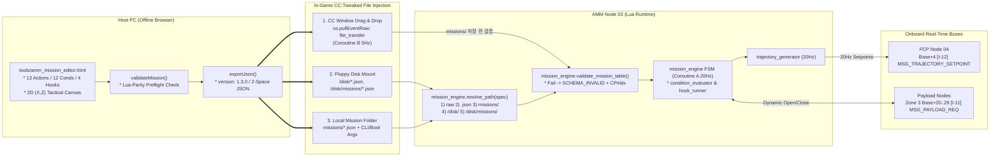

# AMM WebUI Mission Editor (호스트 PC 외부 비주얼 미션 에디터) 상세 규격서

> **AMM WebUI Mission Editor: Zero-Install Browser-Based Visual Mission Authoring Tool**  
> **대상 상위 시스템**: `AMM (Aircraft Mission Manager / Node 03 — Layer 3 Planning)`  
> **프로젝트**: Universal Autonomous Flight Stack (UAFS Ecosystem)  
> **실행 환경**: Host PC Standard Desktop Browser (`file://` Offline Single-File HTML5/CSS/Vanilla JS) $\to$ CC:Tweaked `file_transfer` / `/disk/` / `missions/`

| 항목 | 내용 |
| :--- | :--- |
| **문서 상태 (Status)** | `Draft` |
| **문서 버전 (Version)** | `v0.1.0` |
| **최종 수정일 (Date)** | `2026-11-12` |
| **구현 코드 (Source)** | `tools/amm_mission_editor.html` |
| **주관 도메인 (Domain)** | 임무 계획 외부 웹 GUI 미션 에디터 (AMM Companion Tool / Host PC) |

> **연관 문서**:
> - [AMM_PROGRAM_SPECIFICATION.md](AMM_PROGRAM_SPECIFICATION.md) (AMM 항공 임무 관리자 v1.3.0 Approved)
> - [AUTONOMOUS_FLIGHT_SYSTEM_ARCHITECTURE_AND_ICD.md](../../../system/AUTONOMOUS_FLIGHT_SYSTEM_ARCHITECTURE_AND_ICD.md) (마스터 ICD v1.28.0 Approved)
> - [SYSTEM_PROGRAM_RELATION_AND_PACKET_DIAGRAM.md](../../../system/SYSTEM_PROGRAM_RELATION_AND_PACKET_DIAGRAM.md) (전체 구조도 v2.13.0 Approved)
> - [GEMINI.md](../../../../GEMINI.md) (전역 컨텍스트 및 규칙)

### Revision History

| 버전 | 개정 일자 | 개정 요약 | 개정 사유 |
| :---: | :---: | :--- | :--- |
| `v0.1.0` | `2026-11-12` | `AMM WebUI Mission Editor`(`tools/amm_mission_editor.html`) 상세 규격 초안(`Draft`) 최초 작성: `AMM v1.3.0` / `ICD v1.28.0` / `Diagram v2.13.0` 기준 외부 파일 파이프라인, Industrial Avionics UI 레이아웃, 미션 상태 모델(`version: "1.3.0"` 및 `v1.0.0`~`v1.2.0` 임포트), 13종 액션·12종 조건·4종 훅 빌더, Lua 동등성 프리플라이트 검증기, 2D `(X, Z)` 전술 캔버스, JSON 입출력 및 `TASK-402` 인수 기준 명세 | `TASK-202-5` 사양 수립 (`tools/amm_mission_editor.html` 구현은 `TASK-402`로 분리) |

---

## 1. 프로그램 개요 및 불변 제약 (Overview, Constraints & Non-Goals)

### 1.1 목적 및 기능 범위
`tools/amm_mission_editor.html`은 마인크래프트 CC:Tweaked 인게임 `51x19` 터미널의 해상도 한계 밖에서, 호스트 PC 브라우저를 통해 `AMM (Node 03)`의 다중 체크포인트 미션 JSON 파일을 시각적으로 설계·검증·입출력하는 **독립형 오프라인 웹 GUI 컴패니언 도구**입니다.

1. **AMM 미션 스키마 동등성**: `AMM_PROGRAM_SPECIFICATION.md` (`v1.3.0 Approved`) §6·§9가 정의한 **13종 체크포인트 액션(활성 9종 + 예약 4종)**, **12종 `completeWhen`/`abortWhen` 조건**, **4종 `onEnter`/`onExit`/`onAbort` 라이프사이클 훅**, **하위 호환 `v1.0.0` `items[]` 업그레이드** 및 **`v1.1.0` / `v1.2.0` 임포트 정규화**를 지원합니다.
2. **2D `(X, Z)` 전술 경로 시각화**: 마인크래프트 수평 좌표계($+X$ 동쪽, $-Z$ 북쪽) 위에서 웨이포인트, 도달 허용 반경(`acceptanceRadius`), `ORBIT` 선회 원, `PATROL` 순찰 루프, `POI_HOLD` 조준선을 실시간 렌더링하고 마우스 클릭·드래그로 좌표를 편집합니다.
3. **실시간 프리플라이트 검증**: 온보드 `mission_engine.validate_mission_table` 및 `normalize_checkpoint` 규칙과 동등한 정적 검증(`validateMission()`)을 편집 즉시 실행해, 인게임 투입 전 `CP#idx` 단위 오류와 예약(`DEFERRED`) 경고를 사전 검출합니다.

### 1.2 불변 제약 (Hard Constraints)
- **무설치(Zero-Install) 단일 파일 구조**: `tools/amm_mission_editor.html`은 별도 빌드 도구, 로컬 HTTP 서버, npm 패키지 없이 단일 `.html` 파일(인라인 `<style>` + `<script>`)로 완결되어야 하며 `file://` 프로토콜에서 즉시 열려야 합니다.
- **외부 네트워크·CDN 차단**: `<script src="http...">`, `<link href="https...">`, Google Fonts, `fetch()`, `XMLHttpRequest`, `WebSocket` 등 어떠한 외부 네트워크 요청도 허용하지 않습니다.
- **DOM XSS 안전성**: 사용자가 불러오거나 붙여넣은 미션 JSON 내부 문자열(`missionId`, `description`, `checkpointId`, `facilityId`, `command`, `message`, 오류 문구 등)을 DOM에 출력할 때는 반드시 `document.createElement` + `textContent` (또는 `value`)만 사용하며, 비신뢰 문자열을 `innerHTML` / `insertAdjacentHTML`에 직접 결합하지 않습니다.
- **생태계 용어 및 금지 모드 준수**: Valkyrien Skies(`valkyrien`, `vs2`, `cc_vs` 등) 및 `kontraption:` 네임스페이스, 구버전 용어(`UAP`, `SAS`, `WAP`, `VAS-Core`, `VAS-Align`, `VAC-Align`, `VAC-Core`)를 UI·주석·식별자 어디에도 포함하지 않습니다.

### 1.3 비목표 (Non-Goals)
- 인게임 CC:Tweaked 모뎀 RF 채널(`Base+0..5`, `50000..60002`)과의 실시간 소켓 브리지 또는 실시간 텔레메트리 스트리밍은 범위 밖입니다.
- 3D WebGL 지형 렌더링이나 마인크래프트 월드 세이브(`.mca`) 직접 파싱은 수행하지 않습니다.
- `src/3_planning/amm/` 온보드 Lua 코드 수정은 본 사양서 범위(`TASK-202-5` / `TASK-402`)에 포함되지 않습니다.

---

## 2. 시스템 연동 및 외부 파일 파이프라인 (System Context & In-Game Workflow)

### 2.1 호스트 PC $\to$ AMM 인게임 구동 파이프라인 (`AMM v1.3.0`)
`tools/amm_mission_editor.html`에서 내보낸 `.json` 미션 파일은 3대 외부 파일 주입 경로를 통해 `AMM (Node 03)`으로 전달되며, `AMM v1.3.0`의 듀얼 코루틴(`Coroutine B 5Hz` / `Coroutine A 20Hz`)과 `trajectory_generator`를 거쳐 `FCP (Node 04)` `Base+4` (`[I-12]`) 및 `Zone 3` (`Base+20~29`, `[I-11]`)로 집행됩니다.

### 2.2 설정 기준선 및 RF 채널 프리뷰 계산식
- **기본값 기준선 (`AMM v1.3.0` §10.2 `config/amm_config.json`)**:
  - `channels.baseChannel`: `10000` (기체 블록 번호 $N = 1$, 대역폭 `40`)
  - `trajectory.defaultAlt`: `150.0` m
  - `trajectory.defaultSpeed`: `18.0` m/s
  - `trajectory.arrivalRadius`: `15.0` m
  - *(과도기 참고)* `TASK-202-4` 기준 현행 디스크 내 `src/3_planning/amm/config/amm_config.json` (`v1.0.0`)은 평면 키(`baseChannel`, `defaultAlt`, `defaultSpeed`, `arrivalRadius`)를 사용하며, `TASK-207`에서 `v1.3.0` 중첩 키로 이행됩니다. 에디터 UI는 사용자 편의를 위해 기체 번호 $N$ (`1..1000`)과 `baseChannel` 프리뷰만 보조 계산하며, 내보내는 미션 JSON에는 하드웨어 설정 키를 혼입하지 않습니다.
- **Zone 3 RF 채널 계산식 (`Base` 프리뷰)**:
  - $\text{Base} = 10000 + (N - 1) \times 40 \quad (1 \le N \le 1000)$
  - $\text{Zone 3} = \text{Base} + \text{channelOffset} \quad (20 \le \text{channelOffset} \le 29)$
  - 예: $N = 1$ ($\text{Base} = 10000$), `channelOffset = 20` $\to$ `CH 10020`.

---

## 3. UI 레이아웃, 디자인 시스템 및 반응형 규격 (Layout Shell & Design Tokens)

### 3.1 Industrial Avionics Dark Cockpit 디자인 토큰
에디터는 장시간 미션 설계 시 시인성을 확보하기 위해 고대비 다크 조종석 팔레트와 고정폭 계측 폰트를 사용합니다. 상태 배지는 색상 단독 구분을 피하고 반드시 텍스트 아이콘/태그(`[OK]`, `[ERR]`, `[DEF]`)를 병기합니다.

| CSS 변수명 | HEX 값 | 용도 |
| :--- | :---: | :--- |
| `--bg-app` | `#0b0f17` | 최상위 앱 배경 |
| `--bg-panel` | `#111827` | 좌측 레일, 우측 인스펙터, 상/하단 바 배경 |
| `--bg-elevated` | `#1b2434` | 카드, 입력 필드, 드롭다운, JSON 드로어 배경 |
| `--border-default` | `#2b394e` | 패널 및 카드 경계선 (`1px solid`) |
| `--text-primary` | `#e5edf7` | 본문 및 주요 수치 텍스트 |
| `--text-muted` | `#94a3b8` | 보조 설명, 한국어 툴팁, 비활성 라벨 |
| `--accent-cyan` | `#22d3ee` | 선택된 체크포인트, 활성 도구, 수평 경로 강조 |
| `--accent-amber` | `#f59e0b` | `DEFERRED` 경고, `POI_HOLD` 조준선, `ORBIT` 주의 배지 |
| `--accent-green` | `#10b981` | 프리플라이트 검증 통과(`[OK]`), Active 배지 |
| `--accent-red` | `#ef4444` | 스키마 오류(`[ERR]`), 삭제/중단(`abortWhen`) 강조 |
| `--accent-violet` | `#a78bfa` | `PAYLOAD_ACTION` / `Zone 3` 탑재체 배지 |

- **폰트 스택**:
  - 일반 UI 라벨: `system-ui, -apple-system, "Segoe UI", sans-serif`
  - 좌표/채널/JSON/ID 계측 데이터: `"JetBrains Mono", "Cascadia Code", Consolas, monospace` (`font-variant-numeric: tabular-nums`)

### 3.2 언어 표기 정책 (English Cockpit Labels + Bilingual Tooltips)
- **주 UI 라벨·버튼·배지**: 조종석 계기판 및 `AMM` Lua/JSON 키와의 일관성을 위해 **영문**(`Mission ID`, `Execution Mode`, `Fallback Policy`, `Add Checkpoint`, `Preflight Valid`, `Export .json`, `Fit All`)으로 표기합니다.
- **보조 설명 및 툴팁(`title` / 인라인 힌트)**: 한국어 사용자가 즉시 이해할 수 있도록 파라미터 설명, 경고 사유, `DEFERRED` 안내, 단축키 가이드는 **한/영 혼합**으로 제공합니다(예: `Acceptance Radius (m) — 도달 허용 반경; FLY_TO default 5.0m`).

### 3.3 5영역 워크스페이스 레이아웃
전체 뷰포트(`100vh`, `overflow: hidden`)는 CSS Grid 5개 영역으로 구성합니다:

1. **Top Action & Mission Header Bar (`52px`)**:
   - 좌측: 앱 타이틀(`AMM MISSION EDITOR`), `Mission ID` 입력, `Execution Mode` 토글(`SINGLE` / `REPEAT`), `Fallback Policy` 선택(`RTH` / `HOVER_HOLD` / `LOITER` / `SKIP_NEXT`), `Aircraft #N (Base)` 프리뷰 입력.
   - 우측: `Undo` / `Redo`, `Presets` 드롭다운, `Import .json`, `Raw JSON` 드로어 토글, `Copy JSON`, `Export .json`.
2. **Left Checkpoint Sequence Rail (`300px`)**:
   - 상단 헤더: `CHECKPOINTS (N)` 카운터, `+ Add` 버튼(그룹별 액션 선택 또는 즉시 추가).
   - 스크롤 가능한 수직 카드 목록: 순번(`#1..#N`), `checkpointId`, 액션 배지(`NAV` / `INFRA` / `SPECIAL` / `DEFERRED`), 상태 테두리(`[ERR]` 빨강 / `[DEF]` 주황 / `[OK]` 초록), 상하 이동(`▲`/`▼`)·복제·삭제 버튼, 드래그 재정렬 핸들.
3. **Center Interactive 2D `(X, Z)` Tactical Canvas (`1fr`, 최소 `420px`)**:
   - 상단 플로팅 툴바: 도구 선택(`SELECT`, `ADD_FLY_OVER`, `PICK_TARGET`, `PICK_POI`, `ADD_PATROL_WP`), `Grid Snap`(`Off | 1m | 10m | 50m`), `Fit All`, `Zoom +/-`.
   - 좌상단 텔레메트리 HUD 오버레이: `Cursor (X, Z)`, `Zoom`, `Legs`, `2D Path (m)`, `Est. Time (s)`.
4. **Right Inspector & JSON Drawer (`420px`)**:
   - 상단 탭 또는 아코디언: **`Checkpoint Inspector`** (`Params` / `Complete` / `Abort` / `Hooks [onEnter|onExit|onAbort]`) 및 **`Mission Defaults`** (`version`, `description`, `defaults.*`).
   - 하단/사이드 접이식 **`Raw JSON Drawer`**: 실시간 2-space JSON 미리보기, 수동 편집 후 `Apply JSON` 적용 버튼, 동기화 상태 표시.
5. **Bottom Preflight Validation Bar (`32px` 축소 / `180px` 확장 드로어)**:
   - 요약 바: `[PASS] 0 Errors, N Warnings` 또는 `[FAIL] E Errors, W Warnings` + 드로어 확장 토글.
   - 확장 목록: 클릭 시 해당 `CP#idx` 체크포인트를 선택하고 캔버스를 해당 좌표로 이동시키는 이슈 칩(`SEVERITY | CODE | CP#idx | Message`).

### 3.4 반응형 및 접근성 규격
- **반응형 분기 (`@media (max-width: 1150px)`)**: 뷰포트 너비가 `1150px` 미만이면 3열 레이아웃을 전환해 상단 바 + 레일(`260px`) + 중앙 영역(상단 탭으로 `2D Canvas` / `Inspector` 전환)으로 배치하여 입력 폼이 찌그러지지 않도록 합니다.
- **키보드 접근성**: 모든 버튼·입력·도구 토글에 명확한 `aria-label`과 `:focus-visible` `2px solid var(--accent-cyan)` 포커스 링을 부여합니다.
