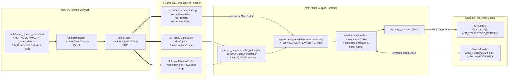

# AMM WebUI Mission Editor (호스트 PC 외부 비주얼 미션 에디터) 상세 규격서

> **AMM WebUI Mission Editor: Zero-Install Browser-Based Visual Mission Authoring Tool**  
> **대상 상위 시스템**: `AMM (Aircraft Mission Manager / Node 03 — Layer 3 Planning)`  
> **프로젝트**: Universal Autonomous Flight Stack (UAFS Ecosystem)  
> **실행 환경**: Host PC Standard Desktop Browser (`file://` Offline Single-File HTML5/CSS/Vanilla JS) $\to$ CC:Tweaked `file_transfer` / `/disk/` / `missions/`

| 항목 | 내용 |
| :--- | :--- |
| **문서 상태 (Status)** | `Implemented` |
| **문서 버전 (Version)** | `v0.3.1` |
| **최종 수정일 (Date)** | `2026-11-14` |
| **구현 코드 (Source)** | `tools/amm_mission_editor.html` |
| **주관 도메인 (Domain)** | 임무 계획 외부 웹 GUI 미션 에디터 (AMM Companion Tool / Host PC) |

> **연관 문서**:
> - [AMM_PROGRAM_SPECIFICATION.md](AMM_PROGRAM_SPECIFICATION.md) (AMM 항공 임무 관리자 v2.0.1 Implemented)
> - [AUTONOMOUS_FLIGHT_SYSTEM_ARCHITECTURE_AND_ICD.md](../../../system/AUTONOMOUS_FLIGHT_SYSTEM_ARCHITECTURE_AND_ICD.md) (마스터 ICD v1.30.0 Approved)
> - [SYSTEM_PROGRAM_RELATION_AND_PACKET_DIAGRAM.md](../../../system/SYSTEM_PROGRAM_RELATION_AND_PACKET_DIAGRAM.md) (전체 구조도 v2.15.0 Approved)
> - [GEMINI.md](../../../../GEMINI.md) (전역 컨텍스트 및 규칙)

### Revision History

| 버전 | 개정 일자 | 개정 요약 | 개정 사유 |
| :---: | :---: | :--- | :--- |
| `v0.3.1` | `2026-11-14` | **`frontend-design` + `web-design-guidelines` 기반 UI 크래프트·접근성 규격 정제 (`Draft` 유지)**: ① 4단 타이포 스케일(`11/12/13/14px`)·계측 코너 반경(`2px/4px/6px`)·무그림자 헤어라인 및 2D 캔버스 단일 시각 초점 원칙 명시, ② 빈 상태(`checkpoints=[]`)·오류 복구 지침 카피 및 능동형 버튼-토스트 일관성(`Export .json` $\to$ `Exported …`) 규격화, ③ `<meta name="theme-color">`, `pointer: fine` `overscroll-behavior: none`, 드래그 중 `user-select: none`, `paste` 차단 금지, 다이얼로그 `aria-modal`/포커스 복원, 긴 ID 말줄임(`min-width: 0`) 및 `translate="no"` 추가 | `TASK-402` 구현 계획 수립 직전 격리 HTML 스킬 기준선 반영 |
| `v0.3.0` | `2026-11-14` | **서브 창 역할·레이아웃·런타임 정합성 전면 구체화 (`Draft` 유지)**: ① 상단 바(`52px`) 경량화(`Fallback Policy`·`Aircraft #N`을 우측 `Mission Settings`로 이동), ② 좌측 레일(`300px`) 도메인 검색·필터 팔레트 팝오버(`#actionPickerPopover`) 및 `MAC_*` 원형 유지+`Expand Now` 지원, ③ 중앙 캔버스 하단 접이식 `120px` 고도(`Y`) 미니 프로필(`#altProfilePane`, 5m 스냅/Alt 미세 드래그), ④ 우측 `420px` 2모드(`[Checkpoint \| Mission Settings]`)·4탭(`Params \| Guards \| Conditions \| Hooks`) + `460px` 슬라이드오버 `Raw JSON` 드로어(`#rawJsonDrawer`), ⑤ 하단 검증 바 필터(`[All \| Errors \| Warnings]`)·`fieldPath` 탭 자동 전환 및 `Presets`/`Import`/`Apply JSON` `undoStack` 보호, ⑥ `action_registry.lua` 동등성(19종 `preconditions`, `DEC_*` `overrideParams`, 3종 `DEFERRED_*` 코드, `MAC_CARGO_SORTIE` 키) 및 Web Interface Guidelines(`color-scheme: dark`, `aria-live`, `overscroll-behavior`, `prefers-reduced-motion`) 반영, 잔존 구용어 오타(`PAYLOAD_ACTION`, `FLY_TO`) 제거 | `TASK-402` 구현 착수 전 모든 서브 창 구조, 인터랙션 및 `AMM` Lua 런타임 경계 확정 |
| `v0.2.1` | `2026-11-14` | **`AMM v2.0.1` (`TASK-204` 동기화) 스키마·조건 및 용어 정합화 (`Draft` 유지)**: ① 조건 빌더·검증을 14종(`SYS_ARMED`, `IMMEDIATE` 추가)으로 확장, ② `v1.3.0` 잔존 용어(`ADD_FLY_OVER`/`ADD_PATROL_WP` $\to$ `ADD_SPLINE_WP`, `ORBIT.*`/`PATROL.*`/`POI_HOLD.poiPos`/`LAND_LAUNCHPAD`/`PAYLOAD_ACTION`/`REDSTONE_ACTION.mode`) 제거 및 `ACT_*` 명칭 단일화, ③ `ACT_NAV_SPLINE_WP` 기본 `acceptanceRadius` `15.0`m 통일, ④ 참조 배지 `AMM v2.0.1` / `ICD v1.30.0` / `Diagram v2.15.0` 동기화 | Wave 1 사양서 전역 동기화에 따른 온보드 `AMM` 및 `condition_evaluator.lua`와의 스키마·명칭 불일치 해소 |
| `v0.2.0` | `2026-11-14` | **`AMM v2.0.0` (`TASK-204` + `TASK-124`) 스키마 전면 정합 (`Draft` 유지)**: ① `version: "2.0.0"` 단일 출력 및 구 13종 액션/`items[]` (`convertLegacyItems` `[DEPRECATED - v2.0.0]`) Zero-Fallback 거부, ② `ACT_*` 팔레트(`[즉시]` 36종 + `[로드맵]` 19종 + `TASK-401`), `DEC_*` 7종 데코레이터, `MAC_*` 5종 매크로 전개, 4대 범주 `preconditions` 인스펙터, `PROXIMITY_2D`/`PROXIMITY_3D`/`ALTITUDE_REACHED` `settleTicks` 지원, ③ 참조 배지 `AMM v2.0.0` / `ICD v1.29.0` / `Diagram v2.14.0` 동기화 | `TASK-204`·`TASK-124` 온보드 `AMM v2.0.0` 규격과의 동등성 확보 (`tools/amm_mission_editor.html` 구현은 `TASK-402`로 지속) |
| `v0.1.0` | `2026-11-12` | `AMM WebUI Mission Editor`(`tools/amm_mission_editor.html`) 상세 규격 초안(`Draft`) 수립: `AMM v1.3.0` / `ICD v1.28.0` / `Diagram v2.13.0` 외부 파일 파이프라인, Flexbox Column UI 셸(`.app-shell`)·네이티브 대화상자 금지(`#exportConfirmModal`/`#toastContainer`), 상태 모델(`version: "1.3.0"` 및 `v1.0.0`~`v1.2.0` 임포트), 13종 액션·12종 조건·4종 훅 빌더, Lua 동등성 + `defaults`/`ARM_*` 프리플라이트 검증기, 2D `(X, Z)` 전술 캔버스(`hitTestCanvas` 4종 드래그·라벨 스태킹·`Alt` 미세 조정), JSON 입출력 및 `TASK-402` 인수 기준 명세 | `TASK-202-5` 사양 수립 (`tools/amm_mission_editor.html` 구현은 `TASK-402`로 분리) |

---

## 1. 프로그램 개요 및 불변 제약 (Overview, Constraints & Non-Goals)

### 1.1 목적 및 기능 범위
`tools/amm_mission_editor.html`은 마인크래프트 CC:Tweaked 인게임 `51x19` 터미널의 해상도 한계 밖에서, 호스트 PC 브라우저를 통해 `AMM (Node 03)`의 `v2.0.0` 다중 체크포인트 미션 JSON 파일을 시각적으로 설계·검증·입출력하는 **독립형 오프라인 웹 GUI 컴패니언 도구**입니다.

1. **AMM `v2.0.0` 미션 스키마 동등성**: `AMM_PROGRAM_SPECIFICATION.md` (`v2.0.1 Approved`) §6·§9가 정의한 **3계층 `ACT_*`(활성 36종 + 예약 19종 + `TASK-401`) / `DEC_*`(7종) / `MAC_*`(5종) 매크로 전개**, **4대 범주 `preconditions`**, **14종 `completeWhen`/`abortWhen` 조건(`settleTicks` 포함)**, **4종 `onEnter`/`onExit`/`onAbort` 라이프사이클 훅**을 지원합니다. 구 `v1.0.0` `items[]` 및 구 13종 액션(`FLY_OVER` 등 `[DEPRECATED - v2.0.0]`)은 Zero-Fallback 정책에 따라 오류(`ERROR`)로 거부합니다.
2. **2D `(X, Z)` 전술 경로 시각화**: 마인크래프트 수평 좌표계($+X$ 동쪽, $-Z$ 북쪽) 위에서 웨이포인트, 도달 허용 반경(`acceptanceRadius`), `ACT_PAT_LOITER_*` 선회 원, `ACT_NAV_GOTO_WP` 접선 진입 오프셋(`tangentEntryOffsetM`), `ACT_NAV_CORRIDOR` 회랑선, `ACT_PAT_POI_HOLD` 조준선을 실시간 렌더링하고 마우스 클릭·드래그로 좌표를 편집합니다.
3. **실시간 프리플라이트 검증**: 온보드 `mission_engine.validate_mission_table` 및 `action_registry` 규칙과 동등한 정적 검증(`validateMission()`)을 편집 즉시 실행해, 인게임 투입 전 `CP#idx` 단위 오류(`SCHEMA_INVALID`)와 예약(`DEFERRED_ACTION_UNSUPPORTED`) 경고를 사전 검출합니다.

### 1.2 불변 제약 (Hard Constraints)
- **무설치(Zero-Install) 단일 파일 구조**: `tools/amm_mission_editor.html`은 별도 빌드 도구, 로컬 HTTP 서버, npm 패키지 없이 단일 `.html` 파일(인라인 `<style>` + `<script>`)로 완결되어야 하며 `file://` 프로토콜에서 즉시 열려야 합니다.
- **외부 네트워크·CDN 차단**: `<script src="http...">`, `<link href="https...">`, Google Fonts, `fetch()`, `XMLHttpRequest`, `WebSocket` 등 어떠한 외부 네트워크 요청도 허용하지 않습니다.
- **DOM XSS 안전성**: 사용자가 불러오거나 붙여넣은 미션 JSON 내부 문자열(`missionId`, `description`, `checkpointId`, `facilityId`, `command`, `message`, 오류 문구 등)을 DOM에 출력할 때는 반드시 `document.createElement` + `textContent` (또는 `value`)만 사용하며, 비신뢰 문자열을 `innerHTML` / `insertAdjacentHTML`에 직접 결합하지 않습니다.
- **네이티브 대화상자 금지 (In-Page Modal & Toast Only)**: 브라우저 기본 차단 대화상자(`window.alert`, `window.confirm`, `window.prompt`) 호출을 금지하며, 오류 포함 내보내기 확인은 인페이지 모달(`#exportConfirmModal`)로, 입출력/복사 알림은 비차단 토스트 컨테이너(`#toastContainer`)로 처리합니다.
- **생태계 용어 및 금지 모드 준수**: `.agent/rules/domain-aeronautics.md`의 금지 모드·네임스페이스 및 `tests/harness/test_terminology_guard.py`의 금지 구버전 용어를 UI·주석·식별자 어디에도 포함하지 않습니다.

### 1.3 비목표 (Non-Goals)
- 인게임 CC:Tweaked 모뎀 RF 채널(`Base+0..5`, `50000..60002`)과의 실시간 소켓 브리지 또는 실시간 텔레메트리 스트리밍은 범위 밖입니다.
- 3D WebGL 지형 렌더링이나 마인크래프트 월드 세이브(`.mca`) 직접 파싱은 수행하지 않습니다.
- `src/3_planning/amm/` 온보드 Lua 코드 수정은 본 사양서 범위(`TASK-202-5` / `TASK-402`)에 포함되지 않습니다.

---

## 2. 시스템 연동 및 외부 파일 파이프라인 (System Context & In-Game Workflow)

### 2.1 호스트 PC $\to$ AMM 인게임 구동 파이프라인 (`AMM v2.0.0`)
`tools/amm_mission_editor.html`에서 내보낸 `.json` 미션 파일은 3대 외부 파일 주입 경로를 통해 `AMM (Node 03)`으로 전달되며, `AMM v2.0.0`의 듀얼 코루틴(`Coroutine B 5Hz` / `Coroutine A 20Hz`), `action_registry`/`chattering_guard`, `trajectory_generator`를 거쳐 `FCP (Node 04)` `Base+4` (`[I-12]`) 및 `Zone 3` (`Base+20~29`, `[I-11]`)로 집행됩니다.



### 2.2 설정 기준선 및 RF 채널 프리뷰 계산식
- **기본값 기준선 (`AMM v2.0.0` §10.2 `config/amm_config.json`)**:
  - `channels.baseChannel`: `10000` (기체 블록 번호 $N = 1$, 대역폭 `40`)
  - `trajectory.defaultAlt`: `150.0` m
  - `trajectory.defaultSpeed`: `18.0` m/s
  - `trajectory.arrivalRadius`: `15.0` m
  - `safety.chattering.arrivalSettleTicks`: `4` Ticks (무정지 통과형 `ACT_NAV_SPLINE_WP`는 `0`)
  - 에디터 UI는 사용자 편의를 위해 기체 번호 $N$ (`1..1000`)과 `baseChannel` 프리뷰만 보조 계산하며, 내보내는 미션 JSON에는 하드웨어 설정 키를 혼입하지 않습니다.
- **Zone 3 RF 채널 계산식 (`Base` 프리뷰)**:
  - $\text{Base} = 10000 + (N - 1) \times 40 \quad (1 \le N \le 1000)$
  - $\text{Zone 3} = \text{Base} + \text{channelOffset} \quad (20 \le \text{channelOffset} \le 29)$
  - 예: $N = 1$ ($\text{Base} = 10000$), `channelOffset = 20` $\to$ `CH 10020`.

---

## 3. UI 레이아웃, 디자인 시스템 및 반응형 규격 (Layout Shell & Design Tokens)

### 3.1 Industrial Avionics Dark Cockpit 디자인 토큰
에디터는 장시간 미션 설계 시 시인성을 확보하기 위해 고대비 다크 조종석 팔레트와 고정폭 계측 폰트를 사용합니다. 상태 배지는 색상 단독 구분을 피하고 반드시 텍스트 아이콘/태그(`[OK]`, `[ERR]`, `[DEF]`)를 병기합니다.

| CSS 변수명 | HEX 값 | 용도 |
| :--- | :---: | :--- |
| `--bg-app` | `#0b0f17` | 최상위 앱 배경 |
| `--bg-panel` | `#111827` | 좌측 레일, 우측 인스펙터, 상/하단 바 배경 |
| `--bg-elevated` | `#1b2434` | 카드, 입력 필드, 드롭다운, JSON 드로어 배경 |
| `--border-default` | `#2b394e` | 패널 및 카드 경계선 (`1px solid`) |
| `--text-primary` | `#e5edf7` | 본문 및 주요 수치 텍스트 |
| `--text-muted` | `#94a3b8` | 보조 설명, 한국어 툴팁, 비활성 라벨 |
| `--accent-cyan` | `#22d3ee` | 선택된 체크포인트, 활성 도구, 수평 경로 강조 |
| `--accent-amber` | `#f59e0b` | `DEFERRED` 경고, `ACT_PAT_POI_HOLD` 조준선, `ACT_PAT_LOITER_TIME` 주의 배지 |
| `--accent-green` | `#10b981` | 프리플라이트 검증 통과(`[OK]`), Active 배지 |
| `--accent-red` | `#ef4444` | 스키마 오류(`[ERR]`), 삭제/중단(`abortWhen`) 강조 |
| `--accent-violet` | `#a78bfa` | `ACT_PAY_*` / `Zone 3` 탑재체 배지 |

- **폰트 스택, 타이포 스케일 및 표면 계층 (Frontend Craft)**:
  - 루트 `<html>`에 `color-scheme: dark`와 `<meta name="theme-color" content="#0b0f17">`를 선언하고, `@media (pointer: fine)`에서 `overscroll-behavior: none`을 적용하며, `<select>` 요소에 `--bg-elevated`·`--text-primary`를 명시해 Windows 다크 모드 기본 드롭다운 깨짐을 방지합니다.
  - **시각 초점 원칙**: **2D `(X, Z)` 전술 캔버스**를 유일한 시각 중심부(정밀 그리드·방위 나침반·벡터 궤적·노드 글리프)로 두고, 주변 레일·인스펙터는 장식적 그라데이션·카드 그림자 없이 `1px solid var(--border-default)` 헤어라인과 정제된 계측 코너 반경(`2px` 입력·배지, `4px` 패널·카드, `6px` 모달·드로어)으로 억제합니다.
  - **폰트 & 4단 스케일**: 일반 UI(`system-ui, -apple-system, "Segoe UI", sans-serif`) + 계측/ID/JSON(`"JetBrains Mono", "Cascadia Code", Consolas, monospace`, `font-variant-numeric: tabular-nums`); 크기 체계 `11px`(칩·HUD 보조) / `12px`(폼 라벨·배지) / `13px`(본문·입력, `line-height: 1.4`) / `14px`(패널 제목), 안내 문구 최대 `80ch`. 불필요한 ALL-CAPS 장식 레이블을 배제하고 항공 식별자(`AMM`, `ACT_*`, `DEC_*`, `MAC_*`)·식별자 입력(`missionId`, `checkpointId`, `command`)에는 `translate="no"`를 부여합니다.

### 3.2 언어 표기 및 액션 카피 정책 (English Cockpit Labels + Bilingual Tooltips)
- **주 UI 라벨·버튼·배지**: 조종석 계기판 및 `AMM` Lua/JSON 키와의 일관성을 위해 **영문**(`Mission ID`, `Execution Mode`, `Fallback Policy`, `Add Checkpoint`, `Preflight Valid`, `Export .json`, `Fit All`)으로 표기하며, 플레이스홀더는 유니코드 말줄임표 `…`(`Search actions…`)를 사용합니다.
- **능동형 동사·피드백 일관성 및 빈 상태/오류 카피**:
  - 버튼과 토스트는 동일 동사로 짝을 맞춥니다(`Export .json` $\to$ `"Exported <file>.json"`, `Copy JSON` $\to$ `"Copied JSON"`, `Apply JSON` $\to$ `"Applied JSON"`, `Expand Now` $\to$ `"Expanded <MAC_*> into N steps"`).
  - `checkpoints.length === 0` 빈 상태에서는 좌측 레일과 2D 캔버스 중앙에 즉시 실행 가능한 안내(`"No checkpoints yet. Click + Add, + Macro, or load a Preset."`)와 퀵 액션 버튼을 제공합니다.
  - 검증·JSON 파싱 오류 문구는 모호한 `"Invalid"` 대신 원인과 수정 방법(예: `"POI position required — switch to PICK_POI tool or enter X/Z in Params."`)을 명시합니다.
- **보조 설명 및 툴팁(`title` / 인라인 힌트)**: 한국어 사용자가 즉시 이해할 수 있도록 파라미터 설명, 경고 사유, `DEFERRED` 안내, 단축키 가이드는 **한/영 혼합**으로 제공합니다(예: `Acceptance Radius (m) — 도달 허용 반경; ACT_NAV_SPLINE_WP default 15.0m`).

### 3.3 5영역 워크스페이스 및 서브 창별 상세 역할·구성
루트 컨테이너 `.app-shell`(`100vh`, `overflow: hidden`)은 Chrome `file://` 직접 실행 시 조건부 숨김 요소(`display: none`인 복구 배너·반응형 탭) 때문에 CSS Grid 행 배치가 당겨져 하단 검증 바가 `1fr`로 비정상 확장되는 현상을 방지하기 위해 **수직 Flexbox Column 레이아웃**(`display: flex; flex-direction: column`)으로 고정합니다. 모든 Flex/Grid 자식은 `min-width: 0; min-height: 0`을 적용해 긴 JSON 키·라벨에 의한 패널 팽창을 차단합니다.

| 영역 / 서브 창 | DOM 셀렉터 | 레이아웃 / Flex 규격 | 주요 역할 |
| :--- | :--- | :--- | :--- |
| **복구 배너** | `#recoveryBanner` | `flex-shrink: 0` (평시 `display: none`) | `localStorage` 자동 저장본 복구/무시 선택 |
| **1. 상단 헤더 바** | `header.top-header` | `height: 52px; min-height: 52px; flex-shrink: 0` | `missionId`, `SINGLE`/`REPEAT`, `Undo`/`Redo`, `Presets`, 입출력, `Raw JSON` 토글 |
| **반응형 뷰 탭** | `nav.responsive-tabs` | `flex-shrink: 0` (`>1150px`에서 `display: none`) | 소형 뷰포트(`<= 1150px`)에서 `Checkpoints` / `2D Canvas` / `Inspector` 뷰 전환 |
| **2~4. 메인 워크스페이스** | `main.workspace-main` | `flex: 1 1 0%; min-height: 0; overflow: hidden` | 좌측 레일(`300px`) + 중앙 캔버스 컬럼(`minmax(420px, 1fr)`) + 우측 인스펙터(`420px`) 3열 CSS Grid |
| **3a. 고도 미니 프로필** | `#altProfilePane` | 중앙 컬럼 하단 `height: 120px` (기본 접힘 `display: none`) | `Alt Profile` 토글 시 `Seq #1..#N` 대비 유효 고도(`Y`) 곡선 및 상하 드래그 편집 |
| **4a. Raw JSON 드로어** | `#rawJsonDrawer` | `width: 460px` 우측 슬라이드오버/도킹 오버레이 (`overscroll-behavior: contain`) | 실시간 2-space JSON 미리보기, 편집 후 `Apply JSON`, 복사 및 파싱 상태 배지 |
| **5. 하단 검증 바** | `footer.bottom-validation-bar` | `flex-shrink: 0` (요약 행 `32px` + 접이식 드로어 최대 `165px`) | `[All \| Errors \| Warnings]` 필터, 실시간 `VALID`/`WARNING`/`INVALID` 및 `CP#k` 칩 |
| **서브 팝오버 / 모달 / 토스트** | `#actionPickerPopover` / `#exportConfirmModal` / `#toastContainer` | 고정 오버레이 (`overscroll-behavior: contain` / `aria-live="polite"`) | 도메인 검색형 액션·매크로 팔레트, 오류 포함 내보내기 확인, 비차단 토스트 |

1. **Top Action & Mission Header Bar (`header.top-header`, `52px`)**:
   - `1280px` 해상도에서도 1행 유지가 가능하도록 핵심 식별·전역 파일 제어만 배치합니다(`Fallback Policy`·`Aircraft #N` 프리뷰는 우측 `Mission Settings` 모드로 이관).
   - **좌측**: 앱 타이틀(`AMM MISSION EDITOR`), `Mission ID` 입력(`spellcheck="false"`, `autocomplete="off"`), `Execution Mode` 세그멘트 토글(`SINGLE` / `REPEAT`).
   - **우측**: `Undo` / `Redo`, `Presets` 드롭다운, `Import .json`, `Raw JSON` 드로어 토글(활성 시 시안 강조), `Copy JSON`, `Export .json`.
2. **Left Checkpoint Sequence Rail (`300px`) & `#actionPickerPopover`**:
   - **레일 헤더**: `CHECKPOINTS (N)` 카운터, `+ Add` 버튼(전술 `ACT_*` 팔레트 오픈), `+ Macro` 버튼(`MAC_*` 매크로 팔레트 오픈).
   - **액션·매크로 팔레트 팝오버 (`#actionPickerPopover`)**: 63종 액션(`36` 활성 + `19+3` 예약 + `5` 매크로)을 평면 드롭다운 대신 도메인 탭(`ALL | SYS | TKL | NAV | PAT | PAY | COM | MOB | FS | MAC | DEFERRED`), 실시간 검색 입력, `[즉시]`(초록)/`[예약]`(주황) 배지, 1줄 설명과 함께 제공합니다. `MAC_*` 선택 시에는 원형 `MAC_*` 노드로 삽입하되 인스펙터 상단의 `Expand Now` 버튼으로 즉시 전개(`ACT_*` 배열 변환)할 수 있습니다.
   - **스크롤 가능한 체크포인트 카드 목록**: 순번(`#1..#N`), `checkpointId`, 도메인/액션 배지, 상태 테두리(`[ERR]` 빨강 / `[DEF]` 주황 / `[OK]` 초록), 1줄 요약(예: `(120, -80) · 150m` 또는 `CH+20 · SCAN`), 메타 칩(`DEC(n)`, `PRE(n)`, `COND`, `HOOK`), 상하 이동(`▲`/`▼`)·복제·삭제 버튼, 드래그 재정렬 핸들.
3. **Center Interactive 2D `(X, Z)` Tactical Canvas + Collapsible `#altProfilePane` (`minmax(420px, 1fr)`)**:
   - 중앙 컬럼은 수직 Flex Column(`flex: 1` 2D 캔버스 + 하단 접이식 `120px` `#altProfilePane`)으로 구성합니다.
   - **상단 플로팅 툴바**: 도구 선택(`SELECT`, `ADD_SPLINE_WP`, `PICK_TARGET`, `PICK_POI`), `Grid Snap`(`Off | 1m | 10m | 50m`), `Alt Profile` 토글(기본 접힘), `Fit All`, `Zoom +/-`.
   - **좌상단 텔레메트리 HUD 오버레이**: `Cursor (X, Z)`, `Zoom`, `Legs`, `2D Path (m)`, `Est. Time (s)`.
   - **고도 미니 프로필 (`#altProfilePane`, `120px`)**: `Alt Profile` 활성화 시 캔버스 하단에 열리며, `Seq #1..#N`을 가로축, 유효 고도 `Y`(m)를 세로축으로 연결선·`defaults.targetAlt` 점선을 표시합니다. 포인트 클릭 시 해당 체크포인트가 선택되고, 상하 드래그(`5m` 스냅 / `Alt` 미세 조정)로 `params.targetAlt`를 직접 편집합니다(상세 §8.4).
4. **Right Inspector (`420px`) & `#rawJsonDrawer` (`460px`)**:
   - **우측 패널 상단 2모드 전환 바**: **`[Checkpoint]`** vs **`[Mission Settings]`**.
   - **`[Checkpoint]` 모드**:
     - 상단 고정 엔벨로프 헤더: `checkpointId`, `action` 변경 드롭다운/피커 버튼, `fallbackPolicy` 오버라이드, `MAC_*` 선택 시 `Expand Now` 버튼(`targetAirframe` 반영 전개).
     - **4개 서브 탭**:
       - **`Params`**: 액션별 전용 파라미터 폼(좌표, 반경, `poiPos`, `channelOffset`, `REDSTONE` 6면 등).
       - **`Guards`**: 상단 **`Decorators (DEC_*)`** 7종 체크박스(선택 시 `DEC_RETRY_N.maxAttempts`, `DEC_TIMEOUT_GUARD.timeoutSec` 등 `overrideParams` 인라인 입력 노출) + 하단 **`Preconditions`** 4대 범주 접이식 아코디언(`State Flag` / `Sensor & Est` / `Resource` / `Spatial & Safety` — 총 19키 지원, 각 범주 헤더에 활성 조건 개수 배지 표시).
       - **`Conditions`**: `completeWhen`(생략 시 자동 조건 프리뷰 배너 포함) + `abortWhen` 스택 빌더(14종 조건 + `settleTicks`).
       - **`Hooks`**: `onEnter` / `onExit` / `onAbort` 3서브 탭 및 4종 훅 빌더.
   - **`[Mission Settings]` 모드**: `version` (`"2.0.0"` readonly), `description`, `fallbackPolicy` (`RTH` | `HOVER_HOLD` | `LOITER` | `SKIP_NEXT`), `defaults.*` (`cruiseSpeed`, `targetAlt`, `acceptanceRadius`, `headingMode`), UI 전용 **`Target Airframe`** 프리뷰 선택(`MULTICOPTER` | `WINGED_VTOL` | `FIXED_WING` — JSON 미출력, `preconditions` 정적 검사 및 `MAC_SHIP_RECOVERY` 전개 확인용), **`Aircraft #N`** → `Base` 및 `Zone 3` (`Base+20..29`) RF 채널 프리뷰.
   - **`#rawJsonDrawer` (`460px` 슬라이드오버/도킹 드로어)**: 상단 헤더의 `Raw JSON` 토글 시 우측에서 슬라이드오버되며 `420px` 인스펙터 세로 높이를 잠식하지 않습니다. 실시간 2-space JSON 미리보기(`textContent` 기반)와 수동 편집 모드(`spellcheck="false"`), `Apply JSON`, `Copy JSON`, 문법 오류 상태 배지를 제공합니다.
5. **Bottom Preflight Validation Bar (`footer.bottom-validation-bar`, `32px` 축소 / 최대 `165px` 확장 드로어)**:
   - **요약 바 (`32px`, `aria-live="polite"`)**: `[PASS] 0 Errors, N Warnings` 또는 `[FAIL] E Errors, W Warnings` + 드로어 확장 토글.
   - **확장 드로어 (`<= 165px`)**: 상단 `[All | Errors | Warnings]` 필터 칩과 이슈 칩 목록(`SEVERITY | CODE | CP#idx | Message`). 이슈 클릭 시 해당 `CP#idx` 선택, 캔버스 센터링과 함께 `fieldPath`에 맞춰 우측 인스펙터 모드/탭(`Mission Settings` / `Params` / `Guards` / `Conditions` / `Hooks`)을 자동 전환하고 대상 필드를 포커스·하이라이트합니다.

### 3.4 반응형, 접근성 및 Web Interface Guidelines 규격
- **반응형 분기 (`@media (max-width: 1150px)`)**: 뷰포트 너비가 `1150px` 이하이면 `nav.responsive-tabs`를 활성화하여 **`Checkpoints` / `2D Canvas` / `Inspector` 3탭 전환** 구조로 전환함으로써 좌측 레일·2D 캔버스·인스펙터 입력 폼이 찌그러지지 않도록 합니다.
- **시맨틱 컨트롤, 다이얼로그 포커스 & 폼 위생**:
  - 모든 클릭 동작은 `<div>`/`<span>`이 아닌 `<button type="button">`으로 구현하며, 아이콘 전용 버튼은 `aria-label`, 모든 폼 컨트롤은 `<label for>` 또는 `aria-label`을 부여합니다. 체크박스/라디오(`DEC_*` 토글 등)는 `<label>`로 감싸 단일 클릭 히트 영역을 보장합니다.
  - `#exportConfirmModal`과 `#actionPickerPopover`에는 `role="dialog"`, `aria-modal="true"`, `aria-labelledby`를 부여하고, `Escape`/취소로 닫힐 때 직전 트리거 버튼으로 포커스를 복원합니다.
  - 붙여넣기(`paste`) 이벤트를 절대 차단하지 않으며, ID·명령·JSON 필드에 `spellcheck="false"`와 `autocomplete="off"`를 적용합니다.
- **오버플로우, 드래그 & 모션 안전성**:
  - 긴 `missionId`, `checkpointId`, `command`, 오류 문구는 `min-width: 0` 컨테이너 안에서 `text-overflow: ellipsis` 또는 `overflow-wrap: anywhere`로 처리해 가로 스크롤바(`overflow-x: hidden`)가 생기지 않게 합니다.
  - 2D 캔버스·`#altProfilePane`·카드 재정렬 드래그 중에는 `user-select: none`을 적용해 텍스트 선택 오작동을 막고, 모든 드래그 조작은 우측 인스펙터 수치 입력으로 동일하게 대체할 수 있어야 합니다.
  - `transition: all` 사용을 금지(명시적 속성만 전이)하고 `@media (prefers-reduced-motion: reduce)`에서 전환/애니메이션을 비활성화하며, 모달/드로어에는 `overscroll-behavior: contain`을, `#toastContainer`와 검증 요약에는 `aria-live="polite"`를 부여합니다. 모든 상호작용 요소는 `:focus-visible` (`2px solid var(--accent-cyan)`) 링을 유지합니다.

---

## 4. 에디터 상태 모델, 하위 호환 변환 및 영속성 (§4)

### 4.1 정규 내부 상태 객체 (`EditorState`)
에디터 스토어는 단일 불변 스냅샷 기반 `EditorState`를 유지하며, 모든 편집 액션(체크포인트 편집, `Presets` 로드, `Import .json`, `Apply JSON`, `Expand Now` 포함)은 변경 직전 `mission`과 `selectedIndex`의 깊은 복사본(`structuredClone` 또는 JSON 안전 복제)을 실행 취소 스택에 적재한 뒤 상태를 갱신합니다. 따라서 `Presets`/`Import`/`Apply JSON` 덮어쓰기 시 추가 확인 모달 없이 `Ctrl+Z`로 직전 작업 상태를 즉시 복구할 수 있습니다.

```json
{
  "mission": {
    "missionId": "MSN_RECON_001",
    "version": "2.0.0",
    "description": "",
    "executionMode": "SINGLE",
    "fallbackPolicy": "RTH",
    "defaults": {
      "cruiseSpeed": 18.0,
      "targetAlt": 150.0,
      "acceptanceRadius": 15.0,
      "headingMode": "AUTO"
    },
    "checkpoints": []
  },
  "ui": {
    "selectedIndex": 0,
    "activeRightMode": "CHECKPOINT",
    "activeInspectorTab": "PARAMS",
    "activeHookTab": "onEnter",
    "altProfileOpen": false,
    "rawJsonOpen": false,
    "validationExpanded": false,
    "validationFilter": "ALL",
    "activeTool": "SELECT",
    "gridSnapM": 10,
    "targetAirframe": "WINGED_VTOL",
    "aircraftBlockNumber": 1,
    "baseChannel": 10000,
    "dirty": false
  },
  "canvas": {
    "camX": 0,
    "camZ": 0,
    "zoomPxPerM": 0.4,
    "draggingNode": null,
    "isPanning": false
  },
  "history": {
    "undoStack": [],
    "redoStack": [],
    "maxDepth": 50
  }
}
```

- **미지 필드 보존 (`_extra` Preservation)**: 수기 편집된 미션 JSON을 불러올 때 최상위, `defaults`, 개별 체크포인트, `params`, 조건 객체, 훅 객체에 존재하는 비표준/확장 키(예: 향후 `TASK-204` 진입 조건 메타데이터나 사용자 메모)는 내부 `_extra` 맵에 보존하고 `exportJson()` 시 원래 위치에 병합 출력합니다. 단, 아래 정규화 대상 단축 좌표(`params.x`, `params.z`)는 `params.targetPos`로 승격한 뒤 출력에서 제거합니다.

### 4.2 스키마 버전 검증 및 레거시 Zero-Fallback 거부 정책
1. **표준 `v2.0.0` 체크포인트 스키마**:
   - `Array.isArray(raw.checkpoints)`가 참이어야 하며 내보내기(`exportJson`) 시 항상 `"version": "2.0.0"`을 출력합니다.
   - `+ Macro` 버튼(`#actionPickerPopover` 매크로 탭)으로 `MAC_RECON_ORBIT` / `MAC_SHIP_RECOVERY` / `MAC_CARGO_SORTIE` 선택 시 기본 동작으로 원형 `MAC_*` 체크포인트 노드를 삽입하고, 인스펙터 상단의 **`Expand Now`** 버튼 클릭 시 `ui.targetAirframe`을 반영해 선형 `ACT_*` + `DEC_*` 시퀀스로 즉시 전개할 수 있습니다(원형 `MAC_*` 상태 그대로의 내보내기도 지원).
2. **레거시 `v1.0.0` `items[]` 및 구 13종 액션 `[DEPRECATED - v2.0.0]` 거부 (Zero-Fallback)**:
   - `raw.items[]` 단독 포맷 또는 구 13종 액션명(`FLY_OVER`, `FLY_TO`, `ORBIT`, `PATROL`, `POI_HOLD`, `TAKEOFF_LAUNCHPAD`, `LAND_LAUNCHPAD`, `PAYLOAD_ACTION`, `REDSTONE_ACTION`, `TAKEOFF_RUNWAY`, `LAND_RUNWAY`, `DOCK_ARM`, `UNDOCK_ARM` `[DEPRECATED - v2.0.0]`)을 임포트하면 자동 변환(`convertLegacyItems` `[DEPRECATED - v2.0.0]`) 없이 `ERROR` (`SCHEMA_INVALID`)로 차단하고 `ACT_*` 규격으로 재작성하도록 안내합니다.

### 4.3 단축 좌표 정규화 (`params.{x, z}` $\to$ `params.targetPos`)
`TASK-202-4` `mission_engine.extract_target_pos`와 동등하게, 임포트된 체크포인트의 `params`에 `params.targetPos`가 없고 유한 수치 `params.x`와 `params.z`가 존재하면 즉시 `params.targetPos = { x: params.x, z: params.z }`로 승격하고 임시 `params.x`, `params.z` 키는 제거합니다.

### 4.4 브라우저 자동 저장 및 복구 (`localStorage`)
- **저장 키**: `uafs_amm_editor_autosave_v1`
- **디바운스 주기**: 상태 변경 후 `500ms` 디바운스 기록 (`{ savedAtIso, mission }`, `localStorage` 비활성 환경에서는 예외를 삼키고 메모리 내 동작 유지).
- **초기 복구 배너**: 페이지 로드 시 저장된 초안이 기본 스타터 템플릿과 다르면 사용자 작업물을 묵시적으로 덮어쓰지 않고 상단 비차단 복구 배너(`[Restore Draft]` / `[Dismiss]`)를 표출합니다.

---

## 5. 미션 헤더 및 3계층 (`ACT_*` / `DEC_*` / `MAC_*`) 액션 · `preconditions` 폼 매트릭스 (§5)

### 5.1 미션 헤더 및 전역 기본값 (`defaults`) 입력 규격 (`[Mission Settings]` + 상단 바)

| JSON 필드 경로 | 위치 | 타입 | 기본값 | UI 컨트롤 | 설명 및 제약 |
| :--- | :---: | :---: | :---: | :--- | :--- |
| `missionId` | 상단 바 | `string` | `"MSN_RECON_001"` | Text Input (`spellcheck=false`) | 파일명 기본값(`${missionId.toLowerCase()}.json`) 및 식별자 |
| `executionMode` | 상단 바 | `enum` | `"SINGLE"` | Segmented Toggle | `"SINGLE"` \| `"REPEAT"` |
| `version` | `Mission Settings` | `string` | `"2.0.0"` | Readonly / Badge Input | 단일 표준 `"2.0.0"` 출력 (`v1.0.0` `items[]` Zero-Fallback 거부) |
| `description` | `Mission Settings` | `string` | `""` | Text Input (Optional) | 임무 설명 (빈 문자열이면 export 시 생략 가능) |
| `fallbackPolicy` | `Mission Settings` | `enum` | `"RTH"` | Select | `"RTH"` \| `"HOVER_HOLD"` \| `"LOITER"` \| `"SKIP_NEXT"` |
| `defaults.cruiseSpeed` | `Mission Settings` | `number` | `18.0` | Number (`step=0.5`, `>0`) | 하위 체크포인트 미지정 시 상속되는 기본 순항 속도 (m/s) |
| `defaults.targetAlt` | `Mission Settings` | `number` | `150.0` | Number (`step=5`) | 하위 체크포인트 미지정 시 상속되는 기본 순항 고도 (m) |
| `defaults.acceptanceRadius` | `Mission Settings` | `number` | `15.0` | Number (`step=1`, `>0`) | `ACT_NAV_SPLINE_WP` 등의 기본 수평 도달 반경 (m) |
| `defaults.headingMode` | `Mission Settings` | `enum` | `"AUTO"` | Select | `"AUTO"` \| `"FIXED"` \| `"POI"` |
| *(UI 전용)* `Target Airframe` | `Mission Settings` | `enum` | `"WINGED_VTOL"` | Select (JSON 미저장) | `"MULTICOPTER"` \| `"WINGED_VTOL"` \| `"FIXED_WING"` — 정적 `preconditions` 및 `MAC_SHIP_RECOVERY` 전개 프리뷰용 |
| *(UI 전용)* `Aircraft #N` | `Mission Settings` | `int` | `1` (`1..1000`) | Number + Readonly Base/CH | $\text{Base} = 10000 + (N - 1) \times 40$ 및 `Zone 3` (`Base+20..29`) 프리뷰 (JSON 미저장) |

### 5.2 체크포인트 엔벨로프, `decorators` (`DEC_*`), `preconditions` 및 시퀀스 레일 제어
- **공통 헤더 필드**:
  - `checkpointId` (`string`): 자동 생성(`CP_01`, `CP_02`, ...), 사용자 수정 가능 (`spellcheck="false"`).
  - `action` (`enum`): `#actionPickerPopover` 또는 인스펙터 도메인별 `<optgroup>`에서 선택:
    - `ACT_SYS_*` (Active 6): `ACT_SYS_LOAD`, `ACT_SYS_PREFLIGHT`, `ACT_SYS_SET_HOME`, `ACT_SYS_ARM`, `ACT_SYS_DISARM`, `ACT_SYS_TERMINATE`
    - `ACT_TKL_*` (Active 6): `ACT_TKL_TAKEOFF_VERT`, `ACT_TKL_TRANS_MC2FW`, `ACT_TKL_TRANS_FW2MC`, `ACT_TKL_LAND_NORM`, `ACT_TKL_LAND_PREC`, `ACT_TKL_ABORT_LAND`
    - `ACT_NAV_*` (Active 6): `ACT_NAV_GOTO_WP`, `ACT_NAV_SPLINE_WP`, `ACT_NAV_CORRIDOR`, `ACT_NAV_CHANGE_ALT`, `ACT_NAV_CHANGE_SPD`, `ACT_NAV_CHANGE_YAW`
    - `ACT_PAT_*` (Active 5): `ACT_PAT_HOLD_POS`, `ACT_PAT_POI_HOLD`, `ACT_PAT_LOITER_TIME`, `ACT_PAT_LOITER_TURNS`, `ACT_PAT_LOITER_ALT`
    - `ACT_PAY_*` (Active 4): `ACT_PAY_BUS_CMD`, `ACT_PAY_REDSTONE`, `ACT_PAY_SET_ROI`, `ACT_PAY_CLEAR_ROI`
    - `ACT_COM_*` (Active 1): `ACT_COM_ATC_HOLD`
    - `ACT_MOB_*` (Active 3): `ACT_MOB_RV_TRACK`, `ACT_MOB_DECK_SYNC`, `ACT_MOB_MOVING_TKOFF`
    - `ACT_FS_*` (Active 5): `ACT_FS_RTL_HOME`, `ACT_FS_GOTO_RALLY`, `ACT_FS_FENCE_BRAKE`, `ACT_FS_HOVER_HOLD`, `ACT_FS_EMERG_LAND`
    - `Deferred / Roadmap` (19종 + `TASK-401` 3종): `ACT_TKL_TAKEOFF_RWY`, `ACT_TKL_LAND_RWY`, `ACT_NAV_TERRAIN_FLW`, `ACT_PAT_FIG_EIGHT`, `ACT_PAT_GRID_SURVEY`, `ACT_PAT_EXP_SPIRAL`, `ACT_PER_LOCAL_AVOID`, `ACT_PER_REPLAN_GLB`, `ACT_PER_TRACK_TGT`, `ACT_PER_SENTRY_HOLD`, `ACT_COM_SWARM_FOLLOW`, `ACT_COM_HANDOVER`, `ACT_MOB_ARM_DOCK`, `ACT_MOB_ARM_UNDOCK`, `ACT_NRG_REFUEL_DOCK`, `ACT_NRG_HIBERNATE`, `ACT_MUMT_WINGMAN`, `ACT_MUMT_UGV_SCOUT`, `ACT_MUMT_CROSS_CUE`, `ACT_PAY_CARGO_DROP`, `ACT_PAY_FIRE_CTRL`, `ACT_PAY_GEO_SCAN`
    - `MAC_*` 매크로 (Active 3 / Deferred 2): `MAC_RECON_ORBIT`, `MAC_SHIP_RECOVERY`, `MAC_CARGO_SORTIE`, `MAC_PATROL_RADAR`, `MAC_ARM_RESUPPLY`
  - `decorators[]` (`Guards` 탭 상단 — `{ decoratorId, overrideParams? }[]` 형태):
    - `[즉시]` 6종: `DEC_EMCON`, `DEC_ENERGY_ECO`, `DEC_SMOOTH_TRAJ`, `DEC_HUMAN_AUTH`, `DEC_RETRY_N` (체크 시 `overrideParams.maxAttempts` 정수 입력 노출, 기본 `3`), `DEC_TIMEOUT_GUARD` (체크 시 `overrideParams.timeoutSec` 실수 입력 노출).
    - `[로드맵]` 1종: `DEC_TIME_CRIT` (체크 시 호박색 `[DEFERRED]` 경고 `DEFERRED_DECORATOR_UNSUPPORTED` 표출).
  - `preconditions{}` (`Guards` 탭 하단 — 4대 범주 접이식 아코디언, 총 19키 = `action_registry.lua` `KNOWN_PRECONDITIONS` 전수 지원):

| 범주 (아코디언 헤더) | JSON 키 (`preconditions.*`) | 타입 / UI 컨트롤 | 검증 규칙 (`action_registry.lua` 동등) |
| :--- | :--- | :--- | :--- |
| **1. State Flag (5)** | `controlState`, `activeSource`, `fsmState`, `allowedAirframes`, `disallowedAirframes` | Text / Comma-separated Chips or Multi-select | `fsmState`는 string 또는 array, `allowedAirframes`·`disallowedAirframes`는 array; `Target Airframe` 충돌 시 `ERROR` |
| **2. Sensor & Est (6)** | `sensorOk`, `gpsValid`, `maxHdop`, `requireTap`, `requireAsa`, `requireGimbal` | Boolean Tri-state (`Unset\|true\|false`) + `maxHdop` Number | `maxHdop` 실수(`>= 0`), 나머지 boolean |
| **3. Resource (4)** | `minFuel`, `channelBound`, `atcCleared`, `zone3Available` | `minFuel` Number (`0..1`, `step=0.05`) + Boolean Tri-state | `minFuel` 실수(`[0,1]`), 나머지 boolean |
| **4. Spatial & Safety (4)** | `geofenceMarginM`, `minAlt`, `maxAlt`, `maxSpeed` | Number Inputs (m, m/s) | 모두 유한 실수; `minAlt > maxAlt` 시 `PRECONDITION_STATIC_INVALID` `ERROR` |

  - `fallbackPolicy` (선택 오버라이드): `(Inherit Mission)`(저장 시 키 생략) | `"RTH"` | `"HOVER_HOLD"` | `"LOITER"` | `"SKIP_NEXT"`.
- **시퀀스 제어**: `+ Add`, `+ Macro`, `Duplicate` (`_copy` ID 생성), `Delete`, `Move Up` (`▲`), `Move Down` (`▼`), Drag-to-Reorder, `Expand Now` (`MAC_*` 전용). 순서 변경 시 배열 인덱스를 즉시 재계산하고 `validateMission()`을 재실행합니다.
- **액션 전환 시 필드 정리 정책**: 사용자가 기존 체크포인트의 `action`을 변경하면 이전 액션 전용 잔존 필드를 정리(신규 액션 스키마에 유효한 공통 필드 `targetPos`, `targetAlt`, `cruiseSpeed` 보존)해 불필요한 잉여 키가 남지 않게 합니다.

### 5.3 주요 체크포인트 액션 및 매크로 파라미터 매트릭스

| 도메인 / 액션 | 상태 | JSON 키 경로 (`params.*`) | 타입 / UI 위젯 | 기본값 및 상속 규칙 | 검증 규칙 |
| :--- | :---: | :--- | :--- | :--- | :--- |
| **`ACT_NAV_SPLINE_WP`** | Active | `targetPos.{x, z}`, `targetAlt`, `cruiseSpeed`, `acceptanceRadius`, `headingMode`, `fixedHeading` | Number Pair + Option Inputs | 상속 `defaults.*` (`acceptanceRadius` 기본 `15.0` m, `settleTicks=0`) | `targetPos.{x,z}` 유한 실수, `acceptanceRadius > 0` |
| **`ACT_NAV_GOTO_WP`** | Active | `targetPos.{x, z}`, `targetAlt`, `cruiseSpeed`, `acceptanceRadius`, `tangentEntryOffsetM` | Number Pair + Tangency | **명시적 기본 `5.0` m** (`settleTicks=4`, `tangentEntryOffsetM >= 0` 선택) | `targetPos.{x,z}` 유한 실수, `acceptanceRadius > 0` |
| **`ACT_NAV_CORRIDOR`** | Active | `startPos.{x, z}`, `endPos.{x, z}`, `targetPos.{x, z}`, `maxCrossTrackM`, `targetAlt`, `cruiseSpeed` | Pair × 2 + Max Deviation | `maxCrossTrackM` 기본 `15.0` m | `startPos` 및 `endPos` 모두 필수(`INVALID_CORRIDOR_BOUNDS`), `maxCrossTrackM > 0` |
| **`ACT_NAV_CHANGE_ALT` / `_SPD` / `_YAW`** | Active | `targetAlt` / `cruiseSpeed` / `targetYaw` (`fixedHeading`) | Single Scalar Input | 해당 단일 목표치 변경 | 각 대상 필드 유한 실수 필수 (`cruiseSpeed > 0`) |
| **`ACT_PAT_LOITER_TIME` / `_TURNS` / `_ALT`** | Active | `targetPos.{x, z}`, `radius`, `direction`, `durationSec` / `turns` / `targetAlt` | Center + Orbit Params | `radius=30.0`, `direction="CW"`, `turns >= 1` | `targetPos.{x,z}` 필수, `radius > 0`, `turns >= 1` |
| **`ACT_PAT_HOLD_POS` / `ACT_PAT_POI_HOLD`** | Active | `targetPos.{x, z}`, `poiPos.{x, y?, z}`, `headingMode`, `durationSec` | Point + Target 3D | `headingMode="POI"` (`POI_HOLD`), 미지정 시 수동 대기 | `POI_HOLD` 시 `targetPos` 및 `poiPos.{x,z}` 필수 |
| **`ACT_TKL_TAKEOFF_VERT` / `ACT_TKL_LAND_*`** | Active | `facilityId`, `targetPos.{x, z}`, `targetAlt` | Facility / Pos Inputs | `LAND_PREC`/`LAND_NORM`: `facilityId` 또는 `targetPos` | `LAND_*` 시 `facilityId` 또는 `targetPos.{x,z}` 중 1개 이상 필수 |
| **`ACT_PAY_BUS_CMD` / `_SET_ROI` / `_CLEAR_ROI`** | Active | `channelOffset`, `command`, `commandPayload`, `waitForAck`, `expectedStatus`, `poiPos` | Zone 3 Payload Builder | `channelOffset=20`, `waitForAck=true`, `expectedStatus="OK"` | `channelOffset` ∈ `[20,29]`, `command` 비어 있지 않음 |
| **`ACT_PAY_REDSTONE`** | Active | `mode`, `side`, `color`, `level`, `state`, `durationMs`, `minLevel` | 6-Side Redstone Form | `mode="EMIT"\|"WAIT_INPUT"`, `durationMs=0`, `minLevel=1` | `side` ∈ 6면, `durationMs >= 0` |
| **`ACT_SYS_*` / `ACT_COM_ATC_HOLD` / `ACT_MOB_*` / `ACT_FS_*`** | Active | 도메인별 선택 파라미터 (`targetPos`, `facilityId`, `targetAlt`, `cruiseSpeed`) | Contextual Form | 기본 `defaults.*` 및 `amm_config.safety.chattering` 연동 | 지정 시 각 좌표/고도 유한 실수 검증 |
| **`MAC_RECON_ORBIT`** | Active Macro | `targetPos.{x, z}`, `targetAlt`, `radius`, `durationSec`, `poiPos`, `facilityId` | Macro Param Form + `Expand Now` | `radius=40`, `durationSec=60`, `poiPos` 생략 시 `targetPos` 상속 | `targetPos` 필수, `radius > 0` |
| **`MAC_SHIP_RECOVERY`** | Active Macro | `facilityId`, `targetPos.{x, z}` | Macro Param Form + `Expand Now` | `Target Airframe == "WINGED_VTOL"`이면 전개 시 `ACT_TKL_TRANS_FW2MC` 자동 삽입 | `facilityId` 또는 `targetPos` 1개 이상 필수 |
| **`MAC_CARGO_SORTIE`** | Active Macro | `facilityId`, `targetPos.{x, z}`, `targetAlt`, `channelOffset`, `command`, `payload`, `awaitAck` | Macro Param Form + `Expand Now` | `action_registry.lua` `expand_cargo_sortie` 키(`payload`, `awaitAck`) 그대로 사용 | `targetPos` 필수, `channelOffset` ∈ `[20,29]`, `command` 필수 |
| **예약 19종 + `TASK-401` 3종 + 지연 `DEC_*`/`MAC_*`** | `DEFERRED` | 해당 표준 키 (`facilityId`, `targetPos` 등) | Amber `[DEFERRED]` 배너 | 런타임 진입 시 각각 `DEFERRED_*_UNSUPPORTED` 반환 안내 | 구조 오류 아님(`WARNING`: `DEFERRED_*_UNSUPPORTED` 표출) |

---

## 6. 14종 조건 빌더 및 4종 라이프사이클 훅 빌더 (§6)

### 6.1 복합 조건 그룹 (`completeWhen` / `abortWhen`) 및 빈 그룹 생략 규칙
- **논리 결합자 (`logic`)**: `completeWhen` 기본값 `"ALL"`(AND), `abortWhen` 기본값 `"ANY"`(OR).
- **빈 조건 그룹 생략 규칙 (Empty Group Omission Trap Prevention)**:
  - 온보드 `condition_evaluator.evaluate_group(group, ctx, ...)`는 `conditions`가 빈 배열(`{}`)일 때 기본 조건으로 폴백하지 않고 `false`를 반환합니다.
  - 따라서 UI에서 `conditions.length === 0`인 `completeWhen` 또는 `abortWhen`은 인스펙터에 `"Default completion active (no custom override)"` / `"No abort conditions"` 배너로 표시하고, **`exportJson()` 시 `completeWhen` / `abortWhen` 키 자체를 JSON에서 생략**합니다(기존 JSON에 명시적 `{ logic, conditions: [] }`가 들어온 경우 검증 경고를 표시).

#### 액션별 기본 `completeWhen` 프리뷰 (`AMM v2.0.1` §6.3 / `condition_evaluator.resolve_default_complete`)
| 액션 (`action`) | `completeWhen` 생략 시 온보드 엔진 자동 적용 조건 |
| :--- | :--- |
| **`ACT_NAV_SPLINE_WP`** | `{ logic: "ALL", conditions: [{ type: "PROXIMITY_2D", toleranceM: acceptanceRadius (15.0), settleTicks: 0 }] }` |
| **`ACT_NAV_GOTO_WP`** / **`ACT_NAV_CORRIDOR`** | `{ logic: "ALL", conditions: [{ type: "PROXIMITY_3D", toleranceM: params.acceptanceRadius ?? 5.0, settleTicks: 4 }] }` |
| **`ACT_TKL_TAKEOFF_VERT`** / **`ACT_NAV_CHANGE_ALT`** / **`ACT_PAT_LOITER_ALT`** | `{ logic: "ANY", conditions: [{ type: "ALTITUDE_REACHED", toleranceM: 5.0, settleTicks: 4 }] }` (`TAKEOFF` 시 `CRUISE` 전이 포함) |
| **`ACT_TKL_LAND_NORM`** / **`ACT_TKL_LAND_PREC`** | `{ logic: "ALL", conditions: [{ type: "FACILITY_TOUCHDOWN", facilityId }] }` |
| **`ACT_PAT_LOITER_TIME`** / **`ACT_PAT_HOLD_POS`** / **`ACT_PAT_POI_HOLD`** | `params.durationSec` 지정 시 `DURATION_SEC`, 미지정 시 수동 체공(`next`/`stop`) |
| **`ACT_PAY_BUS_CMD`** / **`ACT_PAY_SET_ROI`** / **`ACT_PAY_CLEAR_ROI`** | `waitForAck == false`이면 즉시 완료, 기본(`true`)이면 `PAYLOAD_RESP_MATCH` |
| **`ACT_PAY_REDSTONE`** | `mode == "EMIT"`이면 `DURATION_SEC(durationMs / 1000)`, `mode == "WAIT_INPUT"`이면 `REDSTONE_INPUT_HIGH` |

### 6.2 14종 조건 타입 입력 매트릭스 (`settleTicks` 포함)

| 조건 타입 (`type`) | 파라미터 키 및 UI 컨트롤 | 기본값 / 제약 | 비고 |
| :--- | :--- | :---: | :--- |
| **`PROXIMITY_2D`** | `toleranceM` (Number, opt), `settleTicks` (Int `>=0`, opt), `targetPos.{x, z}` (opt) | 기본 `acceptanceRadius` (`settleTicks`: `SPLINE_WP=0`) | 2D 수평 도달 + 안착 틱 |
| **`PROXIMITY_3D`** | `toleranceM` (Number, opt), `settleTicks` (Int `>=0`, opt), `targetPos.{x, z}`, `targetAlt` | 기본 `5.0` (`settleTicks` 기본 `4`) | 3D 정밀 도달 + 안착 틱 |
| **`ALTITUDE_REACHED`** | `toleranceM` (Number, opt), `settleTicks` (Int `>=0`, opt), `targetAlt`, `allowFsmCruise` | 기본 `5.0` (`settleTicks` 기본 `4`) | 목표 고도 도달 + 안착 틱 |
| **`DURATION_SEC`** | `durationSec` (Number, 필수) | `>= 0` (초) | 스텝 경과 시간 |
| **`TIMEOUT_SEC`** | `timeout` (Number, 필수 — **키 명칭 `timeoutSec` 아님**) | `>= 0` (초) | 주로 `abortWhen` 타임아웃 |
| **`FUEL_LEVEL_BELOW`** | `threshold` (Number, `step=0.05`) | `0.0 .. 1.0` | 잔여 연료 하한 이하 중단 |
| **`FACILITY_TOUCHDOWN`** | `facilityId` (Text, opt) | 선택 문자열 | 착륙 접지(`DISARMED`) |
| **`PAYLOAD_RESP_MATCH`** | `expectedStatus` (Text), `command` (Text, opt), `checkpointId` (Text, opt) | 기본 `"OK"` | Zone 3 `MSG_PAYLOAD_ACK` 일치 |
| **`REDSTONE_INPUT_HIGH`** | `side` (Select 6면, 필수), `color` (16색 opt), `minLevel` (Int `1..15`, opt) | `minLevel` 기본 `1` | 번들 또는 아날로그/디지털 입력 |
| **`CROSS_TRACK_ERROR`** | `maxDevM` (Number, 필수) | `>= 0` (m) | 경로 이탈 오차 초과(`abortWhen`) |
| **`ARM_DOCKED`** | `facilityId` (Text, opt) | `[DEFERRED / TASK-104]` 배지 | 도킹암 결합 완료 |
| **`ARM_RELEASED`** | `facilityId` (Text, opt) | `[DEFERRED / TASK-104]` 배지 | 도킹암 분리 완료 |
| **`SYS_ARMED`** | *(매개변수 없음)* | 시동/비행 상태 판정 | `controlState == "IDLE_ARMED"` 또는 `fsmState` ∈ `{"IDLE_ARMED","TAKEOFF","CRUISE"}` |
| **`IMMEDIATE`** | *(매개변수 없음)* | 즉시 참 반환 | 평가 틱 도달 시 즉시 `true` 반환 |

### 6.3 3-Tab 라이프사이클 훅 빌더 (`onEnter`, `onExit`, `onAbort`) 및 16색 레퍼런스
각 체크포인트는 `onEnter`, `onExit`, `onAbort` 탭별로 0-tick 훅 배열을 구성할 수 있습니다. (빈 배열인 탭은 `exportJson()` 시 키를 생략합니다.)

| 훅 타입 (`type`) | 파라미터 키 및 UI 컨트롤 | 기본값 / 제약 | 주의사항 |
| :--- | :--- | :---: | :--- |
| **`REDSTONE_SET`** | `side` (6면 필수), `state` (Checkbox), `color` (16색 opt), `level` (Int `0..15`, opt) | `state = true` | `color` 지정 시 번들, `level` 지정 시 아날로그, 둘 다 없으면 디지털 |
| **`REDSTONE_PULSE`** | `side` (6면 필수), `durationMs` (Number `>=0`), `color` (16색 opt), `level` (Int `0..15`, opt) | `durationMs = 500` | 비차단 데드라인 펄스 큐 등록 |
| **`ZONE3_PAYLOAD_CMD`** | `channelOffset` (`20..29`) / `targetChannel` (`Base+20..29`), `command` (Text 필수), `payload` (JSON Object Textarea) | `channelOffset = 20`, `payload = {}` | 훅은 `hook.payload` 키 사용 (`ACT_PAY_BUS_CMD`의 `params.commandPayload`와 구분) |
| **`NOTIFY_OPERATOR`** | `level` (`"INFO"` \| `"WARN"` \| `"CRITICAL"`), `message` (Text) | `level = "INFO"` | AMM TUI 17행 배너 알림 |

#### CC:Tweaked 16색 번들 케이블 색상 표 (`hook_runner.lua` `colors[color]` 문자열 직렬화)
| 색상 키 (`color`) | 스와치 HEX | 색상 키 (`color`) | 스와치 HEX |
| :--- | :---: | :--- | :---: |
| `white` | `#F0F0F0` | `lightGray` | `#999999` |
| `orange` | `#F2B233` | `cyan` | `#4C99B2` |
| `magenta` | `#E57FD8` | `purple` | `#B266E5` |
| `lightBlue` | `#99B2F2` | `blue` | `#3366CC` |
| `yellow` | `#DEDE6C` | `brown` | `#7F664C` |
| `lime` | `#7FCC19` | `green` | `#57A64E` |
| `pink` | `#F2B2CC` | `red` | `#CC4C4C` |
| `gray` | `#4C4C4C` | `black` | `#111111` |

---

## 7. 실시간 프리플라이트 스키마 검증 엔진 (§7)

### 7.1 `validateMission(mission, opts)` 반환 계약
에디터는 모든 상태 변경 직후 동기식으로 `validateMission(mission, { baseChannel })`를 실행(`5ms` 이내)하며 다음 구조를 반환합니다:

```ts
type ValidationIssue = {
  severity: "ERROR" | "WARNING";
  code: string;
  luaCode?: string;        // 대응하는 mission_engine.lua 오류/상수 코드
  cpIndex: number | null;  // 1-based 체크포인트 인덱스 (미션 전역이면 null)
  checkpointId: string | null;
  fieldPath: string;       // 예: "checkpoints[2].params.commandPayload"
  message: string;         // 한/영 요약 메시지
};
// return { valid: errors.length === 0, errors, warnings }
```

- **구조 검증 vs 런타임 `DEFERRED` 분리**: 온보드 `mission_engine.validate_mission_table` 및 `action_registry`와 동일하게 예약 액션 19종+`TASK-401` 3종(`ACT_TKL_TAKEOFF_RWY`, `ACT_MOB_ARM_DOCK` 등), 예약 데코레이터(`DEC_TIME_CRIT`), 예약 매크로(`MAC_PATROL_RADAR`, `MAC_ARM_RESUPPLY`) 및 예약 조건(`ARM_DOCKED`, `ARM_RELEASED`)은 `ERROR`가 아닌 `WARNING` (`DEFERRED_ACTION_UNSUPPORTED` / `DEFERRED_DECORATOR_UNSUPPORTED` / `DEFERRED_MACRO_UNSUPPORTED`)으로 분류합니다. 반면 구 13종 액션명(`FLY_OVER` 등 `[DEPRECATED - v2.0.0]`) 및 `v1.0.0` `items[]` 단독 입력은 Zero-Fallback 원칙에 따라 **`ERROR` (`SCHEMA_INVALID`)**로 거부합니다.

### 7.2 오류 및 경고 카탈로그 (Lua 동등성 매핑)

| 심각도 | 에디터 코드 (`code`) | Lua 대응 코드 (`mission_engine`) | 트리거 조건 |
| :---: | :--- | :--- | :--- |
| `ERROR` | `EMPTY_CHECKPOINTS` | `EMPTY_CHECKPOINTS` | `checkpoints.length === 0` 또는 `items[]` 레거시 포맷 |
| `ERROR` | `INVALID_EXECUTION_MODE` | `INVALID_EXECUTION_MODE` | `executionMode` ∉ `{"SINGLE","REPEAT"}` |
| `ERROR` | `INVALID_FALLBACK_POLICY` | `INVALID_FALLBACK_POLICY` | `fallbackPolicy` ∉ `{"RTH","HOVER_HOLD","LOITER","SKIP_NEXT"}` |
| `ERROR` | `UNKNOWN_ACTION` | `UNKNOWN_ACTION` | `action` ∉ `action_registry` (`ACT_*` / `MAC_*`) 또는 구 13종 폐기 액션 사용 |
| `ERROR` | `PRECONDITION_STATIC_INVALID` | `SCHEMA_INVALID` | `preconditions` 미지 키/타입 위반, `minAlt > maxAlt`, 또는 `ui.targetAirframe`과 `allowedAirframes`/`disallowedAirframes` 충돌 |
| `ERROR` | `INVALID_TARGET_POS` | `INVALID_TARGET_POS` | `ACT_NAV_SPLINE_WP`/`GOTO_WP`/`ACT_PAT_LOITER_*`/`ACT_PAT_POI_HOLD`의 `targetPos.{x,z}` 누락 또는 비유한수 |
| `ERROR` | `INVALID_ACCEPTANCE_RADIUS` | `INVALID_ACCEPTANCE_RADIUS` | `mission.defaults.acceptanceRadius` 또는 체크포인트 `params.acceptanceRadius` 지정 시 `<= 0` 또는 비유한수 |
| `ERROR` | `INVALID_TARGET_ALT` | `INVALID_TARGET_ALT` | `mission.defaults.targetAlt` 또는 체크포인트 `params.targetAlt` 지정 시 비유한수 |
| `ERROR` | `INVALID_FACILITY_ID` | `INVALID_FACILITY_ID` | `facilityId` 지정 시 빈 문자열 또는 비문자열 |
| `ERROR` | `INVALID_ORBIT_RADIUS` | `INVALID_ORBIT_RADIUS` | `ACT_PAT_LOITER_*.radius <= 0` 또는 비유한수 |
| `ERROR` | `INVALID_ORBIT_DIRECTION` | `INVALID_ORBIT_DIRECTION` | `ACT_PAT_LOITER_*.direction` ∉ `{"CW","CCW"}` |
| `ERROR` | `MISSING_POI_POS` | `MISSING_POI_OR_TARGET` / `MISSING_POI_POS` | `ACT_PAT_POI_HOLD.poiPos` / `ACT_PAY_SET_ROI.poiPos` 누락 (`normalize_checkpoint` 필수) |
| `ERROR` | `INVALID_POI_POS` | `INVALID_POI_POS` | `ACT_PAT_POI_HOLD.poiPos.{x,z}` / `ACT_PAY_SET_ROI.poiPos.{x,z}` 비유한수 또는 `poiPos.y` 비유한수 |
| `ERROR` | `INVALID_LAND_PARAMS` | `INVALID_LAND_PARAMS` | `ACT_TKL_LAND_NORM` / `ACT_TKL_LAND_PREC`에서 `facilityId`와 `targetPos` 모두 부재 |
| `ERROR` | `INVALID_ZONE3_CHANNEL` | `INVALID_ZONE3_CHANNEL` | `ACT_PAY_BUS_CMD` / `MAC_CARGO_SORTIE` / `ZONE3_PAYLOAD_CMD` 채널이 `20..29` 또는 `Base+20..29` 범위 이탈 |
| `ERROR` | `MISSING_PAYLOAD_COMMAND` | `MISSING_PAYLOAD_COMMAND` | `ACT_PAY_BUS_CMD` / `MAC_CARGO_SORTIE` / `ZONE3_PAYLOAD_CMD` `command` 빈 문자열 |
| `ERROR` | `INVALID_JSON_PAYLOAD` | `INVALID_PAYLOAD` | `commandPayload`, `MAC_CARGO_SORTIE.payload` 또는 `hook.payload`가 유효 JSON 객체(`{...}`)가 아님 |
| `ERROR` | `INVALID_REDSTONE_MODE` | `INVALID_REDSTONE_MODE` | `ACT_PAY_REDSTONE.mode` ∉ `{"EMIT","WAIT_INPUT"}` |
| `ERROR` | `INVALID_REDSTONE_SIDE` | `INVALID_REDSTONE_SIDE` | `side` ∉ `{"top","bottom","left","right","front","back"}` |
| `ERROR` | `INVALID_REDSTONE_DURATION` | `INVALID_REDSTONE_DURATION` | `durationMs < 0` 또는 비유한수 |
| `ERROR` | `INVALID_CONDITION_LOGIC` | `INVALID_LOGIC` / `INVALID_COND_BLOCK` | `logic` ∉ `{"ALL","ANY"}` 또는 그룹 형식 오류 |
| `ERROR` | `UNKNOWN_CONDITION_TYPE` | `INVALID_CONDITION_TYPE` | `cond.type` ∉ 14종 표준 조건 |
| `ERROR` | `EMPTY_CONDITION_GROUP` | *(주의: 런타임 `false` 반환)* | 임포트된 JSON에 명시적 `conditions: []` 존재 (Export 시 생략 권고) |
| `ERROR` | `INVALID_CONDITION_PARAM` | *(런타임 평가 실패 방지)* | `DURATION_SEC.durationSec < 0`, `TIMEOUT_SEC.timeout < 0`, `FUEL_LEVEL_BELOW.threshold` ∉ `[0,1]`, `CROSS_TRACK_ERROR.maxDevM < 0`, `REDSTONE_INPUT_HIGH` `side` 누락 등 |
| `ERROR` | `UNKNOWN_HOOK_TYPE` | `INVALID_HOOK_TYPE` / `INVALID_HOOK_BLOCK` | `hook.type` ∉ 4종 표준 훅 |
| `ERROR` | `INVALID_HOOK_PARAM` | *(런타임 훅 실패 방지)* | `REDSTONE_*` `side` 누락/`durationMs < 0`, `ZONE3_PAYLOAD_CMD` 채널·`command` 누락, `NOTIFY_OPERATOR` `level` 위반 |
| `ERROR` | `UNKNOWN_DECORATOR` | `UNKNOWN_DECORATOR` | `decorators[]` 내 `decoratorId` ∉ 7종 표준 `DEC_*` |
| `WARNING` | `DEFERRED_ACTION_UNSUPPORTED` | `DEFERRED_ACTION_UNSUPPORTED` | 예약 19종+`TASK-401` `ACT_*` 또는 예약 조건(`ARM_DOCKED`/`ARM_RELEASED`) 사용 |
| `WARNING` | `DEFERRED_DECORATOR_UNSUPPORTED` | `DEFERRED_DECORATOR_UNSUPPORTED` | 예약 데코레이터(`DEC_TIME_CRIT`) 사용 |
| `WARNING` | `DEFERRED_MACRO_UNSUPPORTED` | `DEFERRED_MACRO_UNSUPPORTED` | 예약 매크로(`MAC_PATROL_RADAR`/`MAC_ARM_RESUPPLY`) 사용 |
| `WARNING` | `ORBIT_RADIUS_BELOW_FCP_MIN` | *(FCP `LOITER` $R \ge 5.0\text{m}$ 클램프)* | `ACT_PAT_LOITER_*.radius < 5.0` |
| `WARNING` | `MISSING_DURATION_HOLD_MANUAL` | `HOLD/MANUAL` | `ACT_PAT_LOITER_TIME`/`ACT_PAT_POI_HOLD`에 `durationSec` 및 커스텀 `completeWhen` 모두 부재 |

### 7.3 진단 인터랙션 규칙
- `errors.length > 0` 상태에서도 `Export .json` 버튼은 클릭 가능하게 두되, `window.confirm()` 대신 인페이지 확인 모달 `#exportConfirmModal`(`"Preflight detected N error(s). Export anyway?"`)로 사용자 실수를 방지하며, 내보내기·복사 결과는 `#toastContainer` (`aria-live="polite"`) 비차단 토스트로 알립니다.
- 하단 검증 바는 `[All | Errors | Warnings]` 필터 칩을 제공하며, `CP#k` 이슈 칩 클릭 시 ① `selectedIndex = k - 1` 선택, ② 좌표 보유 시 캔버스 카메라(`camX, camZ`) 센터링, ③ `fieldPath` 파싱에 따라 우측 인스펙터 모드/탭(`Mission Settings`, `Params`, `Guards`, `Conditions`, `Hooks`) 자동 전환 및 대상 입력 필드 포커스·하이라이트를 수행합니다.

---

## 8. 2D `(X, Z)` 전술 경로 프리뷰 캔버스 규격 (§8)

### 8.1 마인크래프트 `(X, Z)` 아핀 좌표 변환 및 HiDPI 스케일링
- **좌표계 규약**: 마인크래프트 수평 평면에서 $+X$는 동쪽(화면 우측), $-Z$는 북쪽(화면 상단), $+Z$는 남쪽(화면 하단)입니다.
- **World $\leftrightarrow$ Screen 변환**:
  - $\text{sx} = \frac{W}{2} + (\text{wx} - \text{camX}) \cdot \text{zoom}$, $\quad \text{sy} = \frac{H}{2} + (\text{wz} - \text{camZ}) \cdot \text{zoom}$
  - $\text{wx} = \text{camX} + \frac{\text{sx} - W / 2}{\text{zoom}}$, $\quad \text{wz} = \text{camZ} + \frac{\text{sy} - H / 2}{\text{zoom}}$
  - 격자 스냅(`gridSnapM` ∈ `{0, 1, 10, 50}`): 활성 시 $v_{\text{snap}} = \text{Math.round}(v / g) \cdot g$.
- **방위각 변환**: 진북 $0^\circ$($-Z$) $\to$ 캔버스 라디안 $\theta = (\text{headingDeg} - 90) \cdot \frac{\pi}{180}$. `ACT_PAT_LOITER_*`의 `CW` 회전은 화면상 시계 방향($+X \to +Z \to -X \to -Z$) 화살표로 표시합니다.
- **HiDPI 스케일링**: 리사이즈마다 `dpr = window.devicePixelRatio || 1`를 반영해 `canvas.width = rect.width * dpr`, `canvas.height = rect.height * dpr`, `ctx.setTransform(dpr, 0, 0, dpr, 0, 0)`를 적용합니다.

### 8.2 8계층 순차 렌더링 파이프라인
1. **배경 및 적응형 격자**: 줌 레벨에 따라 `10m` / `50m` / `100m` / `500m` 간격 중 화면상 `40..120px` 간격이 되는 축척 자동 선택, 원점 `(0, 0)` 십자선, 우상단 `N(-Z) / E(+X) / S(+Z) / W(-X)` 나침반 표시.
2. **주 비행 경로선 (Primary Trajectory Legs)**: 공간 좌표를 가진 체크포인트(`ACT_NAV_SPLINE_WP`, `ACT_NAV_GOTO_WP`, `ACT_NAV_CORRIDOR`, `ACT_PAT_LOITER_*`, `ACT_PAT_POI_HOLD`, `targetPos`가 있는 `ACT_TKL_*` 및 `ACT_FS_*`)를 순차 연결하고 구간 중앙에 방향 화살표를 렌더링합니다. `executionMode === "REPEAT"`일 때는 마지막 공간 체크포인트에서 첫 번째 비행 체크포인트(`ACT_SYS_*`, `ACT_TKL_TAKEOFF_*`, `ACT_MOB_MOVING_TKOFF`를 건너뛴 첫 비행 체크포인트 — `mission_engine.lua` 순환 규칙 일치)로 이어지는 점선 귀환 레그를 그립니다.
3. **도달 허용 반경 및 `LOITER` 선회원**: `ACT_NAV_SPLINE_WP` / `ACT_NAV_GOTO_WP`의 해석된 `acceptanceRadius` 점선 원, `ACT_NAV_GOTO_WP.tangentEntryOffsetM` 접선 진입점 마커, `ACT_PAT_LOITER_*`의 `params.radius` 점선 원 및 원주 위 `CW`/`CCW` 접선 방향 화살표.
4. **`ACT_NAV_CORRIDOR` 회랑 및 무게중심 핸들**: `startPos` $\to$ `endPos` 중심선과 $\pm \text{maxCrossTrackM}$ 회랑 경계 점선 렌더링.
5. **`ACT_PAT_POI_HOLD` / `ACT_PAY_SET_ROI` 조준선**: `targetPos`에서 `poiPos`까지 이어지는 호박색(`--accent-amber`) 점선 시선 및 `+POI` 표적 십자 마커.
6. **체크포인트 노드 글리프, 비공간 배지 및 중첩 라벨 스태킹**:
   - `ACT_TKL_TAKEOFF_VERT`: 상향 삼각형(`▲`), `ACT_TKL_LAND_*`: 하향 착륙 패드 사각형(`▼`), `ACT_PAT_LOITER_*`: 이중 링, `ACT_PAT_POI_HOLD`: 다이아몬드(`◆`), `ACT_NAV_CORRIDOR`: 회랑 라인, `ACT_NAV_SPLINE_WP`/`GOTO_WP`: 원형 마커 및 순번 `1..N`.
   - `ACT_PAY_*` / `ACT_SYS_*` 등 좌표 없는 비공간 스텝은 직전 공간 체크포인트 옆에 위성 배지(`P#idx`, `R#idx`)로 부착해 시퀀스 내 위치를 시각화합니다.
   - **중첩 좌표 라벨 스태킹 (`Coord Stack Offset`)**: 동일 `(X, Z)` 좌표를 공유하는 노드(예: 동일 패드의 이륙/착륙)는 우측 라벨 Y 좌표를 `15px`씩 계단식으로 분리 렌더링하여 텍스트 겹침을 방지합니다.
   - 선택 체크포인트는 시안(`--accent-cyan`) 외곽선, 오류 체크포인트는 적색(`--accent-red`), `DEFERRED` 체크포인트는 호박색 점선 외곽선을 부여합니다.
7. **`FIXED` 기수 방위 벡터**: 유효 `headingMode == "FIXED"` 또는 `ACT_NAV_CHANGE_YAW` 노드에 짧은 노즈 방향 화살표를 렌더링합니다.
8. **좌상단 캔버스 HUD 오버레이**: `Cursor (X, Z)`, `Zoom`, `Legs`, `Total 2D Path (m)`, `Est. Transit Time (s)`.

### 8.3 포인터 상태 머신, 노드 히트 테스트 및 `Fit All`
- **줌**: 마우스 휠로 커서 위치 월드 좌표를 고정한 채 `0.05 .. 10.0 px/m` 범위 줌 인/아웃.
- **팬(Pan)**: 마우스 중클릭 드래그, 우클릭 드래그, 또는 `Space + 좌클릭 드래그`(`cursor: grab`).
- **`SELECT` 도구 직접 드래그 규격 (`hitTestCanvas` 대상)**:

| 드래그 대상 분류 | 히트 테스트 범위 (`hitTestCanvas`) | `mousemove` 드래그 동작 |
| :--- | :--- | :--- |
| **`CP` (일반 공간 노드 및 라벨)** | 노드 중심 반경 `16px` 원 **또는** 우측 라벨 박스(`#k CP_ID [ACTION]`) | `params.targetPos.{x, z}`를 스냅(또는 `Alt` 미세) 좌표로 실시간 이동 |
| **`POI` (`ACT_PAT_POI_HOLD`/`ACT_PAY_SET_ROI` 조준점)** | `+POI` 십자 마커 중심 반경 `15px` | `targetPos` 고정 상태에서 `params.poiPos.{x, z}`만 이동 (`poiPos.y` 보존) |
| **`CORRIDOR_END` (회랑 종점)** | `endPos` / `startPos` 핸들 반경 `14px` | `params.startPos.{x, z}` 또는 `params.endPos.{x, z}` 이동 |

  - **선택 노드 최우선 히트 (`Selected-Node Priority`)**, **호버링/드래그 피드백**, **`Alt + 드래그` 미세 조정**, **단일 Undo 스냅샷 (`mousedown`)** 규격 유지.
- **기타 도구 모드 (`ui.activeTool`)**:
  - `ADD_SPLINE_WP`: 캔버스 클릭 위치(스냅 적용)에 `ACT_NAV_SPLINE_WP` 체크포인트 추가.
  - `PICK_TARGET`: 캔버스 클릭 위치로 현재 선택된 체크포인트의 `targetPos` 지정/갱신.
  - `PICK_POI`: 캔버스 클릭 위치로 현재 선택된 체크포인트의 `poiPos.{x, z}` 지정/갱신.
- **`Fit All`**: 모든 공간 좌표(`targetPos`, `poiPos`, `startPos`/`endPos`) 및 `LOITER` `radius`의 바운딩 박스를 계산해 `15%` 여백으로 뷰포트를 맞춥니다.

### 8.4 접이식 고도(`Y`) 미니 프로필 서브 창 (`#altProfilePane`, `120px`)
- **표시 토글**: 캔버스 상단 툴바의 `Alt Profile` 버튼으로 여닫으며 초기 상태는 접힘(`ui.altProfileOpen = false`)입니다.
- **렌더링 규격**:
  - 가로축은 체크포인트 시퀀스(`#1..#N`) 등간격 배치, 세로축은 체크포인트별 유효 고도(`params.targetAlt ?? defaults.targetAlt`) 범위(최소/최대 + 여백 `20m`)를 자동 스케일링합니다.
  - `defaults.targetAlt` 수평 기준 점선, 유효 고도 연결 폴리라인, 선택 체크포인트 시안(`--accent-cyan`) 강조 노드, 수치 툴팁을 렌더링합니다.
- **상호작용**:
  - 포인트 클릭 시 해당 체크포인트를 선택(`selectedIndex` 갱신)하고 2D 캔버스를 동기화합니다.
  - 포인트 상하 드래그 시 `5m` 격자 스냅(`Alt` 키 누름 시 `1m` 미세 조정)으로 `params.targetAlt`를 직접 갱신하며, `mousedown` 시 단일 Undo 스냅샷을 적재합니다.

---

## 9. JSON 입출력, 스타터 프리셋 및 단축키 규격 (§9)

### 9.1 스타터 프리셋 (`Presets`)
1. **`MSN_RECON_001 (MAC_RECON_ORBIT)`**: `AMM_PROGRAM_SPECIFICATION.md` §6.2의 5-체크포인트 복합 소티(`ACT_TKL_TAKEOFF_VERT` $\to$ `ACT_NAV_GOTO_WP` $\to$ `DEC_SMOOTH_TRAJ`+`ACT_PAT_LOITER_TIME` $\to$ `DEC_HUMAN_AUTH`+`ACT_PAY_BUS_CMD` $\to$ `DEC_RETRY_N`+`ACT_TKL_LAND_PREC`)를 `"version": "2.0.0"` 기준으로 제공합니다.
2. **`Corridor Patrol`**: `ACT_TKL_TAKEOFF_VERT` $\to$ `ACT_NAV_CORRIDOR` $\to$ `ACT_PAT_LOITER_TURNS` $\to$ `ACT_TKL_LAND_NORM`.
3. **`MAC_SHIP_RECOVERY` (Macro Template)**: 원형 `MAC_SHIP_RECOVERY` 노드(또는 `Expand Now`로 전개된 동적 갑판 착함 시퀀스) 예시.
4. **`Empty Draft`**: 기본 헤더와 빈 체크포인트 `[]`.

### 9.2 JSON 임포트 · 내보내기 · Raw JSON 드로어
- **임포트 (`importJson(rawTextOrObject)`)**:
  - 지원 경로: 상단 `Import .json` 파일 선택, 브라우저 창 전체 `dragover`/`drop`, Raw JSON 드로어 `Apply JSON`.
  - 처리 순서: `JSON.parse` $\to$ 구 `items[]` / 구 13종 액션 감지 시 `ERROR` (`SCHEMA_INVALID`, Zero-Fallback 거부) $\to$ 현재 상태 `undoStack` 적재 $\to$ `_extra` 미지 키 보존 $\to$ `validateMission()` $\to$ UI/캔버스 갱신. (`Presets` 전환도 동일하게 직전 상태를 `undoStack`에 적재합니다.)
- **내보내기 (`exportJson()` / `Copy JSON`)**:
  - 2-space 들여쓰기 정식 JSON 생성, `"version"`은 `"2.0.0"` 단일 출력, 빈 `description`/빈 `decorators`/빈 `completeWhen`/`abortWhen`/빈 훅 배열 및 UI 전용 상태(`targetAirframe`, `aircraftBlockNumber`) 생략.
  - `Export .json` 및 `Copy JSON` 동작 동일 유지.
- **Raw JSON Drawer (`#rawJsonDrawer`)**: `460px` 우측 슬라이드오버/도킹 드로어로 열리며 실시간 JSON 미리보기(`textContent` 전용)와 수동 편집 후 `Apply JSON`(`undoStack` 적재), `ESC` 닫기를 지원합니다.

### 9.3 키보드 단축키
| 단축키 | 동작 | 활성 조건 |
| :---: | :--- | :--- |
| **`Ctrl+Z`** | 실행 취소 (`Undo`) | 전역 (`undoStack` > 0) |
| **`Ctrl+Y` / `Ctrl+Shift+Z`** | 다시 실행 (`Redo`) | 전역 (`redoStack` > 0) |
| **`F`** | 캔버스 `Fit All` | 텍스트 입력 포커스 비활성 시 |
| **`Delete`** | 선택 체크포인트 삭제 | 텍스트 입력 포커스 비활성 시 |
| **`1` / `2` / `3`** | 도구 전환 (`SELECT` / `ADD_SPLINE_WP` / `PICK_TARGET`) | 텍스트 입력 포커스 비활성 시 |
| **`Escape`** | 열린 서브 창(`#actionPickerPopover`, `#rawJsonDrawer`, `#exportConfirmModal`) 닫기 | 해당 오버레이 활성 시 |

---

## 10. 내부 모듈 아키텍처 및 `TASK-402` 인수 기준 (§10)

### 10.1 단일 파일 내부 IIFE 모듈 구조 (`tools/amm_mission_editor.html`)
`tools/amm_mission_editor.html`은 단일 `<script>` 블록 내부를 아래 9개 IIFE/네임스페이스 섹션으로 구조화하여 전역 오염 없이 유지보수성을 확보합니다.

| 내부 모듈 | 주요 책임 | `AMM` §10 공개 심볼 매핑 |
| :--- | :--- | :--- |
| **`SchemaConstants`** | `ACT_*`(36+19+`TASK-401`), `DEC_*`(7종+`overrideParams`), `MAC_*`(5종), 19키 `preconditions`, 14종 조건, 4종 훅, `AMM v2.0.1` 기본값 | — |
| **`MacroExpander`** | `MAC_RECON_ORBIT` / `MAC_SHIP_RECOVERY`(`targetAirframe` 반영) / `MAC_CARGO_SORTIE` 전개 및 `_extra` 추출/병합 | `expandMacros()` |
| **`DefaultResolver`** | 액션별 `defaults` 상속 및 `settleTicks` (`ACT_NAV_SPLINE_WP=0` vs `4`) 해석 | — |
| **`Validator`** | Zero-Fallback `v2.0.0` 스키마·4대 `preconditions`(19키)·`DEFERRED_*` 3분리·`settleTicks` Lua 동등성 검증 | `validateMission()` |
| **`Store`** | `EditorState`, `undo`/`redo`(깊은 50, `Presets`/`Import`/`Apply JSON` 포함), `500ms` `localStorage` 자동 저장·복구 | — |
| **`CanvasRenderer`** | `(X, Z)` 아핀 변환, HiDPI 스케일링, 8계층 렌더링, 줌/팬/드래그/클릭 도구 및 `#altProfilePane` 고도 프로필 렌더링·드래그 | `renderCanvas()` |
| **`InspectorUI`** | 5영역·2모드(`[Checkpoint \| Mission Settings]`)·4탭(`Params \| Guards \| Conditions \| Hooks`) DOM 안전 렌더러, `#actionPickerPopover`, `fieldPath` 자동 점프 | `renderCheckpoints()` |
| **`JsonIO`** | 파일 `<input>`/드롭 임포트, 정규 `v2.0.0` 직렬화, 다운로드/복사, `#rawJsonDrawer` 슬라이드오버 드로어 | `importJson()`, `exportJson()` |
| **`AppBootstrap`** | DOM 초기화, 단축키(`Escape` 포함) 바인딩, 자동 저장 복구 배너 및 초기 프리셋/빈 초안 로드 | *(선택적 읽기전용 테스트 훅 `window.__AMM_EDITOR__`)* |

### 10.2 `TASK-402` 구현 및 검증 인수 기준 (Acceptance Criteria)
후속 구현 태스크(`TASK-402`)에서 `tools/amm_mission_editor.html`을 작성·검증할 때 다음 4대 게이트를 모두 통과해야 합니다:

1. **정적·보안·접근성 게이트**:
   - `tools/amm_mission_editor.html` 내 외부 `http://` · `https://` `<script>`/`<link>`/`fetch()`/`WebSocket` 호출 `0`건.
   - 비신뢰 JSON 문자열(테스트용 `` 포함 `missionId`/`message`) 임포트 및 Raw JSON 프리뷰 시 `innerHTML` 실행 없이 리터럴 텍스트로 렌더링됨을 확인.
   - Valkyrien Skies / `kontraption:` / 금지 레거시 용어 `0`건.
   - Web Interface Guidelines 핵심 규격(`color-scheme: dark`, `<select>` 다크 스타일, `:focus-visible`, `<button>` 시맨틱 컨트롤, `aria-live="polite"`, `overscroll-behavior: contain`, `prefers-reduced-motion`) 준수 확인.
2. **스키마 및 Lua/CraftOS-PC 라운드트립 게이트**:
   - `MSN_RECON_001`, 36종 활성 `ACT_*`, 6종 활성 `DEC_*`(`overrideParams` 포함), 3종 활성 `MAC_*`(원형 및 `Expand Now` 전개본), 19키 `preconditions`, `settleTicks` 내보낸 `"version": "2.0.0"` JSON 파일이 CraftOS-PC `mission_engine:load()` 및 `validate_mission_table()`에서 `ok == true`로 적재됨을 검증.
   - 예약 19종+`TASK-401` `ACT_*` / `DEC_TIME_CRIT` / `MAC_PATROL_RADAR`·`MAC_ARM_RESUPPLY` 포함 파일이 `action_registry`·`mission_engine`에서 각각 `DEFERRED_ACTION_UNSUPPORTED` / `DEFERRED_DECORATOR_UNSUPPORTED` / `DEFERRED_MACRO_UNSUPPORTED`를 반환하고, 구 13종 액션 및 `items[]` 입력이 Zero-Fallback `SCHEMA_INVALID`로 거부됨을 확인.
3. **브라우저 실동작 수동 검증 (`file://`)**:
   - 로컬 브라우저 `file://` 직접 실행 시 데스크톱(`>= 1280px`)에서 상단 바 1행 유지 및 `footer.bottom-validation-bar` 정상 배치, 축소 뷰포트(`<= 1150px`)에서 3탭 전환, `#actionPickerPopover` 검색/추가, `#altProfilePane` 고도 드래그(`5m`/`Alt`), `#rawJsonDrawer` 편집·적용, 검증 칩 `fieldPath` 탭 점프, 드래그·`Alt` 미세 조정·`#exportConfirmModal`·`#toastContainer`·`file_transfer` 드롭 즉시 적재 동작을 확인.
4. **사양서 상태 전이 규칙**:
   - 본 규격서 `Draft` $\to$ `Approved` 리뷰 승격 후 `TASK-402` 구현·검증 완료 시 `AMM_MISSION_EDITOR_SPECIFICATION.md` 상태를 `Implemented`로 승격하고, 상위 `AMM_PROGRAM_SPECIFICATION.md` (`v2.0.1 Approved`)도 `TASK-402` 완료 후 함께 `Implemented`로 승격합니다.
