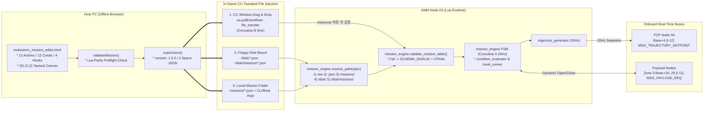

# AMM WebUI Mission Editor (호스트 PC 외부 비주얼 미션 에디터) 상세 규격서

> **AMM WebUI Mission Editor: Zero-Install Browser-Based Visual Mission Authoring Tool**  
> **대상 상위 시스템**: `AMM (Aircraft Mission Manager / Node 03 — Layer 3 Planning)`  
> **프로젝트**: Universal Autonomous Flight Stack (UAFS Ecosystem)  
> **실행 환경**: Host PC Standard Desktop Browser (`file://` Offline Single-File HTML5/CSS/Vanilla JS) $\to$ CC:Tweaked `file_transfer` / `/disk/` / `missions/`

| 항목 | 내용 |
| :--- | :--- |
| **문서 상태 (Status)** | `Draft` |
| **문서 버전 (Version)** | `v0.1.0` |
| **최종 수정일 (Date)** | `2026-11-12` |
| **구현 코드 (Source)** | `tools/amm_mission_editor.html` |
| **주관 도메인 (Domain)** | 임무 계획 외부 웹 GUI 미션 에디터 (AMM Companion Tool / Host PC) |

> **연관 문서**:
> - [AMM_PROGRAM_SPECIFICATION.md](AMM_PROGRAM_SPECIFICATION.md) (AMM 항공 임무 관리자 v1.3.0 Approved)
> - [AUTONOMOUS_FLIGHT_SYSTEM_ARCHITECTURE_AND_ICD.md](../../../system/AUTONOMOUS_FLIGHT_SYSTEM_ARCHITECTURE_AND_ICD.md) (마스터 ICD v1.28.0 Approved)
> - [SYSTEM_PROGRAM_RELATION_AND_PACKET_DIAGRAM.md](../../../system/SYSTEM_PROGRAM_RELATION_AND_PACKET_DIAGRAM.md) (전체 구조도 v2.13.0 Approved)
> - [GEMINI.md](../../../../GEMINI.md) (전역 컨텍스트 및 규칙)

### Revision History

| 버전 | 개정 일자 | 개정 요약 | 개정 사유 |
| :---: | :---: | :--- | :--- |
| `v0.1.0` | `2026-11-12` | `AMM WebUI Mission Editor`(`tools/amm_mission_editor.html`) 상세 규격 초안(`Draft`) 최초 작성: `AMM v1.3.0` / `ICD v1.28.0` / `Diagram v2.13.0` 기준 외부 파일 파이프라인, Industrial Avionics UI 레이아웃, 미션 상태 모델(`version: "1.3.0"` 및 `v1.0.0`~`v1.2.0` 임포트), 13종 액션·12종 조건·4종 훅 빌더, Lua 동등성 프리플라이트 검증기, 2D `(X, Z)` 전술 캔버스, JSON 입출력 및 `TASK-402` 인수 기준 명세 | `TASK-202-5` 사양 수립 (`tools/amm_mission_editor.html` 구현은 `TASK-402`로 분리) |

---

## 1. 프로그램 개요 및 불변 제약 (Overview, Constraints & Non-Goals)

### 1.1 목적 및 기능 범위
`tools/amm_mission_editor.html`은 마인크래프트 CC:Tweaked 인게임 `51x19` 터미널의 해상도 한계 밖에서, 호스트 PC 브라우저를 통해 `AMM (Node 03)`의 다중 체크포인트 미션 JSON 파일을 시각적으로 설계·검증·입출력하는 **독립형 오프라인 웹 GUI 컴패니언 도구**입니다.

1. **AMM 미션 스키마 동등성**: `AMM_PROGRAM_SPECIFICATION.md` (`v1.3.0 Approved`) §6·§9가 정의한 **13종 체크포인트 액션(활성 9종 + 예약 4종)**, **12종 `completeWhen`/`abortWhen` 조건**, **4종 `onEnter`/`onExit`/`onAbort` 라이프사이클 훅**, **하위 호환 `v1.0.0` `items[]` 업그레이드** 및 **`v1.1.0` / `v1.2.0` 임포트 정규화**를 지원합니다.
2. **2D `(X, Z)` 전술 경로 시각화**: 마인크래프트 수평 좌표계($+X$ 동쪽, $-Z$ 북쪽) 위에서 웨이포인트, 도달 허용 반경(`acceptanceRadius`), `ORBIT` 선회 원, `PATROL` 순찰 루프, `POI_HOLD` 조준선을 실시간 렌더링하고 마우스 클릭·드래그로 좌표를 편집합니다.
3. **실시간 프리플라이트 검증**: 온보드 `mission_engine.validate_mission_table` 및 `normalize_checkpoint` 규칙과 동등한 정적 검증(`validateMission()`)을 편집 즉시 실행해, 인게임 투입 전 `CP#idx` 단위 오류와 예약(`DEFERRED`) 경고를 사전 검출합니다.

### 1.2 불변 제약 (Hard Constraints)
- **무설치(Zero-Install) 단일 파일 구조**: `tools/amm_mission_editor.html`은 별도 빌드 도구, 로컬 HTTP 서버, npm 패키지 없이 단일 `.html` 파일(인라인 `<style>` + `<script>`)로 완결되어야 하며 `file://` 프로토콜에서 즉시 열려야 합니다.
- **외부 네트워크·CDN 차단**: `<script src="http...">`, `<link href="https...">`, Google Fonts, `fetch()`, `XMLHttpRequest`, `WebSocket` 등 어떠한 외부 네트워크 요청도 허용하지 않습니다.
- **DOM XSS 안전성**: 사용자가 불러오거나 붙여넣은 미션 JSON 내부 문자열(`missionId`, `description`, `checkpointId`, `facilityId`, `command`, `message`, 오류 문구 등)을 DOM에 출력할 때는 반드시 `document.createElement` + `textContent` (또는 `value`)만 사용하며, 비신뢰 문자열을 `innerHTML` / `insertAdjacentHTML`에 직접 결합하지 않습니다.
- **생태계 용어 및 금지 모드 준수**: `.agent/rules/domain-aeronautics.md`의 금지 모드·네임스페이스 및 `tests/harness/test_terminology_guard.py`의 금지 구버전 용어를 UI·주석·식별자 어디에도 포함하지 않습니다.

### 1.3 비목표 (Non-Goals)
- 인게임 CC:Tweaked 모뎀 RF 채널(`Base+0..5`, `50000..60002`)과의 실시간 소켓 브리지 또는 실시간 텔레메트리 스트리밍은 범위 밖입니다.
- 3D WebGL 지형 렌더링이나 마인크래프트 월드 세이브(`.mca`) 직접 파싱은 수행하지 않습니다.
- `src/3_planning/amm/` 온보드 Lua 코드 수정은 본 사양서 범위(`TASK-202-5` / `TASK-402`)에 포함되지 않습니다.

---

## 2. 시스템 연동 및 외부 파일 파이프라인 (System Context & In-Game Workflow)

### 2.1 호스트 PC $\to$ AMM 인게임 구동 파이프라인 (`AMM v1.3.0`)
`tools/amm_mission_editor.html`에서 내보낸 `.json` 미션 파일은 3대 외부 파일 주입 경로를 통해 `AMM (Node 03)`으로 전달되며, `AMM v1.3.0`의 듀얼 코루틴(`Coroutine B 5Hz` / `Coroutine A 20Hz`)과 `trajectory_generator`를 거쳐 `FCP (Node 04)` `Base+4` (`[I-12]`) 및 `Zone 3` (`Base+20~29`, `[I-11]`)로 집행됩니다.



### 2.2 설정 기준선 및 RF 채널 프리뷰 계산식
- **기본값 기준선 (`AMM v1.3.0` §10.2 `config/amm_config.json`)**:
  - `channels.baseChannel`: `10000` (기체 블록 번호 $N = 1$, 대역폭 `40`)
  - `trajectory.defaultAlt`: `150.0` m
  - `trajectory.defaultSpeed`: `18.0` m/s
  - `trajectory.arrivalRadius`: `15.0` m
  - *(과도기 참고)* `TASK-202-4` 기준 현행 디스크 내 `src/3_planning/amm/config/amm_config.json` (`v1.0.0`)은 평면 키(`baseChannel`, `defaultAlt`, `defaultSpeed`, `arrivalRadius`)를 사용하며, `TASK-207`에서 `v1.3.0` 중첩 키로 이행됩니다. 에디터 UI는 사용자 편의를 위해 기체 번호 $N$ (`1..1000`)과 `baseChannel` 프리뷰만 보조 계산하며, 내보내는 미션 JSON에는 하드웨어 설정 키를 혼입하지 않습니다.
- **Zone 3 RF 채널 계산식 (`Base` 프리뷰)**:
  - $\text{Base} = 10000 + (N - 1) \times 40 \quad (1 \le N \le 1000)$
  - $\text{Zone 3} = \text{Base} + \text{channelOffset} \quad (20 \le \text{channelOffset} \le 29)$
  - 예: $N = 1$ ($\text{Base} = 10000$), `channelOffset = 20` $\to$ `CH 10020`.

---

## 3. UI 레이아웃, 디자인 시스템 및 반응형 규격 (Layout Shell & Design Tokens)

### 3.1 Industrial Avionics Dark Cockpit 디자인 토큰
에디터는 장시간 미션 설계 시 시인성을 확보하기 위해 고대비 다크 조종석 팔레트와 고정폭 계측 폰트를 사용합니다. 상태 배지는 색상 단독 구분을 피하고 반드시 텍스트 아이콘/태그(`[OK]`, `[ERR]`, `[DEF]`)를 병기합니다.

| CSS 변수명 | HEX 값 | 용도 |
| :--- | :---: | :--- |
| `--bg-app` | `#0b0f17` | 최상위 앱 배경 |
| `--bg-panel` | `#111827` | 좌측 레일, 우측 인스펙터, 상/하단 바 배경 |
| `--bg-elevated` | `#1b2434` | 카드, 입력 필드, 드롭다운, JSON 드로어 배경 |
| `--border-default` | `#2b394e` | 패널 및 카드 경계선 (`1px solid`) |
| `--text-primary` | `#e5edf7` | 본문 및 주요 수치 텍스트 |
| `--text-muted` | `#94a3b8` | 보조 설명, 한국어 툴팁, 비활성 라벨 |
| `--accent-cyan` | `#22d3ee` | 선택된 체크포인트, 활성 도구, 수평 경로 강조 |
| `--accent-amber` | `#f59e0b` | `DEFERRED` 경고, `POI_HOLD` 조준선, `ORBIT` 주의 배지 |
| `--accent-green` | `#10b981` | 프리플라이트 검증 통과(`[OK]`), Active 배지 |
| `--accent-red` | `#ef4444` | 스키마 오류(`[ERR]`), 삭제/중단(`abortWhen`) 강조 |
| `--accent-violet` | `#a78bfa` | `PAYLOAD_ACTION` / `Zone 3` 탑재체 배지 |

- **폰트 스택**:
  - 일반 UI 라벨: `system-ui, -apple-system, "Segoe UI", sans-serif`
  - 좌표/채널/JSON/ID 계측 데이터: `"JetBrains Mono", "Cascadia Code", Consolas, monospace` (`font-variant-numeric: tabular-nums`)

### 3.2 언어 표기 정책 (English Cockpit Labels + Bilingual Tooltips)
- **주 UI 라벨·버튼·배지**: 조종석 계기판 및 `AMM` Lua/JSON 키와의 일관성을 위해 **영문**(`Mission ID`, `Execution Mode`, `Fallback Policy`, `Add Checkpoint`, `Preflight Valid`, `Export .json`, `Fit All`)으로 표기합니다.
- **보조 설명 및 툴팁(`title` / 인라인 힌트)**: 한국어 사용자가 즉시 이해할 수 있도록 파라미터 설명, 경고 사유, `DEFERRED` 안내, 단축키 가이드는 **한/영 혼합**으로 제공합니다(예: `Acceptance Radius (m) — 도달 허용 반경; FLY_TO default 5.0m`).

### 3.3 5영역 워크스페이스 레이아웃
전체 뷰포트(`100vh`, `overflow: hidden`)는 CSS Grid 5개 영역으로 구성합니다:

1. **Top Action & Mission Header Bar (`52px`)**:
   - 좌측: 앱 타이틀(`AMM MISSION EDITOR`), `Mission ID` 입력, `Execution Mode` 토글(`SINGLE` / `REPEAT`), `Fallback Policy` 선택(`RTH` / `HOVER_HOLD` / `LOITER` / `SKIP_NEXT`), `Aircraft #N (Base)` 프리뷰 입력.
   - 우측: `Undo` / `Redo`, `Presets` 드롭다운, `Import .json`, `Raw JSON` 드로어 토글, `Copy JSON`, `Export .json`.
2. **Left Checkpoint Sequence Rail (`300px`)**:
   - 상단 헤더: `CHECKPOINTS (N)` 카운터, `+ Add` 버튼(그룹별 액션 선택 또는 즉시 추가).
   - 스크롤 가능한 수직 카드 목록: 순번(`#1..#N`), `checkpointId`, 액션 배지(`NAV` / `INFRA` / `SPECIAL` / `DEFERRED`), 상태 테두리(`[ERR]` 빨강 / `[DEF]` 주황 / `[OK]` 초록), 상하 이동(`▲`/`▼`)·복제·삭제 버튼, 드래그 재정렬 핸들.
3. **Center Interactive 2D `(X, Z)` Tactical Canvas (`1fr`, 최소 `420px`)**:
   - 상단 플로팅 툴바: 도구 선택(`SELECT`, `ADD_FLY_OVER`, `PICK_TARGET`, `PICK_POI`, `ADD_PATROL_WP`), `Grid Snap`(`Off | 1m | 10m | 50m`), `Fit All`, `Zoom +/-`.
   - 좌상단 텔레메트리 HUD 오버레이: `Cursor (X, Z)`, `Zoom`, `Legs`, `2D Path (m)`, `Est. Time (s)`.
4. **Right Inspector & JSON Drawer (`420px`)**:
   - 상단 탭 또는 아코디언: **`Checkpoint Inspector`** (`Params` / `Complete` / `Abort` / `Hooks [onEnter|onExit|onAbort]`) 및 **`Mission Defaults`** (`version`, `description`, `defaults.*`).
   - 하단/사이드 접이식 **`Raw JSON Drawer`**: 실시간 2-space JSON 미리보기, 수동 편집 후 `Apply JSON` 적용 버튼, 동기화 상태 표시.
5. **Bottom Preflight Validation Bar (`32px` 축소 / `180px` 확장 드로어)**:
   - 요약 바: `[PASS] 0 Errors, N Warnings` 또는 `[FAIL] E Errors, W Warnings` + 드로어 확장 토글.
   - 확장 목록: 클릭 시 해당 `CP#idx` 체크포인트를 선택하고 캔버스를 해당 좌표로 이동시키는 이슈 칩(`SEVERITY | CODE | CP#idx | Message`).

### 3.4 반응형 및 접근성 규격
- **반응형 분기 (`@media (max-width: 1150px)`)**: 뷰포트 너비가 `1150px` 미만이면 3열 레이아웃을 전환해 상단 바 + 레일(`260px`) + 중앙 영역(상단 탭으로 `2D Canvas` / `Inspector` 전환)으로 배치하여 입력 폼이 찌그러지지 않도록 합니다.
- **키보드 접근성**: 모든 버튼·입력·도구 토글에 명확한 `aria-label`과 `:focus-visible` `2px solid var(--accent-cyan)` 포커스 링을 부여합니다.

---

## 4. 에디터 상태 모델, 하위 호환 변환 및 영속성 (§4)

### 4.1 정규 내부 상태 객체 (`EditorState`)
에디터 스토어는 단일 불변 스냅샷 기반 `EditorState`를 유지하며, 모든 편집 액션은 `mission`과 `selectedIndex`의 깊은 복사본(`structuredClone` 또는 JSON 안전 복제)을 실행 취소 스택에 적재한 뒤 상태를 갱신합니다.

```json
{
  "mission": {
    "missionId": "SORTIE_ALPHA",
    "version": "1.3.0",
    "description": "",
    "executionMode": "SINGLE",
    "fallbackPolicy": "RTH",
    "defaults": {
      "cruiseSpeed": 18.0,
      "targetAlt": 150.0,
      "acceptanceRadius": 15.0,
      "headingMode": "AUTO"
    },
    "checkpoints": []
  },
  "ui": {
    "selectedIndex": 0,
    "selectedPatrolIndex": null,
    "activeInspectorTab": "PARAMS",
    "activeHookTab": "onEnter",
    "rawJsonOpen": false,
    "validationExpanded": false,
    "activeTool": "SELECT",
    "gridSnapM": 10,
    "aircraftBlockNumber": 1,
    "baseChannel": 10000,
    "dirty": false,
    "importedFromVersion": null
  },
  "canvas": {
    "camX": 0,
    "camZ": 0,
    "zoomPxPerM": 0.4,
    "draggingNode": null,
    "isPanning": false
  },
  "history": {
    "undoStack": [],
    "redoStack": [],
    "maxDepth": 50
  }
}
```

- **미지 필드 보존 (`_extra` Preservation)**: 수기 편집된 미션 JSON을 불러올 때 최상위, `defaults`, 개별 체크포인트, `params`, 조건 객체, 훅 객체에 존재하는 비표준/확장 키(예: 향후 `TASK-204` 진입 조건 메타데이터나 사용자 메모)는 내부 `_extra` 맵에 보존하고 `exportJson()` 시 원래 위치에 병합 출력합니다. 단, 아래 정규화 대상 단축 좌표(`params.x`, `params.z`)는 `params.targetPos`로 승격한 뒤 출력에서 제거합니다.

### 4.2 버전 호환 임포트 및 레거시 `v1.0.0` 자동 업그레이드 (`convertLegacyItems`)
1. **체크포인트 기반 스키마 (`v1.1.0` / `v1.2.0` / `v1.3.0`)**:
   - `Array.isArray(raw.checkpoints)`가 참이면 체크포인트 스키마로 간주합니다.
   - 원본 `raw.version`이 `"1.1.0"` 또는 `"1.2.0"`인 경우 `ui.importedFromVersion`에 원본 버전을 기록하고 툴바 배지로 안내하며, 내보내기(`exportJson`) 시 표준 `"version": "1.3.0"`으로 정규화합니다. *(참고: 현행 온보드 `mission_engine.lua` `v1.2.0`은 임의의 `version` 문자열을 수용하며, `TASK-207`/`TASK-402`에서 `1.3.0` 기준과 정합화됩니다.)*
2. **레거시 `v1.0.0` 단순 큐 변환 (`convertLegacyItems(raw)`)**:
   - `Array.isArray(raw.items) && !Array.isArray(raw.checkpoints)` 조건 감지 시 `mission_engine.lua`의 `convert_legacy_items`와 동일한 규칙으로 즉시 업그레이드합니다:
     - 각 `item[i]` $\to$ `{ checkpointId: formatCpId(item.id ?? i + 1), action: "FLY_OVER", params: { targetPos: { x: item.x, z: item.z }, ...(isFiniteNum(item.alt) && { targetAlt: item.alt }), ...(isFiniteNum(item.speed) && { cruiseSpeed: item.speed }) } }` (`formatCpId(n)`은 정수 시 `CP_%02d`, 문자열 시 그대로 사용).
     - 마지막 원소 `last = raw.items[raw.items.length - 1]`에 비어 있지 않은 문자열 `last.facilityId`가 있으면 후속 체크포인트 `{ checkpointId: formatCpId(checkpoints.length + 1), action: "LAND_LAUNCHPAD", params: { facilityId: last.facilityId, targetPos: { x: last.x, z: last.z }, ...(isFiniteNum(last.alt) && { targetAlt: last.alt }) } }`를 자동 추가합니다.
     - 상단 `missionId = raw.missionId || "LEGACY_MISSION"`, `version = "1.3.0"`, `executionMode = raw.executionMode || "SINGLE"`, `fallbackPolicy = raw.fallbackPolicy || "RTH"`, `defaults = raw.defaults || defaultMissionDefaults()`를 설정하고 비차단 토스트(`"Legacy v1.0.0 queue upgraded to v1.3.0 checkpoints"`)를 표출합니다.

### 4.3 단축 좌표 정규화 (`params.{x, z}` $\to$ `params.targetPos`)
`TASK-202-4` `mission_engine.extract_target_pos`와 동등하게, 임포트된 체크포인트의 `params`에 `params.targetPos`가 없고 유한 수치 `params.x`와 `params.z`가 존재하면 즉시 `params.targetPos = { x: params.x, z: params.z }`로 승격하고 임시 `params.x`, `params.z` 키는 제거합니다.

### 4.4 브라우저 자동 저장 및 복구 (`localStorage`)
- **저장 키**: `uafs_amm_editor_autosave_v1`
- **디바운스 주기**: 상태 변경 후 `500ms` 디바운스 기록 (`{ savedAtIso, mission }`, `localStorage` 비활성 환경에서는 예외를 삼키고 메모리 내 동작 유지).
- **초기 복구 배너**: 페이지 로드 시 저장된 초안이 기본 스타터 템플릿과 다르면 사용자 작업물을 묵시적으로 덮어쓰지 않고 상단 비차단 복구 배너(`[Restore Draft]` / `[Dismiss]`)를 표출합니다.

---

## 5. 미션 헤더 및 13종 체크포인트 액션 폼 매트릭스 (§5)

### 5.1 미션 헤더 및 전역 기본값 (`defaults`) 입력 규격

| JSON 필드 경로 | 타입 | 기본값 | UI 컨트롤 | 설명 및 제약 |
| :--- | :---: | :---: | :--- | :--- |
| `missionId` | `string` | `"SORTIE_ALPHA"` | Text Input | 파일명 기본값(`${missionId.toLowerCase()}.json`) 및 식별자 |
| `version` | `string` | `"1.3.0"` | Readonly / Badge Input | 표준 `"1.3.0"` 출력 (`v1.1.0`/`v1.2.0` 임포트 시 업그레이드 표기) |
| `description` | `string` | `""` | Text Input (Optional) | 임무 설명 (빈 문자열이면 export 시 생략 가능) |
| `executionMode` | `enum` | `"SINGLE"` | Segmented Toggle | `"SINGLE"` \| `"REPEAT"` |
| `fallbackPolicy` | `enum` | `"RTH"` | Select | `"RTH"` \| `"HOVER_HOLD"` \| `"LOITER"` \| `"SKIP_NEXT"` |
| `defaults.cruiseSpeed` | `number` | `18.0` | Number (`step=0.5`, `>0`) | 하위 체크포인트 미지정 시 상속되는 기본 순항 속도 (m/s) |
| `defaults.targetAlt` | `number` | `150.0` | Number (`step=5`) | 하위 체크포인트 미지정 시 상속되는 기본 순항 고도 (m) |
| `defaults.acceptanceRadius` | `number` | `15.0` | Number (`step=1`, `>0`) | `FLY_OVER` 등의 기본 수평 도달 반경 (m) |
| `defaults.headingMode` | `enum` | `"AUTO"` | Select | `"AUTO"` \| `"FIXED"` \| `"POI"` |

### 5.2 체크포인트 엔벨로프 및 시퀀스 레일 제어
- **공통 헤더 필드**:
  - `checkpointId` (`string`): 자동 생성(`CP_01`, `CP_02`, ...), 사용자 수정 가능.
  - `action` (`enum`): 4개 `<optgroup>`으로 분류하여 선택:
    - `1. Navigation (Active 5)`: `FLY_OVER`, `FLY_TO`, `ORBIT`, `PATROL`, `POI_HOLD`
    - `2A. Infrastructure (Active 2)`: `TAKEOFF_LAUNCHPAD`, `LAND_LAUNCHPAD`
    - `3. Special Devices (Active 2)`: `PAYLOAD_ACTION`, `REDSTONE_ACTION`
    - `2B. Infrastructure (Deferred 4)`: `TAKEOFF_RUNWAY`, `LAND_RUNWAY`, `DOCK_ARM`, `UNDOCK_ARM`
  - `fallbackPolicy` (선택 오버라이드): `(Inherit Mission)`(저장 시 키 생략) | `"RTH"` | `"HOVER_HOLD"` | `"LOITER"` | `"SKIP_NEXT"`.
- **시퀀스 제어**: `+ Add`, `Duplicate` (`_copy` ID 생성), `Delete`, `Move Up` (`▲`), `Move Down` (`▼`), Drag-to-Reorder. 순서 변경 시 배열 인덱스를 즉시 재계산하고 `validateMission()`을 재실행합니다.
- **액션 전환 시 필드 정리 정책**: 사용자가 기존 체크포인트의 `action`을 변경하면 이전 액션 전용 잔존 필드를 정리(신규 액션 스키마에 유효한 공통 필드 `targetPos`, `targetAlt`, `cruiseSpeed`는 가급적 보존)해 불필요한 잉여 키가 남지 않게 합니다.

### 5.3 13종 체크포인트 액션 파라미터 매트릭스

| 액션 (`action`) | 상태 | JSON 키 경로 (`params.*`) | 타입 / UI 위젯 | 기본값 및 상속 규칙 | 검증 규칙 |
| :--- | :---: | :--- | :--- | :--- | :--- |
| **`FLY_OVER`** | Active | `targetPos.{x, z}`<br/>`targetAlt`<br/>`cruiseSpeed`<br/>`acceptanceRadius`<br/>`headingMode`<br/>`fixedHeading` | Number Pair<br/>Number (opt)<br/>Number (opt)<br/>Number (opt)<br/>Select (opt)<br/>Number (`0..360`) | 필수<br/>상속 `defaults.targetAlt`<br/>상속 `defaults.cruiseSpeed`<br/>상속 `defaults.acceptanceRadius` (최후 `20.0`)<br/>상속 `defaults.headingMode`<br/>유효 `headingMode == "FIXED"`일 때 노출 | `targetPos.{x,z}` 유한 실수 필수<br/>`acceptanceRadius > 0`<br/>`cruiseSpeed > 0` (지정 시) |
| **`FLY_TO`** | Active | `targetPos.{x, z}`<br/>`targetAlt`<br/>`cruiseSpeed`<br/>`acceptanceRadius`<br/>`headingMode`<br/>`fixedHeading` | Number Pair<br/>Number (opt)<br/>Number (opt)<br/>Number (opt)<br/>Select (opt)<br/>Number (`0..360`) | 필수<br/>상속 `defaults.targetAlt`<br/>상속 `defaults.cruiseSpeed`<br/>**명시적 기본 `5.0` m** (`defaults.acceptanceRadius` 미상속)<br/>상속 `defaults.headingMode`<br/>유효 `headingMode == "FIXED"`일 때 노출 | `targetPos.{x,z}` 유한 실수 필수<br/>`acceptanceRadius > 0`<br/>`5.0` 플레이스홀더 강조 |
| **`ORBIT`** | Active | `targetPos.{x, z}`<br/>`radius`<br/>`direction`<br/>`durationSec`<br/>`targetAlt`<br/>`cruiseSpeed` | Number Pair<br/>Number (`>0`)<br/>Toggle (`CW`\|`CCW`)<br/>Number (`>=0`, opt)<br/>Number (opt)<br/>Number (opt) | 필수<br/>기본 `30.0` m<br/>기본 `"CW"`<br/>미지정 시 수동(`next`/`stop`) 체공<br/>상속 `defaults.targetAlt`<br/>상속 `defaults.cruiseSpeed` | `targetPos.{x,z}` 필수<br/>`radius > 0` (`< 5.0` 시 FCP/LOITER 클램프 주의 배지)<br/>`direction` ∈ `{"CW","CCW"}` |
| **`PATROL`** | Active | `waypoints[]` (`{x, z, alt?, speed?, acceptanceRadius?}`)<br/>`patrolMode`<br/>`cycles`<br/>`durationSec`<br/>`targetAlt`<br/>`cruiseSpeed`<br/>`acceptanceRadius` | 동적 행 테이블 (`Add/Del/▲/▼` + 캔버스 입력)<br/>Select (`LOOP`\|`PING_PONG`)<br/>Integer (`>=1`)<br/>Number (`>=0`, opt)<br/>Number/Select (opt) | 최소 1행 필수<br/>기본 `"LOOP"`<br/>기본 `1`<br/>미지정 시 `cycles` 기준 완주<br/>상속 `defaults.*` | `waypoints.length >= 1` 및 모든 행 `{x,z}` 유한 실수<br/>`patrolMode` ∈ `{"LOOP","PING_PONG"}`<br/>`cycles` 정수 `>= 1` |
| **`POI_HOLD`** | Active | `targetPos.{x, z}`<br/>`poiPos.{x, y?, z}`<br/>`headingMode`<br/>`durationSec`<br/>`targetAlt`<br/>`cruiseSpeed` | Number Pair<br/>Number Triple (`y` opt)<br/>Select (opt)<br/>Number (`>=0`, opt)<br/>Number (opt)<br/>Number (opt) | 체공 좌표 필수<br/>조준 표적 `x, z` 필수 (`y` opt)<br/>기본 `"POI"`<br/>미지정 시 수동 체공<br/>상속 `defaults.*` | `mission_engine.normalize_checkpoint` 기준 `targetPos.{x,z}` 및 `poiPos.{x,z}` 모두 필수 (`poiPos.y` 지정 시 유한 실수) |
| **`TAKEOFF_LAUNCHPAD`** | Active | `facilityId`<br/>`targetAlt`<br/>`targetPos.{x, z}` | Text (opt)<br/>Number (opt)<br/>Number Pair (opt) | 선택 문자열<br/>상속 `defaults.targetAlt`<br/>캔버스 이륙 마커용 선택 좌표 | `facilityId` 지정 시 비어 있지 않은 문자열<br/>`targetAlt`·`targetPos` 지정 시 유한 실수 |
| **`LAND_LAUNCHPAD`** | Active | `facilityId`<br/>`targetPos.{x, z}`<br/>`targetAlt` | Text<br/>Number Pair<br/>Number (opt) | 둘 중 **최소 1개 필수**<br/>상속 `defaults.targetAlt` | `facilityId`(비어 있지 않음) 또는 `targetPos.{x,z}` 중 1개 이상 필수 (`INVALID_LAND_PARAMS`) |
| **`PAYLOAD_ACTION`** | Active | `channelOffset` 또는 `targetChannel`<br/>`command`<br/>`commandPayload`<br/>`waitForAck`<br/>`expectedStatus` | Integer (`20..29`) / Absolute CH + `Base+offset` 프리뷰<br/>Text<br/>JSON Object Textarea<br/>Checkbox<br/>Text | 기본 `channelOffset = 20`<br/>필수 문자열<br/>기본 `"{}"` (`{}` 객체)<br/>기본 `true`<br/>기본 `"OK"` (`waitForAck==true` 활성) | `channelOffset` ∈ `[20,29]` 정수 또는 유효 `Base+20..29`<br/>`command` 비어 있지 않음<br/>`commandPayload` 유효 JSON 객체 (배열/원시값 금지) |
| **`REDSTONE_ACTION`** | Active | `mode`<br/>`side`<br/>`color`<br/>`level`<br/>`state`<br/>`durationMs`<br/>`minLevel` | Select (`EMIT`\|`WAIT_INPUT`)<br/>Select (6면)<br/>Select (16색 \| None)<br/>Integer (`0..15`, opt)<br/>Toggle (`true`/`false`)<br/>Number (`>=0`)<br/>Integer (`1..15`) | 필수<br/>필수 (`top..back`)<br/>선택 (번들 출력/입력)<br/>아날로그 `EMIT` 시 사용<br/>디지털 `EMIT` 기본 `true`<br/>기본 `0` (`EMIT` 펄스 ms)<br/>기본 `1` (`WAIT_INPUT`) | `mode` ∈ `{"EMIT","WAIT_INPUT"}`<br/>`side` ∈ 6면<br/>`durationMs >= 0`<br/>`color` 지정 시 16색 중 하나 |
| **`TAKEOFF_RUNWAY`**<br/>**`LAND_RUNWAY`**<br/>**`DOCK_ARM`**<br/>**`UNDOCK_ARM`** | `DEFERRED` | `facilityId`<br/>`targetPos.{x, z}`<br/>`targetAlt` | 상단 Amber 배너 + Text (opt) / Number Pair (opt) / Number (opt) | `TASK-103/104` 미구현으로 런타임 진입 시 `DEFERRED_ACTION_UNSUPPORTED` 거부 안내 | 구조 오류 아님(`WARNING`: `DEFERRED_ACTION_UNSUPPORTED` 표출) |

---

## 6. 12종 조건 빌더 및 4종 라이프사이클 훅 빌더 (§6)

### 6.1 복합 조건 그룹 (`completeWhen` / `abortWhen`) 및 빈 그룹 생략 규칙
- **논리 결합자 (`logic`)**: `completeWhen` 기본값 `"ALL"`(AND), `abortWhen` 기본값 `"ANY"`(OR).
- **빈 조건 그룹 생략 규칙 (Empty Group Omission Trap Prevention)**:
  - 온보드 `condition_evaluator.evaluate_group(group, ctx, ...)`는 `conditions`가 빈 배열(`{}`)일 때 기본 조건으로 폴백하지 않고 `false`를 반환합니다.
  - 따라서 UI에서 `conditions.length === 0`인 `completeWhen` 또는 `abortWhen`은 인스펙터에 `"Default completion active (no custom override)"` / `"No abort conditions"` 배너로 표시하고, **`exportJson()` 시 `completeWhen` / `abortWhen` 키 자체를 JSON에서 생략**합니다(기존 JSON에 명시적 `{ logic, conditions: [] }`가 들어온 경우 검증 경고를 표시).

#### 액션별 기본 `completeWhen` 프리뷰 (`AMM v1.3.0` §6.3 / `condition_evaluator.resolve_default_complete`)
| 액션 (`action`) | `completeWhen` 생략 시 온보드 엔진 자동 적용 조건 |
| :--- | :--- |
| **`FLY_OVER`** | `{ logic: "ALL", conditions: [{ type: "PROXIMITY_2D", toleranceM: acceptanceRadius (20.0) }] }` |
| **`FLY_TO`** | `{ logic: "ALL", conditions: [{ type: "PROXIMITY_3D", toleranceM: params.acceptanceRadius ?? 5.0 }] }` |
| **`TAKEOFF_LAUNCHPAD`** | `{ logic: "ANY", conditions: [{ type: "ALTITUDE_REACHED", toleranceM: 5.0, allowFsmCruise: true }] }` (`flightMode == "CRUISE"` 전이 시에도 완료 인정) |
| **`LAND_LAUNCHPAD`** | `{ logic: "ALL", conditions: [{ type: "FACILITY_TOUCHDOWN", facilityId }] }` |
| **`ORBIT` / `POI_HOLD`** | `params.durationSec` 지정 시 `DURATION_SEC`, 미지정 시 `HOLD/MANUAL` (`next`/`stop` 명령까지 체공) |
| **`PATROL`** | `params.durationSec` 지정 시 `DURATION_SEC`, 미지정 시 `cycles`회 순환 완주(`patrolCompleted`) |
| **`PAYLOAD_ACTION`** | `waitForAck == false`이면 `DURATION_SEC(0)`, 기본(`true`)이면 `PAYLOAD_RESP_MATCH` (`expectedStatus = params.expectedStatus ?? "OK"`) |
| **`REDSTONE_ACTION`** | `mode == "EMIT"`이면 `DURATION_SEC(durationMs / 1000)`, `mode == "WAIT_INPUT"`이면 `REDSTONE_INPUT_HIGH` |

### 6.2 12종 조건 타입 입력 매트릭스

| 조건 타입 (`type`) | 파라미터 키 및 UI 컨트롤 | 기본값 / 제약 | 비고 |
| :--- | :--- | :---: | :--- |
| **`PROXIMITY_2D`** | `toleranceM` (Number, opt), `targetPos.{x, z}` (opt override) | 기본 `acceptanceRadius` (`>= 0`) | 2D 수평 도달 |
| **`PROXIMITY_3D`** | `toleranceM` (Number, opt), `targetPos.{x, z}` (opt), `targetAlt` (opt) | 기본 `5.0` (`>= 0`) | 3D 정밀 도달 |
| **`ALTITUDE_REACHED`** | `toleranceM` (Number, opt), `targetAlt` (opt), `allowFsmCruise` (Checkbox) | 기본 `5.0` (`>= 0`) | 목표 고도 도달 |
| **`DURATION_SEC`** | `durationSec` (Number, 필수) | `>= 0` (초) | 스텝 경과 시간 |
| **`TIMEOUT_SEC`** | `timeout` (Number, 필수 — **키 명칭 `timeoutSec` 아님**) | `>= 0` (초) | 주로 `abortWhen` 타임아웃 |
| **`FUEL_LEVEL_BELOW`** | `threshold` (Number, `step=0.05`) | `0.0 .. 1.0` | 잔여 연료 하한 미만/이하 중단 |
| **`FACILITY_TOUCHDOWN`** | `facilityId` (Text, opt) | 선택 문자열 | 착륙 접지(`DISARMED`) |
| **`PAYLOAD_RESP_MATCH`** | `expectedStatus` (Text), `command` (Text, opt), `checkpointId` (Text, opt) | 기본 `"OK"` | Zone 3 `MSG_PAYLOAD_ACK` 일치 |
| **`REDSTONE_INPUT_HIGH`** | `side` (Select 6면, 필수), `color` (16색 opt), `minLevel` (Int `1..15`, opt) | `minLevel` 기본 `1` | 번들 또는 아날로그/디지털 입력 |
| **`CROSS_TRACK_ERROR`** | `maxDevM` (Number, 필수) | `>= 0` (m) | 경로 이탈 오차 초과(`abortWhen`) |
| **`ARM_DOCKED`** | `facilityId` (Text, opt) | `[DEFERRED / TASK-104]` 배지 | 도킹암 결합 완료 |
| **`ARM_RELEASED`** | `facilityId` (Text, opt) | `[DEFERRED / TASK-104]` 배지 | 도킹암 분리 완료 |

### 6.3 3-Tab 라이프사이클 훅 빌더 (`onEnter`, `onExit`, `onAbort`) 및 16색 레퍼런스
각 체크포인트는 `onEnter`, `onExit`, `onAbort` 탭별로 0-tick 훅 배열을 구성할 수 있습니다. (빈 배열인 탭은 `exportJson()` 시 키를 생략합니다.)

| 훅 타입 (`type`) | 파라미터 키 및 UI 컨트롤 | 기본값 / 제약 | 주의사항 |
| :--- | :--- | :---: | :--- |
| **`REDSTONE_SET`** | `side` (6면 필수), `state` (Checkbox), `color` (16색 opt), `level` (Int `0..15`, opt) | `state = true` | `color` 지정 시 번들, `level` 지정 시 아날로그, 둘 다 없으면 디지털 |
| **`REDSTONE_PULSE`** | `side` (6면 필수), `durationMs` (Number `>=0`), `color` (16색 opt), `level` (Int `0..15`, opt) | `durationMs = 500` | 비차단 데드라인 펄스 큐 등록 |
| **`ZONE3_PAYLOAD_CMD`** | `channelOffset` (`20..29`) / `targetChannel` (`Base+20..29`), `command` (Text 필수), `payload` (JSON Object Textarea) | `channelOffset = 20`, `payload = {}` | 훅은 `hook.payload` 키 사용 (`PAYLOAD_ACTION`의 `params.commandPayload`와 구분) |
| **`NOTIFY_OPERATOR`** | `level` (`"INFO"` \| `"WARN"` \| `"CRITICAL"`), `message` (Text) | `level = "INFO"` | AMM TUI 17행 배너 알림 |

#### CC:Tweaked 16색 번들 케이블 색상 표 (`hook_runner.lua` `colors[color]` 문자열 직렬화)
| 색상 키 (`color`) | 스와치 HEX | 색상 키 (`color`) | 스와치 HEX |
| :--- | :---: | :--- | :---: |
| `white` | `#F0F0F0` | `lightGray` | `#999999` |
| `orange` | `#F2B233` | `cyan` | `#4C99B2` |
| `magenta` | `#E57FD8` | `purple` | `#B266E5` |
| `lightBlue` | `#99B2F2` | `blue` | `#3366CC` |
| `yellow` | `#DEDE6C` | `brown` | `#7F664C` |
| `lime` | `#7FCC19` | `green` | `#57A64E` |
| `pink` | `#F2B2CC` | `red` | `#CC4C4C` |
| `gray` | `#4C4C4C` | `black` | `#111111` |

---

## 7. 실시간 프리플라이트 스키마 검증 엔진 (§7)

### 7.1 `validateMission(mission, opts)` 반환 계약
에디터는 모든 상태 변경 직후 동기식으로 `validateMission(mission, { baseChannel })`를 실행(`5ms` 이내)하며 다음 구조를 반환합니다:

```ts
type ValidationIssue = {
  severity: "ERROR" | "WARNING";
  code: string;
  luaCode?: string;        // 대응하는 mission_engine.lua 오류/상수 코드
  cpIndex: number | null;  // 1-based 체크포인트 인덱스 (미션 전역이면 null)
  checkpointId: string | null;
  fieldPath: string;       // 예: "checkpoints[2].params.commandPayload"
  message: string;         // 한/영 요약 메시지
};
// return { valid: errors.length === 0, errors, warnings }
```

- **구조 검증 vs 런타임 `DEFERRED` 분리**: 온보드 `mission_engine.validate_mission_table`과 동일하게 예약 4종(`TAKEOFF_RUNWAY`, `LAND_RUNWAY`, `DOCK_ARM`, `UNDOCK_ARM`)은 `ERROR`가 아닌 `WARNING` (`DEFERRED_ACTION_UNSUPPORTED`)으로 분류하여 파일 저장 및 내보내기를 허용하되, 온보드 시퀀서 진입 시 안전 중단됨을 명시합니다.

### 7.2 오류 및 경고 카탈로그 (Lua 동등성 매핑)

| 심각도 | 에디터 코드 (`code`) | Lua 대응 코드 (`mission_engine`) | 트리거 조건 |
| :---: | :--- | :--- | :--- |
| `ERROR` | `EMPTY_CHECKPOINTS` | `EMPTY_CHECKPOINTS` | `checkpoints.length === 0` |
| `ERROR` | `INVALID_EXECUTION_MODE` | `INVALID_EXECUTION_MODE` | `executionMode` ∉ `{"SINGLE","REPEAT"}` |
| `ERROR` | `INVALID_FALLBACK_POLICY` | `INVALID_FALLBACK_POLICY` | `fallbackPolicy` ∉ `{"RTH","HOVER_HOLD","LOITER","SKIP_NEXT"}` |
| `ERROR` | `UNKNOWN_ACTION` | `UNKNOWN_ACTION` | `action` ∉ 13종 표준 액션 |
| `ERROR` | `INVALID_TARGET_POS` | `INVALID_TARGET_POS` | `FLY_OVER`/`FLY_TO`/`ORBIT`/`POI_HOLD`의 `targetPos.{x,z}` 누락 또는 비유한수 (`TAKEOFF`/`LAND` 지정 시 오타 포함) |
| `ERROR` | `INVALID_ACCEPTANCE_RADIUS` | `INVALID_ACCEPTANCE_RADIUS` | `acceptanceRadius <= 0` 또는 비유한수 |
| `ERROR` | `INVALID_TARGET_ALT` | `INVALID_TARGET_ALT` | `targetAlt` 지정 시 비유한수 |
| `ERROR` | `INVALID_FACILITY_ID` | `INVALID_FACILITY_ID` | `facilityId` 지정 시 빈 문자열 또는 비문자열 |
| `ERROR` | `INVALID_ORBIT_RADIUS` | `INVALID_ORBIT_RADIUS` | `ORBIT.radius <= 0` 또는 비유한수 |
| `ERROR` | `INVALID_ORBIT_DIRECTION` | `INVALID_ORBIT_DIRECTION` | `ORBIT.direction` ∉ `{"CW","CCW"}` |
| `ERROR` | `INVALID_PATROL_WAYPOINTS` | `INVALID_PATROL_WAYPOINTS` | `PATROL.waypoints` 비어 있거나 원소에 유효한 `{x,z}` 부재 |
| `ERROR` | `INVALID_PATROL_MODE` | `INVALID_PATROL_MODE` | `PATROL.patrolMode` ∉ `{"LOOP","PING_PONG"}` |
| `ERROR` | `INVALID_PATROL_CYCLES` | `INVALID_PATROL_CYCLES` | `PATROL.cycles < 1` 또는 비정수 |
| `ERROR` | `MISSING_POI_POS` | `MISSING_POI_OR_TARGET` / `MISSING_POI_POS` | `POI_HOLD.poiPos` 누락 (`normalize_checkpoint` 필수) |
| `ERROR` | `INVALID_POI_POS` | `INVALID_POI_POS` | `POI_HOLD.poiPos.{x,z}` 비유한수 또는 `poiPos.y` 비유한수 |
| `ERROR` | `INVALID_LAND_PARAMS` | `INVALID_LAND_PARAMS` | `LAND_LAUNCHPAD`에서 `facilityId`와 `targetPos` 모두 부재 |
| `ERROR` | `INVALID_ZONE3_CHANNEL` | `INVALID_ZONE3_CHANNEL` | `PAYLOAD_ACTION` / `ZONE3_PAYLOAD_CMD` 채널이 `20..29` 또는 `Base+20..29` 범위 이탈 |
| `ERROR` | `MISSING_PAYLOAD_COMMAND` | `MISSING_PAYLOAD_COMMAND` | `PAYLOAD_ACTION` 또는 `ZONE3_PAYLOAD_CMD` `command` 빈 문자열 |
| `ERROR` | `INVALID_JSON_PAYLOAD` | `INVALID_PAYLOAD` | `commandPayload` 또는 `hook.payload`가 유효 JSON 객체(`{...}`)가 아님 |
| `ERROR` | `INVALID_REDSTONE_MODE` | `INVALID_REDSTONE_MODE` | `REDSTONE_ACTION.mode` ∉ `{"EMIT","WAIT_INPUT"}` |
| `ERROR` | `INVALID_REDSTONE_SIDE` | `INVALID_REDSTONE_SIDE` | `side` ∉ `{"top","bottom","left","right","front","back"}` |
| `ERROR` | `INVALID_REDSTONE_DURATION` | `INVALID_REDSTONE_DURATION` | `durationMs < 0` 또는 비유한수 |
| `ERROR` | `INVALID_CONDITION_LOGIC` | `INVALID_LOGIC` / `INVALID_COND_BLOCK` | `logic` ∉ `{"ALL","ANY"}` 또는 그룹 형식 오류 |
| `ERROR` | `UNKNOWN_CONDITION_TYPE` | `INVALID_CONDITION_TYPE` | `cond.type` ∉ 12종 표준 조건 |
| `ERROR` | `EMPTY_CONDITION_GROUP` | *(주의: 런타임 `false` 반환)* | 임포트된 JSON에 명시적 `conditions: []` 존재 (Export 시 생략 권고) |
| `ERROR` | `INVALID_CONDITION_PARAM` | *(런타임 평가 실패 방지)* | `DURATION_SEC.durationSec < 0`, `TIMEOUT_SEC.timeout < 0`, `FUEL_LEVEL_BELOW.threshold` ∉ `[0,1]`, `CROSS_TRACK_ERROR.maxDevM < 0`, `REDSTONE_INPUT_HIGH` `side` 누락 등 |
| `ERROR` | `UNKNOWN_HOOK_TYPE` | `INVALID_HOOK_TYPE` / `INVALID_HOOK_BLOCK` | `hook.type` ∉ 4종 표준 훅 |
| `ERROR` | `INVALID_HOOK_PARAM` | *(런타임 훅 실패 방지)* | `REDSTONE_*` `side` 누락/`durationMs < 0`, `ZONE3_PAYLOAD_CMD` 채널·`command` 누락, `NOTIFY_OPERATOR` `level` 위반 |
| `WARNING` | `DEFERRED_ACTION_UNSUPPORTED` | `DEFERRED_ACTION_UNSUPPORTED` | 예약 4종 액션(`TASK-103/104` 미구현으로 런타임 거부 예정) |
| `WARNING` | `ORBIT_RADIUS_BELOW_FCP_MIN` | *(FCP `LOITER` $R \ge 5.0\text{m}$ 클램프)* | `ORBIT.radius < 5.0` |
| `WARNING` | `MISSING_DURATION_HOLD_MANUAL` | `HOLD/MANUAL` | `ORBIT`/`POI_HOLD`에 `durationSec` 및 커스텀 `completeWhen` 모두 부재(수동 `next`/`stop` 필요) |
| `WARNING` | `PATROL_SINGLE_WP_DEGENERACY` | *(단일 점 순찰)* | `PATROL.waypoints.length === 1` |

### 7.3 진단 인터랙션 규칙
- `errors.length > 0` 상태에서도 `Export .json` 버튼은 클릭 가능하게 두되, 내보내기 전 비차단 확인 대화창(`"Preflight detected N error(s). Export anyway?"`)으로 사용자 실수를 방지합니다.
- 하단 검증 바의 `CP#k` 이슈 칩을 클릭하면 즉시 `selectedIndex = k - 1`로 이동하고, 해당 체크포인트가 좌표를 가지면 캔버스 카메라(`camX, camZ`)를 해당 위치로 센터링합니다.

---

## 8. 2D `(X, Z)` 전술 경로 프리뷰 캔버스 규격 (§8)

### 8.1 마인크래프트 `(X, Z)` 아핀 좌표 변환 및 HiDPI 스케일링
- **좌표계 규약**: 마인크래프트 수평 평면에서 $+X$는 동쪽(화면 우측), $-Z$는 북쪽(화면 상단), $+Z$는 남쪽(화면 하단)입니다.
- **World $\leftrightarrow$ Screen 변환**:
  - $\text{sx} = \frac{W}{2} + (\text{wx} - \text{camX}) \cdot \text{zoom}$, $\quad \text{sy} = \frac{H}{2} + (\text{wz} - \text{camZ}) \cdot \text{zoom}$
  - $\text{wx} = \text{camX} + \frac{\text{sx} - W / 2}{\text{zoom}}$, $\quad \text{wz} = \text{camZ} + \frac{\text{sy} - H / 2}{\text{zoom}}$
  - 격자 스냅(`gridSnapM` ∈ `{0, 1, 10, 50}`): 활성 시 $v_{\text{snap}} = \text{Math.round}(v / g) \cdot g$.
- **방위각 변환**: 진북 $0^\circ$($-Z$) $\to$ 캔버스 라디안 $\theta = (\text{headingDeg} - 90) \cdot \frac{\pi}{180}$. `ORBIT`의 `CW` 회전은 화면상 시계 방향($+X \to +Z \to -X \to -Z$) 화살표로 표시합니다.
- **HiDPI 스케일링**: 리사이즈마다 `dpr = window.devicePixelRatio || 1`를 반영해 `canvas.width = rect.width * dpr`, `canvas.height = rect.height * dpr`, `ctx.setTransform(dpr, 0, 0, dpr, 0, 0)`를 적용합니다.

### 8.2 8계층 순차 렌더링 파이프라인
1. **배경 및 적응형 격자**: 줌 레벨에 따라 `10m` / `50m` / `100m` / `500m` 간격 중 화면상 `40..120px` 간격이 되는 축척 자동 선택, 원점 `(0, 0)` 십자선, 우상단 `N(-Z) / E(+X) / S(+Z) / W(-X)` 나침반 표시.
2. **주 비행 경로선 (Primary Trajectory Legs)**: 공간 좌표를 가진 체크포인트(`FLY_OVER`, `FLY_TO`, `ORBIT`, `POI_HOLD`, `PATROL` 진입/이탈, `targetPos`가 있는 `TAKEOFF_LAUNCHPAD`/`LAND_LAUNCHPAD`)를 순차 연결하고 구간 중앙에 방향 화살표를 렌더링합니다. `executionMode === "REPEAT"`일 때는 마지막 공간 체크포인트에서 첫 번째 비행 체크포인트(첫 항목이 `TAKEOFF_LAUNCHPAD`이고 길이가 `2` 이상이면 인덱스 `1`, 아니면 인덱스 `0` — `mission_engine.lua` 순환 규칙 일치)로 이어지는 점선 귀환 레그를 그립니다.
3. **도달 허용 반경 및 `ORBIT` 선회원**: `FLY_OVER` / `FLY_TO`의 해석된 `acceptanceRadius` 점선 원, `ORBIT`의 `params.radius` 점선 원 및 원주 위 `CW`/`CCW` 접선 방향 화살표.
4. **`PATROL` 서브웨이포인트 다각형**: `P1`, `P2`, ... 번호가 붙은 폴리라인, `LOOP` 모드 시 `P_n -> P_1` 폐합선, `PING_PONG` 모드 시 양방향 셰브런 화살표.
5. **`POI_HOLD` 조준선**: `targetPos`에서 `poiPos`까지 이어지는 호박색(`--accent-amber`) 점선 시선 및 `+POI` 표적 십자 마커.
6. **체크포인트 노드 글리프 및 비공간 배지**:
   - `TAKEOFF_LAUNCHPAD`: 상향 삼각형(`▲`), `LAND_LAUNCHPAD`: 하향 착륙 패드 사각형(`▼`), `ORBIT`: 이중 링, `POI_HOLD`: 다이아몬드(`◆`), `PATROL`: 다각형 허브, `FLY_OVER`/`FLY_TO`: 원형 마커 및 순번 `1..N`.
   - `PAYLOAD_ACTION` / `REDSTONE_ACTION` 등 좌표 없는 비공간 스텝은 직전 공간 체크포인트 옆에 위성 배지(`P#idx`, `R#idx`)로 부착해 시퀀스 내 위치를 시각화합니다.
   - 선택 체크포인트는 시안(`--accent-cyan`) 외곽선, 오류 체크포인트는 적색(`--accent-red`), `DEFERRED` 체크포인트는 호박색 점선 외곽선을 부여합니다.
7. **`FIXED` 기수 방위 벡터**: 유효 `headingMode == "FIXED"`이고 유한 `fixedHeading`이 지정된 노드에 짧은 노즈 방향 화살표를 렌더링합니다.
8. **좌상단 캔버스 HUD 오버레이**: `Cursor (X, Z)`, `Zoom`, `Legs`, `Total 2D Path (m)`, `Est. Transit Time (s)` (`defaults.cruiseSpeed` 및 구간별 속도 기준 합산).

### 8.3 포인터 상태 머신 및 `Fit All`
- **줌**: 마우스 휠로 커서 위치 월드 좌표를 고정한 채 `0.05 .. 10.0 px/m` 범위 줌 인/아웃.
- **팬(Pan)**: 마우스 중클릭 드래그, 우클릭 드래그, 또는 `Space + 좌클릭 드래그`(`cursor: grab`).
- **도구 모드 (`ui.activeTool`)**:
  - `SELECT`: 노드 클릭 시 선택, 드래그 시 `targetPos` / `poiPos` / `PATROL` 서브웨이포인트 이동(드롭 시 `history` 스냅샷 적재).
  - `ADD_FLY_OVER`: 캔버스 클릭 위치(스냅 적용)에 `FLY_OVER` 체크포인트 추가.
  - `PICK_TARGET`: 캔버스 클릭 위치로 현재 선택된 체크포인트의 `targetPos` 지정/갱신.
  - `PICK_POI`: 캔버스 클릭 위치로 현재 선택된 `POI_HOLD`의 `poiPos.{x, z}` 지정/갱신.
  - `ADD_PATROL_WP`: 캔버스 클릭 위치에 현재 선택된 `PATROL`의 `waypoints[]` 행 추가.
- **`Fit All`**: 모든 공간 좌표(`targetPos`, `poiPos`, `PATROL.waypoints`) 및 `ORBIT.radius`의 바운딩 박스를 계산해 `15%` 여백으로 뷰포트를 맞춥니다(공간 좌표가 없으면 `(0, 0)` 중심 `[-200, +200]` 기본 뷰).

---

## 9. JSON 입출력, 스타터 프리셋 및 단축키 규격 (§9)

### 9.1 스타터 프리셋 (`Presets`)
1. **`Sortie Alpha (Full Example)`**: `AMM_PROGRAM_SPECIFICATION.md` §6.2의 5-체크포인트 복합 소티(`TAKEOFF_LAUNCHPAD` $\to$ `FLY_OVER` $\to$ `ORBIT` $\to$ `PAYLOAD_ACTION` $\to$ `LAND_LAUNCHPAD`)를 `"version": "1.3.0"` 기준으로 제공합니다.
2. **`Patrol Perimeter`**: `TAKEOFF_LAUNCHPAD` $\to$ 4점 사각 `PATROL (LOOP)` $\to$ `LAND_LAUNCHPAD` (`REPEAT` / `SINGLE` 예시).
3. **`Payload Delivery`**: `FLY_OVER` $\to$ `FLY_TO` $\to$ `PAYLOAD_ACTION` + `REDSTONE_PULSE` 훅 $\to$ `LAND_LAUNCHPAD`.
4. **`Empty Draft`**: 기본 헤더와 빈 체크포인트 `[]` (사용자가 캔버스에서 `ADD_FLY_OVER`로 즉시 구축 시작).

### 9.2 JSON 임포트 · 내보내기 · Raw JSON 드로어
- **임포트 (`importJson(rawTextOrObject)`)**:
  - 지원 경로: 상단 `Import .json` 파일 선택(`<input type="file" accept=".json">`), 브라우저 창 전체 `dragover`/`drop`, Raw JSON 드로어 `Apply JSON`.
  - 처리 순서: `JSON.parse` $\to$ `v1.0.0` `items[]` 감지 시 `convertLegacyItems` $\to$ `params.{x, z}` 단축 좌표 승격 $\to$ `_extra` 미지 키 분리 보존 $\to$ `validateMission()` $\to$ UI/캔버스 갱신.
- **내보내기 (`exportJson()` / `Copy JSON`)**:
  - 2-space 들여쓰기 정식 JSON 생성.
  - `"version"`은 `"1.3.0"` 출력, 빈 `description`·미지정 선택 파라미터·`(Inherit Mission)`·**빈 `completeWhen`/`abortWhen` 및 빈 훅 배열(`onEnter`/`onExit`/`onAbort`) 키는 생략**, `_extra` 보존 키는 재병합.
  - `Export .json`: `${missionId.toLowerCase().replace(/[^a-z0-9_-]+/g, "_") || "mission"}.json` 파일명으로 브라우저 다운로드 트리거.
  - `Copy JSON`: `navigator.clipboard.writeText()` 실행(오프라인 `file://` 권한 제한 시 숨김 `<textarea>` + `execCommand("copy")` 폴백) 후 토스트 알림 표시.
- **Raw JSON Drawer**: 실시간 JSON 동기화 미리보기(구문 강조 시 반드시 `<span>` + `textContent`만 생성해 DOM XSS 차단) 및 수동 편집 후 `Apply JSON` 지원.

### 9.3 키보드 단축키
| 단축키 | 동작 | 활성 조건 |
| :---: | :--- | :--- |
| **`Ctrl+Z`** | 실행 취소 (`Undo`) | 전역 (`undoStack` > 0) |
| **`Ctrl+Y` / `Ctrl+Shift+Z`** | 다시 실행 (`Redo`) | 전역 (`redoStack` > 0) |
| **`F`** | 캔버스 `Fit All` | 텍스트 입력 포커스 비활성 시 |
| **`Delete`** | 선택 체크포인트 삭제 | 텍스트 입력 포커스 비활성 시 |
| **`1` / `2` / `3`** | 도구 전환 (`SELECT` / `ADD_FLY_OVER` / `PICK_TARGET`) | 텍스트 입력 포커스 비활성 시 |

---

## 10. 내부 모듈 아키텍처 및 `TASK-402` 인수 기준 (§10)

### 10.1 단일 파일 내부 IIFE 모듈 구조 (`tools/amm_mission_editor.html`)
`tools/amm_mission_editor.html`은 단일 `<script>` 블록 내부를 아래 9개 IIFE/네임스페이스 섹션으로 구조화하여 전역 오염 없이 유지보수성을 확보합니다.

| 내부 모듈 | 주요 책임 | `AMM` §10 공개 심볼 매핑 |
| :--- | :--- | :--- |
| **`SchemaConstants`** | 13종 액션, 12종 조건, 4종 훅, 6면, 16색, `AMM v1.3.0` §10.2 기본값, 프리셋 정의 | — |
| **`LegacyMigrator`** | `v1.0.0` `items[]` $\to$ `v1.3.0` 업그레이드, `v1.1.0`/`v1.2.0` 버전 표기, `params.{x,z}` 승격, `_extra` 추출/병합 | `convertLegacyItems()` |
| **`DefaultResolver`** | 액션별 `defaults` 상속 해석(`FLY_TO` `5.0m` vs `FLY_OVER` `20.0m`), 기본 `completeWhen` 프리뷰 텍스트 산출 | — |
| **`Validator`** | 13종 액션·12종 조건·4종 훅·JSON 페이로드 실시간 Lua 동등성 검증 | `validateMission()` |
| **`Store`** | `EditorState`, `undo`/`redo`(깊은 50), `500ms` `localStorage` 자동 저장·복구, 구독자 디스패치 | — |
| **`CanvasRenderer`** | `(X, Z)` 아핀 변환, HiDPI 스케일링, 8계층 렌더링, 줌/팬/드래그/클릭 도구 상태 머신 | `renderCanvas()` |
| **`InspectorUI`** | 5영역 DOM 안전 렌더러(`textContent` 전용), 체크포인트 레일, 13종 동적 폼, 조건/훅 빌더, 검증 드로어 | `renderCheckpoints()` |
| **`JsonIO`** | 파일 `<input>`/드롭 임포트, 정규 JSON 직렬화, 다운로드/클립보드 복사, Raw JSON 드로어 | `importJson()`, `exportJson()` |
| **`AppBootstrap`** | DOM 초기화, 단축키 바인딩, 자동 저장 복구 배너 및 초기 프리셋/빈 초안 로드 | *(선택적 읽기전용 테스트 훅 `window.__AMM_EDITOR__`)* |

### 10.2 `TASK-402` 구현 및 검증 인수 기준 (Acceptance Criteria)
후속 구현 태스크(`TASK-402`)에서 `tools/amm_mission_editor.html`을 작성·검증할 때 다음 4대 게이트를 모두 통과해야 합니다:

1. **정적·보안 게이트**:
   - `tools/amm_mission_editor.html` 내 외부 `http://` · `https://` `<script>`/`<link>`/`fetch()`/`WebSocket` 호출 `0`건.
   - 비신뢰 JSON 문자열(테스트용 `` 포함 `missionId`/`message`) 임포트 및 Raw JSON 프리뷰 시 `innerHTML` 실행 없이 리터럴 텍스트로 렌더링됨을 확인.
   - Valkyrien Skies / `kontraption:` / 금지 레거시 용어 `0`건.
2. **스키마 및 Lua/CraftOS-PC 라운드트립 게이트**:
   - `Sortie Alpha`, 9종 활성 액션 전체, 12종 조건, 4종 훅, `v1.0.0` 레거시 변환 결과를 내보낸 `"version": "1.3.0"` JSON 파일이 CraftOS-PC `mission_engine:load()` 및 `validate_mission_table()`에서 `ok == true`로 적재됨을 검증(`tools/run_unit_tests.py` 및 `tools/run_e2e_tests.py` 통과).
   - 예약 4종(`TAKEOFF_RUNWAY`, `LAND_RUNWAY`, `DOCK_ARM`, `UNDOCK_ARM`) 포함 내보내기 파일이 `validate_mission_table()`은 통과하고 `enter_checkpoint()`에서 `DEFERRED_ACTION_UNSUPPORTED`를 반환함을 확인.
   - `empty completeWhen`/`abortWhen` 생략 규칙으로 인해 `ORBIT`/`PATROL` 등이 `evaluate_group(..., {})` `false` 함정에 빠지지 않음을 확인.
3. **브라우저 실동작 수동 검증 (`file://`)**:
   - 로컬 브라우저에서 `file:///.../tools/amm_mission_editor.html` 직접 실행 후 데스크톱(`>= 1280px`) 및 축소 뷰포트(`~1024px`)에서 캔버스 팬/줌/클릭/드래그, `Undo`/`Redo`, 파일 드롭 임포트/내보내기, CC:Tweaked 창 `file_transfer` 드롭 즉시 적재 동작을 확인.
4. **사양서 상태 전이 규칙**:
   - 본 규격서 `Draft` $\to$ `Approved` 리뷰 승격 후 `TASK-402` 구현·검증 완료 시 `AMM_MISSION_EDITOR_SPECIFICATION.md` 상태를 `Implemented`로 승격하고 `tools/verify_all_specs.py` 및 `tools/verify_spec_status.py`에 편입합니다. *(단, 상위 `AMM_PROGRAM_SPECIFICATION.md` `v1.3.0 Approved`는 `TASK-402`와 `TASK-207`이 모두 완료될 때까지 `Approved`를 유지합니다.)*
