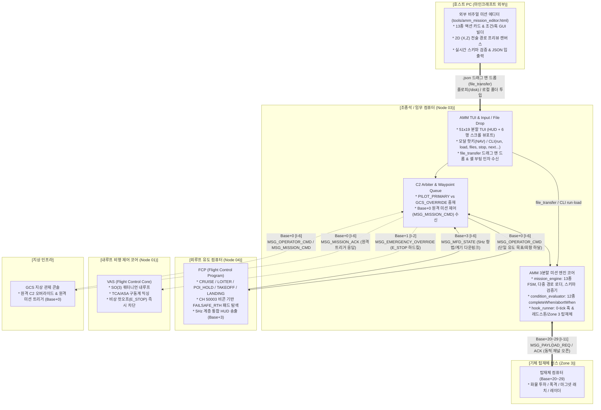
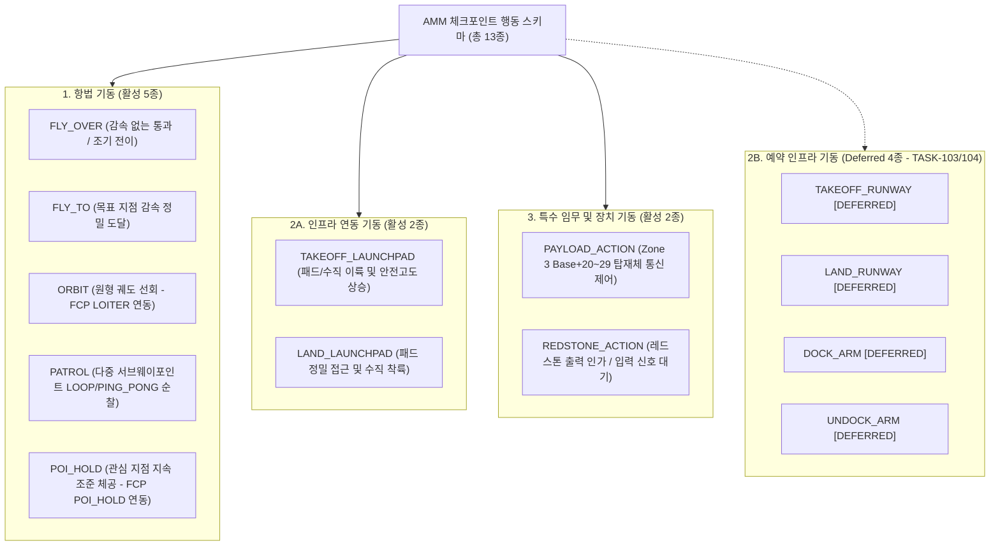
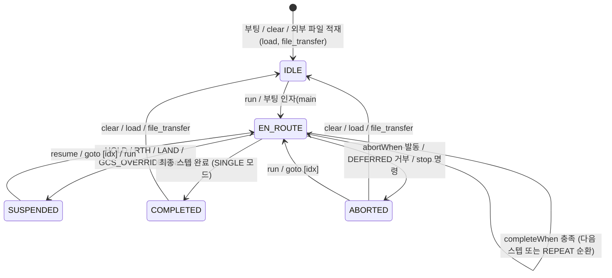
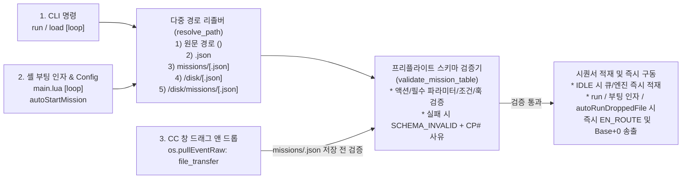

# AMM (항공 임무 관리자 및 조종석 통합 단말) 상세 규격서
> **AMM: Aircraft Mission Manager & Cockpit Integrated Terminal (Layer 3 Planning & C2 Station)**  
> **프로젝트**: Universal Autonomous Flight Stack (UAFS Ecosystem)  
> **운영 환경**: Minecraft CC:Tweaked, Create: Aeronautics, Create: Avionics  

| 항목 | 내용 |
| :--- | :--- |
| **문서 상태 (Status)** | `Approved` |
| **문서 버전 (Version)** | `v1.2.0` |
| **최종 수정일 (Date)** | `2026-11-11` |
| **구현 코드 (Source)** | `src/3_planning/amm/` |
| **주관 도메인 (Domain)** | 임무 계획 및 조종석 통합 단말 (AMM / Node 03) |

> **연관 문서**: 
> - [AUTONOMOUS_FLIGHT_SYSTEM_ARCHITECTURE_AND_ICD.md](../../../system/AUTONOMOUS_FLIGHT_SYSTEM_ARCHITECTURE_AND_ICD.md) (마스터 ICD v1.27.0)
> - [SYSTEM_PROGRAM_RELATION_AND_PACKET_DIAGRAM.md](../../../system/SYSTEM_PROGRAM_RELATION_AND_PACKET_DIAGRAM.md) (전체 구조도 v2.12.1)
> - [FCP_PROGRAM_SPECIFICATION.md](../../2_guidance/fcp/FCP_PROGRAM_SPECIFICATION.md) (외루프 유도 제어기 v1.16.0)
> - [VAS_PROGRAM_SPECIFICATION.md](../../1_control/vas/VAS_PROGRAM_SPECIFICATION.md) (비행 제어 코어 v1.18.0)
> - [GEMINI.md](../../../../GEMINI.md) (전역 컨텍스트 및 규칙)

### Revision History

| 버전 | 개정 일자 | 개정 요약 | 개정 사유 |
| :---: | :---: | :--- | :--- |
| `v1.2.0` | 2026-11-11 | 호스트 PC 외부 비주얼 미션 에디터(`tools/amm_mission_editor.html`) 및 외부 파일 즉시 구동 워크플로우 명세 신설: ① `mission_engine` 다중 경로 리졸버(`resolve_path`: 원문 경로, `.json` 보강, `missions/`, `/disk/`, `/disk/missions/`) 및 프리플라이트 스키마 검증기(`validate_mission_table`, `SCHEMA_INVALID` 반환), ② 3대 외부 파일 즉시 구동 채널(CLI `run`/`load`/`files`, 셸 부팅 인자 `main.lua <path> [loop]` 및 `autoStartMission`, CC 창 마우스 드래그 앤 드롭 `file_transfer` 이벤트 수신 및 `IDLE` 즉시 적재), ③ 브라우저 기반 단일 파일 웹 GUI 에디터(`tools/amm_mission_editor.html` — 13종 액션 폼, 조건/훅 빌더, 2D $(X,Z)$ 경로 프리뷰 캔버스, 실시간 검증, JSON 입출력) 규격 추가 | 외부 GUI 에디터 기반 직관적 미션 저작 및 외부 파일 무중단 투입·즉시 구동 지원 |
| `v1.1.0` | 2026-11-11 | Layer 3(AMM) 및 구 Layer 4(AMP) 미션 시퀀서를 3분할 코어 모듈(`mission_engine`, `condition_evaluator`, `hook_runner`)로 통합: 13종 체크포인트 스키마(활성 9종 + 예약 4종), 12종 `completeWhen`/`abortWhen` 복합 조건 평가기, 0-tick 비차단 라이프사이클 훅(`onEnter`/`onExit`/`onAbort`), Zone 3(`Base+20~29`) 동적 탑재체 교신(`MSG_PAYLOAD_REQ`/`ACK`), `Base+0` 원격 미션 제어(`MSG_MISSION_CMD`/`ACK`), 무인기 헤드리스(`config.headless`) 겸용 토폴로지, 51x19 TUI 6행 스크롤 뷰포트 + 5행 조건 진행률 표시 및 `run`/`stop`/`next` CLI 확장 (`Implemented` $\to$ `Approved`) | TASK-202 통합 미션 시퀀서 엔진 및 조종석 단말 사양 고도화 |
| `v1.0.1` | 2026-11-08 | 구버전 명칭 전면 척결 및 표준 명칭(FCP/ASA) 동기화 | 용어 무결성 확보 |
| `v1.0.0` | 2026-11-08 | AMM 상세 규격서 초안(Draft) 최초 작성: 조종석 MFD(Node 03) 일체화 분할 TUI(51x19), 단방향 순차 웨이포인트 큐, 도달 판정(2D 15m) 및 FCP(`Base+0`) 하달, GCS 원격 C2 중계 및 권한 탈환, 원터치 핫키 및 CLI 복합 입력 규격화 | Planning 계층 신규 프로그램 설계 및 조종석 C2 단말 통합 |

---

## 1. 프로그램 개요 및 시스템 위상 (Overview & System Role)

### 1.1 시스템 정체성 및 통합 배경
**AMM (Aircraft Mission Manager / Node 03)**은 비행체 조종석의 온보드 컴퓨터(CC:Tweaked Advanced Computer) 또는 무인기의 임무 컴퓨터에서 가동되는 **임무 계획(Planning Layer 3) 및 조종석 통합 단말(Cockpit C2 Terminal)**입니다.

자율 비행 생태계에서 하위 외루프 유도 컴퓨터인 **FCP (Node 04)**가 단일 목표에 대한 비선형 L1 수평 유도, 총 에너지 제어(TECS), 3축 병진 PID, 15-State FSM 및 20Hz 내루프 지령(`Base + 1`)을 전담한다면, **AMM**은 비행체가 수행해야 할 **다중 체크포인트 시퀀싱, 복합 완료/중단 조건(`completeWhen`/`abortWhen`) 평가, 라이프사이클 이벤트 훅(`onEnter`/`onExit`/`onAbort`), Zone 3 탑재체 및 로컬 레드스톤 제어, 조종사 대화형 51x19 TUI 및 지상 관제 센터(GCS)와의 원격 C2 중재**를 총괄합니다.

본 `v1.1.0`~`v1.2.0` 개정에서는 기존에 Layer 3(AMM 단순 웨이포인트 큐)와 Layer 4(AMP 복합 미션 플래너 초안)로 이원화되어 있던 구조를 단일 노드(Node 03) 내부의 3분할 미션 코어(`mission_engine.lua`, `condition_evaluator.lua`, `hook_runner.lua`)로 통합하고, **호스트 PC용 무설치 웹 GUI 미션 에디터(`tools/amm_mission_editor.html`)**와 **외부 미션 파일 즉시 구동 파이프라인(다중 경로 해석, 프리플라이트 스키마 검증, CC 창 드래그 앤 드롭 `file_transfer` 및 부팅 인자 실행)**을 추가하였습니다. 이를 통해 사용자는 마인크래프트 외부 브라우저에서 직관적으로 미션을 설계·검증한 뒤, 생성된 `.json` 파일을 인게임 컴퓨터에 집어넣어 즉시 구동할 수 있습니다.



### 1.2 7대 설계 목표 (Goals)
1. **13종 체크포인트 통합 시퀀싱 (Active 9종 + Deferred 4종)**:
   - 현행 활성 기종(`VECTORED_VTOL`, `ADVANCED_VTOL`) 및 인프라(`Landing Pad`, `GAC`)에서 즉시 운용 가능한 **활성 9종**(`FLY_OVER`, `FLY_TO`, `ORBIT`, `PATROL`, `POI_HOLD`, `TAKEOFF_LAUNCHPAD`, `LAND_LAUNCHPAD`, `PAYLOAD_ACTION`, `REDSTONE_ACTION`)을 지원하고, 후속 과제(`TASK-103` 활주로, `TASK-104` 도킹암)에 종속된 **예약 4종**(`TAKEOFF_RUNWAY`, `LAND_RUNWAY`, `DOCK_ARM`, `UNDOCK_ARM`)은 스키마에 정의하되 런타임 진입 시 안전 거부(`DEFERRED_ACTION_UNSUPPORTED`) 처리합니다.
2. **AMM(5Hz 시퀀서) $\leftrightarrow$ FCP(20Hz 유도기) 명확한 책임 분리**:
   - FCP는 단일 타깃 유도(`CRUISE`, `LOITER`, `POI_HOLD`, `TAKEOFF`, `LANDING`)와 `CH 50003` 비콘 기반 최단거리 패드 회항(`FAILSAFE_RTH`)만 전담하며, AMM은 `PATROL` 서브웨이포인트 순환, `FLY_OVER` 조기 전이, `FLY_TO` 감속 정밀 도달 및 `abortWhen` 발동 시 FCP로의 페일세이프 위임(`RTH`, `HOVER_HOLD`, `LOITER`, `SKIP_NEXT`)을 담당합니다.
3. **12종 복합 조건 평가 및 기본 완료 조건 자동 보강**:
   - `completeWhen` 및 `abortWhen`에 `logic: "ANY" | "ALL"` 복합 논리 연산을 지원하고, 체크포인트 JSON에 `completeWhen`이 생략된 경우 액션별 표준 기본 조건을 자동 적용합니다.
4. **0-Tick 비차단 라이프사이클 훅 및 동적 Zone 3 채널 관리**:
   - `onEnter`, `onExit`, `onAbort` 훅은 타이머 데드라인 큐를 통해 이벤트 루프 블로킹 없이 실행하며, Zone 3(`Base + 20 ~ 29`) 탑재체 채널은 해당 스텝 활성 중에만 동적으로 개방(`modem.open`) 및 해제(`modem.close`)합니다.
5. **조종석 51x19 TUI 및 무인기 헤드리스 겸용 아키텍처**:
   - 우측 미션 패널에 **6행 활성 중심 스크롤 뷰포트**와 **하단 5행 스텝/조건 진행률**을 표출하고, `config.headless = true` 설정 시 터미널 렌더링 없이 백그라운드 데몬으로 동작합니다.
6. **채널 추가 없는 `Base+0` 원격 미션 제어 및 조종사 즉시 권한 탈환**:
   - 별도 전용 RF 채널을 추가하지 않고 기존 `Base + 0` (`CH_OPERATOR_C2`)에서 `MSG_MISSION_CMD`(`RUN`, `STOP`, `PAUSE`, `RESUME`, `NEXT`)를 통합 수신하며, 로컬 키 입력 시 즉시 `PILOT_PRIMARY` 권한을 탈환합니다.
7. **호스트 PC 외부 비주얼 에디터 및 외부 파일 즉시 구동**:
   - 별도 패키지 설치 없이 브라우저에서 동작하는 단일 파일 웹 GUI 에디터(`tools/amm_mission_editor.html`)로 미션 JSON을 직관적으로 제작·검증하고, 인게임 CC:Tweaked 컴퓨터에 마우스 드래그 앤 드롭(`file_transfer`), 플로피 디스크(`/disk`), 셸 부팅 인자(`main.lua <path>`), 또는 CLI(`run <path>`)로 집어넣어 즉시 구동할 수 있습니다.

### 1.3 비목표 및 반목표 (Non-Goals & Anti-Goals)
- **Non-Goals (보류/제외 범위)**:
  - 3차원 A* 격자/그래프 경로 탐색 및 지형 고도 회피.
  - CC:Radars 기반 동적 이동체 충돌 회피 (레이더 트리거 연동은 Zone 3 `PAYLOAD_ACTION` 인터페이스로만 추상화).
  - 다중 기체 편대 비행 슬롯 오케스트레이션 (Zone 4 `Base+30~39` 후속 과제로 분리).
  - 활주로(`TAKEOFF_RUNWAY`, `LAND_RUNWAY`) 및 도킹암(`DOCK_ARM`, `UNDOCK_ARM`) 실기동 유도 (`TASK-103`, `TASK-104` 구현 전까지 `DEFERRED` 상태 유지).
  - 수동 급기동 ACRO 20Hz 직결 조종간 (`Base + 1`, `TASK-301` 물리 컨트롤러 과제로 분리).
- **Anti-Goals (금지 사항)**:
  - FCP의 L1 수평 가속도 연산, TECS 에너지 제어, 또는 `CH 50003` 시설물 비콘 수집/최단거리 패드 탐색 로직을 AMM에서 중복 계산하지 않는다.
  - 훅(`REDSTONE_PULSE` 등)이나 디바이스 대기 중 `sleep()`을 호출하여 5Hz UI 갱신 및 이벤트 수신 루프를 블로킹하지 않는다.

---

## 2. 검토된 대안 및 채택 아키텍처 (Architectural Approaches)

### 2.1 노드 토폴로지 대안 비교

| 비교 항목 | 방안 1: 일체형 온보드/헤드리스 겸용 단말 (채택) | 방안 2: Layer 3(AMM) + Layer 4(AMP) 노드 분리형 |
| :--- | :--- | :--- |
| **노드 구성** | 단일 컴퓨터 (Node 03에 AMM + 미션 엔진 통합, `headless` 지원) | AMM 단말(Node 03) + AMP 미션 데몬(Node 08) |
| **통신 홉 및 채널** | 1-Hop: AMM $\to$ FCP (`Base + 0` 단일 채널) | 2-Hop: AMP $\to$ AMM (`Base+6` `[DEPRECATED]` 검토안 폐기) $\to$ FCP (`Base+0`) |
| **컴퓨터 자원** | 1대 (자원 및 조종석 공간 절약) | 2대 이상 필요, 노드 간 상태 동기화 오버헤드 발생 |
| **평가 결과** | **최종 채택** (단일 시퀀서 SSOT 확립, 채널 낭비 제거) | 기각 (불필요한 내부 RF 홉 및 큐 이중화 발생) |

### 2.2 소프트웨어 모듈 분할 대안 비교

| 비교 항목 | 대안 1: 단일 `mission_engine.lua` 통합 | 대안 2: 3분할 미션 코어 + `waypoint_queue` 호환 유지 (채택) | 대안 3: `waypoint_queue.lua` 폐기 및 전면 교체 |
| :--- | :--- | :--- | :--- |
| **모듈 구조** | `mission_engine.lua` 1개 파일에 FSM·조건·훅 통합 + `waypoint_queue` 유지 | `mission_engine.lua`(FSM/로더) + `condition_evaluator.lua`(12종 조건) + `hook_runner.lua`(0-tick 훅/디바이스) + `waypoint_queue.lua`(기본 큐 호환) | `waypoint_queue.lua` 삭제 후 `mission_engine.lua`로 단일화 |
| **단일 함수/파일 복잡도** | 단일 파일 350줄 이상으로 비대화 우려 | 파일별 책임 직교 분리 및 단일 함수 50줄 이하 유지 용이 | 단일 파일 비대화 및 기존 API 단절 |
| **하위 호환 및 회귀** | 기존 단위/돌연변이 테스트 보존 | 기존 단위 테스트 및 돌연변이 테스트(`MUT-04`) 무수정 보존 | `MUT-04` 및 기존 테스트 전면 재작성 필요 |
| **평가 결과** | 보류 (조건 평가기와 훅 실행기 결합도 높음) | **최종 채택** (단일 책임 원칙, 테스트 호환성, 50줄 제한 동시 충족) | 기각 (불필요한 하위 호환 파괴) |

---

## 3. 하드웨어 구성 및 RF 네트워크 인터페이스 (Hardware & Network)

### 3.1 하드웨어 요구사항
- **컴퓨터 본체**: CC:Tweaked Advanced Computer (유인 조종석 51x19 컬러 터미널 구동 시) 또는 Standard/Advanced Computer (`headless: true` 무인기 탑재 시) 1대.
- **무선 모뎀**: `modem` (Advanced Wireless Ender Modem 권장, 상단 또는 후면 장착).
- **레드스톤 인터페이스 (선택)**: 컴퓨터 6면(`top`, `bottom`, `left`, `right`, `front`, `back`) 일반 아날로그/디지털 레드스톤 또는 16색 번들 케이블(`redstone.setBundledOutput` / `getBundledInput`).

### 3.2 RF 네트워크 채널 규격 ($Base = 10000 + (N-1) \times 40$)

AMM은 기체 고유의 40채널 블록 내에서 다음 채널들을 운용합니다:

| 채널 식별자 | 채널 번호 | 통신 방향 | 패킷 타입 | 주기 / 트리거 | 통신 목적 및 거동 |
| :--- | :---: | :---: | :--- | :---: | :--- |
| **`CH_OPERATOR_C2`** | `Base + 0` | AMM $\to$ FCP (송신) | `MSG_OPERATOR_CMD` | 이벤트 / 스텝 전이 | 활성 체크포인트 유도 목표(좌표, 고도, 속도, 선회/POI 파라미터, 회항/착륙) 하달 |
| **`CH_OPERATOR_C2`** | `Base + 0` | GCS $\to$ FCP/AMM (청취) | `MSG_OPERATOR_CMD` | 비주기 (GCS 송출 시) | `authority == "GCS_OVERRIDE"` 감청 시 AMM 미션 시퀀서 즉시 일시정지(`SUSPENDED`) |
| **`CH_OPERATOR_C2`** | `Base + 0` | GCS $\leftrightarrow$ AMM (수신/응답) | `MSG_MISSION_CMD` / `MSG_MISSION_ACK` | 비주기 (원격 미션 제어) | GCS에서 온보드 미션(`RUN`/`STOP`/`PAUSE`/`RESUME`/`NEXT`) 원격 제어 및 상태 응답 |
| **`CH_FLIGHT_GUIDANCE`**| `Base + 1` | AMM $\to$ VAS (송신) | `MSG_EMERGENCY_OVERRIDE` | 비상 `[X]` 키 트리거 | 하드 킬스위치 (`E_STOP`), FCP 우회 전 추진기 즉시 차단 |
| **`CH_MFD_STATE`** | `Base + 3` | FCP $\to$ AMM (수신) | `MSG_MFD_STATE` | 5Hz (200ms) | 비행 계기 렌더링 및 `completeWhen`/`abortWhen` 조건 평가용 통합 텔레메트리 수신 |
| **`CH_PAYLOAD_BUS`** | `Base + 20 ~ 29` | AMM $\leftrightarrow$ 탑재체 (송수신) | `MSG_PAYLOAD_REQ` / `MSG_PAYLOAD_ACK` | 체크포인트/훅 활성 시 | Zone 3 탑재체(화물 투하, 마그넷 래치, 레이더 등) 제어 요청 및 완료 응답 수신 (동적 오픈) |

> [!NOTE]
> **무반향(Non-loopback) C2 감청 및 `Base+0` 단일 관문 원칙**  
> 1. FCP(Node 04)는 `Base + 0`을 상시 청취하므로, GCS가 송출한 `MSG_OPERATOR_CMD`는 FCP에 직접 도달합니다. AMM은 이를 재송출(Relay)하지 않으며, `authority == "GCS_OVERRIDE"` 수신 시 내부 미션 시퀀서를 `SUSPENDED`로 전환합니다.  
> 2. 반면 `MSG_MISSION_CMD`는 AMM(Node 03) 전용 원격 시퀀서 제어 패킷이므로 FCP는 이를 무시하고 AMM만 수신하여 미션을 기동·중지한 뒤 `Base + 0`으로 `MSG_MISSION_ACK`를 회신합니다.

---

## 4. 패킷 스키마 및 프로토콜 규격 (Packet Protocols)

모든 패킷은 **UAFS 네트워크 엔벨로프 v1.9.5** 표준을 준수합니다.

### 4.1 [송출] 오퍼레이터 비행 명령 패킷 (`MSG_OPERATOR_CMD`, AMM $\to$ FCP, Base + 0)

`TASK-201` 외루프 유도 프리미티브(`LOITER`, `POI_HOLD`) 및 3종 기수 지향 모드와 연동하기 위해 `params` 필드가 확장됩니다:

```lua
{
    ver = "1.9.5",
    domainId = "AIRCRAFT_01",
    seq = 501,
    type = "MSG_OPERATOR_CMD",
    time = 1729845000000,
    payload = {
        authority = "PILOT_PRIMARY",  -- "PILOT_PRIMARY" | "GCS_OVERRIDE"
        command = "CRUISE",           -- "ARM" | "TAKEOFF" | "CRUISE" | "LOITER" | "POI_HOLD" | "LANDING"
        flightMode = "CRUISE",        -- "TAKEOFF" | "CRUISE" | "LOITER" | "POI_HOLD" | "LANDING"
        params = {
            targetWaypoint = { x = 450.0, z = -1200.0 }, -- 활성 목표 2D 좌표 (또는 ORBIT 중심점)
            targetAlt = 150.0,                             -- 목표 고도 (m)
            targetSpeed = 18.0,                            -- 목표 대지 속도 (m/s)
            designatedFacilityId = nil,                    -- 이착륙 목표 시설물 ID (예: "PAD_BRAVO_01")
            headingMode = "AUTO",                          -- "AUTO" | "FIXED" | "POI"
            fixedHeading = nil,                            -- headingMode == "FIXED" 시 목표 진방위각 (0~360 deg)
            poiTarget = nil,                               -- headingMode == "POI" 또는 POI_HOLD 시 { x, y, z }
            loiterRadius = 40.0,                           -- ORBIT(LOITER) 선회 반경 (m, 기본 30.0)
            loiterDirection = "CW"                         -- "CW" (시계 방향) | "CCW" (반시계 방향)
        },
        emergencyAction = "NONE"       -- "NONE" | "HOVER_HOLD" | "EMERGENCY_LAND" | "RTH"
    }
}
```

### 4.2 [수신/송출] 원격 미션 시퀀서 제어 패킷 (`MSG_MISSION_CMD` / `MSG_MISSION_ACK`, GCS $\leftrightarrow$ AMM, Base + 0)

GCS 또는 외부 자동화 노드가 온보드 AMM의 미션 시퀀서를 원격 조작할 때 사용합니다:

```lua
-- 1. GCS -> AMM: 원격 미션 제어 요청 (MSG_MISSION_CMD, Base + 0)
{
    ver = "1.9.5",
    domainId = "AIRCRAFT_01",
    seq = 610,
    type = "MSG_MISSION_CMD",
    time = 1729845010000,
    payload = {
        action = "RUN",                -- "RUN" | "STOP" | "PAUSE" | "RESUME" | "NEXT"
        missionName = "patrol_alpha",  -- "RUN" 시 로드할 미션 식별자 또는 외부 경로 (예: "/disk/sortie.json", 생략 시 현재 큐 실행)
        executionMode = "SINGLE",      -- "SINGLE" (1회 완주) | "REPEAT" (무한 순환)
        forceRestart = false           -- 실행 중 재기동 강제 여부 (false이고 EN_ROUTE이면 BUSY_REJECTED)
    }
}

-- 2. AMM -> GCS: 원격 미션 제어 응답 (MSG_MISSION_ACK, Base + 0)
{
    ver = "1.9.5",
    domainId = "AIRCRAFT_01",
    seq = 502,
    type = "MSG_MISSION_ACK",
    time = 1729845010020,
    payload = {
        action = "RUN",
        status = "ACCEPTED",           -- "ACCEPTED" | "BUSY_REJECTED" | "FILE_NOT_FOUND" | "SCHEMA_INVALID" | "DEFERRED_ACTION_UNSUPPORTED" | "INVALID_CMD"
        missionId = "PATROL_ALPHA",
        missionState = "EN_ROUTE",     -- "IDLE" | "EN_ROUTE" | "SUSPENDED" | "COMPLETED" | "ABORTED"
        activeIndex = 1,
        totalCheckpoints = 4,
        reason = nil
    }
}
```

### 4.3 [송출/수신] Zone 3 탑재체 제어 및 응답 패킷 (`MSG_PAYLOAD_REQ` / `MSG_PAYLOAD_ACK`, AMM $\leftrightarrow$ Payload, Base + 20 ~ 29)

`PAYLOAD_ACTION` 체크포인트 또는 `ZONE3_PAYLOAD_CMD` 라이프사이클 훅 실행 시 기체 내부 Zone 3 버스(`Base + 20 ~ 29`)로 송수신되는 표준 패킷입니다:

```lua
-- 1. AMM -> Payload Node: 탑재체 동작 요청 (MSG_PAYLOAD_REQ, Base + 20..29)
{
    ver = "1.9.5",
    domainId = "AIRCRAFT_01",
    seq = 503,
    type = "MSG_PAYLOAD_REQ",
    time = 1729845020000,
    payload = {
        checkpointId = "CP_02_CARGO_DROP",
        command = "RELEASE_BAY",       -- 탑재체 명령 식별자
        replyChannel = 10020,          -- AMM이 동적 개방한 Zone 3 수신 채널 (Base + offset)
        params = { bayId = 1 }         -- 탑재체별 세부 파라미터 테이블
    }
}

-- 2. Payload Node -> AMM: 탑재체 동작 결과 회신 (MSG_PAYLOAD_ACK, Base + 20..29)
{
    ver = "1.9.5",
    domainId = "AIRCRAFT_01",
    seq = 88,
    type = "MSG_PAYLOAD_ACK",
    time = 1729845020250,
    payload = {
        checkpointId = "CP_02_CARGO_DROP",
        command = "RELEASE_BAY",
        status = "DROPPED",            -- PAYLOAD_RESP_MATCH 조건의 expectedStatus와 대조할 결과 문자열
        detail = { bayId = 1, empty = true }
    }
}
```

### 4.4 [송출] 하드 비상 차단 직결 패킷 (`MSG_EMERGENCY_OVERRIDE`, AMM $\to$ VAS, Base + 1)

```lua
{
    ver = "1.9.5",
    domainId = "AIRCRAFT_01",
    seq = 504,
    type = "MSG_EMERGENCY_OVERRIDE",
    time = 1729845000050,
    payload = {
        action = "CUTOFF",            -- "CUTOFF" (전 추진기 0 정지) | "CUSHION_STOP"
        reason = "PILOT_ESTOP_HOTKEY",
        source = "MFD",
        timestamp = 1729845000050
    }
}
```

### 4.5 [수신] MFD 계기판 화면 갱신 패킷 (`MSG_MFD_STATE`, FCP $\to$ AMM, Base + 3)

AMM은 5Hz 주기로 수신되는 `MSG_MFD_STATE`의 다음 필드를 파싱하여 TUI 렌더링 및 조건 평가기(`condition_evaluator`) 입력으로 활용합니다:
- `payload.navigation.currentPos`: 비행체 현재 2D 절대 좌표 (`{ x, z }`)
- `payload.navigation.distanceToWp`: 현재 타깃까지의 수평 거리 ($m$)
- `payload.navigation.crossTrackError`: 현재 경로 횡방향 이탈 오차 ($m$, `CROSS_TRACK_ERROR` 조건 평가용)
- `payload.dynamics.altitudeY`: 현재 Y 고도 ($m$)
- `payload.dynamics.verticalSpeed`: 현재 수직 승강 속도 ($m/s$)
- `payload.dynamics.groundSpeed`: 현재 수평 대지 속도 ($m/s$)
- `payload.attitude`: 피치, 롤, 방위각 (`{ pitch, roll, heading }`)
- `payload.fuel`: 잔여 연료/에너지 비율 ($0.0 \sim 1.0$)
- `payload.fsmState`: FCP의 현재 상태 (`IDLE_ARMED`, `TAKEOFF`, `CRUISE`, `LOITER`, `POI_HOLD`, `APPROACH_LAND`, `DISARMED` 등)
- `payload.activeSource`: 활성 제어원 (`"FCP"`, `"MFD_ACRO"`, `"EMERGENCY_DIRECT"`)

---

## 5. 조종석 51x19 분할 TUI 및 헤드리스 모드 설계 (Cockpit TUI & Headless Mode)

### 5.1 51x19 분할 TUI 화면 레이아웃
표준 CC:Tweaked Advanced Computer 터미널(가로 51자, 세로 19행)을 좌우로 분할하여 `term.blit` 무깜빡임 버퍼로 렌더링합니다. 우측 패널(26~51열)은 **상단 6행 활성 중심 스크롤 뷰포트(4~9행)**와 **하단 5행 활성 체크포인트·조건 진행률 요약(11~15행)**으로 구성됩니다.

```
+---------------------------------------------------+  Row 1: Header
| AIRCRAFT_01 [CRUISE]  ALT:150m SPD:18m/s AUTH:PIL |
|-------------------------+-------------------------|  Row 2: Separator
| [HUD INSTRUMENTS]       | [MISSION: SORTIE] (2/5) |  Row 3: Pane Titles
| PITCH: +2.1  ROLL: -0.2 | O 1:TKOFF  [PAD_BRAVO ] |  Row 4~9:
| HDG  : 092.4 DEG        | * 2:ORBIT  [ 450,-1200] |  Left(1~25): HUD 계기판
| Y-ALT:  148.5 m         |   3:PAYLD  [CH:Base+20] |  Right(27~51):
| V-SPD: +0.10 m/s        |   4:PATROL [3 WPs LOOP] |  6행 활성 스크롤 뷰포트
| G-SPD:  17.8 m/s        |   5:LAND   [PAD_ALPHA ] |  (O:완료, *:활성, !:실패)
| FUEL : [||||||||..] 82% |                         |
| SRC  : FCP              |-------------------------|  Row 10: Right Divider
| ACTR : ALL_HEALTHY      | STATE: EN_ROUTE (SINGLE)|  Row 11: 시퀀서 상태/모드
|                         | ACT  : ORBIT CW R:40m   |  Row 12: 활성 액션 상세
|                         | COND : DUR 12/30s (ALL) |  Row 13: 완료 조건 진행률
|                         | ALT/V: 150m / 18.0m/s   |  Row 14: 목표 고도/속도
|                         | DIST : 145.2m (RAD:20m) |  Row 15: 목표 거리/반경
|-------------------------+-------------------------|  Row 16: Footer Divider
| MSG: ORBIT AT CP_02 | PILOT_PRIMARY               |  Row 17: Status Banner
| [X]STOP [H]HOLD [R]RTH [L]LAND [A]ARM [T]TAKEOFF  |  Row 18: Hotkeys
| CMD> run patrol_alpha loop                        |  Row 19: Command Input
+---------------------------------------------------+
```

- **좌측 영역 (1 ~ 25열, 계기판 HUD)**:
  - 자세(Pitch, Roll, Heading), 동역학(Y고도, 승강률, 대지속도), 연료 잔량 바, 활성 제어원(`SRC`), 구동계 헬스(`ACTR`) 표출.
- **우측 상단 (27 ~ 51열, 4 ~ 9행: 6행 스크롤 뷰포트)**:
  - 전체 체크포인트가 6개를 초과할 경우 활성 인덱스(`active_index`)가 뷰포트 중앙에 유지되도록 자동 스크롤(`compute_viewport`)합니다.
  - 상태 마커: `*`(현재 활성, 노란색 `"4"`), `O`(완료, 회색 `"8"`), `!`(중단/오류, 적색 `"e"`), 공백(대기, 흰색 `"0"`).
- **우측 하단 (27 ~ 51열, 11 ~ 15행: 활성 체크포인트 상세 패널)**:
  - 11행(`STATE`): 시퀀서 상태(`IDLE`, `EN_ROUTE`, `SUSPENDED`, `COMPLETED`, `ABORTED`) 및 실행 모드(`SINGLE` / `REPEAT`).
  - 12행(`ACT`): 현재 활성 체크포인트의 `action` 요약 (예: `ORBIT CW R:40m`, `PATROL (2/3)`, `PAYLOAD CH+20`).
  - 13행(`COND`): 활성 `completeWhen` 조건의 실시간 달성 현황 (예: `PROX2D <=20m`, `DUR 12/30s (ALL)`, `WAIT_ACK`).
  - 14행(`ALT/V`): 활성 체크포인트 목표 고도 및 목표 속도.
  - 15행(`DIST`): 활성 목표 좌표까지의 현재 2D 거리 및 허용 반경(`acceptanceRadius`).

### 5.2 무인기 헤드리스 모드 (`config.headless == true`)
- `config/amm_config.json`에서 `headless = true`로 설정된 경우:
  - 5Hz 화면 렌더링 타이머 및 `ui_renderer.flush_buffer` 호출을 생략하여 터미널 출력 오버헤드를 제거합니다.
  - 모뎀 이벤트(`Base+0`, `Base+3`, `Base+20~29`) 및 비차단 훅 타이머 루프만 구동하며, GCS의 `MSG_MISSION_CMD`(`Base+0`) 또는 시작 설정(`autoStartMission`)으로 미션을 자율 수행합니다.

---

## 6. 통합 미션 시퀀서 및 13종 체크포인트 규격 (Mission Engine & Schema)

### 6.1 3대 도메인 13종 체크포인트 행동 분류 (Actions Taxonomy)



| 도메인 | 액션 식별자 (`action`) | 구현 상태 | FCP 하달 모드 (`Base+0`) | 핵심 파라미터 (`params`) 및 거동 정의 |
| :--- | :--- | :---: | :---: | :--- |
| **항법** | **`FLY_OVER`** | **Active** | `command = "CRUISE"`<br>`flightMode = "CRUISE"` | `targetPos = {x, z}`, `targetAlt`, `cruiseSpeed`, `acceptanceRadius`(기본 20m). 감속 정지 없이 수평 반경 진입 즉시 다음 스텝으로 조기 전이. |
| **항법** | **`FLY_TO`** | **Active** | `command = "CRUISE"`<br>`flightMode = "CRUISE"` | `targetPos = {x, z}`, `targetAlt`, `cruiseSpeed`, `acceptanceRadius`(기본 5m). 목표 지점에 접근하며 감속하여 3차원 반경 내 정밀 도달 판정. |
| **항법** | **`ORBIT`** | **Active** | `command = "LOITER"`<br>`flightMode = "LOITER"` | `targetPos = {x, z}`(선회 중심), `targetAlt`, `cruiseSpeed`, `radius`(기본 30m), `direction`(`"CW"`\|`"CCW"`). FCP `LOITER` 프리미티브로 원형 선회 유지. |
| **항법** | **`PATROL`** | **Active** | `command = "CRUISE"`<br>`flightMode = "CRUISE"` | `waypoints = [{x, z, alt?, speed?}, ...]`, `patrolMode = "LOOP" \| "PING_PONG"`, `cycles`(선택). AMM이 서브웨이포인트를 순차 교체하며 FCP에 `CRUISE` 하달. |
| **항법** | **`POI_HOLD`** | **Active** | `command = "POI_HOLD"`<br>`flightMode = "POI_HOLD"` | `targetPos = {x, z}`(체공 위치), `targetAlt`, `poiPos = {x, y, z}`(관심 좌표). FCP `POI_HOLD` 프리미티브로 체공 위치 유지 및 기수 지속 지향. |
| **인프라** | **`TAKEOFF_LAUNCHPAD`**| **Active** | `ARM` $\to$ `TAKEOFF` | `targetAlt`(목표 안전고도), `facilityId`(선택). FCP가 `DISARMED`이면 `ARM` 선행 후 `TAKEOFF` 하달, `CRUISE` 전이 또는 목표 고도 도달 시 완료. |
| **인프라** | **`LAND_LAUNCHPAD`** | **Active** | `command = "CRUISE"`<br>`flightMode = "LANDING"` | `facilityId`(착륙 패드 ID), `targetPos`(선택). FCP에 착륙 모드 및 `designatedFacilityId`를 하달하고 접지 후 `DISARMED` 전이 시 완료. |
| **특수** | **`PAYLOAD_ACTION`** | **Active** | 현 위치 유지 (`POI_HOLD`/`LOITER`) | `channelOffset`(20~29) 또는 `targetChannel`, `command`, `commandPayload`, `waitForAck`(기본 `true`). Zone 3 채널 동적 개방 후 `MSG_PAYLOAD_REQ` 송출. |
| **특수** | **`REDSTONE_ACTION`** | **Active** | 현 위치 유지 | `mode = "EMIT" \| "WAIT_INPUT"`, `side`, `color`(16색 번들 선택), `level`(0~15 또는 bool), `durationMs`(펄스 폭). 비차단 출력 또는 입력 신호 대기. |
| **인프라** | **`TAKEOFF_RUNWAY`** | `DEFERRED` | 미송출 (안전 거부) | `TASK-103` 활주로 제어기 및 고정익 드라이버 구현 전까지 예약. 실행 진입 시 `DEFERRED_ACTION_UNSUPPORTED` 반환 및 미션 안전 중단. |
| **인프라** | **`LAND_RUNWAY`** | `DEFERRED` | 미송출 (안전 거부) | `TASK-103` 활주로 ILS 착륙 구현 전까지 예약. 실행 진입 시 안전 거부. |
| **인프라** | **`DOCK_ARM`** | `DEFERRED` | 미송출 (안전 거부) | `TASK-104` 도킹 암 제어기 구현 전까지 예약. 실행 진입 시 안전 거부. |
| **인프라** | **`UNDOCK_ARM`** | `DEFERRED` | 미송출 (안전 거부) | `TASK-104` 도킹 암 제어기 구현 전까지 예약. 실행 진입 시 안전 거부. |

### 6.2 미션 JSON 파일 구조 및 하위 호환 규격 (`missions/*.json`)

미션 파일은 전역 기본값(`defaults`) 상속과 체크포인트 배열(`checkpoints`)을 포함하는 v1.1.0 표준 스키마를 따릅니다. 기존 v1.0.0 단순 큐 포맷(`items` `[DEPRECATED]`) 파일을 로드할 경우, 로더(`mission_engine:load()`)가 각 원소를 `FLY_OVER`(최종 원소에 `facilityId`가 있으면 `LAND_LAUNCHPAD` 후속 결합) 체크포인트로 정규화하여 단일 엔진에서 처리합니다.

```json
{
  "missionId": "SORTIE_ALPHA",
  "version": "1.1.0",
  "description": "런치패드 수직 이륙, 정찰 선회 및 화물 투하 후 복귀 착륙",
  "executionMode": "SINGLE",
  "fallbackPolicy": "RTH",
  "defaults": {
    "cruiseSpeed": 18.0,
    "targetAlt": 140.0,
    "acceptanceRadius": 15.0,
    "headingMode": "AUTO"
  },
  "checkpoints": [
    {
      "checkpointId": "CP_01_LIFT_OFF",
      "action": "TAKEOFF_LAUNCHPAD",
      "params": { "targetAlt": 140.0, "facilityId": "PAD_BRAVO_01" },
      "completeWhen": {
        "logic": "ANY",
        "conditions": [
          { "type": "ALTITUDE_REACHED", "toleranceM": 5.0 }
        ]
      },
      "abortWhen": {
        "logic": "ANY",
        "conditions": [
          { "type": "TIMEOUT_SEC", "timeout": 60 }
        ]
      }
    },
    {
      "checkpointId": "CP_02_TRANSIT",
      "action": "FLY_OVER",
      "params": {
        "targetPos": { "x": 450.0, "z": -1200.0 },
        "cruiseSpeed": 20.0
      }
    },
    {
      "checkpointId": "CP_03_SURVEILLANCE",
      "action": "ORBIT",
      "params": {
        "targetPos": { "x": 600.0, "z": -1500.0 },
        "radius": 40.0,
        "direction": "CW"
      },
      "onEnter": [
        { "type": "NOTIFY_OPERATOR", "level": "INFO", "message": "ORBIT SURVEILLANCE START" },
        { "type": "REDSTONE_PULSE", "side": "top", "durationMs": 500 }
      ],
      "completeWhen": {
        "logic": "ALL",
        "conditions": [
          { "type": "DURATION_SEC", "durationSec": 30 }
        ]
      },
      "abortWhen": {
        "logic": "ANY",
        "conditions": [
          { "type": "FUEL_LEVEL_BELOW", "threshold": 0.25 }
        ]
      }
    },
    {
      "checkpointId": "CP_04_CARGO_DROP",
      "action": "PAYLOAD_ACTION",
      "params": {
        "channelOffset": 20,
        "command": "RELEASE_BAY",
        "commandPayload": { "bayId": 1 }
      },
      "completeWhen": {
        "logic": "ALL",
        "conditions": [
          { "type": "PAYLOAD_RESP_MATCH", "expectedStatus": "DROPPED" }
        ]
      },
      "abortWhen": {
        "logic": "ANY",
        "conditions": [
          { "type": "TIMEOUT_SEC", "timeout": 15 }
        ]
      }
    },
    {
      "checkpointId": "CP_05_RETURN_LAND",
      "action": "LAND_LAUNCHPAD",
      "params": {
        "facilityId": "PAD_BRAVO_01",
        "targetPos": { "x": 0.0, "z": 0.0 }
      }
    }
  ]
}
```

### 6.3 조건 평가 엔진 (`condition_evaluator.lua`) 및 기본 완료 조건 자동 보강

조건 평가기는 매 텔레메트리 수신(5Hz) 및 이벤트 발생 시 활성 체크포인트의 `abortWhen`(우선 평가)과 `completeWhen`을 평가합니다.
- **논리 결합자 (`logic`)**:
  - `"ALL"` (기본값, AND 결합): `conditions` 배열의 모든 조건이 `true`일 때 충족.
  - `"ANY"` (OR 결합): `conditions` 배열 중 하나 이상이 `true`일 때 충족.

#### 12대 표준 조건 타입 명세

| 조건 타입 (`type`) | 파라미터 | 충족 판정 수식 및 기준 | 비고 |
| :--- | :--- | :--- | :--- |
| **`PROXIMITY_2D`** | `toleranceM` (기본 `acceptanceRadius`) | $\sqrt{(x_{tgt}-x)^2 + (z_{tgt}-z)^2} \le \text{toleranceM}$ | 수평 2D 도달 판정 |
| **`PROXIMITY_3D`** | `toleranceM` (기본 5.0m) | $\sqrt{(x_{tgt}-x)^2 + (y_{tgt}-y)^2 + (z_{tgt}-z)^2} \le \text{toleranceM}$ | 3차원 정밀 도달 판정 |
| **`ALTITUDE_REACHED`** | `toleranceM` (기본 5.0m) | $\|y_{tgt} - y_{craft}\| \le \text{toleranceM}$ | 목표 고도 도달 판정 |
| **`DURATION_SEC`** | `durationSec` | $(t_{now} - t_{enter}) / 1000 \ge \text{durationSec}$ | 스텝 진입 후 체류 경과 시간 |
| **`TIMEOUT_SEC`** | `timeout` (초) | $(t_{now} - t_{enter}) / 1000 \ge \text{timeout}$ | 주로 `abortWhen` 타임아웃 감시 |
| **`FUEL_LEVEL_BELOW`** | `threshold` ($0.0 \sim 1.0$) | $\text{fuel} \le \text{threshold}$ | 저연료 중단/회항 트리거 |
| **`FACILITY_TOUCHDOWN`**| `facilityId` (선택) | `mfd.fsmState == "DISARMED"` (이륙/착륙 접근 이후 접지 완료) | 패드/활주로 착륙 완료 |
| **`PAYLOAD_RESP_MATCH`**| `expectedStatus` | 수신된 `MSG_PAYLOAD_ACK.payload.status == expectedStatus` | Zone 3 탑재체 응답 일치 |
| **`REDSTONE_INPUT_HIGH`**| `side`, `color`(선택), `minLevel`(기본 1) | 지정 면 아날로그 입력 $\ge \text{minLevel}$ 또는 번들 색상 활성 | 외부 레드스톤 트리거 감지 |
| **`CROSS_TRACK_ERROR`** | `maxDevM` | $\|\text{navigation.crossTrackError}\| \ge \text{maxDevM}$ | 코스 이탈 감지 (`abortWhen`) |
| **`ARM_DOCKED`** | `facilityId` | 도킹암 결합 완료 상태 수신 (`TASK-104` 연동용 예약 조건) | `DOCK_ARM` 전용 |
| **`ARM_RELEASED`** | `facilityId` | 도킹암 분리 완료 상태 수신 (`TASK-104` 연동용 예약 조건) | `UNDOCK_ARM` 전용 |

#### 액션별 기본 완료 조건 (Default `completeWhen` Auto-Resolution)
체크포인트 정의에서 `completeWhen`이 생략(`nil`)된 경우, 엔진은 액션에 따라 다음 기본 조건을 자동 생성합니다:
- `FLY_OVER`: `{ logic = "ALL", conditions = { { type = "PROXIMITY_2D", toleranceM = acceptanceRadius } } }`
- `FLY_TO`: `{ logic = "ALL", conditions = { { type = "PROXIMITY_3D", toleranceM = params.acceptanceRadius or 5.0 } } }`
- `TAKEOFF_LAUNCHPAD`: `{ logic = "ANY", conditions = { { type = "ALTITUDE_REACHED", toleranceM = 5.0 } } }` (단, FCP `fsmState == "CRUISE"` 전이 시에도 즉시 완료 인정)
- `LAND_LAUNCHPAD`: `{ logic = "ALL", conditions = { { type = "FACILITY_TOUCHDOWN" } } }`
- `ORBIT` / `POI_HOLD`: `params.durationSec`가 지정된 경우 `DURATION_SEC`, 미지정 시 조종사/GCS의 `next` 또는 `stop` 명령까지 체공 유지.
- `PATROL`: `params.cycles`회 순환 완주 시 완료 (기본 `cycles = 1` 루프 완주; `params.durationSec` 지정 시 `DURATION_SEC` 병행).
- `PAYLOAD_ACTION`: `params.waitForAck == false`이면 송출 즉시 완료, 기본(`true`)이면 `PAYLOAD_RESP_MATCH` (`expectedStatus = params.expectedStatus or "OK"`).
- `REDSTONE_ACTION`: `mode == "EMIT"`이면 펄스 지속시간(`durationMs`, 기본 0ms) 경과 즉시 완료, `mode == "WAIT_INPUT"`이면 `REDSTONE_INPUT_HIGH`.

#### 중단(`abortWhen`) 발동 시 페일세이프 FCP 위임 (`fallbackPolicy`)
`abortWhen` 조건이 충족되면 AMM은 `onAbort` 훅을 실행한 뒤, `CH 50003` 비콘을 직접 파싱하지 않고 미션(또는 체크포인트)의 `fallbackPolicy`에 따라 FCP(`Base+0`)에 조치를 위임합니다:
1. **`"RTH"` (기본값, 구 `"RTH_ORIGIN"` / `"DIVERT_NEAREST"` 통합 위임)**:
   - 시퀀서 상태를 `"ABORTED"`로 전환하고, FCP에 `emergencyAction = "RTH"`를 송출합니다. FCP는 자체 `CH 50003` 비콘 테이블(`facility_client.find_nearest_free_landing_facility`)을 사용하여 최단거리 가용 패드로 회항(`FAILSAFE_RTH`)합니다.
2. **`"HOVER_HOLD"`**:
   - 시퀀서 상태를 `"ABORTED"`로 전환하고, FCP에 `emergencyAction = "HOVER_HOLD"`를 송출합니다.
3. **`"LOITER"`**:
   - 시퀀서 상태를 `"ABORTED"`로 전환하고, FCP에 `command = "LOITER", flightMode = "LOITER"`를 송출하여 현 위치 선회 체공합니다.
4. **`"SKIP_NEXT"`**:
   - 현재 체크포인트만 실패(`!`)로 표시하고 즉시 다음 체크포인트($k \leftarrow k + 1$)로 전이하여 임무를 계속 수행합니다.

### 6.4 0-Tick 비차단 라이프사이클 훅 실행기 (`hook_runner.lua`)

체크포인트 전이 시점(`onEnter`, `onExit`, `onAbort`)에 실행되는 훅 배열은 메인 루프를 블로킹하지 않고 0-tick 내에 처리됩니다:
- **`REDSTONE_SET`**: `{ type = "REDSTONE_SET", side = "right", state = true, color = nil, level = 15 }` — 즉시 해당 면(또는 번들 색상) 출력 상태를 변경합니다.
- **`REDSTONE_PULSE`**: `{ type = "REDSTONE_PULSE", side = "top", color = colors.red, durationMs = 500 }` — 즉시 출력을 활성화하고 내부 데드라인 큐(`expireMs = nowMs + durationMs`)에 등록합니다. 메인 루프의 매 틱(`hook_runner:tick(nowMs)`)에서 만료된 펄스를 자동으로 `false`/`0`으로 복원합니다 (`sleep` 사용 금지).
- **`ZONE3_PAYLOAD_CMD`**: `{ type = "ZONE3_PAYLOAD_CMD", channelOffset = 20, command = "TRIGGER_RADAR", payload = {...} }` — Zone 3 채널(`Base + channelOffset`)로 `MSG_PAYLOAD_REQ`를 단발(Fire-and-forget) 송출합니다.
- **`NOTIFY_OPERATOR`**: `{ type = "NOTIFY_OPERATOR", level = "INFO" | "WARN" | "CRITICAL", message = "..." }` — TUI 17행 상태 배너 및 로그에 메시지를 즉시 갱신합니다.

### 6.5 미션 시퀀서 상태 머신 (Mission Sequencer FSM)

- **`IDLE`**: 대기 상태. 미션 시작 전이거나 큐가 비어 있는 상태.
- **`EN_ROUTE`**: 활성 체크포인트 시퀀싱 상태. 5Hz 조건 평가, `PATROL` 서브웨이포인트 순환, 훅 데드라인 큐 및 FCP 유도 지령 송출 활성화.
- **`SUSPENDED`**: 일시정지 상태. 조종사 비상 핫키(`HOLD`, `RTH`, `LAND`, `ESTOP`), GCS 오버라이드(`GCS_OVERRIDE`), 또는 CLI/원격 `pause` 명령 시 진입.
- **`COMPLETED`**: 모든 체크포인트 완주 상태 (`executionMode == "REPEAT"`인 경우 `COMPLETED` 대신 첫 번째 비행 체크포인트로 자동 루프).
- **`ABORTED`**: `abortWhen` 발동(`fallbackPolicy ~= "SKIP_NEXT"`), 예약(`DEFERRED`) 액션 진입 차단, 또는 `stop` 명령으로 임무가 중단된 상태.



### 6.6 외부 미션 파일 다중 경로 해석, 프리플라이트 스키마 검증 및 즉시 구동 파이프라인

외부 에디터(`tools/amm_mission_editor.html`)나 호스트 PC에서 작성한 `.json` 파일을 인게임 컴퓨터에 집어넣어 별도 수작업 경로 변환 없이 즉시 검증·구동하기 위해 다음 파이프라인을 제공합니다.



#### 1. 다중 경로 리졸버 (`mission_engine.resolve_path(spec, fs_api)`)
사용자가 단축 미션명(`sortie_01`), 루트 파일(`/my_mission.json`), 또는 플로피 디스크 경로(`/disk/sortie_01.json`) 중 어떤 형태를 입력하더라도 다음 우선순위로 실제 존재하는 파일(`not fs.isDir(p)`)을 탐색합니다:
1. `spec` 원문 경로 (`"/disk/sortie_01.json"`, `"custom.json"` 등)
2. `spec .. ".json"` (`"/disk/sortie_01"` $\to$ `"/disk/sortie_01.json"`)
3. `"missions/" .. spec` 및 `"missions/" .. spec .. ".json"`
4. `"/disk/" .. spec` 및 `"/disk/" .. spec .. ".json"` (플로피 디스크 루트 자동 탐색)
5. `"/disk/missions/" .. spec` 및 `"/disk/missions/" .. spec .. ".json"` (플로피 디스크 내 `missions/` 하위 폴더 탐색)

#### 2. 프리플라이트 스키마 검증기 (`mission_engine.validate_mission_table(tbl)`)
외부 파일 파싱 직후 시퀀서 상태를 변경하기 전에 정적 유효성을 검사하여 `(ok: boolean, err_code_or_nil: string, detail_or_nil: string)`을 반환합니다:
- **최상위 구조**: `type(tbl) == "table"`이며 `checkpoints` 배열(또는 하위 호환 `items` `[DEPRECATED]` 배열)이 최소 1개 이상의 원소를 포함해야 합니다 (위반 시 `false, "SCHEMA_INVALID", "EMPTY_CHECKPOINTS"`).
- **모드 및 정책**: `executionMode` 지정 시 `"SINGLE" | "REPEAT"`, `fallbackPolicy` 지정 시 `"RTH" | "HOVER_HOLD" | "LOITER" | "SKIP_NEXT"` 범위여야 합니다.
- **체크포인트별 필수 파라미터 검사 (`CP#<idx>`)**:
  - `action`이 13종 표준 액션(활성 9종 + 예약 4종)에 속하지 않으면 `false, "SCHEMA_INVALID", "CP#" .. idx .. ": UNKNOWN_ACTION"`.
  - `FLY_OVER`, `FLY_TO`, `ORBIT`: `params.targetPos` 내 `x`, `z`(또는 단축 `params.x`, `params.z`)가 수치(`number`)여야 하며, `ORBIT`의 `radius` 지정 시 $> 0$이어야 합니다.
  - `PATROL`: `params.waypoints`가 최소 1개 이상의 `{ x = number, z = number }` 원소를 가진 배열이어야 합니다.
  - `POI_HOLD`: `params.poiPos`(`{ x = number, z = number }`) 또는 `params.targetPos`가 수치 좌표를 포함해야 합니다.
  - `LAND_LAUNCHPAD`: `params.facilityId`(비어 있지 않은 문자열) 또는 `params.targetPos`(`{ x, z }`) 중 하나 이상이 존재해야 합니다.
  - `PAYLOAD_ACTION`: `params.command`(비어 있지 않은 문자열)가 필수이며, `channelOffset` 지정 시 Zone 3 범위($20 \sim 29$) 내 정수여야 합니다.
  - `REDSTONE_ACTION`: `params.side`가 6면(`top`, `bottom`, `left`, `right`, `front`, `back`) 중 하나여야 합니다.
- **조건 및 훅 유효성**: `completeWhen` / `abortWhen` 지정 시 `logic`(`"ANY" | "ALL"`) 및 각 조건의 `type`이 12종 표준 조건 타입에 속해야 하며, `onEnter` / `onExit` / `onAbort` 지정 시 각 훅의 `type`이 4종 표준 훅 타입에 속해야 합니다.

#### 3. 3대 외부 파일 즉시 구동 채널
1. **CLI 대화형 즉시 로드·구동 (`run <spec> [loop]`, `load <spec>`, `files`)**:
   - `run <spec> [loop]`: `resolve_path(spec)`로 로컬 또는 `/disk` 외부 파일을 찾아 `validate_mission_table`을 통과하면 큐/엔진에 적재하고 즉시 `start(mode, now_ms)`를 호출하여 `EN_ROUTE` 비행 지령을 송출합니다.
   - `load <spec>`: 다중 경로 리졸버와 스키마 검증을 거쳐 미션을 적재(`IDLE` 대기)하며, 실패 시 `LOAD FAIL: <detail>` 배너를 표시합니다.
   - `files` (별칭 `mission list`): 로컬 `missions/` 디렉토리와 마운트된 `/disk`의 `.json` 파일 목록을 스캔하여 배너에 출력합니다 (예: `FILES: patrol_alpha, /disk/sortie_01`).
2. **셸 부팅 인자 및 설정 자동 구동 (`main.lua [mission_spec] [loop]` & `amm_config.json`)**:
   - CC:Tweaked 셸에서 `main /disk/sortie_01.json` 또는 `main sortie_01 loop`와 같이 실행 인자를 넘기면, 부팅 즉시 해당 외부 파일을 로드·검증하여 `SINGLE`(또는 `REPEAT`) 모드로 출격합니다.
   - 명령행 인자가 없을 때는 `config/amm_config.json`의 `autoStartMission` 및 `autoExecutionMode` 설정을 폴백으로 참조합니다.
3. **CC:Tweaked 창 마우스 드래그 앤 드롭 (`file_transfer` 이벤트) 핫인젝션**:
   - 사용자가 호스트 PC의 `.json` 파일을 마인크래프트 CC:Tweaked 터미널 창에 드래그 앤 드롭하면 `os.pullEventRaw()`에서 `"file_transfer"` 이벤트(`p1.getFiles()`)가 수신됩니다.
   - `main.lua`의 `handle_file_transfer(app, transferred, now_ms)`는 드롭된 파일 중 `.json` 파일의 본문을 읽어 `textutils.unserializeJSON` 및 `validate_mission_table`로 즉시 검증합니다:
     - **검증 실패 시**: 디스크에 덮어쓰지 않고 17행 배너에 `DROP FAIL: <detail>`을 표시합니다.
     - **검증 통과 시**: `missions/<filename>`에 자동 저장(`fs.open`)합니다.
     - **비행 상태별 안전 분기**:
       - 시퀀서가 `IDLE`, `COMPLETED`, `ABORTED` 상태이면: 드롭된 미션을 즉시 엔진 및 큐에 적재(`DROP LOADED: <name>`)하고, `config.autoRunDroppedFile == true`이면 즉시 `engine:start()`까지 수행합니다.
       - 시퀀서가 `EN_ROUTE` 또는 `SUSPENDED`(비행 중) 상태이면: 진행 중인 비행을 교란하지 않도록 디스크 저장만 수행하고 `DROP SAVED: <name> (USE 'run <name>')` 배너를 출력합니다.

---

## 7. 사용자 인터랙션 규격 (Hotkeys & CLI Commands)

### 7.1 모달 입력 인터페이스 (Modal Disambiguation)
단축키와 텍스트 타이핑 간의 오작동을 방지하기 위해 **2대 입력 모드**를 운용합니다:
1. **`NAV / HOTKEY MODE` (기본 상태)**:
   - 화면 하단 프롬프트가 `CMD> [HOTKEY MODE - Press / or Enter to type]`로 표출되며, 단일 키 타건 시 즉시 비상 핫키(`[X]`, `[H]`, `[R]`, `[L]`, `[A]`, `[T]`)가 발동합니다.
   - `[Enter]` 또는 `[/]` 키를 누르면 즉시 `CLI EDIT MODE`로 전환됩니다.
2. **`CLI EDIT MODE` (명령어 입력 상태)**:
   - 화면 하단 프롬프트가 `CMD> `로 전환되고 모든 문자 입력이 텍스트 버퍼에 누적됩니다.
   - 최우선 비상 킬스위치인 **`Ctrl+X`**는 CLI 입력 중에도 즉시 `E_STOP`을 발동합니다.
   - `[Enter]` 입력 시 명령어를 실행하고 `NAV` 모드로 복귀하며, `[Esc]` 입력 시 입력을 취소하고 복귀합니다.

### 7.2 원터치 단축키 (Hotkeys)

| 단축키 | 명령 액션 | 전송 대상 및 통신 채널 | 설명 |
| :---: | :--- | :--- | :--- |
| **`[X]`** | `E_STOP` (긴급 차단) | VAS (`Base + 1`, 직결) | FCP를 우회하여 전 추진기 즉시 컷오프 (시퀀서 `SUSPENDED`) |
| **`[H]`** | `HOVER_HOLD` (호버 홀드) | FCP (`Base + 0`) | 현 위치 수평 복원 및 정지 체공 (`FAILSAFE_HOLD`, 시퀀서 `SUSPENDED`) |
| **`[R]`** | `RTH` (기지 복귀) | FCP (`Base + 0`) | 최단거리 가용 패드로 자동 회항 (`FAILSAFE_RTH`, 시퀀서 `SUSPENDED`) |
| **`[L]`** | `EMERGENCY_LAND` (비상착륙) | FCP (`Base + 0`) | 외루프 정속 강하(-2.0m/s) 비상 착륙 유도 (`SUSPENDED`) |
| **`[A]`** | `ARM` / `DISARM` (시동) | FCP (`Base + 0`) | 지상 대기 시 시동 인가 |
| **`[T]`** | `TAKEOFF` (자동 이륙) | FCP (`Base + 0`) | 수직/활주 이륙 개시 (안전고도 `CRUISE` 진입 시 시퀀서 `EN_ROUTE` 자동 활성화) |

### 7.3 대화형 커맨드라인 명령어 (CLI Commands)

기존 단축 큐 편집 명령어를 유지하면서 다중 경로 외부 파일 실행(`run`, `load`, `files`), 시퀀서 제어(`stop`, `next`) 및 `mission <subcmd>` 별칭을 모두 지원합니다:

| 명령어 | 매개변수 | 설명 | 사용 예시 |
| :--- | :--- | :--- | :--- |
| **`run`** | `[spec] [loop]` | 현재 큐(또는 `<spec>` 다중 경로 해석: 원문, `missions/`, `/disk/` 로드·검증 후) 즉시 미션 실행 (`loop` 지정 시 `REPEAT` 모드) | `run /disk/sortie.json loop` |
| **`stop`** | 없음 | 활성 미션 즉시 중단(`ABORTED`), Zone 3 동적 채널 해제 및 FCP `LOITER` 대기 전환 | `stop` |
| **`next`** | 없음 | 현재 활성 체크포인트를 수동 스킵하고 다음 체크포인트로 즉시 전이 | `next` |
| **`files`** | 없음 | 로컬 `missions/` 및 마운트된 `/disk` 내 가용 `.json` 미션 파일 목록을 상태 배너에 표시 | `files` |
| **`mission`**| `run\|load\|list\|stop\|status\|next ...` | `run`, `load`, `files`(`mission list`), `stop`, `next` 및 상태 요약(`mission status`) 통합 명령 | `mission run /disk/sortie` |
| **`add`** | `<x> <z> [alt] [spd] [fac]` | `FLY_OVER` 체크포인트를 큐 맨 뒤에 추가 (`waypoint_queue` 및 `mission_engine` 동기화) | `add 500 -1200 150 18` |
| **`del`** | `<index>` | 지정한 순번의 체크포인트 삭제 | `del 2` |
| **`clear`**| 없음 | 모든 체크포인트 초기화 및 `IDLE` 전환 | `clear` |
| **`goto`** | `<index>` | 특정 체크포인트를 즉시 활성 스텝으로 지정하고 `EN_ROUTE` 실행 | `goto 3` |
| **`pause`**| 없음 | 미션 시퀀서 진행을 수동 일시정지 (`SUSPENDED`) | `pause` |
| **`resume`**| 없음 | 일시정지된 미션 시퀀서 진행 재개 (`EN_ROUTE`) | `resume` |
| **`save`** | `<name_or_path>` | 현재 체크포인트 시퀀스를 `missions/<name>.json`(또는 지정 경로)으로 저장 | `save patrol_alpha` |
| **`load`** | `<spec>` | 다중 경로 리졸버(`resolve_path`) 및 스키마 검증기를 통해 외부/플로피/내장 `.json` 파일 로드 | `load /disk/sortie_01.json` |
| **`alt`**  | `<altitude>` | 전역 기본 순항 고도 변경 ($m$) | `alt 180` |
| **`spd`**  | `<speed>` | 전역 기본 순항 속도 변경 ($m/s$) | `spd 20` |
| **`rad`**  | `<radius>` | 기본 도달 판정 반경 변경 ($m$) | `rad 20` |

---

## 8. 제어 권한 및 원격 미션 중재 (Arbitration & Remote Mission C2)

### 8.1 GCS 원격 지령 감청 및 원격 미션 제어 (`Base + 0`)
1. **`MSG_OPERATOR_CMD` (`authority == "GCS_OVERRIDE"`) 감청 시**:
   - AMM은 동일 채널 재송출을 하지 않고, 내부 미션 시퀀서(`mission_engine` 및 `waypoint_queue`)를 즉시 **`SUSPENDED`**로 전환합니다.
   - 화면 17행 배너에 `[GCS OVERRIDE ACTIVE - MISSION SUSPENDED]`를 표시합니다.
2. **`MSG_MISSION_CMD` 수신 시**:
   - `action == "RUN"`: 이미 `EN_ROUTE` 상태이고 `forceRestart ~= true`이면 `status = "BUSY_REJECTED"`로 `MSG_MISSION_ACK`를 회신합니다. 그 외에는 지정된 `missionName`(단축명 또는 `/disk/...` 외부 경로)을 다중 경로 리졸버 및 프리플라이트 스키마 검증기로 로드(파일 부재 시 `"FILE_NOT_FOUND"`, 스키마 오류 시 `"SCHEMA_INVALID"`, 예약 액션 포함 시 `"DEFERRED_ACTION_UNSUPPORTED"` 회신)하고 활성 스텝을 시작하며 `status = "ACCEPTED"`를 회신합니다.
   - `action == "STOP" | "PAUSE" | "RESUME" | "NEXT"`: 각각 시퀀서 중단(`ABORTED`), 일시정지(`SUSPENDED`), 재개(`EN_ROUTE`), 다음 스텝 스킵을 수행하고 결과를 `MSG_MISSION_ACK`로 회신합니다.

### 8.2 조종사 즉시 권한 탈환 (Pilot Takeover)
- GCS 오버라이드 또는 원격 미션 수행 중이라도 조종석에서 로컬 키보드 핫키나 CLI 명령을 입력하면:
  1. AMM 내부 권한이 즉시 `PILOT_PRIMARY`로 복원됩니다.
  2. 조종사 명령을 담아 `authority = "PILOT_PRIMARY"`로 FCP(`Base + 0`)에 송출하여 로컬 제어권을 즉시 회복합니다.

---

## 9. 호스트 PC 외부 비주얼 미션 에디터 규격 (`tools/amm_mission_editor.html`)

### 9.1 설계 목적 및 구동 환경
CC:Tweaked 인게임 51x19 터미널의 제한된 해상도 밖에서 사용자가 복합 미션(13종 액션, 12종 조건, 4종 훅, 다중 서브웨이포인트)을 직관적으로 설계·수정할 수 있도록 **호스트 PC 브라우저 기반 단일 파일 웹 GUI 에디터(`tools/amm_mission_editor.html`)**를 제공합니다.
- **무설치(Zero-Install) 단일 파일 구조**: 별도 웹 서버나 외부 패키지 설치 없이 HTML5/CSS/Vanilla JS 단일 파일(`tools/amm_mission_editor.html`)을 브라우저에서 직접 열어 오프라인으로 구동합니다.
- **인게임 즉시 연동**: 에디터에서 내보낸(Export) `.json` 파일을 마인크래프트 CC:Tweaked 창에 마우스로 드래그 앤 드롭(`file_transfer`)하거나 월드 컴퓨터/디스크 폴더에 복사하여 즉시 구동합니다.

### 9.2 화면 구성 및 5대 핵심 기능
1. **미션 헤더 및 전역 기본값(`defaults`) 설정 패널**:
   - `missionId`, `version` (`"1.2.0"`), `description`, `executionMode` (`SINGLE` / `REPEAT`), `fallbackPolicy` (`RTH` / `HOVER_HOLD` / `LOITER` / `SKIP_NEXT`) 입력 폼.
   - 전역 `defaults` (`cruiseSpeed`, `targetAlt`, `acceptanceRadius`, `headingMode`) 설정 및 하위 체크포인트 상속 미리보기.
2. **13종 체크포인트 카드 빌더 (Checkpoint Sequence Editor)**:
   - 체크포인트 추가(`+ Add Checkpoint`), 복제, 삭제, 순서 이동(`▲` / `▼` 및 드래그).
   - 선택한 `action`에 따라 필요한 `params` 입력 폼만 동적으로 전환하여 표시:
     - `FLY_OVER` / `FLY_TO`: 목표 좌표 `(x, z)`, 고도 `targetAlt`, 속도 `cruiseSpeed`, 허용 반경 `acceptanceRadius`, 기수 모드 `headingMode`.
     - `ORBIT`: 선회 중심 `(x, z)`, 반경 `radius`($m$), 방향 `direction`(`CW` / `CCW`), 체류 시간 `durationSec`.
     - `PATROL`: 서브웨이포인트(`waypoints`) 동적 행 추가/삭제 테이블, 순찰 모드(`LOOP` / `PING_PONG`), 반복 횟수 `cycles`.
     - `POI_HOLD`: 체공 좌표 `(x, z)`, 고도 `targetAlt`, 조준 대상 3D 좌표 `poiPos (x, y, z)`.
     - `TAKEOFF_LAUNCHPAD` / `LAND_LAUNCHPAD`: 시설물 ID `facilityId`, 목표 고도 `targetAlt`, 보조 좌표 `targetPos`.
     - `PAYLOAD_ACTION`: Zone 3 채널 오프셋 `channelOffset`($20 \sim 29$), 명령 `command`, 페이로드 JSON 편집기, 응답 대기 `waitForAck`, 기대 상태 `expectedStatus`.
     - `REDSTONE_ACTION`: 모드(`EMIT` / `WAIT_INPUT`), 컴퓨터 6면 `side`, 16색 번들 `color`, 신호 강도 `level`($0 \sim 15$), 펄스 폭 `durationMs`.
     - 예약 4종(`TAKEOFF_RUNWAY`, `LAND_RUNWAY`, `DOCK_ARM`, `UNDOCK_ARM`): 선택 시 `[DEFERRED - TASK-103/104 구현 전 런타임 안전 거부됨]` 경고 배지 표출.
3. **12종 복합 조건(`completeWhen` / `abortWhen`) 및 4종 훅(`onEnter` / `onExit` / `onAbort`) 시각적 빌더**:
   - `ANY` / `ALL` 논리 결합 선택기 및 12종 조건 타입 드롭다운 + 타입별 필수 파라미터(`toleranceM`, `durationSec`, `timeout`, `threshold`, `expectedStatus`, `maxDevM` 등) 전용 입력란 제공.
   - `completeWhen`을 비워둘 경우 온보드 엔진이 자동 적용하는 **액션별 기본 완료 조건**을 카드 하단에 안내.
   - `onEnter`, `onExit`, `onAbort` 탭별로 4종 0-tick 훅(`REDSTONE_SET`, `REDSTONE_PULSE`, `ZONE3_PAYLOAD_CMD`, `NOTIFY_OPERATOR`)을 추가·편집.
4. **2D $(X, Z)$ 전술 경로 프리뷰 캔버스 (Interactive Tactical Canvas)**:
   - 마인크래프트 월드 수평 좌표계($+X$ 동쪽, $-Z$ 북쪽) 위에서 체크포인트 간 비행 궤적 화살표, 도달 반경(`acceptanceRadius`), `ORBIT` 선회 원, `PATROL` 루프 다각형, `POI_HOLD` 조준선을 실시간 렌더링.
   - 캔버스 팬/줌(Pan/Zoom) 및 마우스 클릭으로 현재 선택된 체크포인트의 $(X, Z)$ 목표 좌표를 직관적으로 지정 가능.
5. **실시간 프리플라이트 스키마 검증 및 JSON 입출력 (Import / Export / Copy)**:
   - 온보드 `mission_engine.validate_mission_table`과 동일한 검증 규칙을 편집 즉시 실행하여 오류 항목(`CP#idx` 및 누락/범위 위반 사유)을 상단 검증 배너에 실시간 표시.
   - 로컬 `.json` 미션 파일 불러오기(Import, v1.0.0 `items` 포맷 자동 변환 포함), `.json` 파일 다운로드(Export), 클립보드 JSON 복사 및 실시간 Raw JSON 미리보기 지원.

---

## 10. 소프트웨어 모듈 아키텍처 (Software Architecture)

온보드 AMM 프로그램(`src/3_planning/amm/`) 9개 모듈과 호스트 PC 외부 에디터(`tools/amm_mission_editor.html`)의 구성은 다음과 같습니다:

```
src/3_planning/amm/
├── main.lua                     # 진입점, 5Hz UI 타이머 / 헤드리스 분기, 부팅 인자 및 file_transfer 디스패처
├── modules/
│   ├── mission_engine.lua       # 13종 체크포인트 FSM, 다중 경로 리졸버, 프리플라이트 스키마 검증기, JSON 입출력
│   ├── condition_evaluator.lua  # 12종 completeWhen/abortWhen 복합 조건 평가 및 기본 조건 자동 보강
│   ├── hook_runner.lua          # 0-tick 비차단 훅(onEnter/onExit/onAbort), 레드스톤 펄스 큐, Zone 3 연동
│   ├── waypoint_queue.lua       # 단순 FIFO 큐 및 2D 거리 판정 유틸리티 (v1.0.0 하위 호환 유지)
│   ├── c2_arbiter.lua           # PILOT_PRIMARY vs GCS_OVERRIDE 중재 및 MSG_MISSION_CMD 연동
│   ├── network_manager.lua      # ICD v1.9.5 인코딩/디코딩, Base+0/+1/+3 및 Zone 3(Base+20~29) 동적 바인딩
│   ├── ui_renderer.lua          # 51x19 분할 TUI 렌더러 (6행 스크롤 뷰포트 + 5행 조건 진행률)
│   ├── input_handler.lua        # 모달 핫키(NAV) 및 CLI(run/load/files/stop/next/mission 등) 입력 파서
│   └── mission_controller.lua   # 지원 기종 프로파일 판별 유틸리티
└── config/
    └── amm_config.json          # 기본 고도/속도/반경, 채널, headless, autoStartMission, autoRunDroppedFile 설정

tools/
└── amm_mission_editor.html      # 호스트 PC 브라우저 기반 무설치 비주얼 미션 에디터 (단일 HTML5 파일)
```

| 모듈명 | 주요 책임 | 핵심 함수 |
| :--- | :--- | :--- |
| **`main`** | 이벤트 루프(`os.pullEventRaw`), 5Hz 타이머, `file_transfer` 드롭 수신, 부팅 인자 즉시 실행, CLI 디스패치 | `main_loop()`, `process_event()`, `handle_file_transfer()`, `execute_cli_command()` |
| **`mission_engine`** | 13종 체크포인트 FSM(`SINGLE`/`REPEAT`), 다중 경로 리졸버, 프리플라이트 스키마 검증, JSON 입출력 | `new()`, `resolve_path()`, `validate_mission_table()`, `load()`, `save()`, `start()`, `stop()`, `step_telemetry()` |
| **`condition_evaluator`** | `completeWhen`/`abortWhen`(`ANY`/`ALL`) 12종 조건 판정 및 기본 조건 생성 | `resolve_default_complete()`, `evaluate_group()`, `evaluate_condition()`, `format_progress()` |
| **`hook_runner`** | `onEnter`/`onExit`/`onAbort` 0-tick 실행, 비차단 레드스톤 펄스 데드라인 큐, `REDSTONE_ACTION`/`PAYLOAD_ACTION` 구동 | `new()`, `execute_hooks()`, `start_action()`, `tick()`, `on_payload_ack()` |
| **`waypoint_queue`** | 기본 웨이포인트 추가/삭제/2D 도달 판정 (`MUT-04` 및 기존 API 호환 보장) | `add()`, `del()`, `check_arrival()`, `save()`, `load()` |
| **`c2_arbiter`** | 조종사 vs GCS 권한 중재, `MSG_MISSION_CMD` 처리, FCP 지령 패킷 빌드 | `handle_mfd_state()`, `handle_gcs_packet()`, `handle_mission_cmd()`, `handle_pilot_action()` |
| **`network_manager`** | `Base+0`, `Base+1`, `Base+3` 상시 바인딩 및 Zone 3(`Base+20~29`) 동적 개폐/송수신 | `send_operator_cmd()`, `send_mission_ack()`, `open_payload_channel()`, `send_payload_req()` |
| **`ui_renderer`** | 좌측 HUD + 우측 6행 스크롤 뷰포트 + 하단 5행 스텝/조건 상세 51x19 버퍼 출력 | `render_screen()`, `compute_viewport()`, `flush_buffer()` |
| **`input_handler`** | `NAV`/`CLI` 모달 전환, `Ctrl+X` 하드킬, CLI 명령어 파싱 | `handle_char()`, `handle_key()`, `handle_ctrl_key()` |
| **`amm_mission_editor.html`** | 호스트 PC 오프라인 웹 GUI 미션 저작, 2D $(X,Z)$ 경로 프리뷰, 실시간 스키마 검증, JSON Import/Export | `validateMission()`, `renderCheckpoints()`, `renderCanvas()`, `exportJson()`, `importJson()` |

---

## 11. 구현 및 검증 기준 (Verification Criteria)

본 사양서(`v1.2.0`) 기반 구현 코드는 다음 검증 기준을 통과해야 `Implemented` 상태로 승격됩니다:
1. **정적 검사 및 매니페스트 정합성**:
   - `python tools/validate_lua_syntax.py` 통과 (구문 오류 0건).
   - `python tools/verify_manifest_sync.py` 통과 (`manifest.lua` 내 신규 모듈 `mission_engine.lua`, `condition_evaluator.lua`, `hook_runner.lua` 등록 및 `0 Errors, 0 Warnings`).
   - 모든 개별 Lua 함수는 50줄 이하 크기 준수 (`test-driven-development` / `ponytail`).
2. **단위 테스트 (`tools/run_unit_tests.py -t 3_planning/amm`)**:
   - `condition_evaluator`: 12종 조건 타입, `ANY`/`ALL` 논리 조합, 액션별 기본 `completeWhen` 자동 보강 검증.
   - `hook_runner`: `onEnter`/`onExit`/`onAbort` 비차단 실행, `REDSTONE_PULSE` 타이머 만료 복원, Zone 3 동적 채널 오픈/해제 및 `PAYLOAD_RESP_MATCH` 검증.
   - `mission_engine`: 활성 9종 액션(`FLY_OVER`, `FLY_TO`, `ORBIT`, `PATROL`, `POI_HOLD`, `TAKEOFF_LAUNCHPAD`, `LAND_LAUNCHPAD`, `PAYLOAD_ACTION`, `REDSTONE_ACTION`) 전이, `DEFERRED` 4종 안전 거부, `SINGLE`/`REPEAT` 루프, `abortWhen` 발동 시 FCP 페일세이프 위임, **다중 경로 리졸버(`resolve_path`: 원문, `missions/`, `/disk/`, `/disk/missions/`) 및 프리플라이트 스키마 검증기(`validate_mission_table`: `SCHEMA_INVALID` 검출)** 검증.
   - `main` & `ui_renderer` & `input_handler`: 6행 스크롤 뷰포트, 5행 조건 상세 렌더링, `run`/`load`/`files`/`stop`/`next` CLI, **셸 부팅 인자 즉시 실행, `file_transfer` 드래그 앤 드롭 이벤트 수신(`IDLE` 시 즉시 적재 및 `autoRunDroppedFile` 구동 / 비행 중 안전 저장)**, `MSG_MISSION_CMD` 원격 트리거 검증.
3. **외부 에디터 (`tools/amm_mission_editor.html`) 및 E2E/돌연변이 검증**:
   - `tools/amm_mission_editor.html`: 13종 액션 폼, 12종 조건/4종 훅 빌더, 2D $(X,Z)$ 경로 캔버스, 스키마 검증 및 내보낸 JSON의 `mission_engine:load()` 호환성 검증.
   - `python tools/run_e2e_tests.py --clean-orphans` 전 시나리오 PASS (AMM $\leftrightarrow$ FCP $\leftrightarrow$ VAS 복합 미션 시퀀스 포함).
   - `python tools/run_mutation_tests.py` (`MUT-04`, `MUT-05` 포함) 살상률 기준 충족.
