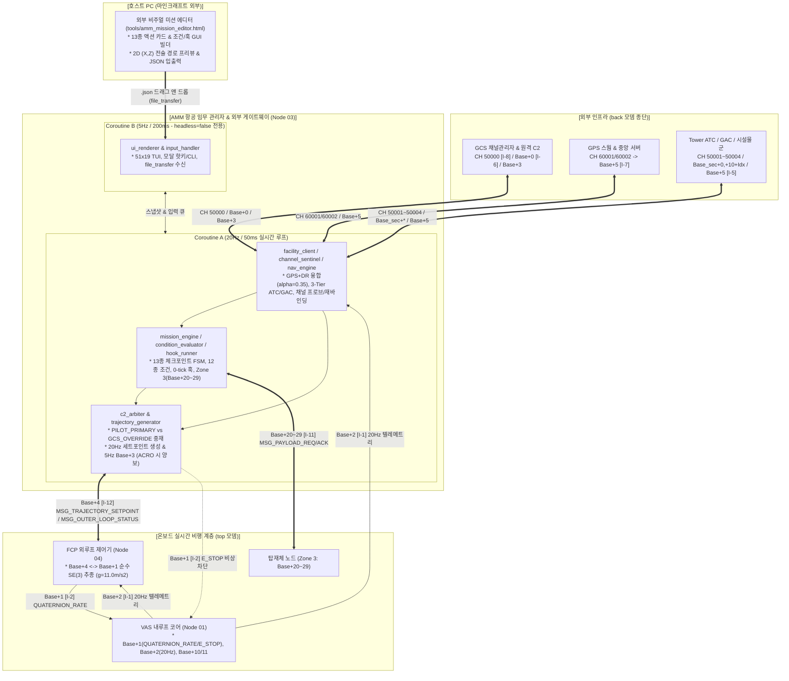
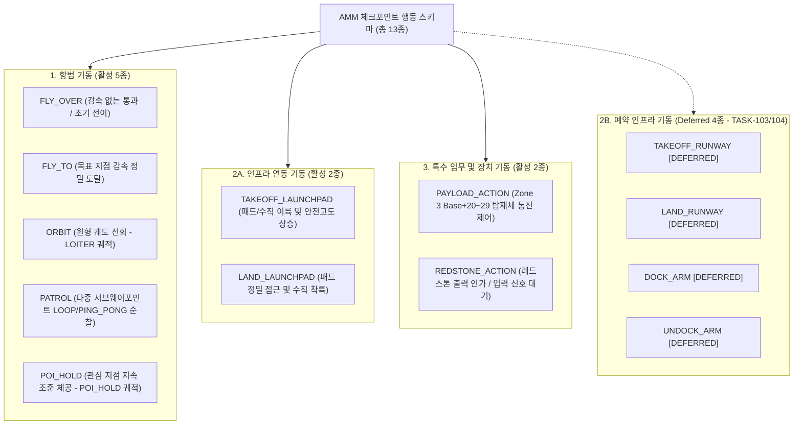
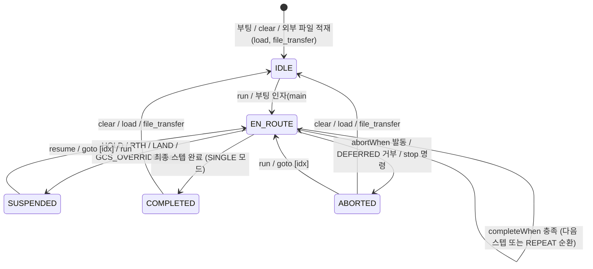

# AMM (항공 임무 관리자·외부 게이트웨이 및 조종석 통합 단말) 상세 규격서
> **AMM: Aircraft Mission Manager, External Gateway, Navigation/Trajectory Engine & Cockpit Terminal (Layer 3 Planning & C2 Station)**  
> **프로젝트**: Universal Autonomous Flight Stack (UAFS Ecosystem)  
> **운영 환경**: Minecraft CC:Tweaked, Create: Aeronautics, Create: Avionics  

| 항목 | 내용 |
| :--- | :--- |
| **문서 상태 (Status)** | `Approved` |
| **문서 버전 (Version)** | `v1.3.0` |
| **최종 수정일 (Date)** | `2026-11-12` |
| **구현 코드 (Source)** | `src/3_planning/amm/` |
| **주관 도메인 (Domain)** | 임무 계획, 외부 인프라 게이트웨이, 항법·궤적 생성 및 조종석 통합 단말 (AMM / Node 03) |

> **연관 문서**: 
> - [AUTONOMOUS_FLIGHT_SYSTEM_ARCHITECTURE_AND_ICD.md](../../../system/AUTONOMOUS_FLIGHT_SYSTEM_ARCHITECTURE_AND_ICD.md) (마스터 ICD v1.28.0)
> - [SYSTEM_PROGRAM_RELATION_AND_PACKET_DIAGRAM.md](../../../system/SYSTEM_PROGRAM_RELATION_AND_PACKET_DIAGRAM.md) (전체 구조도 v2.13.0)
> - [FCP_PROGRAM_SPECIFICATION.md](../../2_guidance/fcp/FCP_PROGRAM_SPECIFICATION.md) (외루프 유도 제어기 v2.0.0)
> - [VAS_PROGRAM_SPECIFICATION.md](../../1_control/vas/VAS_PROGRAM_SPECIFICATION.md) (비행 제어 코어 v1.19.0)
> - [GAC_PROGRAM_SPECIFICATION_AND_ICD.md](../../0_infra/gac/GAC_PROGRAM_SPECIFICATION_AND_ICD.md) (지상 구역 관제사 v1.4.2)
> - [GPS_PROGRAM_SPECIFICATION_AND_ICD.md](../../0_infra/gps/GPS_PROGRAM_SPECIFICATION_AND_ICD.md) (고정밀 GPS v2.3.1)
> - [GCS_PROGRAM_SPECIFICATION_AND_ICD.md](../../0_infra/gcs/GCS_PROGRAM_SPECIFICATION_AND_ICD.md) (GCS 채널 관리자 및 관제 콘솔 v1.0.2)
> - [RUNWAY_SPECIFICATION_AND_ICD.md](../../0_infra/runway/RUNWAY_SPECIFICATION_AND_ICD.md) (활주로 규격서 v1.10.7)
> - [LANDING_PAD_SPECIFICATION_AND_ICD.md](../../0_infra/landing_pad/LANDING_PAD_SPECIFICATION_AND_ICD.md) (착륙패드 규격서 v2.4.3)
> - [DOCKING_ARM_SPECIFICATION_AND_ICD.md](../../0_infra/docking_arm/DOCKING_ARM_SPECIFICATION_AND_ICD.md) (도킹암 규격서 v1.11.2)
> - [GEMINI.md](../../../../GEMINI.md) (전역 컨텍스트 및 규칙)

### Revision History

| 버전 | 개정 일자 | 개정 요약 | 개정 사유 |
| :---: | :---: | :--- | :--- |
| `v1.3.0` | `2026-11-12` | FCP-AMM 역할 분리 및 AMM(Node 03) 승격 개편: ① 듀얼 무선 엔더 모뎀(`top` 온보드 + `back` 외부 인프라, 단일 모뎀 폴백 포함) 기반 외부 인프라 게이트웨이(`CH 50000` 부트스트랩, `CH 50001~50004` ATC/GAC/비콘/디스패치, $Base_{\text{sec}}+*$ 섹터/전술, `CH 60001/60002` + `Base+5` GPS) 이관, ② 20Hz 항법 융합 엔진(`nav_engine`: GPS+DR 상보 필터 $\alpha=0.35$, 기구학 게이트 $8.0\text{m}$, 5,000ms GPS 두절 시 체공 전환) 및 20Hz 궤적 생성기(`trajectory_generator`: `TAKEOFF`/`CRUISE`/`LOITER`/`POI_HOLD`/`APPROACH_LAND`/`LANDING`/`DOCKING`/`FAILSAFE_RTH`/`HOVER_HOLD`/`EMERGENCY_LAND`, 4단계 도킹 및 `-0.8` Abort, 동적 갑판 2차 테일러 외삽, 가상 ILS) 신설, ③ `[I-12]` `Base+4` (`CH_TRAJECTORY_CMD`: `MSG_TRAJECTORY_SETPOINT` 20Hz 송출 / `MSG_OUTER_LOOP_STATUS` 수신 / `MSG_CHANNEL_REBIND` 개시) 신설 및 구 `AMM -> FCP` `MSG_OPERATOR_CMD` (`Base+0`) `[DEPRECATED]` 처리, ④ `Base+0` 단일 C2 수신 중재(`PILOT_PRIMARY` vs `GCS_OVERRIDE`), `Base+2` 20Hz 수신 및 `Base+3` 5Hz 단독 MFD 다운링크(`MFD_ACRO` 시 즉시 양보), ⑤ Coroutine A(20Hz 실시간 제어/통신) + Coroutine B(5Hz TUI 렌더러) 분리 및 Tier-1 외부 페일세이프 매트릭스 정립 | 계층 직교성(AMM: 임무·외부 게이트웨이·항법·궤적 / FCP: 순수 `SE(3)` 외루프 / VAS: `SO(3)` 내루프) 확립 및 마스터 ICD `v1.28.0` 동기화 |
| `v1.2.0` | 2026-11-11 | 호스트 PC 외부 비주얼 미션 에디터(`tools/amm_mission_editor.html`) 및 외부 파일 즉시 구동 워크플로우 명세 신설: ① `mission_engine` 다중 경로 리졸버(`resolve_path`: 원문 경로, `.json` 보강, `missions/`, `/disk/`, `/disk/missions/`) 및 프리플라이트 스키마 검증기(`validate_mission_table`, `SCHEMA_INVALID` 반환), ② 3대 외부 파일 즉시 구동 채널(CLI `run`/`load`/`files`, 셸 부팅 인자 `main.lua <path> [loop]` 및 `autoStartMission`, CC 창 마우스 드래그 앤 드롭 `file_transfer` 이벤트 수신 및 `IDLE` 즉시 적재), ③ 브라우저 기반 단일 파일 웹 GUI 에디터(`tools/amm_mission_editor.html` — 13종 액션 폼, 조건/훅 빌더, 2D $(X,Z)$ 경로 프리뷰 캔버스, 실시간 검증, JSON 입출력) 규격 추가 | 외부 GUI 에디터 기반 직관적 미션 저작 및 외부 파일 무중단 투입·즉시 구동 지원 |
| `v1.1.0` | 2026-11-11 | Layer 3(AMM) 및 구 Layer 4(AMP) 미션 시퀀서를 3분할 코어 모듈(`mission_engine`, `condition_evaluator`, `hook_runner`)로 통합: 13종 체크포인트 스키마(활성 9종 + 예약 4종), 12종 `completeWhen`/`abortWhen` 복합 조건 평가기, 0-tick 비차단 라이프사이클 훅(`onEnter`/`onExit`/`onAbort`), Zone 3(`Base+20~29`) 동적 탑재체 교신(`MSG_PAYLOAD_REQ`/`ACK`), `Base+0` 원격 미션 제어(`MSG_MISSION_CMD`/`ACK`), 무인기 헤드리스(`config.headless`) 겸용 토폴로지, 51x19 TUI 6행 스크롤 뷰포트 + 5행 조건 진행률 표시 및 `run`/`stop`/`next` CLI 확장 (`Implemented` $\to$ `Approved`) | TASK-202 통합 미션 시퀀서 엔진 및 조종석 단말 사양 고도화 |
| `v1.0.1` | 2026-11-08 | 구버전 명칭 전면 척결 및 표준 명칭(FCP/ASA) 동기화 | 용어 무결성 확보 |
| `v1.0.0` | 2026-11-08 | AMM 상세 규격서 초안(Draft) 최초 작성: 조종석 MFD(Node 03) 일체화 분할 TUI(51x19), 단방향 순차 웨이포인트 큐, 도달 판정(2D 15m) 및 FCP(`Base+0`) 하달, GCS 원격 C2 중계 및 권한 탈환, 원터치 핫키 및 CLI 복합 입력 규격화 | Planning 계층 신규 프로그램 설계 및 조종석 C2 단말 통합 |

---

## 1. 프로그램 개요 및 시스템 위상 (Overview & System Role)

### 1.1 시스템 정체성 및 역할 승격
**AMM (Aircraft Mission Manager / Node 03)**은 비행체 조종석의 온보드 컴퓨터(CC:Tweaked Advanced Computer) 또는 무인기의 임무 컴퓨터에서 가동되는 **전략 임무 계획(Layer 3), 외부 인프라 단일 게이트웨이, 20Hz 항법 융합 및 궤적 생성기, 그리고 조종석 통합 C2 단말(Cockpit C2 Terminal)**입니다.

자율 비행 생태계에서 하위 **FCP (Node 04)**가 `Base+4` $\leftrightarrow$ `Base+1` 구간에 격리된 **순수 온보드 `SE(3)` 외루프 추종 제어기** 역할에 전념하고, **VAS (Node 01)**가 `SO(3)` 내루프 자세·추력·공력면 믹싱을 전담하는 구조로 개편됨에 따라, **AMM (Node 03)**은 다음 **5대 핵심 책임**을 총괄합니다:

1. **전략 임무 계획 및 13종 체크포인트 시퀀서 (`v1.1.0`/`v1.2.0` 계승)**:
   - 3분할 미션 코어(`mission_engine.lua`, `condition_evaluator.lua`, `hook_runner.lua`) 기반 다중 체크포인트 시퀀싱, 12종 복합 완료/중단 조건(`completeWhen`/`abortWhen`) 평가, 0-tick 라이프사이클 훅(`onEnter`/`onExit`/`onAbort`), Zone 3(`Base+20~29`) 동적 탑재체 제어, 로컬 레드스톤 입출력, **호스트 PC 무설치 웹 GUI 미션 에디터(`tools/amm_mission_editor.html`)** 및 **외부 파일 즉시 구동 파이프라인(`resolve_path`, `validate_mission_table`, `file_transfer`, 셸 부팅 인자)**을 일관 유지합니다.
2. **외부 인프라 단일 무선 게이트웨이 (`facility_client`, `channel_sentinel`)**:
   - **GCS 부트스트랩 및 채널 무결성**: `CH 50000` (`[I-8]`, `MSG_BLOCK_REQUEST`/`ASSIGN`), `Base+0` 채널 선점 프로브(`MSG_CHANNEL_PROBE`/`ACK`), 4계층 채널 재바인딩(`MSG_CHANNEL_REBIND` via `Base+4 -> Base+1 -> Base+10/11`)을 주도합니다.
   - **3-Tier 공항·시설물 관제 연동 (`[I-5]`)**: `CH 50003` 1Hz 섹터 대표 비콘(`MSG_FACILITY_BEACON`), `CH 50004` GAC 디스패치, `CH 50001` Tower ATC 접근/이륙 관제, $Base_{\text{sec}} + 0$ GAC 섹터 체크인/패드 배정/로컬 복행 중재, $Base_{\text{sec}} + 10 + \text{Idx}$ 전술 정밀 유도(`MSG_FACILITY_STATIC_GUIDE` 1Hz / `MSG_FACILITY_DYNAMIC_GUIDE` 20Hz) 및 `Base+5` 도킹 체결/엄빌리컬 통보를 전담 종단합니다.
   - **고정밀 GPS 클라이언트 (`[I-7]`)**: `CH 60001`(`MSG_GPS_REQUEST`, `VAS Base+2` 실측 `altitudeY` 주입), `CH 60002`(`MSG_GPS_STATUS_REQ`/`RESP`) 및 `Base+5`(`MSG_GPS_RESPONSE`) 교신을 전담합니다.
3. **20Hz 항법 상태 추정 엔진 (`nav_engine`)**:
   - 5~10Hz 비동기 GPS 응답(`gpsClient.handleMessage()` 직접 주입)과 20Hz `VAS Base+2` (`MSG_FLIGHT_TELEMETRY`) 속도/진방위 기반 추측항법(Dead Reckoning, $\Delta t = 0.05\text{s}$)을 결합하고, 기구학 게이트($\Delta d_{\max} = 8.0\text{m}$, 3회 연속 일관성 검증) 및 상보 필터($\alpha = 0.35$, `hdop > 3.0` 또는 `accuracy > 2.0m` 시 $\le 0.1$)로 정밀 위치 `currentPos`를 산출합니다.
   - GPS 응답 5,000ms 초과 두절 시(`gpsTimedOut = true`) 추측항법으로 전환하며, 안전 체공(`LOITER` $R=30\text{m}$ 또는 `HOVER_HOLD`) 궤적을 개시하고 MFD/GCS 경보를 송출합니다.
4. **20Hz 실시간 궤적 생성기 (`trajectory_generator`, `Base+4` `[I-12]`)**:
   - 미션 시퀀서, C2 조종 명령, 시설물 전술 유도 벡터를 통합하여 `FCP (Node 04)`로 송출할 20Hz 목표 궤적 `{ targetPos, targetVel, feedforwardAccel, targetHeading }` 및 `{ arm, flightActive, flightMode, constraintProfile, flapHint, translationBiasHint }`를 산출합니다.
   - 지원 비행 모드(11종): `IDLE_ARMED`, `TAKEOFF`, `CRUISE`, `LOITER` (방사+접선 벡터 합성), `POI_HOLD` ($\le 30.0^\circ/\text{s}$ 표적 조준), `APPROACH_LAND`, `LANDING` (2단계 감속 착륙 및 가상 ILS 로컬라이저/3° 글라이드슬로프), `DOCKING` (4단계 정밀 랑데부 $>20\text{m} \to 20\sim 5\text{m} \to 5\sim 0.5\text{m}$ 크립 $\le 0.4\text{m/s}$, 허용공차 $|e_y|,|e_z|\le 0.15\text{m}$, $|\Delta\psi|\le 2.0^\circ \to$ 포획 및 `surge = -0.8` 비상 이탈 Abort), `FAILSAFE_RTH`, `HOVER_HOLD`, `EMERGENCY_LAND` ($-2.0\text{m/s}$).
   - 동적 모선/함상 시설물 접근 시 2차 테일러 외삽($\vec{r}_{deck}(t+\Delta t) \approx \vec{r}_{deck} + \vec{v}_{deck}\Delta t + \frac{1}{2}\vec{a}_{deck}\Delta t^2$, $\vec{v}_{deck}(t+\Delta t) \approx \vec{v}_{deck} + \vec{a}_{deck}\Delta t$)을 통해 이동 갑판의 위치·속도·가속도 피드포워드를 생성합니다.
5. **온보드 C2 단일 진입(`Base+0`) 및 평시 5Hz MFD 단독 송출(`Base+3`)**:
   - `Cockpit MFD` 및 `GCS`의 모든 비행 모드(`TAKEOFF`~`DOCKING`), `RTH`/`HOVER_HOLD`/`EMERGENCY_LAND`, 원격 미션 제어(`MSG_MISSION_CMD`)를 `Base+0` 단일 관문에서 수신해 `c2_arbiter`로 중재(`GCS_OVERRIDE` > `PILOT_PRIMARY`)합니다.
   - `VAS` `Base+2` (`MSG_FLIGHT_TELEMETRY`, 20Hz) 및 `FCP` `Base+4` (`MSG_OUTER_LOOP_STATUS`)를 통합해 평시 **5Hz `Base+3` (`MSG_MFD_STATE`)**을 단독 송출하며, `VAS Base+2`에서 `activeSource == "MFD_ACRO"` 감지 시 `Base+3` 송출을 즉시 일시 중단(Yield)하여 `VAS`의 20Hz ACRO HUD가 채널을 단독 사용하도록 양보합니다.



### 1.2 8대 설계 목표 (Goals)
1. **13종 체크포인트 통합 시퀀싱 (Active 9종 + Deferred 4종)**:
   - 현행 활성 기종(`VECTORED_VTOL`, `ADVANCED_VTOL`, `QUADROTOR`, `HEXAROTOR`, `WINGED_VTOL`, `FIXED_WING`) 및 인프라(`LANDING_PAD`, `GAC`)에서 즉시 운용 가능한 **활성 9종**(`FLY_OVER`, `FLY_TO`, `ORBIT`, `PATROL`, `POI_HOLD`, `TAKEOFF_LAUNCHPAD`, `LAND_LAUNCHPAD`, `PAYLOAD_ACTION`, `REDSTONE_ACTION`)을 지원하고, 후속 과제(`TASK-103` 활주로, `TASK-104` 도킹암) 런타임 통합 전까지 시퀀서의 **예약 4종**(`TAKEOFF_RUNWAY`, `LAND_RUNWAY`, `DOCK_ARM`, `UNDOCK_ARM`)은 진입 시 안전 거부(`DEFERRED_ACTION_UNSUPPORTED`) 처리합니다.
2. **계층 직교 분리: AMM(20Hz 외부 게이트웨이·항법·궤적·시퀀서) $\leftrightarrow$ FCP(20Hz 순수 `SE(3)` 외루프)**:
   - AMM은 외부 인프라 교신, GPS/DR 항법 융합, 미션 시퀀싱 및 20Hz 목표 궤적(`targetPos`, `targetVel`, `feedforwardAccel`, `targetHeading`) 생성을 전담하여 `Base+4` (`[I-12]`)로 하달하며, FCP는 오직 `SE(3)` 가속도/자세 투영(`Base+1` `QUATERNION_RATE`)만을 담당합니다.
3. **20Hz 항법 융합 및 2차 테일러 동적 궤적 생성**:
   - `nav_engine`은 5~10Hz GPS와 20Hz `Base+2` DR을 상보 필터($\alpha=0.35$)로 융합하며, `trajectory_generator`는 4단계 도킹(`-0.8` Abort 포함), 동적 갑판 2차 테일러 외삽, 가상 ILS, `LOITER`/`POI_HOLD`를 단일 20Hz 파이프라인으로 생성합니다.
4. **12종 복합 조건 평가 및 기본 완료 조건 자동 보강**:
   - `completeWhen` 및 `abortWhen`에 `logic: "ANY" | "ALL"` 복합 논리 연산을 지원하고, 체크포인트 JSON에 `completeWhen`이 생략된 경우 액션별 표준 기본 조건을 자동 적용합니다.
5. **0-Tick 비차단 라이프사이클 훅 및 동적 Zone 3 채널 관리**:
   - `onEnter`, `onExit`, `onAbort` 훅은 타이머 데드라인 큐를 통해 이벤트 루프 블로킹 없이 실행하며, Zone 3(`Base + 20 ~ 29`) 탑재체 채널은 해당 스텝 활성 중에만 동적으로 개방(`modem.open`) 및 해제(`modem.close`)합니다.
6. **20Hz 실시간 코어 + 5Hz 51x19 TUI 코루틴 격리 및 헤드리스 겸용**:
   - Coroutine A(20Hz)와 Coroutine B(5Hz TUI: 우측 6행 스크롤 뷰포트 + 5행 조건 진행률)를 `parallel.waitForAny`로 격리하며, `config.headless = true` 시 Coroutine B를 생략하되 Coroutine A는 `Base+3` 5Hz 원격 HUD 송출을 유지합니다.
7. **`Base+0` 단일 C2 진입 및 `Base+3` MFD 다운링크(`MFD_ACRO` 양보)**:
   - 모든 C2 명령(`MSG_OPERATOR_CMD`, `MSG_MISSION_CMD`)을 `Base+0` 단일 관문에서 중재하며, 평시 5Hz `Base+3` 다운링크를 단독 송출하되 `VAS Base+2` `activeSource == "MFD_ACRO"` 시 즉시 양보합니다.
8. **호스트 PC 외부 비주얼 에디터 및 외부 파일 즉시 구동**:
   - 무설치 웹 GUI 에디터(`tools/amm_mission_editor.html`)로 미션 JSON을 제작·검증하고, 드래그 앤 드롭(`file_transfer`), `/disk`, 셸 부팅 인자(`main.lua <path>`), CLI(`run <path>`)로 즉시 구동합니다.

### 1.3 비목표 및 반목표 (Non-Goals & Anti-Goals)
- **Non-Goals (보류/제외 범위)**:
  - 3차원 A* 격자/그래프 경로 탐색 및 지형 고도 회피.
  - CC:Radars 기반 동적 이동체 충돌 회피 (레이더 트리거 연동은 Zone 3 `PAYLOAD_ACTION` 인터페이스로만 추상화).
  - 다중 기체 편대 비행 슬롯 오케스트레이션 (Zone 4 `Base+30~39` 후속 과제로 분리).
  - 미션 시퀀서 내 활주로(`TAKEOFF_RUNWAY`, `LAND_RUNWAY`) 및 도킹암(`DOCK_ARM`, `UNDOCK_ARM`) 체크포인트 실기동 활성화 (`trajectory_generator`가 전술 궤적 수식을 보유하되, `mission_engine` 실행 단계는 `TASK-103`, `TASK-104` 물리 노드 연동 완료 전까지 `DEFERRED` 상태 유지).
  - 수동 급기동 ACRO 20Hz 직결 조종간 (`Base + 1`, `TASK-301` 물리 컨트롤러 과제로 분리).
- **Anti-Goals (금지 사항)**:
  - `AMM` 내부에서 `SE(3)` 가속도-쿼터니언/집합추력 역투영(`FCP` 전담)이나 `SO(3)` 내루프 자세·추력·공력면 믹싱(`VAS` 전담)을 수행하지 않는다.
  - `VAS Base+2` 텔레메트리가 `activeSource == "MFD_ACRO"`를 보고하는 동안 `Base+3` (`MSG_MFD_STATE`)을 송출하여 `VAS`의 20Hz ACRO HUD와 채널 경합을 일으키지 않는다.
  - 20Hz Coroutine A(`hook_runner`, `facility_client`, `nav_engine`, `trajectory_generator`, `network_manager`) 내부에서 `sleep()`을 호출하여 실시간 제어·수신 루프를 블로킹하지 않으며, 5Hz TUI 렌더링(`Coroutine B`)이 Coroutine A의 50ms 주기를 지연시키지 않도록 격리한다.

---

## 2. 검토된 대안 및 채택 아키텍처 (Architectural Approaches)

### 2.1 노드 토폴로지 및 FCP-AMM 역할 경계 대안 비교

| 비교 항목 | 방안 1: AMM 외부/항법/궤적 통합 + FCP 순수 `SE(3)` 분리 (채택) | 방안 2: 구 FCP 외부 게이트웨이 겸임 + AMM 단순 웨이포인트 송출 | 방안 3: Layer 3(AMM) + Layer 4(AMP) 노드 분리 |
| :--- | :--- | :--- | :--- |
| **노드 구성** | `AMM (Node 03)`(임무·외부 RF·항법·궤적·C2) + `FCP (Node 04)`(`Base+4`/`+2`/`+1` 순수 `SE(3)`) | `FCP`가 외부 RF·GPS·ATC·궤적·`SE(3)`·C2·HUD를 모두 겸임 | AMM 단말(Node 03) + AMP 미션 데몬(Node 08) + FCP |
| **통신 홉 및 채널** | `AMM` $\to$ `FCP` (`Base + 4` 단일 20Hz 궤적 버스; 구 `AMM -> FCP` `Base+0` `[DEPRECATED]`) | `AMM` $\to$ `FCP` (`Base+0`) + `FCP` 내부 과밀 | 2-Hop: AMP $\to$ AMM (`Base+6` `[DEPRECATED]` 검토안 폐기) $\to$ FCP |
| **단일 책임 및 지연** | 외부 패킷 파싱·TUI·미션 부하가 `FCP` 20Hz `SE(3)` 루프로 전이되지 않음 | 외부 ATC/GPS/파일 I/O와 20Hz 외루프가 단일 FCP 노드에 혼재 | 노드 수 증가 및 상태 동기화 오버헤드 발생 |
| **평가 결과** | **최종 채택** (4계층 직교 분리 및 단일 모뎀 FCP 격리 확립) | 기각 (FCP 비대화 및 책임 경계 모호) | 기각 (불필요한 내부 RF 홉 및 큐 이중화 발생) |

### 2.2 소프트웨어 모듈 분할 대안 비교

| 비교 항목 | 대안 1: 단일 `mission_engine.lua` 통합 | 대안 2: 3분할 미션 코어 + 항법/외부/궤적 직교 모듈 (채택) | 대안 3: `waypoint_queue.lua` 폐기 및 전면 교체 |
| :--- | :--- | :--- | :--- |
| **모듈 구조** | `mission_engine`에 FSM·조건·훅·궤적·항법 혼재 | 미션 코어(`mission_engine`, `condition_evaluator`, `hook_runner`, `waypoint_queue`) + 항법·게이트웨이·궤적(`nav_engine`, `facility_client`, `channel_sentinel`, `trajectory_generator`) | `waypoint_queue.lua` 삭제 및 전체 재작성 |
| **단일 함수/파일 복잡도** | 단일 파일 비대화 및 결합도 상승 | 파일별 책임 직교 분리 및 단일 함수 50줄 이하 유지 용이 | 기존 API 단절 |
| **하위 호환 및 회귀** | 기존 테스트 유지 | 기존 단위/돌연변이 테스트(`MUT-04`, `MUT-05`) 보존 + 신규 모듈 독립 단위 테스트 가능 | `MUT-04` 전면 재작성 필요 |
| **평가 결과** | 보류 (결합도 높음) | **최종 채택** (단일 책임 원칙, 테스트 호환성, 50줄 제한 동시 충족) | 기각 (불필요한 하위 호환 파괴) |

### 2.3 듀얼 코루틴 실행 모델 (Coroutine A 20Hz + Coroutine B 5Hz 격리)

터미널 `term.blit` 렌더링 및 로컬 파일/키보드 처리가 20Hz 항법·궤적 생성 및 50ms `Base+4` 송출 주기를 지연시키지 않도록, `main.lua`는 CC:Tweaked `parallel.waitForAny` 기반의 **2-코루틴 분리 실행 모델**을 채택합니다:

| 구분 | 실행 주기 | 구동 조건 | 소속 모듈 및 담당 파이프라인 |
| :--- | :---: | :---: | :--- |
| **Coroutine A (`runtime_loop`)** | **20Hz (50ms 틱)** + 이벤트 | 상시 가동 (`headless` 무관) | • `network_manager`: `top`/`back` 모뎀 수신 라우팅 (`Base+0`, `Base+1`, `Base+2`, `Base+4`, `Base+5`, `Base+20~29`, `50000~50004`, `Base_sec+*`, `60001/60002`)<br>• `channel_sentinel`: 기동 부트스트랩(`50000`), 프로브(`Base+0`), 동적 재바인딩(`Base+4`)<br>• `nav_engine`: 5~10Hz GPS 핑 + `gpsClient.handleMessage` + 20Hz `Base+2` DR 상보 필터($\alpha=0.35$)<br>• `facility_client`: 3-Tier ATC/GAC/전술 유도(`Base_sec+10+Idx`) + 도킹 상태 수신(`Base+5`)<br>• `mission_engine` / `condition_evaluator` / `hook_runner`: 체크포인트 FSM, 20Hz 조건 판정, 0-tick 훅 데드라인 큐<br>• `c2_arbiter`: `Base+0` 권한 중재 (`GCS_OVERRIDE` > `PILOT_PRIMARY`) 및 `Base+1` `E_STOP`<br>• `trajectory_generator`: 20Hz `MSG_TRAJECTORY_SETPOINT` (`Base+4`) 산출·송출<br>• 5Hz MFD 다운링크(매 4틱): `Base+3` `MSG_MFD_STATE` 송출 (`activeSource == "MFD_ACRO"` 시 즉시 양보) |
| **Coroutine B (`tui_loop`)** | **5Hz (200ms 틱)** + 입력 이벤트 | **`headless == false` 전용**<br>(`headless == true` 시 완전 미실행) | • `ui_renderer`: Coroutine A 상태 스냅샷 기반 51x19 `term.blit` 무깜빡임 렌더링<br>• `input_handler`: 로컬 `char`/`key`/`Ctrl+X` 모달 입력 큐잉 -> Coroutine A `c2_arbiter` 전달<br>• `file_transfer` 드래그 앤 드롭 수신 -> 스키마 검증 후 `missions/` 저장 및 큐 전달 |

> [!NOTE]
> `headless == true` (무인기 모드)에서는 `Coroutine B`를 생성하지 않고 `Coroutine A` 단일 루프로 구동됩니다. 이때도 `Coroutine A`는 매 4틱(5Hz)마다 `Base+3` (`MSG_MFD_STATE`)을 정상 송출하여 GCS 및 원격 관제 뷰어에 계기·항법 상태를 제공합니다(`MFD_ACRO` 시 양보 규칙 동일 적용).

---

## 3. 하드웨어 구성 및 RF 네트워크 인터페이스 (Hardware & Network)

### 3.1 하드웨어 요구사항 및 듀얼 무선 엔더 모뎀 토폴로지
- **컴퓨터 본체**: CC:Tweaked Advanced Computer (유인 조종석 51x19 컬러 터미널 구동 시) 또는 Standard/Advanced Computer (`headless: true` 무인기 탑재 시) 1대.
- **무선 엔더 모뎀 (`modem`) 듀얼 구성 및 단일 모뎀 폴백**:
  - **내부 온보드 모뎀 (`primaryModemSide = "top"`)**: 기체 내부 Zone 1 코어 채널(`Base + 0`, `Base + 1`, `Base + 2`, `Base + 3`, `Base + 4`) 및 Zone 3 탑재체 채널(`Base + 20 ~ 29` 동적 개방) 전담.
  - **외부 인프라 모뎀 (`infraModemSide = "back"`)**: 지상/공역 인프라 채널(`CH 50000`, `CH 50001`, `CH 50003`, `CH 50004`, $Base_{\text{sec}} + 0$, $Base_{\text{sec}} + 10 + \text{Idx}$, `CH 60001`, `CH 60002`) 및 외부 1:1 회신 전용 채널(`Base + 5`, GPS/도킹/접지 응답) 전담.
  - **단일 모뎀 폴백 (Single-Modem Fallback)**: 기체 공간 제약으로 `back` 모뎀(`infraModemSide`)이 장착되지 않은 경우(`peripheral.wrap(infraModemSide) == nil`), `network_manager`는 부팅 시 경고를 기록하고 **`top` 단일 모뎀(`primaryModemSide`)에 온보드 채널과 외부 인프라 채널의 전체 합집합(Union)을 자동 개방**하여 무수정 동작합니다.
- **레드스톤 인터페이스 (선택)**: 컴퓨터 6면(`top`, `bottom`, `left`, `right`, `front`, `back`) 일반 아날로그/디지털 레드스톤 또는 16색 번들 케이블(`redstone.setBundledOutput` / `getBundledInput`).

### 3.2 RF 네트워크 채널 규격 ($Base = 10000 + (N-1) \times 40$, $Base_{\text{sec}} = 50001 + S \times 200$)

AMM은 기체 전용 40채널 블록(Zone 1/3)과 외부 인프라 대역을 모두 관할합니다:

| 대역 / 모뎀 | 채널 식별자 | 채널 번호 | 통신 방향 | 패킷 타입 | 주기 / 트리거 | 통신 목적 및 거동 |
| :---: | :--- | :---: | :---: | :--- | :---: | :--- |
| **온보드 (`top`)** | **`CH_OPERATOR_C2`** | `Base + 0` | Cockpit / GCS $\to$ AMM (수신) | `MSG_OPERATOR_CMD` | 이벤트 | 조종사/GCS 비행 모드·목표·`RTH`/`HOVER_HOLD`/`EMERGENCY_LAND` 단일 진입 *(구 `AMM -> FCP` `MSG_OPERATOR_CMD` `[DEPRECATED]`)* |
| **온보드 (`top`)** | **`CH_OPERATOR_C2`** | `Base + 0` | GCS $\leftrightarrow$ AMM (송수신) | `MSG_MISSION_CMD` / `MSG_MISSION_ACK` | 이벤트 | GCS 원격 미션 제어(`RUN`/`STOP`/`PAUSE`/`RESUME`/`NEXT`) 및 상태 회신 |
| **온보드 (`top`)** | **`CH_OPERATOR_C2`** | `Base + 0` | AMM $\leftrightarrow$ 인접 기체 (송수신) | `MSG_CHANNEL_PROBE` / `MSG_CHANNEL_PROBE_ACK` | Arming 전 200ms | 독립 기동 시 채널 선점 충돌 탐색 및 충돌 감지 시 `ARMING_LOCKED` |
| **온보드 (`top`)** | **`CH_FLIGHT_GUIDANCE`** | `Base + 1` | AMM $\to$ VAS (송신)<br>VAS $\to$ AMM (수신) | `MSG_EMERGENCY_OVERRIDE`<br>`MSG_EMERGENCY_ALERT` | 비상 이벤트 | `[X]`/`Ctrl+X` 하드 킬스위치(`E_STOP`) 직결 차단 및 VAS 공중 셧다운 경보 수신 |
| **온보드 (`top`)** | **`CH_TELEMETRY`** | `Base + 2` | VAS $\to$ AMM (수신) | `MSG_FLIGHT_TELEMETRY` | 20Hz (50ms) | `nav_engine` DR 적분, `condition_evaluator` 조건/연료 평가, `activeSource == "MFD_ACRO"` 양보 감지, HUD 계측 |
| **온보드 (`top`)** | **`CH_MFD_STATE`** | `Base + 3` | AMM $\to$ MFD / GCS (송신) | `MSG_MFD_STATE` | 5Hz (200ms) | 평시 계층 통합 계기판 다운링크 (`activeSource == "MFD_ACRO"` 시 즉시 송출 중단/양보) |
| **온보드 (`top`)** | **`CH_TRAJECTORY_CMD`** *(구 `CH_NAV_SENSOR` `[DEPRECATED]`)* | `Base + 4` | AMM $\to$ FCP (송신)<br>FCP $\to$ AMM (수신)<br>AMM $\leftrightarrow$ FCP | `MSG_TRAJECTORY_SETPOINT`<br>`MSG_OUTER_LOOP_STATUS`<br>`MSG_CHANNEL_REBIND/_ACK` | 20Hz / On-Change / 이벤트 | `[I-12]` 20Hz 목표 궤적·융합 위치·비행모드 하달, 외루프 FSM/오차/포화 피드백 수신, 4계층 재바인딩 개시 |
| **온보드 (`top`)** | **`CH_PAYLOAD_BUS`** | `Base + 20 ~ 29` | AMM $\leftrightarrow$ 탑재체 (송수신) | `MSG_PAYLOAD_REQ` / `MSG_PAYLOAD_ACK` | 스텝/훅 활성 시 | `[I-11]` Zone 3 탑재체 제어 요청 및 완료 응답 수신 (동적 오픈/해제) |
| **외부 (`back`)** | **`CH_EXTERNAL_COMM`** | `Base + 5` | GPS/시설물 $\leftrightarrow$ AMM | `MSG_GPS_RESPONSE`, `MSG_DOCK_CAPTURE_STAGE`, `MSG_UMBILICAL_STATUS`, `MSG_TOUCHDOWN_COMPLETE` | 5~10Hz / 이벤트 | GPS 서버 2D 측위 응답 수신(구 `10045` `[DEPRECATED]`), 도킹 결합·엄빌리컬·접지 통보 교환 |
| **외부 (`back`)** | **`CH_BOOTSTRAP`** | `50000` | AMM $\leftrightarrow$ GCS 채널관리자 | `MSG_BLOCK_REQUEST` / `MSG_BLOCK_ASSIGN` | 부팅 1회 | `[I-8]` 기체 전용 40채널 블록($BW=40$) 최초 할당 및 영속화 |
| **외부 (`back`)** | **`CH_ATC_COMM`** | `50001` | AMM $\leftrightarrow$ Tower ATC | `MSG_ATC_APPROACH_REQ`, `MSG_ATC_HANDOFF_CLEARANCE`, `MSG_ATC_DEPARTURE_COMPLETE` | 이벤트 / 15s 재시도 | `[I-5]` 광역 공역 접근 인가, 섹터 GAC 채널 수령, 공역 이탈 통보 |
| **외부 (`back`)** | **`CH_FACILITY_BEACON`** | `50003` | GAC $\to$ AMM (수신) | `MSG_FACILITY_BEACON` | 1Hz (1000ms) | `[I-5]` 섹터 집약 가용 시설물 목록·중량/반경 제한·지상풍 인벤토리 수집 |
| **외부 (`back`)** | **`CH_GAC_DISPATCH`** | `50004` | GAC $\to$ AMM (수신) | `MSG_GAC_DISPATCH` | 1Hz / 이벤트 | `[I-5]` 활성 섹터 주파수 디렉터리 수신 |
| **외부 (`back`)** | **`CH_GAC_COMM`** | $Base_{\text{sec}} + 0$ | AMM $\leftrightarrow$ GAC | `MSG_GAC_CHECKIN_REQ`, `MSG_GAC_APPROACH_CLEARANCE`, `MSG_GAC_ABORT_CLEAR`, `MSG_GAC_DEPARTURE_*` | 이벤트 | `[I-5]` 섹터 체크인, 최적 시설물/전술채널 배정 인가, 복행 안전고도 보고, 이륙 관제 |
| **외부 (`back`)** | **`CH_TACTICAL_GUIDANCE`** | $Base_{\text{sec}} + 10 + \text{Idx}$ | Facility $\leftrightarrow$ AMM | `MSG_FACILITY_STATIC_GUIDE`, `MSG_FACILITY_DYNAMIC_GUIDE`, `MSG_ABORT_APPROACH`, `MSG_TOUCHDOWN_COMPLETE` | 1Hz(고정) / 20Hz(동적) | `[I-5]` 정적/동적 착륙패드·활주로·도킹암 전술 유도 벡터 수신 및 접지 통보 |
| **외부 (`back`)** | **`CH_GPS_PING`** | `60001` | AMM $\to$ GPS 스웜 (송신) | `MSG_GPS_REQUEST` | 5~10Hz | `[I-7]` `VAS Base+2` 실측 `altitudeY` 주입 거리측정 핑 브로드캐스트 |
| **외부 (`back`)** | **`CH_GPS_SERVICE`** | `60002` | AMM $\leftrightarrow$ GPS 서버 | `MSG_GPS_STATUS_REQ` / `MSG_GPS_STATUS_RESP` | 필요 시 | `[I-7]` GPS 중앙 서버 상태 및 활성 노드 수 진단 조회 |

---

## 4. 패킷 스키마 및 프로토콜 규격 (Packet Protocols)

모든 패킷은 **UAFS 네트워크 엔벨로프 v1.9.5** 표준을 준수합니다.

### 4.1 [수신] 오퍼레이터 비행 명령 패킷 (`MSG_OPERATOR_CMD`, Cockpit MFD / GCS $\to$ AMM, Base + 0)

조종석 입력 및 지상 통제소(GCS)의 모든 일반 비행 지령, 선회/관심점 파라미터, 목표 시설물 지정, `RTH`, `HOVER_HOLD`, `EMERGENCY_LAND` 요청은 `Base + 0` (`CH_OPERATOR_C2`)을 통해 **AMM으로 단일 인입**됩니다.

> [!IMPORTANT]
> **레거시 `AMM -> FCP` `MSG_OPERATOR_CMD` 전달 경로 폐기 (`[DEPRECATED]` / Zero-Fallback)**  
> 구버전(`v1.0.0~v1.2.0`)에서 `AMM`이 `Base + 0`으로 `MSG_OPERATOR_CMD`를 `FCP`에 하달하던 경로는 **`[DEPRECATED]`** 처리되었습니다. `FCP (Node 04)` `v2.0.0`은 `Base + 0`을 개방하지 않으며, `AMM`은 수신된 `MSG_OPERATOR_CMD`를 `c2_arbiter`로 중재한 뒤 `trajectory_generator`에서 3D 목표 궤적을 산출하여 `Base + 4` (`[I-12]`, `MSG_TRAJECTORY_SETPOINT`)로 `FCP`에 전달합니다.

```lua
-- Cockpit MFD / GCS -> AMM (Inbound C2 on Base + 0)
{
    ver = "1.9.5",
    domainId = "AIRCRAFT_01",
    seq = 501,
    type = "MSG_OPERATOR_CMD",
    time = 1729845000000,
    payload = {
        authority = "PILOT_PRIMARY",  -- "PILOT_PRIMARY" | "GCS_OVERRIDE"
        command = "CRUISE",           -- "ARM" | "DISARM" | "TAKEOFF" | "CRUISE" | "LOITER" | "POI_HOLD" | "LANDING" | "DOCKING"
        flightMode = "CRUISE",        -- "TAKEOFF" | "CRUISE" | "LOITER" | "POI_HOLD" | "LANDING" | "DOCKING"
        params = {
            targetWaypoint = { x = 450.0, z = -1200.0 }, -- 활성 목표 2D 좌표 (또는 ORBIT 중심점)
            targetAlt = 150.0,                             -- 목표 고도 (m)
            targetSpeed = 18.0,                            -- 목표 대지 속도 (m/s)
            designatedFacilityId = nil,                    -- 이착륙/도킹 목표 시설물 ID (예: "PAD_BRAVO_01")
            headingMode = "AUTO",                          -- "AUTO" | "FIXED" | "POI"
            fixedHeading = nil,                            -- headingMode == "FIXED" 시 목표 진방위각 (0~360 deg)
            poiTarget = nil,                               -- headingMode == "POI" 또는 POI_HOLD 시 { x, y, z }
            loiterRadius = 40.0,                           -- ORBIT(LOITER) 선회 반경 (m, 기본 30.0)
            loiterDirection = "CW"                         -- "CW" (시계 방향) | "CCW" (반시계 방향)
        },
        emergencyAction = "NONE"       -- "NONE" | "HOVER_HOLD" | "EMERGENCY_LAND" | "RTH"
    }
}
```

### 4.2 [수신/송출] 원격 미션 시퀀서 제어 패킷 (`MSG_MISSION_CMD` / `MSG_MISSION_ACK`, GCS $\leftrightarrow$ AMM, Base + 0)

GCS 또는 외부 자동화 노드가 온보드 AMM의 미션 시퀀서를 원격 조작할 때 사용합니다:

```lua
-- 1. GCS -> AMM: 원격 미션 제어 요청 (MSG_MISSION_CMD, Base + 0)
{
    ver = "1.9.5",
    domainId = "AIRCRAFT_01",
    seq = 610,
    type = "MSG_MISSION_CMD",
    time = 1729845010000,
    payload = {
        action = "RUN",                -- "RUN" | "STOP" | "PAUSE" | "RESUME" | "NEXT"
        missionName = "patrol_alpha",  -- "RUN" 시 로드할 미션 식별자 또는 외부 경로 (예: "/disk/sortie.json", 생략 시 현재 큐 실행)
        executionMode = "SINGLE",      -- "SINGLE" (1회 완주) | "REPEAT" (무한 순환)
        forceRestart = false           -- 실행 중 재기동 강제 여부 (false이고 EN_ROUTE이면 BUSY_REJECTED)
    }
}

-- 2. AMM -> GCS: 원격 미션 제어 응답 (MSG_MISSION_ACK, Base + 0)
{
    ver = "1.9.5",
    domainId = "AIRCRAFT_01",
    seq = 502,
    type = "MSG_MISSION_ACK",
    time = 1729845010020,
    payload = {
        action = "RUN",
        status = "ACCEPTED",           -- "ACCEPTED" | "BUSY_REJECTED" | "FILE_NOT_FOUND" | "SCHEMA_INVALID" | "DEFERRED_ACTION_UNSUPPORTED" | "INVALID_CMD"
        missionId = "PATROL_ALPHA",
        missionState = "EN_ROUTE",     -- "IDLE" | "EN_ROUTE" | "SUSPENDED" | "COMPLETED" | "ABORTED"
        activeIndex = 1,
        totalCheckpoints = 4,
        reason = nil
    }
}
```

### 4.3 [송출/수신] Zone 3 탑재체 제어 및 응답 패킷 (`MSG_PAYLOAD_REQ` / `MSG_PAYLOAD_ACK`, AMM $\leftrightarrow$ Payload, Base + 20 ~ 29)

`PAYLOAD_ACTION` 체크포인트 또는 `ZONE3_PAYLOAD_CMD` 라이프사이클 훅 실행 시 기체 내부 Zone 3 버스(`Base + 20 ~ 29`)로 송수신되는 표준 패킷입니다:

```lua
-- 1. AMM -> Payload Node: 탑재체 동작 요청 (MSG_PAYLOAD_REQ, Base + 20..29)
{
    ver = "1.9.5",
    domainId = "AIRCRAFT_01",
    seq = 503,
    type = "MSG_PAYLOAD_REQ",
    time = 1729845020000,
    payload = {
        checkpointId = "CP_02_CARGO_DROP",
        command = "RELEASE_BAY",       -- 탑재체 명령 식별자
        replyChannel = 10020,          -- AMM이 동적 개방한 Zone 3 수신 채널 (Base + offset)
        params = { bayId = 1 }         -- 탑재체별 세부 파라미터 테이블
    }
}

-- 2. Payload Node -> AMM: 탑재체 동작 결과 회신 (MSG_PAYLOAD_ACK, Base + 20..29)
{
    ver = "1.9.5",
    domainId = "AIRCRAFT_01",
    seq = 88,
    type = "MSG_PAYLOAD_ACK",
    time = 1729845020250,
    payload = {
        checkpointId = "CP_02_CARGO_DROP",
        command = "RELEASE_BAY",
        status = "DROPPED",            -- PAYLOAD_RESP_MATCH 조건의 expectedStatus와 대조할 결과 문자열
        detail = { bayId = 1, empty = true }
    }
}
```

### 4.4 [송출/수신] 하드 비상 차단 및 공중 셧다운 경보 (`MSG_EMERGENCY_OVERRIDE` / `MSG_EMERGENCY_ALERT`, AMM $\leftrightarrow$ VAS, Base + 1)

- **하드 킬스위치 직결 송출 (`AMM -> VAS`, `Base + 1`)**: 조종사 `[X]` / `Ctrl+X` 입력, 또는 공중 셧다운 경보 대응(`CUTOFF` / `CUSHION_STOP` 연동) 시 FCP를 우회하여 `VAS`로 `MSG_EMERGENCY_OVERRIDE`를 직결 송출하고 내부 시퀀서를 `SUSPENDED`로 전환합니다.
- **공중 셧다운 경보 수신 (`VAS -> AMM`, `Base + 1`)**: `VAS`가 공중 비행(`isAirborne == true`) 중 런타임 패닉·엔진 화재·강제 종료를 감지해 송출한 `MSG_EMERGENCY_ALERT`를 수신하면, `AMM`은 TUI 17행 및 GCS로 긴급 경보를 표출하고 필요 시 `CUTOFF`/`CUSHION_STOP` 후속 비상 차단(`E_STOP` 또는 `EMERGENCY_LAND` 궤적)을 즉시 집행합니다.

```lua
-- 1. AMM -> VAS: 하드 비상 차단 직결 패킷 (MSG_EMERGENCY_OVERRIDE, Base + 1)
{
    ver = "1.9.5",
    domainId = "AIRCRAFT_01",
    seq = 504,
    type = "MSG_EMERGENCY_OVERRIDE",
    time = 1729845000050,
    payload = {
        action = "E_STOP",             -- ICD [I-2] 표준 하드 킬스위치 (전 추진기 즉시 차단 및 조종면 중립)
        authKey = "ESTOP_CONFIRM_KEY",
        source = "AMM"                 -- "AMM" | "MFD" | "GCS"
    }
}

-- 2. VAS -> AMM: 공중 비상 셧다운 경보 수신 (MSG_EMERGENCY_ALERT, Base + 1)
{
    ver = "1.9.5",
    domainId = "AIRCRAFT_01",
    seq = 10429,
    type = "MSG_EMERGENCY_ALERT",
    time = 1729845000200,
    payload = {
        reason = "ENGINE_FIRE",
        isAirborne = true,
        fsmState = "NORMAL",
        altitude = 125.4
    }
}
```

### 4.5 [수신/송출] 비행 텔레메트리 수신(Base+2, 20Hz) 및 MFD 계기판 송출(Base+3, 5Hz, MFD_ACRO 시 양보)

1. **`Base + 2` (`MSG_FLIGHT_TELEMETRY`, VAS $\to$ AMM, 20Hz 구독)**:
   `AMM`은 `VAS`로부터 매 50ms마다 다음 필드를 구독하여 20Hz `nav_engine` DR 적분, `condition_evaluator` 조건/연료 판정, `activeSource` 감시 및 TUI/MFD 데이터 원천으로 활용합니다:
   - `payload.attitude`: `{ pitch, roll, yaw, heading }`
   - `payload.angularRates`: `{ pitchRate, rollRate, yawRate }` (deg/s)
   - `payload.dynamics`: `{ altitudeY, verticalSpeed, velocity = { vx, vy, vz } }` (`altitudeY`는 GPS 핑 주입용, `velocity`는 DR 적분용)
   - `payload.fuel`: 잔여 연료/에너지 비율 ($0.0 \sim 1.0$, `< 0.20` RTH / `< 0.10` 비상착륙 및 `FUEL_LEVEL_BELOW` 조건)
   - `payload.dynamicLoad`: 6-DoF 추력기 구동 부하율 ($0.0 \sim 1.0$)
   - `payload.controlState`: VAS 내부 제어 상태 (`"NORMAL"`, `"IDLE_ARMED"`, `"DISARMED"`, `"FAILSAFE_HOLD"` 등)
   - `payload.activeSource`: 현재 `Base+1` 제어권 선점 소스 (`"FCP"`, `"MFD_ACRO"`, `"EMERGENCY_DIRECT"`)
   - `payload.sensorOk`, `payload.sensorHealth`, `payload.actuatorHealth` (`{ tap, asa }`)
2. **`Base + 3` (`MSG_MFD_STATE`, AMM $\to$ Cockpit MFD / GCS, 평시 5Hz 단독 송출)**:
   - **평시 (Normal Flight)**: `AMM`이 `VAS Base+2` 텔레메트리, `FCP Base+4` 외루프 상태(`MSG_OUTER_LOOP_STATUS`), 그리고 `AMM` 자체 항법/미션 상태를 통합하여 매 4틱마다(5Hz, 200ms) `Base+3`으로 송출합니다(`source = "AMM_INTEGRATED"`).
   - **`MFD_ACRO` 진입 시 즉시 양보(Yield)**: `VAS Base+2`의 `activeSource == "MFD_ACRO"`가 감지되면 `AMM`은 즉시 `Base+3` 송출을 일시 중단하여 `VAS`가 20Hz 고속 초저지연 HUD(`source = "CORE_ACRO_TAKEOVER"`)를 단독 송출하도록 양보하며, `activeSource == "FCP"` 복귀 시 5Hz `Base+3` 송출을 자동 재개합니다.

```lua
-- AMM -> Cockpit MFD / GCS: 평시 5Hz 계층 통합 HUD 패킷 (MSG_MFD_STATE, Base + 3)
{
    ver = "1.9.5",
    domainId = "AIRCRAFT_01",
    seq = 8011,
    type = "MSG_MFD_STATE",
    time = 1729845000250,
    payload = {
        source = "AMM_INTEGRATED",
        fsmState = "NORMAL",
        flightMode = "CRUISE",
        attitude = { pitch = 2.1, roll = -4.5, yaw = 92.4 },
        angularRates = { pitchRate = 0.02, rollRate = -0.08, yawRate = 0.05 },
        dynamics = { altitudeY = 125.4, verticalSpeed = 0.20, groundSpeed = 18.5 },
        nav = { targetAlt = 150.0, targetSpeed = 20.0, targetHeading = 90.0, distToWp = 450.2, currentWpIndex = 3 },
        fuel = 0.85,
        dynamicLoad = 0.42,
        sensorHealth = { gimbal = true, altitude = true, velocity = true, fuel = true },
        actuatorHealth = { tap = true, asa = true }
    }
}
```

### 4.6 [I-12] FCP 궤적 세트포인트 송출 및 상태 피드백 (`AMM` $\leftrightarrow$ `FCP`, Base + 4, 20Hz)

`CH_TRAJECTORY_CMD` (`Base + 4`, 구 `CH_NAV_SENSOR` `[DEPRECATED]`)는 `AMM`의 20Hz `trajectory_generator`와 `FCP`의 20Hz `SE(3)` 외루프 제어기 간 유일한 실시간 제어·상태 버스입니다.

#### 1. [송출] 20Hz 궤적 세트포인트 (`MSG_TRAJECTORY_SETPOINT`, AMM $\to$ FCP, Base + 4)

| 필드 경로 | 타입 | 단위/범위 | 필수 여부 | 설명 |
| :--- | :---: | :---: | :---: | :--- |
| `payload.arm` | boolean | `true`/`false` | 필수 | 기체 시동 활성화 플래그 |
| `payload.flightActive` | boolean | `true`/`false` | 필수 | 실비행 폐루프 제어 활성화 플래그 |
| `payload.flightMode` | string | 모드 문자열 | 필수 | `IDLE_ARMED`, `TAKEOFF`, `CRUISE`, `LOITER`, `POI_HOLD`, `APPROACH_LAND`, `LANDING`, `DOCKING`, `FAILSAFE_RTH`, `HOVER_HOLD`, `EMERGENCY_LAND` |
| `payload.constraintProfile` | string | 프로파일 코드 | 필수 | `"STANDARD"`, `"STRICT_LEVEL"`, `"TILT_ASSISTED"`, `"FIXED_WING_GLIDE"` |
| `payload.targetPos` | table | `{ x, y, z }` m | 필수 | 목표 월드 3D 위치 좌표 |
| `payload.targetVel` | table | `{ vx, vy, vz }` m/s | 필수 | 목표 3D 속도 벡터 |
| `payload.feedforwardAccel` | table | `{ ax, ay, az }` $\text{m/s}^2$ | 필수 | 선행 피드포워드 가속도 벡터 (선회 구심가속도 및 동적 갑판 추종 가속도) |
| `payload.targetHeading` | float | $0.0 \sim 360.0^\circ$ | 필수 | 목표 기수 진방위각 (진북 $0^\circ$) |
| `payload.currentPos` | table | `{ x, y, z }` m | 필수 | `AMM` `nav_engine`이 GPS/DR 융합으로 추정한 기체 현재 위치 |
| `payload.navValid` | boolean | `true`/`false` | 필수 | `AMM` 항법 해 유효 여부 |
| `payload.gpsTimedOut` | boolean | `true`/`false` | 필수 | `AMM` GPS 5,000ms 타임아웃(DR 단독 전환) 여부 |
| `payload.hdop` | float | 무차원 | 필수 | `AMM` GPS 최신 수평 기하 정밀도 저하율 |
| `payload.posEpoch` | uint32 | 단조 증가 정수 | 필수 | `AMM` 항법 위치 갱신 에포크 (`FCP` 오프셋 병합 기준) |
| `payload.flapHint` | float | $0.0 \sim 1.0$ | 선택 | 공력 기종(`FIXED_WING`, `WINGED_VTOL`) 플랩 전개 힌트 |
| `payload.translationBiasHint` | table | `{ surge, sway }` ($-1.0 \sim +1.0$) | 선택 | 무경사 도킹 크립 및 비상 이탈(`surge = -0.8`) 직접 병진 바이어스 힌트 |

```lua
-- AMM -> FCP: 20Hz 궤적 세트포인트 (MSG_TRAJECTORY_SETPOINT, Base + 4)
{
    ver = "1.9.5",
    domainId = "AIRCRAFT_01",
    seq = 20410,
    type = "MSG_TRAJECTORY_SETPOINT",
    time = 1729845000050,
    payload = {
        arm = true,
        flightActive = true,
        flightMode = "CRUISE",
        constraintProfile = "STANDARD",
        targetPos = { x = 1280.0, y = 150.0, z = -420.0 },
        targetVel = { vx = 18.0, vy = 0.0, vz = 0.0 },
        feedforwardAccel = { ax = 0.0, ay = 0.0, az = 0.25 },
        targetHeading = 90.0,
        currentPos = { x = 1245.8, y = 149.7, z = -420.4 },
        navValid = true,
        gpsTimedOut = false,
        hdop = 1.08,
        posEpoch = 4120,
        flapHint = 0.0
    }
}
```

#### 2. [수신] 외루프 상태 피드백 (`MSG_OUTER_LOOP_STATUS`, FCP $\to$ AMM, Base + 4)

| 필드 경로 | 타입 | 단위/범위 | 필수 여부 | 설명 |
| :--- | :---: | :---: | :---: | :--- |
| `payload.fsmState` | string | FSM 상태 | 필수 | `FCP` 6-State 외루프 FSM (`"BOOT"`, `"IDLE_ARMED"`, `"ACTIVE_TRACKING"`, `"PASSIVE_TRACKING"`, `"AMM_TIMEOUT_HOLD"`, `"EMERGENCY_LAND"`) |
| `payload.posError` | float | m | 필수 | 현재 3D 위치 추종 오차 노름 ($\|\mathbf{p}_{\text{ref}} - \mathbf{p}\|$) |
| `payload.velError` | float | m/s | 필수 | 현재 3D 속도 추종 오차 노름 ($\|\mathbf{v}_{\text{ref}} - \mathbf{v}\|$) |
| `payload.saturated` | boolean | `true`/`false` | 필수 | `FCP` 가속도/집합 추력 포화 여부 |
| `payload.navStale` | boolean | `true`/`false` | 필수 | `posEpoch` 정체 또는 `navValid == false` 임계 초과 여부 |
| `payload.activeConstraintProfile` | string | 프로파일 코드 | 필수 | `FCP`가 실제 적용 중인 기동 제약 프로파일 |
| `payload.commandedCollectiveThrust` | float | $0.0 \sim 1.0$ | 필수 | `FCP`가 `Base+1`로 송출 중인 정규화 집합 추력 |

### 4.7 [I-5 / I-7 / I-8 / I-9] 인프라 게이트웨이, GPS, 부트스트랩 및 채널 재바인딩

1. **GCS 채널 블록 부트스트랩 (`[I-8]`, `CH 50000`)**:
   - `channel_sentinel`은 부팅 시 `CH 50000`으로 `MSG_BLOCK_REQUEST` (`hardwareUuid`, `domainId`, `requestedBandwidth = 40`)를 송출하고, 1,000ms 이내에 `MSG_BLOCK_ASSIGN` (`blockId`, `baseChannel`, `bandwidth = 40`, `status`)을 수신해 40채널 블록을 확정합니다(무응답 시 로컬 캐시 Base로 폴백).
2. **채널 충돌 프로브 및 4계층 재바인딩 개시 (`[I-9]`, `Base + 0` & `Base + 4`)**:
   - **독립/오프라인 프로브**: 비행 시동 전 후보 `Base + 0`으로 `MSG_CHANNEL_PROBE` (`candidateBase`, `bandwidth = 40`)를 송출해 200ms 동안 침묵을 감시합니다. `MSG_CHANNEL_PROBE_ACK` (`status = "CONFLICT_DETECTED"`) 수신 시 즉시 `ARMING_LOCKED`를 발동해 `Base+4`로 `arm = false`를 고정하고 MFD 경보를 표출합니다.
   - **동적 채널 재바인딩**: `baseChannel` 변경 필요 시 `AMM`은 `Base_old + 4`로 `MSG_CHANNEL_REBIND` (`phase = "PREPARE"`, `oldBase`, `newBase`, `bandwidth = 40`)를 하달하여 `AMM -> FCP (Base+4) -> VAS (Base+1) -> TCA/ASA (Base+10/11, 구 Base+6/7 [DEPRECATED])` 4계층을 통해 새 채널을 사전 개방한 뒤 `MSG_REBIND_ACK` 취합 완료 즉시 `"COMMIT"`(실패 시 `"ROLLBACK"`)을 전파합니다.
3. **고정밀 GPS 비동기 파이프라인 (`[I-7]`, `CH 60001/60002`, `Base + 5`)**:
   - `nav_engine`은 5~10Hz 간격으로 `VAS Base+2`의 실측 `altitudeY`를 주입한 `MSG_GPS_REQUEST` (`replyChannel = Base + 5`, 구 `10045` `[DEPRECATED]`)를 `CH 60001`로 송출하고, `Base + 5`에 도착한 `MSG_GPS_RESPONSE`를 `gpsClient.handleMessage()`로 직접 주입하여 이벤트 큐 오염 없이 2D 위치 `{ x, z }`, `accuracy`, `hdop`를 획득합니다(`CH 60002` `MSG_GPS_STATUS_REQ`/`RESP` 진단 조회 지원).
4. **3-Tier 시설물 관제 및 전술 유도 (`[I-5]`, `CH 50001~50004`, $Base_{\text{sec}} + 0/+10+\text{Idx}$, `Base + 5`)**:
   - `facility_client`는 `CH 50003` (`1Hz` `MSG_FACILITY_BEACON`) 및 `CH 50004` (`MSG_GAC_DISPATCH`)를 상시 수집해 가용 시설물 인벤토리(`freePads`, `maxSupportedWeight`, `maxClearanceRadius`, `surfaceWind`)를 유지합니다.
   - 착륙/도킹/이륙 절차 시 `CH 50001` (`MSG_ATC_APPROACH_REQ` $\to$ `MSG_ATC_HANDOFF_CLEARANCE`) $\to$ $Base_{\text{sec}} + 0$ (`MSG_GAC_CHECKIN_REQ` $\to$ `MSG_GAC_APPROACH_CLEARANCE`) $\to$ $Base_{\text{sec}} + 10 + \text{Idx}$ (`MSG_FACILITY_STATIC_GUIDE` 1Hz / `MSG_FACILITY_DYNAMIC_GUIDE` 20Hz / `MSG_ABORT_APPROACH` / `MSG_TOUCHDOWN_COMPLETE`) $\to$ `Base + 5` (`MSG_DOCK_CAPTURE_STAGE`, `MSG_UMBILICAL_STATUS`) 순으로 교신하며, 도킹 `stage == "HARD_LOCKED"` 수신 즉시 `Base+4`로 `arm = false, flightActive = false`를 하달하여 추진기를 안전 차단합니다.

---

## 5. 조종석 51x19 분할 TUI 및 헤드리스 모드 설계 (Cockpit TUI & Headless Mode)

### 5.1 51x19 분할 TUI 화면 레이아웃 및 5Hz 코루틴 B 격리
표준 CC:Tweaked Advanced Computer 터미널(가로 51자, 세로 19행)을 좌우로 분할하여 `term.blit` 무깜빡임 버퍼로 렌더링합니다. TUI 렌더링과 로컬 키 입력·드래그 앤 드롭(`file_transfer`) 처리는 **Coroutine B (5Hz / 200ms)**에 전담 격리되어, **Coroutine A (20Hz / 50ms)**의 GPS/DR 융합(`nav_engine`), 3-Tier 시설물 교신(`facility_client`), 궤적 생성(`trajectory_generator`) 및 `Base+4` 세트포인트 송출 주기에 영향을 주지 않고 상태 스냅샷만 비차단 참조합니다. 우측 패널(26~51열)은 **상단 6행 활성 중심 스크롤 뷰포트(4~9행)**와 **하단 5행 활성 체크포인트·조건 진행률 요약(11~15행)**으로 구성됩니다.

```
+---------------------------------------------------+  Row 1: Header
| AIRCRAFT_01 [CRUISE]  ALT:150m SPD:18m/s AUTH:PIL |
|-------------------------+-------------------------|  Row 2: Separator
| [HUD INSTRUMENTS]       | [MISSION: SORTIE] (2/5) |  Row 3: Pane Titles
| PITCH: +2.1  ROLL: -0.2 | O 1:TKOFF  [PAD_BRAVO ] |  Row 4~9:
| HDG  : 092.4 DEG        | * 2:ORBIT  [ 450,-1200] |  Left(1~25): HUD 계기판
| Y-ALT:  148.5 m         |   3:PAYLD  [CH:Base+20] |  Right(27~51):
| V-SPD: +0.10 m/s        |   4:PATROL [3 WPs LOOP] |  6행 활성 스크롤 뷰포트
| G-SPD:  17.8 m/s        |   5:LAND   [PAD_ALPHA ] |  (O:완료, *:활성, !:실패)
| FUEL : [||||||||..] 82% |                         |
| SRC  : FCP              |-------------------------|  Row 10: Right Divider
| ACTR : ALL_HEALTHY      | STATE: EN_ROUTE (SINGLE)|  Row 11: 시퀀서 상태/모드
|                         | ACT  : ORBIT CW R:40m   |  Row 12: 활성 액션 상세
|                         | COND : DUR 12/30s (ALL) |  Row 13: 완료 조건 진행률
|                         | ALT/V: 150m / 18.0m/s   |  Row 14: 목표 고도/속도
|                         | DIST : 145.2m (RAD:20m) |  Row 15: 목표 거리/반경
|-------------------------+-------------------------|  Row 16: Footer Divider
| MSG: ORBIT AT CP_02 | PILOT_PRIMARY               |  Row 17: Status Banner
| [X]STOP [H]HOLD [R]RTH [L]LAND [A]ARM [T]TAKEOFF  |  Row 18: Hotkeys
| CMD> run patrol_alpha loop                        |  Row 19: Command Input
+---------------------------------------------------+
```

- **좌측 영역 (1 ~ 25열, 계기판 HUD)**:
  - 자세(Pitch, Roll, Heading), 동역학(Y고도, 승강률, 대지속도), 연료 잔량 바, 활성 제어원(`SRC`), 구동계 헬스(`ACTR`) 표출.
- **우측 상단 (27 ~ 51열, 4 ~ 9행: 6행 스크롤 뷰포트)**:
  - 전체 체크포인트가 6개를 초과할 경우 활성 인덱스(`active_index`)가 뷰포트 중앙에 유지되도록 자동 스크롤(`compute_viewport`)합니다.
  - 상태 마커: `*`(현재 활성, 노란색 `"4"`), `O`(완료, 회색 `"8"`), `!`(중단/오류, 적색 `"e"`), 공백(대기, 흰색 `"0"`).
- **우측 하단 (27 ~ 51열, 11 ~ 15행: 활성 체크포인트 상세 패널)**:
  - 11행(`STATE`): 시퀀서 상태(`IDLE`, `EN_ROUTE`, `SUSPENDED`, `COMPLETED`, `ABORTED`) 및 실행 모드(`SINGLE` / `REPEAT`).
  - 12행(`ACT`): 현재 활성 체크포인트의 `action` 요약 (예: `ORBIT CW R:40m`, `PATROL (2/3)`, `PAYLOAD CH+20`).
  - 13행(`COND`): 활성 `completeWhen` 조건의 실시간 달성 현황 (예: `PROX2D <=20m`, `DUR 12/30s (ALL)`, `WAIT_ACK`).
  - 14행(`ALT/V`): 활성 체크포인트 목표 고도 및 목표 속도.
  - 15행(`DIST`): 활성 목표 좌표까지의 현재 2D 거리 및 허용 반경(`acceptanceRadius`).

### 5.2 무인기 헤드리스 모드 (`config.headless == true`)
- `config/amm_config.json`에서 `headless = true`로 설정된 경우:
  - **Coroutine B (`5Hz` TUI 렌더링 루틴 및 `ui_renderer.flush_buffer`)를 생략**하여 로컬 터미널 출력 오버헤드를 제거합니다.
  - **Coroutine A (`20Hz` 실시간 루프)**는 동일하게 가동되어 외부 모뎀·온보드 채널(`Base+0/+1/+2/+4/+5`, `Base+20~29`, `50000~50004`, `Base_sec+*`, `60001/60002`), 비차단 훅 데드라인 큐, 그리고 `Base+3` 5Hz 원격 MFD 다운링크(`MFD_ACRO` 시 양보)를 지속 수행하며, GCS의 `MSG_MISSION_CMD`(`Base+0`) 또는 시작 설정(`autoStartMission`)으로 미션을 자율 수행합니다.

---

## 6. 통합 미션 시퀀서 및 13종 체크포인트 규격 (Mission Engine & Schema)

### 6.1 3대 도메인 13종 체크포인트 행동 분류 (Actions Taxonomy)



| 도메인 | 액션 식별자 (`action`) | 구현 상태 | AMM 궤적 / FCP 하달 모드 (`Base+4`) | 핵심 파라미터 (`params`) 및 거동 정의 |
| :--- | :--- | :---: | :---: | :--- |
| **항법** | **`FLY_OVER`** | **Active** | `flightMode = "CRUISE"` | `targetPos = {x, z}`, `targetAlt`, `cruiseSpeed`, `acceptanceRadius`(기본 20m). 감속 정지 없이 수평 반경 진입 즉시 다음 스텝으로 조기 전이. |
| **항법** | **`FLY_TO`** | **Active** | `flightMode = "CRUISE"` | `targetPos = {x, z}`, `targetAlt`, `cruiseSpeed`, `acceptanceRadius`(기본 5m). 목표 지점에 접근하며 감속하여 3차원 반경 내 정밀 도달 판정. |
| **항법** | **`ORBIT`** | **Active** | `flightMode = "LOITER"` | `targetPos = {x, z}`(선회 중심), `targetAlt`, `cruiseSpeed`, `radius`(기본 30m), `direction`(`"CW"`\|`"CCW"`). `trajectory_generator`의 방사+접선 궤적으로 원형 선회 유지. |
| **항법** | **`PATROL`** | **Active** | `flightMode = "CRUISE"` | `waypoints = [{x, z, alt?, speed?}, ...]`, `patrolMode = "LOOP" \| "PING_PONG"`, `cycles`(선택). AMM이 서브웨이포인트를 순차 교체하며 `Base+4`로 `CRUISE` 세트포인트 송출. |
| **항법** | **`POI_HOLD`** | **Active** | `flightMode = "POI_HOLD"` | `targetPos = {x, z}`(체공 위치), `targetAlt`, `poiPos = {x, y, z}`(관심 좌표). 체공 위치 유지 및 `poiPos` 방향 기수 지속 지향. |
| **인프라** | **`TAKEOFF_LAUNCHPAD`**| **Active** | `IDLE_ARMED` $\to$ `TAKEOFF` | `targetAlt`(목표 안전고도), `facilityId`(선택). 기체가 `DISARMED`이면 `arm = true, flightActive = false` 선행 후 `flightActive = true, flightMode = "TAKEOFF"` 하달(필요 시 `facility_client` 이륙 인가 연동), 안전고도 또는 `CRUISE` 전이 시 완료. |
| **인프라** | **`LAND_LAUNCHPAD`** | **Active** | `APPROACH_LAND` $\to$ `LANDING` | `facilityId`(착륙 패드 ID), `targetPos`(선택). `facility_client`를 통해 ATC/GAC 인가 및 전술 유도 채널($Base_{\text{sec}}+10+\text{Idx}$)을 수신하고 `trajectory_generator` 2단계 감속 착륙 궤적을 `Base+4`로 하달하며 접지 후 `DISARMED` 전이 시 완료. |
| **특수** | **`PAYLOAD_ACTION`** | **Active** | 현 위치 유지 (`POI_HOLD`/`LOITER`) | `channelOffset`(20~29) 또는 `targetChannel`, `command`, `commandPayload`, `waitForAck`(기본 `true`). Zone 3 채널 동적 개방 후 `MSG_PAYLOAD_REQ` 송출. |
| **특수** | **`REDSTONE_ACTION`** | **Active** | 현 위치 유지 | `mode = "EMIT" \| "WAIT_INPUT"`, `side`, `color`(16색 번들 선택), `level`(0~15 또는 bool), `durationMs`(펄스 폭). 비차단 출력 또는 입력 신호 대기. |
| **인프라** | **`TAKEOFF_RUNWAY`** | `DEFERRED` | 미송출 (안전 거부) | `TASK-103` 활주로 제어기 및 고정익 드라이버 구현 전까지 예약. 실행 진입 시 `DEFERRED_ACTION_UNSUPPORTED` 반환 및 미션 안전 중단. |
| **인프라** | **`LAND_RUNWAY`** | `DEFERRED` | 미송출 (안전 거부) | `TASK-103` 활주로 ILS 착륙 구현 전까지 예약. 실행 진입 시 안전 거부. |
| **인프라** | **`DOCK_ARM`** | `DEFERRED` | 미송출 (안전 거부) | `TASK-104` 도킹 암 제어기 구현 전까지 예약. 실행 진입 시 안전 거부. |
| **인프라** | **`UNDOCK_ARM`** | `DEFERRED` | 미송출 (안전 거부) | `TASK-104` 도킹 암 제어기 구현 전까지 예약. 실행 진입 시 안전 거부. |

### 6.2 미션 JSON 파일 구조 및 하위 호환 규격 (`missions/*.json`)

미션 파일은 전역 기본값(`defaults`) 상속과 체크포인트 배열(`checkpoints`)을 포함하는 v1.1.0 표준 스키마를 따릅니다. 기존 v1.0.0 단순 큐 포맷(`items` `[DEPRECATED]`) 파일을 로드할 경우, 로더(`mission_engine:load()`)가 각 원소를 `FLY_OVER`(최종 원소에 `facilityId`가 있으면 `LAND_LAUNCHPAD` 후속 결합) 체크포인트로 정규화하여 단일 엔진에서 처리합니다.

```json
{
  "missionId": "SORTIE_ALPHA",
  "version": "1.1.0",
  "description": "런치패드 수직 이륙, 정찰 선회 및 화물 투하 후 복귀 착륙",
  "executionMode": "SINGLE",
  "fallbackPolicy": "RTH",
  "defaults": {
    "cruiseSpeed": 18.0,
    "targetAlt": 140.0,
    "acceptanceRadius": 15.0,
    "headingMode": "AUTO"
  },
  "checkpoints": [
    {
      "checkpointId": "CP_01_LIFT_OFF",
      "action": "TAKEOFF_LAUNCHPAD",
      "params": { "targetAlt": 140.0, "facilityId": "PAD_BRAVO_01" },
      "completeWhen": {
        "logic": "ANY",
        "conditions": [
          { "type": "ALTITUDE_REACHED", "toleranceM": 5.0 }
        ]
      },
      "abortWhen": {
        "logic": "ANY",
        "conditions": [
          { "type": "TIMEOUT_SEC", "timeout": 60 }
        ]
      }
    },
    {
      "checkpointId": "CP_02_TRANSIT",
      "action": "FLY_OVER",
      "params": {
        "targetPos": { "x": 450.0, "z": -1200.0 },
        "cruiseSpeed": 20.0
      }
    },
    {
      "checkpointId": "CP_03_SURVEILLANCE",
      "action": "ORBIT",
      "params": {
        "targetPos": { "x": 600.0, "z": -1500.0 },
        "radius": 40.0,
        "direction": "CW"
      },
      "onEnter": [
        { "type": "NOTIFY_OPERATOR", "level": "INFO", "message": "ORBIT SURVEILLANCE START" },
        { "type": "REDSTONE_PULSE", "side": "top", "durationMs": 500 }
      ],
      "completeWhen": {
        "logic": "ALL",
        "conditions": [
          { "type": "DURATION_SEC", "durationSec": 30 }
        ]
      },
      "abortWhen": {
        "logic": "ANY",
        "conditions": [
          { "type": "FUEL_LEVEL_BELOW", "threshold": 0.25 }
        ]
      }
    },
    {
      "checkpointId": "CP_04_CARGO_DROP",
      "action": "PAYLOAD_ACTION",
      "params": {
        "channelOffset": 20,
        "command": "RELEASE_BAY",
        "commandPayload": { "bayId": 1 }
      },
      "completeWhen": {
        "logic": "ALL",
        "conditions": [
          { "type": "PAYLOAD_RESP_MATCH", "expectedStatus": "DROPPED" }
        ]
      },
      "abortWhen": {
        "logic": "ANY",
        "conditions": [
          { "type": "TIMEOUT_SEC", "timeout": 15 }
        ]
      }
    },
    {
      "checkpointId": "CP_05_RETURN_LAND",
      "action": "LAND_LAUNCHPAD",
      "params": {
        "facilityId": "PAD_BRAVO_01",
        "targetPos": { "x": 0.0, "z": 0.0 }
      }
    }
  ]
}
```

### 6.3 조건 평가 엔진 (`condition_evaluator.lua`) 및 기본 완료 조건 자동 보강

조건 평가기는 매 20Hz 텔레메트리 수신(`Base+2`) 및 이벤트 발생 시 활성 체크포인트의 `abortWhen`(우선 평가)과 `completeWhen`을 평가합니다.
- **논리 결합자 (`logic`)**:
  - `"ALL"` (기본값, AND 결합): `conditions` 배열의 모든 조건이 `true`일 때 충족.
  - `"ANY"` (OR 결합): `conditions` 배열 중 하나 이상이 `true`일 때 충족.

#### 12대 표준 조건 타입 명세

| 조건 타입 (`type`) | 파라미터 | 충족 판정 수식 및 기준 | 비고 |
| :--- | :--- | :--- | :--- |
| **`PROXIMITY_2D`** | `toleranceM` (기본 `acceptanceRadius`) | $\sqrt{(x_{tgt}-x)^2 + (z_{tgt}-z)^2} \le \text{toleranceM}$ | 수평 2D 도달 판정 |
| **`PROXIMITY_3D`** | `toleranceM` (기본 5.0m) | $\sqrt{(x_{tgt}-x)^2 + (y_{tgt}-y)^2 + (z_{tgt}-z)^2} \le \text{toleranceM}$ | 3차원 정밀 도달 판정 |
| **`ALTITUDE_REACHED`** | `toleranceM` (기본 5.0m) | $\|y_{tgt} - y_{craft}\| \le \text{toleranceM}$ | 목표 고도 도달 판정 |
| **`DURATION_SEC`** | `durationSec` | $(t_{now} - t_{enter}) / 1000 \ge \text{durationSec}$ | 스텝 진입 후 체류 경과 시간 |
| **`TIMEOUT_SEC`** | `timeout` (초) | $(t_{now} - t_{enter}) / 1000 \ge \text{timeout}$ | 주로 `abortWhen` 타임아웃 감시 |
| **`FUEL_LEVEL_BELOW`** | `threshold` ($0.0 \sim 1.0$) | $\text{fuel} \le \text{threshold}$ | 저연료 중단/회항 트리거 |
| **`FACILITY_TOUCHDOWN`**| `facilityId` (선택) | `telemetry.controlState == "DISARMED"` (이륙/착륙 접근 이후 접지 완료) | 패드/활주로 착륙 완료 |
| **`PAYLOAD_RESP_MATCH`**| `expectedStatus` | 수신된 `MSG_PAYLOAD_ACK.payload.status == expectedStatus` | Zone 3 탑재체 응답 일치 |
| **`REDSTONE_INPUT_HIGH`**| `side`, `color`(선택), `minLevel`(기본 1) | 지정 면 아날로그 입력 $\ge \text{minLevel}$ 또는 번들 색상 활성 | 외부 레드스톤 트리거 감지 |
| **`CROSS_TRACK_ERROR`** | `maxDevM` | $\|\text{navigation.crossTrackError}\| \ge \text{maxDevM}$ | 코스 이탈 감지 (`abortWhen`) |
| **`ARM_DOCKED`** | `facilityId` | 도킹암 결합 완료 상태(`stage == "HARD_LOCKED"`) 수신 (`TASK-104` 연동용 예약 조건) | `DOCK_ARM` 전용 |
| **`ARM_RELEASED`** | `facilityId` | 도킹암 분리 완료 상태(`stage == "RELEASED"`) 수신 (`TASK-104` 연동용 예약 조건) | `UNDOCK_ARM` 전용 |

#### 액션별 기본 완료 조건 (Default `completeWhen` Auto-Resolution)
체크포인트 정의에서 `completeWhen`이 생략(`nil`)된 경우, 엔진은 액션에 따라 다음 기본 조건을 자동 생성합니다:
- `FLY_OVER`: `{ logic = "ALL", conditions = { { type = "PROXIMITY_2D", toleranceM = acceptanceRadius } } }`
- `FLY_TO`: `{ logic = "ALL", conditions = { { type = "PROXIMITY_3D", toleranceM = params.acceptanceRadius or 5.0 } } }`
- `TAKEOFF_LAUNCHPAD`: `{ logic = "ANY", conditions = { { type = "ALTITUDE_REACHED", toleranceM = 5.0 } } }` (단, `flightMode == "CRUISE"` 전이 시에도 즉시 완료 인정)
- `LAND_LAUNCHPAD`: `{ logic = "ALL", conditions = { { type = "FACILITY_TOUCHDOWN" } } }`
- `ORBIT` / `POI_HOLD`: `params.durationSec`가 지정된 경우 `DURATION_SEC`, 미지정 시 조종사/GCS의 `next` 또는 `stop` 명령까지 체공 유지.
- `PATROL`: `params.cycles`회 순환 완주 시 완료 (기본 `cycles = 1` 루프 완주; `params.durationSec` 지정 시 `DURATION_SEC` 병행).
- `PAYLOAD_ACTION`: `params.waitForAck == false`이면 송출 즉시 완료, 기본(`true`)이면 `PAYLOAD_RESP_MATCH` (`expectedStatus = params.expectedStatus or "OK"`).
- `REDSTONE_ACTION`: `mode == "EMIT"`이면 펄스 지속시간(`durationMs`, 기본 0ms) 경과 즉시 완료, `mode == "WAIT_INPUT"`이면 `REDSTONE_INPUT_HIGH`.

#### 중단(`abortWhen`) 발동 시 페일세이프 궤적 전환 (`fallbackPolicy`)
`abortWhen` 조건이 충족되면 AMM은 `onAbort` 훅을 실행한 뒤, 미션(또는 체크포인트)의 `fallbackPolicy`에 따라 `facility_client`(`CH 50003` 비콘)와 `trajectory_generator`를 직접 가동하여 `Base+4` (`[I-12]`)로 안전 궤적 세트포인트를 송출합니다:
1. **`"RTH"` (기본값, 구 `"RTH_ORIGIN"` / `"DIVERT_NEAREST"` 통합)**:
   - 시퀀서 상태를 `"ABORTED"`로 전환하고, `facility_client.find_nearest_free_landing_facility()`로 수집한 `CH 50003` 비콘 테이블에서 최단거리 가용 패드(부재 시 홈 좌표)를 선정해 `trajectory_generator`의 `FAILSAFE_RTH` 궤적을 `Base+4`로 송출합니다.
2. **`"HOVER_HOLD"`**:
   - 시퀀서 상태를 `"ABORTED"`로 전환하고, 현 위치 고정 `flightMode = "HOVER_HOLD"` 세트포인트를 `Base+4`로 송출합니다.
3. **`"LOITER"`**:
   - 시퀀서 상태를 `"ABORTED"`로 전환하고, 현 위치 기준 반경 30m `flightMode = "LOITER"` 원형 선회 궤적을 `Base+4`로 송출합니다.
4. **`"SKIP_NEXT"`**:
   - 현재 체크포인트만 실패(`!`)로 표시하고 즉시 다음 체크포인트($k \leftarrow k + 1$)로 전이하여 임무를 계속 수행합니다.

### 6.4 0-Tick 비차단 라이프사이클 훅 실행기 (`hook_runner.lua`)

체크포인트 전이 시점(`onEnter`, `onExit`, `onAbort`)에 실행되는 훅 배열은 메인 루프를 블로킹하지 않고 0-tick 내에 처리됩니다:
- **`REDSTONE_SET`**: `{ type = "REDSTONE_SET", side = "right", state = true, color = nil, level = 15 }` — 즉시 해당 면(또는 번들 색상) 출력 상태를 변경합니다.
- **`REDSTONE_PULSE`**: `{ type = "REDSTONE_PULSE", side = "top", color = colors.red, durationMs = 500 }` — 즉시 출력을 활성화하고 내부 데드라인 큐(`expireMs = nowMs + durationMs`)에 등록합니다. 메인 루프의 매 틱(`hook_runner:tick(nowMs)`)에서 만료된 펄스를 자동으로 `false`/`0`으로 복원합니다 (`sleep` 사용 금지).
- **`ZONE3_PAYLOAD_CMD`**: `{ type = "ZONE3_PAYLOAD_CMD", channelOffset = 20, command = "TRIGGER_RADAR", payload = {...} }` — Zone 3 채널(`Base + channelOffset`)로 `MSG_PAYLOAD_REQ`를 단발(Fire-and-forget) 송출합니다.
- **`NOTIFY_OPERATOR`**: `{ type = "NOTIFY_OPERATOR", level = "INFO" | "WARN" | "CRITICAL", message = "..." }` — TUI 17행 상태 배너 및 로그에 메시지를 즉시 갱신합니다.

### 6.5 미션 시퀀서 상태 머신 (Mission Sequencer FSM)

- **`IDLE`**: 대기 상태. 미션 시작 전이거나 큐가 비어 있는 상태.
- **`EN_ROUTE`**: 활성 체크포인트 시퀀싱 상태. 20Hz 조건 평가, `PATROL` 서브웨이포인트 순환, 훅 데드라인 큐 및 `Base+4` 궤적 세트포인트 송출 활성화.
- **`SUSPENDED`**: 일시정지 상태. 조종사 비상 핫키(`HOLD`, `RTH`, `LAND`, `ESTOP`), GCS 오버라이드(`GCS_OVERRIDE`), 또는 CLI/원격 `pause` 명령 시 진입.
- **`COMPLETED`**: 모든 체크포인트 완주 상태 (`executionMode == "REPEAT"`인 경우 `COMPLETED` 대신 첫 번째 비행 체크포인트로 자동 루프).
- **`ABORTED`**: `abortWhen` 발동(`fallbackPolicy ~= "SKIP_NEXT"`), 예약(`DEFERRED`) 액션 진입 차단, 또는 `stop` 명령으로 임무가 중단된 상태.



### 6.6 외부 미션 파일 다중 경로 해석, 프리플라이트 스키마 검증 및 즉시 구동 파이프라인

외부 에디터(`tools/amm_mission_editor.html`)나 호스트 PC에서 작성한 `.json` 파일을 인게임 컴퓨터에 집어넣어 별도 수작업 경로 변환 없이 즉시 검증·구동하기 위해 다음 파이프라인을 제공합니다.


#### 1. 다중 경로 리졸버 (`mission_engine.resolve_path(spec, fs_api)`)
사용자가 단축 미션명(`sortie_01`), 루트 파일(`/my_mission.json`), 또는 플로피 디스크 경로(`/disk/sortie_01.json`) 중 어떤 형태를 입력하더라도 다음 우선순위로 실제 존재하는 파일(`not fs.isDir(p)`)을 탐색합니다:
1. `spec` 원문 경로 (`"/disk/sortie_01.json"`, `"custom.json"` 등)
2. `spec .. ".json"` (`"/disk/sortie_01"` $\to$ `"/disk/sortie_01.json"`)
3. `"missions/" .. spec` 및 `"missions/" .. spec .. ".json"`
4. `"/disk/" .. spec` 및 `"/disk/" .. spec .. ".json"` (플로피 디스크 루트 자동 탐색)
5. `"/disk/missions/" .. spec` 및 `"/disk/missions/" .. spec .. ".json"` (플로피 디스크 내 `missions/` 하위 폴더 탐색)

#### 2. 프리플라이트 스키마 검증기 (`mission_engine.validate_mission_table(tbl)`)
외부 파일 파싱 직후 시퀀서 상태를 변경하기 전에 정적 유효성을 검사하여 `(ok: boolean, err_code_or_nil: string, detail_or_nil: string)`을 반환합니다:
- **최상위 구조**: `type(tbl) == "table"`이며 `checkpoints` 배열(또는 하위 호환 `items` `[DEPRECATED]` 배열)이 최소 1개 이상의 원소를 포함해야 합니다 (위반 시 `false, "SCHEMA_INVALID", "EMPTY_CHECKPOINTS"`).
- **모드 및 정책**: `executionMode` 지정 시 `"SINGLE" | "REPEAT"`, `fallbackPolicy` 지정 시 `"RTH" | "HOVER_HOLD" | "LOITER" | "SKIP_NEXT"` 범위여야 합니다.
- **체크포인트별 필수 파라미터 검사 (`CP#<idx>`)**:
  - `action`이 13종 표준 액션(활성 9종 + 예약 4종)에 속하지 않으면 `false, "SCHEMA_INVALID", "CP#" .. idx .. ": UNKNOWN_ACTION"`.
  - `FLY_OVER`, `FLY_TO`, `ORBIT`: `params.targetPos` 내 `x`, `z`(또는 단축 `params.x`, `params.z`)가 수치(`number`)여야 하며, `ORBIT`의 `radius` 지정 시 $> 0$이어야 합니다.
  - `PATROL`: `params.waypoints`가 최소 1개 이상의 `{ x = number, z = number }` 원소를 가진 배열이어야 합니다.
  - `POI_HOLD`: `params.poiPos`(`{ x = number, z = number }`) 또는 `params.targetPos`가 수치 좌표를 포함해야 합니다.
  - `LAND_LAUNCHPAD`: `params.facilityId`(비어 있지 않은 문자열) 또는 `params.targetPos`(`{ x, z }`) 중 하나 이상이 존재해야 합니다.
  - `PAYLOAD_ACTION`: `params.command`(비어 있지 않은 문자열)가 필수이며, `channelOffset` 지정 시 Zone 3 범위($20 \sim 29$) 내 정수여야 합니다.
  - `REDSTONE_ACTION`: `params.side`가 6면(`top`, `bottom`, `left`, `right`, `front`, `back`) 중 하나여야 합니다.
- **조건 및 훅 유효성**: `completeWhen` / `abortWhen` 지정 시 `logic`(`"ANY" | "ALL"`) 및 각 조건의 `type`이 12종 표준 조건 타입에 속해야 하며, `onEnter` / `onExit` / `onAbort` 지정 시 각 훅의 `type`이 4종 표준 훅 타입에 속해야 합니다.

#### 3. 3대 외부 파일 즉시 구동 채널
1. **CLI 대화형 즉시 로드·구동 (`run <spec> [loop]`, `load <spec>`, `files`)**:
   - `run <spec> [loop]`: `resolve_path(spec)`로 로컬 또는 `/disk` 외부 파일을 찾아 `validate_mission_table`을 통과하면 큐/엔진에 적재하고 즉시 `start(mode, now_ms)`를 호출하여 `EN_ROUTE` 비행 지령을 송출합니다.
   - `load <spec>`: 다중 경로 리졸버와 스키마 검증을 거쳐 미션을 적재(`IDLE` 대기)하며, 실패 시 `LOAD FAIL: <detail>` 배너를 표시합니다.
   - `files` (별칭 `mission list`): 로컬 `missions/` 디렉토리와 마운트된 `/disk`의 `.json` 파일 목록을 스캔하여 배너에 출력합니다 (예: `FILES: patrol_alpha, /disk/sortie_01`).
2. **셸 부팅 인자 및 설정 자동 구동 (`main.lua [mission_spec] [loop]` & `amm_config.json`)**:
   - CC:Tweaked 셸에서 `main /disk/sortie_01.json` 또는 `main sortie_01 loop`와 같이 실행 인자를 넘기면, 부팅 즉시 해당 외부 파일을 로드·검증하여 `SINGLE`(또는 `REPEAT`) 모드로 출격합니다.
   - 명령행 인자가 없을 때는 `config/amm_config.json`의 `autoStartMission` 및 `autoExecutionMode` 설정을 폴백으로 참조합니다.
3. **CC:Tweaked 창 마우스 드래그 앤 드롭 (`file_transfer` 이벤트) 핫인젝션**:
   - 사용자가 호스트 PC의 `.json` 파일을 마인크래프트 CC:Tweaked 터미널 창에 드래그 앤 드롭하면 `os.pullEventRaw()`에서 `"file_transfer"` 이벤트(`p1.getFiles()`)가 수신됩니다.
   - `main.lua`의 `handle_file_transfer(app, transferred, now_ms)`는 드롭된 파일 중 `.json` 파일의 본문을 읽어 `textutils.unserializeJSON` 및 `validate_mission_table`로 즉시 검증합니다:
     - **검증 실패 시**: 디스크에 덮어쓰지 않고 17행 배너에 `DROP FAIL: <detail>`을 표시합니다.
     - **검증 통과 시**: `missions/<filename>`에 자동 저장(`fs.open`)합니다.
     - **비행 상태별 안전 분기**:
       - 시퀀서가 `IDLE`, `COMPLETED`, `ABORTED` 상태이면: 드롭된 미션을 즉시 엔진 및 큐에 적재(`DROP LOADED: <name>`)하고, `config.autoRunDroppedFile == true`이면 즉시 `engine:start()`까지 수행합니다.
       - 시퀀서가 `EN_ROUTE` 또는 `SUSPENDED`(비행 중) 상태이면: 진행 중인 비행을 교란하지 않도록 디스크 저장만 수행하고 `DROP SAVED: <name> (USE 'run <name>')` 배너를 출력합니다.

---

## 7. 사용자 인터랙션 규격 (Hotkeys & CLI Commands)

### 7.1 모달 입력 인터페이스 (Modal Disambiguation)
단축키와 텍스트 타이핑 간의 오작동을 방지하기 위해 **2대 입력 모드**를 운용합니다:
1. **`NAV / HOTKEY MODE` (기본 상태)**:
   - 화면 하단 프롬프트가 `CMD> [HOTKEY MODE - Press / or Enter to type]`로 표출되며, 단일 키 타건 시 즉시 비상 핫키(`[X]`, `[H]`, `[R]`, `[L]`, `[A]`, `[T]`)가 발동합니다.
   - `[Enter]` 또는 `[/]` 키를 누르면 즉시 `CLI EDIT MODE`로 전환됩니다.
2. **`CLI EDIT MODE` (명령어 입력 상태)**:
   - 화면 하단 프롬프트가 `CMD> `로 전환되고 모든 문자 입력이 텍스트 버퍼에 누적됩니다.
   - 최우선 비상 킬스위치인 **`Ctrl+X`**는 CLI 입력 중에도 즉시 `E_STOP`을 발동합니다.
   - `[Enter]` 입력 시 명령어를 실행하고 `NAV` 모드로 복귀하며, `[Esc]` 입력 시 입력을 취소하고 복귀합니다.

### 7.2 원터치 단축키 (Hotkeys)

| 단축키 | 명령 액션 | 전송 대상 및 통신 채널 | 설명 |
| :---: | :--- | :--- | :--- |
| **`[X]`** | `E_STOP` (긴급 차단) | VAS (`Base + 1`, 직결) | FCP를 우회하여 전 추진기 즉시 컷오프 (시퀀서 `SUSPENDED`) |
| **`[H]`** | `HOVER_HOLD` (호버 홀드) | AMM 궤적 $\to$ FCP (`Base + 4`) | `trajectory_generator` 현 위치 수평 복원·정지 세트포인트 송출 (`flightMode = "HOVER_HOLD"`, 시퀀서 `SUSPENDED`) |
| **`[R]`** | `RTH` (기지 복귀) | AMM 궤적 $\to$ FCP (`Base + 4`) | `facility_client`(`CH 50003`) 최단거리 가용 패드 또는 홈으로 자동 회항 (`flightMode = "FAILSAFE_RTH"`, 시퀀서 `SUSPENDED`) |
| **`[L]`** | `EMERGENCY_LAND` (비상착륙) | AMM 궤적 $\to$ FCP (`Base + 4`) | 정속 강하(`-2.0m/s`) 비상 착륙 궤적 송출 (`flightMode = "EMERGENCY_LAND"`, 시퀀서 `SUSPENDED`) |
| **`[A]`** | `ARM` / `DISARM` (시동) | AMM 궤적 $\to$ FCP (`Base + 4`) | 지상 대기 시 `arm = true, flightActive = false` (`IDLE_ARMED`) 또는 시동 해제 |
| **`[T]`** | `TAKEOFF` (자동 이륙) | AMM 궤적 $\to$ FCP (`Base + 4`) | `flightActive = true, flightMode = "TAKEOFF"` 개시 (안전고도 `CRUISE` 진입 시 시퀀서 `EN_ROUTE` 자동 활성화) |

### 7.3 대화형 커맨드라인 명령어 (CLI Commands)

기존 단축 큐 편집 명령어를 유지하면서 다중 경로 외부 파일 실행(`run`, `load`, `files`), 시퀀서 제어(`stop`, `next`) 및 `mission <subcmd>` 별칭을 모두 지원합니다:

| 명령어 | 매개변수 | 설명 | 사용 예시 |
| :--- | :--- | :--- | :--- |
| **`run`** | `[spec] [loop]` | 현재 큐(또는 `<spec>` 다중 경로 해석: 원문, `missions/`, `/disk/` 로드·검증 후) 즉시 미션 실행 (`loop` 지정 시 `REPEAT` 모드) | `run /disk/sortie.json loop` |
| **`stop`** | 없음 | 활성 미션 즉시 중단(`ABORTED`), Zone 3 동적 채널 해제 및 AMM `trajectory_generator` `LOITER` 대기 전환(`Base+4` 송출) | `stop` |
| **`next`** | 없음 | 현재 활성 체크포인트를 수동 스킵하고 다음 체크포인트로 즉시 전이 | `next` |
| **`files`** | 없음 | 로컬 `missions/` 및 마운트된 `/disk` 내 가용 `.json` 미션 파일 목록을 상태 배너에 표시 | `files` |
| **`mission`**| `run\|load\|list\|stop\|status\|next ...` | `run`, `load`, `files`(`mission list`), `stop`, `next` 및 상태 요약(`mission status`) 통합 명령 | `mission run /disk/sortie` |
| **`add`** | `<x> <z> [alt] [spd] [fac]` | `FLY_OVER` 체크포인트를 큐 맨 뒤에 추가 (`waypoint_queue` 및 `mission_engine` 동기화) | `add 500 -1200 150 18` |
| **`del`** | `<index>` | 지정한 순번의 체크포인트 삭제 | `del 2` |
| **`clear`**| 없음 | 모든 체크포인트 초기화 및 `IDLE` 전환 | `clear` |
| **`goto`** | `<index>` | 특정 체크포인트를 즉시 활성 스텝으로 지정하고 `EN_ROUTE` 실행 | `goto 3` |
| **`pause`**| 없음 | 미션 시퀀서 진행을 수동 일시정지 (`SUSPENDED`) | `pause` |
| **`resume`**| 없음 | 일시정지된 미션 시퀀서 진행 재개 (`EN_ROUTE`) | `resume` |
| **`save`** | `<name_or_path>` | 현재 체크포인트 시퀀스를 `missions/<name>.json`(또는 지정 경로)으로 저장 | `save patrol_alpha` |
| **`load`** | `<spec>` | 다중 경로 리졸버(`resolve_path`) 및 스키마 검증기를 통해 외부/플로피/내장 `.json` 파일 로드 | `load /disk/sortie_01.json` |
| **`alt`**  | `<altitude>` | 전역 기본 순항 고도 변경 ($m$) | `alt 180` |
| **`spd`**  | `<speed>` | 전역 기본 순항 속도 변경 ($m/s$) | `spd 20` |
| **`rad`**  | `<radius>` | 기본 도달 판정 반경 변경 ($m$) | `rad 20` |

---

## 8. 제어 권한 및 원격 미션 중재 (Arbitration & Remote Mission C2)

### 8.1 GCS 원격 지령 감청 및 원격 미션 제어 (`Base + 0` $\to$ `trajectory_generator` $\to$ `Base + 4`)
1. **`MSG_OPERATOR_CMD` (`authority == "GCS_OVERRIDE"`) 수신 시**:
   - `c2_arbiter`는 내부 미션 시퀀서(`mission_engine` 및 `waypoint_queue`)를 즉시 **`SUSPENDED`**로 전환하고, 권한을 `GCS_OVERRIDE`로 잠급니다.
   - GCS가 요청한 기동(`TAKEOFF`, `CRUISE`, `LOITER`, `POI_HOLD`, `APPROACH_LAND`, `RTH`, `HOVER_HOLD`, `EMERGENCY_LAND`, `ABORT`)을 `AMM` 내부 `trajectory_generator`에 즉시 반영하고, `Base + 4` (`[I-12]`, `MSG_TRAJECTORY_SETPOINT`)를 통해 `arm`/`flightActive`/`flightMode`/3D 세트포인트만 `FCP`로 하달합니다(하드 킬스위치 `E_STOP`은 `Base + 1` 직결).
   - 화면 17행 배너에 `[GCS OVERRIDE ACTIVE - MISSION SUSPENDED]`를 표시합니다.
2. **`MSG_MISSION_CMD` 수신 시**:
   - `action == "RUN"`: 이미 `EN_ROUTE` 상태이고 `forceRestart ~= true`이면 `status = "BUSY_REJECTED"`로 `MSG_MISSION_ACK`를 회신합니다. 그 외에는 지정된 `missionName`(단축명 또는 `/disk/...` 외부 경로)을 다중 경로 리졸버 및 프리플라이트 스키마 검증기로 로드(파일 부재 시 `"FILE_NOT_FOUND"`, 스키마 오류 시 `"SCHEMA_INVALID"`, 예약 액션 포함 시 `"DEFERRED_ACTION_UNSUPPORTED"` 회신)하고 활성 스텝을 시작하며 `status = "ACCEPTED"`를 회신합니다.
   - `action == "STOP" | "PAUSE" | "RESUME" | "NEXT"`: 각각 시퀀서 중단(`ABORTED`), 일시정지(`SUSPENDED`), 재개(`EN_ROUTE`), 다음 스텝 스킵을 수행하고 결과를 `MSG_MISSION_ACK`로 회신하며, `trajectory_generator`의 목표 궤적을 즉시 갱신해 `Base + 4`로 송출합니다.

### 8.2 조종사 즉시 권한 탈환 (Pilot Takeover)
- GCS 오버라이드 또는 원격 미션 수행 중이라도 조종석에서 로컬 키보드 핫키나 CLI 명령을 입력하면:
  1. `c2_arbiter` 내부 권한이 즉시 `PILOT_PRIMARY`로 복원됩니다.
  2. 조종사 명령이 `trajectory_generator`에 즉시 적용되어 `Base + 4` (`MSG_TRAJECTORY_SETPOINT`, `E_STOP` 시 `Base + 1` `MSG_EMERGENCY_OVERRIDE`)로 송출됨으로써 로컬 제어권을 즉시 회복합니다.

---

## 9. 호스트 PC 외부 비주얼 미션 에디터 규격 (`tools/amm_mission_editor.html`)

### 9.1 설계 목적 및 구동 환경
CC:Tweaked 인게임 51x19 터미널의 제한된 해상도 밖에서 사용자가 복합 미션(13종 액션, 12종 조건, 4종 훅, 다중 서브웨이포인트)을 직관적으로 설계·수정할 수 있도록 **호스트 PC 브라우저 기반 단일 파일 웹 GUI 에디터(`tools/amm_mission_editor.html`)**를 제공합니다.
- **무설치(Zero-Install) 단일 파일 구조**: 별도 웹 서버나 외부 패키지 설치 없이 HTML5/CSS/Vanilla JS 단일 파일(`tools/amm_mission_editor.html`)을 브라우저에서 직접 열어 오프라인으로 구동합니다.
- **인게임 즉시 연동**: 에디터에서 내보낸(Export) `.json` 파일을 마인크래프트 CC:Tweaked 창에 마우스로 드래그 앤 드롭(`file_transfer`)하거나 월드 컴퓨터/디스크 폴더에 복사하여 즉시 구동합니다.

### 9.2 화면 구성 및 5대 핵심 기능
1. **미션 헤더 및 전역 기본값(`defaults`) 설정 패널**:
   - `missionId`, `version` (`"1.2.0"`), `description`, `executionMode` (`SINGLE` / `REPEAT`), `fallbackPolicy` (`RTH` / `HOVER_HOLD` / `LOITER` / `SKIP_NEXT`) 입력 폼.
   - 전역 `defaults` (`cruiseSpeed`, `targetAlt`, `acceptanceRadius`, `headingMode`) 설정 및 하위 체크포인트 상속 미리보기.
2. **13종 체크포인트 카드 빌더 (Checkpoint Sequence Editor)**:
   - 체크포인트 추가(`+ Add Checkpoint`), 복제, 삭제, 순서 이동(`▲` / `▼` 및 드래그).
   - 선택한 `action`에 따라 필요한 `params` 입력 폼만 동적으로 전환하여 표시:
     - `FLY_OVER` / `FLY_TO`: 목표 좌표 `(x, z)`, 고도 `targetAlt`, 속도 `cruiseSpeed`, 허용 반경 `acceptanceRadius`, 기수 모드 `headingMode`.
     - `ORBIT`: 선회 중심 `(x, z)`, 반경 `radius`($m$), 방향 `direction`(`CW` / `CCW`), 체류 시간 `durationSec`.
     - `PATROL`: 서브웨이포인트(`waypoints`) 동적 행 추가/삭제 테이블, 순찰 모드(`LOOP` / `PING_PONG`), 반복 횟수 `cycles`.
     - `POI_HOLD`: 체공 좌표 `(x, z)`, 고도 `targetAlt`, 조준 대상 3D 좌표 `poiPos (x, y, z)`.
     - `TAKEOFF_LAUNCHPAD` / `LAND_LAUNCHPAD`: 시설물 ID `facilityId`, 목표 고도 `targetAlt`, 보조 좌표 `targetPos`.
     - `PAYLOAD_ACTION`: Zone 3 채널 오프셋 `channelOffset`($20 \sim 29$), 명령 `command`, 페이로드 JSON 편집기, 응답 대기 `waitForAck`, 기대 상태 `expectedStatus`.
     - `REDSTONE_ACTION`: 모드(`EMIT` / `WAIT_INPUT`), 컴퓨터 6면 `side`, 16색 번들 `color`, 신호 강도 `level`($0 \sim 15$), 펄스 폭 `durationMs`.
     - 예약 4종(`TAKEOFF_RUNWAY`, `LAND_RUNWAY`, `DOCK_ARM`, `UNDOCK_ARM`): 선택 시 `[DEFERRED - TASK-103/104 구현 전 런타임 안전 거부됨]` 경고 배지 표출.
3. **12종 복합 조건(`completeWhen` / `abortWhen`) 및 4종 훅(`onEnter` / `onExit` / `onAbort`) 시각적 빌더**:
   - `ANY` / `ALL` 논리 결합 선택기 및 12종 조건 타입 드롭다운 + 타입별 필수 파라미터(`toleranceM`, `durationSec`, `timeout`, `threshold`, `expectedStatus`, `maxDevM` 등) 전용 입력란 제공.
   - `completeWhen`을 비워둘 경우 온보드 엔진이 자동 적용하는 **액션별 기본 완료 조건**을 카드 하단에 안내.
   - `onEnter`, `onExit`, `onAbort` 탭별로 4종 0-tick 훅(`REDSTONE_SET`, `REDSTONE_PULSE`, `ZONE3_PAYLOAD_CMD`, `NOTIFY_OPERATOR`)을 추가·편집.
4. **2D $(X, Z)$ 전술 경로 프리뷰 캔버스 (Interactive Tactical Canvas)**:
   - 마인크래프트 월드 수평 좌표계($+X$ 동쪽, $-Z$ 북쪽) 위에서 체크포인트 간 비행 궤적 화살표, 도달 반경(`acceptanceRadius`), `ORBIT` 선회 원, `PATROL` 루프 다각형, `POI_HOLD` 조준선을 실시간 렌더링.
   - 캔버스 팬/줌(Pan/Zoom) 및 마우스 클릭으로 현재 선택된 체크포인트의 $(X, Z)$ 목표 좌표를 직관적으로 지정 가능.
5. **실시간 프리플라이트 스키마 검증 및 JSON 입출력 (Import / Export / Copy)**:
   - 온보드 `mission_engine.validate_mission_table`과 동일한 검증 규칙을 편집 즉시 실행하여 오류 항목(`CP#idx` 및 누락/범위 위반 사유)을 상단 검증 배너에 실시간 표시.
   - 로컬 `.json` 미션 파일 불러오기(Import, v1.0.0 `items` 포맷 자동 변환 포함), `.json` 파일 다운로드(Export), 클립보드 JSON 복사 및 실시간 Raw JSON 미리보기 지원.

---

## 10. 소프트웨어 모듈 아키텍처 및 설정 스키마 (Software Architecture & Config)

### 10.1 온보드 모듈 구성 (`src/3_planning/amm/`) 및 외부 에디터
온보드 AMM 프로그램(`src/3_planning/amm/`) 13개 모듈과 호스트 PC 외부 에디터(`tools/amm_mission_editor.html`)의 구성은 다음과 같습니다:

```text
src/3_planning/amm/
├── main.lua                     # 진입점, parallel.waitForAny (20Hz Coroutine A + 5Hz Coroutine B/헤드리스), 부팅 인자 및 file_transfer
├── modules/
│   ├── nav_engine.lua           # 5~10Hz GPS 비동기 핑 + 20Hz Base+2 DR 상보 필터(alpha=0.35), 기구학 게이트, 5,000ms 타임아웃
│   ├── facility_client.lua      # CH 50003 비콘 수집, 3-Tier ATC/GAC 핸드셰이크, 전술 유도(1Hz/20Hz) 및 도킹 상태 처리
│   ├── channel_sentinel.lua     # CH 50000 GCS 부트스트랩, Base+0 충돌 프로브(200ms), 4계층 재바인딩(Base+4) 개시
│   ├── trajectory_generator.lua # 20Hz 11종 비행모드 궤적 세트포인트 생성(4단계 도킹/-0.8 Abort, 2차 테일러, 가상 ILS)
│   ├── mission_engine.lua       # 13종 체크포인트 FSM, 다중 경로 리졸버, 프리플라이트 스키마 검증기, JSON 입출력
│   ├── condition_evaluator.lua  # 12종 completeWhen/abortWhen 복합 조건 평가 및 기본 조건 자동 보강
│   ├── hook_runner.lua          # 0-tick 비차단 훅(onEnter/onExit/onAbort), 레드스톤 펄스 큐, Zone 3 연동
│   ├── waypoint_queue.lua       # 단순 FIFO 큐 및 2D 거리 판정 유틸리티 (v1.0.0 하위 호환 유지)
│   ├── c2_arbiter.lua           # PILOT_PRIMARY vs GCS_OVERRIDE 중재, MSG_MISSION_CMD 및 trajectory_generator 트리거
│   ├── network_manager.lua      # 듀얼 모뎀(top/back + 단일 모뎀 폴백), ICD v1.9.5, Base+0~5/Base+20~29/50000~50004/60001~60002
│   ├── ui_renderer.lua          # 51x19 분할 TUI 렌더러 (Coroutine B 5Hz, 6행 스크롤 뷰포트 + 5행 조건 진행률)
│   ├── input_handler.lua        # 모달 핫키(NAV) 및 CLI(run/load/files/stop/next/mission 등) 입력 파서
│   └── mission_controller.lua   # 지원 기종 프로파일 및 constraintProfile 판별 유틸리티
└── config/
    └── amm_config.json          # 듀얼 모뎀, 채널, 항법/궤적/도킹, 안전 워치독, headless, autoStartMission 설정

tools/
└── amm_mission_editor.html      # 호스트 PC 브라우저 기반 무설치 비주얼 미션 에디터 (단일 HTML5 파일)
```

| 모듈명 | 주요 책임 | 핵심 함수 |
| :--- | :--- | :--- |
| **`main.lua`** | `parallel.waitForAny` 코루틴 A(20Hz)/B(5Hz TUI 또는 `headless`), `file_transfer`, 부팅 인자 실행 | `main_loop()`, `runtime_tick_20hz()`, `tui_loop_5hz()`, `handle_file_transfer()` |
| **`nav_engine.lua`** | 5~10Hz GPS + 20Hz `Base+2` DR 상보 필터($\alpha=0.35$), 기구학 게이트($8.0\text{m}$), `gpsClient.handleMessage` 연동 | `init()`, `update()`, `inject_gps()`, `should_query_gps()`, `is_timed_out()` |
| **`facility_client.lua`** | `CH 50003` 인벤토리, `CH 50001` ATC, $Base_{\text{sec}}+0$ GAC, $Base_{\text{sec}}+10+\text{Idx}$ 정적/동적 유도, `Base+5` 도킹 | `init()`, `on_beacon()`, `request_approach()`, `update_tactical()`, `find_nearest_free_landing_facility()` |
| **`channel_sentinel.lua`** | `CH 50000` 부트스트랩, `Base+0` 200ms 충돌 프로브, 4계층 `MSG_CHANNEL_REBIND` (`PREPARE`/`COMMIT`/`ROLLBACK`) | `init()`, `negotiate_and_probe()`, `start_rebind()`, `on_rebind_ack()` |
| **`trajectory_generator.lua`** | 20Hz `MSG_TRAJECTORY_SETPOINT` (`Base+4`) 생성: `TAKEOFF`, `CRUISE`, `LOITER`, `POI_HOLD`, `APPROACH_LAND`, `LANDING`, `DOCKING`(4단계/`-0.8` Abort), 동적 갑판 2차 테일러, 가상 ILS | `init()`, `compute_setpoint()`, `compute_docking()`, `extrapolate_dynamic_deck()`, `compute_ils()` |
| **`mission_engine.lua`** | 13종 체크포인트 FSM(`SINGLE`/`REPEAT`), 다중 경로 리졸버, 프리플라이트 스키마 검증, JSON 입출력 | `new()`, `resolve_path()`, `validate_mission_table()`, `load()`, `save()`, `start()`, `stop()`, `step_telemetry()` |
| **`condition_evaluator.lua`** | `completeWhen`/`abortWhen`(`ANY`/`ALL`) 12종 조건 판정 및 기본 조건 생성 | `resolve_default_complete()`, `evaluate_group()`, `evaluate_condition()`, `format_progress()` |
| **`hook_runner.lua`** | `onEnter`/`onExit`/`onAbort` 0-tick 실행, 비차단 레드스톤 펄스 데드라인 큐, `REDSTONE_ACTION`/`PAYLOAD_ACTION` 구동 | `new()`, `execute_hooks()`, `start_action()`, `tick()`, `on_payload_ack()` |
| **`waypoint_queue.lua`** | 기본 웨이포인트 추가/삭제/2D 도달 판정 (`MUT-04` 및 기존 API 호환 유지) | `add()`, `del()`, `check_arrival()`, `save()`, `load()` |
| **`c2_arbiter.lua`** | 조종사 vs GCS 권한 중재(`Base+0`), `MSG_MISSION_CMD` 처리, `trajectory_generator` 모드 전환 및 `Base+4` 상태 연동 | `handle_operator_cmd()`, `handle_mission_cmd()`, `handle_pilot_action()`, `handle_outer_loop_status()` |
| **`network_manager.lua`** | 듀얼 모뎀(`top`/`back`) 및 단일 모뎀 폴백 채널 개폐, `Base+0~5`, `Base+20~29`, `50000~50004`, `Base_sec+*`, `60001/60002` 송수신, `MFD_ACRO` 시 `Base+3` 양보 | `init()`, `poll_all()`, `send_trajectory_setpoint()`, `send_mfd_state()`, `send_emergency_override()`, `open_payload_channel()` |
| **`ui_renderer.lua`** | Coroutine B(5Hz) 좌측 HUD + 우측 6행 스크롤 뷰포트 + 하단 5행 스텝/조건 상세 51x19 버퍼 출력 | `render_screen()`, `compute_viewport()`, `flush_buffer()` |
| **`input_handler.lua`** | `NAV`/`CLI` 모달 전환, `Ctrl+X` 하드킬, CLI 명령어 파싱 | `handle_char()`, `handle_key()`, `handle_ctrl_key()` |
| **`amm_mission_editor.html`** | 호스트 PC 오프라인 웹 GUI 미션 저작, 2D $(X,Z)$ 경로 프리뷰, 실시간 스키마 검증, JSON Import/Export | `validateMission()`, `renderCheckpoints()`, `renderCanvas()`, `exportJson()`, `importJson()` |

### 10.2 설정 파일 스키마 (`config/amm_config.json`)

```json
{
  "version": "1.3.0",
  "system": {
    "domainId": "AIRCRAFT_01",
    "hardwareUuid": "AMM-NODE-03-4402",
    "airframeType": "VECTORED_VTOL",
    "loopFrequencyHz": 20,
    "primaryModemSide": "top",
    "infraModemSide": "back",
    "headless": false,
    "autoStartMission": null,
    "autoExecutionMode": "SINGLE",
    "autoRunDroppedFile": false
  },
  "channels": {
    "bootstrapChannel": 50000,
    "baseChannel": 10000,
    "bandwidth": 40,
    "operatorC2Offset": 0,
    "flightGuidanceOffset": 1,
    "telemetryOffset": 2,
    "mfdStateOffset": 3,
    "trajectoryCmdOffset": 4,
    "externalCommOffset": 5,
    "payloadZone3Start": 20,
    "payloadZone3End": 29,
    "atcCommChannel": 50001,
    "facilityBeaconChannel": 50003,
    "gacDispatchChannel": 50004,
    "gpsPingChannel": 60001,
    "gpsServiceChannel": 60002
  },
  "navigation": {
    "gpsRequestRateHz": 10,
    "gpsTimeoutMs": 5000,
    "loiterRadiusM": 30.0,
    "drComplementaryAlpha": 0.35,
    "degradedAlpha": 0.10,
    "maxAllowedHdop": 3.0,
    "maxAllowedAccuracyM": 2.0,
    "kinematicGateLimitM": 8.0,
    "glitchConsistencySamples": 3
  },
  "trajectory": {
    "defaultAlt": 150.0,
    "defaultSpeed": 18.0,
    "arrivalRadius": 15.0,
    "maxYawRateDegPerSec": 30.0,
    "docking": {
      "standoffDistanceM": 20.0,
      "precisionGateDistanceM": 5.0,
      "captureRadiusM": 0.5,
      "creepSpeedMps": 0.4,
      "maxHorizToleranceM": 0.15,
      "maxVertToleranceM": 0.15,
      "maxHeadingToleranceDeg": 2.0,
      "abortThresholdM": 0.30,
      "abortHeadingThresholdDeg": 5.0,
      "abortSurgeBias": -0.8,
      "abortSafetyDistanceM": 15.0
    }
  },
  "safety": {
    "dynamicGuideTimeoutMs": 300,
    "maxApproachRetries": 3,
    "atcDeniedRetryIntervalSec": 15,
    "maxAtcDeniedRetries": 10,
    "deniedHoldingClimbM": 30.0,
    "lowFuelRthThreshold": 0.20,
    "emergencyLandFuelThreshold": 0.10,
    "vasTelemetryTimeoutMs": 500,
    "fcpStatusTimeoutMs": 500,
    "channelProbeWaitMs": 200,
    "gcsBootstrapTimeoutMs": 1000,
    "mfdBroadcastRateHz": 5
  }
}
```

---

## 11. 결함 감시·페일세이프 및 검증 기준 (Failsafe Matrix & Verification Criteria)

### 11.1 Tier-1 AMM 외부 인프라 및 임무 페일세이프 매트릭스

3계층 타임아웃 격리(`Tier-1 AMM 외부/임무` $\to$ `Tier-2 FCP AMM_TIMEOUT 500ms` $\to$ `Tier-3 VAS FCP_TIMEOUT 1,500ms`) 중 최상위 Tier-1을 담당하는 AMM의 페일세이프 동작은 다음과 같습니다:

| 감시 대상 및 조건 | 임계치 / 트리거 | 감지 모듈 | AMM 페일세이프 집행 액션 |
| :--- | :---: | :--- | :--- |
| **GPS 측위 응답 (`Base+5`, `[I-7]`)** | **5,000ms** | `nav_engine` | `gpsTimedOut = true`, 20Hz `Base+2` DR 단독 적분 전환, `trajectory_generator` 반경 30m `LOITER` (또는 `HOVER_HOLD`) 궤적 개시 및 `GPS_TIMEOUT_LOITER_HOLD` 경보 송출 |
| **동적 시설물 유도 ($Base_{\text{sec}}+10+\text{Idx}$)** | **300ms** / `DANGEROUS` 3s / `abortAlert` / $\|d_{ct}\| > 3.0\text{m}$ | `facility_client` | 즉각 복행(`GO_AROUND`, $h=100\text{m}$ 상승, `MSG_GAC_ABORT_CLEAR`); 1~2회 재시도 후 `approachAttempts >= 3` 도달 시 대체 기지 우회 또는 `FAILSAFE_RTH` |
| **도킹 랑데부 이탈 / 300ms 두절** | **300ms** / 오차 $>0.30\text{m}$ / 각도 $>5.0^\circ$ | `trajectory_generator` | `DOCKING` Abort 즉시 발동: `translationBiasHint = { surge = -0.8, sway = 0.0 }` 하달 후 안전 거리(15m) 후퇴·체공 |
| **ATC 접근 거절 (`CH 50001`, `DENIED`)** | **15초 $\times$ 10회** | `facility_client` | 현 위치 상공 $+30.0\text{m}$ `LOITER` 대기, 15초 주기 재요청(최대 10회) $\to$ 초과 시 `CH 50003` 인벤토리 최인접 가용 시설물 우회, 전무 시 `FAILSAFE_RTH` |
| **연료/배터리 복합 비상 (`Base+2`)** | **< 20% / < 10%** | `nav_engine` / `c2_arbiter` | `fuel < 0.20` 시 `FAILSAFE_RTH` 자동 강제 전환(ATC 거절 대기 중 포함); `fuel < 0.10` 시 `EMERGENCY_LAND` ($-2.0\text{ m/s}$ 정속 강하) 전환 |
| **FCP 외루프 상태 (`Base+4`, `[I-12]`)** | **500ms** (`fcpStatusTimeoutMs`) | `network_manager` / `c2_arbiter` | TUI 17행 및 GCS로 `FCP_STATUS_TIMEOUT` 경보, 미션 시퀀서 `SUSPENDED` 보호, 하위 `FCP`(`AMM_TIMEOUT_HOLD`) 및 `VAS`(`FCP_TIMEOUT` 1,500ms) 격리 감시 |
| **VAS 비행 텔레메트리 (`Base+2`, `[I-1]`)** | **500ms** (`vasTelemetryTimeoutMs`) | `nav_engine` / `network_manager` | DR 적분 정지(`navValid = false`), TUI/GCS `VAS_TELEMETRY_TIMEOUT` 경보 표출 및 미션 시퀀서 `SUSPENDED` |
| **GCS 부트스트랩 (`50000`) & 충돌 프로브 (`Base+0`)** | **1,000ms** / **200ms** | `channel_sentinel` | `CH 50000` 무응답 시 로컬 캐시 Base 폴백; `Base+0` `MSG_CHANNEL_PROBE_ACK` 수신 시 `ARMING_LOCKED` 발동(`Base+4` `arm = false` 고정) |

### 11.2 구현 및 검증 기준 (Verification Criteria)

본 사양서(`v1.3.0`) 기반 구현 코드는 다음 검증 기준을 통과해야 `Implemented` 상태로 승격됩니다:
1. **정적 검사 및 매니페스트 정합성**:
   - `python tools/validate_lua_syntax.py` 통과 (구문 오류 0건).
   - `python tools/verify_manifest_sync.py` 통과 (`manifest.lua` 내 신규 모듈 `nav_engine.lua`, `facility_client.lua`, `channel_sentinel.lua`, `trajectory_generator.lua` 및 기존 코어 모듈 등록, `0 Errors, 0 Warnings`).
   - 모든 개별 Lua 함수는 50줄 이하 크기 준수 (`test-driven-development` / `ponytail`).
2. **단위 테스트 (`tools/run_unit_tests.py -t 3_planning/amm`)**:
   - `nav_engine`: 5~10Hz GPS + 20Hz `Base+2` DR 적분(NED $\leftrightarrow$ MC 부호 정합), 기구학 게이트($8.0\text{m}$ / 3-sample), 상보 필터($\alpha=0.35$, 저신뢰 $\le 0.1$), 5,000ms 타임아웃 전환 검증.
   - `trajectory_generator`: `TAKEOFF`, `CRUISE`, `LOITER`, `POI_HOLD`, `APPROACH_LAND`, `LANDING`, `DOCKING`(4단계 공차 및 `-0.8` Abort), `FAILSAFE_RTH`, `HOVER_HOLD`, `EMERGENCY_LAND`, 동적 갑판 2차 테일러 외삽 및 가상 ILS 검증.
   - `facility_client` & `channel_sentinel`: `CH 50000` 부트스트랩, `Base+0` 200ms 프로브(`ARMING_LOCKED`), 4계층 `MSG_CHANNEL_REBIND` 전파, ATC 15s $\times$ 10 재시도/우회, 3회 복행 제한 및 도킹 `HARD_LOCKED` 해제 검증.
   - `network_manager` & `main`: 듀얼 모뎀(`top`/`back`) 및 단일 모뎀 폴백, `Base+4` `[I-12]` 송수신, `Base+3` 5Hz 송출 및 `MFD_ACRO` 시 양보/재개, `Coroutine A(20Hz) + Coroutine B(5Hz)` 격리 및 `headless = true` 분기 검증.
   - `condition_evaluator`, `hook_runner`, `mission_engine`, `ui_renderer`, `input_handler` (`v1.2.0` 전체 기준 유지): 12종 조건, 0-tick 훅, 13종 액션(활성 9종 + `DEFERRED` 4종), `resolve_path`, `validate_mission_table`, `file_transfer` 드롭 수신, 6행 스크롤 뷰포트, `run`/`load`/`files`/`stop`/`next` CLI, `MSG_MISSION_CMD` 원격 제어 검증.
3. **외부 에디터 (`tools/amm_mission_editor.html`) 및 E2E/돌연변이 검증**:
   - `tools/amm_mission_editor.html`: 13종 액션 폼, 12종 조건/4종 훅 빌더, 2D $(X,Z)$ 경로 캔버스, 스키마 검증 및 내보낸 JSON의 `mission_engine:load()` 호환성 검증.
   - `python tools/run_e2e_tests.py --clean-orphans` 전 시나리오 PASS (`AMM -> Base+4 -> FCP -> Base+1 -> VAS -> TCA/ASA` 4계층 폐루프 및 GPS/GAC/도킹 E2E 포함).
   - `python tools/run_mutation_tests.py` (`MUT-04`, `MUT-05` 포함) 살상률 기준 충족.
