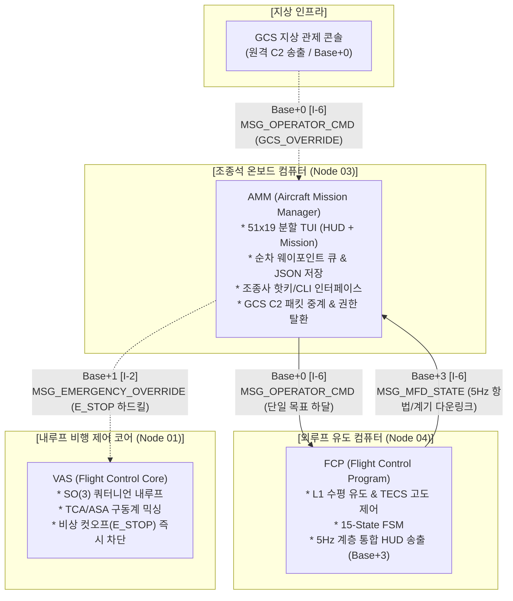
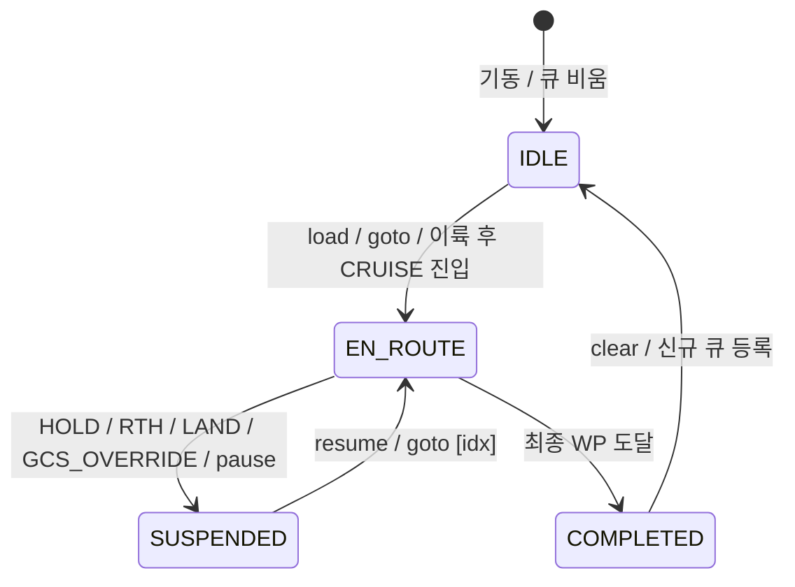

# AMM (항공 임무 관리자 및 조종석 통합 단말) 상세 규격서
> **AMM: Aircraft Mission Manager & Cockpit Integrated Terminal (Layer 3 Planning & C2 Station)**  
> **프로젝트**: Universal Autonomous Flight Stack (UAFS Ecosystem)  
> **운영 환경**: Minecraft CC:Tweaked, Create: Aeronautics, Create: Avionics  

| 항목 | 내용 |
| :--- | :--- |
| **문서 상태 (Status)** | `Implemented` |
| **문서 버전 (Version)** | `v1.0.0` |
| **최종 수정일 (Date)** | `2026-11-08` |
| **구현 코드 (Source)** | `src/3_planning/amm/` |
| **주관 도메인 (Domain)** | 임무 계획 및 조종석 통합 단말 (AMM / Node 03) |

> **연관 문서**: 
> - [AUTONOMOUS_FLIGHT_SYSTEM_ARCHITECTURE_AND_ICD.md](../../../system/AUTONOMOUS_FLIGHT_SYSTEM_ARCHITECTURE_AND_ICD.md) (마스터 ICD v1.23.0)
> - [SYSTEM_PROGRAM_RELATION_AND_PACKET_DIAGRAM.md](../../../system/SYSTEM_PROGRAM_RELATION_AND_PACKET_DIAGRAM.md) (전체 구조도 v2.10.0)
> - [FCP_PROGRAM_SPECIFICATION.md](../../2_guidance/fcp/FCP_PROGRAM_SPECIFICATION.md) (외루프 유도 제어기 v1.12.0)
> - [VAS_PROGRAM_SPECIFICATION.md](../../1_control/vas/VAS_PROGRAM_SPECIFICATION.md) (비행 제어 코어 v1.15.0)
> - [GEMINI.md](../../../../GEMINI.md) (전역 컨텍스트 및 규칙)

### Revision History

| 버전 | 개정 일자 | 개정 요약 | 개정 사유 |
| :---: | :---: | :--- | :--- |
| `v1.0.0` | 2026-11-08 | AMM 상세 규격서 초안(Draft) 최초 작성: 조종석 MFD(Node 03) 일체화 분할 TUI(51x19), 단방향 순차 웨이포인트 큐, 도달 판정(2D 15m) 및 FCP(`Base+0`) 하달, GCS 원격 C2 중계 및 권한 탈환, 원터치 핫키 및 CLI 복합 입력 규격화 | Planning 계층 신규 프로그램 설계 및 조종석 C2 단말 통합 |

---

## 1. 프로그램 개요 및 시스템 위상 (Overview & System Role)

### 1.1 시스템 정체성 및 통합 배경
**AMM (Aircraft Mission Manager / Node 03)**은 비행체 조종석의 온보드 컴퓨터(CC:Tweaked Advanced Computer)에서 가동되는 **임무 계획(Planning Layer 3) 및 조종석 통합 단말(Cockpit C2 Terminal)**입니다.

자율 비행 생태계에서 하위 외루프 유도 컴퓨터인 **FCP (Node 04)**가 비선형 L1 유도 법칙, 총 에너지 제어(TECS), 15-State FSM 및 20Hz 내루프 지령(`Base + 1`)을 전담한다면, **AMM**은 비행체가 수행해야 할 **다중 웨이포인트 큐 관리, 비행 단계 스케줄링, 조종사 대화형 UI 제공 및 지상 관제 센터(GCS)와의 원격 C2 중계**를 총괄하는 상위 운영자 단말입니다.

컴퓨터 자원 최적화 및 조종석 운용 편의를 위해, AMM은 기존 분리 계획되었던 조종석 계기판 MFD(Node 03)와 단일 하드웨어로 일체화되어 **51x19 분할 TUI(좌측: 계기판 HUD / 우측: 미션 큐 및 C2 제어 / 하단: 핫키 및 커맨드라인)**를 단일 터미널에서 구동합니다.



### 1.2 5대 설계 목표 (Goals)
1. **단방향 순차 웨이포인트 시퀀싱 (Sequential Waypoint Sequencing)**:
   - 다중 웨이포인트 큐(`FIFO Queue`)를 유지하고, 활성 타깃의 도달 조건 충족 시 다음 웨이포인트를 자동으로 FCP(`Base + 0`)에 하달.
2. **조종석 MFD 일체화 51x19 분할 TUI**:
   - `term.blit` 무깜빡임 고속 TUI를 통해 좌측 25열에 비행 계기 HUD, 우측 26열에 미션 큐 및 C2 상태, 하단에 핫키/CLI를 동시 표출.
3. **영구 저장소 및 동적 큐 편집**:
   - `missions/*.json` 파일 영구 저장/로드 및 화면 상에서의 실시간 좌표 추가(`add`), 삭제(`del`), 즉시 이동(`goto`), 초기화(`clear`).
4. **GCS C2 중계 및 조종사 즉시 권한 탈환 (Bumpless Takeover)**:
   - GCS 원격 명령 수신 시 유효성 검증 후 FCP로 중계 송출하되, 조종사의 로컬 키 입력 감지 시 즉시 `PILOT_PRIMARY` 권한을 자동 탈환.
5. **원터치 핫키 비상 조치**:
   - `[X]`(E-STOP 전 추진기 컷오프 직결), `[H]`(호버 홀드), `[R]`(기지 복귀), `[L]`(안전 착륙), `[A]`(시동), `[T]`(이륙) 즉시 발동.

### 1.3 비목표 및 반목표 (Non-Goals & Anti-Goals)
- **Non-Goals (보류/제외 범위)**:
  - 3차원 A* 격자/그래프 경로 탐색 및 지형 고도 회피 (지형/NFZ 공간 데이터 규격 확립 전까지 보류).
  - CC:Radars 기반 동적 이동체 충돌 회피 (후속 Phase 2 과제로 연기).
  - 다중 기체 편대 비행 슬롯 오케스트레이션 (Layer 4 `4_mission` 과제로 분리).
  - **수동 급기동 ACRO 20Hz 직결 조종간 (`Base + 1`)**: 아날로그 조종간 등 물리 하드웨어 기반 제어기로 별도 특화하여 **Phase 3 전용 과제(`TASK-301`)로 공식 분리/이관**. AMM은 5Hz 이벤트 기반 순수 임무 계획 및 C2 조종석 단말에 집중함.
- **Anti-Goals (금지 사항)**:
  - FCP의 L1 수평 가속도 연산이나 TECS 피치/스로틀 수치 제어를 AMM에서 중복 계산하지 않는다.
  - 비동기 sleep이나 긴 블로킹 연산으로 인해 5Hz UI 갱신 및 20Hz 이벤트 수신 루프가 지연되지 않도록 한다.

---

## 2. 검토된 대안 및 채택 아키텍처 (Architectural Approaches)

| 비교 항목 | 방안 1: 일체형 온보드 미션 단말 (채택) | 방안 2: 헤드리스 코어 + 원격 단말 분리형 |
| :--- | :--- | :--- |
| **노드 구성** | 단일 온보드 컴퓨터 (Node 03에 AMM + MFD 통합) | AMM 데몬(Node 08) + 무선 조종 단말(Pocket PC / MFD) |
| **통신 홉** | 1-Hop: AMM $\to$ FCP (`Base + 0`) | 2-Hop: 무선 단말 $\to$ AMM $\to$ FCP |
| **컴퓨터 자원** | 1대 (자원 및 조종석 공간 최소화) | 2대 이상 필요 |
| **운용 편의성** | 조종사가 단일 화면에서 계기 확인 및 임무 조작 완결 | 단말 간 무선 채널 페어링 및 채널 관리 오버헤드 |
| **평가 결과** | **최종 채택** (YAGNI 원칙 준수, 신뢰성 및 가용성 극대화) | 보류 (단기 목표 대비 통신 복잡도 증가) |

---

## 3. 하드웨어 구성 및 RF 네트워크 인터페이스 (Hardware & Network)

### 3.1 하드웨어 요구사항
- **컴퓨터 본체**: CC:Tweaked Advanced Computer (51x19 컬러 터미널 지원) 1대.
- **무선 모뎀**: `modem` (Advanced Wireless Modem 권장, 상단 또는 후면 장착).
- **외부 모니터 (선택)**: 3x2 또는 4x3 고급 모니터(`monitor`) 부착 시 자동 감지 및 미러링/확장 렌더링 지원.

### 3.2 RF 네트워크 채널 규격 ($Base = 10000 + (N-1) \times 40$)

AMM은 기체 고유의 40채널 블록 내에서 다음 3개 채널을 운용합니다:

| 채널 식별자 | 채널 번호 | 통신 방향 | 패킷 타입 | 주기 / 트리거 | 통신 목적 및 거동 |
| :--- | :---: | :---: | :---: | :---: | :--- |
| **`CH_OPERATOR_C2`** | `Base + 0` | AMM $\to$ FCP (송신) | `MSG_OPERATOR_CMD` | 이벤트 / 모드 변경 | 활성 웨이포인트 좌표, 목표 고도/속도 및 비행 명령 하달 |
| **`CH_OPERATOR_C2`** | `Base + 0` | GCS $\to$ FCP/AMM (청취) | `MSG_OPERATOR_CMD` | 비주기 (GCS 송출 시) | FCP 직결 수신 패킷을 동시 감청, AMM 미션 큐 일시정지 및 화면 경보 동기화 |
| **`CH_FLIGHT_GUIDANCE`**| `Base + 1` | AMM $\to$ VAS (송신) | `MSG_EMERGENCY_OVERRIDE` | 비상 `[X]` 키 트리거 | 하드 킬스위치 (`E_STOP`), FCP 우회 전 추진기 즉시 차단 |
| **`CH_MFD_STATE`** | `Base + 3` | FCP $\to$ AMM (수신) | `MSG_MFD_STATE` | 5Hz (200ms) | 비행 계기 렌더링 및 웨이포인트 도달 판정용 텔레메트리 수신 |

> [!NOTE]
> **무반향(Non-loopback) C2 감청 원칙**  
> FCP(Node 04)는 온보드 무선 버스인 `Base + 0`을 상시 직접 청취하므로, GCS가 `Base + 0`으로 송출한 원격 지령은 FCP에 직접 도달합니다. AMM은 동일 채널로 패킷을 재송출(Relay)하여 발생하는 중복 실행 및 셀프 루프백을 원천 차단하며, `Base + 0`을 수신 감청하여 GCS 지령 시 내부 미션 큐를 안전하게 일시정지(`SUSPENDED`)하고 화면에 원격 활성 상태를 동기화합니다.

---

## 4. 패킷 스키마 및 프로토콜 규격 (Packet Protocols)

모든 패킷은 **UAFS 네트워크 엔벨로프 v1.9.5** 표준을 준수합니다.

### 4.1 [송출] 오퍼레이터 비행 명령 패킷 (`MSG_OPERATOR_CMD`, AMM $\to$ FCP, Base + 0)

```lua
{
    ver = "1.9.5",
    domainId = "AIRCRAFT_01",
    seq = 501,
    type = "MSG_OPERATOR_CMD",
    time = 1729845000000,
    payload = {
        authority = "PILOT_PRIMARY",  -- "PILOT_PRIMARY" | "GCS_OVERRIDE"
        command = "CRUISE",           -- "ARM" | "TAKEOFF" | "CRUISE" | "LOITER"
        flightMode = "CRUISE",        -- "TAKEOFF" | "CRUISE" | "LOITER" | "LANDING"
        params = {
            targetWaypoint = { x = 450.0, z = -1200.0 }, -- 활성 L1 목표 2D 좌표
            targetAlt = 150.0,                             -- 목표 순항 고도 (m)
            targetSpeed = 18.0,                            -- 목표 순항 대지 속도 (m/s)
            designatedFacilityId = nil                     -- 착륙 접근 시 패드/활주로 ID
        },
        emergencyAction = "NONE"       -- "NONE" | "HOVER_HOLD" | "EMERGENCY_LAND" | "RTH"
    }
}
```

### 4.2 [송출] 하드 비상 차단 직결 패킷 (`MSG_EMERGENCY_OVERRIDE`, AMM $\to$ VAS, Base + 1)

```lua
{
    ver = "1.9.5",
    domainId = "AIRCRAFT_01",
    seq = 502,
    type = "MSG_EMERGENCY_OVERRIDE",
    time = 1729845000050,
    payload = {
        action = "CUTOFF",            -- "CUTOFF" (전 추진기 0 정지) | "CUSHION_STOP"
        reason = "PILOT_ESTOP_HOTKEY",
        source = "MFD",
        timestamp = 1729845000050
    }
}
```

### 4.3 [수신] MFD 계기판 화면 갱신 패킷 (`MSG_MFD_STATE`, FCP $\to$ AMM, Base + 3)

AMM은 수신된 `MSG_MFD_STATE`의 다음 필드를 파싱하여 활용합니다:
- `payload.navigation.currentPos`: 비행체 현재 2D 절대 좌표 (`{ x, z }`)
- `payload.navigation.distanceToWp`: 현재 타깃 웨이포인트까지의 남은 수평 거리 ($m$)
- `payload.dynamics.altitudeY`: 현재 Y 고도 ($m$)
- `payload.dynamics.groundSpeed`: 현재 수평 대지 속도 ($m/s$)
- `payload.attitude`: 피치, 롤, 방위각 (`{ pitch, roll, heading }`)
- `payload.fuel`: 잔여 연료/에너지 비율 ($0.0 \sim 1.0$)
- `payload.fsmState`: FCP의 현재 상태 (`CRUISE`, `LOITER`, `APPROACH_LAND` 등)
- `payload.activeSource`: 활성 제어원 (`"FCP"`, `"MFD_ACRO"`, `"EMERGENCY_DIRECT"`)

---

## 5. 조종석 51x19 분할 TUI 화면 설계 (Cockpit TUI Layout)

표준 CC:Tweaked Advanced Computer 터미널(가로 51자, 세로 19행)을 좌우로 분할하여 정보를 무깜빡임(`term.blit`)으로 표출합니다.

```
+---------------------------------------------------+  Row 1: Header
| AIRCRAFT_01 [CRUISE]  ALT:150m SPD:18m/s GCS:LINK |
|-------------------------+-------------------------|  Row 2: Separator
| [HUD INSTRUMENTS]       | [MISSION QUEUE] (2/4)   |  Row 3~16:
| PITCH: +2.1  ROLL: -0.2 | > WP1: [ 100, -200] OK  |  Left(1~25):
| HDG  : 092.4 E          | * WP2: [ 450,-1200] 145m|  HUD 계기판
| Y-ALT: 148.5 m          |   WP3: [ 800,-1500]     |  Right(26~51):
| V-SPD: +0.10 m/s        |   WP4: [-200, -800] PAD1|  미션 큐
| G-SPD:  17.8 m/s        | ----------------------- |
| FUEL : [||||||||..] 82% | TGT_ALT: 150m RAD: 15m  |
| CORE : OK   FCP : OK    | NEXT   : WP3 in 145m    |
| ACTR : ALL_HEALTHY      | STATUS : EN_ROUTE       |
|-------------------------+-------------------------|  Row 17: Status Banner
| MSG: CRUISE TO WP2 | PILOT_PRIMARY ACTIVE         |
| [X]STOP [H]HOLD [R]RTH [L]LAND [A]ARM [T]TAKEOFF  |  Row 18: Hotkeys
| CMD> add 600 -1400 160 20                         |  Row 19: Command Input
+---------------------------------------------------+
```

- **좌측 영역 (1 ~ 25열, 계기판 HUD)**:
  - 자세(Pitch, Roll, Heading), 동역학(Y고도, 승강률, 대지속도), 연료 잔량 바, 센서/구동계 헬스 상태 표출.
- **우측 영역 (26 ~ 51열, 미션 큐 및 C2 상태)**:
  - 등록된 웨이포인트 목록 스크롤 표시 (완료: `OK`, 현재 활성: `*`, 대기: 공백).
  - 현재 타깃까지의 거리, 도달 반경(`RAD`), 전역 순항 고도 및 속도 표시.
- **하단 영역 (17 ~ 19행, 상태 알림 및 조작 콘솔)**:
  - 17행: 최신 경보 및 GCS 원격 중계 이벤트 배너.
  - 18행: 원터치 핫키 안내 바.
  - 19행: 대화형 커맨드라인 입력 프롬프트 (`CMD> `).

---

## 6. 웨이포인트 큐 관리 및 도달 판정 알고리즘 (Queue & Sequencing)

### 6.1 웨이포인트 데이터 구조
각 웨이포인트는 다음과 같은 테이블 구조를 가집니다:

```lua
{
    id = 1,                 -- 고유 인덱스 (1-based 정수)
    x = 450.0,              -- 수평 X 좌표 (필수)
    z = -1200.0,            -- 수평 Z 좌표 (필수)
    alt = 150.0,            -- 목표 Y 고도 (선택, nil이면 전역 defaultAlt 적용)
    speed = 18.0,           -- 목표 순항 속도 (선택, nil이면 전역 defaultSpeed 적용)
    facilityId = "PAD_01"   -- 착륙 시설물 ID (선택, 최종 WP 착륙 시 지정)
}
```

### 6.2 도달 판정 및 전이 로직 (Arrival Threshold)
AMM은 5Hz 주기로 `MSG_MFD_STATE`를 수신할 때마다 활성 웨이포인트($WP_k$)와의 거리를 평가합니다:

1. **거리 계산**:
   - FCP가 패킷에 제공하는 `navigation.distanceToWp`를 우선 신뢰.
   - 누락 시 비행체 현재 좌표 $(x_{craft}, z_{craft})$와 목표 좌표 $(x_k, z_k)$ 간의 2D 유클리드 거리 산출:
     $$d_{2D} = \sqrt{(x_k - x_{craft})^2 + (z_k - z_{craft})^2}$$
2. **도달 조건 (Arrival Condition)**:
   $$d_{2D} \le R_{arrival} \quad (기본값: R_{arrival} = 15.0\text{ m})$$
3. **다음 웨이포인트 전이 (Advancement)**:
   - 도달 조건 충족 시 $WP_k$를 완료(`OK`) 처리하고 $k \leftarrow k + 1$로 전이.
   - 신규 활성 웨이포인트 $WP_{k+1}$의 좌표, 고도, 속도를 담아 FCP(`Base + 0`)로 `MSG_OPERATOR_CMD`를 송출.
4. **임무 완주 시 거동 분기 (Mission Completion)**:
   - 모든 웨이포인트를 통과하여 큐가 소진되었을 때:
     - **조건 A (최종 WP에 `facilityId` 지정)**: `flightMode = "LANDING", designatedFacilityId = facilityId`를 하달하여 FCP의 **`APPROACH_LAND`** 모드 진입.
     - **조건 B (지정 시설물 없음)**: `command = "LOITER"`를 하달하여 최종 웨이포인트 상공에서 **`LOITER` (선회 체공)** 모드로 안전 대기하며 조종사의 후속 명령을 대기.

### 6.3 큐 상태 머신 (Queue FSM) 및 지상-공중 이륙 연동

AMM 내부의 임무 큐는 4대 상태 머신으로 관리됩니다:
- **`IDLE`**: 대기 상태. 비행 전 또는 큐가 비어 있는 상태.
- **`EN_ROUTE`**: 활성 순차 유도 상태. 5Hz 도달 판정 및 FCP 지령 활성화.
- **`SUSPENDED`**: 임무 일시정지 상태. 조종사의 비상 조치(`HOLD`, `RTH`, `LAND`), GCS 오버라이드, 또는 CLI `pause` 명령 시 즉시 진입하며, 도달 판정 및 자동 전이가 중단됨.
- **`COMPLETED`**: 전 웨이포인트 완주 상태 (`LOITER` 또는 `APPROACH_LAND` 완료).



> [!NOTE]
> **지상-공중 이륙 연동 (Ground-to-Air Mission Handover)**  
> 지상 대기(`IDLE_ARMED`) 상태에서 조종사가 `[T]`(TAKEOFF)를 입력하면, AMM은 FCP로 `command = "TAKEOFF"`를 전송하되 첫 번째 웨이포인트($WP_1$)의 L1 순항 지령은 즉시 송출하지 않습니다. FCP가 상승 안전고도에 도달하여 `MSG_MFD_STATE`의 `fsmState`가 `"CRUISE"`로 전이되는 순간, AMM이 이를 감지하여 큐 상태를 `EN_ROUTE`로 활성화하고 $WP_1$ 좌표를 FCP에 자동 하달합니다.

---

## 7. 사용자 인터랙션 규격 (Hotkeys & CLI Commands)

### 7.1 모달 입력 인터페이스 (Modal Disambiguation)
단축키와 텍스트 타이핑 간의 오작동(예: `add` 입력 중 `[A]` 시동 토글 오발동)을 원천 방지하기 위해 **2대 입력 모드**를 운용합니다:
1. **`NAV / HOTKEY MODE` (기본 상태)**:
   - 화면 하단 프롬프트가 `CMD> [HOTKEY]`로 표출되며, 단일 키 타건 시 즉시 비상 핫키(`[X]`, `[H]`, `[R]`, `[L]`, `[A]`, `[T]`)가 발동합니다.
   - `[Enter]` 또는 `[/]` 키를 누르면 즉시 `CLI EDIT MODE`로 전환됩니다.
2. **`CLI EDIT MODE` (명령어 입력 상태)**:
   - 화면 하단 프롬프트가 `CMD> `로 전환되고 커서가 활성화되며, 모든 키 입력은 텍스트 버퍼에 누적됩니다.
   - 단, 최우선 비상 킬스위치인 **`Ctrl+X` (또는 더블 `[Esc]` 후 `[X]`)**는 CLI 입력 중에도 즉각 가동되어 `E_STOP`을 보장합니다.
   - `[Enter]` 입력 시 명령어를 실행하고 `NAV / HOTKEY MODE`로 자동 복귀하며, `[Esc]` 입력 시 입력을 취소하고 즉시 복귀합니다.

### 7.2 원터치 단축키 (Hotkeys)
`NAV / HOTKEY MODE`에서 키를 단일 타건했을 때 즉시 실행되는 비상 및 모드 조작 키:

| 단축키 | 명령 액션 | 전송 대상 및 통신 채널 | 설명 |
| :---: | :--- | :--- | :--- |
| **`[X]`** | `E_STOP` (긴급 차단) | VAS (`Base + 1`, 직결) | FCP를 우회하여 전 추진기 즉시 컷오프 (하드 킬스위치) |
| **`[H]`** | `HOVER_HOLD` (호버 홀드) | FCP (`Base + 0`) | 현 위치 수평 복원 및 정지 체공 (`FAILSAFE_HOLD`, 큐 `SUSPENDED`) |
| **`[R]`** | `RTH` (기지 복귀) | FCP (`Base + 0`) | 출발 기지(Home) 좌표로 자동 회항 (`FAILSAFE_RTH`, 큐 `SUSPENDED`) |
| **`[L]`** | `EMERGENCY_LAND` (비상착륙) | FCP (`Base + 0`) | 외루프 정속 강하(-2.0m/s) 비상 착륙 유도 (`SUSPENDED`) |
| **`[A]`** | `ARM` / `DISARM` (시동 토글) | FCP (`Base + 0`) | 지상 대기 시 시동 인가 또는 시동 해제 |
| **`[T]`** | `TAKEOFF` (자동 이륙) | FCP (`Base + 0`) | 순항 고도로의 수직/활주 이륙 개시 (안전고도 진입 시 큐 `EN_ROUTE` 활성화) |

### 7.3 대화형 커맨드라인 명령어 (CLI Commands)
하단 19행 프롬프트(`CMD> `)를 통해 큐 편집 및 시스템 설정을 수행합니다:

| 명령어 | 매개변수 | 설명 | 사용 예시 |
| :--- | :--- | :--- | :--- |
| **`add`** | `<x> <z> [alt] [spd] [fac]` | 웨이포인트를 큐의 맨 뒤에 추가 | `add 500 -1200 150 18` |
| **`del`** | `<index>` | 지정한 순번의 웨이포인트 삭제 | `del 2` |
| **`clear`**| 없음 | 대기 중인 모든 웨이포인트 큐 초기화 및 `IDLE` 전환 | `clear` |
| **`goto`** | `<index>` | 특정 웨이포인트를 즉시 활성 타깃으로 지정 (`EN_ROUTE`) | `goto 3` |
| **`pause`**| 없음 | 미션 큐 진행을 수동 일시정지 (`SUSPENDED`) | `pause` |
| **`resume`**| 없음 | 일시정지된 웨이포인트 큐 순차 진행 재개 (`EN_ROUTE`) | `resume` |
| **`save`** | `<name>` | 현재 큐를 `missions/<name>.json`으로 저장 | `save patrol_alpha` |
| **`load`** | `<name>` | `missions/<name>.json` 파일에서 큐 불러오기 | `load patrol_alpha` |
| **`alt`**  | `<altitude>` | 전역 기본 순항 고도 변경 ($m$) | `alt 180` |
| **`spd`**  | `<speed>` | 전역 기본 순항 속도 변경 ($m/s$) | `spd 20` |
| **`rad`**  | `<radius>` | 웨이포인트 도달 판정 반경 변경 ($m$) | `rad 20` |

---

## 8. 제어 권한 및 GCS 중계 중재 (Arbitration & C2 Relay)

### 8.1 GCS 원격 지령 감청 및 안전 정지 (Remote C2 Snooping)
- FCP(Node 04)는 `Base + 0` 포트를 상시 개방하여 GCS의 `MSG_OPERATOR_CMD`를 직결 수신합니다.
- AMM은 동일한 `Base + 0` 버스를 수신 감청(Snooping)하여 패킷의 `payload.authority == "GCS_OVERRIDE"`인 경우:
  1. 동일 채널로의 중복 재송출(Loopback)을 원천 차단하고, 내부 미션 큐를 즉시 **`SUSPENDED`** 상태로 전환하여 도달 판정 충돌을 방지합니다.
  2. 화면 17행 배너에 `[GCS OVERRIDE ACTIVE - MISSION SUSPENDED]`를 점멸 표출합니다.
  3. GCS가 지령한 비행 모드(`HOLD`, `RTH`, `LAND` 등)를 화면 상태 헤더에 즉각 동기화합니다.

### 8.2 조종사 즉시 권한 탈환 (Pilot Takeover)
- GCS 원격 조작 중이라도, 조종석의 플레이어가 키보드 핫키나 커맨드라인 입력을 발생시키는 순간:
  1. AMM의 내부 권한이 즉시 `PILOT_PRIMARY`로 전환됩니다.
  2. AMM은 조종사의 현재 명령을 담아 `authority = "PILOT_PRIMARY"` 플래그로 FCP에 재송출합니다.
  3. FCP의 `operator_handler`는 조종사 입력 우선 규칙에 따라 즉시 로컬 조종사 제어권을 복원합니다.

---

## 9. 소프트웨어 모듈 아키텍처 (Software Architecture)

AMM 프로그램(`src/3_planning/amm/`)은 단일 함수 50줄 제한 및 무블로킹 이벤트 주도 패턴을 준수하여 6개 핵심 모듈로 모듈화됩니다:

```
src/3_planning/amm/
├── main.lua                # 진입점 및 20Hz 이벤트/타이머 메인 디스패처
├── modules/
│   ├── network_manager.lua # ICD v1.9.5 인코딩/디코딩 및 모뎀 다중 채널 송수신
│   ├── waypoint_queue.lua  # 웨이포인트 큐 관리, 도달 판정 및 JSON 입출력
│   ├── c2_arbiter.lua      # 조종사 vs GCS 권한 중재 및 FCP 명령 조합
│   ├── ui_renderer.lua     # 51x19 분할 TUI 버퍼 렌더러 (term.blit 무깜빡임)
│   └── input_handler.lua   # 키 타건(핫키) 및 커맨드라인 텍스트 입력 파서
└── config/
    └── amm_config.json     # 기본 고도/속도/도달반경 및 채널 기본값 설정
```

| 모듈명 | 주요 책임 | 핵심 함수 |
| :--- | :--- | :--- |
| **`main`** | 이벤트 폴링(`os.pullEventRaw`), 5Hz UI 갱신 타이머, 생명주기 관리 | `main()`, `init()` |
| **`network_manager`** | `Base+0`, `Base+1`, `Base+3` 채널 바인딩 및 패킷 송수신 | `init()`, `send_c2()`, `send_estop()`, `receive()` |
| **`waypoint_queue`** | 순차 큐 조작, 도달 거리 판정, JSON 직렬화/역직렬화 | `add()`, `del()`, `check_arrival()`, `save()`, `load()` |
| **`c2_arbiter`** | `PILOT_PRIMARY` vs `GCS_OVERRIDE` 권한 전환 및 지령 패킷 빌드 | `handle_gcs_packet()`, `handle_pilot_action()` |
| **`ui_renderer`** | 좌측 HUD + 우측 미션 큐 + 하단 콘솔 51x19 화면 버퍼 출력 | `render_hud()`, `render_queue()`, `flush()` |
| **`input_handler`** | `key`, `char` 이벤트 수신, 핫키 분기 및 커맨드라인 버퍼 조립 | `process_key()`, `process_char()`, `execute_command()` |

---

## 10. 구현 및 검증 기준 (Verification Criteria)

본 사양서 기반 구현 코드는 다음 검증 기준을 충족해야 `Implemented` 상태로 승격됩니다:
1. **정적 검사**:
   - `python tools/validate_lua_syntax.py` 통과 (구문 오류 0건).
   - 모든 개별 Lua 함수는 50줄 이하 크기 준수 (`test-driven-development` / `ponytail`).
2. **단위 테스트 (`harness/unit/` & `tools/run_unit_tests.py`)**:
   - `waypoint_queue`: 큐 추가/삭제, 도달 판정, 파일 저장/로드 무결성 검증.
   - `c2_arbiter`: 권한 탈환, 비상 핫키 패킷 생성, GCS 중계 로직 검증.
   - `input_handler`: 단축키 인식 및 커맨드라인 파싱 검증.
3. **E2E 하네스 시뮬레이션**:
   - AMM $\leftrightarrow$ FCP $\leftrightarrow$ VAS 간 `Base+0`, `Base+1`, `Base+3` 패킷 교환 루프 정상 가동 확인.
   - 웨이포인트 3개 순차 통과 후 지정 시설 착륙 또는 LOITER 전이 시나리오 100% PASS.
