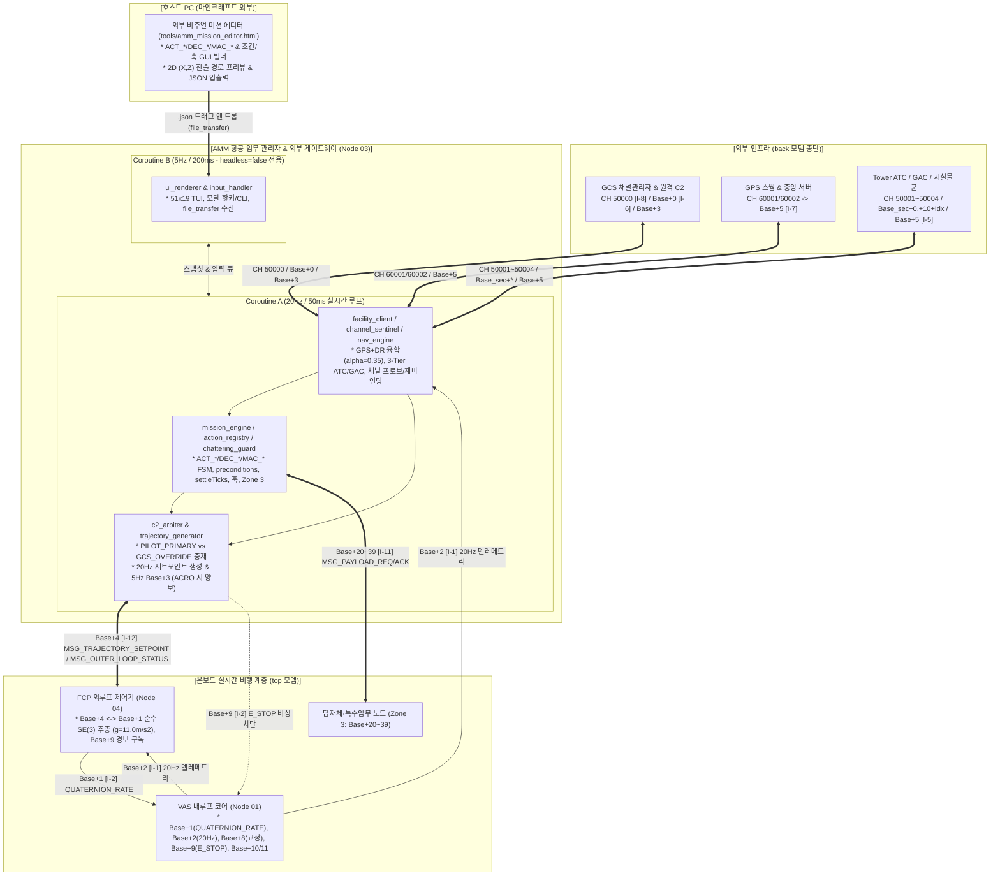
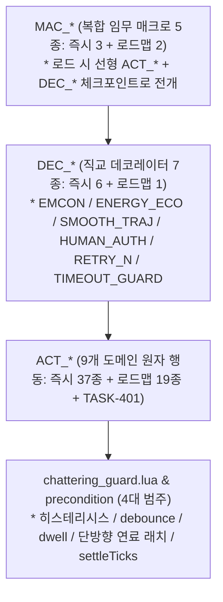

# AMM (항공 임무 관리자·외부 게이트웨이 및 조종석 통합 단말) 상세 규격서
> **AMM: Aircraft Mission Manager, External Gateway, Navigation/Trajectory Engine & Cockpit Terminal (Layer 3 Planning & C2 Station)**  
> **프로젝트**: Universal Autonomous Flight Stack (UAFS Ecosystem)  
> **운영 환경**: Minecraft CC:Tweaked, Create: Aeronautics, Create: Avionics  

| 항목 | 내용 |
| :--- | :--- |
| **문서 상태 (Status)** | `Approved` |
| **문서 버전 (Version)** | `v2.8.0` |
| **최종 수정일 (Date)** | `2026-11-21` |
| **구현 코드 (Source)** | `src/3_planning/amm/` |
| **주관 도메인 (Domain)** | 임무 계획, 외부 인프라 게이트웨이, 항법·궤적 생성 및 조종석 통합 단말 (AMM / Node 03) |

> **연관 문서**: 
> - [AUTONOMOUS_FLIGHT_SYSTEM_ARCHITECTURE_AND_ICD.md](../../../system/AUTONOMOUS_FLIGHT_SYSTEM_ARCHITECTURE_AND_ICD.md) (마스터 ICD)
> - [SYSTEM_PROGRAM_RELATION_AND_PACKET_DIAGRAM.md](../../../system/SYSTEM_PROGRAM_RELATION_AND_PACKET_DIAGRAM.md) (전체 구조도)
> - [OTA_PROGRAM_SPECIFICATION.md](../../0_development/ota/OTA_PROGRAM_SPECIFICATION.md) (격납고 무선 OTA 배포 및 슬레이브 롤백 가드)
> - [FCP_PROGRAM_SPECIFICATION.md](../../2_guidance/fcp/FCP_PROGRAM_SPECIFICATION.md) (외루프 유도 제어기)
> - [VAS_PROGRAM_SPECIFICATION.md](../../1_control/vas/VAS_PROGRAM_SPECIFICATION.md) (비행 제어 코어)
> - [GAC_PROGRAM_SPECIFICATION_AND_ICD.md](../../0_infra/gac/GAC_PROGRAM_SPECIFICATION_AND_ICD.md) (지상 구역 관제사)
> - [GPS_PROGRAM_SPECIFICATION_AND_ICD.md](../../0_infra/gps/GPS_PROGRAM_SPECIFICATION_AND_ICD.md) (고정밀 GPS)
> - [GCS_PROGRAM_SPECIFICATION_AND_ICD.md](../../0_infra/gcs/GCS_PROGRAM_SPECIFICATION_AND_ICD.md) (GCS 채널 관리자 및 관제 콘솔)
> - [POCKET_PDA_PROGRAM_SPECIFICATION_AND_ICD.md](../../0_infra/pocket_pda/POCKET_PDA_PROGRAM_SPECIFICATION_AND_ICD.md) (휴대용 원격 관제·지상 콘솔 링크·비상 E_STOP 단말)
> - [RUNWAY_SPECIFICATION_AND_ICD.md](../../0_infra/runway/RUNWAY_SPECIFICATION_AND_ICD.md) (활주로 규격서)
> - [LANDING_PAD_SPECIFICATION_AND_ICD.md](../../0_infra/landing_pad/LANDING_PAD_SPECIFICATION_AND_ICD.md) (착륙패드 규격서)
> - [DOCKING_ARM_SPECIFICATION_AND_ICD.md](../../0_infra/docking_arm/DOCKING_ARM_SPECIFICATION_AND_ICD.md) (도킹암 규격서)
> - [AMM_MISSION_EDITOR_SPECIFICATION.md](AMM_MISSION_EDITOR_SPECIFICATION.md) (외부 웹 GUI 미션 에디터)
> - [GEMINI.md](../../../../GEMINI.md) (전역 컨텍스트 및 규칙)

### Revision History

| 버전 | 개정 일자 | 개정 요약 | 개정 사유 |
| :---: | :---: | :--- | :--- |
| `v2.8.0` | `2026-11-21` | **`TASK-302` (`R3`) `c2_arbiter` 원격 `LAND_NEAREST` 최근접 빈 시설 해석·`EMERGENCY_LAND` 폴백 및 `RTB` 별칭 추가 (`Implemented` $\to$ `Approved`)**: ① `Base+0` `MSG_OPERATOR_CMD` (`authority = "GCS_OVERRIDE"`)에서 `command = "LAND_NEAREST"` 수신 시 `facility_client.find_nearest_free_landing_facility`로 현 위치 기준 최근접 `FREE` 착륙패드/활주로를 선별하여 `LANDING` 목표(`designatedFacilityId`, `targetPos`, `targetAlt`)로 설정(가용 시설 부재 시 즉시 `EMERGENCY_LAND` 폴백), ② `command = "RTB"`를 `"RTH"` (`FAILSAFE_RTH`) 동일 별칭으로 지원, ③ `POCKET_PDA_PROGRAM_SPECIFICATION_AND_ICD.md` 연관 문서 링크 추가 | `TASK-302` Pocket PDA `[L]`/`[R]` 원격 전술 지휘 연동 (`src/3_planning/amm/modules/c2_arbiter.lua` 반영 후 `Implemented` 승격 예정) |
| `v2.7.1` | `2026-11-20` | **`TASK-019` 제자리 `Extract` 경량화, 피어 버전 배지 폐지, `uiFrequencyHz` 정합 및 이력 롤업 (코드 무변경)**: `§4` 패킷 코드 덤프를 AMM 와이어 매트릭스·마스터 ICD `§3` 참조로 치환(46종/47매핑 `MSG_*`·`[DEPRECATED]`·게이트웨이/중재 규칙 보존), `연관 문서`·`§9.1` 피어 버전 배지 제거, `§10.2` `"uiFrequencyHz": 5` 정합 반영 및 `v1.0.0 ~ v2.3.0` 1행 롤업 | `TASK-019` 사양 경량화, 버전 SSOT 일원화 및 설정 드리프트 해소 (`Implemented` 유지) |
| `v2.7.0` | `2026-11-19` | **`TASK-017`·`TASK-018` 프로토콜 계약 정합·`PBIT`/`DIVERT` 규칙 확정·미사용 RX/설정 키 제거 (`Implemented` $\to$ `Approved`)**: ① `MSG_PBIT_REPORT` 이륙 인터록을 `overallStatus == "FAIL"` 또는 개별 `checks` `"FAIL"` 기반으로 단일화(`WARN`은 이륙 허용, `R2`), ② `MSG_GAC_APPROACH_CLEARANCE` `status == "DIVERT"` + `divertChannel` 수신 시 섹터 채널 자동 전환(`R3`)·`MSG_FACILITY_BEACON.facilitiesSummary` 인벤토리 색인·`MSG_BLOCK_ASSIGN.reassignedFrom`/`MSG_CHANNEL_PROBE_ACK.{existingDomain,responderStatus}` 소비 및 표준 `MSG_RUNWAY_TOUCHDOWN`/`MSG_RUNWAY_VACATED` 빌더 정합화, ③ 미사용 `MSG_OPERATOR_CMD.emergencyAction` 및 `Base+5` 구형 RX 14종 제거(`MSG_DOCK_CAPTURE_STAGE`, `MSG_UMBILICAL_STATUS`만 유지), ④ `config/amm_config.json` 미소비 `trajectory.docking.{maxHorizToleranceM, maxVertToleranceM, maxHeadingToleranceDeg}` `[DEPRECATED]` 제거 및 `channels.runwayDirectoryChannel` 정정, `MSG_GAC_DEPARTURE_REQ` 명시화, ⑤ 연관 배지(`ICD v1.39.0`, `Diagram v2.22.0`, `FCP v2.6.0`, `VAS v1.26.0`, `RUNWAY v1.13.0`, `LANDING_PAD v2.6.0`) 동기화 | `TASK-016` 감사 후속 계약 정합화 및 죽은 RX/설정 키 제거 (`src/3_planning/amm/` 반영 후 `Implemented` 승격 예정) |
| `v2.6.0` | `2026-11-18` | **`TASK-131` 비행 전 PBIT 게이트 및 `TASK-128` GPS 품질(`MSG_NAV_QUALITY`) 연동 반영 (`Implemented` $\to$ `Approved`)**: ① `[I-4]` `Base+8` `MSG_PBIT_REQ` 송출·`Base+2`/`Base+8` `MSG_PBIT_REPORT` 수신 및 `pbit` CLI 명령 추가, ② `ACT_TKL_*` 이륙 프리미티브에 `requirePbit` / `takeoffPermitted == false` 기반 `PBIT_TAKEOFF_INTERLOCK` 게이트 적용, ③ `[I-7]` `MSG_GPS_RESPONSE` 선택 필드(`navQuality`, `consecutiveFailures`) 및 `MSG_NAV_QUALITY` 수신 연동으로 `nav_engine` DR 두절 판정 정합화, ④ 연관 배지(`ICD v1.38.0`, `Diagram v2.21.0`, `VAS v1.25.0`, `FCP v2.5.0`, `GPS v2.4.0`) 동기화 | `TASK-131` 이륙 전 자가진단 안전 게이트 및 `TASK-128` GPS 성상 품질 추적 규격화 (`src/3_planning/amm/` 반영 후 `Implemented` 승격 예정) |
| `v2.5.0` | `2026-11-18` | **`TASK-130` 비휘발성 비행 상태 스냅샷(`/.flight_state.json`) 영속화 및 공중 콜드부트 미션 복구(`RESUME`/`RTB`) 규격 반영 (`Implemented` — 2026-11-18 승격)**: ① 이륙 완료·체크포인트 전환(`currentCpIdx`)·홈 패드 변경(`homePadId`/`homePos`)·착지/무장 해제 시 `/.flight_state.json`(`schemaVersion = 1`, Zero-Fallback)을 `.tmp` + `fs.move` 원자적 교체로 갱신, ② 부팅 시 `/.flight_state.json` `armedState == "AIRBORNE_ACTIVE"` 및/또는 `VAS Base+2` `controlState == "AIRBORNE_RECOVERY_HOLD"` 감지 시 `amm_config.json` `recovery.coldBootPolicy` (`"RESUME"` \| `"RTB"`)에 따라 체크포인트 재개 또는 홈 패드 자동 귀환 및 `Base+4` (`arm = true, flightActive = true`) 동기화, ③ `Base+3` 양보 대상에 `"AIRBORNE_RECOVERY_HOLD"` 추가, ④ 연관 배지(`ICD v1.36.0`, `Diagram v2.20.0`, `FCP v2.4.0`, `VAS v1.24.0`, `AMM_MISSION_EDITOR v0.5.0`) 동기화 | `TASK-130-3`·`TASK-130-4` (`src/3_planning/amm/` 및 단위·E2E 검증 완료) |
| `v2.4.0` | `2026-11-16` | **`TASK-125` 40채널 블록 개편 및 프로브·리스·히스테리시스 규격 반영 (`Implemented`)**: ① `Base+9` (`CH_EMERGENCY_CORE`) `E_STOP` (`MSG_EMERGENCY_OVERRIDE`) 송신 및 `MSG_EMERGENCY_ALERT` 수신 분리(`Base+1` 미사용), ② `Base+3` `acroRecoveryHoldMs = 300ms` 복귀 히스테리시스 및 `MFD_ACRO`/`FAILSAFE_HOLD`/`EMERGENCY_LAND` 즉시 양보, ③ `Base+0` 부팅 즉시 상시 개방·자기 UUID 무시·랜덤 지터(`0~100ms`)·`2`회 재프로브(`200ms`/회)·GCS `conflictBase` 재할당 회피(`maxReassignAttempts = 3` $\to$ `LOCKED_CONFLICT`), ④ `config/channel_lease.json` 영속 리스 캐시 및 GCS `preferredBase` 재검증(`gcsBootstrapTimeoutMs = 2000ms`, 무응답 시 `[NO_GCS_LEASE]` / `LOCKED_NO_GCS`), ⑤ `Base+0..39` 전 블록 침범 감시(`30,000ms`) 및 Zone 3 확장(`Base+20~39`, 편대 `TBD` 이관), ⑥ 연관 배지(`ICD v1.35.0`, `Diagram v2.19.0`, `FCP v2.3.0`, `VAS v1.23.0`, `GCS v1.3.0`, `Alignment v2.8.0`, `FDR v0.4.0`) 동기화 | `TASK-125` 40채널 스펙트럼 충돌·경합·검증 결함 해소 및 `TASK-403`/`404` 통합 반영 |
| `v1.0.0 ~ v2.3.0` | `2026-11-08 ~ 2026-11-16` | **(과거 개정 이력 일괄 요약)**: 조종석 C2 초안·FCP-AMM 역할 분리(외부 게이트웨이·항법·궤적 이관), Zone 3·40채널 기반, `v2.0.0` `ACT_*`/`DEC_*`/`MAC_*` 3계층 표준·채터링 방지 가드, Wave 1 정합, `[I-13]` 무선 OTA 슬레이브, WebUI Live(`TASK-403` `ACT_TKL_LAND_NEAREST`·`TASK-404` `LOAD`) 누적 | 상세 이력은 `git log` 참조 |

---

## 1. 프로그램 개요 및 시스템 위상 (Overview & System Role)

### 1.1 시스템 정체성 및 역할 승격
**AMM (Aircraft Mission Manager / Node 03)**은 비행체 조종석의 온보드 컴퓨터(CC:Tweaked Advanced Computer) 또는 무인기의 임무 컴퓨터에서 가동되는 **전략 임무 계획(Layer 3), 외부 인프라 단일 게이트웨이, 20Hz 항법 융합 및 궤적 생성기, 그리고 조종석 통합 C2 단말(Cockpit C2 Terminal)**입니다.

자율 비행 생태계에서 하위 **FCP (Node 04)**가 `Base+4` $\leftrightarrow$ `Base+1` 구간에 격리된 **순수 온보드 `SE(3)` 외루프 추종 제어기** 역할에 전념하고, **VAS (Node 01)**가 `SO(3)` 내루프 자세·추력·공력면 믹싱을 전담하는 구조로 개편됨에 따라, **AMM (Node 03)**은 다음 **5대 핵심 책임**을 총괄합니다:

1. **전략 임무 계획 및 `ACT_*`/`DEC_*`/`MAC_*` 체크포인트 시퀀서 (`v2.0.0`)**:
   - 5모듈 미션 코어(`mission_engine.lua`, `action_registry.lua`, `chattering_guard.lua`, `condition_evaluator.lua`, `hook_runner.lua`) 기반 3계층 행동 시퀀싱(37종 `[즉시]` + 19종 `[로드맵]` + `TBD [TASK-401]` `ACT_*`, 6종 `[즉시]` + 1종 `[로드맵]` `DEC_*`, 3종 `[즉시]` + 2종 `[로드맵]` `MAC_*`), 4대 범주 진입 조건(`preconditions`), 14종 복합 완료/중단 조건(`completeWhen`/`abortWhen`) 및 `settleTicks`, 0-tick 라이프사이클 훅(`onEnter`/`onExit`/`onAbort`), Zone 3(`Base+20~39`) 동적 탑재체·특수 임무 제어, 로컬 레드스톤 입출력, **호스트 PC 무설치 웹 GUI 미션 에디터(`tools/amm_mission_editor.html`)** 및 **외부 파일 즉시 구동 파이프라인(`resolve_path`, `validate_mission_table`, `file_transfer`, 셸 부팅 인자)**을 통합 관장합니다.
2. **외부 인프라 단일 무선 게이트웨이 (`facility_client`, `channel_sentinel`)**:
   - **GCS 부트스트랩 및 채널 무결성**: `CH 50000` (`[I-8]`, `MSG_BLOCK_REQUEST`/`ASSIGN`, `BW=40` 고정, `config/channel_lease.json` 영속 리스 재검증, `2000ms` 타임아웃), `Base+0` 부팅 즉시 상시 개방·랜덤 지터(`0~100ms`)·다회 충돌 프로브(`2`회 × `200ms`, 자기 UUID 무시)·GCS `conflictBase` 재할당 회피 루프(`maxReassignAttempts = 3`), `Base+0..39` 침범 감시(`30,000ms`) 및 4계층 채널 재바인딩(`MSG_CHANNEL_REBIND` via `Base+4 -> Base+1 -> Base+10/11`)을 주도합니다.
   - **3-Tier 공항·시설물 관제 연동 (`[I-5]`)**: `CH 50003` 1Hz 섹터 대표 비콘(`MSG_FACILITY_BEACON`), `CH 50004` GAC 디스패치, `CH 50001` Tower ATC 접근/이륙 관제, $Base_{\text{sec}} + 0$ GAC 섹터 체크인/패드 배정/로컬 복행 중재, $Base_{\text{sec}} + 10 + \text{Idx}$ 전술 정밀 유도(`MSG_FACILITY_STATIC_GUIDE` 1Hz / `MSG_FACILITY_DYNAMIC_GUIDE` 20Hz) 및 `Base+5` 도킹 체결/엄빌리컬 통보를 전담 종단합니다.
   - **고정밀 GPS 클라이언트 (`[I-7]`)**: `CH 60001`(`MSG_GPS_REQUEST`, `VAS Base+2` 실측 `altitudeY` 주입), `CH 60002`(`MSG_GPS_STATUS_REQ`/`RESP`) 및 `Base+5`(`MSG_GPS_RESPONSE`) 교신을 전담합니다.
3. **20Hz 항법 상태 추정 엔진 (`nav_engine`)**:
   - 5~10Hz 비동기 GPS 응답(`gpsClient.handleMessage()` 직접 주입)과 20Hz `VAS Base+2` (`MSG_FLIGHT_TELEMETRY`) 속도/진방위 기반 추측항법(Dead Reckoning, $\Delta t = 0.05\text{s}$)을 결합하고, 기구학 게이트($\Delta d_{\max} = 8.0\text{m}$, 3회 연속 일관성 검증) 및 상보 필터($\alpha = 0.35$, `hdop > 3.0` 또는 `accuracy > 2.0m` 시 $\le 0.1$)로 정밀 위치 `currentPos`를 산출합니다.
   - GPS 응답 5,000ms 초과 두절 시(`gpsTimedOut = true`) 추측항법으로 전환하며, 안전 체공(`LOITER` $R=30\text{m}$ 또는 `HOVER_HOLD`) 궤적을 개시하고 MFD/GCS 경보를 송출합니다.
4. **20Hz 실시간 궤적 생성기 (`trajectory_generator`, `Base+4` `[I-12]`)**:
   - 미션 시퀀서, C2 조종 명령, 시설물 전술 유도 벡터를 통합하여 `FCP (Node 04)`로 송출할 20Hz 목표 궤적 `{ targetPos, targetVel, feedforwardAccel, targetHeading }` 및 `{ arm, flightActive, flightMode, constraintProfile, flapHint, translationBiasHint }`를 산출합니다.
   - 지원 비행 모드(11종): `IDLE_ARMED`, `TAKEOFF`, `CRUISE`, `LOITER` (방사+접선 벡터 합성), `POI_HOLD` ($\le 30.0^\circ/\text{s}$ 표적 조준), `APPROACH_LAND`, `LANDING` (2단계 감속 착륙 및 가상 ILS 로컬라이저/3° 글라이드슬로프), `DOCKING` (4단계 정밀 랑데부 $>20\text{m} \to 20\sim 5\text{m} \to 5\sim 0.5\text{m}$ 크립 $\le 0.4\text{m/s}$, 허용공차 $|e_y|,|e_z|\le 0.15\text{m}$, $|\Delta\psi|\le 2.0^\circ \to$ 포획 및 `surge = -0.8` 비상 이탈 Abort), `FAILSAFE_RTH`, `HOVER_HOLD`, `EMERGENCY_LAND` ($-2.0\text{m/s}$).
   - 동적 모선/함상 시설물 접근 시 2차 테일러 외삽($\vec{r}_{deck}(t+\Delta t) \approx \vec{r}_{deck} + \vec{v}_{deck}\Delta t + \frac{1}{2}\vec{a}_{deck}\Delta t^2$, $\vec{v}_{deck}(t+\Delta t) \approx \vec{v}_{deck} + \vec{a}_{deck}\Delta t$)을 통해 이동 갑판의 위치·속도·가속도 피드포워드를 생성합니다.
5. **온보드 C2 단일 진입(`Base+0`), `Base+9` 비상 코어 및 평시 5Hz MFD 단독 송출(`Base+3`)**:
   - `Cockpit MFD` 및 `GCS`의 모든 비행 모드(`TAKEOFF`~`DOCKING`), `RTH`/`HOVER_HOLD`/`EMERGENCY_LAND`, 원격 미션 제어(`MSG_MISSION_CMD`)를 `Base+0` 단일 관문에서 수신해 `c2_arbiter`로 중재(`GCS_OVERRIDE` > `PILOT_PRIMARY`)하며, 하드 `E_STOP`은 `Base+9` (`CH_EMERGENCY_CORE`)로 직결 송출합니다.
   - `VAS` `Base+2` (`MSG_FLIGHT_TELEMETRY`, 20Hz) 및 `FCP` `Base+4` (`MSG_OUTER_LOOP_STATUS`)를 통합해 평시 **5Hz `Base+3` (`MSG_MFD_STATE`)**을 단독 송출하며, `VAS Base+2`에서 `activeSource == "MFD_ACRO"` 또는 `FAILSAFE_HOLD`/`EMERGENCY_LAND` 감지 시 `Base+3` 송출을 즉시 일시 중단(Yield)하고, `"FCP"` 복귀 시 **`acroRecoveryHoldMs = 300ms`** 히스테리시스 유예 후 재개합니다.



### 1.2 8대 설계 목표 (Goals)
1. **3계층 조합형 표준 행동 (`ACT_*` / `DEC_*` / `MAC_*`) 및 Zero-Fallback 단일화**:
   - 구 13종 평면 액션(`FLY_OVER` 등) 및 `v1.0.0 items[]` 포맷을 `[DEPRECATED - v2.0.0]` Zero-Fallback으로 완전 폐기하고, 9개 도메인 원자 행동(`ACT_*`: `[즉시]` 37종 + `[로드맵]` 19종 + `TBD [TASK-401]`), 7종 직교 데코레이터(`DEC_*`: `[즉시]` 6종 + `[로드맵]` 1종), 5종 복합 매크로(`MAC_*`: `[즉시]` 3종 + `[로드맵]` 2종) 및 4대 범주 `preconditions`(`checkPrecondition`)로 상태 폭발 없이 확장합니다. 예약(`[로드맵]`) 식별자 진입 시 `DEFERRED_ACTION_UNSUPPORTED`를 반환합니다.
2. **계층 직교 분리: AMM(20Hz 외부 게이트웨이·항법·궤적·시퀀서) $\leftrightarrow$ FCP(20Hz 순수 `SE(3)` 외루프)**:
   - AMM은 외부 인프라 교신, GPS/DR 항법 융합, 미션 시퀀싱 및 20Hz 목표 궤적(`targetPos`, `targetVel`, `feedforwardAccel`, `targetHeading`) 생성을 전담하여 `Base+4` (`[I-12]`)로 하달하며, FCP는 오직 `SE(3)` 가속도/자세 투영(`Base+1` `QUATERNION_RATE`)만을 담당합니다.
3. **이산 틱 채터링 방지 가드 (`chattering_guard.lua`) 및 2차 테일러 동적 궤적 생성**:
   - `chattering_guard`는 지오펜스(`5.0/15.0m`, `2/40 Ticks`), 연료 단방향 래치(`0.20/60 Ticks`, `0.10/30 Ticks`), VTOL 천이(`18.0/8.0 m/s`, `10/100 Ticks`), 동적 갑판(`10.0°/2.5 m/s` vs `7.0°/1.8 m/s`, `2/10/60 Ticks`) 및 도착 안착(`settleTicks`)으로 상태 진동을 억제하고, `trajectory_generator`는 2차 테일러 외삽·가상 ILS·접선 진입(Tangent Entry)을 단일 20Hz 파이프라인으로 생성합니다.
4. **14종 복합 조건 평가 (`settleTicks` 포함) 및 기본 완료 조건 자동 보강**:
   - `completeWhen` 및 `abortWhen`에 `logic: "ANY" | "ALL"` 복합 논리 연산과 `PROXIMITY_2D`/`PROXIMITY_3D`/`ALTITUDE_REACHED` 안착 유지(`settleTicks`)를 지원하고, `completeWhen` 생략 시 `ACT_*`별 표준 기본 조건을 자동 생성합니다.
5. **0-Tick 비차단 라이프사이클 훅 및 동적 Zone 3 채널 관리**:
   - `onEnter`, `onExit`, `onAbort` 훅은 타이머 데드라인 큐를 통해 이벤트 루프 블로킹 없이 실행하며, Zone 3(`Base + 20 ~ 39`) 탑재체·특수임무 채널은 해당 스텝 활성 중에만 동적으로 개방(`modem.open`) 및 해제(`modem.close`)합니다. (기존 Zone 4 편대 링크는 향후 독립 광역 데이터링크 `TBD`로 이관)
6. **20Hz 실시간 코어 + 5Hz 51x19 TUI 코루틴 격리 및 헤드리스 겸용**:
   - Coroutine A(20Hz)와 Coroutine B(5Hz TUI: 우측 6행 스크롤 뷰포트 + 5행 조건/데코레이터/사전조건 상세)를 `parallel.waitForAny`로 격리하며, `config.headless = true` 시 Coroutine B를 생략하되 Coroutine A는 `Base+3` 5Hz 원격 HUD 송출을 유지합니다.
7. **`Base+0` 단일 C2 진입(`CONFIRM` 포함) 및 `Base+3` MFD 다운링크(`MFD_ACRO` 양보)**:
   - 모든 C2 명령(`MSG_OPERATOR_CMD`, `MSG_MISSION_CMD`, `DEC_HUMAN_AUTH` 승인용 `CONFIRM`)을 `Base+0` 단일 관문에서 중재하며, 평시 5Hz `Base+3` 다운링크를 단독 송출하되 `VAS Base+2` `activeSource == "MFD_ACRO"` 시 즉시 양보합니다.
8. **호스트 PC 외부 비주얼 에디터 및 외부 파일 즉시 구동**:
   - 무설치 웹 GUI 에디터(`tools/amm_mission_editor.html`)로 미션 `v2.0.0` JSON을 제작·검증하고, 드래그 앤 드롭(`file_transfer`), `/disk`, 셸 부팅 인자(`main.lua <path>`), CLI(`run <path>`)로 즉시 구동합니다.

### 1.3 비목표 및 반목표 (Non-Goals & Anti-Goals)
- **Non-Goals (보류/제외 범위)**:
  - 3차원 A* 격자/그래프 전역 재계획(`ACT_PER_REPLAN_GLB`) 및 하방 레이저 지형 추종(`ACT_NAV_TERRAIN_FLW`).
  - CC:Radars/GeoScanner 기반 동적 회피·표적 추적·광역 스캔(`[로드맵]` `ACT_PER_*`, `ACT_PAT_FIG_EIGHT`/`GRID_SURVEY`/`EXP_SPIRAL`, 편대 광역 데이터링크 `TBD` `ACT_COM_SWARM_FOLLOW`/`HANDOVER`, `ACT_MUMT_*`).
  - Zone 3 세부 탑재체 통신 스키마(`TBD [TASK-401]` `ACT_PAY_CARGO_DROP`, `ACT_PAY_FIRE_CTRL`, `ACT_PAY_GEO_SCAN`) 및 활주로/도킹암 물리 노드 연동(`TASK-103` `ACT_TKL_*_RWY`, `TASK-104` `ACT_MOB_ARM_*`, `ACT_NRG_REFUEL_DOCK`) — 모두 `[로드맵]`/`DEFERRED_ACTION_UNSUPPORTED` 처리.
  - 수동 급기동 ACRO 20Hz 직결 조종간 (`Base + 1`, `TASK-301` 물리 컨트롤러 과제로 분리).
- **Anti-Goals (금지 사항)**:
  - `AMM` 내부에서 `SE(3)` 가속도-쿼터니언/집합추력 역투영(`FCP` 전담)이나 `SO(3)` 내루프 자세·추력·공력면 믹싱(`VAS` 전담)을 수행하지 않는다.
  - `v1.0.0 items[]` 또는 구 13종 액션명(`FLY_OVER`, `FLY_TO` 등)에 대한 런타임 폴백/이중 호환 래퍼를 두지 않는다 (`Zero-Fallback`).
  - `VAS Base+2` 텔레메트리가 `activeSource == "MFD_ACRO"`를 보고하는 동안 `Base+3` (`MSG_MFD_STATE`)을 송출하여 `VAS`의 20Hz ACRO HUD와 채널 경합을 일으키지 않는다.
  - 20Hz Coroutine A(`hook_runner`, `facility_client`, `nav_engine`, `trajectory_generator`, `chattering_guard`, `network_manager`) 내부에서 `sleep()`을 호출하여 실시간 제어·수신 루프를 블로킹하지 않으며, 5Hz TUI 렌더링(`Coroutine B`)이 Coroutine A의 50ms 주기를 지연시키지 않도록 격리한다.

---

## 2. 검토된 대안 및 채택 아키텍처 (Architectural Approaches)

### 2.1 노드 토폴로지 및 FCP-AMM 역할 경계 대안 비교

| 비교 항목 | 방안 1: AMM 외부/항법/궤적 통합 + FCP 순수 `SE(3)` 분리 (채택) | 방안 2: 구 FCP 외부 게이트웨이 겸임 + AMM 단순 웨이포인트 송출 | 방안 3: Layer 3(AMM) + Layer 4(AMP) 노드 분리 |
| :--- | :--- | :--- | :--- |
| **노드 구성** | `AMM (Node 03)`(임무·외부 RF·항법·궤적·C2) + `FCP (Node 04)`(`Base+4`/`+2`/`+1` 순수 `SE(3)`) | `FCP`가 외부 RF·GPS·ATC·궤적·`SE(3)`·C2·HUD를 모두 겸임 | AMM 단말(Node 03) + AMP 미션 데몬(Node 08) + FCP |
| **통신 홉 및 채널** | `AMM` $\to$ `FCP` (`Base + 4` 단일 20Hz 궤적 버스; 구 `AMM -> FCP` `Base+0` `[DEPRECATED]`) | `AMM` $\to$ `FCP` (`Base+0`) + `FCP` 내부 과밀 | 2-Hop: AMP $\to$ AMM (`Base+6` `[DEPRECATED]` 검토안 폐기) $\to$ FCP |
| **단일 책임 및 지연** | 외부 패킷 파싱·TUI·미션 부하가 `FCP` 20Hz `SE(3)` 루프로 전이되지 않음 | 외부 ATC/GPS/파일 I/O와 20Hz 외루프가 단일 FCP 노드에 혼재 | 노드 수 증가 및 상태 동기화 오버헤드 발생 |
| **평가 결과** | **최종 채택** (4계층 직교 분리 및 단일 모뎀 FCP 격리 확립) | 기각 (FCP 비대화 및 책임 경계 모호) | 기각 (불필요한 내부 RF 홉 및 큐 이중화 발생) |

### 2.2 소프트웨어 모듈 분할 대안 비교

| 비교 항목 | 대안 1: 단일 `mission_engine.lua` 통합 | 대안 2: 3분할 미션 코어 + 항법/외부/궤적 직교 모듈 (채택) | 대안 3: `waypoint_queue.lua` 폐기 및 전면 교체 |
| :--- | :--- | :--- | :--- |
| **모듈 구조** | `mission_engine`에 FSM·조건·훅·궤적·항법 혼재 | 미션 코어(`mission_engine`, `condition_evaluator`, `hook_runner`, `waypoint_queue`) + 항법·게이트웨이·궤적(`nav_engine`, `facility_client`, `channel_sentinel`, `trajectory_generator`) | `waypoint_queue.lua` 삭제 및 전체 재작성 |
| **단일 함수/파일 복잡도** | 단일 파일 비대화 및 결합도 상승 | 파일별 책임 직교 분리 및 단일 함수 50줄 이하 유지 용이 | 기존 API 단절 |
| **하위 호환 및 회귀** | 기존 테스트 유지 | 기존 단위/돌연변이 테스트(`MUT-04`, `MUT-05`) 보존 + 신규 모듈 독립 단위 테스트 가능 | `MUT-04` 전면 재작성 필요 |
| **평가 결과** | 보류 (결합도 높음) | **최종 채택** (단일 책임 원칙, 테스트 호환성, 50줄 제한 동시 충족) | 기각 (불필요한 하위 호환 파괴) |

### 2.3 듀얼 코루틴 실행 모델 (Coroutine A 20Hz + Coroutine B 5Hz 격리)

터미널 `term.blit` 렌더링 및 로컬 파일/키보드 처리가 20Hz 항법·궤적 생성 및 50ms `Base+4` 송출 주기를 지연시키지 않도록, `main.lua`는 CC:Tweaked `parallel.waitForAny` 기반의 **2-코루틴 분리 실행 모델**을 채택합니다:

| 구분 | 실행 주기 | 구동 조건 | 소속 모듈 및 담당 파이프라인 |
| :--- | :---: | :---: | :--- |
| **Coroutine A (`runtime_loop`)** | **20Hz (50ms 틱)** + 이벤트 | 상시 가동 (`headless` 무관) | • `network_manager`: `top`/`back` 모뎀 수신 라우팅 (`Base+0`, `Base+2`, `Base+4`, `Base+5`, `Base+9`, `Base+20~39`, `50000~50004`, `Base_sec+*`, `60001/60002`, `Base+0..39` 침범 감시)<br>• `channel_sentinel`: 기동 부트스트랩(`50000`, `channel_lease.json`), `Base+0` 부팅 즉시 개방·지터(`0~100ms`)·2회 프로브·재할당(`maxReassignAttempts=3`), 동적 재바인딩(`Base+4`)<br>• `nav_engine`: 5~10Hz GPS 핑 + `gpsClient.handleMessage` + 20Hz `Base+2` DR 상보 필터($\alpha=0.35$)<br>• `facility_client`: 3-Tier ATC/GAC/전술 유도(`Base_sec+10+Idx`) + 도킹 상태 수신(`Base+5`)<br>• `mission_engine` / `condition_evaluator` / `hook_runner`: 체크포인트 FSM, 20Hz 조건 판정, 0-tick 훅 데드라인 큐<br>• `c2_arbiter`: `Base+0` 권한 중재 (`GCS_OVERRIDE` > `PILOT_PRIMARY`) 및 `Base+9` `E_STOP`<br>• `trajectory_generator`: 20Hz `MSG_TRAJECTORY_SETPOINT` (`Base+4`) 산출·송출<br>• 5Hz MFD 다운링크(매 4틱): `Base+3` `MSG_MFD_STATE` 송출 (`activeSource == "MFD_ACRO"` 시 즉시 양보, `"FCP"` 복귀 시 `300ms` 히스테리시스 후 재개) |
| **Coroutine B (`tui_loop`)** | **5Hz (200ms 틱)** + 입력 이벤트 | **`headless == false` 전용**<br>(`headless == true` 시 완전 미실행) | • `ui_renderer`: Coroutine A 상태 스냅샷 기반 51x19 `term.blit` 무깜빡임 렌더링<br>• `input_handler`: 로컬 `char`/`key`/`Ctrl+X` 모달 입력 큐잉 -> Coroutine A `c2_arbiter` 전달<br>• `file_transfer` 드래그 앤 드롭 수신 -> 스키마 검증 후 `missions/` 저장 및 큐 전달 |

> [!NOTE]
> `headless == true` (무인기 모드)에서는 `Coroutine B`를 생성하지 않고 `Coroutine A` 단일 루프로 구동됩니다. 이때도 `Coroutine A`는 매 4틱(5Hz)마다 `Base+3` (`MSG_MFD_STATE`)을 정상 송출하여 GCS 및 원격 관제 뷰어에 계기·항법 상태를 제공합니다(`MFD_ACRO` 시 양보 규칙 동일 적용).

---

## 3. 하드웨어 구성 및 RF 네트워크 인터페이스 (Hardware & Network)

### 3.1 하드웨어 요구사항 및 듀얼 무선 엔더 모뎀 토폴로지
- **컴퓨터 본체**: CC:Tweaked Advanced Computer (유인 조종석 51x19 컬러 터미널 구동 시) 또는 Standard/Advanced Computer (`headless: true` 무인기 탑재 시) 1대.
- **무선 엔더 모뎀 (`modem`) 듀얼 구성 및 단일 모뎀 폴백**:
  - **내부 온보드 모뎀 (`primaryModemSide = "top"`)**: 기체 내부 Zone 1 코어 채널(`Base + 0`, `Base + 2`, `Base + 3`, `Base + 4`, `Base + 9` `CH_EMERGENCY_CORE`) 및 Zone 3 탑재체·특수 임무 채널(`Base + 20 ~ 39` 동적 개방) 전담. (`Base + 1`은 `FCP`/`MFD` $\to$ `VAS` 전용이므로 `AMM`이 송신하지 않으며, 전 블록 `Base + 0..39` 침범 감시 지원)
  - **외부 인프라 모뎀 (`infraModemSide = "back"`)**: 지상/공역 인프라 채널(`CH 50000`, `CH 50001`, `CH 50003`, `CH 50004`, $Base_{\text{sec}} + 0$, $Base_{\text{sec}} + 10 + \text{Idx}$, `CH 60001`, `CH 60002`) 및 외부 1:1 회신 전용 채널(`Base + 5`, GPS/도킹/접지 응답) 전담.
  - **단일 모뎀 폴백 (Single-Modem Fallback)**: 기체 공간 제약으로 `back` 모뎀(`infraModemSide`)이 장착되지 않은 경우(`peripheral.wrap(infraModemSide) == nil`), `network_manager`는 부팅 시 경고를 기록하고 **`top` 단일 모뎀(`primaryModemSide`)에 온보드 채널과 외부 인프라 채널의 전체 합집합(Union)을 자동 개방**하여 무수정 동작합니다.
- **레드스톤 인터페이스 (선택)**: 컴퓨터 6면(`top`, `bottom`, `left`, `right`, `front`, `back`) 일반 아날로그/디지털 레드스톤 또는 16색 번들 케이블(`redstone.setBundledOutput` / `getBundledInput`).

### 3.2 RF 네트워크 채널 규격 ($Base = 10000 + (N-1) \times 40$, $Base_{\text{sec}} = 50001 + S \times 200$)

AMM은 기체 전용 40채널 블록(Zone 1/3)과 외부 인프라 대역을 모두 관할합니다:

| 대역 / 모뎀 | 채널 식별자 | 채널 번호 | 통신 방향 | 패킷 타입 | 주기 / 트리거 | 통신 목적 및 거동 |
| :---: | :--- | :---: | :---: | :--- | :---: | :--- |
| **온보드 (`top`)** | **`CH_OPERATOR_C2`** | `Base + 0` | Cockpit / GCS $\to$ AMM (수신) | `MSG_OPERATOR_CMD` | 이벤트 | 조종사/GCS 비행 모드·목표·`RTH`/`HOVER_HOLD`/`EMERGENCY_LAND` 단일 진입 *(구 `AMM -> FCP` `MSG_OPERATOR_CMD` `[DEPRECATED]`)* |
| **온보드 (`top`)** | **`CH_OPERATOR_C2`** | `Base + 0` | GCS $\leftrightarrow$ AMM (송수신) | `MSG_MISSION_CMD` / `MSG_MISSION_ACK` | 이벤트 | GCS 원격 미션 제어(`LOAD`/`RUN`/`STOP`/`PAUSE`/`RESUME`/`NEXT`/`CONFIRM`) 및 상태 회신 |
| **온보드 (`top`)** | **`CH_OPERATOR_C2`** | `Base + 0` | AMM $\leftrightarrow$ 인접 기체 (송수신) | `MSG_CHANNEL_PROBE` / `MSG_CHANNEL_PROBE_ACK` | 부팅 즉시 상시 개방 · 지터(`0~100ms`)+2회(`200ms`/회) | 자기 UUID 무시, 충돌 시 GCS `conflictBase` 보고 재할당 회피(`maxReassignAttempts=3`), 3회 초과 시 `LOCKED_CONFLICT` |
| **온보드 (`top`)** | **`CH_EMERGENCY_CORE`** | `Base + 9` | AMM $\to$ VAS (송신)<br>VAS $\to$ AMM (수신) | `MSG_EMERGENCY_OVERRIDE`<br>`MSG_EMERGENCY_ALERT` | 비상 이벤트 | `[X]`/`Ctrl+X` 하드 킬스위치(`E_STOP`) 직결 차단 및 VAS 공중 셧다운 경보 수신 (`Base + 1` 분리) |
| **온보드 (`top`)** | **`CH_TELEMETRY`** | `Base + 2` | VAS $\to$ AMM (수신) | `MSG_FLIGHT_TELEMETRY` | 20Hz (50ms) | `nav_engine` DR 적분, `condition_evaluator` 조건/연료 평가, `activeSource == "MFD_ACRO"` 양보 감지, HUD 계측 |
| **온보드 (`top`)** | **`CH_MFD_STATE`** | `Base + 3` | AMM $\to$ MFD / GCS (송신) | `MSG_MFD_STATE` | 5Hz (200ms) | 평시 계층 통합 계기판 다운링크 (`MFD_ACRO`/`FAILSAFE` 시 양보, `"FCP"` 복귀 시 `acroRecoveryHoldMs=300ms` 후 재개) |
| **온보드 (`top`)** | **`CH_TRAJECTORY_CMD`** *(구 `CH_NAV_SENSOR` `[DEPRECATED]`)* | `Base + 4` | AMM $\to$ FCP (송신)<br>FCP $\to$ AMM (수신)<br>AMM $\leftrightarrow$ FCP | `MSG_TRAJECTORY_SETPOINT`<br>`MSG_OUTER_LOOP_STATUS`<br>`MSG_CHANNEL_REBIND/_ACK` | 20Hz / On-Change / 이벤트 | `[I-12]` 20Hz 목표 궤적·융합 위치·비행모드 하달, 외루프 FSM/오차/포화 피드백 수신, 4계층 재바인딩 개시 |
| **온보드 (`top`)** | **`CH_PAYLOAD_BUS`** | `Base + 20 ~ 39` | AMM $\leftrightarrow$ 탑재체 (송수신) | `MSG_PAYLOAD_REQ` / `MSG_PAYLOAD_ACK` | 스텝/훅 활성 시 | `[I-11]` Zone 3 탑재체·특수 임무 제어 요청 및 완료 응답 수신 (동적 오픈/해제) |
| **외부 (`back`)** | **`CH_EXTERNAL_COMM`** | `Base + 5` | GPS/시설물 $\leftrightarrow$ AMM | `MSG_GPS_RESPONSE`, `MSG_DOCK_CAPTURE_STAGE`, `MSG_UMBILICAL_STATUS`, `MSG_TOUCHDOWN_COMPLETE` | 5~10Hz / 이벤트 | GPS 서버 2D 측위 응답 수신(구 `10045` `[DEPRECATED]`), 도킹 결합·엄빌리컬·접지 통보 교환 |
| **외부 (`back`)** | **`CH_BOOTSTRAP`** | `50000` | AMM $\leftrightarrow$ GCS 채널관리자 | `MSG_BLOCK_REQUEST` / `MSG_BLOCK_ASSIGN` | 부팅 리스 검증 / 재할당 (`2000ms`) | `[I-8]` `BW=40` 고정 계약, `preferredBase` 재검증, `channel_lease.json` 영속화, `"ASSIGNED"`/`"REASSIGNED"`/`"DENIED"`/`"FAILED"` |
| **외부 (`back`)** | **`CH_ATC_COMM`** | `50001` | AMM $\leftrightarrow$ Tower ATC | `MSG_ATC_APPROACH_REQ`, `MSG_ATC_HANDOFF_CLEARANCE`, `MSG_ATC_DEPARTURE_COMPLETE` | 이벤트 / 15s 재시도 | `[I-5]` 광역 공역 접근 인가, 섹터 GAC 채널 수령, 공역 이탈 통보 |
| **외부 (`back`)** | **`CH_FACILITY_BEACON`** | `50003` | GAC $\to$ AMM (수신) | `MSG_FACILITY_BEACON` | 1Hz (1000ms) | `[I-5]` 섹터 집약 가용 시설물 목록·중량/반경 제한·지상풍 인벤토리 수집 |
| **외부 (`back`)** | **`CH_GAC_DISPATCH`** | `50004` | GAC $\to$ AMM (수신) | `MSG_GAC_DISPATCH` | 1Hz / 이벤트 | `[I-5]` 활성 섹터 주파수 디렉터리 수신 |
| **외부 (`back`)** | **`CH_GAC_COMM`** | $Base_{\text{sec}} + 0$ | AMM $\leftrightarrow$ GAC | `MSG_GAC_CHECKIN_REQ`, `MSG_GAC_APPROACH_CLEARANCE`, `MSG_GAC_ABORT_CLEAR`, `MSG_GAC_DEPARTURE_REQ`, `MSG_GAC_DEPARTURE_CLEARANCE` | 이벤트 | `[I-5]` 섹터 체크인, 최적 시설물/전술채널 배정 인가, 복행 안전고도 보고, 이륙 관제 |
| **외부 (`back`)** | **`CH_TACTICAL_GUIDANCE`** | $Base_{\text{sec}} + 10 + \text{Idx}$ | Facility $\leftrightarrow$ AMM | `MSG_FACILITY_STATIC_GUIDE`, `MSG_FACILITY_DYNAMIC_GUIDE`, `MSG_ABORT_APPROACH`, `MSG_TOUCHDOWN_COMPLETE` | 1Hz(고정) / 20Hz(동적) | `[I-5]` 정적/동적 착륙패드·활주로·도킹암 전술 유도 벡터 수신 및 접지 통보 |
| **외부 (`back`)** | **`CH_GPS_PING`** | `60001` | AMM $\to$ GPS 스웜 (송신) | `MSG_GPS_REQUEST` | 5~10Hz | `[I-7]` `VAS Base+2` 실측 `altitudeY` 주입 거리측정 핑 브로드캐스트 |
| **외부 (`back`)** | **`CH_GPS_SERVICE`** | `60002` | AMM $\leftrightarrow$ GPS 서버 | `MSG_GPS_STATUS_REQ` / `MSG_GPS_STATUS_RESP` | 필요 시 | `[I-7]` GPS 중앙 서버 상태 및 활성 노드 수 진단 조회 |

---

## 4. 패킷 스키마 및 프로토콜 규격 (Packet Protocols)

`AMM` 와이어 스키마 상세 필드·예시는 마스터 ICD
([AUTONOMOUS_FLIGHT_SYSTEM_ARCHITECTURE_AND_ICD.md](../../../system/AUTONOMOUS_FLIGHT_SYSTEM_ARCHITECTURE_AND_ICD.md) §3)를 단일 SSOT로 참조합니다.
전 패킷은 공통 엔벨로프(`ver = "1.9.5"`, `domainId`, `seq`, `type`, `time`, `payload`) 및 `Zero-Fallback`(이중 키 폴백 금지, 송신 노드 즉시 패치) 원칙을 준수합니다.

### 4.1 AMM 와이어 인터페이스 매트릭스

| 인터페이스 | 채널 | 방향 / 주기 | 정본 패킷 (`MSG_*`) | 폐기 식별자 (`[DEPRECATED]`) |
| :--- | :--- | :--- | :--- | :--- |
| `[I-1]` 텔레메트리 | `Base+2` (`CH_TELEMETRY`) | `VAS -> AMM` (20Hz/응답) | `MSG_FLIGHT_TELEMETRY`, `MSG_PBIT_REPORT` | — |
| `[I-2]` 비상 코어 | `Base+9` (`CH_EMERGENCY_CORE`) | `AMM <-> VAS` (비상 이벤트) | `MSG_EMERGENCY_OVERRIDE` (`E_STOP`), `MSG_EMERGENCY_ALERT` | 구 `Base+1` 직결 `[DEPRECATED]` |
| `[I-4]` PBIT 진단 | `Base+8` / `Base+2` | `AMM <-> VAS` (이벤트) | `MSG_PBIT_REQ`, `MSG_PBIT_REPORT` | — |
| `[I-5]` 공역·시설 관제 | `CH 50001`, `50003`, `50004`, `Base+5` | `AMM <-> ATC / GAC` (1Hz/이벤트) | `MSG_ATC_APPROACH_REQ`, `MSG_ATC_APPROACH_CLEARANCE`, `MSG_ATC_HANDOFF_CLEARANCE`, `MSG_ATC_DEPARTURE_COMPLETE`, `MSG_ATC_FACILITY_UPDATE`, `MSG_FACILITY_BEACON`, `MSG_GAC_DISPATCH` | — |
| `[I-5]` 섹터·유도·도킹 | $Base_{\text{sec}}+0/+10+\text{Idx}$, `Base+5` | `AMM <-> GAC / Facility` (1Hz/20Hz/이벤트) | `MSG_GAC_CHECKIN_REQ`, `MSG_GAC_APPROACH_CLEARANCE`, `MSG_GAC_ABORT_CLEAR`, `MSG_GAC_DEPARTURE_REQ`, `MSG_GAC_DEPARTURE_CLEARANCE`, `MSG_FACILITY_STATIC_GUIDE`, `MSG_FACILITY_DYNAMIC_GUIDE`, `MSG_ABORT_APPROACH`, `MSG_TOUCHDOWN_COMPLETE`, `MSG_RUNWAY_TOUCHDOWN`, `MSG_RUNWAY_VACATED`, `MSG_DOCK_CAPTURE_STAGE`, `MSG_UMBILICAL_STATUS` | `MSG_ATC_ABORT_CLEAR [DEPRECATED]`, 구 `Base+5` 레거시 RX 14종 `[DEPRECATED]` |
| `[I-6]` C2·미션 | `Base+0` (`CH_OPERATOR_C2`) | `Cockpit/GCS <-> AMM` (이벤트) | `MSG_OPERATOR_CMD`, `MSG_MISSION_CMD`, `MSG_MISSION_ACK` | 구 `Base+0` `AMM -> FCP` `MSG_OPERATOR_CMD` `[DEPRECATED]`, `emergencyAction [DEPRECATED]` |
| `[I-6]` MFD 피드 | `Base+3` (`CH_MFD_STATE`) | `AMM -> MFD/GCS` (5Hz; ACRO 양보) | `MSG_MFD_STATE` (`source = "AMM_INTEGRATED"`) | — |
| `[I-7]` 고정밀 GPS | `CH 60001`, `60002` -> `Base+5` | `AMM <-> GPS` (5~10Hz/진단) | `MSG_GPS_REQUEST`, `MSG_GPS_RESPONSE`, `MSG_NAV_QUALITY`, `MSG_GPS_STATUS_REQ`, `MSG_GPS_STATUS_RESP` | `10045 [DEPRECATED]` |
| `[I-8]` 블록 할당 | `CH 50000` / `Base+0` | `AMM <-> GCS` (부팅·재할당 `2s`) | `MSG_BLOCK_REQUEST`, `MSG_BLOCK_ASSIGN` | — |
| `[I-9]` 프로브·재바인딩 | `Base+0` / `Base+4` | `AMM <-> 인접기/FCP` (`200ms`/`500ms`) | `MSG_CHANNEL_PROBE`, `MSG_CHANNEL_PROBE_ACK`, `MSG_CHANNEL_REBIND`, `MSG_CHANNEL_REBIND_ACK` | `MSG_REBIND_ACK [DEPRECATED]`, `Base+6/7 [DEPRECATED]` |
| `[I-11]` Zone 3 | `Base+20..39` (`CH_PAYLOAD_BUS`) | `AMM <-> Payload` (동적 개폐) | `MSG_PAYLOAD_REQ`, `MSG_PAYLOAD_ACK` | — |
| `[I-12]` 궤적·외루프 | `Base+4` (`CH_TRAJECTORY_CMD`) | `AMM <-> FCP` (20Hz/On-Change) | `MSG_TRAJECTORY_SETPOINT`, `MSG_OUTER_LOOP_STATUS` | `CH_NAV_SENSOR [DEPRECATED]` |
| `[I-13]` 무선 OTA | $Base_{\text{hangar}}+4/+5$ (`105`/`106`) | `OTA Server <-> AMM` (이벤트) | `MSG_OTA_DISCOVER_REQ`, `MSG_OTA_DISCOVER_ACK`, `MSG_OTA_BEGIN`, `MSG_OTA_CHUNK`, `MSG_OTA_COMMIT`, `MSG_OTA_ABORT`, `MSG_OTA_REBOOT`, `MSG_OTA_ACK`, `MSG_OTA_NACK`, `MSG_OTA_BOOT_STATUS` | — |

### 4.2 AMM 게이트웨이·중재·시퀀스 규칙 (AMM Gateway, Arbiter & Sequence Rules)

- **`[I-6]` `Base+0` 단일 C2 및 `MSG_MISSION_CMD`**: `c2_arbiter`는 `GCS_OVERRIDE` > `PILOT_PRIMARY` 우선순위로 `MSG_OPERATOR_CMD`를 중재해 `Base+4` (`MSG_TRAJECTORY_SETPOINT`)로만 하달하며, 레거시 `AMM -> FCP` `MSG_OPERATOR_CMD`와 `emergencyAction [DEPRECATED]`를 거부합니다. `Pocket PDA`/`GCS`의 `command == "LAND_NEAREST"`(`R3`)는 `facility_client.find_nearest_free_landing_facility`로 최근접 `FREE` 착륙 시설(`LANDING`)을 해석하며, 가용 시설 부재 시 즉시 `EMERGENCY_LAND`로 폴백하고 `command == "RTB"`는 `"RTH"` (`FAILSAFE_RTH`) 별칭으로 처리합니다. `MSG_MISSION_CMD`(`"LOAD"|"RUN"|"STOP"|"PAUSE"|"RESUME"|"NEXT"|"CONFIRM"`)는 인라인 `missionData` 적재(`saveToDisk`)와 동적 사전조건 결과를 `MSG_MISSION_ACK`(`ACCEPTED`/`BUSY_REJECTED`/`FILE_NOT_FOUND`/`SCHEMA_INVALID`/`DEFERRED_ACTION_UNSUPPORTED`/`PRECONDITION_FAILED`/`INVALID_CMD`)로 회신합니다.
- **`[I-11]`/`[I-5]` `Zone 3` 및 `BASE_PLUS_5_INFRA_RESPONSES`**: `Base+20..39`는 `ACT_PAY_*`·훅 활성 중에만 동적 개방합니다. `Base+5`는 `BASE_PLUS_5_INFRA_RESPONSES` 15종 허용 목록만 수락하고 구형 RX 14종(`MSG_DOCKING_STATUS` 등 `[DEPRECATED]`)을 제거해 도킹은 `MSG_DOCK_CAPTURE_STAGE`·`MSG_UMBILICAL_STATUS`만 유지합니다(`stage == "HARD_LOCKED"` 시 즉시 `arm = false, flightActive = false`).
- **`[I-4]`/`[I-2]` PBIT 인터록 (`R2`) 및 `Base+8`/`Base+9`**: `Base+8` `MSG_PBIT_REQ` 송출 후 `Base+2`/`Base+8` `MSG_PBIT_REPORT`에서 `overallStatus == "FAIL"`·`checks[*].status == "FAIL"` 또는 `takeoffPermitted == false`이면 `ACT_TKL_*` 이륙을 `PBIT_TAKEOFF_INTERLOCK`으로 차단합니다(`overallStatus == "WARN"`은 허용). `E_STOP`(`authKey = "ESTOP_CONFIRM_KEY"`) 및 `MSG_EMERGENCY_ALERT`는 `Base+9`에 직결합니다.
- **`[I-5]` `DIVERT` 자동 전환 (`R3`) 및 전술 유도**: `CH 50003` `MSG_FACILITY_BEACON.facilitiesSummary`/`facilities[]` 및 `CH 50004`를 상시 색인하고, `MSG_GAC_APPROACH_CLEARANCE` `status == "DIVERT"` + `divertChannel` 수신 시 `gacChannel`을 전환합니다. $Base_{\text{sec}}+10+\text{Idx}$(`MSG_FACILITY_STATIC_GUIDE`/`DYNAMIC_GUIDE`) 소비 및 `MSG_TOUCHDOWN_COMPLETE`·`MSG_RUNWAY_TOUCHDOWN`·`MSG_RUNWAY_VACATED` 송출을 수행합니다.
- **`[I-6]` `Base+3` 5Hz 양보 (`300ms`)**: 평시 5Hz `MSG_MFD_STATE`를 송출하되 `activeSource == "MFD_ACRO"` 또는 `controlState` `"FAILSAFE_HOLD"`/`"EMERGENCY_LAND"`/`"AIRBORNE_RECOVERY_HOLD"` 시 즉시 양보하며, `"FCP"` 복귀 후 `acroRecoveryHoldMs = 300ms` 유지 뒤 재개합니다.
- **`[I-7]`/`[I-8]`/`[I-9]` GPS 위상 분산·DR·부트스트랩·재바인딩**: `nav_engine`은 `offsetMs = (computerId % slots) * 50` 위상 분산으로 `CH 60001` `MSG_GPS_REQUEST`(`altitudeY` 주입, `replyChannel = Base+5`)를 송출하고, 상보 필터($\alpha = 0.35$/$\le 0.10$)·기구학 게이트($8.0\text{m}$, 3연속 스냅)·`5,000ms` 타임아웃·`MSG_NAV_QUALITY`(`consecutiveFailures >= 3` 시 `"LOST"`)로 DR 경계를 제어합니다. `channel_sentinel`은 `CH 50000`(`channel_lease.json`, `2,000ms`, `[NO_GCS_LEASE]`/`LOCKED_NO_GCS`), `Base+0` 개방·`0~100ms` 지터·`2×200ms` 프로브(`existingDomain`/`responderStatus`/`reassignedFrom`, `3`회 이상 충돌(`>= 3`) 시 `LOCKED_CONFLICT`), `Base+0..39` `30s` 감시 및 `Base+4` `MSG_CHANNEL_REBIND`(`500ms`)를 실행합니다.

---

## 5. 조종석 51x19 분할 TUI 및 헤드리스 모드 설계 (Cockpit TUI & Headless Mode)

### 5.1 51x19 분할 TUI 화면 레이아웃 및 5Hz 코루틴 B 격리
표준 CC:Tweaked Advanced Computer 터미널(가로 51자, 세로 19행)을 좌우로 분할하여 `term.blit` 무깜빡임 버퍼로 렌더링합니다. TUI 렌더링과 로컬 키 입력·드래그 앤 드롭(`file_transfer`) 처리는 **Coroutine B (5Hz / 200ms)**에 전담 격리되어, **Coroutine A (20Hz / 50ms)**의 GPS/DR 융합(`nav_engine`), 3-Tier 시설물 교신(`facility_client`), 궤적 생성(`trajectory_generator`) 및 `Base+4` 세트포인트 송출 주기에 영향을 주지 않고 상태 스냅샷만 비차단 참조합니다. 우측 패널(26~51열)은 **상단 6행 활성 중심 스크롤 뷰포트(4~9행)**와 **하단 5행 활성 체크포인트·조건 진행률 요약(11~15행)**으로 구성됩니다.

```
+---------------------------------------------------+  Row 1: Header
| AIRCRAFT_01 [CRUISE]  ALT:150m SPD:18m/s AUTH:PIL |
|-------------------------+-------------------------|  Row 2: Separator
| [HUD INSTRUMENTS]       | [MISSION: SORTIE] (2/5) |  Row 3: Pane Titles
| PITCH: +2.1  ROLL: -0.2 | O 1:TKOFF  [PAD_BRAVO ] |  Row 4~9:
| HDG  : 092.4 DEG        | * 2:LOITER [ 450,-1200] |  Left(1~25): HUD 계기판
| Y-ALT:  148.5 m         |   3:PAYLD  [CH:Base+20] |  Right(27~51):
| V-SPD: +0.10 m/s        |   4:CORRDR [ 600,-1500] |  6행 활성 스크롤 뷰포트
| G-SPD:  17.8 m/s        |   5:LAND   [PAD_ALPHA ] |  (O:완료, *:활성, !:실패)
| FUEL : [||||||||..] 82% |                         |
| SRC  : FCP              |-------------------------|  Row 10: Right Divider
| ACTR : ALL_HEALTHY      | STATE: EN_ROUTE (SINGLE)|  Row 11: 시퀀서 상태/모드
|                         | ACT  : LOITER CW R:40m  |  Row 12: 활성 액션 상세
|                         | COND : DUR 12/30s (ALL) |  Row 13: 완료 조건 진행률
|                         | ALT/V: 150m / 18.0m/s   |  Row 14: 목표 고도/속도
|                         | DIST : 145.2m (RAD:20m) |  Row 15: 목표 거리/반경
|-------------------------+-------------------------|  Row 16: Footer Divider
| MSG: LOITER AT CP_02 | PILOT_PRIMARY              |  Row 17: Status Banner
| [X]STOP [H]HOLD [R]RTH [L]LAND [A]ARM [T]TAKEOFF  |  Row 18: Hotkeys
| CMD> run patrol_alpha loop                        |  Row 19: Command Input
+---------------------------------------------------+
```

- **좌측 영역 (1 ~ 25열, 계기판 HUD)**:
  - 자세(Pitch, Roll, Heading), 동역학(Y고도, 승강률, 대지속도), 연료 잔량 바, 활성 제어원(`SRC`), 구동계 헬스(`ACTR`) 표출.
- **우측 상단 (27 ~ 51열, 4 ~ 9행: 6행 스크롤 뷰포트)**:
  - 전체 체크포인트가 6개를 초과할 경우 활성 인덱스(`active_index`)가 뷰포트 중앙에 유지되도록 자동 스크롤(`compute_viewport`)합니다.
  - 상태 마커: `*`(현재 활성, 노란색 `"4"`), `O`(완료, 회색 `"8"`), `!`(중단/오류, 적색 `"e"`), 공백(대기, 흰색 `"0"`).
- **우측 하단 (27 ~ 51열, 11 ~ 15행: 활성 체크포인트 상세 패널)**:
  - 11행(`STATE`): 시퀀서 상태(`IDLE`, `EN_ROUTE`, `SUSPENDED`, `COMPLETED`, `ABORTED`) 및 실행 모드(`SINGLE` / `REPEAT`).
  - 12행(`ACT`): 현재 활성 체크포인트의 `action` 요약 및 데코레이터 배지 (예: `ACT_PAT_LOITER_TIME`, `ACT_PAY_BUS_CMD CH+20`, `[DEC_SMOOTH]`).
  - 13행(`COND`): 활성 `completeWhen` 조건 달성 현황 또는 `DEC_HUMAN_AUTH` 승인 대기(`WAIT CONFIRM`).
  - 14행(`ALT/V`): 활성 체크포인트 목표 고도 및 목표 속도.
  - 15행(`DIST`): 활성 목표 좌표까지의 현재 2D 거리 및 허용 반경(`acceptanceRadius`).

### 5.2 무인기 헤드리스 모드 (`config.headless == true`)
- `config/amm_config.json`에서 `headless = true`로 설정된 경우:
  - **Coroutine B (`5Hz` TUI 렌더링 루틴 및 `ui_renderer.flush_buffer`)를 생략**하여 로컬 터미널 출력 오버헤드를 제거합니다.
  - **Coroutine A (`20Hz` 실시간 루프)**는 동일하게 가동되어 외부 모뎀·온보드 채널(`Base+0/+2/+4/+5/+9`, `Base+20~39`, `50000~50004`, `Base_sec+*`, `60001/60002`), 비차단 훅 데드라인 큐, 그리고 `Base+3` 5Hz 원격 MFD 다운링크(`MFD_ACRO` 시 양보)를 지속 수행하며, GCS의 `MSG_MISSION_CMD`(`Base+0`) 또는 시작 설정(`autoStartMission`)으로 미션을 자율 수행합니다.

---

## 6. 통합 미션 시퀀서 및 3계층 표준 행동 규격 (`v2.0.0` `ACT_*` / `DEC_*` / `MAC_*`)

### 6.1 3계층 확장 아키텍처 및 9개 도메인 행동 분류 (`action_registry.lua`)

구 `AMM v1.3.0`의 평면적 13종 액션(`FLY_OVER`, `FLY_TO`, `ORBIT`, `PATROL`, `POI_HOLD`, `TAKEOFF_LAUNCHPAD`, `LAND_LAUNCHPAD`, `PAYLOAD_ACTION`, `REDSTONE_ACTION`, `TAKEOFF_RUNWAY`, `LAND_RUNWAY`, `DOCK_ARM`, `UNDOCK_ARM` `[DEPRECATED - v2.0.0]`)은 Zero-Fallback 원칙에 따라 완전 폐기하며, 상태 폭발($N \times N$)을 방지하기 위해 **3계층 조합 구조(`ACT_*` 원자 행동 + `DEC_*` 직교 데코레이터 + `MAC_*` 복합 매크로)** 및 **5단계 라이프사이클(`checkPrecondition` $\to$ `onEnter` $\to$ `onTick` $\to$ `onExit` / `onAbort`)**을 채택합니다.



#### 1. `[즉시]` 활성 원자 행동 (`ACT_*`, 37종)

| 도메인 | 행동 식별자 (`action`) | 수량 | AMM 궤적 / FCP 하달 모드 (`Base+4`) | 핵심 파라미터(`params`) 및 거동 요약 |
| :--- | :--- | :---: | :---: | :--- |
| **`ACT_SYS_*`** | `ACT_SYS_LOAD`, `ACT_SYS_PREFLIGHT`, `ACT_SYS_SET_HOME`, `ACT_SYS_ARM`, `ACT_SYS_DISARM`, `ACT_SYS_TERMINATE` | 6 | `DISARMED` / `IDLE_ARMED` / `Base+9` `E_STOP` | 스키마/BIT 점검, Home `(X,Y,Z)` 고정, 2단계 시동(`arm=true, flightActive=false`), 접지 시동 해제, 하드 `E_STOP`(`authKey = "ESTOP_CONFIRM_KEY"`) |
| **`ACT_TKL_*`** | `ACT_TKL_TAKEOFF_VERT`, `ACT_TKL_TRANS_MC2FW`, `ACT_TKL_TRANS_FW2MC`, `ACT_TKL_LAND_NORM`, `ACT_TKL_LAND_PREC`, `ACT_TKL_LAND_NEAREST`, `ACT_TKL_ABORT_LAND` | 7 | `TAKEOFF` / `CRUISE` / `APPROACH_LAND` / `LANDING` | 수직 이륙(`targetAlt`, `facilityId`), `WINGED_VTOL` 천이(`18.0`/`8.0 m/s`, `10 Ticks` 디바운스, `100 Ticks` 유지), 일반/비콘 정밀 착륙(`Base_sec+10+Idx`), 실행 시점 최근접 무료 시설 자동 탐색 착륙(`facilityTypeFilter`, `maxRangeM`), 복행(`GO_AROUND`, `60 Ticks` 유지) |
| **`ACT_NAV_*`** | `ACT_NAV_GOTO_WP`, `ACT_NAV_SPLINE_WP`, `ACT_NAV_CORRIDOR`, `ACT_NAV_CHANGE_ALT`, `ACT_NAV_CHANGE_SPD`, `ACT_NAV_CHANGE_YAW` | 6 | `CRUISE` / `HOVER_HOLD` | 정밀 3D 이동(`tangentEntryOffsetM` 접선 오프셋 지원), 무정지 통과(`settleTicks=0`), 항공 회랑(`startPos`~`endPos` 횡오차 제어), `Y` 고도/속도/기수 방위각(`FIXED`) 단독 변경 |
| **`ACT_PAT_*`** | `ACT_PAT_HOLD_POS`, `ACT_PAT_POI_HOLD`, `ACT_PAT_LOITER_TIME`, `ACT_PAT_LOITER_TURNS`, `ACT_PAT_LOITER_ALT` | 5 | `HOVER_HOLD` / `POI_HOLD` / `LOITER` | 정밀 호버 대기, 표적 `poiPos` 지속 조준($\le 30^\circ/\text{s}$), 시간 지정 원궤도(`radius >= 5m`, `CW`/`CCW`), 회전 수(`turns >= 1`) 원궤도, 나선형 승강 선회 |
| **`ACT_PAY_*`** | `ACT_PAY_BUS_CMD`, `ACT_PAY_REDSTONE`, `ACT_PAY_SET_ROI`, `ACT_PAY_CLEAR_ROI` | 4 | 현 궤적 유지 / `POI` 조준 | Zone 3(`Base+20~39`) `MSG_PAYLOAD_REQ/ACK` 송수신, 레드스톤/16색 번들 `EMIT`/`WAIT_INPUT`, 기수/Zone 3 터렛 `poiPos` 고정 및 중립 복귀(`AUTO`) |
| **`ACT_COM_*`** | `ACT_COM_ATC_HOLD` | 1 | `LOITER` / `HOVER_HOLD` | 공역·섹터 진입 전 대기하며 `Tower ATC`(`CH 50001`) 또는 `GAC`($Base_{\text{sec}}+0$) 인가 수신 대기 |
| **`ACT_MOB_*`** | `ACT_MOB_RV_TRACK`, `ACT_MOB_DECK_SYNC`, `ACT_MOB_MOVING_TKOFF` | 3 | `APPROACH_LAND` / `TAKEOFF` | 이동 갑판 `MSG_FACILITY_DYNAMIC_GUIDE` 2차 테일러 외삽 추종, 요동 한계(`7.0° / 1.8 m/s`, `10 Ticks`) 동기화 착함 윈도우, 이동 갑판 피드포워드 동적 이륙 |
| **`ACT_FS_*`** | `ACT_FS_RTL_HOME`, `ACT_FS_GOTO_RALLY`, `ACT_FS_FENCE_BRAKE`, `ACT_FS_HOVER_HOLD`, `ACT_FS_EMERG_LAND` | 5 | `FAILSAFE_RTH` / `HOVER_HOLD` / `LOITER` / `EMERGENCY_LAND` | 기지 안전 고도 복귀, `CH 50003` 최단 가용 패드 대피, 지오펜스 경계 급제동(`5.0m -> 15.0m`, `2/40 Ticks`), GPS 두절 안전 체공, `-2.0m/s` 비상 강하 착륙 |

#### 2. `[로드맵]` 예약 원자 행동 (`ACT_*`, 19종 + `TBD [TASK-401]`) 및 구 `v1.x` 폐기 목록

아래 19종 로드맵 행동과 `TBD [TASK-401]` 탑재체 확장 행동(3종)은 `action_registry.is_action_deferred()`에 등록되어 정적 스키마상 식별 가능하되 실행 진입 시 **`false, "DEFERRED_ACTION_UNSUPPORTED"`**를 반환합니다:
- **예약 19종**: `ACT_TKL_TAKEOFF_RWY`, `ACT_TKL_LAND_RWY` (`TASK-103`), `ACT_NAV_TERRAIN_FLW` (`laser_sensor`), `ACT_PAT_FIG_EIGHT`, `ACT_PAT_GRID_SURVEY`, `ACT_PAT_EXP_SPIRAL`, `ACT_PER_LOCAL_AVOID`, `ACT_PER_REPLAN_GLB`, `ACT_PER_TRACK_TGT`, `ACT_PER_SENTRY_HOLD` *(구 `ACT_NRG_HIBERNATE` 통합)*, `ACT_COM_SWARM_FOLLOW`, `ACT_COM_HANDOVER` (`Zone 4`), `ACT_MOB_ARM_DOCK`, `ACT_MOB_ARM_UNDOCK`, `ACT_NRG_REFUEL_DOCK` (`TASK-104`), `ACT_NRG_HIBERNATE` (`ACT_PER_SENTRY_HOLD` 통합 별칭 예약), `ACT_MUMT_WINGMAN`, `ACT_MUMT_UGV_SCOUT`, `ACT_MUMT_CROSS_CUE` (`Zone 4`).
- **`[로드맵: TASK-401]` 예약 3종**: `ACT_PAY_CARGO_DROP`, `ACT_PAY_FIRE_CTRL`, `ACT_PAY_GEO_SCAN`.
- **폐기 13종 `[DEPRECATED - v2.0.0]` (`Zero-Fallback` 즉시 거부 `SCHEMA_INVALID`)**: `FLY_OVER`, `FLY_TO`, `ORBIT`, `PATROL`, `POI_HOLD`, `TAKEOFF_LAUNCHPAD`, `LAND_LAUNCHPAD`, `PAYLOAD_ACTION`, `REDSTONE_ACTION`, `TAKEOFF_RUNWAY`, `LAND_RUNWAY`, `DOCK_ARM`, `UNDOCK_ARM` (및 구 `v1.0.0` `items[]` 단독 키).

#### 3. 직교 데코레이터 (`DEC_*`, 7종: `[즉시]` 6종 + `[로드맵]` 1종)

| 데코레이터 ID (`decoratorId`) | 등급 | 직교 제약 및 런타임 개입 동작 |
| :--- | :---: | :--- |
| **`DEC_EMCON`** | `[즉시]` | `nav_engine`에 `emconActive = true` 주입 $\to$ `CH 60001` GPS 핑 억제 및 `Base+2` DR 단독 항법 강제 |
| **`DEC_ENERGY_ECO`** | `[즉시]` | `trajectory_generator`에 `ecoCruiseSpeed`(기본 `12.0 m/s`)·완화 가속도 프로파일 적용 |
| **`DEC_SMOOTH_TRAJ`** | `[즉시]` | `FCP Base+4` `constraintProfile = "STRICT_LEVEL"` 강제 및 선회 각속도(`maxYawRateDegS`) 상한 제한 |
| **`DEC_HUMAN_AUTH`** | `[즉시]` | `checkPrecondition` 통과 후 실행 직전 `WAIT_HUMAN_AUTH` 대기 $\to$ 로컬 CLI/`Base+0` `CONFIRM` 명령 시 진행 |
| **`DEC_RETRY_N`** | `[즉시]` | 복행(`ABORT_LAND`)/타임아웃 시 안전 복귀 후 `maxAttempts`(기본 `3`) 이내 자동 재시도 |
| **`DEC_TIMEOUT_GUARD`** | `[즉시]` | 체크포인트 경과 시간 `maxDurationSec` 초과 시 `onTimeout`(`fallbackPolicy` 또는 `ABORT`) 강제 분기 |
| **`DEC_TIME_CRIT`** | `[로드맵]` | 지정 ETA 기반 속도 동적 가감 — 진입 시 `DEFERRED_ACTION_UNSUPPORTED` |

#### 4. 복합 임무 매크로 (`MAC_*`, 5종: `[즉시]` 3종 + `[로드맵]` 2종)

로드·검증 단계(`action_registry.expand_macros()`)에서 매크로 체크포인트 1개를 아래 선형 `ACT_*` + `DEC_*` 시퀀스로 전개합니다:
- **`MAC_RECON_ORBIT`** (`[즉시]`): `ACT_NAV_GOTO_WP`(`tangentEntryOffsetM = radius`) $\to$ `ACT_PAY_SET_ROI` $\to$ [`DEC_SMOOTH_TRAJ` + `ACT_PAT_LOITER_TIME`] $\to$ `ACT_PAY_CLEAR_ROI` $\to$ [`DEC_ENERGY_ECO` + `ACT_FS_RTL_HOME`] $\to$ `ACT_TKL_LAND_PREC`.
- **`MAC_SHIP_RECOVERY`** (`[즉시]`): `ACT_MOB_RV_TRACK` $\to$ (`WINGED_VTOL` 기체 한정 `ACT_TKL_TRANS_FW2MC`) $\to$ `ACT_MOB_DECK_SYNC` $\to$ [`DEC_RETRY_N(3)` + `ACT_TKL_LAND_PREC`] $\to$ `ACT_SYS_DISARM`.
- **`MAC_CARGO_SORTIE`** (`[즉시]`): `ACT_TKL_TAKEOFF_VERT` $\to$ `ACT_NAV_GOTO_WP` $\to$ [`DEC_HUMAN_AUTH` + `ACT_PAY_BUS_CMD`/`ACT_PAY_REDSTONE`] $\to$ `ACT_FS_RTL_HOME` $\to$ `ACT_TKL_LAND_PREC`.
- **`MAC_PATROL_RADAR`**, **`MAC_ARM_RESUPPLY`** (`[로드맵]`): 전개/진입 시 `DEFERRED_ACTION_UNSUPPORTED`.

### 6.2 미션 JSON `v2.0.0` 스키마 및 4대 사전 진입 조건 (`preconditions`)

미션 JSON은 `"version": "2.0.0"` 단일 표준을 사용하며 `checkpoints[]` 배열만 허용합니다 (`items[]` `[DEPRECATED - v2.0.0]` Zero-Fallback 거부). 각 체크포인트는 선택적으로 `decorators[]`와 4대 범주 `preconditions`를 가집니다:
1. **`State Flag`**: `controlState`(`"DISARMED"`, `"IDLE_ARMED"`, `"NORMAL"`, ...), `activeSource`, `fsmState`, `allowedAirframes` / `disallowedAirframes`.
2. **`Sensor & Est`**: `sensorOk`, `gpsValid`, `maxHdop`, `requireTap`, `requireAsa`, `requireGimbal`.
3. **`Resource`**: `minFuel`, `channelBound`, `atcCleared`, `zone3Available`.
4. **`Spatial & Safety`**: `geofenceMarginM`, `minAlt`, `maxAlt`, `maxSpeed`.

- **정적 vs 동적 실패 분리**: `allowedAirframes`/`disallowedAirframes` 기체 불일치나 정적 좌표 지오펜스 이탈은 `validate_mission_table()`에서 `"SCHEMA_INVALID"`로 거부하고, 런타임 체크포인트 진입 시 `check_dynamic_preconditions()` 실패는 **`false, "PRECONDITION_FAILED", detail`**을 반환해 안전 정지(`SUSPENDED`/`HOVER_HOLD`) 또는 `fallbackPolicy`로 분기합니다.

```json
{
  "missionId": "MSN_RECON_001",
  "version": "2.0.0",
  "description": "수직 이륙, 접선 진입, 평활 선회 정찰 및 ECO 복귀 정밀 착륙",
  "executionMode": "SINGLE",
  "fallbackPolicy": "RTH",
  "defaults": {
    "cruiseSpeed": 18.0,
    "targetAlt": 140.0,
    "acceptanceRadius": 15.0,
    "headingMode": "AUTO"
  },
  "checkpoints": [
    {
      "checkpointId": "CP_01_TAKEOFF",
      "action": "ACT_TKL_TAKEOFF_VERT",
      "params": { "targetAlt": 140.0, "facilityId": "PAD_BRAVO_01" },
      "preconditions": { "controlState": "IDLE_ARMED", "sensorOk": true, "minFuel": 0.85, "disallowedAirframes": ["FIXED_WING"] },
      "completeWhen": { "logic": "ANY", "conditions": [{ "type": "ALTITUDE_REACHED", "toleranceM": 5.0, "settleTicks": 4 }] },
      "abortWhen": { "logic": "ANY", "conditions": [{ "type": "TIMEOUT_SEC", "timeout": 60 }] }
    },
    {
      "checkpointId": "CP_02_GOTO_ENTRY",
      "action": "ACT_NAV_GOTO_WP",
      "params": { "targetPos": { "x": 450.0, "z": -1200.0 }, "cruiseSpeed": 20.0, "tangentEntryOffsetM": 40.0 },
      "preconditions": { "controlState": "NORMAL", "gpsValid": true, "minFuel": 0.40 },
      "completeWhen": { "logic": "ALL", "conditions": [{ "type": "PROXIMITY_3D", "toleranceM": 5.0, "settleTicks": 4 }] }
    },
    {
      "checkpointId": "CP_03_LOITER_RECON",
      "action": "ACT_PAT_LOITER_TIME",
      "decorators": [{ "decoratorId": "DEC_SMOOTH_TRAJ", "overrideParams": { "constraintProfile": "STRICT_LEVEL" } }],
      "params": { "targetPos": { "x": 450.0, "z": -1200.0 }, "radius": 40.0, "direction": "CW", "durationSec": 30 },
      "onEnter": [{ "type": "NOTIFY_OPERATOR", "level": "INFO", "message": "ORBIT SURVEILLANCE START" }],
      "completeWhen": { "logic": "ALL", "conditions": [{ "type": "DURATION_SEC", "durationSec": 30 }] },
      "abortWhen": { "logic": "ANY", "conditions": [{ "type": "FUEL_LEVEL_BELOW", "threshold": 0.25 }] }
    },
    {
      "checkpointId": "CP_04_CARGO_DROP",
      "action": "ACT_PAY_BUS_CMD",
      "decorators": [{ "decoratorId": "DEC_HUMAN_AUTH" }],
      "params": { "channelOffset": 20, "command": "RELEASE_BAY", "commandPayload": { "bayId": 1 } },
      "completeWhen": { "logic": "ALL", "conditions": [{ "type": "PAYLOAD_RESP_MATCH", "expectedStatus": "DROPPED" }] }
    },
    {
      "checkpointId": "CP_05_RETURN_LAND",
      "action": "ACT_TKL_LAND_PREC",
      "decorators": [{ "decoratorId": "DEC_RETRY_N", "overrideParams": { "maxAttempts": 2 } }],
      "params": { "facilityId": "PAD_BRAVO_01", "targetPos": { "x": 0.0, "z": 0.0 } }
    }
  ]
}
```

### 6.3 조건 평가 (`condition_evaluator.lua`), `settleTicks` 및 채터링 방지 가드 (`chattering_guard.lua`)

조건 평가기는 매 20Hz 텔레메트리 수신(`Base+2`) 시 `abortWhen`(우선)과 `completeWhen`을 평가하며, **`PROXIMITY_2D`**, **`PROXIMITY_3D`**, **`ALTITUDE_REACHED`**에는 레드스톤 0~15 양자화 Limit Cycle을 방지하기 위한 연속 안착 유지 틱 **`settleTicks`**를 적용합니다.

#### 14대 표준 조건 타입 명세
| 조건 타입 (`type`) | 파라미터 | 충족 판정 수식 및 기준 | 비고 |
| :--- | :--- | :--- | :--- |
| **`PROXIMITY_2D`** | `toleranceM`, `settleTicks`(선택) | $\sqrt{(x_{tgt}-x)^2 + (z_{tgt}-z)^2} \le \text{toleranceM}$ 를 연속 `settleTicks` 틱 유지 | `ACT_NAV_SPLINE_WP` 기본 `0` |
| **`PROXIMITY_3D`** | `toleranceM`(기본 5.0m), `settleTicks` | 3차원 오차 $\le \text{toleranceM}$ 연속 `settleTicks` 틱 유지 | `ACT_NAV_GOTO_WP` 기본 `4` |
| **`ALTITUDE_REACHED`** | `toleranceM`(기본 5.0m), `settleTicks` | $\|y_{tgt} - y_{craft}\| \le \text{toleranceM}$ 연속 `settleTicks` 틱 유지 | 이륙/고도변경 기본 `4` |
| **`DURATION_SEC`** | `durationSec` | $(t_{now} - t_{enter}) / 1000 \ge \text{durationSec}$ | `now_ms` 시간축 유지 |
| **`TIMEOUT_SEC`** | `timeout` (초) | $(t_{now} - t_{enter}) / 1000 \ge \text{timeout}$ | `abortWhen` / `DEC_TIMEOUT_GUARD` |
| **`FUEL_LEVEL_BELOW`** | `threshold` ($0.0 \sim 1.0$) | $\text{fuel} \le \text{threshold}$ | 저연료 중단/회항 |
| **`FACILITY_TOUCHDOWN`**| `facilityId` (선택) | `telemetry.controlState == "DISARMED"` (접지 완료) | `ACT_TKL_LAND_NORM`/`PREC` |
| **`PAYLOAD_RESP_MATCH`**| `expectedStatus` | `MSG_PAYLOAD_ACK.payload.status == expectedStatus` | Zone 3 `ACT_PAY_*` |
| **`REDSTONE_INPUT_HIGH`**| `side`, `color`, `minLevel` | 지정 면 입력 $\ge \text{minLevel}$ 또는 번들 활성 | `ACT_PAY_REDSTONE` |
| **`CROSS_TRACK_ERROR`** | `maxDevM` | $\|\text{navigation.crossTrackError}\| \ge \text{maxDevM}$ | `ACT_NAV_CORRIDOR` |
| **`ARM_DOCKED`** | `facilityId` | `stage == "HARD_LOCKED"` (`TASK-104` 예약 조건) | `ACT_MOB_ARM_DOCK` |
| **`ARM_RELEASED`** | `facilityId` | `stage == "RELEASED"` (`TASK-104` 예약 조건) | `ACT_MOB_ARM_UNDOCK` |
| **`SYS_ARMED`** | *(없음)* | `controlState == "IDLE_ARMED"` 또는 `fsmState` ∈ `{"IDLE_ARMED","TAKEOFF","CRUISE"}` | `ACT_SYS_ARM` 시동 확인 |
| **`IMMEDIATE`** | *(없음)* | 무조건 `true` 즉시 반환 | 0-tick 즉시 완료 전이 |

#### 액션별 기본 완료 조건 (`resolve_default_complete`)
- `ACT_NAV_SPLINE_WP`: `PROXIMITY_2D` (`toleranceM = acceptanceRadius`, `settleTicks = 0` 즉시 통과).
- `ACT_NAV_GOTO_WP` / `ACT_NAV_CORRIDOR`: `PROXIMITY_3D` (`toleranceM = params.acceptanceRadius or 5.0`, `settleTicks = safety.chattering.arrivalSettleTicks`).
- `ACT_NAV_CHANGE_ALT` / `ACT_PAT_LOITER_ALT`: `ALTITUDE_REACHED` (`toleranceM = 5.0`, `settleTicks = 4`).
- `ACT_TKL_TAKEOFF_VERT` / `ACT_MOB_MOVING_TKOFF`: `ALTITUDE_REACHED` (`toleranceM = 5.0`, `settleTicks = 4`, 또는 `flightMode == "CRUISE"` 전이).
- `ACT_TKL_LAND_NORM` / `ACT_TKL_LAND_PREC` / `ACT_TKL_LAND_NEAREST`: `FACILITY_TOUCHDOWN` (`ACT_TKL_LAND_NEAREST`는 진입 시 해결된 `facilityId` 또는 미지정 조건; 가용 시설 부재 시 Abort 폴백).
- `ACT_PAT_HOLD_POS` / `ACT_PAT_POI_HOLD` / `ACT_PAT_LOITER_TIME` / `ACT_PAT_LOITER_TURNS`: `DURATION_SEC`(`durationSec` 지정 시), `ACT_PAT_LOITER_TURNS`는 누적 회전각 $\ge 360 \times \text{turns}$, 미지정 시 수동 체공.
- `ACT_PAY_BUS_CMD` / `ACT_PAY_SET_ROI` / `ACT_PAY_CLEAR_ROI`: `waitForAck == false` 시 즉시 완료, 기본 `PAYLOAD_RESP_MATCH`.
- `ACT_PAY_REDSTONE`: `mode == "EMIT"` 시 `DURATION_SEC(durationMs/1000)`, `WAIT_INPUT` 시 `REDSTONE_INPUT_HIGH`.

#### 채터링 방지 가드 (`chattering_guard.lua` — `TASK-124`)
- **이원화 시간축**: 디바운스(`N_debounce`)·최소 유지(`N_dwell`)·안착(`N_settle`)은 `Coroutine A`의 20Hz 정수 틱(`step_20hz_tick`)으로 카운트해 서버 TPS 변동과 격리하고, 통신 워치독(`5000ms`/`500ms`/`300ms`)과 `DURATION_SEC`/`TIMEOUT_SEC`는 `now_ms`를 유지합니다.
- **이중 임계값 + 디바운스 + 최소 유지 + 상향 선점**: 지오펜스(`5.0m -> 15.0m`, `2 Ticks`, `40 Ticks`), `WINGED_VTOL` 천이(`18.0 -> 8.0 m/s`, `10 Ticks`, `100 Ticks`), 동적 갑판(`10.0°/2.5 m/s` `2 Ticks` Abort vs `7.0°/1.8 m/s` `10 Ticks` Sync, `60 Ticks` 복행 유지)을 적용하며, 우선순위 `[1] E_STOP > [2] EMERG_LAND > [3] FENCE_BRAKE > [4] RTL/RALLY/HOVER > [5] ABORT_LAND > [6] 일반` 상향 선점 시 남은 `dwellTicks`를 무시합니다.
- **단방향 연료 래치**: `fuel <= 0.20` (`60 Ticks`) 시 `lowFuelLatched` 래치, `fuel <= 0.10` (`30 Ticks`) 시 `emergFuelLatched` 래치를 잠그고 비행 중 해제를 금지하며(`DISARMED` + `fuel > lowFuel + 0.05` + `start()`/`reset()` 시에만 해제), `REPEAT` 순환 시 지상 초기화·이륙 액션(`ACT_SYS_*`, `ACT_TKL_TAKEOFF_*`, `ACT_MOB_MOVING_TKOFF`)을 자동 건너뜁니다.

### 6.4 0-Tick 비차단 라이프사이클 훅 실행기 (`hook_runner.lua`)
체크포인트 전이 시점(`onEnter`, `onExit`, `onAbort`)의 `REDSTONE_SET`, `REDSTONE_PULSE`, `ZONE3_PAYLOAD_CMD`, `NOTIFY_OPERATOR`는 0-tick 데드라인 큐로 실행하며 `ACT_PAY_REDSTONE`, `ACT_PAY_BUS_CMD`, `ACT_PAY_SET_ROI`, `ACT_PAY_CLEAR_ROI` 액션을 직접 구동합니다.

### 6.5 미션 시퀀서 상태 머신 (`IDLE` / `EN_ROUTE` / `SUSPENDED` / `COMPLETED` / `ABORTED`)
- `DEC_HUMAN_AUTH` 대기 중에는 `waitingHumanAuth = true`를 표출하고 로컬 `confirm` 또는 `Base+0` `MSG_MISSION_CMD (action = "CONFIRM")` 수신 후 진행합니다.
- 동적 `preconditions` 실패 시 `false, "PRECONDITION_FAILED", detail`과 함께 `SUSPENDED`(또는 `fallbackPolicy`)로 안전 전환합니다.

### 6.6 외부 파일 다중 경로 해석 (`resolve_path`), 검증기 (`validate_mission_table`) 및 즉시 구동
- **`resolve_path`**: 원문 $\to$ `.json` $\to$ `missions/` $\to$ `/disk/` $\to$ `/disk/missions/` 탐색 유지.
- **`validate_mission_table(tbl, config)` (`Zero-Fallback`)**:
  - 최상위에 `checkpoints[]` 배열(1개 이상) 필수 — `v1.0.0 items[]` 단독 구조는 `"SCHEMA_INVALID"` 거부.
  - 각 체크포인트 `action`이 `action_registry` 37종 `[즉시]` 또는 예약 19종+`TASK-401`에 속하지 않으면(구 13종 포함) `false, "SCHEMA_INVALID", "CP#<idx>: UNKNOWN_ACTION"`; `[로드맵]` 액션/데코레이터/매크로 포함 시 `action_registry`에서 `DEFERRED_ACTION_UNSUPPORTED` 판별.
  - 정적 `preconditions`(`allowedAirframes`/`disallowedAirframes`, 정적 지오펜스 범위) 위반 시 `"SCHEMA_INVALID"` 반환, 유효 `MAC_*` 매크로는 검증 직후 선형 체크포인트로 전개.
- **3대 외부 파일 구동 채널**: CLI `run`/`load`/`files`, 셸 부팅 인자(`main.lua <spec> [loop]`), CC 창 드래그 앤 드롭 `file_transfer` 유지.

### 6.7 비휘발성 비행 상태 스냅샷 (`/.flight_state.json`) 및 공중 콜드부트 복구 (`RESUME` / `RTB`)
서버 재시작·청크 언로드 이후에도 임무 진행 상태와 귀환 목적지를 복구할 수 있도록 `AMM`은 로컬 루트 `/.flight_state.json` 영속 저장과 부팅 시 공중 임무 복구 시퀀스를 집행합니다:
1. **원자적 저장 트리거 (`.tmp` + `fs.move`)**:
   - **이륙 완료 시**: 이륙 단계(`ACT_TKL_TAKEOFF_*`, `ACT_MOB_MOVING_TKOFF` 또는 `EN_ROUTE` 공중 전이) 완료 즉시 `armedState = "AIRBORNE_ACTIVE"`, `missionId`, `currentCpIdx`, `homePadId`, `homePos`, `savedAtEpoch`를 기록합니다.
   - **체크포인트 전환 시**: `mission_engine`이 다음 체크포인트 인덱스(`currentCpIdx`)로 전진할 때마다 즉시 원자적으로 갱신합니다.
   - **홈 패드 변경 시**: `homePadId` 또는 `homePos`(`{ x, y, z }`) 갱신 시 즉시 기록합니다.
   - **착지·시동 해제·임무 종료 시**: 정상 착륙(`COMPLETED`), `DISARM` 또는 `E_STOP` 시 `armedState = "GROUND_SAFE"`로 갱신합니다.
   - **표준 스키마 (`schemaVersion = 1`, `Zero-Fallback`)**: `{ schemaVersion = 1, armedState = "AIRBORNE_ACTIVE"|"GROUND_SAFE", missionId = string, currentCpIdx = integer, homePadId = string, homePos = { x, y, z }, savedAtEpoch = number }`. `schemaVersion ~= 1` 또는 손상 JSON은 폐기합니다.
2. **부팅 시 공중 복구 시퀀스 (`recovery.coldBootPolicy = "RESUME" | "RTB"`)**:
   - 부팅 시 로컬 `/.flight_state.json`의 `armedState == "AIRBORNE_ACTIVE"`이거나 `VAS Base+2` 텔레메트리가 `controlState == "AIRBORNE_RECOVERY_HOLD"`를 보고하면 **공중 콜드부트 복구 모드**에 진입합니다(지상 이륙 `ACT_TKL_TAKEOFF_*` 스텝 재실행 금지).
   - **`coldBootPolicy == "RESUME"`** (및 유효한 `missionId`/`missions/<missionId>.json` 존재): 해당 미션을 로드한 뒤 저장된 `currentCpIdx`로 즉시 점프하여 `EN_ROUTE` 재개, `Base+4` (`MSG_TRAJECTORY_SETPOINT`, `arm = true, flightActive = true`)를 `FCP`로 송출해 `VAS` `AIRBORNE_RECOVERY_HOLD` $\to$ `NORMAL` 인계를 완료합니다.
   - **`coldBootPolicy == "RTB"`** (또는 미션 파일 유실/무효): 저장된 `homePadId`/`homePos`를 목표로 `FAILSAFE_RTH` / `ACT_TKL_LAND_PREC` 복귀 궤적을 즉시 개시하고 `Base+4` (`arm = true, flightActive = true`)를 인가합니다(`homePos`까지 부재 시 현 위치 `HOVER_HOLD`).

---

## 7. 사용자 인터랙션 규격 (Hotkeys & CLI Commands)

### 7.1 모달 입력 인터페이스 (Modal Disambiguation)
단축키와 텍스트 타이핑 간의 오작동을 방지하기 위해 **2대 입력 모드**를 운용합니다:
1. **`NAV / HOTKEY MODE` (기본 상태)**:
   - 화면 하단 프롬프트가 `CMD> [HOTKEY MODE - Press / or Enter to type]`로 표출되며, 단일 키 타건 시 즉시 비상 핫키(`[X]`, `[H]`, `[R]`, `[L]`, `[A]`, `[T]`)가 발동합니다.
   - `[Enter]` 또는 `[/]` 키를 누르면 즉시 `CLI EDIT MODE`로 전환됩니다.
2. **`CLI EDIT MODE` (명령어 입력 상태)**:
   - 화면 하단 프롬프트가 `CMD> `로 전환되고 모든 문자 입력이 텍스트 버퍼에 누적됩니다.
   - 최우선 비상 킬스위치인 **`Ctrl+X`**는 CLI 입력 중에도 즉시 `E_STOP`을 발동합니다.
   - `[Enter]` 입력 시 명령어를 실행하고 `NAV` 모드로 복귀하며, `[Esc]` 입력 시 입력을 취소하고 복귀합니다.

### 7.2 원터치 단축키 (Hotkeys)

| 단축키 | 명령 액션 | 전송 대상 및 통신 채널 | 설명 |
| :---: | :--- | :--- | :--- |
| **`[X]`** | `E_STOP` (긴급 차단) | VAS (`Base + 9`, 직결) | FCP를 우회하여 `CH_EMERGENCY_CORE`로 전 추진기 즉시 컷오프 (시퀀서 `SUSPENDED`) |
| **`[H]`** | `HOVER_HOLD` (호버 홀드) | AMM 궤적 $\to$ FCP (`Base + 4`) | `trajectory_generator` 현 위치 수평 복원·정지 세트포인트 송출 (`flightMode = "HOVER_HOLD"`, 시퀀서 `SUSPENDED`) |
| **`[R]`** | `RTH` (기지 복귀) | AMM 궤적 $\to$ FCP (`Base + 4`) | `facility_client`(`CH 50003`) 최단거리 가용 패드 또는 홈으로 자동 회항 (`flightMode = "FAILSAFE_RTH"`, 시퀀서 `SUSPENDED`) |
| **`[L]`** | `EMERGENCY_LAND` (비상착륙) | AMM 궤적 $\to$ FCP (`Base + 4`) | 정속 강하(`-2.0m/s`) 비상 착륙 궤적 송출 (`flightMode = "EMERGENCY_LAND"`, 시퀀서 `SUSPENDED`) |
| **`[A]`** | `ARM` / `DISARM` (시동) | AMM 궤적 $\to$ FCP (`Base + 4`) | 지상 대기 시 `arm = true, flightActive = false` (`IDLE_ARMED`) 또는 시동 해제 |
| **`[T]`** | `TAKEOFF` (자동 이륙) | AMM 궤적 $\to$ FCP (`Base + 4`) | `flightActive = true, flightMode = "TAKEOFF"` 개시 (안전고도 `CRUISE` 진입 시 시퀀서 `EN_ROUTE` 자동 활성화) |

### 7.3 대화형 커맨드라인 명령어 (CLI Commands)

기존 단축 큐 편집 명령어를 유지하면서 다중 경로 외부 파일 실행(`run`, `load`, `files`), 시퀀서 제어(`stop`, `next`) 및 `mission <subcmd>` 별칭을 모두 지원합니다:

| 명령어 | 매개변수 | 설명 | 사용 예시 |
| :--- | :--- | :--- | :--- |
| **`run`** | `[spec] [loop]` | 현재 큐(또는 `<spec>` 다중 경로 해석: 원문, `missions/`, `/disk/` 로드·검증 후) 즉시 미션 실행 (`loop` 지정 시 `REPEAT` 모드) | `run /disk/sortie.json loop` |
| **`stop`** | 없음 | 활성 미션 즉시 중단(`ABORTED`), Zone 3 동적 채널 해제 및 AMM `trajectory_generator` `LOITER` 대기 전환(`Base+4` 송출) | `stop` |
| **`next`** | 없음 | 현재 활성 체크포인트를 수동 스킵하고 다음 체크포인트로 즉시 전이 | `next` |
| **`confirm`** | 없음 | `DEC_HUMAN_AUTH` 승인 대기 상태를 해제하고 해당 체크포인트 실행을 승인 | `confirm` |
| **`files`** | 없음 | 로컬 `missions/` 및 마운트된 `/disk` 내 가용 `.json` 미션 파일 목록을 상태 배너에 표시 | `files` |
| **`mission`**| `run\|load\|list\|stop\|status\|next\|confirm ...` | `run`, `load`, `files`(`mission list`), `stop`, `next`, `confirm` 및 상태 요약 통합 명령 | `mission run /disk/sortie` |
| **`add`** | `<x> <z> [alt] [spd] [fac]` | `ACT_NAV_SPLINE_WP`(패드 지정 시 `ACT_TKL_LAND_PREC`) 체크포인트를 큐 맨 뒤에 추가 | `add 500 -1200 150 18` |
| **`del`** | `<index>` | 지정한 순번의 체크포인트 삭제 | `del 2` |
| **`clear`**| 없음 | 모든 체크포인트 초기화 및 `IDLE` 전환 | `clear` |
| **`goto`** | `<index>` | 특정 체크포인트를 즉시 활성 스텝으로 지정하고 `EN_ROUTE` 실행 | `goto 3` |
| **`pause`**| 없음 | 미션 시퀀서 진행을 수동 일시정지 (`SUSPENDED`) | `pause` |
| **`resume`**| 없음 | 일시정지된 미션 시퀀서 진행 재개 (`EN_ROUTE`) | `resume` |
| **`save`** | `<name_or_path>` | 현재 체크포인트 시퀀스를 `missions/<name>.json`(또는 지정 경로)으로 저장 | `save patrol_alpha` |
| **`load`** | `<spec>` | 다중 경로 리졸버(`resolve_path`) 및 스키마 검증기를 통해 외부/플로피/내장 `.json` 파일 로드 | `load /disk/sortie_01.json` |
| **`alt`**  | `<altitude>` | 전역 기본 순항 고도 변경 ($m$) | `alt 180` |
| **`spd`**  | `<speed>` | 전역 기본 순항 속도 변경 ($m/s$) | `spd 20` |
| **`rad`**  | `<radius>` | 기본 도달 판정 반경 변경 ($m$) | `rad 20` |
| **`pbit`** | 없음 | `Base+8`로 `MSG_PBIT_REQ`를 송출해 `VAS` 5단계 자가진단(`MSG_PBIT_REPORT`) 수행 | `pbit` |

---

## 8. 제어 권한 및 원격 미션 중재 (Arbitration & Remote Mission C2)

### 8.1 GCS 원격 지령 감청 및 원격 미션 제어 (`Base + 0` $\to$ `trajectory_generator` $\to$ `Base + 4`)
1. **`MSG_OPERATOR_CMD` (`authority == "GCS_OVERRIDE"`) 수신 시**:
   - `c2_arbiter`는 내부 미션 시퀀서(`mission_engine` 및 `waypoint_queue`)를 즉시 **`SUSPENDED`**로 전환하고, 권한을 `GCS_OVERRIDE`로 잠급니다.
   - GCS/Pocket PDA가 요청한 기동(`TAKEOFF`, `CRUISE`, `LOITER`, `POI_HOLD`, `APPROACH_LAND`, `LAND_NEAREST`, `RTH`, `RTB`, `HOVER_HOLD`, `EMERGENCY_LAND`, `ABORT`)을 `AMM` 내부 `trajectory_generator`에 즉시 반영하고, `Base + 4` (`[I-12]`, `MSG_TRAJECTORY_SETPOINT`)를 통해 `arm`/`flightActive`/`flightMode`/3D 세트포인트만 `FCP`로 하달합니다(하드 킬스위치 `E_STOP`은 `Base + 9` 직결).
   - `command == "LAND_NEAREST"` 수신 시에는 현 기체 항법 위치(`lastMfd.navigation.currentPos` / `latest_telem` / `params.targetPos` / `homePos`) 기준으로 `facility_client.find_nearest_free_landing_facility`를 조회해 최근접 `FREE` 착륙 패드/활주로(`flightMode = "LANDING"`, `designatedFacilityId = best.facilityId`)를 설정하며, 가용 시설이 없으면 즉시 `flightMode = "EMERGENCY_LAND"`로 폴백합니다. `command == "RTB"`는 `"RTH"` (`flightMode = "FAILSAFE_RTH"`)와 동일하게 처리합니다.
   - 화면 17행 배너에 `[GCS OVERRIDE ACTIVE - MISSION SUSPENDED]`를 표시합니다.
2. **`MSG_MISSION_CMD` 수신 시**:
   - `action == "LOAD"`: 이미 `EN_ROUTE` 상태이고 `forceRestart ~= true`이면 `status = "BUSY_REJECTED"`를 회신합니다. 그 외에는 `payload.missionData` 테이블을 `v2.0.0` 스키마 검증기로 검증하고(누락/스키마 오류 `"SCHEMA_INVALID"`, 예약 액션 포함 `"DEFERRED_ACTION_UNSUPPORTED"`), `saveToDisk ~= false`이면 `/missions/<missionId>.json`으로 원자적 저장한 뒤 `mission_engine:load_table`에 적재하고 `status = "ACCEPTED"` (`IDLE`)를 회신합니다.
   - `action == "RUN"`: 이미 `EN_ROUTE` 상태이고 `forceRestart ~= true`이면 `status = "BUSY_REJECTED"`로 `MSG_MISSION_ACK`를 회신합니다. `payload.missionData`가 동봉된 경우 `LOAD`와 동일하게 적재(선택적 `/missions/<missionId>.json` 저장)하며, `missionName` 지정 시 다중 경로 리졸버 및 `v2.0.0` 스키마 검증기로 로드(파일 부재 `"FILE_NOT_FOUND"`, 스키마 오류 `"SCHEMA_INVALID"`, 예약 액션 포함 `"DEFERRED_ACTION_UNSUPPORTED"`, 동적 사전조건 실패 `"PRECONDITION_FAILED"` 회신)하고 활성 스텝을 시작하며 `status = "ACCEPTED"`를 회신합니다.
   - `action == "STOP" | "PAUSE" | "RESUME" | "NEXT" | "CONFIRM"`: 각각 시퀀서 중단(`ABORTED`), 일시정지(`SUSPENDED`), 재개(`EN_ROUTE`), 다음 스텝 스킵, `DEC_HUMAN_AUTH` 승인 해제를 수행하고 결과를 `MSG_MISSION_ACK`로 회신하며 `Base+4` 궤적을 갱신합니다.

### 8.2 조종사 즉시 권한 탈환 (Pilot Takeover)
- GCS 오버라이드 또는 원격 미션 수행 중이라도 조종석에서 로컬 키보드 핫키나 CLI 명령을 입력하면:
  1. `c2_arbiter` 내부 권한이 즉시 `PILOT_PRIMARY`로 복원됩니다.
  2. 조종사 명령이 `trajectory_generator`에 즉시 적용되어 `Base + 4` (`MSG_TRAJECTORY_SETPOINT`, `E_STOP` 시 `Base + 9` `MSG_EMERGENCY_OVERRIDE`)로 송출됨으로써 로컬 제어권을 즉시 회복합니다.

---

## 9. 호스트 PC 외부 비주얼 미션 에디터 규격 (`tools/amm_mission_editor.html`)

### 9.1 설계 목적 및 구동 환경
CC:Tweaked 인게임 51x19 터미널의 제한된 해상도 밖에서 사용자가 `v2.0.0` 미션(`ACT_*` / `DEC_*` / `MAC_*`, 4대 `preconditions`, 14종 조건/`settleTicks`, 4종 훅) 및 월드 프리셋 시설 연동(`TASK-403`)을 직관적으로 설계·수정할 수 있도록 **호스트 PC 브라우저 기반 단일 파일 웹 GUI 에디터(`tools/amm_mission_editor.html`)**를 제공합니다.
상세 규격은 [AMM_MISSION_EDITOR_SPECIFICATION.md](AMM_MISSION_EDITOR_SPECIFICATION.md)를 참조합니다.

### 9.2 5대 핵심 기능 요약
1. **미션 헤더 및 전역 기본값(`defaults`)**: `missionId`, `"version": "2.0.0"`, `executionMode`, `fallbackPolicy`, `defaults` 편집.
2. **3계층 체크포인트 카드 빌더**: `[즉시]` 37종 `ACT_*` / `[로드맵]` 19종+`TASK-401` (`DEFERRED_ACTION_UNSUPPORTED` 배지) 팔레트, `DEC_*` 7종 데코레이터 토글, `MAC_*` 5종 매크로 템플릿 전개 및 `preconditions` 4대 범주 입력 지원.
3. **14종 조건(`completeWhen` / `abortWhen`, `settleTicks` 포함) 및 4종 훅 빌더**.
4. **2D $(X, Z)$ 전술 경로 프리뷰 캔버스**: 좌표·반경·`LOITER`·접선 진입(Tangent Entry)·`POI` 조준선 렌더링 및 드래그 편집.
5. **실시간 `v2.0.0` 스키마 검증 및 JSON 입출력**: Zero-Fallback 단일 `"version": "2.0.0"` JSON Import/Export (`v1.0.0 items[]` 및 구 13종 액션 거부).

---

## 10. 소프트웨어 모듈 아키텍처 및 설정 스키마 (Software Architecture & Config)

### 10.1 온보드 모듈 구성 (`src/3_planning/amm/`) 및 외부 에디터
온보드 AMM 프로그램(`src/3_planning/amm/`)은 `main.lua`, `modules/` 14개 모듈, `config/amm_config.json`(§10.2) 및 호스트 PC 외부 에디터(`tools/amm_mission_editor.html`)로 구성됩니다:

| 모듈명 | 주요 책임 | 핵심 함수 |
| :--- | :--- | :--- |
| **`action_registry.lua`** | `ACT_*`/`DEC_*`/`MAC_*` 정의·전개, Zero-Fallback 레거시 거부, 4대 `preconditions` 검사 | `expand_macros()`, `check_static_preconditions()`, `check_dynamic_preconditions()` |
| **`chattering_guard.lua`** | 이중 임계값 히스테리시스, `debounce`, `dwell`(상향 선점), 단방향 연료 래치 | `init()`, `reset()`, `eval_hysteresis()`, `eval_debounce()`, `is_dwell_locked()`, `update_fuel_latches()` |
| **`main.lua`** | `parallel.waitForAny` 코루틴 A(20Hz)/B(5Hz), `tickCount`, `queue_to_mission_table` `v2.0.0` 매핑 | `main_loop()`, `runtime_tick_20hz()`, `tui_loop_5hz()`, `handle_file_transfer()` |
| **`nav_engine.lua`** | 5~10Hz GPS + DR 융합, 기구학 게이트, `DEC_EMCON` 시 `CH 60001` 핑 억제 | `init()`, `update()`, `inject_gps()`, `should_query_gps()`, `is_timed_out()` |
| **`facility_client.lua`** | `CH 50003` 인벤토리, `CH 50001` ATC, GAC, $Base_{\text{sec}}+10+\text{Idx}$ 유도, `Base+5` 도킹 | `init()`, `on_beacon()`, `request_approach()`, `update_tactical()` |
| **`channel_sentinel.lua`** | `CH 50000` 리스 재검증(`channel_lease.json`), `Base+0` 부팅 개방·지터(`0~100ms`)·2회 프로브·3회 재할당 회피, `Base+0..39` 침범 감시, 4계층 `MSG_CHANNEL_REBIND` | `init()`, `negotiate_and_probe()`, `handle_probe()`, `report_intrusion()`, `start_rebind()`, `on_rebind_ack()` |
| **`trajectory_generator.lua`** | 20Hz `MSG_TRAJECTORY_SETPOINT` (`Base+4`) 생성 (`ACT_*`, 접선 진입, 회랑, 2차 테일러) | `init()`, `compute_setpoint()`, `compute_docking()`, `extrapolate_dynamic_deck()` |
| **`mission_engine.lua`** | `v2.0.0` 미션 FSM, `action_registry`·`chattering_guard` 통합, 20Hz 비상 감독, `REPEAT` 스킵 | `new()`, `resolve_path()`, `validate_mission_table()`, `confirm_human_auth()`, `step_telemetry()` |
| **`condition_evaluator.lua`** | `completeWhen`/`abortWhen` 14종 조건, `ACT_*` 기본 조건 생성, `settleTicks` 카운터 | `resolve_default_complete()`, `evaluate_group()`, `evaluate_condition()` |
| **`hook_runner.lua`** | 0-tick 훅, 데드라인 펄스 큐, `ACT_PAY_BUS_CMD`/`REDSTONE`/`SET_ROI`/`CLEAR_ROI` 구동 | `new()`, `execute_hooks()`, `start_action()`, `tick()`, `on_payload_ack()` |
| **`waypoint_queue.lua`** | 수동 웨이포인트 추가/삭제/2D 도달 판정 (`MUT-04` 보존) | `add()`, `del()`, `check_arrival()`, `save()`, `load()` |
| **`c2_arbiter.lua`** | 조종사 vs GCS 중재(`Base+0`), `MSG_MISSION_CMD`(`CONFIRM` 포함), `Base+9` `E_STOP` 직결, `Base+4` 상태 연동 | `handle_operator_cmd()`, `handle_mission_cmd()`, `handle_pilot_action()` |
| **`network_manager.lua`** | 듀얼 모뎀(`top`/`back`) 및 단일 모뎀 폴백 채널 개폐, `Base+9` 비상 송수신, `MFD_ACRO` 시 `Base+3` 양보(`300ms` 히스테리시스) | `init()`, `poll_all()`, `send_trajectory_setpoint()`, `send_mfd_state()` |
| **`ui_renderer.lua`** | Coroutine B(5Hz) 좌측 HUD + 우측 스크롤/상세 51x19 출력 | `render_screen()`, `compute_viewport()`, `flush_buffer()` |
| **`input_handler.lua`** | `NAV`/`CLI` 모달 전환, `Ctrl+X` 하드킬, CLI(`confirm` 포함) 파싱 | `handle_char()`, `handle_key()`, `handle_ctrl_key()` |

### 10.2 설정 파일 스키마 (`config/amm_config.json`)

```json
{
  "version": "2.0.0",
  "system": {
    "domainId": "AIRCRAFT_01",
    "hardwareUuid": "AMM-NODE-03-4402",
    "airframeType": "VECTORED_VTOL",
    "loopFrequencyHz": 20,
    "uiFrequencyHz": 5,
    "primaryModemSide": "top",
    "infraModemSide": "back",
    "headless": false,
    "autoStartMission": null,
    "autoExecutionMode": "SINGLE",
    "autoRunDroppedFile": false
  },
  "channels": {
    "bootstrapChannel": 50000,
    "baseChannel": 10000,
    "bandwidth": 40,
    "operatorC2Offset": 0,
    "flightGuidanceOffset": 1,
    "telemetryOffset": 2,
    "mfdStateOffset": 3,
    "trajectoryCmdOffset": 4,
    "externalCommOffset": 5,
    "emergencyCoreOffset": 9,
    "payloadZone3Start": 20,
    "payloadZone3End": 39,
    "atcCommChannel": 50001,
    "facilityBeaconChannel": 50003,
    "runwayDirectoryChannel": 50004,
    "gpsPingChannel": 60001,
    "gpsServiceChannel": 60002
  },
  "navigation": {
    "gpsRequestRateHz": 10,
    "gpsTimeoutMs": 5000,
    "loiterRadiusM": 30.0,
    "drComplementaryAlpha": 0.35,
    "degradedAlpha": 0.10,
    "maxAllowedHdop": 3.0,
    "maxAllowedAccuracyM": 2.0,
    "kinematicGateLimitM": 8.0,
    "glitchConsistencySamples": 3
  },
  "trajectory": {
    "defaultAlt": 150.0,
    "defaultSpeed": 18.0,
    "arrivalRadius": 15.0,
    "maxYawRateDegPerSec": 30.0,
    "docking": {
      "standoffDistanceM": 20.0,
      "precisionGateDistanceM": 5.0,
      "captureRadiusM": 0.5,
      "creepSpeedMps": 0.4,
      "abortThresholdM": 0.30,
      "abortHeadingThresholdDeg": 5.0,
      "abortSurgeBias": -0.8,
      "abortSafetyDistanceM": 15.0
    }
  },
  "safety": {
    "dynamicGuideTimeoutMs": 300,
    "maxApproachRetries": 3,
    "atcDeniedRetryIntervalSec": 15,
    "maxAtcDeniedRetries": 10,
    "deniedHoldingClimbM": 30.0,
    "lowFuelRthThreshold": 0.20,
    "emergencyLandFuelThreshold": 0.10,
    "vasTelemetryTimeoutMs": 500,
    "fcpStatusTimeoutMs": 500,
    "acroRecoveryHoldMs": 300,
    "channelProbeWaitMs": 200,
    "probeJitterMaxMs": 100,
    "probeRetryCount": 2,
    "maxReassignAttempts": 3,
    "gcsBootstrapTimeoutMs": 2000,
    "intrusionAlertWindowMs": 30000,
    "mfdBroadcastRateHz": 5,
    "chattering": {
      "fenceBrakeMarginM": 5.0,
      "fenceReleaseMarginM": 15.0,
      "fenceDebounceTicks": 2,
      "fenceDwellTicks": 40,
      "lowFuelDebounceTicks": 60,
      "emergFuelDebounceTicks": 30,
      "fuelLatchResetMargin": 0.05,
      "vtolCruiseEnterMps": 18.0,
      "vtolHoverReturnMps": 8.0,
      "vtolTransDebounceTicks": 10,
      "vtolTransDwellTicks": 100,
      "deckAbortTiltDeg": 10.0,
      "deckSafeTiltDeg": 7.0,
      "deckAbortHeaveMps": 2.5,
      "deckSafeHeaveMps": 1.8,
      "deckAbortDebounceTicks": 2,
      "deckSyncDebounceTicks": 10,
      "goAroundDwellTicks": 60,
      "arrivalSettleTicks": 4,
      "arrivalReengageMarginM": 2.0
    }
  },
  "recovery": {
    "enabled": true,
    "stateFilePath": "/.flight_state.json",
    "coldBootPolicy": "RESUME",
    "syncTimeoutMs": 5000
  }
}
```

> **폐기 설정 키 (`[DEPRECATED]`)**: 구 `channels.gacDispatchChannel`(`runwayDirectoryChannel`로 통합) 및 구 `trajectory.docking.{maxHorizToleranceM, maxVertToleranceM, maxHeadingToleranceDeg}` 키는 런타임 미소비로 제거되었습니다(Zero-Fallback).

---

## 11. 결함 감시·페일세이프 및 검증 기준 (Failsafe Matrix & Verification Criteria)

### 11.1 Tier-1 AMM 외부 인프라 및 임무 페일세이프 매트릭스

3계층 타임아웃 격리(`Tier-1 AMM 외부/임무` $\to$ `Tier-2 FCP AMM_TIMEOUT 500ms` $\to$ `Tier-3 VAS FCP_TIMEOUT 1,500ms`) 중 최상위 Tier-1을 담당하는 AMM의 페일세이프 동작은 다음과 같습니다:

| 감시 대상 및 조건 | 임계치 / 트리거 | 감지 모듈 | AMM 페일세이프 집행 액션 |
| :--- | :---: | :--- | :--- |
| **GPS 측위 응답 (`Base+5`, `[I-7]`)** | **5,000ms** | `nav_engine` | `gpsTimedOut = true`, 20Hz `Base+2` DR 단독 적분 전환, `trajectory_generator` 반경 30m `LOITER` (또는 `HOVER_HOLD`) 궤적 개시 및 `GPS_TIMEOUT_LOITER_HOLD` 경보 송출 |
| **동적 시설물 유도 ($Base_{\text{sec}}+10+\text{Idx}$)** | **300ms** / `DANGEROUS` 3s / `abortAlert` / $\|d_{ct}\| > 3.0\text{m}$ | `facility_client` | 즉각 복행(`GO_AROUND`, $h=100\text{m}$ 상승, `MSG_GAC_ABORT_CLEAR`); 1~2회 재시도 후 `approachAttempts >= 3` 도달 시 대체 기지 우회 또는 `FAILSAFE_RTH` |
| **도킹 랑데부 이탈 / 300ms 두절** | **300ms** / 오차 $>0.30\text{m}$ / 각도 $>5.0^\circ$ | `trajectory_generator` | `DOCKING` Abort 즉시 발동: `translationBiasHint = { surge = -0.8, sway = 0.0 }` 하달 후 안전 거리(15m) 후퇴·체공 |
| **ATC 접근 거절 (`CH 50001`, `DENIED`)** | **15초 $\times$ 10회** | `facility_client` | 현 위치 상공 $+30.0\text{m}$ `LOITER` 대기, 15초 주기 재요청(최대 10회) $\to$ 초과 시 `CH 50003` 인벤토리 최인접 가용 시설물 우회, 전무 시 `FAILSAFE_RTH` |
| **연료/배터리 복합 비상 (`Base+2`)** | **<= 20% / <= 10%** | `nav_engine` / `c2_arbiter` | `fuel <= 0.20` 시 `FAILSAFE_RTH` 자동 강제 전환(ATC 거절 대기 중 포함); `fuel <= 0.10` 시 `EMERGENCY_LAND` ($-2.0\text{ m/s}$ 정속 강하) 전환 |
| **FCP 외루프 상태 (`Base+4`, `[I-12]`)** | **500ms** (`fcpStatusTimeoutMs`) | `network_manager` / `c2_arbiter` | TUI 17행 및 GCS로 `FCP_STATUS_TIMEOUT` 경보, 미션 시퀀서 `SUSPENDED` 보호, 하위 `FCP`(`AMM_TIMEOUT_HOLD`) 및 `VAS`(`FCP_TIMEOUT` 1,500ms) 격리 감시 |
| **VAS 비행 텔레메트리 (`Base+2`, `[I-1]`)** | **500ms** (`vasTelemetryTimeoutMs`) | `nav_engine` / `network_manager` | DR 적분 정지(`navValid = false`), TUI/GCS `VAS_TELEMETRY_TIMEOUT` 경보 표출 및 미션 시퀀서 `SUSPENDED` |
| **GCS 부트스트랩 (`50000`) & 충돌 프로브 (`Base+0`)** | **2,000ms** / **200ms × 2회** | `channel_sentinel` | `CH 50000` `preferredBase` 재검증 및 `config/channel_lease.json` 저장; `2,000ms` 무응답 시 로컬 리스+프로브 통과 기체는 `[NO_GCS_LEASE]` 경고로 허용, 미보유 시 `LOCKED_NO_GCS`; 프로브 충돌(`Base+0`) 시 `conflictBase` 재할당(`maxReassignAttempts = 3`) 기준 `3`회 이상 충돌(`>= 3`) 시 `LOCKED_CONFLICT` (`Base+4` `arm = false` 고정) |
| **비행 중 블록 침범 감시 (`Base+0..39`)** | **30,000ms** (`intrusionAlertWindowMs`) | `channel_sentinel` / `network_manager` | Zone 1~3 전 블록(`Base+0..39`)에서 미등록 타 기체 `domainId` 유입 시 즉시 드롭·GCS 경고 및 30초 지속 시 `HOVER_HOLD` 또는 `RTH` 트리거 |
| **공중 콜드부트 복구 (`/.flight_state.json`)** | 부팅 즉시 / **5,000ms** (`syncTimeoutMs`) | `main.lua` / `mission_engine` / `c2_arbiter` | `armedState == "AIRBORNE_ACTIVE"` 또는 `VAS` `controlState == "AIRBORNE_RECOVERY_HOLD"` 감지 시 `recovery.coldBootPolicy`에 따라 `RESUME`(`currentCpIdx` 재개) 또는 `RTB`(`homePadId`/`homePos` 귀환) 개시 및 `Base+4` `arm=true, flightActive=true` 인계 |

### 11.2 구현 및 검증 기준 (Verification Criteria)

본 사양서(`v2.0.0`) 기반 구현 코드는 다음 검증 기준을 통과해야 `Implemented` 상태로 승격됩니다(온보드 런타임 `TASK-204` + `TASK-124` 완료 후에도 외부 에디터 `TASK-402` 구현 완료 시까지 `Approved` 유지):
1. **정적 검사 및 매니페스트 정합성**:
   - `python tools/validate_lua_syntax.py` 통과 (구문 오류 0건).
   - `python tools/verify_manifest_sync.py` 통과 (`manifest.lua` 내 `action_registry.lua`, `chattering_guard.lua` 포함 15개 파일 및 버전 `"2.0.0"` 등록, `0 Errors, 0 Warnings`).
   - 모든 개별 Lua 함수는 50줄 이하 크기 준수 (`test-driven-development` / `ponytail`).
2. **단위 테스트 (`tools/run_unit_tests.py -t 3_planning/amm`)**:
   - `action_registry`: 37종 `[즉시]` `ACT_*`, 19종 `[로드맵]` + 3종 `TASK-401` (`DEFERRED_ACTION_UNSUPPORTED`), 6+1종 `DEC_*`, 3+2종 `MAC_*` 전개, 4대 `preconditions`(`SCHEMA_INVALID` vs `PRECONDITION_FAILED`), 구 13종 액션 및 `items[]` Zero-Fallback 거부 검증.
   - `chattering_guard`: 6대 채터링 시나리오(지오펜스 히스테리시스/디바운스/유지 틱, 단방향 연료 래치 및 해제 경계, 상향 선점 예외, VTOL 천이 히스테리시스/유지, `PROXIMITY`/`ALTITUDE` `settleTicks`, 틱-vs-ms 이원화 시간축) 검증.
   - `nav_engine`, `trajectory_generator`, `facility_client`, `channel_sentinel`, `network_manager`, `condition_evaluator`, `hook_runner`, `mission_engine`, `ui_renderer`, `input_handler`, `main` 전 모듈 단위 검증(`DEC_EMCON`, `DEC_HUMAN_AUTH` `CONFIRM`, `REPEAT` 이륙/초기화 스킵 포함).
3. **외부 에디터 (`tools/amm_mission_editor.html`) 및 E2E/돌연변이 검증**:
   - `tools/amm_mission_editor.html` (`TASK-402`): `v2.0.0` `ACT_*`/`DEC_*`/`MAC_*` 및 `preconditions`/`settleTicks` GUI 빌더 검증.
   - `python tools/run_e2e_tests.py --clean-orphans` 전 시나리오 PASS (`AMM -> Base+4 -> FCP -> Base+1 -> VAS -> TCA/ASA` 4계층 폐루프 `v2.0.0` 스키마 포함).
   - `python tools/run_mutation_tests.py` (`MUT-03`, `MUT-04`, `MUT-05` 포함 25/25 KILLED).

### 11.3 `[I-13]` 무선 OTA 슬레이브 연동 및 안전 게이트 (`OTA_PROGRAM_SPECIFICATION.md`)
- **채널 개방 및 라우팅**: `network_manager.open_channels`에서 설정된 `ota.bayId` (기본 `1` $\rightarrow$ `Base_hangar + 4 = 105`) 및 선택 `ota.bayIds`를 개방하고, `handle_modem_message`에서 수신 프레임을 `app.otaAgent:handle_packet(...)`으로 전달하며 `Base_hangar + 5` (`106`)로 응답합니다(비행·외부 채널 우선순위 유지).
- **안전 게이트 (`getStatusFn`)**: `status = { controlState = (app.arbiter and app.arbiter.fsmState) or "DISARMED", isAirborne = (app.arbiter and app.arbiter.latest_telem and (app.arbiter.latest_telem.isAirborne == true or app.arbiter.latest_telem.controlState == "AIRBORNE_RECOVERY_HOLD")) or false }`를 기준으로 `DISARMED`, `BOOT`, `IDLE_ARMED` 및 `isAirborne ~= true`일 때만 `MSG_OTA_BEGIN`, `MSG_OTA_CHUNK`, `MSG_OTA_COMMIT`, `MSG_OTA_REBOOT`를 허용하고 그 외(`AIRBORNE_RECOVERY_HOLD` 포함)에는 `MSG_OTA_NACK` (`NOT_DISARMED`)를 반환합니다. `MSG_OTA_DISCOVER_REQ`/`MSG_OTA_DISCOVER_ACK`, `MSG_OTA_ABORT`, `MSG_OTA_ACK` 및 메인 루프 틱 `tick_boot_commit()` (`20` 틱 커밋) 기반 `MSG_OTA_BOOT_STATUS`를 처리합니다.
