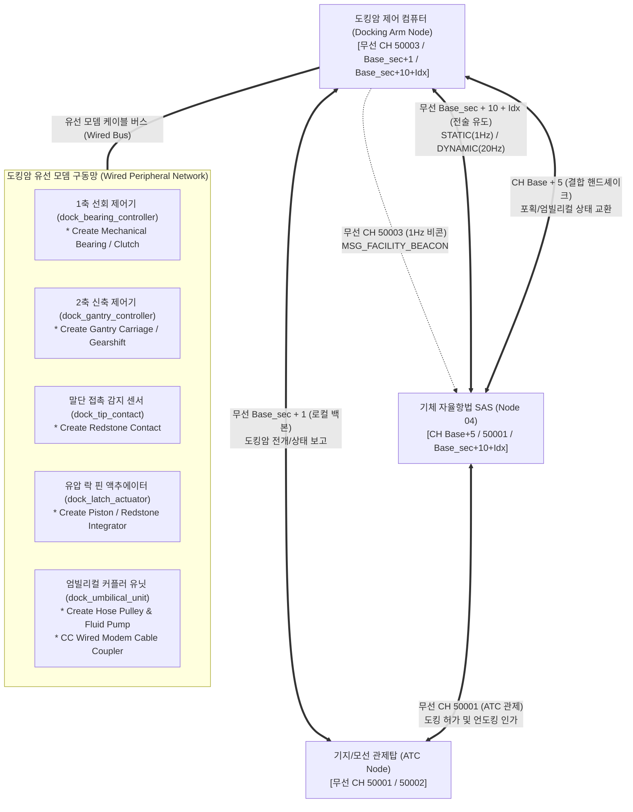
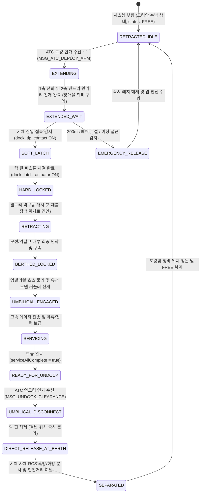
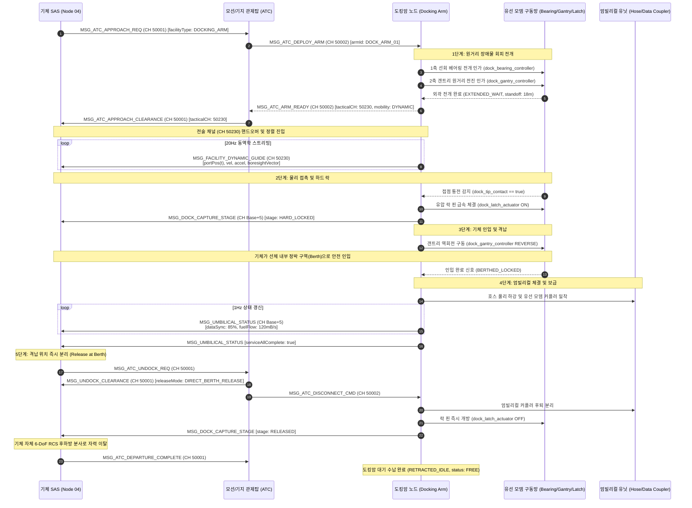

# 도킹암 시스템 및 통신 인터페이스 제어 규격서 (ICD)
> **Docking Arm System Specification & Interface Control Document (ICD)**  
> **프로젝트**: Universal Autonomous Flight Stack (SAS · VAS · Ground Infrastructure)  
> **문서 버전**: v1.10.4 (4대 비행 프로그램 최신 실측 구현 데이터 반영 양방향 동기화: Master ICD v1.20.0, GAC v1.1.4, SYSTEM v2.6.0, SAS v1.9.0, VAS v1.11.0, TCA v1.8.0, Alignment v2.4.0, GPS v2.0.4, LANDING_PAD v2.2.4, RUNWAY v1.10.4 전역 동기화)  
> **최종 수정일**: 2026-11-07  
> **대상 환경**: Minecraft CC:Tweaked (Ender Modem, Wired Modem), Create: Aeronautics, Create: Avionics  
> **연관 규격서**: 
> - [AUTONOMOUS_FLIGHT_SYSTEM_ARCHITECTURE_AND_ICD.md](../../../../system/AUTONOMOUS_FLIGHT_SYSTEM_ARCHITECTURE_AND_ICD.md) (마스터 ICD v1.20.0)
> - [GAC_PROGRAM_SPECIFICATION_AND_ICD.md](../../0_infra/gac/GAC_PROGRAM_SPECIFICATION_AND_ICD.md) (GAC 관제사 규격서 v1.1.4)
> - [SYSTEM_PROGRAM_RELATION_AND_PACKET_DIAGRAM.md](../../../../system/SYSTEM_PROGRAM_RELATION_AND_PACKET_DIAGRAM.md) (전체 관계도 v2.6.0)
> - [GPS_PROGRAM_SPECIFICATION_AND_ICD.md](../../../implemented/0_infra/gps/GPS_PROGRAM_SPECIFICATION_AND_ICD.md) (GPS 규격서 v2.0.4)
> - [SAS_PROGRAM_SPECIFICATION.md](../../../implemented/2_guidance/sas/SAS_PROGRAM_SPECIFICATION.md) (SAS 자율 항법 규격서 v1.9.0)
> - [VAS_PROGRAM_SPECIFICATION.md](../../../implemented/1_control/vas/VAS_PROGRAM_SPECIFICATION.md) (비행 제어 코어 v1.11.0)
> - [LANDING_PAD_SPECIFICATION_AND_ICD.md](../landing_pad/LANDING_PAD_SPECIFICATION_AND_ICD.md) (착륙패드 규격서 v2.2.4)
> - [RUNWAY_SPECIFICATION_AND_ICD.md](../runway/RUNWAY_SPECIFICATION_AND_ICD.md) (활주로 규격서 v1.10.4)

---

## 1. 개요 및 시스템 범위 (Overview & System Scope)

본 문서는 기지 타워 또는 공중/해상 모선에 설치된 기계식 2축 로봇 암(2-Axis Robotic Docking Arm)과 기체 간의 정밀 랑데부, 원거리 장애물 회피 포획 결합(Stand-off Capture), 격납 위치로의 안전 인입(Berthing Retraction), 엄빌리컬(Umbilical) 유선 인터페이스 연동 및 격납 위치 직접 분리(Direct Release at Berth)를 관할하는 **도킹암(Docking Arm) 노드**의 통신 프로토콜, 하드웨어 제어 인터록 및 상태 머신(FSM)을 정의한 세부 규격서입니다.

### 1.1 핵심 설계 원칙 및 운영 시퀀스
1. **2축 기구학 구성 (2-Axis Kinematics Architecture)**:
   - **1축 선회/방위각 제어 (Azimuth/Swing Axis)**: Create 기계식 베어링(Mechanical Bearing) 및 기어시프트/클러치로 구동되며, 모선 선체 또는 기지 구조물 외곽으로 암의 지향 각도를 전개합니다.
   - **2축 신축/직선 제어 (Extension/Retraction Axis)**: Create 갠트리 캐리지(Gantry Carriage) 및 갠트리 샤프트로 구동되며, 장애물 간섭 영역을 완전히 벗어난 안전 공간까지 암을 장거리 투사(Stand-off Extension)합니다.
2. **원거리 장애물 회피 포획 (Stand-off Capture)**:
   - 기체가 모선 선체나 기지 벽면 등 위험 장애물에 근접하지 않도록, 도킹암을 외곽 안전 구역(예: $15\sim 25\text{m}$ 외곽)으로 길게 전개하여 대기(`EXTENDED_WAIT`)합니다.
   - 기체는 6-DoF RCS 및 미세 추력으로 전개된 암 말단의 도킹 포트 조준선(Boresight)에 직접 정렬 진입합니다.
3. **접촉 감지 및 기계식 락 (Contact Sensing & Hard Lock)**:
   - 암 말단과 기체 프로브의 물리 결합 순간, Create 레드스톤 콘택트(Redstone Contact) 스위치가 접촉 통전되어 소프트 래치(`SOFT_LATCH`)를 밀리초 단위로 확증합니다.
   - 접촉 확인 즉시 피스톤 구동식 하드 락 핀(Hard Lock Pin)이 전개되어 물리 구속(`HARD_LOCKED`)을 체결합니다.
4. **기체 인입 및 격납 (Berthing Retraction)**:
   - 결합이 체결되면 갠트리 구동계를 역회전시켜, 연결된 기체를 모선 내부의 전용 정박 구역(Berth / Hangar Bay)으로 안전하게 끌어당겨 안착시킵니다.
5. **엄빌리컬(Umbilical) 통합 서비스 연동**:
   - 기체가 정박 위치에 안착하면 대용량 엄빌리컬 커플러가 전개되어, Create 호스 풀리(Hose Pulley)를 통한 고압 급유, 고전압 배터리 충전, 그리고 CC:Tweaked 유선 모뎀 커플러를 통한 초고속 비행 로그 덤프 및 미션 계획 업로드를 수행합니다.
6. **격납 위치 직접 분리 (Direct Release at Berth)**:
   - 언도킹 및 출격 인가 시, 암을 다시 외곽으로 재전개하지 않고 **인입된 정박 위치에서 엄빌리컬과 락 핀을 즉시 해제**합니다.
   - 기체는 자체 6-DoF RCS 및 미세 추진기를 후방/하방으로 분사하여 격납구 밖 안전 공역으로 자력 이탈합니다.
7. **비상 퀵 릴리스 인터록 (Emergency Quick Release Interlock)**:
   - 접근 중 충돌 위험 감지, 모선 긴급 회피 기동, 또는 기체 이탈 명령 시 100ms 이내에 락 핀을 즉시 후퇴시키고 스프링 분리 펄스를 인가하는 하드웨어 안전 인터록을 탑재합니다.

### 1.2 GPS 광역 항법 $\rightarrow$ 전술 도킹 랑데부 연계 인터페이스 (GPS to Tactical Transition)
1. **광역 접근 단계 (GPS En-Route Phase)**:
   - 비행체 UAP는 `CH_FACILITY_BEACON` (50003, 구버전 `30000` [DEPRECATED])에서 브로드캐스트되는 도킹암 시설물의 글로벌 기준 좌표와 진입 정렬 회랑(`corridorLength = 15.0m`, `standoffDistanceM = 18.0m`) 제원을 수신합니다.
   - 중앙 GPS 체계(`CH_GPS_PING` 60001, 구버전 `30004` [DEPRECATED] / 회신 채널 `Base+5`)의 정밀 2D 위치 추정을 기반으로 도킹암 외곽 100~200m 지점의 대기 공역(Staging Point)까지 장거리 L1 자율 비행을 수행합니다.
2. **관제 인가 및 전술 유도 전이 (Terminal Handoff)**:
   - Staging Point 진입 시 UAP는 `CH_ATC_COMM` (50001, 구버전 `30001` [DEPRECATED])로 `MSG_ATC_APPROACH_REQ`를 송신하여 섹터 관제 채널($Base_{\text{sec}} + 0$, 구버전 `30100 + S` [DEPRECATED])로 핸드오프를 인가받습니다.
   - 관할 지상 구역 관제사(GAC)가 시설물 가용성을 확인하고 도킹암 슬롯 배정(`MSG_ATC_SLOT_ASSIGN` via $Base_{\text{sec}} + 1$, 구버전 `30200 + S` [DEPRECATED])을 완료한 후, UAP에 `MSG_GAC_APPROACH_CLEARANCE`를 통해 전술 채널(`CH_TACTICAL_GUIDANCE = Base_sec + 10 + Idx`, 구버전 `31000 + ID` [DEPRECATED])을 하달합니다.
   - UAP는 광역 GPS 연산 의존도를 낮추고 도킹암 노드가 20Hz(동적 모선) 또는 1Hz(정적 타워)로 송출하는 정밀 상대 벡터(`MSG_FACILITY_DYNAMIC_GUIDE`) 추종 모드로 전이합니다.
3. **이동 모선 동역학 융합**:
   - 항진 중인 모선의 도킹암은 모선 자체의 관성 항법 및 GPS 노드를 통해 산출된 선체 속도 벡터($\vec{v}$) 및 가속도($\vec{a}$)를 전술 유도 패킷에 동봉하여, 기체 UAP가 이동 좌표계 상에서 무경사(Zero-Tilt) 상대 정지 및 6-DoF 랑데부를 완료하도록 지원합니다.

### 1.3 코드 경량화 및 Deprecated 운영 정책 (Code Lightweighting & Deprecation Policy)
1. **사양서 명세 원칙 (Specification-First)**: 프로토콜 패킷 타입명 또는 페이로드 필드가 개정될 경우, 구버전 명칭은 사양서 내에 `[DEPRECATED]` 배지를 부여하고 대체 신규 필드명과 변경 이력을 명시하여 문서상에 보존합니다.
2. **코드베이스 경량화 원칙 (Zero-Fallback)**: CC:Tweaked Lua 분산 컴퓨터 환경의 자원 제약(메모리 절약, 20Hz 실시간 루프 성능 보장)을 준수하기 위해, 코드베이스는 사전 이중 호환(Fallback 래퍼, `payload.new or payload.old` 등)을 일체 작성하지 않고 **최신 표준 필드명/패킷명만을 단일 채택**합니다.
3. **런타임 오류 시 복구 원칙 (송신 노드 즉시 패치)**: 구버전 필드/패킷을 전송하는 미갱신 노드로 인해 수신 측에서 `nil` 인덱싱 등의 런타임 오류가 발생할 경우, 수신 측에 임시 폴백 코드를 추가하지 않고 **구버전 패킷을 송신한 발신 노드의 코드를 최신 사양으로 즉시 패치 및 재배포**하여 전역 일원화를 달성합니다.

---

## 2. 네트워크 채널 및 하드웨어 토폴로지 (Network Channels & Hardware Topology)

도킹암 시스템은 대공/관제 무선 통신(Ender Modem)과 정밀 구동계 제어를 위한 유선 모뎀(Wired Modem) 네트워크로 분리 구성됩니다.



### 2.1 무선 채널 할당 표
| 채널 번호 | 채널 식별자 | 송신자 | 수신자 | 전송 주기 | 통신 목적 및 내용 |
| :---: | :---: | :---: | :---: | :---: | :--- |
| **`50003`** | `CH_FACILITY_BEACON` | Arm Node | All (SAS, MFD) | 1Hz | 도킹 포트 규격 (포트 직경, 어댑터 타입, 가용 상태, 이동성 플래그) (구버전 `30000` [DEPRECATED]) |
| **`50001`** | `CH_ATC_COMM` | SAS / ATC | ATC / SAS | 이벤트 기반 | 도킹 진입 인가(`DOCK_APPROACH_REQ`), 언도킹 분리 허가 교신 (구버전 `30001` [DEPRECATED]) |
| **`50002`** | `CH_ATC_FACILITY` | Tower ATC / GAC | GAC / Tower ATC | 1Hz / 이벤트 | 광역 관제탑과 GAC 간 섹터 관제 이양 및 상태 동기화 (구버전 `30002` [DEPRECATED]) |
| **`Base_sec + 0`** | `CH_GAC_COMM` | SAS / GAC | GAC / SAS | 이벤트 | 도킹 섹터 체크인(`MSG_GAC_CHECKIN_REQ`), 도킹암 인가(`MSG_GAC_APPROACH_CLEARANCE`), 언도킹 허가 (구버전 `30100 + S` [DEPRECATED]) |
| **`Base_sec + 1`** | `CH_SECTOR_FACILITY` | Arm Node / GAC | GAC / Arm Node | 1Hz / 이벤트 | 도킹암 노드와 직속 GAC 간 슬롯 배정(`MSG_ATC_SLOT_ASSIGN`), 전개/인입 상태 보고 (구버전 `30200 + S` [DEPRECATED]) |
| **`Base_sec + 10 + Idx`** | `CH_TACTICAL_GUIDANCE` | Arm Node | SAS (Node 04) | 1Hz (정적)<br/>20Hz (동적) | 포트 중심 좌표, 조준선 벡터($\vec{n}_{bore}$), 동적 속도/가속도 스트리밍 (예: 50230, 구버전 `31000 + ID` [DEPRECATED]) |
| **`Base + 5`** | `CH_EXTERNAL_COMM` | Arm / SAS | SAS / Arm | 이벤트 | 래치 포획(`MSG_DOCK_CAPTURE_STAGE`), 엄빌리컬 서비스 상태 교환 |

### 2.2 유선 모뎀 주변기기 매핑 표 (Wired Modem Peripherals)
| 주변기기 식별자 (Peripheral ID) | 물리 블록 타입 | 제어 방식 및 신호 | 기능 설명 |
| :--- | :---: | :--- | :--- |
| **`dock_bearing_controller`** | Create Clutch / Gearshift | 아날로그 RS 0~15 / Direction Bit | 1축 기계식 베어링 선회 각도 제어 및 방위 고정 |
| **`dock_gantry_controller`** | Create Gantry / Speed Controller | Speed RPM 설정 / 정·역회전 신호 | 2축 갠트리 원거리 전진(전개) 및 역회전(기체 인입) 구동 |
| **`dock_tip_contact`** | Create Redstone Contact | 디지털 접점 입력 (`getInput() == true`) | 기체 프로브 말단 물리 접촉 즉시 통전 감지 |
| **`dock_latch_actuator`** | Create Piston / Redstone Integrator | 디지털 출력 (ON: 잠금, OFF: 해제) | 기계식 하드 락 핀 체결 및 비상 시 즉각 개방 |
| **`dock_hose_pulley`** | Create Hose Pulley / Pump | 유체 주변기기 API (`fluid_storage`) | 엄빌리컬 연료관 하강 및 고압 급유 펌프 제어 |
| **`dock_wired_modem_coupler`** | CC:Tweaked Wired Modem | 유선 네트워크 통신 버스 | 결합 완료 후 비행 로그 덤프 및 미션 계획 유선 전송 |

---

## 3. 통신 패킷 상세 규격 (Message Envelope & Payload Specification)

### 3.1 광역 상태 비콘 (`MSG_FACILITY_BEACON`, CH 50003, 1Hz)
```lua
{
    ver = "1.9.5",
    domainId = "DOCK_ARM_ALPHA_01",
    seq = 30015,
    type = "MSG_FACILITY_BEACON",
    time = 1729850000000,
    payload = {
        facilityId = "DOCK_ARM_ALPHA_01",
        facilityType = "DOCKING_ARM",
        mobility = "DYNAMIC",                -- "STATIC" (지상 타워) | "DYNAMIC" (모선 붐)
        atcChannel = 50001,
        tacticalChannel = 50230,             -- 전술 채널 (Base_sec + 10 + 19)
        status = "FREE",                     -- "FREE", "DEPLOYING", "LOCKED", "BERTHED", "MAINTENANCE"
        portStandard = "PROBE_DROGUE_V2",    -- 도킹 포트 규격
        corridorLength = 15.0,               -- 진입 정렬 회랑 길이 (m)
        maxApproachSpeed = 0.5,              -- 최종 결합 허용 상대속도 (m/s)
        standoffDistanceM = 18.0,            -- 모선 선체 기준 원거리 전개 거리 (m)
        umbilicalSupported = {
            dataSync = true,
            liquidFuel = true,
            highVoltage = true
        }
    }
}
```

---

### 3.2 고정 도킹암 정밀 가이드 패킷 (`MSG_FACILITY_STATIC_GUIDE`, Base_sec + 10 + Idx, 1Hz)
지상 기지 갠트리 도킹암 전용 패킷입니다(예: CH 50230). 원거리 전개 대기 상태(`EXTENDED_WAIT`)의 포트 좌표와 진입 조준선 벡터를 제공합니다.
```lua
{
    ver = "1.9.5",
    domainId = "DOCK_ARM_ALPHA_01",
    seq = 30510,
    type = "MSG_FACILITY_STATIC_GUIDE",
    time = 1729850010000,
    payload = {
        facilityId = "DOCK_ARM_ALPHA_01",
        targetAircraft = "AIRCRAFT_01",
        portTargetPoint = {                  -- 원거리 전개된 도킹 포트 중심 3D 좌표 (Minecraft World Coordinates: X_MC, Y_MC, Z_MC)
            x = 540.0,
            y = 110.5,
            z = -320.0
        },
        boresightVector = {                  -- 진입 정렬 중심선 법선 단위 벡터
            nx = 0.0,
            ny = 0.0,
            nz = 1.0
        },
        dockingCorridor = {
            lateralTolerance = 0.15,         -- 초정밀 수평 허용 공차 (m, VECTORED_VTOL 정합)
            verticalTolerance = 0.15,        -- 초정밀 수직 허용 공차 (m, VECTORED_VTOL 정합)
            angularToleranceDeg = 2.0,       -- 자세각 정렬 허용 오차 (deg)
            approachMaxSpeedMps = 0.4,       -- 최종 크립 최대 전진 속도 (m/s)
            abortToleranceLimit = 0.30       -- 300ms 초과 시 비상 이탈(Abort) 임계치 (m)
        },
        armState = "EXTENDED_WAIT",          -- 원거리 전개 완료 대기 상태
        abortAlert = false
    }
}
```

---

### 3.3 동적 모선 도킹암 실시간 동역학 스트리밍 (`MSG_FACILITY_DYNAMIC_GUIDE`, Base_sec + 10 + Idx, 20Hz)
비행선 모선, 공중 항공모함 등 이동 플랫폼 붐 전용 패킷입니다(예: CH 50230). 모선 동역학과 원거리 전개 포트의 6-DoF 상태를 20Hz로 스트리밍합니다.
```lua
{
    ver = "1.9.5",
    domainId = "MOTHERSHIP_BOOM_02",
    seq = 94200,
    type = "MSG_FACILITY_DYNAMIC_GUIDE",
    time = 1729850020050,
    payload = {
        facilityId = "MOTHERSHIP_BOOM_02",
        targetAircraft = "AIRCRAFT_01",
        portTargetPoint = {                  -- 시각 t에서의 원거리 전개 포트 중심 3D 좌표
            x = 1845.20,
            y = 280.40,
            z = -950.15
        },
        velocity = {                         -- 포트 3축 이동 속도 벡터 (m/s)
            vx = 15.2,
            vy = 0.0,
            vz = 0.5
        },
        acceleration = {                     -- 포트 가속도 벡터 (m/s²)
            ax = -0.02,
            ay = 0.05,
            az = 0.00
        },
        boresightVector = {                  -- 진입 조준 벡터
            nx = -0.998,
            ny = 0.0,
            nz = -0.063
        },
        portAttitude = {                     -- 포트 3축 자세 (deg)
            pitch = 0.5,
            roll = 0.0,
            yaw = 273.6
        },
        captureLatchReady = true,            -- 기계식 래치 포획 준비 완료 여부
        abortAlert = false                   -- 상대 거리 급감 등 비상 이탈 신호
    }
}
```

---

### 3.4 도킹 결합, 인입 및 엄빌리컬 패킷

#### 1. 도킹 체결 단계 갱신 패킷 (`MSG_DOCK_CAPTURE_STAGE`, Base_sec + 10 + Idx $\leftrightarrow$ Base+5)
> [!IMPORTANT]
> **도킹 결합 FSM 정합성 확정 (감사 결함 #1 해소)**:
> 도킹 체결 확인 시 발신하는 공식 와이어 패킷 식별자는 `MSG_DOCK_CAPTURE_STAGE`이며, `stage = "HARD_LOCKED"`를 전달하여 SAS FSM의 즉각적인 추진기 셧다운 및 `DISARMED` 전이를 완수합니다.
> 비행 소프트웨어의 상호 호환성을 위해 SAS 및 도킹암 노드는 `MSG_DOCKING_ARM_CMD` (`ACTION = "CAPTURE_CLOSE"`) 식별자를 동등한 체결 완료 이벤트로 상호 수용(Aliasing)하여 FSM 교착 위험을 원천 배제합니다.

```lua
{
    ver = "1.9.5",
    domainId = "DOCK_ARM_ALPHA_01",
    type = "MSG_DOCK_CAPTURE_STAGE",         -- 공식 와이어 식별자 (알리아스: MSG_DOCKING_ARM_CMD 지원)
    time = 1729850025100,
    payload = {
        facilityId = "DOCK_ARM_ALPHA_01",
        targetAircraft = "AIRCRAFT_01",
        stage = "HARD_LOCKED",               -- "EXTENDED_WAIT", "SOFT_LATCH", "HARD_LOCKED", "RETRACTING", "BERTHED", "RELEASED"
        relativeOffset = { dx = 0.01, dy = -0.01, dz = 0.00 },
        contactSensorActive = true,          -- Create Redstone Contact 통전 상태
        lockPinEngaged = true,               -- 기계식 락 핀 체결 확인
        holdingTorqueNm = 4500.0,
        berthingProgressPercent = 0.0        -- 인입 진행률 (0% -> 100%)
    }
}
```

#### 2. 엄빌리컬 통합 서비스 상태 (`MSG_UMBILICAL_STATUS`, CH Base+5, 1Hz)
```lua
{
    ver = "1.9.5",
    domainId = "DOCK_ARM_ALPHA_01",
    type = "MSG_UMBILICAL_STATUS",
    time = 1729850030000,
    payload = {
        facilityId = "DOCK_ARM_ALPHA_01",
        targetAircraft = "AIRCRAFT_01",
        umbilicalEngaged = true,             -- 엄빌리컬 커플러 결합 여부
        berthLocationSecured = true,         -- 모선 정박 위치 구속 완료
        highSpeedDataLink = {
            connected = true,
            syncStatus = "SYNCING_LOGS",     -- "IDLE", "SYNCING_LOGS", "UPLOADING_MISSION", "COMPLETE"
            progressPercent = 85.0
        },
        fuelService = {
            flowRate = 120.0,                -- 고압 펌프 주입 속도 (mB/s)
            currentLevel = 3800.0,
            maxCapacity = 4000.0
        },
        powerRecharge = {
            voltage = 480.0,
            currentAmps = 60.0
        },
        serviceAllComplete = false
    }
}
```

#### 3. 언도킹 및 격납 위치 분리 인가 패킷 (`MSG_UNDOCK_CLEARANCE`, CH 50001, ATC $\rightarrow$ SAS)
```lua
{
    ver = "1.9.5",
    domainId = "ATC_MOTHERSHIP",
    type = "MSG_UNDOCK_CLEARANCE",
    time = 1729850200000,
    payload = {
        targetAircraft = "AIRCRAFT_01",
        facilityId = "DOCK_ARM_ALPHA_01",
        releaseMode = "DIRECT_BERTH_RELEASE", -- "DIRECT_BERTH_RELEASE" (격납 위치 즉시 분리)
        separationVector = { x = 0.0, y = -1.0, z = -5.0 }, -- 후하방 RCS 자력 분리 권고 벡터
        pushOffImpulseSec = 1.5,             -- 반발 펄스 지속 시간
        safeClearanceDistance = 25.0         -- 모선 선체 안전 이탈 거리 (m)
    }
}
```

---

## 4. 유한 상태 기계 및 동작 시퀀스 (FSM & Sequence)

### 4.1 도킹암 2축 구동 FSM 상태 전이도



### 4.2 도킹, 기체 인입, 엄빌리컬 및 격납 분리 시퀀스 다이어그램



---

## 5. 정밀 도킹 유도 알고리즘 및 인터록 (Algorithms & Interlocks)

### 5.1 조준선(Boresight) 프레임 기반 상대 오차 분해
원거리 전개된 도킹 포트 개구면의 단위 조준선 벡터 $\vec{n}_{bore}$, 상방 벡터 $\vec{n}_{up}$, 횡방 벡터 $\vec{n}_{cross} = \vec{n}_{bore} \times \vec{n}_{up}$를 기준으로 기체 프로브의 상대 위치 $\vec{r}_{rel} = \vec{p}_{probe} - \vec{p}_{port}$를 분해합니다.

- **진입 축 잔여 거리 (Axial Distance)**:
  $$d_{axial} = \vec{r}_{rel} \cdot \vec{n}_{bore}$$
- **수평 오차 (Lateral Error)**:
  $$e_{lat} = \vec{r}_{rel} \cdot \vec{n}_{cross} \quad (|e_{lat}| \le 0.15\text{ m})$$
- **수직 오차 (Vertical Error)**:
  $$e_{vert} = \vec{r}_{rel} \cdot \vec{n}_{up} \quad (|e_{vert}| \le 0.15\text{ m})$$
- **자세각 정렬 오차 및 접근 속도 한계**:
  $$|\Delta \psi| \le 2.0^\circ, \quad v_{axial} \le 0.4\text{ m/s}$$

기체 SAS([SAS_PROGRAM_SPECIFICATION.md](../../../implemented/2_guidance/sas/SAS_PROGRAM_SPECIFICATION.md))는 축 방향 진입 속도를 $v_{axial} = -0.30 \cdot \tanh(d_{axial} / 2.0)\text{ m/s}$로 제어하여, 도킹 포트 접촉 시 충격을 $0.2\text{ m/s}$ 이하로 제한합니다.

### 5.2 안전 인터록 및 페일세이프 매트릭스
| 이상 상황 | 감지 조건 | 대상 시스템 | 조치 사항 및 페일세이프 |
| :--- | :--- | :---: | :--- |
| **비상 복행 / 충돌 위험 (DOCK_ABORT)** | 접근 중 300ms 패킷 두절 또는 5m 이내 공차 초과($\|e_{lat}\|, \|e_{vert}\| > 0.30\text{m}$, $\|\Delta \psi\| > 5.0^\circ$) 300ms 지속 | 기체 / 도킹암 | **후방 급속 역추진 이탈**: 기체는 자세 수평 및 정면을 유지한 채 $surge = -0.8$ 역추진을 최대 인가하여 $15.0\text{m}$ 안전 거리로 급속 후퇴(`DOCK_STANDBY`). 도킹암은 100ms 내 래치 개방 및 `abortAlert = true` 송출 |
| **원거리 전개 장애물 걸림** | 갠트리 전진 중 이동 속도 0 감지 | 도킹암 갠트리 | 갠트리 클러치 즉시 해제, ATC에 `ARM_FAULT` 전송 및 도킹 인가 취소 |
| **소프트 래치 후 락 미체결** | 접촉 감지 후 1.0초 내 락 핀 미관통 | 래치 액추에이터 | 접촉 해제(푸시오프) 후 기체 복행 지시, 포트 재정렬 |
| **인입 중 기동 간섭/과부하** | 갠트리 역회전 중 과도 슬립 감지 | 갠트리 구동계 | 인입 중단, 현재 위치 정지 고정 후 ATC 경보 표출 |
| **엄빌리컬 결합 누유/단선** | 유체 주입 중 유량 급감 또는 유선 핑 두절 | 엄빌리컬 유닛 | 급유 밸브 즉시 차단, 소화 시스템 대기, 수동 점검 모드 전환 |
