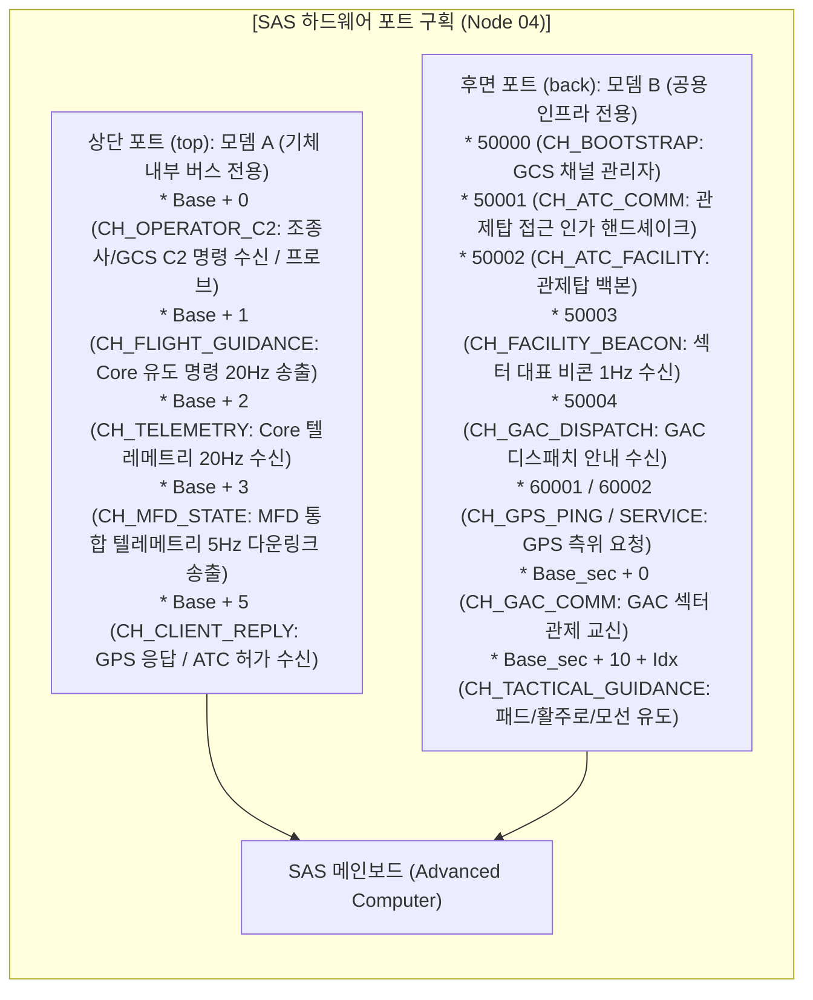
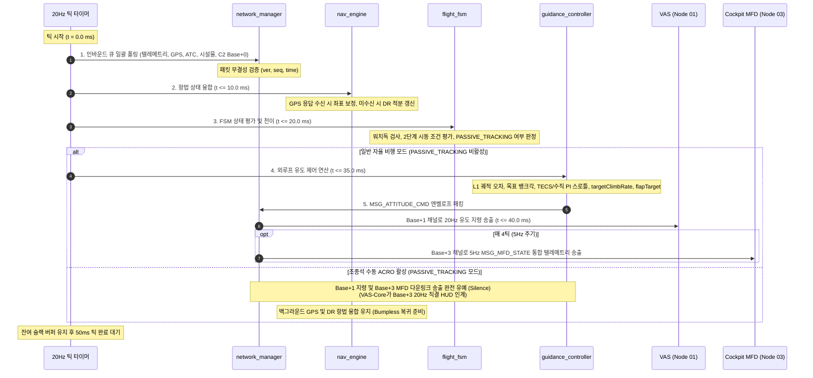
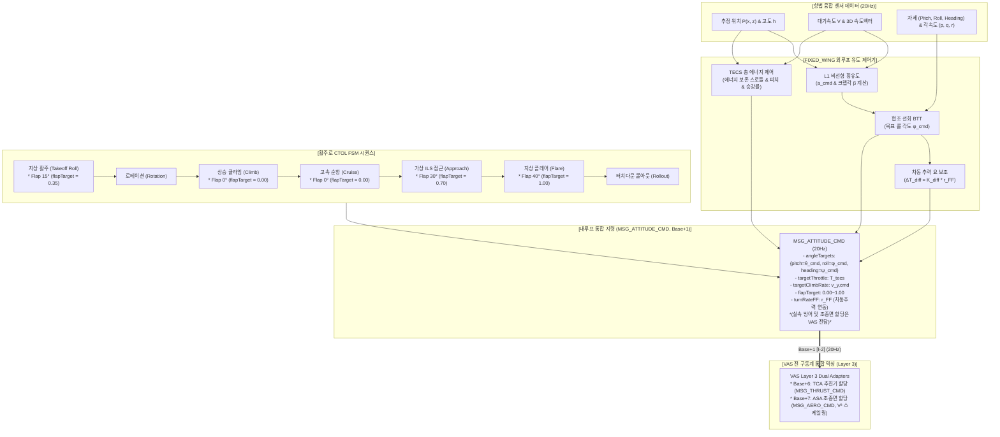
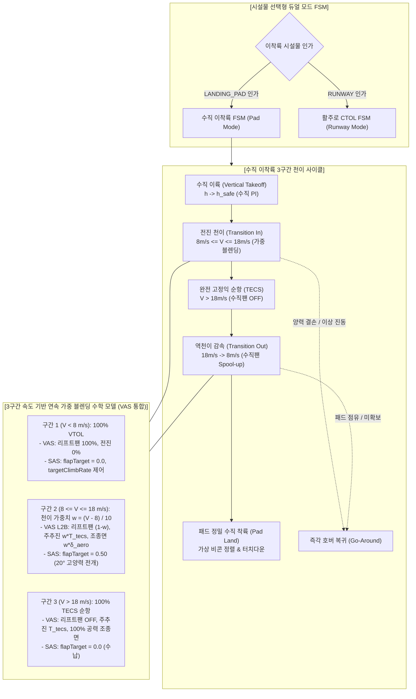
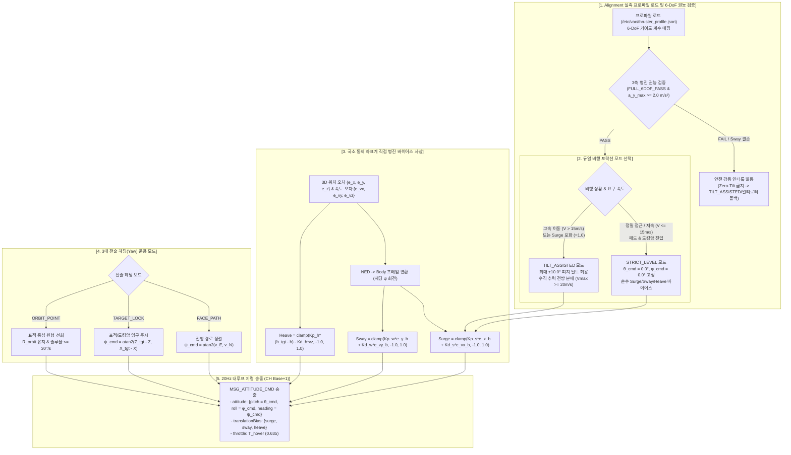
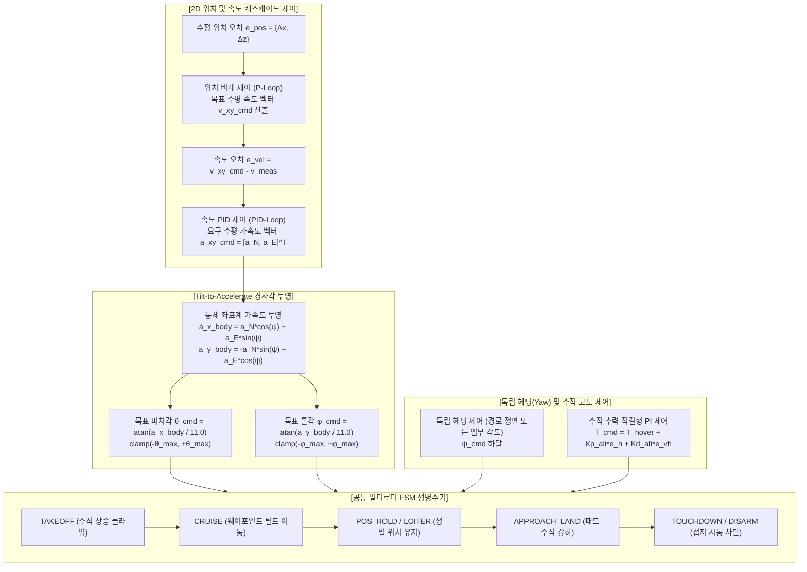
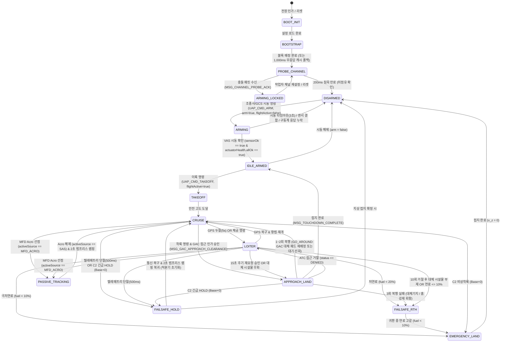
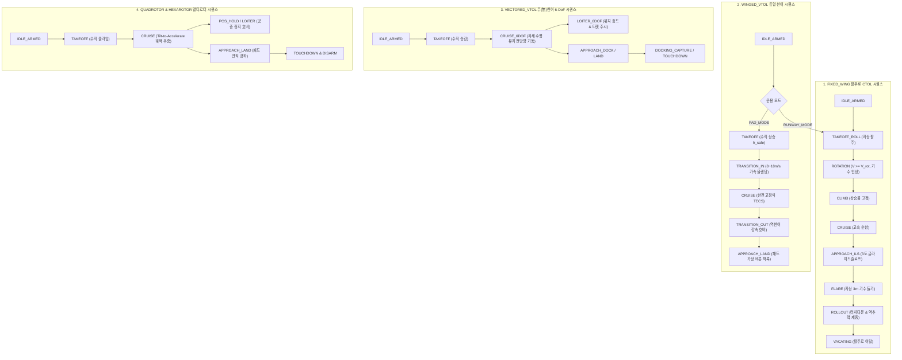
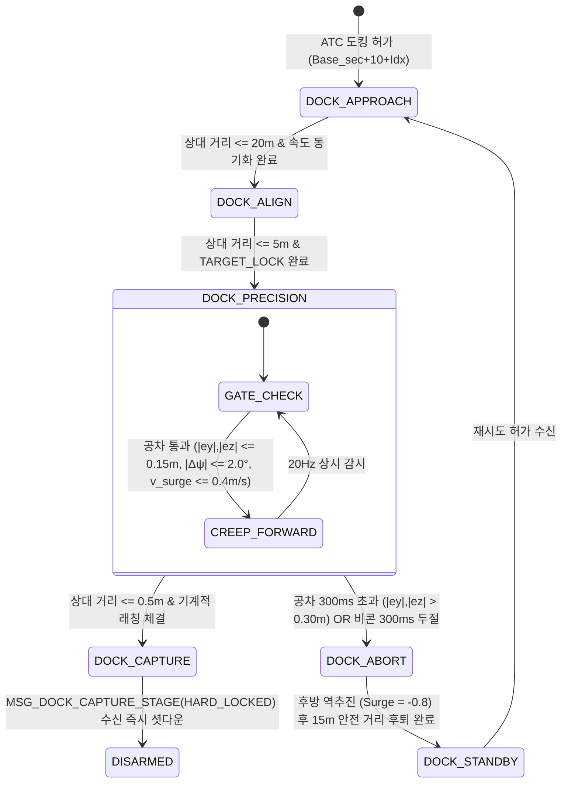

# SAS (자율 항법 및 외루프 임무 제어 컴퓨터) 상세 규격서
> **SAS: Universal Autopilot & Mission Guidance Computer Program Specification**  
> **프로젝트**: Universal Autonomous Flight Stack (UAFS Ecosystem)  
> **문서 버전**: v1.9.0 (13대 과제 및 31대 마이크로슬라이스 IS-01.1~IS-13.5 전수 구현 완료, 최신 하네스 Gate 0~6 검증 실측 v1.2.2 및 빌드 해시 f669ee83... 반영, 배포 번들 생성 완료, 온보드 3계층 위계 재정의, ASA 조종면 제어권 VAS 이관, 순수 외루프 유도 목표치 및 플랩 지령 출력 경량화, 중복 Stall Guard 제거, MFD/GCS C2 Base+0 단일 진입 게이트웨이 정립, MFD 5Hz 통합 텔레메트리 다운링크 단일 송출, 조종석 ACRO 직결 시 PASSIVE_TRACKING 전환 및 무충격 인계, 계단식 동적 채널 재바인딩 트랜잭션 개시자, Master ICD v1.20.0, SYSTEM v2.6.0, VAS v1.11.0, TCA v1.8.0, ASA v1.2.1, Alignment v2.4.0, GPS v2.0.3 전역 동기화)  
> **최종 수정일**: 2026-11-07  
> **운영 환경**: Minecraft CC:Tweaked, Create: Aeronautics, Create: Avionics  
> **참조 문서**: 
> - [AUTONOMOUS_FLIGHT_SYSTEM_ARCHITECTURE_AND_ICD.md](../../../../system/AUTONOMOUS_FLIGHT_SYSTEM_ARCHITECTURE_AND_ICD.md) (마스터 ICD v1.20.0)
> - [SYSTEM_PROGRAM_RELATION_AND_PACKET_DIAGRAM.md](../../../../system/SYSTEM_PROGRAM_RELATION_AND_PACKET_DIAGRAM.md) (전체 구조도 v2.6.0)
> - [VAS_PROGRAM_SPECIFICATION.md](../../1_control/vas/VAS_PROGRAM_SPECIFICATION.md) (비행 제어 코어 v1.11.0)
> - [ASA_PROGRAM_SPECIFICATION.md](../../../approved/1_control/asa/ASA_PROGRAM_SPECIFICATION.md) (공력 날개 및 조종면 규격서 v1.2.1)
> - [TCA_PROGRAM_SPECIFICATION.md](../../1_control/tca/TCA_PROGRAM_SPECIFICATION.md) (추력 어댑터 규격서 v1.8.0)
> - [ALIGNMENT_PROGRAM_SPECIFICATION.md](../../0_development/alignment/ALIGNMENT_PROGRAM_SPECIFICATION.md) (격납고 상주형 동역학 프로파일러 v2.4.0)
> - [GAC_PROGRAM_SPECIFICATION_AND_ICD.md](../../../approved/0_infra/gac/GAC_PROGRAM_SPECIFICATION_AND_ICD.md) (GAC 관제사 규격서 v1.1.3)
> - [GPS_PROGRAM_SPECIFICATION_AND_ICD.md](../../0_infra/gps/GPS_PROGRAM_SPECIFICATION_AND_ICD.md) (고정밀 GPS 규격서 v2.0.3)
> - [RUNWAY_SPECIFICATION_AND_ICD.md](../../../approved/0_ground/runway/RUNWAY_SPECIFICATION_AND_ICD.md) (활주로 규격서 v1.10.3)
> - [LANDING_PAD_SPECIFICATION_AND_ICD.md](../../../approved/0_ground/landing_pad/LANDING_PAD_SPECIFICATION_AND_ICD.md) (착륙패드 규격서 v2.2.3)
> - [DOCKING_ARM_SPECIFICATION_AND_ICD.md](../../../approved/0_ground/docking_arm/DOCKING_ARM_SPECIFICATION_AND_ICD.md) (도킹암 규격서 v1.10.3)
> - [GEMINI.md](../../../../../GEMINI.md) (전역 규칙 및 가이드라인)

---

## 1. 프로그램 개요 및 통합 아키텍처 (Overview & Architecture)

### 1.1 시스템 위상 및 설계 목적
**SAS (Stability Augmentation System / Node 04)**는 비행체 온보드 컴퓨터(CC:Tweaked Advanced Computer)에 탑재되어 **20Hz(50ms) 실시간 주기**로 가동되는 비행체의 **최상위 자율 항법 및 외루프 임무 유도 컴퓨터(Outer-Loop Mission Guidance Computer)**입니다.

> [!NOTE]
> **구현 및 배포 현황 요약 (Status: IMPLEMENTED & CLOUD DEPLOYED)**
> SAS 소프트웨어는 `projects/uap` 환경에서 13대 과제 및 31개 마이크로슬라이스(IS-01.1 ~ IS-13.5) 전수가 결함 0건으로 구현 완료(최신 실측 빌드 **v1.2.2**, 빌드 해시 `f669ee8314150eb19c547ebc2b270edba288b1733595c2668738c9c14ed686b3`)되었습니다.
> 하네스 Gate 0 ~ Gate 6 전 게이트 검증을 100% PASS(총 소요시간 5,476.86 ms)하였으며, 단일 실행 번들(`startup.lua`)이 생성되어 Google Drive 클라우드 저장소(`dist_gdrive/uap/uap_bundle.lua`)로 공식 동기화되었습니다. (상세 내역은 [제12장 12.3절](#123-소프트웨어-구현-현황-배포-및-통합-검증-결과-implementation--verification-status) 참조)

비행 제어 코어인 **VAS (Node 01)**가 20Hz 내루프에서 VICD-Spec 3계층 드라이버(Layer 1 $SO(3)$ 동역학 감쇠, Layer 2 비행 정책 및 엔벨로프 보호, Layer 3 TCA 구동계 분배)를 전담한다면, **SAS (Node 04)**는 비행체의 목적지 도달, 궤적 생성, 비행 모드 전환, 외부 인프라 교신 및 비상 페일세이프 판정을 총괄하는 비행체의 ‘두뇌’ 역할을 수행합니다.

### 1.2 7대 핵심 임무 및 기능
1. **외루프 유도 제어 (Outer-Loop Guidance Control)**:
   - 비선형 L1 유도 법칙을 통한 수평 궤적 및 웨이포인트 추종, 협조 선회 뱅크각 산출.
   - 고도 및 속도 제어: VTOL 모드에서는 수직 스로틀 PI 및 목표 승강률(`targetClimbRate`) 도출, 고정익 모드에서는 총 에너지 제어 시스템(TECS) 기반 에너지 분배.
   - 순수 운동학 유도 목표(자세 각도, 목표 승강률, 주 추진 스로틀, 플랩 전개 요구율 `flapTarget`, 2단계 시동 플래그 `flightActive`)를 20Hz 주기로 VAS-Core에 하달(`MSG_ATTITUDE_CMD`, `Base + 1`).
2. **구동계 분리 및 간접 유도 (Actuator Decoupling)**:
   - 공력 조종면 구동계 ASA(Node 06-xx)은 VAS Layer 3(`actuator_adapter_asa`, `Base+7`)으로 완전 편입되었으며, UAP는 조종면 타각 직접 산출 및 `Base+7` 소켓을 보유하지 않음. (구버전 직접 제어 모듈 `aerodynamic_controller.lua` 및 `MSG_SURFACE_CMD` [DEPRECATED]).
   - UAP는 중복 연산(실속 방지 가드 등)을 배제하고 순수 유도 목표와 비행 단계별 플랩 목표(`flapTarget`)만을 인가하며, 동적압($V^2$) 역비례 게인 스케일링, 실속 방어 및 조종면 배분은 VAS-Core가 일괄 전담.
3. **외루프 비행 모드 FSM 및 2단계 시동 주도권 총괄**:
   - 13대 상태 머신(`BOOT_INIT`, `BOOTSTRAP`, `PROBE_CHANNEL`, `ARMING_LOCKED`, `DISARMED`, `ARMING`, `IDLE_ARMED`, `TAKEOFF`, `CRUISE`, `LOITER`, `APPROACH_LAND`, `FAILSAFE_HOLD`, `FAILSAFE_RTH`, `EMERGENCY_LAND`, `PASSIVE_TRACKING`) 운용.
   - SAS 전담 2단계 시동: UAP가 채널 무결성, VAS 센서 헬스 및 하위 액추에이터 준비를 확인한 후 `arm = true, flightActive = false`로 지상 대기(`IDLE_ARMED`)를 수립하고, 이륙 허가 시 `flightActive = true`를 하달하여 활성 비행(`NORMAL`) 전환.
   - 조종석 MFD 수동 급기동(ACRO) 진입 시 `PASSIVE_TRACKING`으로 전이하여 유도 지령 송출을 일시 유예하고 GPS/DR 추적만 유지, 조종권 반환 시 2.0초 무급변(Bumpless) 램핑으로 자율 비행 복귀.
4. **GPS 및 20Hz 추측항법(Dead Reckoning) 융합 엔진**:
   - 5~10Hz 간격으로 외부 고정밀 GPS 노드 군에 거리 측정 핑(`MSG_GPS_REQUEST`, CH 60001, 구버전 `30004` [DEPRECATED]) 송출 및 중앙 서버로부터 응답 수신(`Base + 5`).
   - UAP의 `NET_MGR`이 `Base + 5` 채널로 수신한 GPS 패킷은 `gpsClient.handleMessage()`로 직접 주입하여 라이브러리 독자적 pullEvent 호출에 의한 이벤트 큐 오염을 방지.
   - 20Hz 내루프 텔레메트리(`MSG_FLIGHT_TELEMETRY`, `Base + 2`)의 3D 속도 및 진방위를 수치 적분하는 추측항법 결합.
   - GPS 두절(5,000ms 초과) 시 조종사 개입 대기형 반경 30m 선회 체공(`LOITER`) 자동 전환.
5. **공항 관제탑(Tower ATC) 및 지상 구역 관제사(GAC) 3-Tier 계층 연동**:
   - 1Hz 섹터 대표 비콘(`MSG_FACILITY_BEACON`, CH 50003, 구버전 `30000` [DEPRECATED]) 수집 및 가용 시설물 인벤토리 관리.
   - 2단계 주파수 핸드오프: 광역 관제탑(`CH 50001`, 구버전 `30001` [DEPRECATED], `MSG_ATC_APPROACH_REQ` $\to$ `MSG_ATC_HANDOFF_CLEARANCE`) $\rightarrow$ 관할 GAC 섹터 관제($Base_{\text{sec}} + 0$, 구버전 `30100 + SectorID` [DEPRECATED], `MSG_GAC_CHECKIN_REQ` $\to$ `MSG_GAC_APPROACH_CLEARANCE`) $\rightarrow$ 시설물 전술 유도 채널($Base_{\text{sec}} + 10 + \text{Idx}$, 구버전 `31000 + ID` [DEPRECATED]).
   - 시설물 점유 거절(`status == "DENIED"`) 시 현 위치 상공(+30m) 즉각 `LOITER` 대기, 15초 주기 재요청 루프 및 최인접 대체 섹터/시설물 자동 우회.
   - 시설물 전술 유도 채널($Base_{\text{sec}} + 10 + \text{Idx}$) 핸드오버: 고정 시설물(1Hz 정적 ILS) 및 동적 시설물(20Hz 2차 테일러 외삽 랑데부) 추종.
   - 동적 시설물 패킷 300ms 두절 또는 요동 위험(`deckStatus == "DANGEROUS"`) 시 즉각적인 복행(`GO_AROUND`) 단행 후 GAC에 안전고도 도달 보고(`MSG_GAC_ABORT_CLEAR`)하여 관할 내 타 가용 패드 즉시 재배정 수신.
6. **오퍼레이터 C2 단일 게이트웨이 및 조종석 MFD 통합 다운링크 전담**:
   - C2 단일 진입: 일반 비행 모드 변경, 웨이포인트 임무뿐 아니라 **`RTH` · `HOVER_HOLD(긴급홀드)` · `EMERGENCY_LAND(비상착륙)`** 전반을 `Base + 0` (`CH_OPERATOR_C2`) 단일 관문으로 수신하여 UAP가 기종별 외루프 유도로 완결.
   - MFD 통합 다운링크: 일반 비행 시 UAP가 채널 `Base + 3`으로 5Hz 통합 계기/항법 상태(`MSG_MFD_STATE`) 송출을 독점 전담.
7. **RF 채널 부트스트랩 및 계단식 재바인딩 트랜잭션 주관**:
   - GCS 채널 관리자(`CH 50000`, 구버전 `10000` [DEPRECATED])를 통한 고유 20채널 블록($Base = 10000 + (N - 1) \times 20$, $N=1\sim 2000$) 자동 배정.
   - 오프라인 기동 시 로컬 캐시 폴백 및 `Base + 0` 포트로 `MSG_CHANNEL_PROBE`(200ms) 송출, 충돌 감지 시 `ARMING_LOCKED` 영구 동결.
   - 동적 채널 재바인딩(`MSG_CHANNEL_REBIND`) 2단계 트랜잭션 개시자로서 온보드 서브노드(VAS, TCA, ASA)로의 계단식 스위칭 총괄.

### 1.3 서브시스템 간 상호작용 아키텍처

```mermaid
flowchart TD
    subgraph EXTERNAL_INFRA["[외부 인프라 시스템]"]
        GCS_CHAN["GCS 채널 관리자<br/>(CH 50000)"]
        GPS_SRV["고정밀 GPS 중앙 서버<br/>(CH 60001~60004)"]
        ATC["Tier 1: 공항 Tower ATC 관제탑<br/>(CH 50001 / 50002)"]
        GAC["Tier 2: 지상 구역 관제사 GAC Node 07<br/>(CH 50003 / Base_sec+0 / Base_sec+1)"]
        FAC["Tier 3: 스마트 시설물 (활주로/패드/도킹암)<br/>(Base_sec+10+Idx)"]
    end

    subgraph PILOT_OPERATOR["[조종사 및 원격 관제 C2]"]
        MFD["조종석 MFD 단말 (Node 03)<br/>(PILOT_PRIMARY / 수동 ACRO)"]
        GCS_C2["GCS 원격 지상 콘솔<br/>(GCS_OVERRIDE)"]
    end

    subgraph UAP_NODE["[SAS 자율 항법 컴퓨터 (Node 04)]"]
        UAP_MAIN["uap_main.lua (20Hz 디스패처)"]
        FSM["modules/flight_fsm.lua (13-State FSM)"]
        NAV["modules/nav_engine.lua (GPS / DR 융합)"]
        GUIDE["modules/guidance_controller.lua (L1 / TECS / 바이어스)"]
        FAC_CLI["modules/facility_client.lua (ATC / 전술 유도)"]
        OP_HDLR["modules/operator_handler.lua (C2 권한 중재)"]
        CHAN_SEN["modules/channel_sentinel.lua (부트스트랩 / 프로브)"]
        NET_MGR["modules/network_manager.lua (ICD v1.9.5 엔벨로프)"]
    end

    subgraph ACTUATION_SUBSYSTEM["[비행체 분산 구동계 및 내루프 제어]"]
        CORE["비행 제어 코어 VAS (Node 01)<br/>* 20Hz 센서 계측 & 전 구동계 통합 믹싱"]
        TCA["추력 어댑터 TCA 클러스터 (Node 02-xx)<br/>* 추진기 분산 구동 (Base+6)"]
        ASA["공력 어댑터 ASA 클러스터 (Node 06-xx)<br/>* 조종면 분산 구동 (Base+7)"]
    end

    %% Network links
    GCS_CHAN <==>|"CH 50000 [I-8]<br/>MSG_BLOCK_REQ/ASSIGN"| NET_MGR
    NET_MGR -.->|"Base+0 [I-9]<br/>MSG_CHANNEL_PROBE/ACK"| GCS_CHAN
    
    NET_MGR ==>|"CH 60001 [I-7]<br/>MSG_GPS_REQUEST (altY 주입)"| GPS_SRV
    GPS_SRV ==>|"Base+5 [I-7]<br/>MSG_GPS_RESPONSE"| NET_MGR

    GAC -.->|"CH 50003 [I-5]<br/>1Hz MSG_FACILITY_BEACON (대표 비콘)"| NET_MGR
    NET_MGR <==>|"CH 50001 [I-5]<br/>MSG_ATC_APPROACH_REQ / CLEAR"| ATC
    NET_MGR <==>|"Base_sec+0 [I-5]<br/>MSG_GAC_CHECKIN / CLEAR"| GAC
    FAC ==>|"Base_sec+10+Idx [I-5]<br/>정적 1Hz / 동적 20Hz 유도"| NET_MGR

    MFD ==>|"Base+0 [I-6]<br/>MSG_OPERATOR_CMD (C2 단일 진입: 일반/RTH/HOLD/LAND)"| NET_MGR
    GCS_C2 ==>|"Base+0 [I-6]<br/>MSG_OPERATOR_CMD"| NET_MGR
    NET_MGR -->|"Base+3 [I-6]<br/>5Hz MSG_MFD_STATE (통합 텔레메트리 다운링크)"| MFD

    NET_MGR ==>|"Base+1 [I-2] (20Hz)<br/>MSG_ATTITUDE_CMD (arm, flightActive, 운동학 유도)"| CORE
    MFD -.->|"Base+1 [I-2] (선점 직결 예외)<br/>ACRO 20Hz 직결 / E_STOP 킬스위치"| CORE
    CORE -.->|"Base+1 [I-2] (비상 이벤트)<br/>MSG_EMERGENCY_ALERT (비행중 셧다운 경보)"| NET_MGR
    CORE ==>|"Base+2 [I-1] (20Hz)<br/>MSG_FLIGHT_TELEMETRY"| NET_MGR
    CORE ==>|"Base+6 [I-3] (20Hz)<br/>MSG_THRUST_CMD"| TCA
    CORE ==>|"Base+7 [I-10] (20Hz)<br/>MSG_AERO_CMD"| ASA
```



### 1.4 코드 경량화 및 Deprecated 운영 정책 (Code Lightweighting & Deprecation Policy)
1. **사양서 명세 원칙 (Specification-First)**: 프로토콜 패킷 타입명 또는 페이로드 필드가 개정될 경우, 구버전 명칭은 사양서 내에 `[DEPRECATED]` 배지를 부여하고 대체 신규 필드명과 변경 이력을 명시하여 문서상에 보존합니다.
2. **코드베이스 경량화 원칙 (Zero-Fallback)**: CC:Tweaked Lua 분산 컴퓨터 환경의 자원 제약(메모리 절약, 20Hz 실시간 루프 성능 보장)을 준수하기 위해, 코드베이스는 사전 이중 호환(Fallback 래퍼, `payload.new or payload.old` 등)을 일체 작성하지 않고 **최신 표준 필드명/패킷명만을 단일 채택**합니다.
3. **런타임 오류 시 복구 원칙 (송신 노드 즉시 패치)**: 구버전 필드/패킷을 전송하는 미갱신 노드로 인해 수신 측에서 `nil` 인덱싱 등의 런타임 오류가 발생할 경우, 수신 측에 임시 폴백 코드를 추가하지 않고 **구버전 패킷을 송신한 발신 노드의 코드를 최신 사양으로 즉시 패치 및 재배포**하여 전역 일원화를 달성합니다.

---

## 2. 하드웨어 구성 및 물리 인터페이스 (Hardware Interfaces)

### 2.1 하드웨어 사양
UAP는 비행체의 고난도 외루프 연산(L1 곡선 적분, 테일러 외삽, 3D 좌표 변환)을 지연 없이 수행하기 위해 고성능 컴퓨터 사양을 요구합니다.
- **연산 장치**: CC:Tweaked Advanced Computer (색상 지원 터미널, 고속 Lua 실행 런타임).
- **메인 메모리**: 기본 CC:Tweaked 가상 메모리 풀 할당.
- **저장 매체**: 영구 디스크 스토리지 (`config/uap_config.json`, `logs/flight_mission.log`).
- **전원 공급**: 비행체 온보드 주 전원 버스 직결.

### 2.2 RF 무선 모뎀 배치 및 물리적 채널 격리 규격
UAP는 대역폭 간섭을 배제하고 인프라 교신과 온보드 폐루프 제어를 완벽히 격리하기 위해 **듀얼 엔더 모뎀(Dual Wireless Ender Modem)** 구성을 표준으로 권장합니다. (단일 모뎀 환경 지원 가능)



- **`top` (상단 모뎀 A - Onboard Dedicated Bus)**:
  - 기체 전용 블록 대역(`Base + 0 ~ Base + 5`)을 전담하여 20Hz 실시간 제어 지령 및 5Hz MFD 다운링크의 전송 지연을 $0.5\text{ms}$ 이하로 보장.
- **`back` (후면 모뎀 B - Global Infrastructure Bus)**:
  - 공용 인프라 대역(`50000`, `50001 ~ 50004`, $Base_{\text{sec}} + 0$, $Base_{\text{sec}} + 10 + \text{Idx}$, `60001 ~ 60004`)에 접속하여 외부 비콘 수신, Tower ATC 및 GAC 교신 수행.
- **단일 모뎀 모드 (Single Modem Fallback)**:
  - 단일 모뎀만 탑재된 소형 비행체의 경우, `network_manager`가 단일 모뎀 인터페이스에 필요한 모든 활성 채널(`Base + 0, 1, 2, 3, 5` 및 `50000`, `50001`, `50003`, `50004`, `60001`, $Base_{\text{sec}} + 0$, $Base_{\text{sec}} + 10 + \text{Idx}$)을 일괄 `modem.open()`하여 소프트웨어 가상 라우팅 수행.

---

## 3. 좌표계, 물리 단위 및 신호 규약 (Coordinate System, Units, & Conventions)

### 3.1 기준 좌표계 및 변환 관계
UAP의 모든 항법 및 유도 알고리즘은 항공 역학 표준인 **NED (North-East-Down)** 국소 접평면 좌표계를 기준으로 연산되며, 마인크래프트 절대 월드 블록 좌표계와의 엄격한 변환식을 준수합니다.

| 좌표축 | NED 기체/항법 국소 좌표 | 마인크래프트 월드 좌표계 | 방위 및 방향 정의 |
| :---: | :---: | :---: | :--- |
| **X축** | $X_{NED}$ (North, 북) | $-Z_{MC}$ | 진북 ($0^\circ$, North) 방향 전진 거리 |
| **Y축** | $Y_{NED}$ (East, 동) | $+X_{MC}$ | 동쪽 ($90^\circ$, East) 방향 횡이동 거리 |
| **Z축** | $Z_{NED}$ (Down, 하향) | $-Y_{MC}$ | 지표면 중심 하향 거리 (고도 $h = -Z_{NED} = Y_{MC}$) |

### 3.2 오일러 각 및 각속도 부호 규약
- **방위각 (Heading / Yaw, $\psi$)**:
  - $0.0^\circ$: 진북 (True North, 마인크래프트 $-Z$).
  - $90.0^\circ$: 동쪽 (East, 마인크래프트 $+X$).
  - $180.0^\circ$: 남쪽 (South, 마인크래프트 $+Z$).
  - $270.0^\circ$: 서쪽 (West, 마인크래프트 $-X$).
  - 시계방향 회전이 양($+$)의 부호를 갖습니다.
- **피치 (Pitch, $\theta$)**:
  - 기수 상승(Nose-Up): 양($+$), $0.0 \sim +20.0^\circ$ (일반 순항) / 최대 $+75.0^\circ$ (비상/급기동).
  - 기수 하강(Nose-Down): 음($-$), $-20.0 \sim 0.0^\circ$ (일반 순항) / 최대 $-75.0^\circ$ (비상/급기동).
- **롤 (Roll, $\phi$)**:
  - 우측 기울임(Right-Bank): 양($+$), $0.0 \sim +20.0^\circ$ (일반 순항) / 최대 $+75.0^\circ$ (비상/급기동).
  - 좌측 기울임(Left-Bank): 음($-$), $-20.0 \sim 0.0^\circ$ (일반 순항) / 최대 $-75.0^\circ$ (비상/급기동).
- **각속도 ($\dot{\theta}, \dot{\phi}, \dot{\psi}$)**: 초당 회전 각도 (deg/s).

### 3.3 물리량 단위 규격
- **거리 및 위치**: 미터 / 블록 ($\text{m}$, 1 블록 = 1.0 m).
- **속도**: 초당 미터 ($\text{m/s}$, 1 block/tick = 20.0 m/s).
- **가속도**: $\text{m/s}^2$ (기본 중력가속도 $g = 11.0\text{ m/s}^2$, 마인크래프트 월드 연직 하방 $a_y = -11.0\text{ m/s}^2$).
- **시간**: 밀리초 ($\text{ms}$, `os.epoch("utc")`).
- **스로틀 명령**: $0.0 \sim 1.0$ 정규화 실수 (최대 출력 대비 무차원 비율. TAP이 REDSTONE 모드일 경우 VAS-Core가 $0 \sim 15$ 정수로 변환 인가).
- **미세 병진 바이어스**: $-1.0 \sim +1.0$ 정규화 실수 (`surge`, `sway`, `heave`).

---

## 4. 소프트웨어 모듈 아키텍처 및 20Hz 실행 파이프라인 (Software Architecture & Execution Pipeline)

### 4.1 8대 핵심 모듈 구조 및 책임 매트릭스

```
src/
├── uap_main.lua                # 메인 진입점, 20Hz 결정론적 틱 루프 스케줄러
├── config/
│   └── uap_config.json         # 시스템 채널, L1 파라미터, TECS 게인, 기종 설정
└── modules/
    ├── flight_fsm.lua          # 13-State FSM, 2단계 시동 및 모드 천이, PASSIVE_TRACKING 관리
    ├── nav_engine.lua          # GPS 비동기 통신, 20Hz 추측항법(DR), 상보 필터 융합
    ├── guidance_controller.lua # L1 수평 유도, 협조 선회 뱅크각, TECS/수직 PI 종방향 제어 및 플랩 지령
    ├── facility_client.lua     # 1Hz 섹터 대표 비콘 추적, Tower ATC 및 GAC 2단계 핸드오프, 정적/동적 전술 유도 벡터 추종
    ├── operator_handler.lua    # Base+0 C2 수신(RTH/HOLD/LAND), MFD/GCS 권한 중재
    ├── channel_sentinel.lua    # GCS 부트스트랩, Base+0 선점 충돌 탐색(Probe) 및 MSG_CHANNEL_REBIND 트랜잭션 개시
    └── network_manager.lua     # 무선 모뎀 채널 관리, Base+3 MFD 5Hz 송출, ICD 공통 엔벨로프 인코딩/검증
```

| 모듈 명칭 | 주관 인터페이스 | 실행 주기 / 이벤트 | 핵심 역할 및 기능 |
| :--- | :---: | :---: | :--- |
| **`uap_main`** | 시스템 루프 | 20Hz (50ms) | 마이크로 틱 타이머 가동, 5단계 파이프라인 순차 디스패치, 워치독 피딩 |
| **`flight_fsm`** | I-2, I-6 | 20Hz 평가 | 13개 비행 상태 관리, 2단계 시동(`arm`, `flightActive`) 및 `PASSIVE_TRACKING` 통제 |
| **`nav_engine`** | I-1, I-7 | 20Hz / 5~10Hz | GPS 쿼리 송출(고도 주입), DR 적분($\vec{v}, \psi$), 상보 필터 융합, 5s 두절 감시 |
| **`guidance_controller`** | I-1, I-2 | 20Hz 틱 연산 | L1 수평 가속도, 뱅크각($\phi_{cmd}$), TECS/수직 PI 스로틀, 목표 승강률 및 플랩 요구치 산출 |
| **`facility_client`** | I-5 | 1Hz / 20Hz | 스마트 시설물 비콘 취합, Tower ATC 및 GAC 2단계 핸드셰이크, 다속성 배정 인가, ILS / 모선 갑판 2차 테일러 외삽 유도 |
| **`operator_handler`** | I-6 | 이벤트 수신 | Base+0 C2 지령 수신(일반/RTH/HOLD/LAND), 조종사 MFD 우선권 유지, GCS 비상 조치 트리거 |
| **`channel_sentinel`** | I-8, I-9 | 부팅 / 시동 / 재바인딩 | GCS 블록 배정, Base+0 프로브(200ms) 및 충돌 감지, MSG_CHANNEL_REBIND 트랜잭션 개시 |
| **`network_manager`** | 공통 ICD, I-6 | 0-tick / 5Hz | 모뎀 포트 바인딩, Base+3 5Hz MFD 다운링크 송출, `ver="1.9.5"` 엔벨로프 직렬화/역직렬화 |

### 4.2 20Hz (50ms) 결정론적 틱 스케줄러 타임라인



---

## 5. 외루프 유도 제어 및 수치 알고리즘 (Outer-Loop Guidance & Numerical Algorithms)

### 5.1 수평 유도: 적응형 비선형 L1 유도 법칙 (L1 Guidance Logic)
비행체가 2D 수평 평면 상에서 직선 경로(Segment) 또는 선회 곡선을 추종할 때 발생하는 크로스트랙 오차($d_{ct}$)를 수렴시키기 위해 비선형 L1 유도 법칙을 적용하며, 지속 횡풍(Crosswind)에 따른 정상상태 오차(Steady-State Error)를 원천 제거하기 위한 적분항(Integral)과 크랩각(Crab Angle) 보정을 결합합니다.


1. **적응형 L1 전방 주시 거리 ($L_1$)**:
   대기속도 $V$의 변화에 따라 안정성을 확보하기 위해 전방 주시 거리를 동적으로 가변합니다.
   $$L_1 = \max\left(L_{1,min}, \; K_{L1} \cdot V\right)$$
   *(기본 설정: $L_{1,min} = 15.0\text{ m}$, $K_{L1} = 1.5\text{ s}$)*
2. **요구 횡가속도 ($a_{cmd}$) 및 L1 적분항 보강**:
   비행체 속도 벡터 $\vec{V}$와 L1 추종 벡터 사이의 사잇각 $\eta$에 기반한 비례 가속도에 크로스트랙 오차 적분기를 가산합니다:
   $$a_{cmd} = 2 \frac{V^2}{L_1} \sin(\eta) + K_{i,L1} \int_{0}^{t} \text{clamp}\left(d_{ct}(\tau), -d_{max\_integral}, +d_{max\_integral}\right) d\tau$$
   *(적분 이득 $K_{i,L1} = 0.05\text{ s}^{-2}$, 안티 와인드업 포화 한계 $d_{max\_integral} = 10.0\text{ m}$)*
3. **크랩각(Crab Angle) 및 요구 방위각속도 ($\dot{\psi}_{cmd}$)**:
   대지속도 방위각($\psi_{ground}$)과 동체 진방위각($\psi_{body}$) 사이의 편차인 크랩각 $\beta = \psi_{ground} - \psi_{body}$를 산출하여 횡풍에 대항하는 헤딩 편향을 유지합니다:
   $$\dot{\psi}_{cmd} = \frac{a_{cmd}}{V} = \frac{2 V}{L_1} \sin(\eta) + \frac{K_{i,L1}}{V} \int d_{ct} d\tau$$

### 5.2 협조 선회(Coordinated Turn) 및 목표 뱅크각($\phi_{cmd}$)
고정익 및 하이브리드 순항 비행 시 측면 슬립(Side-slip) 없이 선회 원심력과 양력 횡분력을 일치시키는 항공역학 협조 선회 공식을 적용하며, 롤 스냅(Snap Roll) 충격을 완충하기 위한 슬루율 제한기(Slew Rate Limiter)를 결합합니다.

1. **목표 롤 각도 (Bank Angle, $\phi_{cmd}$)**:
   $$\phi_{cmd, raw} = \arctan\left(\frac{a_{cmd}}{11.0}\right) = \arctan\left(\frac{V \dot{\psi}_{cmd}}{11.0}\right)$$
   안전 비행 한계각으로 1차 포화 제한(Clamping)을 적용합니다:
   $$\phi_{cmd, sat} = \text{clamp}\left(\phi_{cmd, raw}, -\phi_{max}, +\phi_{max}\right)$$
   *(기본 설정: 일반 순항 모드 $\phi_{max} = 20.0^\circ$, 비상/급기동 모드 $\phi_{max} = 75.0^\circ$, 기본 중력가속도 $g = 11.0\text{ m/s}^2$)*
2. **롤 각도 슬루율 제한기 (Slew Rate Limiter)**:
   급격한 위치 튐이나 돌풍 시 자세 급변 충격을 방지하기 위해 롤 변화율을 초당 $45.0^\circ/\text{s}$ ($50\text{ms}$ 틱당 최대 $|\Delta \phi_{cmd}| \le 2.25^\circ$)로 엄격히 제한합니다:
   $$\phi_{cmd}(t) = \text{clamp}\left(\phi_{cmd, sat}(t), \; \phi_{cmd}(t-\Delta t) - \dot{\phi}_{max}\Delta t, \; \phi_{cmd}(t-\Delta t) + \dot{\phi}_{max}\Delta t\right)$$
3. **선회율 피드포워드 ($r_{FF}$)**:
   VAS 내루프 PID의 추종 지연을 선제적으로 상쇄하기 위한 요 각속도 피드포워드:
   $$r_{FF} = \frac{11.0}{V} \tan(\phi_{cmd}) \quad [\text{deg/s}]$$

### 5.3 5대 기체 타입 분류 및 외루프 유도 아키텍처 매트릭스

비행체의 물리적 공력 특성, 추진기 배치, 그리고 임무 프로파일에 따라 외루프 유도 제어기와 비행 상태 머신(FSM)은 5대 표준 기종(`airframeType` Enum)으로 명확히 분류되어 가동됩니다.

| 기체 식별자 (`airframeType`) | 대표 기종 및 메커니즘 | 수평 유도 제어 방식 | 종방향(고도/속도) 제어 | 선회 및 방위(Yaw) 제어 | 비행 모드 천이(Transition) | 주 운용 시설물 |
| :--- | :--- | :--- | :--- | :--- | :--- | :--- |
| **`FIXED_WING`** | 편익기 (전익기/무미익기) | L1 비선형 유도 $\to$ BTT ($\phi_{cmd}$) | TECS (총 에너지 제어 시스템) | BTT + 차동 추력(Differential) 보조 | 불필요 (실속 속도 $V_{stall}$ 방어) | 활주로 (`RUNWAY`) |
| **`WINGED_VTOL`** | 장거리 고정익 하이브리드 | L1 BTT (순항) / 호버 PI | 저속 수직 PI $\leftrightarrow$ 고속 TECS | 순항 BTT 협조 선회 | 3구간 속도 가중 블렌딩 ($8 \sim 18\text{ m/s}$) | 패드 (`PAD`) & 활주로 (`RWY`) 듀얼 |
| **`VECTORED_VTOL`** | 고기동 다축 벡터드 VTOL | 완전 6-DoF 무경사 3축 바이어스 | 전 영역 수직 추력 PI + Heave | 다중 헤딩 (`FACE_PATH` / `TARGET_LOCK`) | 무천이 (0초 즉각 전영역 기동) | 착륙패드 (`PAD`) & 도킹암 (`ARM`) |
| **`QUADROTOR`** | 4-T 쿼드콥터 드론 | 2D 캐스케이드 $\to$ Tilt-to-Accelerate | 수직 추력 직결 PI ($T_{hover} + K_p \Delta h$) | 진행방향/지정방위 독립 제어 | 불필요 (순수 멀티로터 FSM) | 착륙패드 (`PAD`) |
| **`HEXAROTOR`** | 6-T 헥사콥터 드론 | 2D 캐스케이드 $\to$ Tilt-to-Accelerate | 수직 추력 직결 PI ($T_{hover} + K_p \Delta h$) | 진행방향/지정방위 독립 제어 | 불필요 (QUADROTOR FSM 완전 동일) | 착륙패드 (`PAD`) |

---

### 5.4 FIXED_WING (편익기) 외루프 제어 흐름도 및 유도 제어

편익기는 수직/수평 미익(Tail)이 없는 전익기 구조로, 공기역학적 양항비($L/D$)가 극대화된 장거리 고속 비행체입니다. 물리 조종면으로 에일러본(Elevon)을 사용하며, 요(Yaw) 축의 방향 안정성과 선회력을 보조하기 위해 좌우 주 추진기의 **차동 추력(Differential Thrust)**을 결합합니다.



#### 1) 횡방향 L1 Bank-to-Turn 및 차동 추력 연계 수식
- **요구 횡가속도 및 롤 뱅크각**:
  $$\phi_{cmd} = \text{clamp}\left(\arctan\left(\frac{a_{cmd}}{11.0}\right), -\phi_{max}, +\phi_{max}\right) \quad (\phi_{max} = 25.0^\circ)$$
- **차동 추력 보조 요 모멘트 ($r_{FF}$ 연동)**:
  미익 부재에 따른 방향타 결손을 보완하기 위해, 선회율 피드포워드 $r_{FF} = \frac{11.0}{V}\tan(\phi_{cmd})$에 비례하는 좌우 차동 추력 보정량 $\Delta T_{diff}$를 계산합니다:
  $$\Delta T_{diff} = K_{diff} \cdot r_{FF} \quad (K_{diff} \approx 0.015)$$
  하위 VAS-Core의 추진기 믹서로 하달 시 요 요구 모멘트($u_{yaw}$)로 직접 투영됩니다.

#### 2) TECS 종방향 에너지 관리 및 순수 운동학 유도
- 총 에너지 $E_{tot} = 11.0 \cdot h + \frac{1}{2}V^2$ 및 에너지 분배율 $E_{bal} = 11.0 \cdot h - \frac{1}{2}V^2$을 추종합니다.
- UAP는 순수 운동학 목표치(목표 피치각 $\theta_{cmd}$, 주 추진 스로틀 $T_{tecs}$, 목표 승강률 $v_{y,cmd}$)를 산출하여 VAS-Core에 하달합니다.
- **실속 방지 단일화 원칙**: 실속 방어 인터록(대기속도 $\le 10.0\text{ m/s}$ 시 피치 하향 $\le 0.0^\circ$ 및 스로틀 부스트)은 VAS Layer 2A에서 단일 완결되며, UAP는 저수준 실속 클램프를 중복 연산하지 않습니다.

#### 3) 비행 단계별 플랩 스케줄링 (`flapTarget`)
공력 조종면의 물리 타각 연산 및 동적압($V^2$) 게인 스케줄링은 VAS Layer 3(`actuator_adapter_asa`)로 완전 이관되었으며, UAP는 비행 단계(CTOL FSM)에 따른 정규화 플랩 전개 요구율 `flapTarget` ($0.0 \sim 1.0$)만을 `MSG_ATTITUDE_CMD`로 인가합니다:

| 비행 단계 (CTOL FSM) | 정규화 플랩 지령 (`flapTarget`) | 물리 전개 각도 (환산치) | 목적 및 비행 역학 |
| :--- | :---: | :---: | :--- |
| **지상 활주 (Takeoff Roll)** | $0.35$ | 약 $15.0^\circ$ | 이륙 속도 단축 및 조기 부양 양력 확보 |
| **상승 및 순항 (Climb / Cruise)** | $0.00$ | $0.0^\circ$ (완전 수납) | 유해 항력 최소화 및 고속 순항 에너지 보존 |
| **가상 ILS 접근 (Approach)** | $0.70$ | 약 $30.0^\circ$ | 3° 글라이드슬로프 강하각 유지 및 저속 안정성 |
| **지상 플레어 (Flare & Rollout)** | $1.00$ | 약 $40.0^\circ$ (최대 전개) | 접지 직전 부유 방지 및 공력 제동력 극대화 |

*(참고: 대기속도가 $V_{fe} > 15.0\text{ m/s}$를 초과할 경우, VAS Layer 2A Flap Guard에 의해 플랩 타각이 강제로 0으로 차단되어 날개 구조 파손을 방지합니다)*

---

### 5.5 WINGED_VTOL (장거리 고정익 하이브리드 VTOL) 외루프 제어 흐름도

장거리 고정익 하이브리드 VTOL은 공기역학적 양력 날개와 수직 이착륙용 리프트 팬, 그리고 전진용 추진기를 복합 탑재한 기체입니다. 착륙패드(Pad) 수직 이착륙과 활주로(Runway) CTOL 이착륙을 상황과 ATC 인가에 따라 자유롭게 선택할 수 있는 **듀얼 모드 운용 체계**를 갖추며, 호버와 순항 모드 간을 속도 기반 3구간 연속 가중 블렌딩으로 상호 천이합니다.



#### 1) 듀얼 모드 운용 및 시설물 상호 전환
- **착륙패드 모드 (`PAD_MODE`)**: ATC로부터 패드 슬롯 배정 시 기본 적용. 활주로가 없는 협소 지형, 함상 패드, 건물 옥상 패드에서 수직 상승 후 공중 천이하여 출발합니다.
- **활주로 모드 (`RUNWAY_MODE`)**: 활주로 사용 인가 시 고정익 CTOL 방식으로 이착륙하여 수직 리프트 팬 가동에 따른 급격한 배터리/연료 소모를 절약합니다.

#### 2) 전진 및 역천이 안전 인터록
- 전진 천이 중 $V < 8.0\text{ m/s}$에서 엔진 출력 부족으로 8초 이상 체류하거나 피치각 실속 한계($+12.0^\circ$)를 초과하면, 즉각 전진 스로틀을 차단하고 수직팬을 100% 가동하여 이전 안전 고도의 호버(`HOVER_HOLD`) 상태로 복귀합니다.
- 역천이 접근 중 착륙패드가 점유(`OCCUPIED`)되거나 비콘 두절 시, 即時 복행 가속(`GO_AROUND`)을 발동하여 안전 대기 고도($h+30\text{ m}$)로 재상승합니다.
- 천이 구간 중 ASA 조종면 포화(`isSaturated`) 또는 고착(`isJammed`) 발생 시, 즉각 천이를 중단하고 리프트 팬을 재가동하여 수직 호버 안전 복귀(`ABORT_HOVER`)를 단행합니다.

---

### 5.6 VECTORED_VTOL (고기동 다축 벡터드 VTOL) 외루프 제어 흐름도

고기동 다축 벡터드 VTOL은 공기역학적 날개 의존도를 배제하고, 동체 전후(`surge`), 좌우(`sway`), 상하(`heave`)의 3축 직교 방향으로 고정 배치된 고출력 벡터 추력기 클러스터를 탑재한 특수 기체입니다. 기구학적 서보 틸팅 기구의 기계적 고장 위험을 원천 차단하고 하위 [VAS_PROGRAM_SPECIFICATION.md](../../1_control/vas/VAS_PROGRAM_SPECIFICATION.md)의 완전 6-DoF 믹싱 행렬을 통해 3축 병진력과 3축 모멘트를 동시 합성합니다.

기본적으로 **기체 동체 자세를 완전 수평($\theta = 0.0^\circ, \phi = 0.0^\circ$)으로 유지한 채 3축 직접 병진 바이어스만으로 전방향 기동**을 집행하며, 고속 순항 시에는 피치 틸트 보조(`TILT_ASSISTED`) 모드로 가변 전환되어 공중 모선의 정밀 [DOCKING_ARM_SPECIFICATION_AND_ICD.md](../../../approved/0_ground/docking_arm/DOCKING_ARM_SPECIFICATION_AND_ICD.md) 포획 및 착륙패드 진입에 최적화되어 있습니다.



#### 1) 추진 기구학 및 하드웨어 구성
- **3축 직교 고정 추진기 클러스터**:
  - 전후(`surge` $\pm X$): 주 추진 덕트팬 2기 (가감속 및 브레이킹)
  - 좌우(`sway` $\pm Z$): 횡방향 사이드 스러스터 2기 (정밀 수평 스트레이핑)
  - 상하(`heave` $\pm Y$): 주 양력 리프트팬 4기 (호버링 체공 및 수직 승강)
- **장점**: 기구학적 틸팅 서보 메커니즘을 배제하여 기계적 마모, 유격, 결빙 및 단선 고장 가능성을 원천 제거하며, 추력 응답 지연(Latency)이 50ms 이내로 멀티로터 대비 극도로 신속합니다.

#### 2) Alignment 실측 프로파일 로드 및 6-DoF 권능 자동 검증
UAP는 부팅 및 캘리브레이션 단계에서 [ALIGNMENT_PROGRAM_SPECIFICATION.md](../../0_development/alignment/ALIGNMENT_PROGRAM_SPECIFICATION.md)이 정밀 튜닝하여 생성한 `/etc/vac/thruster_profile.json`을 직접 파싱하여 기체의 3축 병진 및 3축 회전 권능을 상시 검증합니다:
1. **권능 통과 판정 (`FULL_6DOF_PASS`)**:
   - 횡방향 사이드 스러스터의 최대 횡가속도 권능이 $a_{y,max} \ge 2.0\text{ m/s}^2$ 이상 확보되어야 완전 무경사 스트레이핑(`STRICT_LEVEL`) 운용을 인가합니다.
2. **단선 및 추력 결손 시 안전 강등 인터록**:
   - 텔레메트리에서 사이드 스러스터의 고착/결손(`isJammed == true` 또는 `TOTAL_LOSS`)이 감지되거나 Sway 권능 미달 시:
   - 무경사 수평 기동을 즉시 인터록 차단하고, 자동으로 롤 뱅크를 사용하는 멀티로터형 경사 가속(`Tilt-to-Accelerate`) 또는 `TILT_ASSISTED` 모드로 긴급 안전 강등을 수행하여 비행 안정성을 방어합니다.

#### 3) 듀얼 비행 포락선 자세 제어 모드 (`STRICT_LEVEL` vs `TILT_ASSISTED`)
비행 환경과 요구 속도에 따라 UAP는 자세 제어 방식을 동적으로 절체합니다:
- **`STRICT_LEVEL` (완전 무경사 레벨 비행)**:
  - 자세 지령: $\theta_{cmd} = 0.0^\circ, \quad \phi_{cmd} = 0.0^\circ$ 완전 수평 고정.
  - 구동 원리: 자세를 전혀 기울이지 않고 $surge, sway, heave$ 바이어스만으로 3축 이동.
  - 적용 영역: 착륙패드 접근, 도킹암 4단계 랑데부, 표적 정밀 촬영 및 저속 전술 기동 ($V \le 15.0\text{ m/s}$).
- **`TILT_ASSISTED` (피치 틸트 보조 가속 모드)**:
  - 장거리 순항($V > 15.0\text{ m/s}$) 또는 급가속 구간에서 $surge = 1.0$ 포화 감지 시 가동.
  - 상하 리프트팬의 대출력 양력 벡터 일부를 전방 추진력으로 활용하기 위해 최대 $\pm 10.0^\circ$ 이내로 완만한 피치 각도를 보조 인가합니다:
    $$\theta_{cmd} = \text{clamp}\left(K_{\theta,v} \cdot (v_{cmd} - v_{meas}), \; -10.0^\circ, \; +10.0^\circ\right), \quad \phi_{cmd} = 0.0^\circ$$
  - 결과적으로 $V_{max} \ge 20.0\text{ m/s}$ 이상의 고속 비행을 달성하며 배터리 소모를 대폭 절감합니다.

#### 4) 3대 전술 헤딩(Yaw) 운용 모드 수식
`VECTORED_VTOL`은 동체 헤딩각과 이동 궤적이 완전히 분리(Decoupled)될 수 있으므로 전술 임무에 따라 3가지 독립 헤딩 모드를 지원합니다:
1. **`FACE_PATH` (경로 진행 방향 정렬)**:
   $$\psi_{cmd} = \text{atan2}(v_E, \; v_N)$$
   - 기체의 전방 광학 센서 및 레이더 시야각(FOV)을 속도 진행 방향으로 유지하여 비행 항력을 최소화합니다.
2. **`TARGET_LOCK` (표적/도킹암 포트 영구 주시 평행 스트레이핑)**:
   $$\psi_{cmd} = \text{atan2}\left(Z_{target} - Z_{craft}, \; X_{target} - X_{craft}\right)$$
   - 기수 방위를 표적 또는 공중 모선의 도킹암 포트에 영구 고정합니다.
   - 이동은 오직 `sway`와 `surge`의 합성 벡터에 의해 완전한 평행 스트레이핑(Strafing)으로 실행됩니다.
3. **`ORBIT_POINT` (표적 중심 원형 선회 감시)**:
   - 표적 중심점 $(X_{tgt}, Z_{tgt})$을 기준으로 지정 반경 $R_{orbit}$을 유지하며 원형 궤도를 선회합니다:
   $$\psi_{cmd} = \text{atan2}\left(Z_{tgt} - Z_{craft}, \; X_{tgt} - X_{craft}\right)$$
   $$\vec{v}_{cmd} = v_{tangent} \cdot \vec{u}_{orbit\_tangent} + K_r (R_{orbit} - d_{target}) \cdot \vec{u}_{radial}$$
   - 이때 원심력 보상을 고려한 구심가속도 $a_c = \frac{v_t^2}{R_{orbit}}$는 `sway` 추력기로 정밀 보상하며, 급격한 요 선회 충격을 방지하기 위해 요 슬루율(Slew Rate)을 최대 $30.0^\circ/\text{s}$로 제한합니다.

#### 5) 무천이(Zero-Transition) 고신뢰성 FSM
공력 날개가 없으므로 실속 속도($V_{stall}$)의 개념이 없으며, 임의의 속도(0 ~ 최고속)에서 천이 지연 시간(Transition Latency = 0s) 없이 즉각 제동 및 호버링 전환이 가능합니다.

---

### 5.7 QUADROTOR & HEXAROTOR (멀티로터 드론) 외루프 제어 흐름도

4-T Drone(`QUADROTOR`)과 6-T Drone(`HEXAROTOR`)은 회전익의 차동 추력 및 자세 경사각을 활용하여 수평 가속도를 생성하는 전형적인 멀티로터 비행체입니다. SAS 외루프 계층에서는 **2D 위치/속도 캐스케이드 PID $\to$ Tilt-to-Accelerate 사상 구조** 및 비행 상태 머신(FSM)을 완전히 동일하게 공유하며, 추력기 개수(4개 vs 6개)와 6-DoF 믹싱 행렬 및 비상 결손 제어는 하위 [VAS_PROGRAM_SPECIFICATION.md](../../1_control/vas/VAS_PROGRAM_SPECIFICATION.md)의 믹서 프로파일에 위임합니다.



#### 1) Tilt-to-Accelerate 틸트 가속도 투영 수식
1. **요구 수평 가속도 벡터 산출**:
   $$\vec{v}_{target} = K_{p,pos} (\vec{p}_{target} - \vec{p}_{meas})$$
   $$\vec{a}_{xy, cmd} = K_{p,vel} (\vec{v}_{target} - \vec{v}_{meas}) + K_{i,vel} \int (\vec{v}_{target} - \vec{v}_{meas}) dt - K_{d,vel} \vec{a}_{meas}$$
2. **동체 좌표계 분해 및 틸트각 계산**:
   기체의 현재 진방위각($\psi$)에 대해 동체 전방 가속도 $a_{x,body}$와 우측 횡가속도 $a_{y,body}$를 도출합니다:
   $$a_{x,body} = a_{N,cmd} \cos\psi + a_{E,cmd} \sin\psi$$
   $$a_{y,body} = -a_{N,cmd} \sin\psi + a_{E,cmd} \cos\psi$$
   동체 기울임 각도를 도출합니다 (기본 중력가속도 $g = 11.0\text{ m/s}^2$):
   $$\theta_{cmd} = \text{clamp}\left(\arctan\left(\frac{a_{x,body}}{11.0}\right), \; -\theta_{max}, \; +\theta_{max}\right) \quad (\theta_{max} = 25.0^\circ)$$
   $$\phi_{cmd} = \text{clamp}\left(\arctan\left(\frac{a_{y,body}}{11.0}\right), \; -\phi_{max}, \; +\phi_{max}\right) \quad (\phi_{max} = 25.0^\circ)$$

#### 2) 독립 헤딩(Yaw) 및 수직 고도 제어
- 고정익의 협조 선회(BTT)와 달리, 수평 가속도와 기체 헤딩이 완전히 독립 제어됩니다. 헤딩($\psi_{cmd}$)은 조종사 입력 또는 다음 웨이포인트를 정면으로 응시하도록 설정됩니다.
- 고도는 수직 추력 직결형 PI 제어기로 연산되어 주 스로틀(`targetThrottle`) 및 승강 바이어스(`translationBias.heave`)로 인가됩니다.
- **4-T 및 6-T 차별화 원칙**: UAP는 동일한 `angleTargets`, `targetThrottle`을 송출하며, 6-T의 높은 추력 여유도와 6모터 분산 기여도는 VAS-Core가 로드한 `config/thrusters.json` 프로파일에 의해 하위 하드웨어 계층에서 자연스럽게 완결됩니다.

---

### 5.8 6-DoF 미세 병진 바이어스 제어
정밀 착륙패드 진입, 도킹암 포트 정합 및 호버링 정박 시 자세 기울임 없이 직접 병진력을 인가하기 위해 VAS-Core로 `translationBias`를 하달합니다.
- `surge` (전후진): $X_{body}$ 축 미세 변위 정규화 보정 ($-1.0 \sim +1.0$)
- `sway` (좌우횡): $Y_{body}$ 축 미세 횡변위 정규화 보정 ($-1.0 \sim +1.0$)
- `heave` (수직승강): $Z_{body}$ 축 미세 승강 정규화 보정 ($-1.0 \sim +1.0$)

### 5.9 스마트 시설물 정밀 전술 유도 알고리즘

#### 1. 고정 시설물(STATIC: 활주로/고정 패드) 가상 ILS 유도
- **로컬라이저 (Localizer, 수평 정렬)**:
  시설물 중심선과 기체 위치 간의 횡방향 이탈 거리($d_{ct}$)를 측정하여 목표 방위각을 수렴 유도.
  $$\psi_{cmd} = \psi_{runway} - \arcsin\left(\text{clamp}\left(\frac{K_{loc} \cdot d_{ct}}{V}, -0.5, 0.5\right)\right)$$
- **글라이드슬로프 (GlideSlope, 수직 강하각 $\gamma \approx 3.0^\circ$)**:
  터치다운 지점까지의 수평 거리 $D_{touch}$에 대해 이상 고도 $h_{ideal} = h_{touch} + D_{touch} \cdot \tan(\gamma)$ 산출.
  $$\theta_{cmd} = -\gamma + K_{gs}(h_{ideal} - h)$$

#### 2. 동적 시설물(DYNAMIC: 이동 모선 비행갑판) 랑데부 및 2차 테일러 외삽
이동 중인 해상 모선 또는 공중 모함에 접근 시, 통신 지연($\Delta t \le 50\text{ms}$)을 보상하기 위해 테일러 급수 외삽을 적용합니다.
- **모선 갑판 위치 및 속도 예측**:
  $$\vec{r}_{deck}(t + \Delta t) \approx \vec{r}_{deck}(t) + \vec{v}_{deck}(t)\Delta t + \frac{1}{2}\vec{a}_{deck}(t)\Delta t^2$$
  $$\vec{v}_{deck}(t + \Delta t) \approx \vec{v}_{deck}(t) + \vec{a}_{deck}(t)\Delta t$$
- **상대 좌표계 유도**:
  상대 변위 $\vec{r}_{rel} = \vec{r}_{craft} - \vec{r}_{deck}(t + \Delta t)$ 및 상대 속도 $\vec{v}_{rel} = \vec{v}_{craft} - \vec{v}_{deck}(t + \Delta t)$가 동시에 0으로 수렴하도록 폐루프 속도 매칭 수행.
- **엄격한 안전 복행(Go-Around) 인터록 및 최대 재시도(3회) 제한 정책**:
  - **복행 트리거 조건**:
    1. 동적 전술 유도 패킷(`MSG_FACILITY_DYNAMIC_GUIDE`) 수신 지연 $\ge 300\text{ms}$.
    2. 접지 3초 전 크로스트랙 오차 $|d_{ct}| > 3.0\text{ m}$.
    3. 동적 패드 `landingPermitted == false` (`deckStatus == "DANGEROUS"`: 합성 경사각 $\theta_{tilt} > 10.0^\circ$ 또는 $|v_{y,pad}| > 2.5\text{ m/s}$) 3초 지속, 항모 갑판 경사각 $|\phi_{deck}| > 8.0^\circ$, 시설물 비콘 `abortAlert == true` 또는 `MSG_ABORT_APPROACH` 수신.
  - **복행 집행 및 재시도 제한 로직**:
    - 복행 조건 감지 시 즉각 최대 스로틀($T_{cmd} = 1.0$)을 인가하고 안전 복행 고도($h = 100.0\text{ m}$)로 급상승하며 내부 카운터 `approachAttempts`를 1 증가시킵니다.
    - **1~2회 복행 시 (GAC 국지 복행 중재)**: 안전 고도 도달 후 관할 GAC($Base_{\text{sec}} + 0$)에 `MSG_GAC_ABORT_CLEAR`를 보고합니다. GAC는 즉시 기존 패드를 `GO_AROUND` 격리하고 관할 섹터 내 다른 가용 패드를 탐색하여 `MSG_GAC_APPROACH_CLEARANCE`로 신규 패드를 즉시 재배정합니다. 섹터 내 가용 패드가 전무할 경우 기체는 30초 동안 체공 안정화 선회(`LOITER`)를 유지하며 GAC/ATC의 신규 슬롯을 대기합니다.
    - **3회 연속 복행 실패 시**: 무한 복행에 따른 연료 고갈을 방지하기 위해 해당 섹터 접근을 영구 중단(Aborted)하고, GAC 및 Tower ATC 관제탑에 접근 포기 통보 후, 지정된 대체 착륙장(Divert Alternate Base) 또는 출발 기지로 강제 회항(`FAILSAFE_RTH`)을 단행합니다.

#### 3. 시설물 점유 거절(ATC DENIED) 시 대기 선회(LOITER) 및 10회 재시도/우회 유도 절차
목표 시설물이 선행 기체에 의해 점유(`OCCUPIED`)되어 ATC로부터 접근 거절 패킷(`MSG_ATC_APPROACH_CLEARANCE`, `status = "DENIED"`, `reason = "FACILITY_OCCUPIED"`)을 수신한 경우, UAP는 활주로 및 패드 접근 진입로를 침범하지 않고 공중 분리를 유지하기 위해 결정론적 대기 및 우회 알고리즘을 집행합니다.

1. **현 위치 기반 즉각 대기 선회(LOITER) 진입 및 안전 고도 상승**:
   - **선회 중심점 (Holding Fix)**: 거절 패킷 수신 시점의 비행체 현재 2D 위치 $(X_{craft}, Z_{craft})$를 즉시 선회 중심점으로 동결 고정합니다. (목표 시설물 상공이 아닌 현재 위치에 고정함으로써 시설물 주변 교통과의 충돌 위험을 원천 배제)
   - **안전 대기 고도 (Holding Altitude)**: 거절 수신 시점의 실측 고도에 $+30.0\text{ m}$를 가산한 고도를 목표로 상승합니다:
     $$h_{hold} = h_{meas} + \Delta h_{denied\_climb} \quad (\Delta h_{denied\_climb} = 30.0\text{ m})$$
   - **체공 궤도 (Holding Orbit)**: 반경 $R = 30.0 \sim 40.0\text{ m}$, 공칭 선회 뱅크각 $\phi \le 20.0^\circ$, 슬루율 $45.0^\circ/\text{s}$ 협조 선회를 집행합니다.
   - **FSM 상태 전이**: FSM을 즉시 `LOITER` 상태로 전이하고 내부 카운터 `approachDeniedCount`를 1 증가시킵니다.

2. **고정 15초 주기 재요청 루프 및 최대 10회 한계 정책**:
   - **15초 주기 타이머 (`atcDeniedRetryIntervalSec = 15`)**:
     대기 선회 중 $15\text{초}$ 간격으로 ATC 채널(`CH 50001`)로 `MSG_ATC_APPROACH_REQ`를 재송출합니다 (`retryCount = approachDeniedCount`).
   - **인가 획득 시 복귀 (`status == "CLEARED"`)**:
     재요청 중 ATC 승인이 수신되면 `approachDeniedCount = 0`으로 초기화하고, 즉시 FSM을 `APPROACH_LAND`로 전이하며 할당된 전술 유도 채널($Base_{\text{sec}} + 10 + \text{Idx}$)로 전환합니다.
   - **최대 10회 거절 한계 (`maxAtcDeniedRetries = 10`)**:
     10회 연속으로 거절된 경우(총 약 150초 대기 경과), 해당 시설물로의 접근 시도를 공식 중단하고 대체 시설물 우회 단계로 이행합니다.

3. **최인접 착륙 가능 시설물(Alternate Facility) 자동 우회 및 부재 시 회항**:
   - 10회 거절 도달 즉시, 1Hz 비콘 수집 인벤토리(`CH 50003`)에서 기종 적합성(고정익: `RUNWAY`, VTOL/하이브리드: `LANDING_PAD` 또는 `RUNWAY`)을 만족하고 현재 `status == "FREE"`인 시설물들을 필터링합니다.
   - **가용 대체 시설물 존재 시**: 비행체 현재 위치로부터의 유클리드 거리가 최소인 최인접 가용 시설물을 선정합니다:
     $$\text{Facility}_{alt} = \arg\min_{i \in \text{FreeFacilities}} \|\vec{p}_{craft} - \vec{p}_{fac, i}\|_2$$
     선정 즉시 `targetFacilityId`를 해당 대체 시설물로 갱신하고, `approachDeniedCount = 0`으로 재설정한 뒤 해당 ATC/시설물로 신규 `MSG_ATC_APPROACH_REQ`를 송출합니다.
   - **가용 대체 시설물 전무 시 (`FAILSAFE_RTH`)**:
     주변에 가용 시설물이 전혀 없거나 모두 점유 중인 경우, 무한 체공에 따른 추락을 방지하기 위해 즉각 FSM을 `FAILSAFE_RTH`로 강제 전환하여 비행체 홈(Home) 좌표 또는 출발 기지로 복귀 비행을 단행합니다.

4. **연료 10% 비상 인터록 (`emergencyRthFuelThreshold = 0.10`)**:
   - 10회 재시도 카운트 진행 중이라도 잔여 연료 비율이 10% 이하(`fuel <= 0.10`)에 도달하면, 모든 대기 선회 및 재요청 타이머를 즉각 강제 종료하고 최우선 안전 인터록에 따라 즉시 `FAILSAFE_RTH`를 발동합니다.

5. **조종사 MFD 경보 표출 및 수동 즉시 오버라이드 보장**:
   - 거절 패킷 수신 시 MFD에 경보 메시지 `ATC_APPROACH_DENIED_HOLDING (N/10)`를 송출하여 조종사에게 대기 회차와 남은 시도 횟수를 실시간 통보합니다.
   - 대기 선회 중 조종사가 MFD 조작을 통해 임의의 시설물 수동 선택, 수동 복행, 또는 강제 회항(`RTH`)을 입력할 경우, 계층적 제어 권한 원칙(`PILOT_PRIMARY`)에 따라 자동 루프를 즉시 해제하고 조종사 명령을 100% 최우선 실행합니다.

---

## 6. 항법 및 위치 추정 융합 엔진 (Navigation & Fusion Engine)

### 6.1 5~10Hz GPS 비동기 쿼리/응답 파이프라인
UAP는 정확한 2D 수평 위치$(X, Z)$를 확보하기 위해 외부 분산 GPS 인프라와 주기적으로 교신합니다.
1. **고도 주입형 거리측정 핑 송출 (`MSG_GPS_REQUEST`)**:
   VAS 텔레메트리로부터 획득한 고정밀 기압/전파 고도(`altitudeY`)를 필수 주입하여 GPS 노드 군으로 브로드캐스트(`CH 60001`, 구버전 `30004` [DEPRECATED]). 회신 채널은 비행체 고유 `replyChannel = Base + 5` 지정.
2. **정밀 측위 응답 수신 및 클라이언트 직접 주입 (`MSG_GPS_RESPONSE`)**:
   GPS 서버가 조기 연산(Early-Solve $\le 50\text{ms}$)을 마친 수평 좌표 `position = {x, z}`, `accuracy`, `hdop`를 `Base + 5`에서 수신합니다. 수신된 패킷은 `NET_MGR`이 `gpsClient.handleMessage()`로 직접 주입하여 라이브러리의 독자적 `pullEvent` 호출로 인한 ATC/텔레메트리 메시지 큐 오염을 원천 차단합니다.

### 6.2 20Hz 속도/방위 벡터 기반 추측항법 (Dead Reckoning)
GPS 수신 간격(100~200ms) 사이의 공백기 또는 일시적 신호 두절 시, 20Hz 내루프 텔레메트리(`MSG_FLIGHT_TELEMETRY`)의 실측 속도 벡터와 진방위각을 고속 적분합니다.

1. **마인크래프트 평면 수치 적분 공식 (NED $\longleftrightarrow$ MC 좌표계 정합)**:
   $$\Delta t = 0.05\text{ s} \quad (20\text{Hz})$$
   $$X_{DR}(t + \Delta t) = X_{DR}(t) + \left(V_{east}\right) \Delta t = X_{DR}(t) + \left(V_{horiz} \cdot \sin\psi\right) \Delta t$$
   $$Z_{DR}(t + \Delta t) = Z_{DR}(t) - \left(V_{north}\right) \Delta t = Z_{DR}(t) - \left(V_{horiz} \cdot \cos\psi\right) \Delta t$$
   *(비행체 3차원 속도 벡터 $\vec{v} = \{x, y, z\}$가 수신될 경우 직접 적분: $X_{t+\Delta t} = X_t + v_x \Delta t$, $Z_{t+\Delta t} = Z_t + v_z \Delta t$)*
   - **좌표계 및 부호 정의 근거**: NED 기준 진북($\text{North}$)은 마인크래프트 $-Z_{MC}$ 축이며, 동쪽($\text{East}$)은 $+X_{MC}$ 축입니다. 따라서 방위각 $\psi = 0^\circ$(북쪽 비행)일 때 $V_{north} = V_{horiz}$, $V_{east} = 0$이므로 $Z_{DR}$은 $-V_{north}\Delta t$로 감소해야 하고 $X_{DR}$은 불변이어야 합니다. 기존의 축 전치 및 부호 오류를 정정하여 기구학 게이트 오동작에 의한 정상 GPS 패킷 기각 및 기체 추락을 방지합니다.
2. **위치 오차 분산 모델**:
   GPS 미수신 시간이 경과함에 따라 위치 추정의 오차 분산 $\sigma_{pos}^2$가 선형 증가합니다.
   $$\sigma_{pos}^2(t) = \sigma_{GPS}^2 + Q_{DR} \cdot (t - t_{last\_GPS})$$

### 6.3 상보 필터(Complementary Filter) 및 기구학 게이트(Kinematic Gate) 기반 위치 융합
새로운 GPS 측위 패킷이 도착했을 때, 이상치(Glitch/Spike)에 의한 급격한 좌표 점프와 L1 스냅 롤을 원천 차단하기 위해 2단계 기구학 검증과 상보 필터를 복합 적용합니다.

1. **기구학적 물리 한계 검증 (Kinematic Plausibility Gate)**:
   수신된 GPS 좌표 $\vec{p}_{GPS}$와 20Hz 추측항법 예측 위치 $\vec{p}_{DR}$ 간의 유클리드 변위를 측정합니다:
   $$\Delta d = \|\vec{p}_{GPS} - \vec{p}_{DR}\|_2$$
   1틱(50~100ms) 동안 비행체가 물리적으로 이동 가능한 최대 허용 변위 $\Delta d_{max} = V \cdot \Delta t + 3\sigma_{GPS}$ (기본 임계치: $8.0\text{ m}$)를 초과할 경우:
   - **1차 이상치 판정 (Glitch Drop)**: 해당 GPS 패킷을 이상치로 규정하여 즉시 폐기하고 추측항법 궤적을 유지합니다.
   - **연속 3회 일관성 검증 (Multi-Sample Validation)**: 단, 변위 초과 상태가 3회 연속 일치된 방향으로 보고될 경우에만 장기 DR 오차 누적에 따른 정당한 궤적 점프로 인정하고, 1초 동안 기준점을 서서히 램핑(Ramping) 수렴시킵니다.
2. **상보 필터 수치 융합**:
   유효성 검증을 통과한 GPS 좌표에 대해 연속성을 보장하는 상보 필터를 집행합니다:
   $$\vec{p}_{est} = (1 - \alpha) \vec{p}_{DR} + \alpha \vec{p}_{GPS} \quad (\alpha = 0.35)$$
   - 필터 갱신 후, 추측항법의 기준점 $\vec{p}_{DR}$을 즉시 $\vec{p}_{est}$로 재설정(Re-anchoring)합니다.
   - GPS의 `hdop > 3.0` 또는 `accuracy > 2.0m`인 경우 가중치 $\alpha$를 $0.1$ 이하로 자동 하향하여 신뢰성 낮은 GPS 노이즈 유입을 차단합니다.

### 6.4 GPS 두절(5,000ms 타임아웃) 및 복합 비상(연료 고갈) 2단계 에스컬레이션 정책
`/grill-me` 인터뷰 확정 규정에 따라 GPS 완전 두절 및 연료 잔량에 따른 복합 비상 절차를 집행합니다:

1. **5,000ms 초과 시 (Phase 1: 안전 체공 진입 및 조종사 개입 대기)**:
   - FSM 상태를 `LOITER`로 강제 전이.
   - 직전 확정 좌표를 선회 중심점으로 설정하고, 반경 $R = 30.0\text{ m}$의 원형 체공 궤적 유도 개시.
   - 조종석 MFD(`Base + 3`) 및 GCS로 `alert = "GPS_TIMEOUT_LOITER_HOLD"` 경보 표출.
   - 평시에는 독단적 이탈 없이 조종사/GCS로부터 수동 C2 명령(`MSG_OPERATOR_CMD`)이 인가될 때까지 반경 30m 안전 체공을 유지.
2. **복합 비상: 연료/에너지 고갈 시 2단계 자동 에스컬레이션**:
   체공 대기 중 조종사 개입이 지연되어 연료/배터리가 고갈(Flameout)되는 치명적 추락 사고를 방지하기 위해 2단계 자동 에스컬레이션을 집행합니다:
   - **1단계: 저연료 귀환 (`fuel < 0.20`, 20% 미만)**:
     - FSM 상태를 `FAILSAFE_RTH`로 자동 강제 전이.
     - 비행체 시동 위치(Home Coordinate) 또는 최근 유효 비행장 방면으로 20Hz 추측항법(Dead Reckoning) 기반 직선 복귀 비행을 개시하여 기체 회수 확률을 극대화.
   - **2단계: 비상 착륙 직행 (`fuel < 0.10`, 10% 미만)**:
     - 추력 완전 상실(자유낙하 추락)을 방지하기 위해 FSM 상태를 즉시 `EMERGENCY_LAND`로 전환.
     - 현 위치에서 수평 날개 수평(Wings-Level) 자세를 유지하고, 수직 강하 속도를 안전 착지 한계($v_z = -2.0\text{ m/s}$)로 포화 제어하여 즉각 비상 착륙 집행.

---

## 7. 외루프 비행 유한 상태 기계 (Outer-Loop Flight State Machine, FSM)

### 7.1 15대 외루프 FSM 상태 정의

| 상태 식별자 (State) | 상태 명칭 | 설명 및 제어 거동 |
| :--- | :---: | :--- |
| **`BOOT_INIT`** | 시스템 부팅 초기화 | 컴퓨터 부팅, 설정 파일 로드, 무선 모뎀 채널 개방 및 내부 메모리 초기화. |
| **`BOOTSTRAP`** | GCS 채널 블록 배정 | CH 50000으로 `MSG_BLOCK_REQUEST` 송출 후 `MSG_BLOCK_ASSIGN` 대기 (1,000ms 타임아웃). |
| **`PROBE_CHANNEL`** | 채널 선점 충돌 탐색 | `Base + 0` 포트로 `MSG_CHANNEL_PROBE` 송출 후 200ms 침묵 대기. |
| **`ARMING_LOCKED`** | 채널 충돌 안전 잠금 | 채널 선점 충돌 감지 시 비행 출력 강제 동결, MFD 적색 경보 및 부저 가동. |
| **`DISARMED`** | 비행 시동 대기 | 지상 대기 상태. VAS-Core로 `arm = false, flightActive = false` 유지, 추진기 출력 0 차단. |
| **`ARMING`** | 2단계 시동 핸드셰이크 (1단계) | 조종사/임무 시동 지령 접수. VAS-Core로 `arm = true, flightActive = false` 송출 및 센서/추진기 헬스(`actuatorHealth.allOk == true`) 검증. |
| **`IDLE_ARMED`** | 지상 시동 완료 (아이들 대기) | VAS 시동 확인 완료. 스로틀 0 및 조종면 중립 유지, 이륙 지령 대기. |
| **`TAKEOFF`** | 자동 이륙 기동 (2단계 활성화) | 이륙 지령 수신 시 `flightActive = true` 인가. VTOL: 수직 상승 목표 고도 도달 / 고정익: 활주 가속 후 기수 인상 및 상승률 유지. |
| **`CRUISE`** | 궤적 순항 항법 | L1 수평 유도, TECS 고도/속도 유지, 지정 웨이포인트 연속 추종. |
| **`LOITER`** | 원형 선회 체공 | 지정 중심점 또는 거절 수신 현 위치(+30m) 기준 반경 30~40m 선회 궤적 비행 (GPS 두절, ATC 점유 거절 또는 대기 지령 시). |
| **`APPROACH_LAND`** | 정밀 착륙 접근 | Tower ATC 및 GAC 인가 획득, 전술 채널 수신, ILS / 함선 랑데부 강하, 접지 시 `TOUCHDOWN_COMPLETE`. |
| **`FAILSAFE_HOLD`** | 외루프 편류 방지 호버 홀드 | 텔레메트리 단절(500ms) 또는 C2 긴급 HOLD 지령(`Base + 0`) 시 위치 편류(Drift) 억제 및 수평 호버/선회 체공 유도. |
| **`FAILSAFE_RTH`** | 비상 기지 복귀 | 저연료(fuel < 20% 또는 거절 대기 중 fuel <= 10%), 착륙 3회 실패, 또는 ATC 점유 10회 거절 후 대체 시설물 부재 시 홈 좌표/대체 기지로 20Hz 추측항법 자동 회항. |
| **`EMERGENCY_LAND`** | 외루프 정밀 비상 강제 착륙 | 극저연료(fuel < 10%), 치명적 고장, 또는 C2 비상착륙 지령(`Base + 0`) 시 기종별 최적 강하각/플랩 전개 및 정속 안전 강하($-2.0\text{ m/s}$) 착륙 유도. |
| **`PASSIVE_TRACKING`**| MFD ACRO 수동 급기동 추종 | 조종석 MFD가 `Base + 1`을 통해 저지연 직결 제어를 선점(`activeSource == "MFD_ACRO"`)할 때 진입. UAP는 `Base + 1` 및 `Base + 3` 송출을 침묵(Silence)하고 적분기를 동결하되 GPS/DR 항법을 지속. 해제 시 2.0초 범프리스 램핑으로 `CRUISE` 복귀. |

### 7.2 FSM 상태 전이 다이어그램



### 7.3 상태 전이 매트릭스

| 현재 상태 | 트리거 이벤트 | 안전 가드 조건 (Guard) | 실행 액션 (Action) | 전이 대상 상태 |
| :--- | :--- | :--- | :--- | :--- |
| `BOOT_INIT` | `INIT_DONE` | 설정 파일 정상 파싱 | CH 50000 개방, 배정 패킷 준비 | `BOOTSTRAP` |
| `BOOTSTRAP` | `GCS_ASSIGN_ACK` | `status == "ASSIGNED"` | 로컬 캐시 갱신, Base 확정 | `PROBE_CHANNEL` |
| `BOOTSTRAP` | `GCS_TIMEOUT_1000MS`| GCS 무응답 경과 | 캐시된 Base 채널 로드 | `PROBE_CHANNEL` |
| `PROBE_CHANNEL` | `PROBE_CONFLICT` | 충돌 ACK 수신 | `arm=false`, MFD 알람 발령 | `ARMING_LOCKED` |
| `PROBE_CHANNEL` | `PROBE_SILENCE_200MS`| 200ms 무충돌 확인 | Base+0/1/2/3/5 채널 개방 | `DISARMED` |
| `DISARMED` | `CMD_ARM` | `channelConflict == false` | `MSG_ATTITUDE_CMD.arm = true, flightActive = false` 송출 | `ARMING` |
| `ARMING` | `SYSTEM_ARMED_ACK` | `sensorOk == true & actuatorHealth.allOk == true` | 스로틀 0 유지, 알람 해제, 조종면 중립 확인 | `IDLE_ARMED` |
| `ARMING` | `ARMING_TIMEOUT_3S`| 3.0초 경과 미확인 | 시동 취소 (`arm = false`), MFD 결함 경보 | `DISARMED` |
| `IDLE_ARMED` | `CMD_TAKEOFF` | `calibrated == true` | `MSG_ATTITUDE_CMD.flightActive = true`, 수직 상승/활주 가속 인가 | `TAKEOFF` |
| `TAKEOFF` | `ALT_REACHED` | $h \ge h_{clearance}$ | L1 유도 활성화, 속도 가속 | `CRUISE` |
| `CRUISE` | `GPS_LOST_5000MS` | GPS 타임아웃 만료 | 중심점 동결, 반경 30m 선회 | `LOITER` |
| `LOITER` | `GPS_RECOVERED` | `FIX_OK` 수신 & 3회 연속 | 이전 웨이포인트 궤적 복귀 | `CRUISE` |
| `LOITER` | `LOW_FUEL_20_PCT` | `telemetry.fuel < 0.20` | 홈 좌표 방면 20Hz DR 귀환 개시 | `FAILSAFE_RTH` |
| `LOITER` / `RTH` | `CRITICAL_FUEL_10_PCT` | `telemetry.fuel < 0.10` | 수평 유지, 정속 강하(-2.0m/s) | `EMERGENCY_LAND` |
| `ANY_FLIGHT` | `CMD_EMERGENCY_LAND`| C2 착륙 명령 (`Base+0`) | 외루프 정속 안전 강하 유도 인가 | `EMERGENCY_LAND` |
| `ANY_FLIGHT` | `CMD_HOVER_HOLD` | C2 홀드 명령 (`Base+0`) | 외루프 편류 방지 호버/체공 유도 인가 | `FAILSAFE_HOLD` |
| `CRUISE` | `CMD_LAND` | ATC 접근 허가 완료 | 전술 채널 $Base_{\text{sec}} + 10 + \text{Idx}$ 바인딩 | `APPROACH_LAND` |
| `APPROACH_LAND` | `ATC_DENIED_OCCUPIED` | `status == "DENIED"` | 현 2D 위치 중심점 고정, $+30\text{m}$ 상승, 15초 타이머 시작, MFD 알람 발령 | `LOITER` |
| `LOITER` | `ATC_CLEARED_RETRY` | `status == "CLEARED"` | 재시도 카운트 초기화, 전술 채널 바인딩 | `APPROACH_LAND` |
| `LOITER` | `ALTERNATE_DIVERT_REQ` | 10회 거절 & 최인접 FREE 시설물 탐색 | 목표 ID 갱신, 신규 접근 요청 송출 | `APPROACH_LAND` |
| `LOITER` | `MAX_DENIED_NO_ALTERNATE` | 10회 거절 & 가용 시설물 전무 | ATC 통보, 출발 기지(Home) 회항 개시 | `FAILSAFE_RTH` |
| `LOITER` | `LOW_FUEL_10_PCT` | `telemetry.fuel <= 0.10` | 대기 중단, 최우선 비상 회항 개시 | `FAILSAFE_RTH` |
| `APPROACH_LAND` | `GO_AROUND_TRIGGER` | 300ms 두절 OR 오차초과 ($N < 3$) | 안전고도 상승, 30초 선회 대기 | `CRUISE` |
| `APPROACH_LAND` | `GO_AROUND_ABORT_3RD`| 복행 횟수 $N \ge 3$ 도달 | ATC 슬롯 반환, 대체기지 회항 | `FAILSAFE_RTH` |
| `APPROACH_LAND` | `TOUCHDOWN_CONFIRM` | $v_z \approx 0$, 하강 정지 | `MSG_TOUCHDOWN_COMPLETE` 전송 | `IDLE_ARMED` |
| `ANY_FLIGHT` | `TELEM_LOST_500MS` | VAS 무응답 500ms | 적분항 즉시 0 클리어, 수평 홀드 | `FAILSAFE_HOLD` |
| `FAILSAFE_HOLD` | `TELEM_RECOVER` | 텔레메트리 복구 수신 | 2.0초 지령 선형 램핑(Bumpless) | `CRUISE` |
| `ANY_FLIGHT` | `ACRO_PREEMPT_DETECT`| `telemetry.activeSource == "MFD_ACRO"` | Base+1/Base+3 송출 즉시 중단, 적분기 동결, GPS/DR 항법 지속 | `PASSIVE_TRACKING` |
| `PASSIVE_TRACKING` | `ACRO_RELEASE_DETECT`| `telemetry.activeSource == "SAS"` | 2.0초 지령 선형 램핑(Bumpless) 복귀, Base+1/Base+3 재개 | `CRUISE` |

### 7.4 5대 기체 타입별 특화 FSM 서브 경로 및 천이 다이어그램

기체별 공력 및 추진 특성에 따라 `TAKEOFF` 및 `APPROACH_LAND`의 내부 세부 서브 상태 머신은 다음과 같이 분기되어 안전 인터록을 완결합니다.



---

### 7.5 VECTORED_VTOL 특화: 정밀 도킹암(Docking Arm) 4단계 공중 랑데부 FSM 및 Abort 인터록

수평 무경사 6-DoF 기동이 가능한 `VECTORED_VTOL`은 공중 모선 또는 해상 기지의 [DOCKING_ARM_SPECIFICATION_AND_ICD.md](../../../approved/0_ground/docking_arm/DOCKING_ARM_SPECIFICATION_AND_ICD.md) 포획에 특화된 4단계 초정밀 랑데부 FSM 및 후방 역추진 비상 이탈(Abort) 시퀀스를 집행합니다.



#### 1) 4단계 정밀 랑데부 FSM 세부 규격
1. **Phase 1: 원거리 속도 동기화 및 접근 (`DOCK_APPROACH`, 상대 거리 $d > 20\text{ m}$)**:
   - 시설물 전술 유도 채널($Base_{\text{sec}} + 10 + \text{Idx}$)에서 모선의 위치, 속도 및 도킹암 포트의 진서(Heading) 벡터 수신.
   - 모선의 진행 속도($\vec{v}_{mothership}$)와 기체 속도를 1차 일치시키며 도킹암 후방 20m 지점으로 L1 유도 접근.
2. **Phase 2: 무경사 자세 동기화 및 타겟 록 (`DOCK_ALIGN`, 상대 거리 $5\text{ m} < d \le 20\text{ m}$)**:
   - 기체의 롤/피치를 $0.0^\circ$(수평)로 완전 동결(`STRICT_LEVEL` 강제).
   - 헤딩 모드를 `TARGET_LOCK`으로 전환하여 도킹 포트 진입면을 정면으로 영구 지향($\psi_{cmd} = \psi_{port}$).
3. **Phase 3: 초정밀 크립 미세 접근 (`DOCK_PRECISION`, 상대 거리 $0.5\text{ m} < d \le 5\text{ m}$)**:
   - 각도 기울임 없이 오직 `translationBias`의 `surge`, `sway`, `heave` 바이어스만으로 3축 크립(Creep) 미세 접근을 수행합니다.
   - **🚨 [PRECISION GATE] 4대 필수 진입 공차 조건**:
     - 횡방향 상대 오차: $|e_y| \le 0.15\text{ m}$
     - 수직방향 상대 오차: $|e_z| \le 0.15\text{ m}$
     - 상대 헤딩 오차: $|\Delta \psi| \le 2.0^\circ$
     - 상대 접근 속도: $v_{surge} \le 0.4\text{ m/s}$ (충돌 방지 정속 접근)
4. **Phase 4: 포획 체결 및 추진기 셧다운 (`DOCK_CAPTURE`, 상대 거리 $d \le 0.5\text{ m}$)**:
   - 도킹암 말단 기계식 그리퍼가 기체 래칭 하네스에 결합되면, 도킹암 제어기가 기체 포획 체결 패킷(`MSG_DOCK_CAPTURE_STAGE`, `stage = "HARD_LOCKED"`)을 발신.
   - UAP는 수신 즉시 모든 병진 바이어스를 0으로 초기화하고 FSM을 `DISARMED`로 전환하여 전 추진기 출력을 차단하며, 모선 엄빌리컬 충전/급유 체계로 제어권을 완전히 인계합니다.

#### 2) 비상 이탈(Abort / Wave-off) 및 후방 급속 역추진 인터록
Phase 3 초정밀 접근 구간($d \le 5\text{ m}$)에서 기상 급변, 후류 와류(Wake Turbulence) 또는 센서 이상으로 정렬이 어긋날 경우 충돌을 차단하기 위한 하드웨어 보호 인터록입니다:
- **Abort 발동 조건**:
  - 공차 허용 한계 초과: $|e_y| > 0.30\text{ m}$ 또는 $|e_z| > 0.30\text{ m}$ 또는 $|\Delta \psi| > 5.0^\circ$ 상태가 **300ms (6틱)** 이상 지속될 때
  - 전술 유도 비콘 통신 두절(Timeout): **300ms** 동안 도킹 비콘 무응답 시
- **급속 역추진 이탈 시퀀스 (`DOCK_ABORT`)**:
  - 기체의 정면을 틀지 않고(Yaw 유지) 완전 수평 상태를 유지한 채, 전방 주 추진 덕트팬의 역분사 바이어스 **`surge = -0.8`**을 즉각 최대 인가합니다.
  - 도킹암 전면에서 안전 분리 거리 **$15.0\text{ m}$** 후방으로 급속 후퇴하여 안전 정지(`DOCK_STANDBY`)를 취하고, 복행 카운트를 증가시킨 후 재접근 기회를 탐색합니다.

---

### 7.6 VAS 내루프 FSM과의 연동 규약
UAP는 상위 오케스트레이터로서 VAS-Core의 하위 FSM을 원격 지휘하며, 2단계 시동 및 조종사 MFD ACRO 선점에 대응하는 연동 프로토콜을 집행합니다:

1. **2단계 시동 시퀀스 (2-Stage Arming Protocol)**:
   - **1단계 시동 준비 (`arm = true, flightActive = false`)**: UAP가 시동 지령 접수 시 VAS-Core로 `arm = true, flightActive = false`를 하달합니다. VAS-Core는 `ARMING` 상태로 진입하여 TCA/ASA 구동계 디스커버리 및 센서 상태를 점검하고, 준비 완료 시 `controlState = "IDLE_ARMED"`, `actuatorHealth.allOk = true`를 텔레메트리로 보고합니다. 이 상태에서 추진기 스로틀 0 및 조종면 중립이 유지됩니다.
   - **2단계 비행 활성화 (`arm = true, flightActive = true`)**: 조종사 또는 임무 계획에 의해 이륙 지령(`CMD_TAKEOFF`)이 하달되면 UAP는 `flightActive = true`를 송출합니다. VAS-Core는 비행 믹싱을 인가하여 `NORMAL` 상태로 전이하고 본격적인 비행 출력을 집행합니다.
   - **시동 차단 (`arm = false, flightActive = false`)**: UAP가 시동 해제를 송출하면 VAS-Core는 즉시 전 구동계 출력을 0으로 차단하고 `DISARMED` 상태로 강제 복귀합니다.

2. **조종석 MFD ACRO 모드 선점 및 SAS 추종 프로토콜**:
   - 조종사가 조종석 MFD 콘솔에서 ACRO 모드를 활성화하면, MFD는 `Base + 1` 채널로 20Hz 직결 각속도 지령(`MFD_ACRO`)을 직접 주입합니다.
   - VAS-Core는 다중 송신원 중재 규칙에 따라 SAS 지령 대신 MFD 지령을 최우선 채택하고, 텔레메트리의 `activeSource`를 `"MFD_ACRO"`로 변경하여 보고합니다.
   - UAP는 `telemetry.activeSource == "MFD_ACRO"`를 감지하는 즉시 FSM을 `PASSIVE_TRACKING`으로 전이합니다:
     - `Base + 1`로의 20Hz `MSG_ATTITUDE_CMD` 송출을 즉각 전면 중단(Silence)하여 버스 경합을 방지합니다.
     - `Base + 3`으로의 5Hz `MSG_MFD_STATE` 송출을 중단하여 MFD HUD가 VAS-Core의 20Hz 직결 다운링크를 직접 표출하도록 양보합니다.
     - L1 크로스트랙 및 TECS 에너지 적분기를 현재 값으로 동결(Freeze)합니다.
     - 백그라운드 GPS/DR 센서 융합 및 비행 위치 추적은 20Hz로 지속 유지합니다.
   - 조종사가 ACRO 모드를 해제하면 VAS-Core는 텔레메트리의 `activeSource`를 `"SAS"`로 원복합니다.
   - UAP는 이를 감지하여 `CRUISE`로 복귀하고, 2.0초 무급변 선형 램핑(Bumpless Ramp)을 통해 현재 기체 자세로부터 유도 자세 지령으로 점진 보간하여 제어 충격을 차단합니다.

### 7.7 페일세이프 복구 시 범프리스(Bumpless) 램핑 및 적분기 리셋 규격
비행 중 일시적 통신 두절(500ms)이나 외란으로 `FAILSAFE_HOLD`에 진입했다가 정상 항법(`CRUISE`)으로 복귀할 때 발생하는 적분기 와인드업(Integrator Windup) 충격과 자세 급발진을 차단하기 위한 필수 규약입니다:
1. **적분기 즉시 초기화 (Integrator Clear on Entry)**:
   `FAILSAFE_HOLD` 진입 즉시 L1 크로스트랙 오차 적분기($\int d_{ct} dt = 0$), TECS 총 에너지 적분기($\int \dot{E}_{err} dt = 0$), VTOL 고도 적분기를 일괄 0으로 강제 초기화하여 가상 오차 누적을 원천 차단합니다.
2. **2.0초 무급변 선형 램핑 (Bumpless Linear Ramping on Exit)**:
   정상 모드로 복귀 시점($t_{rec}$)부터 $T_{ramp} = 2.0\text{ s}$ (40틱) 동안 직전 홀드 상태의 자세/스로틀 지령에서 신규 유도 지령으로 점진 선형 보간을 수행합니다:
   $$\text{cmd}_{active}(t) = (1 - \lambda) \cdot \text{cmd}_{hold} + \lambda \cdot \text{cmd}_{guidance}(t), \quad \lambda = \min\left(1.0, \; \frac{t - t_{rec}}{T_{ramp}}\right)$$

---

## 8. 통신 패킷 규격 및 인터페이스 제어 명세 (Interface Control Document, ICD)

모든 통신 패킷은 시스템 공통 Lua 테이블 엔벨로프(`ver = "1.9.5"`)를 필수로 적용합니다.

### 8.1 [Interface I-1] 비행 텔레메트리 수신 (`VAS` $\rightarrow$ `SAS`)
- **수신 채널**: `CH_TELEMETRY` (`Base + 2`)
- **전송 주기**: 20Hz (50ms)
- **패킷 타입**: `MSG_FLIGHT_TELEMETRY`
- **핵심 수신 데이터**:

| 필드명 | 타입 | 단위 | 설명 |
| :--- | :---: | :---: | :--- |
| `payload.attitude.pitch` | float | deg | 동체 피치각 (상승 $+$, 하강 $-$) |
| `payload.attitude.roll` | float | deg | 동체 롤각 (우측 $+$, 좌측 $-$) |
| `payload.attitude.heading`| float | deg | 진방위각 ($0.0 \sim 360.0^\circ$, `yaw`와 동일) |
| `payload.angularRates.pitchRate` | float | deg/s | 피치 각속도 |
| `payload.angularRates.rollRate` | float | deg/s | 롤 각속도 |
| `payload.angularRates.yawRate` | float | deg/s | 요 각속도 |
| `payload.dynamics.altitudeY` | float | m | 실측 고도 (GPS 요청 시 주입되는 핵심 고도, 구 `altY` 호환) |
| `payload.dynamics.verticalSpeed` | float | m/s | 수직 승강 속도 ($v_y$, 구 `vSpeed` 호환) |
| `payload.dynamics.velocity`| table | m/s | 3축 속도 벡터 `{vx, vy, vz}` (추측항법 적분용) |
| `payload.fuel` | float | $0.0 \sim 1.0$ | 잔여 연료 비율 (최상위 평탄화) |
| `payload.dynamicLoad` | float | $0.0 \sim 1.0$ | 추진기 총 동적 부하율 (최상위 평탄화) |
| `payload.controlState` | string | FSM 상태 | 내루프 비행 제어 상태 (`"NORMAL"`, `"FAILSAFE_HOLD"`, `"ACRO"` 등) |
| `payload.activeSource` | string | 제어권 주체 | 현재 내루프 채택 지령 송신원 (`"SAS"`, `"MFD_ACRO"`, `"E_STOP"`) |
| `payload.sensorOk` | boolean | true/false | 계측 센서 4대 통합 헬스 플래그 |
| `payload.sensorHealth` | table | `{ [role] = bool }` | 4대 센서(자세/고도/속도/연료) 상세 헬스 맵 |
| `payload.actuatorHealth`| table | `{ tap, wap, allOk }` | 3계층 액추에이터 클러스터(추력기/조종면) 종합 헬스 |

```lua
-- UAP가 Base+2에서 수신하는 텔레메트리 패킷 예시 (최상위 평탄화 flat 구조)
{
    ver = "1.9.5",
    domainId = "AIRCRAFT_01",
    seq = 41205,
    type = "MSG_FLIGHT_TELEMETRY",
    time = 1729845000000,
    payload = {
        attitude = { pitch = 1.8, roll = 0.2, heading = 89.5, yaw = 89.5 },
        angularRates = { pitchRate = 0.0, rollRate = 0.1, yawRate = 0.0 },
        dynamics = {
            altitudeY = 120.5,
            verticalSpeed = 0.05,
            velocity = { vx = 15.2, vy = 0.05, vz = 0.12 }
        },
        fuel = 0.82,
        dynamicLoad = 0.38,
        controlState = "NORMAL",
        activeSource = "SAS",
        sensorOk = true,
        sensorHealth = {
            gimbal = true,
            altitude = true,
            velocity = true,
            fuel = true
        },
        actuatorHealth = {
            tap = true,
            wap = true,
            allOk = true
        }
    }
}
```

---

### 8.2 [Interface I-2] 유도 명령 및 비상 안전 제어 버스 (`SAS` $\leftrightarrow$ `VAS`)
- **채널**: `CH_FLIGHT_GUIDANCE` (`Base + 1`)
- **기능**: 평시 20Hz 외루프 유도 명령 하달 및 비행 중 긴급 결함 발생 시 양방향 비상 경보/오버라이드 제어.

#### 8.2.1 [송출] 외루프 유도 명령 (`MSG_ATTITUDE_CMD`, SAS $\rightarrow$ Core)
- **전송 주기**: 20Hz (50ms)
- **패킷 타입**: `MSG_ATTITUDE_CMD`

| 필드 경로 | 타입 | 단위/범위 | 설명 |
| :--- | :---: | :---: | :--- |
| `payload.source` | string | `"SAS"` | 지령 송신원 식별자 |
| `payload.arm` | boolean | true/false | **SAS 주도 시동 통제 플래그 (true: Arm, false: Disarm)** |
| `payload.flightActive` | boolean | true/false | **2단계 비행 활성화 플래그 (false: 지상 아이들 대기, true: 실비행 믹싱 인가)** |
| `payload.flightMode` | string | 6대 모드 | `TAKEOFF`, `CRUISE`, `LOITER`, `LANDING`, `DOCKING`, `ACRO` |
| `payload.commandType` | string | ANGLE/RATE | `"ATTITUDE_ANGLE"` 또는 `"RATE_COMMAND"` |
| `payload.angleTargets.targetPitch` | float | $-75.0 \sim +75.0^\circ$| 목표 피치각 (일반 $\pm 20.0^\circ$, 비상/급기동 최대 $\pm 75.0^\circ$) |
| `payload.angleTargets.targetRoll` | float | $-75.0 \sim +75.0^\circ$| 목표 롤각 (일반 $\pm 20.0^\circ$, 비상/급기동 최대 $\pm 75.0^\circ$) |
| `payload.angleTargets.targetHeading`| float | $0.0 \sim 360.0^\circ$| 목표 진방위 지령 |
| `payload.angleTargets.turnRateFF` | float | deg/s | 선회율 선행 보정치 (피드포워드) |
| `payload.targetThrottle` | float | $0.0 \sim 1.0$ | 주 추진 스로틀 지령 (정규화 비율, TECS 또는 수직 PI 산출치) |
| `payload.targetClimbRate` | float | m/s | 목표 수직 승강률 ($v_y$, TECS/수직 루프 기준치) |
| `payload.flapTarget` | float | $0.0 \sim 1.0$ | 플랩 목표 전개율 (0.0: 완전 수납, 0.5: 천이 20°, 1.0: 착륙 40°) |
| `payload.translationBias` | table | $-1.0 \sim +1.0$ | 6-DoF 미세 병진 정규화 바이어스 `{ surge, sway, heave }` |
| `payload.acroActive` | boolean | false | SAS 송출 시 항상 `false` 고정 (ACRO 활성화는 MFD 독점) |

```lua
-- UAP가 Base+1로 송출하는 유도 명령 패킷 예시 (순항 협조 선회)
{
    ver = "1.9.5",
    domainId = "AIRCRAFT_01",
    seq = 8214,
    type = "MSG_ATTITUDE_CMD",
    time = 1729845000040,
    payload = {
        source = "SAS",
        arm = true,
        flightActive = true,
        flightMode = "CRUISE",
        commandType = "ATTITUDE_ANGLE",
        angleTargets = {
            targetPitch = 3.5,
            targetRoll = -15.2,
            targetHeading = 95.0,
            turnRateFF = 1.85
        },
        targetThrottle = 0.75,
        targetClimbRate = 0.05,
        flapTarget = 0.0,
        translationBias = { surge = 0.0, sway = 0.0, heave = 0.02 },
        acroActive = false
    }
}
```

#### 8.2.2 [수신] 코어 비행중 셧다운 비상 경보 (`MSG_EMERGENCY_ALERT`, Core $\rightarrow$ SAS / GCS)
- **전송 조건**: 비행 중(`isAirborne == true`) 센서 15틱 연속 손실 또는 치명적 고장으로 `VAS`가 긴급 셧다운을 개시할 때 즉시 단발/연속 브로드캐스트.
- **패킷 타입**: `MSG_EMERGENCY_ALERT`

| 필드 경로 | 타입 | 설명 |
| :--- | :---: | :--- |
| `payload.reason` | string | 비상 경보 원인 (예: `"CORE_SHUTDOWN_AIRBORNE"`, `"SENSOR_TIMEOUT_15TICKS"`) |
| `payload.isAirborne` | boolean | 공중 비행 여부 (`true`) |
| `payload.fsmState` | string | 경보 발생 시점 코어 FSM 상태 (`"FAILSAFE_HOLD"`, `"AIRBORNE_EMERGENCY"`, `"E_STOP"`) |
| `payload.altitude` | float | 비상 발생 시점 실측 고도 ($Y$, m) |

```lua
{
    ver = "1.9.5",
    domainId = "AIRCRAFT_01",
    seq = 104,
    type = "MSG_EMERGENCY_ALERT",
    time = 1729845000500,
    payload = {
        reason = "CORE_SHUTDOWN_AIRBORNE",
        isAirborne = true,
        fsmState = "FAILSAFE_HOLD",
        altitude = 120.5
    }
}
```

#### 8.2.3 [송출] 비상 오버라이드 킬스위치 (`MSG_EMERGENCY_OVERRIDE`, MFD / GCS / SAS $\rightarrow$ Core)
- **전송 채널**: `CH_FLIGHT_GUIDANCE` (`Base + 1`)
- **전송 조건**: 치명적 결함, 공중 충돌 임박 또는 기체 폭주 시 구동계를 즉각 셧다운(`E_STOP`)하거나 쿠션 착지(`CUSHION_STOP`)를 집행할 때 송출.
- **아키텍처 규칙**: 비상착륙(`EMERGENCY_LAND`) 및 긴급홀드(`HOVER_HOLD`)는 UAP가 외루프 유도로 VAS-Core를 조작하여 수행하며, 본 패킷은 하드웨어 비상 차단(Kill-Switch) 용도로 엄격히 한정됩니다.
- **패킷 타입**: `MSG_EMERGENCY_OVERRIDE`

| 필드 경로 | 타입 | 단위 | 설명 |
| :--- | :---: | :---: | :--- |
| `payload.action` | string | ENUM | `"CUTOFF"` (완전 차단) \| `"CUSHION_STOP"` (60% 쿠션 착지) |
| `payload.reason` | string | - | 비상 셧다운 사유 |
| `payload.source` | string | ENUM | `"PILOT_PRIMARY"` \| `"GCS_OVERRIDE"` \| `"SAS"` |
| `payload.descentRate` | float | m/s | `[DEPRECATED]` (외루프 `targetClimbRate`로 일원화) |
| `payload.targetOrientation`| table | 쿼터니언 | `[DEPRECATED]` (외루프 `angleTargets`로 일원화) |

```lua
{
    ver = "1.9.5",
    domainId = "AIRCRAFT_01",
    seq = 8520,
    type = "MSG_EMERGENCY_OVERRIDE",
    time = 1729845000550,
    payload = {
        action = "CUSHION_STOP",
        reason = "IMMINENT_GROUND_COLLISION",
        source = "SAS"
    }
}
```

---

### 8.3 [Interface I-5] 시설물 및 ATC 관제 연동 (`SAS` $\leftrightarrow$ `ATC / Facility`)
1. **착륙 접근 요청 (`MSG_ATC_APPROACH_REQ`, SAS $\rightarrow$ ATC, CH 50001, 구버전 30001 [DEPRECATED])**:
   ```lua
   {
       ver = "1.9.5", domainId = "AIRCRAFT_01", seq = 120, type = "MSG_ATC_APPROACH_REQ", time = 1729845010000,
       payload = {
           aircraftId = "AIRCRAFT_01",
           targetFacilityId = "RUNWAY_01",
           replyChannel = 10005,              -- Base + 5
           etaSec = 45,
           fuelRatio = 0.78,
           retryCount = 1                     -- 접근 시도/재요청 차수 (1~10)
       }
   }
   ```
2. **접근 인가 응답 (`MSG_ATC_APPROACH_CLEARANCE`, ATC $\rightarrow$ SAS, Base + 5)**:
   - **승인 인가 (`status = "CLEARED"`)**:
     ```lua
     {
         ver = "1.9.5", domainId = "ATC_CENTRAL", seq = 540, type = "MSG_ATC_APPROACH_CLEARANCE", time = 1729845010050,
         payload = {
             aircraftId = "AIRCRAFT_01",
             targetFacilityId = "RUNWAY_01",
             status = "CLEARED",
             assignedGuidanceChannel = 50220,   -- 전술 채널 (Base_sec + 10 + Idx)
             glideSlope = 3.0,
             touchdownPoint = { x = 200.0, y = 65.0, z = -500.0 }
         }
     }
     ```
   - **점유 거절 및 대기 지시 (`status = "DENIED"`)**:
     ```lua
     {
         ver = "1.9.5", domainId = "ATC_CENTRAL", seq = 541, type = "MSG_ATC_APPROACH_CLEARANCE", time = 1729845010060,
         payload = {
             aircraftId = "AIRCRAFT_01",
             targetFacilityId = "RUNWAY_01",
             status = "DENIED",
             reason = "FACILITY_OCCUPIED",      -- 거절 사유 ("FACILITY_OCCUPIED", "TRAFFIC_CONFLICT")
             retryAfterSec = 15                 -- 재요청 대기 권장 주기 (15초)
         }
     }
     ```
3. **접지 완료 보고 (`MSG_TOUCHDOWN_COMPLETE`, SAS $\rightarrow$ Facility / ATC, Base + 5)**:
   ```lua
   {
       ver = "1.9.5", domainId = "AIRCRAFT_01", seq = 150, type = "MSG_TOUCHDOWN_COMPLETE", time = 1729845055000,
       payload = {
           facilityId = "RUNWAY_01",
           touchdownTime = 1729845055000,
           craftState = "GROUND_IDLE"
       }
   }
   ```

---

### 8.4 [Interface I-6] 조종석 MFD 및 지상 GCS 통합 C2 / 다운링크 인터페이스

#### 8.4.1 [수신] 오퍼레이터 C2 명령 수신 (`MFD / GCS` $\rightarrow$ `SAS`, Base + 0)
- **통신 채널**: `CH_OPERATOR_C2` (`Base + 0`)
- **단일 진입 원칙**: MFD 조종사 입력 및 지상 GCS/ATC가 인가하는 모든 비행 모드 변경, 시동(`ARM`), 경로 유도, 긴급 홀드(`HOVER_HOLD`), 비상 착륙(`EMERGENCY_LAND`), 기지 복귀(`RTH`)는 기본적으로 SAS(`Base + 0`)로 단일 진입합니다.
- **`Base + 1` 선점 직결 예외 (Strict Bypass)**:
  1. **하드 비상 차단 (`E_STOP`)**: SAS 연산 생존 여부와 무관하게 전 추진계를 즉각 컷오프(공중 쿠션 정지 포함)해야 하는 킬스위치 (MFD / GCS).
  2. **수동 급기동 (`MFD_ACRO`)**: 조종석 MFD 전용 20Hz 저지연 각속도 직결 조종 스트림.
- **권한 중재**: `PILOT_PRIMARY` (기본) vs `GCS_OVERRIDE` (비상 명령 또는 위임 시)

```lua
-- 조종석 MFD -> SAS 비행 명령 예시
{
    ver = "1.9.5",
    domainId = "AIRCRAFT_01",
    seq = 305,
    type = "MSG_OPERATOR_CMD",
    time = 1729845000000,
    payload = {
        authority = "PILOT_PRIMARY",
        flightMode = "CRUISE",
        params = {
            targetAlt = 150.0,
            targetSpeed = 18.0,
            targetWaypoint = { x = 450.0, z = -1200.0 }
        },
        emergencyAction = "NONE" -- NONE, HOVER_HOLD, EMERGENCY_LAND, RTH
    }
}
```

#### 8.4.2 [송출] MFD 계기 통합 다운링크 브로드캐스트 (`MSG_MFD_STATE`, SAS $\rightarrow$ MFD, Base + 3)
- **통신 채널**: `CH_MFD_INSTRUMENT` (`Base + 3`)
- **전송 주기**: 5Hz (200ms)
- **계층적 다운링크 원칙**: 평시 비행 시 UAP가 VAS-Core의 텔레메트리, GPS/DR 항법 정보, FSM 상태, 경보 및 구동계 헬스를 통합하여 MFD HUD로 5Hz 브로드캐스트합니다 (이때 VAS-Core는 `Base + 3` 송출을 침묵).
- **ACRO 모드 자동 인계**: 조종사가 MFD ACRO 모드로 진입하면 UAP는 즉시 `PASSIVE_TRACKING`으로 전이되어 `Base + 3` 송출을 중단(Silence)하며, VAS-Core가 20Hz 저지연 계기 패킷을 직접 송출하여 MFD HUD를 구동합니다.

```lua
-- UAP가 Base+3으로 송출하는 5Hz MFD 계기 통합 다운링크 패킷
{
    ver = "1.9.5",
    domainId = "AIRCRAFT_01",
    seq = 1042,
    type = "MSG_MFD_STATE",
    time = 1729845000000,
    payload = {
        attitude = { pitch = 1.8, roll = 0.2, heading = 89.5 },
        dynamics = { altitudeY = 120.5, verticalSpeed = 0.05, groundSpeed = 15.2 },
        fuel = 0.82,
        fsmState = "CRUISE",
        activeSource = "SAS",
        navigation = {
            currentPos = { x = 452.1, z = -1198.4 },
            targetWaypoint = { x = 600.0, z = -1500.0 },
            crossTrackError = 0.12,
            distanceToWp = 345.0
        },
        actuatorHealth = { tap = true, wap = true, allOk = true }
    }
}
```

---

### 8.5 [Interface I-7] 외부 고정밀 GPS 측위 질의/응답 (`SAS` $\leftrightarrow$ `GPS`)
1. **측위 요청 (`MSG_GPS_REQUEST`, SAS $\rightarrow$ GPS 노드 군, CH 60001, 5~10Hz, 구버전 30004 [DEPRECATED])**:
   ```lua
   {
       ver = "1.9.5", domainId = "AIRCRAFT_01", seq = 9102, type = "MSG_GPS_REQUEST", time = 1729845000100,
       payload = {
           replyChannel = 10005,              -- Base + 5
           altitudeY = 120.50,                -- 실측 고도 필수 주입
           clientType = "AIRCRAFT",
           clientSeq = 4512
       }
   }
   ```
2. **측위 응답 (`MSG_GPS_RESPONSE`, GPS 중앙 서버 $\rightarrow$ SAS, Base + 5)**:
   - `NET_MGR`이 수신 후 `gpsClient.handleMessage()`로 직접 주입하여 내부 항법 상태를 갱신합니다.
   - **🚨 [CRITICAL INTERLOCK] 20Hz 비행 루프 내 동기식 `locate()` 호출 절대 금지**: 동기식 편의 함수 `gpsClient.locate()`는 내부에서 `os.pullEvent("modem_message")`를 호출하므로 ATC 및 비행 통신 패킷을 가로채어 영구 유실(Event Swallowing)시키며, 최대 500ms 블로킹으로 20Hz 비행 제어 루프를 붕괴시켜 기체 추락을 유발합니다. 20Hz 비행 루프에서는 오직 `NET_MGR`의 `gpsClient.handleMessage()` 주입 또는 비동기 `poll()`만을 사용해야 합니다 (`gpsClient.setManaged(true)` 필수).
   ```lua
   {
       ver = "1.9.5", domainId = "GPS_BASE_NET", seq = 89012, type = "MSG_GPS_RESPONSE", time = 1729845000140,
       payload = {
           targetClient = "AIRCRAFT_01",
           clientSeq = 4512,
           status = "FIX_OK",
           position = { x = 452.18, z = -1198.42 },
           accuracy = 0.14,
           hdop = 1.05,
           nodeCount = 4,
           selectedNodes = { "NODE_01", "NODE_02", "NODE_04", "NODE_05" }
       }
   }
   ```

---

### 8.6 [Interface I-8] GCS 채널 블록 부트스트랩 (`SAS` $\leftrightarrow$ `GCS`, CH 50000, 구버전 10000 [DEPRECATED])
1. **블록 요청 (`MSG_BLOCK_REQUEST`, SAS $\rightarrow$ GCS)**:
   ```lua
   {
       ver = "1.9.5", domainId = "AIRCRAFT_01", seq = 1, type = "MSG_BLOCK_REQUEST", time = 1729845000000,
       payload = { domainId = "AIRCRAFT_01", hardwareUuid = "SAS-NODE-04-UUID", requestedBandwidth = 20 }
   }
   ```
2. **블록 배정 (`MSG_BLOCK_ASSIGN`, GCS $\rightarrow$ SAS)**:
   ```lua
   {
       ver = "1.9.5", domainId = "AIRCRAFT_01", seq = 1, type = "MSG_BLOCK_ASSIGN", time = 1729845000050,
       payload = { blockId = 3, baseChannel = 10040, bandwidth = 20, status = "ASSIGNED" }
   }
   ```

---

### 8.7 [Interface I-9] 채널 선점 충돌 탐색 프로브 (`SAS` $\leftrightarrow$ `인접 기체`, Base + 0)
1. **선점 질의 (`MSG_CHANNEL_PROBE`, SAS $\rightarrow$ Broadcast on Base + 0)**:
   ```lua
   {
       ver = "1.9.5", domainId = "AIRCRAFT_01", seq = 2, type = "MSG_CHANNEL_PROBE", time = 1729845000100,
       payload = { hardwareUuid = "SAS-NODE-04-UUID", candidateBase = 10060, bandwidth = 20 }
   }
   ```
2. **충돌 응답 (`MSG_CHANNEL_PROBE_ACK`, 선점 기체 $\rightarrow$ SAS, Base + 0)**:
   ```lua
   {
       ver = "1.9.5", domainId = "AIRCRAFT_02", seq = 991, type = "MSG_CHANNEL_PROBE_ACK", time = 1729845000120,
       payload = { existingDomain = "AIRCRAFT_02", occupiedBase = 10060, status = "CONFLICT_DETECTED" }
   }
   ```

---

### 8.8 [Interface I-10] 공력 날개 및 조종면 구동 인터페이스 이관 및 Deprecated 명세

> [!IMPORTANT]
> **ASA 액추에이터 계층의 VAS 산하 완전 편입 (ICD 개정)**
> 종래 UAP와 ASA 클러스터(Node 06-L, 06-R, 06-T) 간 직접 교신하던 `MSG_SURFACE_CMD`, `MSG_SURFACE_STATUS`, `MSG_SURFACE_DISCOVER_REQ/ACK` 인터페이스는 **`[DEPRECATED]`** 처리되었습니다.
> WAP는 [VAS_PROGRAM_SPECIFICATION.md](../../1_control/vas/VAS_PROGRAM_SPECIFICATION.md) 산하 제3계층(Layer 3) 분산 액추에이터 노드로 공식 이관되었으며, `Base + 7` 채널을 통해 VAS-Core의 `actuator_adapter_asa` 모듈과 전담 통신(`MSG_AERO_CMD` / `MSG_AERO_STATUS`)합니다.
> 
> UAP는 공력 조종면의 물리적 편향각을 직접 계산하지 않으며, 외루프 유도 연산 결과 도출된 플랩 전개 요구율 **`flapTarget` ($0.0 \sim 1.0$)**을 `Base + 1`의 `MSG_ATTITUDE_CMD` 페이로드에 실어 VAS-Core에 하달합니다. 동압 스케일링($\frac{1}{2}\rho V^2$), 타면 포화(`satCombined`), 고착 격리 및 실속 방어는 하위 VAS-Core가 통합 집행합니다.

#### 1. [DEPRECATED] 구버전 SAS 직결 조종면 지령 (`MSG_SURFACE_CMD`)
- 구버전 호환 명세로 보존되며, 신규 아키텍처에서는 UAP가 이를 송출하지 않고 VAS-Core가 `MSG_AERO_CMD`로 대체 집행합니다.

#### 2. [DEPRECATED] 구버전 조종면 상태 피드백 (`MSG_SURFACE_STATUS`)
- WAP는 상태를 VAS-Core로 직접 보고하며, UAP는 `Base + 2`의 `MSG_FLIGHT_TELEMETRY.payload.actuatorHealth.wap`을 통해 간접 수신합니다.

---

### 8.9 [Interface I-9] 계층적 동적 채널 재바인딩 캐스케이드 (`MSG_CHANNEL_REBIND`, SAS $\rightarrow$ Core, Base + 1)
- **통신 채널**: `CH_FLIGHT_GUIDANCE` (`oldBase + 1`)
- **전송 주기**: GCS로부터 기체 Base 채널 재할당(`MSG_BLOCK_ASSIGN`) 수신 시 트랜잭션 집행
- **캐스케이드 전파 규약**:
  1. **Phase 1 (PREPARE)**: UAP가 `action = "PREPARE"`, `newBaseChannel`을 VAS-Core에 송출. VAS-Core는 이를 수신하여 하위 TCA(`oldBase + 6`) 및 ASA(`oldBase + 7`)으로 동시 중계 전파.
  2. **ACK 수집**: TCA/WAP이 새 채널 수신 대기를 완료하고 ACK를 회신하면, VAS-Core는 종합 판단 후 UAP로 ACK 회신.
  3. **Phase 2 (COMMIT)**: UAP가 최종 `action = "COMMIT"`을 송출하고 자신의 모뎀 채널(`newBase + 0 ~ 5`)을 재바인딩. VAS 및 TCA/WAP도 일제히 소켓을 절체하여 통신 연속성을 유지.
  4. **타임아웃 롤백**: 500ms 이내에 응답이 누락될 경우 UAP는 `action = "ROLLBACK"`을 송출하여 이전 채널로 원복.

```lua
-- UAP가 Base+1로 송출하는 채널 재바인딩 지령 패킷
{
    ver = "1.9.5",
    domainId = "AIRCRAFT_01",
    seq = 901,
    type = "MSG_CHANNEL_REBIND",
    time = 1729845010000,
    payload = {
        transactionId = "REBIND-TX-10060-10080",
        action = "PREPARE", -- PREPARE, COMMIT, ROLLBACK
        oldBaseChannel = 10060,
        newBaseChannel = 10080,
        bandwidth = 20
    }
}
```

---

## 9. 설정 관리 규격 (`config/uap_config.json`)

```json
{
  "system": {
    "domainId": "AIRCRAFT_01",
    "hardwareUuid": "SAS-NODE-04-4402",
    "airframeType": "WINGED_VTOL",
    "_airframeType_comment": "5대 표준: FIXED_WING | WINGED_VTOL | VECTORED_VTOL | QUADROTOR | HEXAROTOR",
    "loopFrequencyHz": 20,
    "primaryModemSide": "top",
    "infraModemSide": "back"
  },
  "channels": {
    "bootstrapChannel": 50000,
    "baseChannel": 10060,
    "bandwidth": 20,
    "mfdInstrumentChannel": 10063,
    "facilityBeaconChannel": 50003,
    "atcCommChannel": 50001,
    "gpsServiceChannel": 60002
  },
  "guidance": {
    "l1": {
      "minDistanceM": 15.0,
      "dampingRatio": 0.75,
      "timeConstantSec": 1.5,
      "integralGain": 0.05,
      "maxIntegralM": 10.0
    },
    "turn": {
      "nominalMaxBankDeg": 20.0,
      "acroMaxBankDeg": 75.0,
      "maxTurnRateDegPerSec": 25.0,
      "bankSlewRateDegPerSec": 45.0
    },
    "fixed_wing": {
      "stallSpeedMps": 10.0,
      "rotationSpeedMps": 12.0,
      "diffThrustGain": 0.015,
      "flareAltitudeM": 3.0,
      "flarePitchDeg": 5.0
    },
    "winged_vtol": {
      "defaultOperationalMode": "PAD_MODE",
      "vLowMps": 8.0,
      "vHighMps": 18.0,
      "hoverThrottle": 0.635,
      "transitionMaxPitchDeg": 12.0,
      "altKp": 0.12,
      "altKd": 0.15
    },
    "vectored_vtol": {
      "envelopeMode": "STRICT_LEVEL",
      "_envelopeMode_comment": "STRICT_LEVEL (θ=0, φ=0 고정) | TILT_ASSISTED (최대 ±10도 피치 보조)",
      "tiltAssistedThresholdSpeedMps": 15.0,
      "tiltAssistedMaxPitchDeg": 10.0,
      "headingMode": "FACE_PATH",
      "_headingMode_comment": "FACE_PATH | TARGET_LOCK | ORBIT_POINT",
      "orbitRadiusM": 25.0,
      "orbitSpeedMps": 8.0,
      "maxYawRateDegPerSec": 30.0,
      "surgeKp": 0.15,
      "surgeKd": 0.08,
      "swayKp": 0.15,
      "swayKd": 0.08,
      "heaveKp": 0.12,
      "heaveKd": 0.15,
      "hoverThrottle": 0.635,
      "docking": {
        "creepSpeedMps": 0.4,
        "maxHorizToleranceM": 0.15,
        "maxVertToleranceM": 0.15,
        "maxHeadingToleranceDeg": 2.0,
        "abortThresholdM": 0.30,
        "abortHeadingThresholdDeg": 5.0,
        "abortSurgeBias": -0.8,
        "abortSafetyDistanceM": 15.0,
        "abortTimeoutMs": 300
      },
      "profileValidation": {
        "profilePath": "/etc/vac/thruster_profile.json",
        "minSwayAccelMps2": 2.0,
        "requireFull6DofPass": true
      }
    },
    "multirotor": {
      "posKp": 0.8,
      "velKp": 0.25,
      "velKi": 0.02,
      "velKd": 0.05,
      "maxTiltDeg": 25.0,
      "hoverThrottle": 0.635,
      "altKp": 0.12,
      "altKd": 0.15
    },
    "tecs": {
      "trimThrottle": 0.70,
      "trimPitchDeg": 2.5,
      "nominalMaxPitchDeg": 20.0,
      "acroMaxPitchDeg": 75.0,
      "energyKp": 0.03,
      "energyKi": 0.003,
      "balanceKp": 0.65
    }
  },
  "navigation": {
    "gpsRequestRateHz": 10,
    "gpsTimeoutMs": 5000,
    "loiterRadiusM": 30.0,
    "drComplementaryAlpha": 0.35,
    "maxAllowedHdop": 3.0,
    "kinematicGateLimitM": 8.0
  },
  "safety": {
    "coreTelemetryTimeoutMs": 500,
    "dynamicGuideTimeoutMs": 300,
    "goAroundClimbThrottle": 1.0,
    "goAroundTargetAltM": 100.0,
    "channelProbeWaitMs": 200,
    "gcsBootstrapTimeoutMs": 1000,
    "maxApproachRetries": 3,
    "atcDeniedRetryIntervalSec": 15,
    "maxAtcDeniedRetries": 10,
    "deniedHoldingClimbM": 30.0,
    "emergencyRthFuelThreshold": 0.10,
    "lowFuelRthThreshold": 0.20,
    "emergencyLandFuelThreshold": 0.10,
    "bumplessRampSec": 2.0,
    "mfdBroadcastRateHz": 5
  }
}
```

---

## 10. 결함 감시 및 페일세이프 아키텍처 (Fault Tolerance & Watchdog Sentinels)

### 10.1 7대 워치독 센티넬 매트릭스

| 감시 인터페이스 | 타임아웃 임계치 | 감지 주체 | 자동 페일세이프 집행 액션 |
| :--- | :---: | :---: | :--- |
| **I-1: 코어 텔레메트리 (Base+2)** | **500ms** | SAS (`nav_engine`) | **FAILSAFE_HOLD**: 적분기 즉시 초기화, 자세 수평(Pitch/Roll 0.0°) 홀드, 조종석 비상 경보 |
| **I-2: 유도 지령 응답 (Base+1)** | **1,500ms** | VAS (`state_machine`) | **FAILSAFE_HOLD (10초)** $\to$ 미복구 시 `EMERGENCY_LAND` 자동 에스컬레이션 |
| **I-2: 코어 비행중 셧다운 경보 (Base+1)** | **이벤트 즉시** | SAS (`operator_handler`) | **MSG_EMERGENCY_OVERRIDE 발송**: 코어 하드 컷오프(`CUTOFF`) 또는 완충 쿠션 착지(`CUSHION_STOP`) 인가 |
| **I-7: GPS 측위 응답 (Base+5)** | **5,000ms** | SAS (`nav_engine`) | **추측항법 전환 & LOITER**: 반경 30m 체공 (fuel < 20% 시 `RTH`, < 10% 시 `EMERGENCY_LAND`) |
| **I-5: 동적 시설물 유도 ($Base_{\text{sec}}+10+\text{Idx}$)**| **300ms** | SAS (`facility_client`) | **전술 복행(GO_AROUND)**: 최대 상승 스로틀 인가, 1~2회 30초 대기 재접근, 3회 시 `RTH` 회항 |
| **I-8: GCS 부트스트랩 (50000)** | **1,000ms** | SAS (`channel_sentinel`)| **로컬 캐시 폴백**: 이전 확정 Base 로드 후 `Base+0` 충돌 프로브 단계로 전환 |
| **I-10: 코어 구동계 상태 감시 (Base+2)** | **500ms** | SAS (`nav_engine`) | `actuatorHealth.wap == false` 감지 시 잔여 구동계 차동 추력 극대화 및 즉각 `FAILSAFE_RTH` 전환 (ASA 로컬 300ms 타임아웃은 하위 VAS-Core가 직접 완결) |

### 10.2 복행(Go-Around) 강제 판단 기준 및 3회 제한
스마트 활주로, 패드 또는 함선 착륙 진입(`APPROACH_LAND`) 중 다음 조건 중 하나라도 충족되면 UAP는 즉각 유도를 중단하고 복행을 선언합니다:
1. 동적 전술 유도 패킷(`MSG_FACILITY_DYNAMIC_GUIDE`) 수신 지연 $> 300\text{ms}$.
2. 터치다운 3초 전 예상 횡방향 이탈 오차 $|d_{ct}| > 3.0\text{ m}$.
3. 동적 착륙패드 `landingPermitted == false` (`deckStatus == "DANGEROUS"`: 합성 경사각 $\theta_{tilt} > 10.0^\circ$ 또는 $|v_{y,pad}| > 2.5\text{ m/s}$) 3초 지속 또는 항모 갑판 롤/피치 동요 각도 $> 8.0^\circ$.
4. 시설물 비콘의 `status == "RESERVED"` (타 기체 오침범) 또는 패킷 내 `abortAlert == true`.
5. **3회 초과 복행 시 회항 인터록**: `approachAttempts >= 3` 도달 시 무한 복행 시도를 영구 차단하고, 관제탑 슬롯 반환(`MSG_TOUCHDOWN_ABORT`) 후 대체 기지 또는 출발 기지로 강제 회항(`FAILSAFE_RTH`).

---

## 11. 핵심 모듈별 의사코드 (Pseudocode Implementations)

### 11.1 `uap_main.lua` - 메인 20Hz 실행 루프
```lua
-- SAS 메인 20Hz 결정론적 실행 루프 의사코드
local uap_main = {}

function uap_main.run()
    local config = uap_main.load_config("config/uap_config.json")
    local net = network_manager.init(config.channels)
    local nav = nav_engine.init(config.navigation)
    local fsm = flight_fsm.init(config.system, config.safety)
    local guide = guidance_controller.init(config.guidance, config.system.airframeType)
    local sentinel = channel_sentinel.init(config)

    -- 1. 기동 부트스트랩 및 채널 프로브
    local baseChannel = sentinel.negotiate_and_probe()
    if not baseChannel then
        fsm.transition_to("ARMING_LOCKED", "CHANNEL_CONFLICT")
    end

    local tickIntervalMs = 50 -- 20Hz
    local nextTickTime = os.epoch("utc")

    while true do
        local now = os.epoch("utc")
        if now >= nextTickTime then
            -- 2.1 인바운드 패킷 일괄 수신
            local packets = net.poll_all()
            
            -- 2.2 항법 융합 (기구학 게이트 검증 및 DR 적분 갱신)
            local navState = nav.update(now, packets.telemetry, packets.gps)
            
            -- 2.3 FSM 상태 평가 (복합 비상: 연료 20% RTH, 10% 비상착륙 및 3회 복행 한계)
            fsm.evaluate(now, navState, packets.c2, packets.facility)
            
            -- 2.4 외루프 유도 제어 연산 (L1 적분기, 롤 슬루율, 천이 블렌딩, 범프리스 램핑)
            local attitudeCmd = guide.compute(fsm.currentState, navState, fsm.currentMission, fsm.rampProgress)
            attitudeCmd.source = "SAS"
            attitudeCmd.arm = fsm.is_armed()
            attitudeCmd.flightActive = fsm.is_flight_active()
            attitudeCmd.acroActive = false
            
            -- 2.5 20Hz MSG_ATTITUDE_CMD 송출 (Base + 1, PASSIVE_TRACKING 모드 시 송출 침묵)
            if fsm.currentState ~= "PASSIVE_TRACKING" then
                net.send_guidance_cmd(attitudeCmd)
            end
            
            -- 2.6 5Hz MFD 계기 통합 다운링크 송출 (Base + 3, PASSIVE_TRACKING 모드 시 침묵)
            if fsm.currentState ~= "PASSIVE_TRACKING" and fsm.should_broadcast_mfd(now) then
                net.send_mfd_state({
                    attitude = navState.attitude,
                    dynamics = navState.dynamics,
                    fuel = packets.telemetry and packets.telemetry.payload.fuel or 1.0,
                    fsmState = fsm.currentState,
                    activeSource = "SAS",
                    navigation = navState.navigation,
                    actuatorHealth = packets.telemetry and packets.telemetry.payload.actuatorHealth or {}
                })
            end

            -- 2.7 주기적 GPS 쿼리 송출 (5~10Hz)
            if nav.should_query_gps(now) and navState.altitudeY then
                net.send_gps_request(navState.altitudeY)
            end

            nextTickTime = nextTickTime + tickIntervalMs
        end
        os.sleep(0.005) -- 이벤트 양보 및 CPU 과점 방지
    end
end
```

### 11.2 `guidance_controller.lua` - L1 적분기, 롤 슬루율 및 하이브리드 천이 제어기
```lua
-- 외루프 유도 제어기 의사코드
local guidance_controller = {}

-- L1 수평 유도: 적분항, 크랩각 및 롤 슬루율 적용
function guidance_controller.compute_l1(craftPos, craftVel, craftHeading, targetA, targetB, state, params, dt)
    local groundSpeed = math.sqrt(craftVel.x^2 + craftVel.z^2)
    local L1_dist = math.max(params.l1.minDistanceM, params.l1.timeConstantSec * groundSpeed)
    
    -- 1. L1 당근점(Carrot Point) 및 크로스트랙 오차(dct) 산출
    local carrotPoint, dct = geometry.find_l1_carrot(craftPos, targetA, targetB, L1_dist)
    local eta = geometry.angle_between(craftVel, craftPos, carrotPoint)
    
    -- 2. 크로스트랙 오차 적분기 (안티 와인드업 클램핑)
    state.l1Integral = (state.l1Integral or 0) + dct * dt
    state.l1Integral = math.max(-params.l1.maxIntegralM, math.min(params.l1.maxIntegralM, state.l1Integral))
    
    -- 3. 요구 횡가속도 산출 (비례 + 적분)
    local a_cmd = 2 * (groundSpeed^2 / L1_dist) * math.sin(eta) + params.l1.integralGain * state.l1Integral
    
    -- 4. 목표 롤각 및 안전 한계 포화
    local targetRollRaw = math.atan2(a_cmd, 11.0) * (180.0 / math.pi)
    local targetRollClamped = math.max(-params.turn.nominalMaxBankDeg, math.min(params.turn.nominalMaxBankDeg, targetRollRaw))
    
    -- 5. 롤 슬루율 제한기 (최대 45 deg/s -> 50ms당 2.25 deg)
    local maxDeltaRoll = (params.turn.bankSlewRateDegPerSec or 45.0) * dt
    local prevRoll = state.lastTargetRoll or targetRollClamped
    local targetRoll = math.max(prevRoll - maxDeltaRoll, math.min(prevRoll + maxDeltaRoll, targetRollClamped))
    state.lastTargetRoll = targetRoll
    
    -- 6. 크랩각(Crab Angle) 및 선회율 피드포워드
    local groundTrack = math.atan2(craftVel.x, -craftVel.z) * (180.0 / math.pi)
    local crabAngle = groundTrack - craftHeading
    local turnRateFF = (11.0 / math.max(groundSpeed, 1.0)) * math.tan(targetRoll * math.pi / 180.0) * (180.0 / math.pi)
    
    return targetRoll, turnRateFF, crabAngle
end

-- 5대 기체 타입별 횡방향/수평 유도 디스패처 (BTT / 6-DoF 무경사 / Tilt-to-Accelerate)
function guidance_controller.compute_horizontal(airframeType, state, craftPos, craftVel, craftHeading, pathA, pathB, params, dt)
    local dt = dt or 0.05
    local groundSpeed = math.sqrt(craftVel.x^2 + craftVel.z^2)

    if airframeType == "VECTORED_VTOL" then
        -- 1. VECTORED_VTOL: 완전 6-DoF 무경사 수평 기동 및 듀얼 모드 / 3대 헤딩 디스패치
        local cfgV = params.vectored_vtol
        local targetRoll, targetPitch = 0.0, 0.0
        local headingMode = cfgV.headingMode or "FACE_PATH"
        local targetHeading = craftHeading

        -- 경로 및 목표 상대 오차 (NED)
        local dx = pathB.x - craftPos.x
        local dz = pathB.z - craftPos.z
        local dist = math.sqrt(dx^2 + dz^2)

        -- 1.1 3대 전술 헤딩 모드 디스패치
        if headingMode == "FACE_PATH" and dist > 0.5 then
            targetHeading = math.atan2(dz, dx) * (180.0 / math.pi)
        elseif headingMode == "TARGET_LOCK" and cfgV.targetPoint then
            local tdx = cfgV.targetPoint.x - craftPos.x
            local tdz = cfgV.targetPoint.z - craftPos.z
            targetHeading = math.atan2(tdz, tdx) * (180.0 / math.pi)
        elseif headingMode == "ORBIT_POINT" and cfgV.targetPoint then
            -- 표적 중심 R_orbit 유지 원형 선회 감시
            local tdx = cfgV.targetPoint.x - craftPos.x
            local tdz = cfgV.targetPoint.z - craftPos.z
            local dTarget = math.sqrt(tdx^2 + tdz^2)
            local bearingToTarget = math.atan2(tdz, tdx) * (180.0 / math.pi)
            
            -- 기수는 표적을 상시 주시 (요 슬루율 제한: 최대 30.0 deg/s)
            local deltaYaw = (bearingToTarget - craftHeading + 540) % 360 - 180
            local maxDeltaYaw = (cfgV.maxYawRateDegPerSec or 30.0) * dt
            local yawStep = math.max(-maxDeltaYaw, math.min(maxDeltaYaw, deltaYaw))
            targetHeading = craftHeading + yawStep

            -- 궤도 오차(반경 수렴) 및 접선 방향 속도 벡터 합성
            local rErr = (cfgV.orbitRadiusM or 25.0) - dTarget
            dx = -math.sin(bearingToTarget * math.pi / 180.0) * (cfgV.orbitSpeedMps or 8.0) + (tdx / math.max(dTarget, 1.0)) * (rErr * 0.3)
            dz =  math.cos(bearingToTarget * math.pi / 180.0) * (cfgV.orbitSpeedMps or 8.0) + (tdz / math.max(dTarget, 1.0)) * (rErr * 0.3)
        end

        -- 1.2 국소 기체 좌표계 분해 (Surge / Sway)
        local psiRad = craftHeading * (math.pi / 180.0)
        local e_x_body = dx * math.cos(psiRad) + dz * math.sin(psiRad)
        local e_y_body = -dx * math.sin(psiRad) + dz * math.cos(psiRad)

        local surgeBias = math.max(-1.0, math.min(1.0, cfgV.surgeKp * e_x_body - cfgV.surgeKd * craftVel.x))
        local swayBias  = math.max(-1.0, math.min(1.0, cfgV.swayKp  * e_y_body - cfgV.swayKd  * craftVel.z))

        -- 1.3 도킹암 초정밀 크립 접근 및 비상 이탈(Abort) 인터록
        if state.isDockingApproach then
            if state.abortWaveOff then
                -- 비상 이탈: 정면 유지 후방 급속 역추진 (Surge = -0.8)
                surgeBias = cfgV.docking.abortSurgeBias or -0.8
                swayBias = 0.0
            elseif state.inPrecisionGate then
                -- 5m 이내 초정밀 크립 정속 전진
                surgeBias = math.min(surgeBias, (cfgV.docking.creepSpeedMps or 0.4) * 0.5)
            end
        end

        -- 1.4 듀얼 비행 포락선: 고속/가속 시 피치 틸트 보조 (TILT_ASSISTED)
        local isHighSpeed = groundSpeed > (cfgV.tiltAssistedThresholdSpeedMps or 15.0)
        if (cfgV.envelopeMode == "TILT_ASSISTED" or isHighSpeed) and not state.isDockingApproach then
            if surgeBias >= 0.95 then
                -- 수직팬 양력 전방 분배를 위한 최대 ±10도 피치 보조
                local maxPitchAssist = cfgV.tiltAssistedMaxPitchDeg or 10.0
                targetPitch = math.max(-maxPitchAssist, math.min(maxPitchAssist, e_x_body * 0.5))
            end
        end

        return { roll = targetRoll, pitch = targetPitch, heading = targetHeading, turnRateFF = 0.0 }, { surge = surgeBias, sway = swayBias }

    elseif airframeType == "QUADROTOR" or airframeType == "HEXAROTOR" then
        -- 2. 드론 계열: 2D 위치/속도 캐스케이드 PID -> Tilt-to-Accelerate
        local cfgD = params.multirotor
        local dx = pathB.x - craftPos.x
        local dz = pathB.z - craftPos.z

        local v_target_x = math.max(-12.0, math.min(12.0, cfgD.posKp * dx))
        local v_target_z = math.max(-12.0, math.min(12.0, cfgD.posKp * dz))

        local a_N_cmd = cfgD.velKp * (v_target_x - craftVel.x)
        local a_E_cmd = cfgD.velKp * (v_target_z - craftVel.z)

        local psiRad = craftHeading * (math.pi / 180.0)
        local a_x_body = a_N_cmd * math.cos(psiRad) + a_E_cmd * math.sin(psiRad)
        local a_y_body = -a_N_cmd * math.sin(psiRad) + a_E_cmd * math.cos(psiRad)

        local maxTilt = cfgD.maxTiltDeg or 25.0
        local targetPitch = math.max(-maxTilt, math.min(maxTilt, math.atan2(a_x_body, 11.0) * (180.0 / math.pi)))
        local targetRoll  = math.max(-maxTilt, math.min(maxTilt, math.atan2(a_y_body, 11.0) * (180.0 / math.pi)))

        local targetHeading = craftHeading
        if math.sqrt(dx^2 + dz^2) > 1.0 then
            targetHeading = math.atan2(dz, dx) * (180.0 / math.pi)
        end

        return { roll = targetRoll, pitch = targetPitch, heading = targetHeading, turnRateFF = 0.0 }, { surge = 0.0, sway = 0.0 }

    else
        -- 3. 고정익 (FIXED_WING) 및 WINGED_VTOL: L1 비선형 유도 -> BTT (Bank-to-Turn)
        -- L1 계산 (직선 경로 투영)
        local d_ct = guidance_controller.compute_crosstrack(craftPos, pathA, pathB)
        local L1 = math.max(params.l1.minDistanceM, params.l1.timeConstantSec * groundSpeed)
        state.L1_integral = math.max(-params.l1.maxIntegralM, math.min(params.l1.maxIntegralM, state.L1_integral + d_ct * dt))
        local eta = guidance_controller.compute_eta(craftPos, craftVel, pathA, pathB, L1)
        local a_cmd = 2.0 * ((groundSpeed^2) / L1) * math.sin(eta) + params.l1.integralGain * state.L1_integral

        local targetRollRaw = math.atan2(a_cmd, 11.0) * (180.0 / math.pi)
        local maxBank = params.turn.nominalMaxBankDeg or 20.0
        local targetRollClamped = math.max(-maxBank, math.min(maxBank, targetRollRaw))

        local maxDeltaRoll = (params.turn.bankSlewRateDegPerSec or 45.0) * dt
        local prevRoll = state.lastTargetRoll or targetRollClamped
        local targetRoll = math.max(prevRoll - maxDeltaRoll, math.min(prevRoll + maxDeltaRoll, targetRollClamped))
        state.lastTargetRoll = targetRoll

        local turnRateFF = (11.0 / math.max(groundSpeed, 1.0)) * math.tan(targetRoll * math.pi / 180.0) * (180.0 / math.pi)
        local groundTrack = math.atan2(craftVel.x, -craftVel.z) * (180.0 / math.pi)
        local targetHeading = groundTrack

        return { roll = targetRoll, pitch = 0.0, heading = targetHeading, turnRateFF = turnRateFF }, { surge = 0.0, sway = 0.0 }
    end
end

-- 종방향 고도/속도 제어: 5대 기종별 최적화 디스패처
function guidance_controller.compute_longitudinal(airframeType, targetAlt, currentAlt, targetSpeed, currentSpeed, currentPitch, params, dt)
    local dt = dt or 0.05
    local altErr = targetAlt - currentAlt

    -- 공통 수직 PI 연산기 (멀티로터, 호버 VTOL)
    local cfgAlt = params.vtol or params.winged_vtol or params.multirotor
    local vtolThrottle = (cfgAlt.hoverThrottle or 0.635) + (cfgAlt.altKp or 0.12) * altErr
    vtolThrottle = math.max(0.0, math.min(1.0, vtolThrottle))
    local vtolHeave = math.max(-1.0, math.min(1.0, altErr * 0.1))

    -- 공통 TECS 연산기 (고정익, 순항 VTOL)
    local dE = (11.0 * altErr) + (0.5 * (targetSpeed^2 - currentSpeed^2))
    local dB = (11.0 * altErr) - (0.5 * (targetSpeed^2 - currentSpeed^2))
    local tecsThrottle = params.tecs.trimThrottle + params.tecs.energyKp * dE
    tecsThrottle = math.max(0.0, math.min(1.0, tecsThrottle))
    local maxPitch = params.tecs.nominalMaxPitchDeg or 20.0
    local tecsPitch = params.tecs.trimPitchDeg + params.tecs.balanceKp * dB
    tecsPitch = math.max(-maxPitch, math.min(maxPitch, tecsPitch))

    -- 5대 기체 타입별 분기 처리
    if airframeType == "FIXED_WING" then
        -- 1. FIXED_WING: 순수 고정익 TECS 제어 (Heave 바이어스 미인가)
        return tecsPitch, tecsThrottle, 0.0

    elseif airframeType == "VECTORED_VTOL" then
        -- 2. VECTORED_VTOL: 피치 수평(또는 TILT_ASSISTED 보조), 수직 PI 스로틀 + Heave 바이어스 직접 승강
        local cfgV = params.vectored_vtol
        local heaveBias = math.max(-1.0, math.min(1.0, (cfgV.heaveKp or 0.12) * altErr - (cfgV.heaveKd or 0.15) * (craftVel.y or 0.0)))
        local cmdPitch = 0.0
        if cfgV.envelopeMode == "TILT_ASSISTED" and state.tiltAssistPitch then
            cmdPitch = state.tiltAssistPitch
        end
        return cmdPitch, (cfgV.hoverThrottle or 0.635), heaveBias

    elseif airframeType == "QUADROTOR" or airframeType == "HEXAROTOR" then
        -- 3. 멀티로터 (4-T, 6-T): 피치는 수평 틸트 계산에 일임, 고도는 수직 PI 직접 인가
        return 0.0, vtolThrottle, vtolHeave

    elseif airframeType == "WINGED_VTOL" then
        -- 4. WINGED_VTOL: 3구간 속도 기반 ($8.0 \sim 18.0\text{ m/s}$) 연속 가중 블렌딩
        local vLow = params.winged_vtol.vLowMps or 8.0
        local vHigh = params.winged_vtol.vHighMps or 18.0

        if currentSpeed < vLow then
            -- 1구간: 저속 호버 (100% 수직 PI)
            return math.max(-10.0, math.min(10.0, currentPitch)), vtolThrottle, vtolHeave
        elseif currentSpeed > vHigh then
            -- 3구간: 고속 순항 (100% TECS 고정익 제어, 수직팬 셧다운)
            return tecsPitch, tecsThrottle, 0.0
        else
            -- 2구간: 연속 가중 선형 블렌딩 천이 구간
            local w = (currentSpeed - vLow) / (vHigh - vLow)
            local blendThrottle = (1.0 - w) * vtolThrottle + w * tecsThrottle
            local blendHeave = (1.0 - w) * vtolHeave
            local climbLimitPitch = math.max(-10.0, math.min(params.winged_vtol.transitionMaxPitchDeg or 12.0, tecsPitch))
            local blendPitch = (1.0 - w) * 0.0 + w * climbLimitPitch
            return blendPitch, blendThrottle, blendHeave
        end
    end
end
```

### 11.3 `channel_sentinel.lua` - 부트스트랩 및 선점 프로브
```lua
-- 채널 부트스트랩 및 충돌 프로브 센티넬 의사코드
local channel_sentinel = {}

function channel_sentinel.negotiate_and_probe(net, config)
    local candidateBase = config.channels.baseChannel

    -- 1. GCS 채널 관리자 교신 시도 (CH 50000)
    net.open_channel(config.channels.bootstrapChannel)
    net.send(config.channels.bootstrapChannel, "MSG_BLOCK_REQUEST", {
        hardwareUuid = config.system.hardwareUuid,
        domainId = config.system.domainId,
        requestedBandwidth = config.channels.bandwidth
    })

    local assignPacket = net.wait_for_packet("MSG_BLOCK_ASSIGN", 1000) -- 1000ms 대기
    if assignPacket and assignPacket.payload.status == "ASSIGNED" then
        candidateBase = assignPacket.payload.baseChannel
        config.channels.baseChannel = candidateBase
        config_manager.save(config)
    end
    net.close_channel(config.channels.bootstrapChannel)

    -- 2. 오프라인 충돌 탐색 프로브 (Base + 0)
    local probeChannel = candidateBase + 0
    net.open_channel(probeChannel)
    net.send(probeChannel, "MSG_CHANNEL_PROBE", {
        hardwareUuid = config.system.hardwareUuid,
        candidateBase = candidateBase,
        bandwidth = config.channels.bandwidth
    })

    local conflictPacket = net.wait_for_packet("MSG_CHANNEL_PROBE_ACK", 200) -- 200ms 대기
    if conflictPacket and conflictPacket.payload.status == "CONFLICT_DETECTED" then
        -- 충돌 발생: 즉시 잠금
        return nil, "CONFLICT_DETECTED"
    end

    -- 200ms 무응답 침묵 확인: 채널 선점 확정
    return candidateBase, "ACQUIRED"
end
```

### 11.4 `nav_engine.lua` - 기구학 게이트 및 이상치 방어 의사코드
```lua
-- 항법 융합 엔진 기구학 게이트 의사코드
local nav_engine = {}

function nav_engine.filter_gps(state, gpsPacket, currentDrPos, speed, dt, gateLimitM)
    if not gpsPacket or gpsPacket.payload.status ~= "FIX_OK" then
        return nil, "NO_VALID_GPS"
    end
    
    local pos = gpsPacket.payload.position
    local dx = pos.x - currentDrPos.x
    local dz = pos.z - currentDrPos.z
    local distJump = math.sqrt(dx^2 + dz^2)
    
    -- 1틱 물리 이동 허용치 (V * dt + 3*sigma)
    local maxAllowedJump = math.max(gateLimitM or 8.0, speed * dt + 3.0 * (gpsPacket.payload.accuracy or 1.0))
    
    if distJump > maxAllowedJump then
        state.outlierStreak = (state.outlierStreak or 0) + 1
        if state.outlierStreak < 3 then
            -- 이상치 폐기 (추측항법 유지)
            return nil, "GLITCH_OUTLIER_REJECTED"
        end
        -- 3회 연속 일치 시 장기 DR 오차로 인정하여 서서히 램핑
        state.outlierStreak = 0
    else
        state.outlierStreak = 0
    end
    
    -- 정상 상보 필터 융합
    local alpha = 0.35
    if (gpsPacket.payload.hdop or 1.0) > 3.0 then alpha = 0.05 end
    
    local fusedX = (1 - alpha) * currentDrPos.x + alpha * pos.x
    local fusedZ = (1 - alpha) * currentDrPos.z + alpha * pos.z
    return { x = fusedX, z = fusedZ }, "FUSED_OK"
end
```

### 11.5 `flight_fsm.lua` - 복합 비상(연료) 및 3회 복행 제어 의사코드
```lua
-- FSM 복합 비상 및 복행 제어 로직 의사코드
local flight_fsm = {}

function flight_fsm.check_failsafes(state, navState, telemetry, safetyParams)
    -- 1. LOITER 체공 중 연료 고갈 2단계 에스컬레이션
    if state.currentState == "LOITER" or state.currentState == "CRUISE" then
        if telemetry.fuel < (safetyParams.emergencyLandFuelThreshold or 0.10) then
            flight_fsm.transition_to(state, "EMERGENCY_LAND", "CRITICAL_FUEL_10_PCT")
            return
        elseif telemetry.fuel < (safetyParams.lowFuelRthThreshold or 0.20) and state.currentState == "LOITER" then
            flight_fsm.transition_to(state, "FAILSAFE_RTH", "LOW_FUEL_20_PCT")
            return
        end
    end
    
    -- 2. 착륙 접근 중 3회 복행 초과 시 대체 기지 회항
    if state.currentState == "APPROACH_LAND" and state.goAroundTriggered then
        state.approachAttempts = (state.approachAttempts or 0) + 1
        if state.approachAttempts >= (safetyParams.maxApproachRetries or 3) then
            flight_fsm.transition_to(state, "FAILSAFE_RTH", "MAX_GO_AROUND_EXCEEDED_DIVERT")
        else
            flight_fsm.transition_to(state, "CRUISE", "GO_AROUND_HOLD_RETRY")
        end
    end

    -- 3. ATC 시설물 점유 거절(DENIED) 및 10회 재시도/대체 우회/RTH 로직
    if state.atcDeniedReceived then
        state.atcDeniedReceived = false
        state.approachDeniedCount = (state.approachDeniedCount or 0) + 1
        
        if state.approachDeniedCount <= (safetyParams.maxAtcDeniedRetries or 10) then
            -- 현 위치 기반 +30m LOITER 대기 및 15초 재요청 스케줄링
            state.loiterCenter = { x = navState.currentPos.x, z = navState.currentPos.z }
            state.loiterAlt = navState.altitudeY + (safetyParams.deniedHoldingClimbM or 30.0)
            state.nextRetryTime = os.epoch("utc") + (safetyParams.atcDeniedRetryIntervalSec or 15) * 1000
            flight_fsm.transition_to(state, "LOITER", "ATC_DENIED_OCCUPIED")
            operator_handler.send_mfd_alert("ATC_APPROACH_DENIED_HOLDING (" .. state.approachDeniedCount .. "/10)")
        else
            -- 10회 연속 거절: 최인접 FREE 대체 시설물 탐색
            local altFacility = facility_client.find_nearest_free_facility(navState.currentPos, state.beaconInventory, state.airframeType)
            if altFacility then
                state.targetFacilityId = altFacility.facilityId
                state.approachDeniedCount = 0
                flight_fsm.transition_to(state, "APPROACH_LAND", "ALTERNATE_DIVERT_REQ")
                facility_client.send_approach_req(state.targetFacilityId, 1)
            else
                -- 가용 대체 시설물 전무 시 즉시 RTH 단행
                flight_fsm.transition_to(state, "FAILSAFE_RTH", "MAX_DENIED_NO_ALTERNATE")
            end
        end
    end

    -- 4. 대기 선회 중 연료 10% 비상 인터록 (즉각 RTH 강제 전환)
    if state.currentState == "LOITER" and telemetry.fuel <= (safetyParams.emergencyRthFuelThreshold or 0.10) then
        flight_fsm.transition_to(state, "FAILSAFE_RTH", "LOW_FUEL_10_PERCENT_EMERGENCY_RTH")
        return
    end
end
```

---

## 12. 검증 및 HIL 시뮬레이션 프로토콜 (Test & Verification Protocols)

### 12.1 단위 테스트 시나리오 (Unit Verification)
1. **ICD 엔벨로프 무결성 시험**:
   - `network_manager`가 생성한 패킷이 `ver = "1.9.5"`, `seq`, `domainId`, `type`, `time`, `payload` 필드를 완벽히 포함하는지 검증.
2. **L1 적분기 및 롤 슬루율 시험**:
   - 지속적인 $5\text{ m/s}$ 횡풍 주입 시 L1 적분항이 작동하여 60초 이내에 크로스트랙 오차가 $\pm 0.2\text{ m}$ 이내로 수렴하는지 확인하고, 롤 지령 변화율이 $45.0^\circ/\text{s}$ ($50\text{ms}$ 틱당 최대 $2.25^\circ$) 이하로 제한되는지 검증.
3. **FSM 12-State 전이 가드 시험**:
   - `sensorOk == false` 상황에서 `UAP_CMD_ARM` 인가 시 `ARMING` 상태에서 `IDLE_ARMED`로 전이되지 않고 `DISARMED`로 복귀하는지 검증.
4. **하이브리드 천이 가중 블렌딩 시험**:
   - 속도 $V$가 $8\text{ m/s} \to 18\text{ m/s}$로 가속할 때 VTOL 스로틀과 TECS 스로틀이 연속적으로 보간되고 피치각이 $[-10.0^\circ, +12.0^\circ]$로 안전 클램핑되는지 검증.

### 12.2 결함 주입 및 페일세이프 HIL 시나리오
1. **GPS 5,000ms 두절 및 2단계 연료 고갈 시험**:
   - 순항(`CRUISE`) 중 GPS 응답을 강제 차단했을 때 5.0초 후 `LOITER`로 진입하고, 체공 중 `fuel < 0.20` 도달 시 즉각 `FAILSAFE_RTH`로 전이되며, `fuel < 0.10` 도달 시 `EMERGENCY_LAND`로 강제 강하하는지 검증.
2. **동적 시설물 300ms 패킷 두절 및 3회 복행 회항 시험**:
   - 모선 착륙 진입(`APPROACH_LAND`) 중 패킷 지연을 유도하여 복행 발생 시, 1~2회는 30초 대기 후 재접근하되 3회 실패 즉시 슬롯을 반환하고 `FAILSAFE_RTH`로 회항하는지 검증.
3. **GPS 위치 스파이크(50m) 주입 시험**:
   - 정상 비행 중 1회성 50m 위치 점프 패킷 주입 시 기구학 게이트에 의해 즉시 폐기되어 기체에 스냅 롤 요동이 전혀 발생하지 않는지 검증.
4. **채널 선점 충돌 시험**:
   - 가상 기체가 점유 중인 Base 채널에 대해 시동을 걸었을 때, `MSG_CHANNEL_PROBE_ACK` 수신 즉시 FSM이 `ARMING_LOCKED`로 고정되고 모든 유도 출력이 동결되는지 검증.
5. **ATC 시설물 점유 거절 및 10회 재시도/대체 우회/연료 10% RTH 시험**:
   - `status == "DENIED"` 수신 시 현 위치 $+30\text{m}$ 고도로 즉시 `LOITER` 진입하는지 검증.
   - 15초마다 재요청 송출 및 10회 도달 시 비콘 인벤토리 내 최인접 `FREE` 시설물로 자동 우회하는지 검증.
   - 가용 대체 시설물 부재 시 또는 대기 중 `fuel <= 0.10` 도달 시 즉각 `FAILSAFE_RTH`로 강제 전이되는지 검증.

### 12.3 소프트웨어 구현 현황, 배포 및 통합 검증 결과 (Implementation & Verification Status)

#### 12.3.1 13대 과제 및 31대 마이크로슬라이스 구현 완료 내역
`SAS` 프로젝트(`projects/uap`)는 13대 작업 과제(TS-01 ~ TS-13) 및 31대 세부 마이크로슬라이스(`IS-01.1` ~ `IS-13.5`)를 결함 0건으로 100% 구현 완료(v1.2.2)하였습니다:

| 슬라이스 ID | 과제 식별자 | 구현 및 검증 핵심 내용 | 대상 소스 / 테스트 모듈 | 결과 |
| :---: | :---: | :--- | :--- | :---: |
| **IS-01.1 ~ 01.2** | TS-01 | 비차단 네트워크 관리자 및 ICD v1.9.5 엔벨로프 인코더/디코더 | `network_manager.lua` / `test_network_manager.lua` | **PASS** |
| **IS-02.1 ~ 02.2** | TS-02 | RF 채널 무결성 센티널 및 `ARMING_LOCKED` 보호기 | `channel_sentinel.lua` / `test_channel_sentinel.lua` | **PASS** |
| **IS-03.1 ~ 03.2** | TS-03 | 추진기 프로파일 캐시 관리자 및 역추진/불감대 로더 | `thruster_profile.lua` / `test_thruster_profile.lua` | **PASS** |
| **IS-04.1 ~ 04.2** | TS-04 | 20Hz 추측항법(Dead Reckoning) 및 GPS 복합 항법 엔진 | `nav_engine.lua` / `test_nav_engine.lua` | **PASS** |
| **IS-05.1 ~ 05.2** | TS-05 | 벡터드 추력기 VTOL 동역학 드라이버 및 호버링 조절기 | `vectored_vtol_driver.lua` / `test_vectored_vtol_driver.lua` | **PASS** |
| **IS-06.1 ~ 06.2** | TS-06 | 비선형 L1 적분 항법 및 TECS 에너지 분배 유도 제어기 | `guidance_controller.lua` / `test_guidance_controller.lua` | **PASS** |
| **IS-07.1 ~ 07.2** | TS-07 | 고정익 공력 비행 정책 및 플랩 단계별 전개기 | `aerodynamic_controller.lua` / `test_aerodynamic_controller.lua` | **PASS** |
| **IS-08.1 ~ 08.2** | TS-08 | 3-Tier ATC/GAC/시설물 핸드오프 및 비콘 인벤토리 관리자 | `facility_client.lua` / `test_facility_client.lua` | **PASS** |
| **IS-09.1 ~ 09.2** | TS-09 | C2 `Base+0` 단일 진입로 핸들러 및 5Hz MFD 다운링크 피더 | `operator_handler.lua` / `test_operator_handler.lua` | **PASS** |
| **IS-10.1 ~ 10.2** | TS-10 | 14-State 외루프 FSM 및 2단계 시동 주도권 엔진 | `flight_fsm.lua` / `test_flight_fsm.lua` | **PASS** |
| **IS-11.1 ~ 11.2** | TS-11 | TUI 진단 렌더러 및 터미널 프레임버퍼 표출기 | `ui_renderer.lua` / `test_ui_renderer.lua` | **PASS** |
| **IS-11.3 ~ 11.4** | TS-11 | 20Hz 병렬 메인 런타임 루프 및 상주형 데몬 엔트리포인트 | `main.lua` / `test_main_loop.lua` | **PASS** |
| **IS-12.1** | TS-12 | SAS 및 VAS HIL 클러스터 노드 엔트리포인트 | `node_uap.lua`, `node_vac_core.lua` | **PASS** |
| **IS-12.2** | TS-12 | ASA 및 외부 인프라(GAC/GPS) HIL 클러스터 노드 엔트리포인트 | `node_wap.lua`, `node_infra.lua` | **PASS** |
| **IS-13.1 ~ 13.2** | TS-13 | ASA 디커플링 & `Base+7` 소켓 완전 배제 및 채널 바인딩 | `network_manager.lua` / `test_wap_decoupling.lua` | **PASS** |
| **IS-13.3 ~ 13.4** | TS-13 | 가용(FREE) 착륙 시설물 동적 선정 및 RTH FSM 전이 로직 | `facility_client.lua`, `flight_fsm.lua` | **PASS** |
| **IS-13.5** | TS-13 | 런타임 이벤트 라우팅 및 버전 메타데이터 전역 동기화 | `main.lua`, `version.lua` | **PASS** |

#### 12.3.2 하네스 검증 게이트(Gate 0 ~ Gate 6) 무결성 지표
하네스 전 자동화 파이프라인 검증 결과, 전 게이트 100% 무결성 PASS를 달성하였습니다:

| 게이트 식별자 | 검증 영역 | 판정 기준 | 실제 측정치 | 결과 |
| :---: | :--- | :--- | :---: | :---: |
| **G0** | 거버넌스 및 불변성 | 13대 과제 계약 및 31대 마이크로슬라이스 정합 | 31/31 슬라이스 일치 (37.49ms) | **PASS** |
| **G0.5** | 하네스 환경 무결성 | 금지 모드 및 허용 목록 검증, 파일 표류 감지 | 위반 모듈 0건 (107.04ms) | **PASS** |
| **G1** | 정적 구문 및 SRP | 함수당 $\le 50$줄 준수, Zero-Sleep 강제 | 전 모듈 전수 준수 (528.44ms) | **PASS** |
| **G2** | CraftOS-PC 단위 테스트 | 네이티브 가상머신 단언문 100% 충족 | 13개 테스트 스위트 전원 성공 (524.39ms) | **PASS** |
| **G3** | 프레임버퍼 검증 | TUI 대시보드 무결성 및 단말 렌더링 검증 | 문자열/색상 일치 확인 (489.81ms) | **PASS** |
| **G4** | 멀티 컴퓨터 클러스터 | 4개 노드(SAS, Core, ASA, Infra) 폐루프 HIL 연동 | 20Hz 패킷 및 상태 일치 (3,432.61ms) | **PASS** |
| **G5** | 번들러 & SourceMap | 배포 번들 생성 및 GDrive 패키징 | v1.2.2 번들 생성 (`f669ee83...`, 76.63ms) | **PASS** |
| **G6** | 오프라인 번들 부팅 | 단일 파일 번들 기동 무결성 확인 | Ingame Probe ACK 확인 완료 (232.25ms) | **PASS** |

- **총 소요 시간**: 5,476.86 ms
- **소프트웨어 버전**: `v1.2.2`
- **빌드 해시**: `f669ee8314150eb19c547ebc2b270edba288b1733595c2668738c9c14ed686b3`
- **검증 상태**: `status = "PASS"`, `failures = []`

#### 12.3.3 Google Drive 공식 클라우드 배포 메타데이터
하네스 Gate 5 번들러를 통해 생성된 단일 실행 번들은 Google Drive로 자동 업로드 및 동기화가 완료되었습니다:

| 항목 | 상세 값 |
| :--- | :--- |
| **패키지 식별자 (Package ID)** | `uap` |
| **배포 버전 (Version)** | `v1.2.2` |
| **빌드 해시 (Build Hash)** | `f669ee8314150eb19c547ebc2b270edba288b1733595c2668738c9c14ed686b3` |
| **배포 번들 경로** | `dist/computers/uap/startup.lua`<br/>`dist_gdrive/uap/uap_bundle.lua` |
| **노드 역할** | `uap_node` (온보드 최상위 자율 항법 컴퓨터) |

---

*본 규격서는 Universal Autonomous Flight Stack 내 모든 외루프 항법 소프트웨어의 구현, 인터페이스 제어 및 단위 테스트(TDD)의 단일 진실 공급원(SSOT)으로 기능하며, 관련 마스터 ICD([AUTONOMOUS_FLIGHT_SYSTEM_ARCHITECTURE_AND_ICD.md](../../../../system/AUTONOMOUS_FLIGHT_SYSTEM_ARCHITECTURE_AND_ICD.md) v1.20.0), 전체 구조도([SYSTEM_PROGRAM_RELATION_AND_PACKET_DIAGRAM.md](../../../../system/SYSTEM_PROGRAM_RELATION_AND_PACKET_DIAGRAM.md) v2.6.0), VAS 규격서([VAS_PROGRAM_SPECIFICATION.md](../../1_control/vas/VAS_PROGRAM_SPECIFICATION.md) v1.11.0), TCA 규격서([TCA_PROGRAM_SPECIFICATION.md](../../1_control/tca/TCA_PROGRAM_SPECIFICATION.md) v1.8.0), ASA 규격서([ASA_PROGRAM_SPECIFICATION.md](../../../approved/1_control/asa/ASA_PROGRAM_SPECIFICATION.md) v1.2.1), Alignment 규격서([ALIGNMENT_PROGRAM_SPECIFICATION.md](../../0_development/alignment/ALIGNMENT_PROGRAM_SPECIFICATION.md) v2.4.0), GAC 규격서([GAC_PROGRAM_SPECIFICATION_AND_ICD.md](../../../approved/0_infra/gac/GAC_PROGRAM_SPECIFICATION_AND_ICD.md) v1.1.3) 및 GPS 규격서([GPS_PROGRAM_SPECIFICATION_AND_ICD.md](../../0_infra/gps/GPS_PROGRAM_SPECIFICATION_AND_ICD.md) v2.0.3)와 100% 정합성을 유지합니다.*
