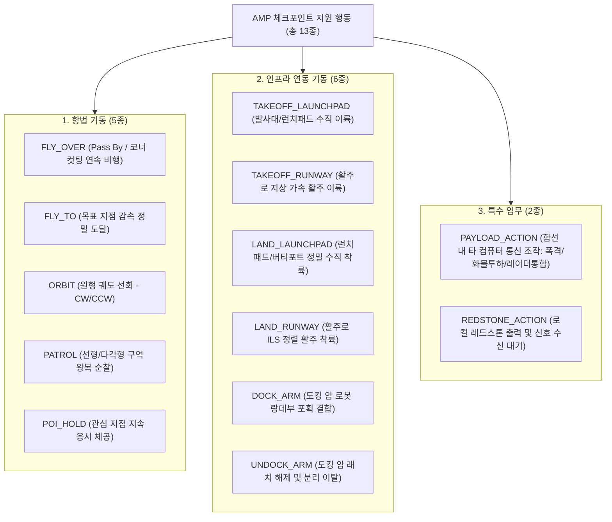
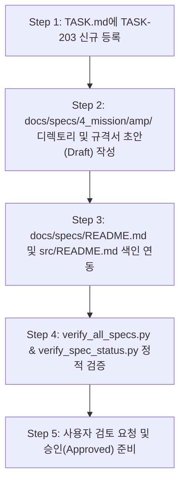

# AMP (Autopilot Mission Planner) 사양서 초안(Draft) 작성 계획 (개정판 v4)

## 1. 개요 및 목적
본 계획은 Universal Autonomous Flight Stack (UAFS)의 **Layer 4 (4_mission)** 계층에 소속되는 **AMP (Autopilot Mission Planner)**의 상세 규격서 초안(`Draft`)을 작성하기 위한 단계별 실행 계획입니다.
`/grill-me` 인터뷰 및 사용자 요구사항에 따라 **인프라 기동 6종 체계(런치패드, 활주로, 도킹 암 포획/해제)**를 전면 반영하여 `docs/specs/4_mission/amp/AMP_PROGRAM_SPECIFICATION.md` 초안 작성 계획을 최종 수립합니다.

---

## 2. 확정 아키텍처 및 체크포인트 스키마 SSOT

### 2.1 시스템 위상 및 연동 인터페이스

| 설계 영역 | 확정된 아키텍처 결정 | 기술적 근거 및 운영 방식 |
| :--- | :--- | :--- |
| **소속 계층 & 노드** | Layer 4 (`4_mission`) / 온보드 & 지상 겸용 | `mode: "ONBOARD" \| "GROUND_DISPATCHER"`. 온보드 탑재 시 완전 자율 비행, 지상 탑재 시 편대/원격 관제 디스패처로 운용 |
| **제어 계층 연동** | AMM (Layer 3) 경유 중계 | AMP가 상위 체크포인트를 AMM의 미션 큐에 동적 주입(`MSG_MISSION_INJECT`), 최종 FCP 제어(`Base+0`) 및 조종사 오버라이드는 AMM이 단일 창구로 통제 |
| **RF 채널 및 패킷** | `Base + 6` (`CH_AMP_MISSION`) 전용 채널 할당 | GCS $\to$ AMP 트리거(`MSG_AMP_TRIGGER`), 수락/거부 응답(`MSG_AMP_ACK`), AMM 지령 주입(`MSG_MISSION_INJECT`) 전용 버스 분리 (`Base+0` 충돌 방지) |
| **실패 & 회항 정책** | 단순 2종 정책 전용 (`RTH_ORIGIN`, `DIVERT_NEAREST`) | 복잡성을 배제하고(YAGNI), 출발 기지 복귀(`RTH_ORIGIN`)와 비상 회항(`DIVERT_NEAREST`) 2가지 핵심 페일세이프 지원. GAC 무선 비콘(`CH 50003`) 감청 기반 최단거리 패드 자동 계산 |
| **트리거 및 운영** | 순수 시퀀스 파일 + CLI/RF 트리거 전용 | `missions/*.json` 파일은 순수 시퀀스만 저장. 외부 운영자/GCS의 명령으로 기동 (`SINGLE` / `REPEAT`). 실행 중 중복 요청 시 `BUSY_REJECTED` 응답 반환 |
| **사용자 인터페이스** | 헤드리스 백그라운드 데몬 + 인터랙티브 CLI | 데몬이 백그라운드에서 RF/텔레메트리 루프를 구동하고, 조종사는 CLI(`amp run`, `amp stop`, `amp status`, `amp list`)로 상호작용 (AMM MFD와 화면 간섭 없음) |

---

### 2.2 3대 도메인 13개 체크포인트 지원 행동 (Actions Taxonomy)



1. **항법 기동 (Navigation Maneuvers — 5종)**:
   - `FLY_OVER`: 감속 없이 지정 지점 상공을 선회 반경으로 통과(Fly-by/코너 컷팅)하며 다음 체크포인트로 부드럽게 전이.
   - `FLY_TO`: 목표 좌표에 도달하여 대기 속도를 감속하고 지정 허용오차 내에 정밀 진입(Fly-over).
   - `ORBIT`: 지정 중심점 `{ x, z }`, 반경($R$), 속도, 방향(`CW` 시계 / `CCW` 반시계)으로 원형 궤도 선회 비행.
   - `PATROL`: 2개 이상의 서브 좌표 간 핑퐁 왕복 또는 다각형 구역 순환 순찰.
   - `POI_HOLD`: 지정 위치에 체공하면서 기수(Heading)를 특정 관심 좌표(POI)로 지속 조준(카메라/센서 감시).
2. **인프라 연동 기동 (Infrastructure Maneuvers — 6종)**:
   - `TAKEOFF_LAUNCHPAD`: 런치패드/발사대/버티포트에서의 수직 상승 이륙 및 안전고도 도달.
   - `TAKEOFF_RUNWAY`: 활주로 지상 활주 가속, 회전(Rotate) 및 상승 전환 이륙.
   - `LAND_LAUNCHPAD`: 지정 런치패드/버티포트 정밀 접근 및 2단계 감속 수직 착륙 (Landing Pad / GAC 연동).
   - `LAND_RUNWAY`: 활주로 진입 정렬, 글라이드슬롭 강하, 접지 및 활주로 제동 (Runway / GAC 연동).
   - `DOCK_ARM`: 도킹 암 스테이션 구역 진입, 랑데부 감속, 2축 로봇 암 포획 및 엄빌리컬 결합 (Docking Arm 연동).
   - `UNDOCK_ARM`: 도킹 암 결합 해제, 엄빌리컬 분리, 지정 안전 이탈 거리/고도로 후퇴 기동.
3. **특수 임무 및 장치 기동 (Special & Device Actions — 2종)**:
   - `PAYLOAD_ACTION`: 함선 내 탑재된 타 컴퓨터(Zone 3 `Base + 20~29` 탑재체 채널 또는 지정 무선/유선 채널)와 프로토콜 통신을 수행하여 탑재 시설·장비를 조작 (폭격 제어기, 화물 투하기, 마그넷 래치 및 **레이더 수색/표적 포착 통제기** 통합 연동).
   - `REDSTONE_ACTION`: 컴퓨터 본체의 레드스톤 I/O(일반 6면 / 번들 케이블 16색)를 직접 조작. 신호 인가(`mode: "EMIT"`, 펄스 또는 지속 출력) 또는 외부 레드스톤 입력 신호가 들어올 때까지 대기(`mode: "WAIT_INPUT"`, 타임아웃 지원).

---

### 2.3 완전 비행 프로파일 및 3종 기수(Heading) 모드

- **공간 프로파일**: `targetPos` (`{ x, z }` 또는 `{ x, y, z }`), `targetAlt` (m), `altMode` (`ABSOLUTE` 해수면 Y 기준 / `TERRAIN_AGL` 대지 기준).
- **동역학 프로파일**: `cruiseSpeed` (m/s), `climbRateLimit` (m/s), `descentRateLimit` (m/s), `acceptanceRadius` (수평 허용오차 m).
- **3종 기수 지향 모드 (Heading Modes)**:
  - `AUTO`: 비행 진행 방향(Ground Track Bearing)으로 기수 자동 정렬.
  - `FIXED`: 지정된 절대 방위각($\theta^\circ$, $0\sim 359$)으로 기수 고정.
  - `POI`: 지정된 관심 지점(`poiPos: { x, z, y }`)을 향해 비행 중 기수를 지속 조준.

---

### 2.4 고도화된 조건 평가 엔진 (`completeWhen` vs `abortWhen`)

- **복합 논리 연산자 (`logic`)**: `"ANY"` (OR 결합) 또는 `"ALL"` (AND 결합).
- **다차원 조건 타입 (Typed Conditions Array)**:
  - `PROXIMITY_2D`: 수평 거리 $\le toleranceM$
  - `PROXIMITY_3D`: 3차원 유클리드 거리 $\le toleranceM$
  - `ALTITUDE_REACHED`: 고도차 $|\Delta Y| \le toleranceM$
  - `DURATION_SEC`: 체크포인트 진입 후 경과 시간 $\ge durationSec$
  - `TIMEOUT_SEC`: 체크포인트 최대 체류 허용 시간 초과 (진행 정체)
  - `FUEL_LEVEL_BELOW`: 잔여 연료 비율 $\le threshold$ ($0.0 \sim 1.0$)
  - `FACILITY_TOUCHDOWN`: 시설 착륙 완료 및 FSM 상태 `LANDED` 확인
  - `ARM_DOCKED`: 도킹 암 포획/결합 완료 수신
  - `ARM_RELEASED`: 도킹 암 분리/안전 이탈 완료 수신
  - `PAYLOAD_RESP_MATCH`: 탑재체 컴퓨터로부터 특정 응답(성공/표적감지 등) 수신
  - `REDSTONE_INPUT_HIGH`: 지정 면/색상의 레드스톤 입력 신호 감지
  - `CROSS_TRACK_ERROR`: 코스 횡방향 이탈 거리 $\ge maxDevM$

---

### 2.5 3단계 라이프사이클 이벤트 훅 (Lifecycle Event Hooks)

체크포인트 상태 전이 시점에 하드웨어 및 외부 시스템을 제어하는 훅을 지원합니다:
- `onEnter`: 체크포인트 활성화 순간 1회 실행.
- `onExit`: 체크포인트 정상 완료 순간 1회 실행.
- `onAbort`: 체크포인트 비정상 중단/실패 순간 1회 실행.
- **지원 훅 액션**:
  - `REDSTONE_PULSE`: `{ side = "top", color = colors.red, durationMs = 500 }`
  - `REDSTONE_SET`: `{ side = "right", state = true }`
  - `ZONE3_PAYLOAD_CMD`: `{ channel = Base + 20, packetType = "MSG_PAYLOAD_REQ", payload = {...} }`
  - `NOTIFY_OPERATOR`: `{ level = "INFO" | "WARN" | "CRITICAL", message = "..." }`

---

### 2.6 미션 파일 구조 및 전역 `defaults` 상속 모델 (`missions/*.json`)

```json
{
  "missionId": "SORTIE_LAUNCHPAD_TO_DOCKING_ARM",
  "version": "1.0.0",
  "description": "런치패드 수직 발사, 정찰 후 공중 기지 도킹 암 결합 임무",
  "fallbackPolicy": "DIVERT_NEAREST",
  "defaults": {
    "cruiseSpeed": 18.0,
    "cruiseAlt": 120.0,
    "climbRate": 8.0,
    "descentRate": 5.0,
    "acceptanceRadius": 20.0,
    "headingMode": "AUTO"
  },
  "checkpoints": [
    {
      "checkpointId": "CP_00_LIFT_OFF",
      "action": "TAKEOFF_LAUNCHPAD",
      "params": { "targetAlt": 90.0, "facilityId": "PAD_BRAVO" },
      "completeWhen": {
        "logic": "ALL",
        "conditions": [
          { "type": "ALTITUDE_REACHED", "toleranceM": 5.0 }
        ]
      },
      "abortWhen": {
        "logic": "ANY",
        "conditions": [
          { "type": "TIMEOUT_SEC", "timeout": 60 }
        ]
      }
    },
    {
      "checkpointId": "CP_01_TRANSIT",
      "action": "FLY_OVER",
      "params": {
        "targetPos": { "x": 800.0, "z": -1600.0 },
        "cruiseSpeed": 24.0
      },
      "completeWhen": {
        "logic": "ANY",
        "conditions": [
          { "type": "PROXIMITY_2D", "toleranceM": 25.0 },
          { "type": "TIMEOUT_SEC", "timeout": 150 }
        ]
      },
      "abortWhen": {
        "logic": "ANY",
        "conditions": [
          { "type": "FUEL_LEVEL_BELOW", "threshold": 0.20 }
        ]
      }
    },
    {
      "checkpointId": "CP_02_CARGO_RELEASE",
      "action": "PAYLOAD_ACTION",
      "params": {
        "targetComputerChannel": 10020,
        "packetType": "MSG_CARGO_DROP_REQ",
        "commandPayload": { "bayId": 1 }
      },
      "completeWhen": {
        "logic": "ALL",
        "conditions": [
          { "type": "PAYLOAD_RESP_MATCH", "expectedStatus": "DROPPED" }
        ]
      },
      "abortWhen": {
        "logic": "ANY",
        "conditions": [
          { "type": "TIMEOUT_SEC", "timeout": 15 }
        ]
      }
    },
    {
      "checkpointId": "CP_03_APPROACH_DOCK_ARM",
      "action": "DOCK_ARM",
      "params": {
        "facilityId": "ARM_STATION_01",
        "targetPos": { "x": 120.0, "z": -50.0 },
        "approachSpeed": 5.0
      },
      "completeWhen": {
        "logic": "ALL",
        "conditions": [
          { "type": "ARM_DOCKED", "facilityId": "ARM_STATION_01" }
        ]
      },
      "abortWhen": {
        "logic": "ANY",
        "conditions": [
          { "type": "TIMEOUT_SEC", "timeout": 180 }
        ]
      }
    }
  ]
}
```

---

## 3. 세부 실행 단계 (Execution Steps)



### Step 1: 작업 추적 등록 (`TASK.md`)
- `TASK.md`에 `TASK-203` (AMP 사양서 수립 및 구현) 등록:
  - `TASK-203-1: AMP 상세 규격서 초안(Draft) 작성` (`[-]` 진행)
  - `TASK-203-2: AMP 상세 구현 계획서 수립` (`[ ]`)
  - `TASK-203-3: AMP TDD 구현 및 검증` (`[ ]`)

### Step 2: 규격서 초안(Draft) 본문 작성
- **경로**: `docs/specs/4_mission/amp/AMP_PROGRAM_SPECIFICATION.md`
- **문서 상태**: `Draft`, **버전**: `v0.1.0`
- **포함할 핵심 섹션**:
  1. **개요 및 시스템 위상**: Layer 4 임무 계획 계층, AMM(Layer 3) $\leftrightarrow$ AMP(Layer 4) 상호작용 및 온보드/지상 듀얼 토폴로지.
  2. **체크포인트 지원 행동 상세 (총 13종)**:
     - 항법 5종 (`FLY_OVER`, `FLY_TO`, `ORBIT`, `PATROL`, `POI_HOLD`)
     - 인프라 6종 (`TAKEOFF_LAUNCHPAD`, `TAKEOFF_RUNWAY`, `LAND_LAUNCHPAD`, `LAND_RUNWAY`, `DOCK_ARM`, `UNDOCK_ARM`)
     - 특수 임무 2종 (`PAYLOAD_ACTION` - 타 컴퓨터 통신 조작/레이더 통합, `REDSTONE_ACTION` - 출력 및 수신 대기)
  3. **완전 비행 프로파일 및 POI 기수 모드**: `AUTO`, `FIXED`, `POI` 삼각함수 연산 및 AMM/FCP 지령 변환 원리.
  4. **조건 평가 엔진 스키마**: `completeWhen` vs `abortWhen`, `logic: ANY/ALL`, 12대 조건 타입 평가 FSM (`ARM_DOCKED`, `ARM_RELEASED` 포함).
  5. **라이프사이클 이벤트 훅**: `onEnter`, `onExit`, `onAbort` 액션 스키마 및 안전 연동.
  6. **실패 정책 및 회항 엔진**: `RTH_ORIGIN`, `DIVERT_NEAREST` (GAC `CH 50003` 비콘 파싱).
  7. **RF 네트워크 인터페이스 및 패킷 프로토콜**: `Base + 6` (`CH_AMP_MISSION`) 버스, `MSG_AMP_TRIGGER`, `MSG_AMP_ACK`, `MSG_MISSION_INJECT` (UAFS v1.9.5).
  8. **인터랙티브 CLI 및 운영 명세**: 데몬 루프 구조, 백그라운드 구동, CLI 서브커맨드 (`run`, `stop`, `status`, `list`, `show`).

### Step 3: 메타 문서 색인 갱신
- `docs/specs/README.md`: `4_mission` 계층 테이블에 AMP 사양서 링크 추가 (Status: `Draft`).
- `src/README.md`: 4_mission 계층 설명 보강.

### Step 4: 사양서 정적 검증
- `python tools/verify_all_specs.py` 실행: 링크 깨짐, 필수 메타데이터 테이블, 헤더 구조 검증.
- `python tools/verify_spec_status.py` 실행: `Draft` 상태 정상 반영 확인.

---

## 4. 제약 사항 및 준수 규칙
- **사양서 상태 규칙**: 초안 단계이므로 메타데이터 `문서 상태`는 `Draft`로 작성하며, `Approved` 승격 전까지는 `specification-lifecycle-manager`를 호출하지 않습니다.
- **코드 미수정 원칙**: 본 단계는 사양서(Draft) 수립 단계이므로 `src/` 내의 실제 Lua 코드는 수정하지 않습니다.
- **과장 표현 금지**: `AGENTS.md`의 Overclaim Ban을 준수하여 미검증된 성능이나 절대적 표현을 배제합니다.
