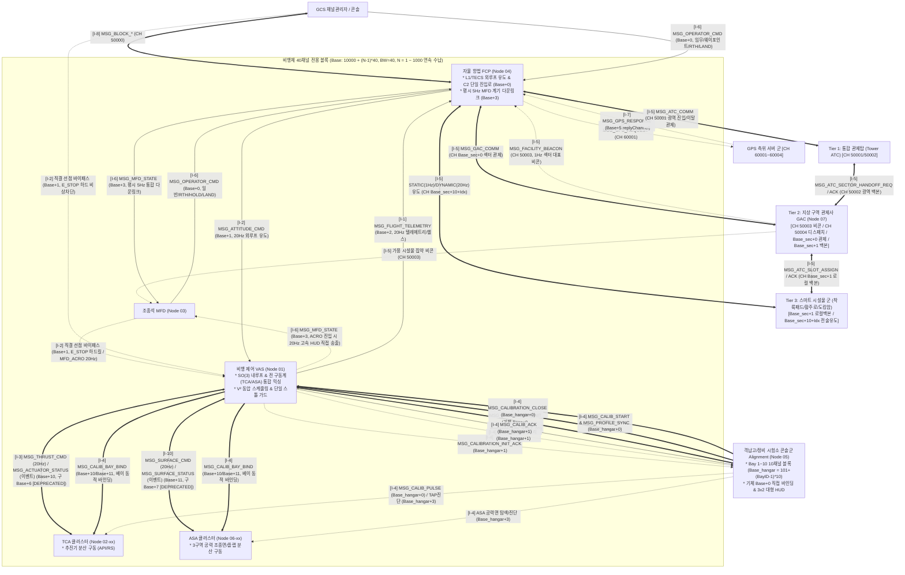

# 비행체 자율 제어 및 통신 데이터 교환 통합 규격서 (ICD)
> **Autonomous Flight System Interface Control Document (ICD / IDD)**  
> **프로젝트**: Universal Autonomous Flight Stack (FCP · VAS · Alignment · TCA · ASA · GPS · ATC & GAC & Facility Swarm · GCS)  
> **대상 환경**: Minecraft CC:Tweaked, Create: Aeronautics, Create: Avionics  

| 항목 | 내용 |
| :--- | :--- |
| **문서 상태 (Status)** | `Approved` |
| **문서 버전 (Version)** | `v1.26.0` |
| **최종 수정일 (Date)** | `2026-11-11` |
| **구현 코드 (Source)** | `src/` |
| **주관 도메인 (Domain)** | 전역 비행체 및 지상 관제 시스템 총괄 (Master ICD) |


### Revision History

| 버전 | 개정 일자 | 개정 요약 | 개정 사유 |
| :---: | :---: | :--- | :--- |
| `v1.26.0` | 2026-11-11 | 조종석 AMM(Node 03, v1.1.0) 통합 미션 시퀀서 인터페이스 반영: Interface I-6(`Base+0`)에 원격 미션 제어 패킷(`MSG_MISSION_CMD`/`MSG_MISSION_ACK`) 및 `MSG_OPERATOR_CMD` 확장 파라미터(`POI_HOLD`, `loiterRadius`, `loiterDirection`, `poiTarget`, `headingMode`, `fixedHeading`) 추가, Interface I-11(`Base+20~29` Zone 3 탑재체 버스 `MSG_PAYLOAD_REQ`/`MSG_PAYLOAD_ACK`) 명세 신설 | TASK-202 통합 미션 시퀀서 엔진 및 Zone 3 탑재체 인터페이스 확립 |
| `v1.25.0` | 2026-11-09 | ADVANCED_VTOL 2D 짐벌 벡터 추진 기체 규격 추가, MSG_THRUST_CMD 다형성(polymorphic) outputs 스키마 정의, MSG_ACTUATOR_STATUS에 appliedGimbal/gimbalSaturated 확장, 순수 추력형 비공력 특성(ASA 바이패스) 명시 | 고기동 짐벌 벡터 추진 VTOL 아키텍처 및 6-DoF 의사역행렬 제어 분배 지원 |
| `v1.24.0` | 2026-11-08 | 유선 패킷 podId를 ASA_L/R/T로 완전 단일화, 텔레메트리 헬스 키 asa 반영, 구 명칭(구버전 명칭) 전면 소급 척결 | 인터페이스 표준화 및 용어 정비 |
| `v1.23.0` | 2026-11-08 | ASA 적용 기체 범위 축소: VECTORED_VTOL 및 드론(QUADROTOR, HEXAROTOR) 기체에서 ASA 동작 배제 및 FCP/VAS 비활성화 규격 동기화 | 비공력 순수 추력형 기체에서 공력 타면 지령 차단 및 스키마 직교성 확보 |
| `v1.22.0` | 2026-11-08 | 지상 시설물 전용 GPS 응답 채널(`CH_SECTOR_GPS_REPLY` = $Base_{\text{sec}}+5$) 정식 등재 및 착륙패드(v2.4.0)·GAC(v1.2.0) 인터페이스 동기화 | 지상 구역 관제 및 착륙패드 정밀 시운전·항법 체계 통합 |
| `v1.21.1` | 2026-11-08 | MSG_CHANNEL_PROBE/ACK 후보 및 점유 베이스 채널 유효 범위를 40채널 기준(10000~49960, N=1~1000)으로 정합 동기화 | 사양서 간 용어 및 수치 정합성 확립 |
| `v1.21.0` | 2026-11-07 | 자율 유도 컴퓨터 Node 04 구 명칭 → FCP(Flight Control Program) 전면 개정, 상대 링크 및 패킷 source/activeSource 식별자('FCP') 동기화, 제어 권한 체계('E_STOP > MFD_ACRO > FCP') 반영 | 시스템 명칭 표준화 및 패킷 스키마 일체화 |
| `v1.20.1` | 2026-11-07 | 0_ground 도메인의 0_infra 통합 반영 및 하위 사양서 링크·버전(v1.10.5/v2.2.5) 갱신 | 지상 인프라 디렉토리 단일화 반영 |
| `v1.20.0` | 2026-11-07 | 비행체 전용 40채널($BW=40$) 대역 확장 ($Base = 10000 + (N-1)\times 40$, $N=1\sim 1000$), 4대 Zone(Zone 1: 코어, Zone 2: 구동계, Zone 3: 탑재체, Zone 4: 편대/확장) 전면 재편, 구동계 버스 Zone 2 이관(`Base+10`: TCA, `Base+11`: ASA, `Base+12~19`: 구동계 예비), 구버전 20채널 및 `Base+6`, `Base+7`에 `[DEPRECATED]` 배지 부여, 하위 사양서 5종 `approved/` 승격 전이 상대 링크 동기화 | 서브채널 대역폭 확장 및 기능 영역별 직교성 확보, 1000대 수용량 확립 |


---

## 1. 개요 및 공통 데이터 표준 (Overview & Protocol Standards)

본 문서는 자율 비행체 시스템을 구성하는 소프트웨어/하드웨어 프로그램 간에 오고 가는 **모든 데이터 패킷의 필드 규격, 데이터 타입, 물리 단위, 인코딩 포맷 및 상태 전이 규칙**을 정의한 표준 인터페이스 제어 규격서(ICD)입니다.

> [!TIP]
> - 전체 시스템 프로그램 간 종합 관계망, 채널 토폴로지 및 생명주기별 패킷 교환 시퀀스 다이어그램은 **[SYSTEM_PROGRAM_RELATION_AND_PACKET_DIAGRAM.md](SYSTEM_PROGRAM_RELATION_AND_PACKET_DIAGRAM.md)** (v2.9.0)에 완전 시각화되어 있습니다.
> - 국지 에이프런/비행갑판/버티포트 시설물 군의 총괄 분배, 3-Tier 관제 위상, 섹터 집약 비콘, 다속성 최적 패드 분배 및 국지 복행 중재 명세는 **[GAC_PROGRAM_SPECIFICATION_AND_ICD.md](../specs/0_infra/gac/GAC_PROGRAM_SPECIFICATION_AND_ICD.md)** (v1.4.0)에 상세 기술되어 있습니다.
> - 비행 제어 컴퓨터(FCP, Node 04)의 6대 기체 타입별 외루프 유도 제어(L1/TECS/Tilt-to-Accelerate/Zero-Tilt 6-DoF/Tilt-Assisted/Decoupled Vector), C2 단일 진입로(Base+0) 총괄, 평시 5Hz MFD 계기 다운링크(Base+3), 15-State FSM, GPS/추측항법 융합, GAC 섹터 관제 연동, 도킹암 4단계 랑데부 FSM 및 20Hz 외루프 지령(Base+1) 명세는 **[FCP_PROGRAM_SPECIFICATION.md](../specs/2_guidance/fcp/FCP_PROGRAM_SPECIFICATION.md)** (v1.15.0)에 상세 기술되어 있습니다.
> - 공력 날개 및 조종면(에일러론/승강타/방향타/플랩) 분산 구동기, VAS 산하 3구역 노드(Node 06-xx, Base+11, 구 Base+7 [DEPRECATED]), `peripheral.find` 동적 탐색 및 300ms 안전 활공 트림(Safe Glide Trim) 규격은 **[ASA_PROGRAM_SPECIFICATION.md](../specs/1_control/asa/ASA_PROGRAM_SPECIFICATION.md)** (v1.4.0)에 상세 기술되어 있습니다.
> - **ASA 기체 적용 범위**: ASA는 `FIXED_WING` 및 `WINGED_VTOL` 기체에서만 전용 가동되며, `VECTORED_VTOL`, `ADVANCED_VTOL`, `QUADROTOR`, `HEXAROTOR` 등 순수 추력형 기체에서는 ASA 노드가 탑재되지 않고 FCP/VAS 단계에서 조종면/플랩 연산 및 Base+11 전송이 원천 배제됩니다.
> - 센서 정적 매핑(config/sensors.json), 3D 레버암 기하 동역학 보정, VICD-Spec 3계층 드라이버(추진기 `actuator_adapter_tca` + 조종면 `actuator_adapter_asa`), 단위 쿼터니언 $SO(3)$ 동역학 제어, $V^2$ 동압 스케줄링, 단일 실속 방지(Stall Guard), 플랩 $V_{fe}$ 가드, Base+1 선점 중재(`E_STOP` > `MFD_ACRO` > `FCP`), 역방향 포화 피드백, `ui_renderer` 대시보드 및 20Hz 실행 생명주기는 **[VAS_PROGRAM_SPECIFICATION.md](../specs/1_control/vas/VAS_PROGRAM_SPECIFICATION.md)** (v1.14.0)에 상세 기술되어 있습니다.
> - 추진기 개별 하드웨어 구동, REDSTONE 모드/API 모드 듀얼 모드, 자체 비례 손실 보상, 핫플러그 감지, `discovery_handler` 세션 격리, 동적 베이 바인딩(`MSG_CALIB_BAY_BIND`) 및 동적 타이머 300ms 워치독 데몬 명세는 **[TCA_PROGRAM_SPECIFICATION.md](../specs/1_control/tca/TCA_PROGRAM_SPECIFICATION.md)** (v1.8.0)에 상세 기술되어 있습니다.
> - 격납고 상주 시설 콘솔로서 베이별 10채널 블록(`101 ~ 200`, $Base_{\text{hangar}} = 101 + (\text{BayID}-1)\times 10$) 및 기체 `Base+0` 직결 바인딩을 기반으로 입고된 임의의 기체와 지상 교정 세션을 맺고 6-DoF 추력기/공력 보조 프로파일(`AERO_ASSISTED_PASS`)을 생성하는 `Alignment` 프로그램의 세부 수치해석, 주 작용축 OLS 회귀, 대형 모니터 HUD 및 14단계 FSM 명세는 **[ALIGNMENT_PROGRAM_SPECIFICATION.md](../specs/0_development/alignment/ALIGNMENT_PROGRAM_SPECIFICATION.md)** (v2.4.0)에 상세 기술되어 있습니다.
> - 지상 분산 노드 군(Swarm), 노드 간이 셋업 마법사 및 커미셔닝, 0ms 세션 버킷 스케줄러, 계층형 2D 가우스-뉴턴 연산, 순수 진단 로깅 및 대형 모니터 자동 피팅 레이더 명세는 **[GPS_PROGRAM_SPECIFICATION_AND_ICD.md](../specs/0_infra/gps/GPS_PROGRAM_SPECIFICATION_AND_ICD.md)** (v2.2.1)에 상세 기술되어 있습니다.
> - VTOL 착륙패드의 순수 가상 좌표 비콘화, 무기계식 경량화, 상대 오프셋 보정, TUI 셋업 마법사, 동적 패드 항법 센서 3종 바인딩, 동역학 요동 안전 인터록(10°/2.5m/s), GAC 직속 로컬 백본($Base_{\text{sec}}+1$) 연동 및 복행 격리 명세는 **[LANDING_PAD_SPECIFICATION_AND_ICD.md](../specs/0_infra/landing_pad/LANDING_PAD_SPECIFICATION_AND_ICD.md)** (v2.4.1)에 상세 기술되어 있습니다.
> - 고정익 활주로 및 항모 비행갑판의 가상 ILS, 유선 모뎀 조명망(PAPI/RWSL) 제어, 무선 상태 추적 및 유도로 GAC 연동 관제 명세는 **[RUNWAY_SPECIFICATION_AND_ICD.md](../specs/0_infra/runway/RUNWAY_SPECIFICATION_AND_ICD.md)** (v1.10.5)에 상세 기술되어 있습니다.
> - 기체 주도형 정밀 도킹, 2축 로봇 암 원거리 전개 포획, 격납 인입, 유선 모뎀 주변기기 매핑, 엄빌리컬 보급 및 격납 위치 직접 분리 명세는 **[DOCKING_ARM_SPECIFICATION_AND_ICD.md](../specs/0_infra/docking_arm/DOCKING_ARM_SPECIFICATION_AND_ICD.md)** (v1.11.0)에 상세 기술되어 있습니다.
> - 조종석 통합 단말 및 미션 시퀀서(AMM, Node 03)의 3분할 미션 코어(`mission_engine`, `condition_evaluator`, `hook_runner`), 13종 체크포인트 스키마(활성 9종 + 예약 4종), 12종 `completeWhen`/`abortWhen` 복합 조건 평가, 0-tick 라이프사이클 훅, Zone 3 탑재체 버스(`Base+20~29`), `Base+0` 원격 미션 제어(`MSG_MISSION_CMD`/`ACK`), 무인기 헤드리스 모드 및 51x19 분할 TUI 명세는 **[AMM_PROGRAM_SPECIFICATION.md](../specs/3_planning/amm/AMM_PROGRAM_SPECIFICATION.md)** (v1.1.0)에 상세 기술되어 있습니다.

### 1.1 공통 패킷 엔벨로프 (Common Message Envelope)
CC:Tweaked Rednet 및 모뎀 전송의 직렬화 오버헤드를 최소화하고 고속 역직렬화를 보장하기 위해, 모든 메시지는 다음의 표준 공통 Lua 테이블 엔벨로프를 필수 적용합니다.

```lua
-- 모든 패킷의 공통 최상위 테이블 구조 (ICD v1.9.5)
{
    ver = "1.9.5",                -- 프로토콜 규격 버전 (string, "1.9.5" 단일 표준)
    domainId = "AIRCRAFT_01",      -- 기체/시스템 고유 도메인 식별자 (string)
    seq = 10425,                   -- 단조 증가 시퀀스 번호 (uint32)
    type = "MSG_TYPE_NAME",        -- 패킷 고유 타입 식별자 (string)
    time = 1729845000050,          -- 발신 UTC 타임스탬프 (ms, os.epoch("utc"))
    payload = { ... }              -- 인터페이스별 세부 데이터 테이블 (table)
}
```

### 1.2 물리량 및 좌표계 표준화 규칙 (Aviation Standard)
- **기준 좌표계 (Reference Frame)**: NED (North-East-Down) 기체 국소 좌표계 및 항공 표준 방위각 준수.
  - **방위각 (Heading / Yaw)**: $0^\circ = \text{진북 (North, MC }-Z)$, $90^\circ = \text{동 (East, MC }+X)$, $180^\circ = \text{남 (South, MC }+Z)$, $270^\circ = \text{서 (West, MC }-X)$.
  - **피치 (Pitch)**: 상향(Nose-Up) $+$, 하향(Nose-Down) $-$.
  - **롤 (Roll)**: 우선회/우뱅크(Right-Bank) $+$, 좌선회/좌뱅크(Left-Bank) $-$.
- **물리 단위 및 신호 표준**:
  - 각도: 도 (Degrees, $^\circ$)
  - 각속도: deg/s (초당 회전 각도)
  - 위치: 블록/미터 (Blocks / Meters)
  - 속도: m/s (블록/초, 1 block/tick = 20 m/s)
  - 중력 및 가속도: $\text{m/s}^2$ (기본 중력가속도 $g = 11.0\text{ m/s}^2$, 마인크래프트 월드 연직 하방 $a_y = -11.0\text{ m/s}^2$)
  - 외루프 스로틀 지령: $0.0 \sim 1.0$ 정규화 실수 (최대 출력 대비 무차원 비율. TAP이 REDSTONE 모드 시 VAS가 $0 \sim 15$ 정수 신호로 변환)
  - 6-DoF 미세 바이어스: $-1.0 \sim +1.0$ 정규화 실수 (`surge, sway, heave`)
  - 추진기 구동 신호: 추진기 상호작용 모드 — Create 아날로그 변속기 $0 \sim 15$ 정수 (REDSTONE 모드) 또는 $0.0 \sim 1.0$ 정규화 실수 (API 모드)

### 1.3 코드 경량화 및 Deprecated 운영 정책 (Code Lightweighting & Deprecation Policy)
1. **사양서 명세 원칙 (Specification-First)**: 프로토콜 또는 페이로드 필드가 개정될 경우, 구버전 명칭은 사양서 내에 `[DEPRECATED]` 배지를 부여하고 대체 신규 필드명과 변경 이력을 명시하여 문서상에 보존합니다.
2. **코드베이스 경량화 원칙 (Zero-Fallback)**: CC:Tweaked Lua 분산 컴퓨터 환경의 자원 제약(RAM/토큰 절약, 파싱 오버헤드 최소화, 20Hz 실시간 루프 성능 보장)을 준수하기 위해, 코드베이스는 사전 이중 호환(Fallback 래퍼, `payload.new or payload.old` 등)을 일체 작성하지 않고 **최신 표준 필드명/패킷명만을 단일 채택**합니다.
3. **런타임 오류 시 복구 원칙 (송신 노드 즉시 패치)**: 구버전 필드/패킷을 전송하는 미갱신 노드로 인해 수신 측에서 `nil` 인덱싱 등의 런타임 오류가 발생할 경우, 수신 측에 임시 폴백 코드를 추가하지 않고 **구버전 패킷을 송신한 발신 노드의 코드를 최신 사양으로 즉시 패치 및 재배포**하여 전역 일원화를 달성합니다.

---

## 2. 프로그램 간 데이터 인터페이스 매트릭스 (Interface Matrix)



---

## 3. 인터페이스별 세부 데이터 교환 명세 (Interface Specifications)

---

### [Interface I-1] 비행 텔레메트리 (`VAS` $\rightarrow$ `FCP` & `Alignment`)
- **통신 채널**: `CH_TELEMETRY` (`Base + 2`, 지상 교정 시 $Base_{\text{hangar}} + 1$, 구버전 `1002` [DEPRECATED])
- **전송 주기**: 20Hz (매 50ms 틱)
- **발신자**: `VAS` (Node 01, 내부 센서 모듈 계측값)
- **수신자**: `FCP` (Node 04, Y고도계/속도/방위 외루프 유도용), `Alignment` (Node 05, 기체 동역학 적분용)
- **패킷 타입**: `MSG_FLIGHT_TELEMETRY`

#### 필드 명세 테이블
| 필드 경로 | 타입 | 단위/범위 | 필수 여부 | 설명 |
| :--- | :---: | :---: | :---: | :--- |
| `payload.attitude.pitch` | float | $-90.0 \sim +90.0^\circ$ | 필수 | 자이로 피치각 (상향 $+$, 하향 $-$) |
| `payload.attitude.roll` | float | $-180.0 \sim +180.0^\circ$ | 필수 | 자이로 롤 뱅크각 (우뱅크 $+$, 좌뱅크 $-$) |
| `payload.attitude.yaw` | float | $0.0 \sim 360.0^\circ$ | 필수 | 기체 기수 방향 방위각 (진북 $0^\circ$) |
| `payload.angularRates.pitchRate` | float | deg/s | 필수 | 피치 각속도 (D-Gain 댐핑 연산용, 단일화 표준) |
| `payload.angularRates.rollRate` | float | deg/s | 필수 | 롤 각속도 (D-Gain 댐핑 연산용, 단일화 표준) |
| `payload.angularRates.yawRate` | float | deg/s | 필수 | 요 각속도 (선회율 댐핑 연산용, 단일화 표준) |
| `payload.dynamics.altitudeY` | float | m (블록) | 필수 | 기압/전파 고도계 실측 Y 좌표 (3D 레버암 CoM 보정) |
| `payload.dynamics.verticalSpeed`| float | m/s | 필수 | 수직 승강 속도 ($v_y$, Climb Rate) |
| `payload.dynamics.velocity` | table | `{vx, vy, vz}` m/s | 필수 | 3차원 월드 속도 벡터 (수평대지속력/대기속력 자율 유도) |
| `payload.fuel` | float | $0.0 \sim 1.0$ | 필수 | 잔여 연료/에너지 게이지 비율 (최상위 평탄화) |
| `payload.dynamicLoad` | float | $0.0 \sim 1.0$ | 필수 | 6-DoF 추력기 총 구동 부하율 (최상위 평탄화) |
| `payload.controlState` | string | FSM 상태 | 필수 | 현재 비행 제어 상태 (`"NORMAL"`, `"FAILSAFE_HOLD"` 등) |
| `payload.activeSource` | string | 소스 식별자 | 필수 | 현재 Base+1 제어권을 선점 중인 능동 소스 (`"FCP"`, `"MFD_ACRO"`, `"EMERGENCY_DIRECT"`) |
| `payload.sensorOk` | boolean| true/false | 필수 | 4종 센서(자세/고도/속도/연료) 통합 정상 여부 |
| `payload.sensorHealth` | table | `{ [role] = bool }` | 필수 | 개별 센서 롤별(gimbal, altitude, velocity, fuel) 상세 헬스 맵 |
| `payload.actuatorHealth` | table | `{ tap = bool, asa = bool }` | 필수 | 3계층 하위 분산 구동기 클러스터(추진기 TCA / 공력면 ASA) 통합 정상 여부 |

```lua
-- Lua 패킷 예시 (최상위 평탄화 flat payload 구조 준수)
{
    ver = "1.9.5",
    domainId = "AIRCRAFT_01",
    seq = 44021,
    type = "MSG_FLIGHT_TELEMETRY",
    time = 1729845000045,
    payload = {
        attitude = { pitch = 2.15, roll = -4.50, yaw = 92.4, heading = 92.4 },
        angularRates = { pitchRate = 0.02, rollRate = -0.08, yawRate = 0.05 },
        dynamics = {
            altitudeY = 125.4,
            verticalSpeed = 0.20,
            velocity = { vx = 18.4, vy = 0.20, vz = 1.8 }
        },
        fuel = 0.85,
        dynamicLoad = 0.42,
        controlState = "NORMAL",
        activeSource = "FCP",
        sensorOk = true,
        sensorHealth = {
            gimbal = true,
            altitude = true,
            velocity = true,
            fuel = true
        },
        actuatorHealth = {
            tap = true,
            asa = true
        }
    }
}
```

---

### [Interface I-2] 외루프 유도 및 조종사 직결 명령 (`FCP / MFD` $\rightarrow$ `VAS`)
- **통신 채널**: `CH_FLIGHT_GUIDANCE` (`Base + 1`)
- **전송 주기**: 20Hz (FCP 외루프 스트림 또는 MFD 직결 급기동 스트림)
- **패킷 타입**: `MSG_ATTITUDE_CMD`
- **구조 특징**: **기동 모드별 가변 지시형 및 FCP/조종사 선점 통제 체계**
  - **2단계 시동 체계 (`arm` & `flightActive`)**:
    - `arm = true, flightActive = false`: 기체 시동 대기 상태(`IDLE_ARMED`), PID 적분기 동결, 추진기 출력 0 / 조종면 트림 중립 유지.
    - `arm = true, flightActive = true`: 실비행 동역학 폐루프 활성화(`NORMAL`), 폐루프 믹싱 및 적분기 정상 구동.
    - `arm = false, flightActive = false`: 시동 해제(`DISARMED`), 전 구동기 즉각 차단.
  - **순항 및 유도 모드 (`ATTITUDE_ANGLE`)**: 3축 절대 각도 지시 + 선회 피드포워드 + 6-DoF 미세 병진 바이어스 동시 하달.
  - **급기동 모드 (`RATE_COMMAND`)**: 3축 목표 각속도(deg/s) 직접 하달 (조종석 MFD 직결 전용).
  - **독립 승강축 유도 (`targetClimbRate`)**: 피치 각도와 물리적으로 독립된 내루프 수직 Heave PI 제어 구동 ($V_y = -5.0 \sim +5.0\text{ m/s}$).
  - **단일 스로틀 추진 의미 (`targetThrottle`)**: 전방(Surge) 주 추진기 출력 비율 ($0.0 \sim 1.0$). 순수 회전익 기종의 MFD 수동 급기동(`RATE_COMMAND`) 시에만 수직 컬렉티브로 매핑.
  - **외루프 플랩 연동 (`flapTarget`)**: $0.0 \sim 1.0$ (FCP가 비행 국면에 맞추어 지시하며, VAS가 $V_{fe}$ 한계 속도 가드 후 ASA으로 배분).

#### 필드 명세 테이블
| 필드 경로 | 타입 | 단위/범위 | 필수 여부 | 설명 |
| :--- | :---: | :---: | :---: | :--- |
| `payload.source` | string | `"FCP"`, `"MFD_DIRECT"` | 필수 | 유도 지령 송신 주체 (기본값: `"FCP"`) |
| `payload.arm` | boolean | true/false | 필수 | 기체 시동 활성화 플래그 (true: Arm, false: Disarm) |
| `payload.flightActive` | boolean | true/false | 필수 | 실비행 동역학 폐루프 제어 활성화 플래그 (true: Active In-Flight, false: Idle Armed Ground) |
| `payload.flightMode` | string | 모드 문자열 | 필수 | `TAKEOFF`, `CRUISE`, `LOITER`, `LANDING`, `DOCKING`, `ACRO` (VECTORED_VTOL 운용 시: `STRICT_LEVEL`, `TILT_ASSISTED`) |
| `payload.commandType` | string | ANGLE/RATE | 필수 | `"ATTITUDE_ANGLE"` 또는 `"RATE_COMMAND"` |
| `payload.angleTargets.targetPitch` | float | $-75.0 \sim +75.0^\circ$| ANGLE 시 | 목표 피치각 (일반 $\pm 20.0^\circ$, TILT_ASSISTED 보조 시 최대 $\pm 10.0^\circ$, 비상/급기동 최대 $\pm 75.0^\circ$) |
| `payload.angleTargets.targetRoll` | float | $-75.0 \sim +75.0^\circ$| ANGLE 시 | 목표 롤각 (일반 $\pm 20.0^\circ$, 비상/급기동 최대 $\pm 75.0^\circ$, 슬루율 $45^\circ/\text{s}$, VECTORED_VTOL 순항/도킹 시 $0.0^\circ$) |
| `payload.angleTargets.targetHeading`| float | $0.0 \sim 360.0^\circ$| ANGLE 시 | 목표 진방위각 (0~360°, VECTORED_VTOL 3대 전술 헤딩: `FACE_PATH` 진행정렬, `TARGET_LOCK` 표적주시, `ORBIT_POINT` 원형선회) |
| `payload.angleTargets.turnRateFF` | float | deg/s | ANGLE 시 | 선회율 선행 보정치 (피드포워드, $r_{FF} = \frac{11.0}{V}\tan\phi$) |
| `payload.rateTargets.targetPitchRate`| float| deg/s | RATE 시 | 목표 피치 각속도 (조종석 직결 급기동 시) |
| `payload.rateTargets.targetRollRate` | float| deg/s | RATE 시 | 목표 롤 각속도 (조종석 직결 급기동 시) |
| `payload.rateTargets.targetYawRate` | float| deg/s | RATE 시 | 목표 요 각속도 (조종석 직결 급기동 시) |
| `payload.targetClimbRate` | float | $-5.0 \sim +5.0\text{ m/s}$ | 필수 | 목표 수직 승강 속도 ($v_y$, 내루프 Heave 가속도 PI 전용 구동) |
| `payload.targetThrottle` | float | $0.0 \sim 1.0$ | 필수 | 주 전방(Surge) 추진 스로틀 요구치 (정규화 비율) |
| `payload.flapTarget` | float | $0.0 \sim 1.0$ | 선택 | 외루프 플랩 전개 목표치 ($0.0$: 수납, $1.0$: 최대 전개, 기본값 $0.0$) |
| `payload.acroActive` | boolean | true/false | 선택 | 조종석 직접 급기동 활성화 플래그 (true 시 FCP 선점 차단) |
| `payload.translationBias.surge` | float | $-1.0 \sim +1.0$ | 선택 | 전후진 미세 병진 바이어스 (정규화 비율, VECTORED_VTOL 도킹 Abort 시 $-0.8$ 역추진) |
| `payload.translationBias.sway` | float | $-1.0 \sim +1.0$ | 선택 | 좌우 미세 횡이동 바이어스 (정규화 비율, 완전 무경사 스트레이핑) |
| `payload.translationBias.heave` | float | $-1.0 \sim +1.0$ | 선택 | 수직 승강 미세 바이어스 (정규화 비율) |

```lua
-- Lua 패킷 예시 1: 일반 순항 모드 (FCP 외루프, FIXED_WING / WINGED_VTOL BTT 모드)
{
    ver = "1.9.5",
    domainId = "AIRCRAFT_01",
    seq = 10426,
    type = "MSG_ATTITUDE_CMD",
    time = 1729845000050,
    payload = {
        source = "FCP",
        arm = true,
        flightActive = true,
        flightMode = "CRUISE",
        commandType = "ATTITUDE_ANGLE",
        angleTargets = {
            targetPitch = 3.2,
            targetRoll = -10.5,
            targetHeading = 90.0,
            turnRateFF = 1.2
        },
        targetClimbRate = 0.0,
        targetThrottle = 0.75,
        flapTarget = 0.0,
        acroActive = false,
        translationBias = { surge = 0.0, sway = 0.0, heave = 0.0 }
    }
}
```

```lua
-- Lua 패킷 예시 2: VECTORED_VTOL 완전 6-DoF 무경사(STRICT_LEVEL) 표적 주시(TARGET_LOCK) 스트레이핑 도킹 기동
{
    ver = "1.9.5",
    domainId = "AIRCRAFT_01",
    seq = 10427,
    type = "MSG_ATTITUDE_CMD",
    time = 1729845000100,
    payload = {
        source = "FCP",
        arm = true,
        flightActive = true,
        flightMode = "DOCKING",
        commandType = "ATTITUDE_ANGLE",
        angleTargets = {
            targetPitch = 0.0,             -- STRICT_LEVEL: 자세 수평 완전 고정
            targetRoll = 0.0,              -- 롤 뱅크 배제
            targetHeading = 180.0,         -- 도킹암 정면 영구 지향 (TARGET_LOCK)
            turnRateFF = 0.0
        },
        targetClimbRate = 0.1,             -- 초미세 승강 (0.1 m/s)
        targetThrottle = 0.0,              -- 순항 스로틀 배제
        flapTarget = 0.0,
        acroActive = false,
        translationBias = {
            surge = 0.25,                  -- 전방 미세 크립 전진 (+0.25, v_surge <= 0.4 m/s)
            sway = -0.40,                  -- 좌측 횡이동 스트레이핑 (-0.40)
            heave = 0.05                   -- 미세 상승 보정 (+0.05)
        }
    }
}
```

```lua
-- Lua 패킷 예시 3: 조종석 MFD 직결 급기동 모드 (MFD_DIRECT, RATE_COMMAND)
{
    ver = "1.9.5",
    domainId = "AIRCRAFT_01",
    seq = 301,
    type = "MSG_ATTITUDE_CMD",
    time = 1729845000150,
    payload = {
        source = "MFD_DIRECT",
        arm = true,
        flightActive = true,
        flightMode = "ACRO",
        commandType = "RATE_COMMAND",
        rateTargets = {
            targetPitchRate = 15.0,        -- 초당 15도 기수 인상
            targetRollRate = -30.0,        -- 초당 30도 좌측 롤 선회
            targetYawRate = 0.0
        },
        targetClimbRate = 0.0,
        targetThrottle = 0.90,             -- 90% 최대 추진 가속
        flapTarget = 0.0,
        acroActive = true
    }
}
```

```lua
-- Lua 패킷 예시 3: VECTORED_VTOL 고속 순항 시 피치 틸트 보조 (TILT_ASSISTED) 가속 모드 (V > 15 m/s)
{
    ver = "1.9.5",
    domainId = "AIRCRAFT_01",
    seq = 10428,
    type = "MSG_ATTITUDE_CMD",
    time = 1729845000150,
    payload = {
        arm = true,
        flightMode = "CRUISE",
        commandType = "ATTITUDE_ANGLE",
        angleTargets = {
            targetPitch = 6.5,             -- TILT_ASSISTED: 피치 틸트 보조 (+6.5°, 최대 ±10.0°)
            targetRoll = 0.0,              -- 롤 뱅크 배제 (무경사 유지)
            targetHeading = 45.0,          -- FACE_PATH 진행 방향 정렬
            turnRateFF = 0.0
        },
        targetThrottle = 0.70,            -- 리프트팬 출력 전방 추진 분배 보조
        translationBias = {
            surge = 0.98,                  -- 전방 주 추진 덕트팬 최대 가속
            sway = 0.0,
            heave = 0.0
        }
    }
}
```

#### 2. 공중 비상 셧다운 경보 (`MSG_EMERGENCY_ALERT`, VAS $\rightarrow$ FCP)
- **전송 조건**: VAS 공중 비행(`isAirborne == true`) 중 강제 종료, 런타임 패닉 또는 시스템 셧다운 발생 시 FCP로 즉시 단발 송출.

| 필드 경로 | 타입 | 단위/형식 | 필수 여부 | 설명 |
| :--- | :---: | :---: | :---: | :--- |
| `payload.reason` | string | 사유 문자열 | 필수 | 비상 셧다운 사유 (`"ENGINE_FIRE"`, `"PANIC"`, `"TERMINATE"` 등) |
| `payload.isAirborne` | boolean | bool | 필수 | 공중 비행 여부 (`true`) |
| `payload.fsmState` | string | 상태 코드 | 필수 | 발생 시점의 VAS 제어 상태 (`"NORMAL"`, `"FAILSAFE_HOLD"` 등) |
| `payload.altitude` | float | m | 필수 | 발생 시점의 CoM 절대/기압 고도 |

```lua
{
    ver = "1.9.5",
    domainId = "AIRCRAFT_01",
    seq = 10429,
    type = "MSG_EMERGENCY_ALERT",
    time = 1729845000200,
    payload = {
        reason = "ENGINE_FIRE",
        isAirborne = true,
        fsmState = "NORMAL",
        altitude = 125.4
    }
}
```

#### 3. 하드 비상 차단 직결 명령 (`MSG_EMERGENCY_OVERRIDE`, MFD/GCS $\rightarrow$ VAS on Base+1)
- **전송 조건**: 조종석 MFD(`PILOT_PRIMARY`) 또는 지상 통제소 GCS(`GCS_OVERRIDE`)에서 추진기 즉시 컷오프 및 물리 구동계 강제 비상 정지(`E_STOP`)를 발동할 때 `Base + 1`(`CH_FLIGHT_GUIDANCE`) 채널로 직결 송출.
- **수신 반응**: VAS는 Base+1 선점 중재 최상위 순위(`EMERGENCY_DIRECT`)로 즉시 `controlState = "E_STOP"` 상태로 전이하여 추진기 출력을 0으로 즉시 차단(`cut_thrust()`)하고 ASA 조종면을 중립(0.0)으로 락아웃합니다.
- **비상착륙/긴급홀드 제외 원칙 (FCP 경유)**:
  > [!IMPORTANT]
  > `HOVER_HOLD(긴급홀드)`와 `EMERGENCY_LAND(비상착륙)`는 기종별 외루프 기동(선회 체공, 역천이 감속, 플랩 전개, 활공각 유지, 위치 드리프트 억제)이 수반되어야 하므로 `Base + 1` 직결 통로에서 완전 배제되며, 예외 없이 `FCP`(`Base + 0`)로 진입하여 수행됩니다. VAS 자체 홀드/착륙은 오직 FCP 통신 두절 워치독 만료(1,500ms) 시에만 최후 내부 페일세이프로 작동합니다.

| 필드 경로 | 타입 | 단위/형식 | 필수 여부 | 설명 |
| :--- | :---: | :---: | :---: | :--- |
| `payload.action` | string | 동작 코드 | 필수 | 하드 비상 정지 킬스위치 지령 (`"E_STOP"`) |
| `payload.authKey` | string | 인증 문자열 | 필수 | 오조작 방지 킬스위치 보안 확인 토큰 (`"ESTOP_CONFIRM_KEY"`) |
| `payload.source` | string | `"MFD"`, `"GCS"` | 필수 | 비상 차단 발신 주체 식별자 |
| `payload.descentRate` `[DEPRECATED]` | float | m/s | 제외 | 구버전 하강 속도 필드 (FCP 외루프 진입으로 대체됨. 코드베이스는 무폴백 원칙에 따라 무시) |
| `payload.targetOrientation` `[DEPRECATED]`| table | 쿼터니언 | 제외 | 구버전 목표 자세 필드 (FCP 외루프 진입으로 대체됨. 코드베이스는 무폴백 원칙에 따라 무시) |

```lua
{
    ver = "1.9.5",
    domainId = "AIRCRAFT_01",
    seq = 5021,
    type = "MSG_EMERGENCY_OVERRIDE",
    time = 1729845000250,
    payload = {
        action = "E_STOP",
        authKey = "ESTOP_CONFIRM_KEY",
        source = "MFD"
    }
}
```

---

### [Interface I-3] 내루프 추력 인가 및 액추에이터 헬스 피드백 (`VAS` $\leftrightarrow$ `TCA 클러스터`)
> **검증 상태**: **VERIFIED_IN_CLUSTER (PASS)** — CraftOS-PC 멀티 컴퓨터 폐루프 시뮬레이션(`VAC_TAP_Integration`) 단언문 100% 검증 완료  
- **통신 채널**: `CH_THRUST_ACTUATION` (`Base + 10`, 구버전 `Base + 6` [DEPRECATED])
- **수신/발신자**: `VAS` (Node 01) $\leftrightarrow$ `TCA 클러스터` (Node 02-xx)
- **구조 특징**: **1그룹 1컴퓨터 완전 분산 클러스터 및 추진기 상호작용 모드(API/REDSTONE) 완전 분리 체계**
  - 기체 내 추진기 그룹(`THR_MAIN_L`, `THR_MAIN_R` 등)마다 독립된 TCA 컴퓨터가 1:1 분산 배치되어 전용 `groupId`를 관할.
  - 채널 `Base + 10` (구 `Base + 6` [DEPRECATED]) 전용 액추에이터 버스를 사용하여 상위 유도 명령(`Base + 1`)과의 트래픽 간섭 및 패킷 폐기 오버헤드를 원천 배제.
  - 평시에는 20Hz 단방향 지령(`MSG_THRUST_CMD`)으로 무선 채널 트래픽을 최소화하고, 상태 변경(파손, 모드 토글, 포화) 발생 시에만 이벤트 기반 예외 패킷(`MSG_ACTUATOR_STATUS`)을 회신.
  - 부팅 및 시동(Arming) 시에는 `MSG_ACTUATOR_DISCOVER_REQ/ACK` 핸드셰이크를 통해 전체 추진기 클러스터의 물리 연결 상태를 검증.

#### 1. 실시간 20Hz 추력 지령 (`MSG_THRUST_CMD`, VAS $\rightarrow$ TCA)
| 필드 경로 | 타입 | 단위/범위 | 필수 여부 | 설명 |
| :--- | :---: | :---: | :---: | :--- |
| `payload.watchdogSeq` | uint16 | $0 \sim 65535$ | 필수 | 틱마다 1씩 증가하는 워치독 시퀀스 번호 |
| `payload.controlState` | string | 상태 코드 | 필수 | `"DISARMED"`, `"ARMING"`, `"IDLE_ARMED"`, `"NORMAL"`, `"CALIBRATION"`, `"FAILSAFE_HOLD"`, `"EMERGENCY_LAND"`, `"E_STOP"` |
| `payload.outputs` | table | `{ [groupId] = number \| { thrust: number, gimbalX: number, gimbalY: number } }` | 필수 | 추진기 그룹 ID별 구동 지령 (다형성 지원). 고정 추진기: $0 \sim 15$ 정수 추력. 벡터 추진기(2D 짐벌): `{ thrust = 0~15, gimbalX = -1.0~1.0, gimbalY = -1.0~1.0 }` 테이블 |

```lua
-- VAS가 20Hz 브로드캐스트하는 MSG_THRUST_CMD 예시 (다형성 outputs 지원)
{
    ver = "1.9.5",
    domainId = "AIRCRAFT_01",
    seq = 33015,
    type = "MSG_THRUST_CMD",
    time = 1729845000055,
    payload = {
        watchdogSeq = 8402,
        controlState = "NORMAL",
        outputs = {
            ["THR_VEC_FL"]  = { thrust = 12, gimbalX = 0.15, gimbalY = -0.20 },  -- 2D 짐벌 벡터 추진기
            ["THR_VEC_FR"]  = { thrust = 12, gimbalX = -0.15, gimbalY = -0.20 }, -- 2D 짐벌 벡터 추진기
            ["THR_VEC_RL"]  = { thrust = 10, gimbalX = 0.10, gimbalY = 0.15 },   -- 2D 짐벌 벡터 추진기
            ["THR_VEC_RR"]  = { thrust = 10, gimbalX = -0.10, gimbalY = 0.15 },  -- 2D 짐벌 벡터 추진기
            ["THR_FIXED_L"] = 2,     -- 고정 보조 추진기 (0~15 스칼라 정수)
            ["THR_FIXED_R"] = 0      -- 고정 보조 추진기 (0~15 스칼라 정수)
        }
    }
}
```

#### 2. 이벤트 기반 예외 상태 피드백 (`MSG_ACTUATOR_STATUS`, TCA $\rightarrow$ VAS)
- **전송 조건**: 추진기 파손/단선(`activeCount` 변동), 추진기 상호작용 모드(`REDSTONE` $\leftrightarrow$ `API`) 전환, 추력 포화(`isSaturated == true/false`) 진입/해제 시 즉시 송출.
- **수신 반응**: VAS는 보고된 실인가값(`appliedSignal`)을 바탕으로 참 동적 부하율 $\text{dynamicLoad} = \frac{\sum_{i=1}^M S_{applied, i}}{15 \cdot M}$을 실시간 갱신하고, `isSaturated == true` 발생 시 해당 추진기가 기여하는 축($|\text{coeff}| > 0.01$)에 한해 선택적 PID I-Gain 적분(Anti-Windup)을 즉각 동결.

| 필드 경로 | 타입 | 단위/범위 | 필수 여부 | 설명 |
| :--- | :---: | :---: | :---: | :--- |
| `payload.groupId` | string | 추진기 식별자 | 필수 | 상태를 보고하는 TCA 노드의 추진기 그룹 ID |
| `payload.interactionMode` | string | `"REDSTONE"`, `"API"` | 필수 | 추진기 상호작용 모드 (표준 규격) |
| `payload.mode` `[DEPRECATED]` | string | `"REDSTONE"`, `"API"` | 선택 | 구버전 모드 필드 (`interactionMode`로 대체됨. 코드베이스는 무폴백 원칙에 따라 interactionMode만 단일 파싱) |
| `payload.appliedSignal`| integer | $0 \sim 15$ | 필수 | 손실 보상/클램핑 후 실제 인가된 디지털 신호 (0~15) |
| `payload.appliedRatio` | number | $0.0 \sim 1.0$ | 선택 | API 모드 시 실제 인가된 정규화 추력 비율 (REDSTONE 시 0.0) |
| `payload.appliedGimbal`| table | `{ x = -1.0~1.0, y = -1.0~1.0 }` | 선택 | 벡터 추진기 노즐에 인가된 2D 짐벌 편향 각도 (고정 추진기 시 nil) |
| `payload.gimbalSaturated` | boolean | `true`/`false` | 선택 | 짐벌 편향 각도가 물리적 최대 한계($\pm 1.0$)에 도달하여 포화되었는지 여부 |
| `payload.isSaturated` | boolean | `true`/`false`| 필수 | 요구 신호의 증폭값이 최대 한계 15를 초과하여 클램핑되었는지 여부 (단일화 표준) |
| `payload.activeCount` | integer | $0 \sim 16$ | 필수 | 현재 감지/작동 중인 정상 추진기 수 |
| `payload.totalCount` | integer | $1 \sim 16$ | 필수 | 해당 노드에 설치된 공칭 총 추진기 수 |
| `payload.healthStatus`| string | 상태 코드 | 필수 | `"REDSTONE_NOMINAL"`, `"REDSTONE_TIMEOUT"`, `"API_NOMINAL"`, `"API_DEGRADED"`, `"API_TOTAL_LOSS"`, `"API_TIMEOUT"` |

```lua
-- TCA 노드가 상태 변동 시 송출하는 MSG_ACTUATOR_STATUS 예시
{
    ver = "1.9.5",
    domainId = "AIRCRAFT_01",
    seq = 412,
    type = "MSG_ACTUATOR_STATUS",
    time = 1729845000062,
    payload = {
        groupId = "THR_MAIN_L",
        interactionMode = "API",
        mode = "API", -- [DEPRECATED] 구버전 호환용 (코드베이스는 interactionMode 단일 파싱)
        appliedSignal = 15,
        appliedRatio = 1.0,
        appliedGimbal = { x = 0.15, y = -0.20 },
        gimbalSaturated = false,
        isSaturated = true,
        activeCount = 3,
        totalCount = 4,
        healthStatus = "API_DEGRADED"
    }
}
```

#### 3. 부팅 및 시동 검증 핸드셰이크 (`MSG_ACTUATOR_DISCOVER_REQ/ACK`)
- **통신 채널**: `CH_THRUST_ACTUATION` (`Base + 10`, 지상 교정 시 $Base_{\text{hangar}} + 3$, 구버전 `Base + 6` [DEPRECATED], 구버전 `1001` [DEPRECATED])
- **질의 (`MSG_ACTUATOR_DISCOVER_REQ`)**: 부팅 시점 또는 Arming 직전 VAS(또는 지상 교정 시 Alignment)가 브로드캐스트 (`payload = { targetGroup = "ALL" }` 또는 특정 그룹).
- **응답 (`MSG_ACTUATOR_DISCOVER_ACK`)**: 온라인 상태인 각 TCA 노드가 자선의 설정 및 헬스 상태를 1:1 회신.

```lua
-- TCA 노드의 디스커버리 응답 패킷 예시
{
    ver = "1.9.5",
    domainId = "AIRCRAFT_01",
    seq = 2,
    type = "MSG_ACTUATOR_DISCOVER_ACK",
    time = 1729845000010,
    payload = {
        groupId = "THR_MAIN_L",
        interactionMode = "REDSTONE",
        mode = "REDSTONE", -- [DEPRECATED] 구버전 호환용 (코드베이스는 interactionMode 단일 파싱)
        activeCount = 1,
        totalCount = 1,
        isVectorCapable = true,
        gimbalLimits = { minX = -1.0, maxX = 1.0, minY = -1.0, maxY = 1.0 },
        healthStatus = "API_NOMINAL"
    }
}
```

---

### [Interface I-4] 기체 교정 및 프로파일 (`Alignment` $\leftrightarrow$ `TCA 클러스터`, `VAS`)
- **통신 채널**:
  - 격납고 베이 채널 공식: $Base_{\text{hangar}} = 101 + (\text{BayID}-1)\times 10$ ($\text{BayID} = 1 \dots 10$, 총 10개 베이 완결)
  - $+0$: `CH_CALIBRATION_CMD` (교정 지령 및 프로파일 동기화, 구버전 `1001` [DEPRECATED])
  - $+1$: `CH_CALIBRATION_TELEM` (교정 텔레메트리 피드백 및 ACK, 구버전 `1002` [DEPRECATED])
  - $+2$: `CH_HANGAR_FACILITY` (격납고 설비, 엄빌리컬 충전/고정 래치/배기/도킹 인터록)
  - $+3$: `CH_CALIBRATION_TAP` (TCA 추진기 직결 진단 및 개별 펄스 시험)
  - $+4 \sim +9$: `CH_RESERVED_04 ~ 09` (격납고 내부 예약 대역, 총 6개 채널 예비 확보)
- **전송 시점 및 세션 생명주기 (방안 A: 기체 Base+0 직결 바인딩)**:
  - Alignment 콘솔은 특정 격납고 베이에 상주하며, `align_config.json`에 `bayId` 및 해당 $Base_{\text{hangar}}$가 고정 배정되어 해당 베이 채널($Base_{\text{hangar}}+0, +1, +3$)을 상시 운용합니다.
  - 엔지니어가 콘솔에서 기체 번호 $N$ 입력 후 [교정 바인딩]을 실행하면, 콘솔이 기체 고유 상시 개방 채널인 **기체 `Base + 0` (`CH_OPERATOR_C2`)**으로 직접 **`MSG_CALIBRATION_INIT`**를 발송합니다.
  - 입고된 기체(VAS)는 `Base + 0` 수신 즉시 `controlState = "CALIBRATION"` 상태로 전이하여 정상 비행 출력을 동결하고, 지정된 베이 채널($Base_{\text{hangar}} + 0, +1, +3$)을 동적으로 개방(`modem.open`)한 뒤 $Base_{\text{hangar}}+1$ 채널을 통해 콘솔로 **`MSG_CALIBRATION_INIT_ACK`**를 회신합니다.
  - 교정 정상 완료 또는 엔지니어 종료 지령 시 콘솔이 $Base_{\text{hangar}}+0$으로 **`MSG_CALIBRATION_CLOSE`**를 발송하면, 기체는 베이 채널들을 즉각 완전히 닫고(`modem.close()`) 지상 안전 대기 상태(`IDLE_ARMED` 또는 `STANDBY`)로 복귀하며 **`MSG_CALIBRATION_CLOSE_ACK`**를 회신합니다.
  - 기체 내부 `Base + 4` 채널은 `CH_NAV_SENSOR`(온보드 항법 센서 버스)로 재편되었으며(구 교정채널 [DEPRECATED]), 온보드 확장 예비 대역으로 영구 보존됩니다.
- **전역 인터록**: 교정 개시 시 Alignment이 `MSG_CALIB_START`를 전송하면 VAS가 `controlState = "CALIBRATION"`을 브로드캐스트하여 정상 비행 출력을 동결·차단한 상태에서만 TCA 클러스터가 시험 펄스를 수락하며, 교정 정상 완료(`MSG_PROFILE_SYNC` $\rightarrow$ `MSG_CALIB_ACK`) 시 프로파일을 저장하고 `calibrated = true`로 설정한 뒤 지상 안전 대기 상태(`IDLE_ARMED`, 출력 0, 이륙 잠금 해제)로 복귀하며, 타임아웃(120초) 또는 비상 중단 시에는 `calibrated = false`를 유지한 채 `IDLE_ARMED`(출력 0, 이륙 잠금 유지)로 복귀.
- **패킷 타입 목록**:
  1. `MSG_CALIBRATION_INIT`: Alignment (Node 05) $\rightarrow$ VAS (기체 Base+0, 격납고 바인딩 개시 지령)
  2. `MSG_CALIBRATION_INIT_ACK`: VAS (Node 01) $\rightarrow$ Alignment (Base_hangar+1, 바인딩 수락 및 준비 완료)
  3. `MSG_CALIB_BAY_BIND`: VAS (Node 01) $\rightarrow$ TCA & ASA (Base+10 / Base+11, 구 Base+6/7 [DEPRECATED], 베이 채널 동적 개폐 지령)
  4. `MSG_CALIB_START`: Alignment (Node 05) $\rightarrow$ VAS (Node 01) (교정 진입/정상출력 차단 인터록 요구 및 비상 중단, Base_hangar+0)
  5. `MSG_ACTUATOR_DISCOVER_REQ / ACK`: 교정 전 대상 추진기/조종면 노드 온라인 상태 확인 (Base_hangar+3)
  6. `MSG_CALIB_PULSE`: Alignment (Node 05) $\rightarrow$ TCA 클러스터 (Node 02-xx) (3단계 다단 미세 펄스 인가: Signal 4, 8, 12, 300ms, Base_hangar+0)
  7. `MSG_PROFILE_SYNC`: Alignment (Node 05) $\rightarrow$ VAS (Node 01) (사다리꼴 충격량 적분 및 6-DoF 프로파일 동기화 및 `IDLE_ARMED` 복귀, Base_hangar+0)
  8. `MSG_CALIB_ACK`: VAS (Node 01) $\rightarrow$ Alignment (Node 05) (동역학 프로파일 영구저장 및 반영 완료 확인 응답, Base_hangar+1)
  9. `MSG_CALIBRATION_CLOSE`: Alignment (Node 05) $\rightarrow$ VAS (Node 01) (교정 세션 종료 및 채널 닫기 지령, Base_hangar+0)
  10. `MSG_CALIBRATION_CLOSE_ACK`: VAS (Node 01) $\rightarrow$ Alignment (Node 05) (세션 종료 및 채널 해제 완료 회신, Base_hangar+1)

#### 1. 격납고 기체 직결 바인딩 지령 (`MSG_CALIBRATION_INIT`, Alignment $\rightarrow$ 기체 Base+0)
| 필드 경로 | 타입 | 단위/범위 | 필수 여부 | 설명 |
| :--- | :---: | :---: | :---: | :--- |
| `payload.stationId` | string | 시설 식별자 | 필수 | 지상 격납고 시험 시설 식별자 (예: `"HANGAR_BAY_01"`) |
| `payload.bayId` | integer | $1 \sim 10$ | 필수 | 격납고 베이 고유 번호 (1-based) |
| `payload.baseHangarChannel` | uint16 | $101 \sim 191$ | 필수 | 해당 베이 베이스 채널 ($101 + (\text{bayId}-1)\times 10$) |
| `payload.targetCraftDomain` | string | 도메인 ID | 선택 | 대상 기체 도메인 ID (생략 시 수신 기체 전체 바인딩 허용) |

```lua
-- Alignment이 기체 Base+0 포트로 발송하는 MSG_CALIBRATION_INIT 예시
{
    ver = "1.9.5",
    domainId = "AIRCRAFT_01",
    seq = 1,
    type = "MSG_CALIBRATION_INIT",
    time = 1729845000000,
    payload = {
        stationId = "HANGAR_BAY_01",
        bayId = 1,
        baseHangarChannel = 101,
        targetCraftDomain = "AIRCRAFT_01"
    }
}
```

#### 2. 기체 바인딩 수락 및 베이 채널 개방 완료 회신 (`MSG_CALIBRATION_INIT_ACK`, VAS $\rightarrow$ Base_hangar+1)
| 필드 경로 | 타입 | 단위/범위 | 필수 여부 | 설명 |
| :--- | :---: | :---: | :---: | :--- |
| `payload.aircraftDomainId` | string | 도메인 ID | 필수 | 바인딩을 완료한 기체 도메인 ID |
| `payload.hardwareUuid` | string | UUID 문자열 | 필수 | 기체 온보드 하드웨어 UUID |
| `payload.bayId` | integer | $1 \sim 10$ | 필수 | 바인딩 확정된 베이 번호 |
| `payload.status` | string | 상태 코드 | 필수 | `"READY"` (채널 개방 완료 및 대기) 또는 `"BUSY"` (비행 중/거절) |
| `payload.airframeType` | string | 기체 타입 | 필수 | 6대 표준 기체 식별자 (`"WINGED_VTOL"`, `"ADVANCED_VTOL"` 등) |

```lua
-- VAS가 Base_hangar+1 포트로 회신하는 MSG_CALIBRATION_INIT_ACK 예시
{
    ver = "1.9.5",
    domainId = "AIRCRAFT_01",
    seq = 101,
    type = "MSG_CALIBRATION_INIT_ACK",
    time = 1729845000050,
    payload = {
        aircraftDomainId = "AIRCRAFT_01",
        hardwareUuid = "FCP-NODE-04-4402",
        bayId = 1,
        status = "READY",
        airframeType = "WINGED_VTOL"
    }
}
```

#### 3. 격납고 베이 채널 동적 개폐 지령 (`MSG_CALIB_BAY_BIND`, VAS $\rightarrow$ TCA & ASA)
- **통신 채널**: `CH_THRUST_ACTUATION` (`Base + 10`, 구버전 `Base + 6` [DEPRECATED]), `CH_SURFACE_ACTUATION` (`Base + 7`)
- **수신 반응**: TAP과 ASA 노드는 `action = "OPEN"` 수신 시 해당 격납고 베이 채널($Base_{\text{hangar}} + 3, +0$)을 동적으로 개방하고, `"CLOSE"` 수신 시 즉시 닫습니다.

| 필드 경로 | 타입 | 단위/범위 | 필수 여부 | 설명 |
| :--- | :---: | :---: | :---: | :--- |
| `payload.action` | string | `"OPEN"`, `"CLOSE"` | 필수 | 베이 채널 개폐 동작 지령 |
| `payload.stationId` | string | 시설 식별자 | 필수 | 격납고 시설 식별자 (예: `"HANGAR_BAY_01"`) |
| `payload.bayId` | integer | $1 \sim 10$ | 필수 | 격납고 베이 번호 |
| `payload.baseHangarChannel`| uint16 | $101 \sim 191$ | 필수 | 해당 베이 베이스 채널 |
| `payload.bayCalibrationTap`| uint16 | $Base_{\text{hangar}} + 3$ | 필수 | TCA/ASA 직접 진단 채널 (예: 104) |
| `payload.bayCalibrationCmd`| uint16 | $Base_{\text{hangar}} + 0$ | 필수 | 격납고 공용 지령 채널 (예: 101) |

```lua
-- VAS가 TCA/ASA로 전파하는 MSG_CALIB_BAY_BIND 예시
{
    ver = "1.9.5",
    domainId = "AIRCRAFT_01",
    seq = 102,
    type = "MSG_CALIB_BAY_BIND",
    time = 1729845000055,
    payload = {
        action = "OPEN",
        stationId = "HANGAR_BAY_01",
        bayId = 1,
        baseHangarChannel = 101,
        bayCalibrationTap = 104,
        bayCalibrationCmd = 101
    }
}
```

#### 4. 지상 교정 진입 및 차단 인터록 (`MSG_CALIB_START`, Alignment $\rightarrow$ VAS)
| 필드 경로 | 타입 | 단위/범위 | 필수 여부 | 설명 |
| :--- | :---: | :---: | :---: | :--- |
| `payload.action` | string | 동작 명령 | 필수 | `"ENTER_CALIBRATION"` 또는 `"ABORT_CALIBRATION"` |
| `payload.stationId` | string | 시설 식별자 | 선택 | 지상 격납고 시험 시설 식별자 (예: `"HANGAR_BAY_01"`) |
| `payload.targetThruster` | string | 추진기 식별자 | 필수 | 교정 대상 추진기 ID 또는 전 추진기 대상 `"ALL"` |
| `payload.timeoutSec` | integer | 초 ($10 \sim 300$) | 필수 | 교정 모드 최대 제한 시간 (미완료 시 안전 복귀) |

```lua
-- Alignment이 VAS(Base_hangar+0)에 송신하는 MSG_CALIB_START 예시
{
    ver = "1.9.5",
    domainId = "AIRCRAFT_01",
    seq = 103,
    type = "MSG_CALIB_START",
    time = 1729845010000,
    payload = {
        action = "ENTER_CALIBRATION",
        stationId = "HANGAR_BAY_01",
        targetThruster = "ALL",
        timeoutSec = 120
    }
}
```

#### 5. 다단 미세 시험 펄스 (`MSG_CALIB_PULSE`, Alignment $\rightarrow$ TCA 클러스터)
| 필드 경로 | 타입 | 단위/범위 | 필수 여부 | 설명 |
| :--- | :---: | :---: | :---: | :--- |
| `payload.targetThrusterId`| string | 그룹 식별자 | 필수 | 시험 펄스를 인가할 대상 TCA 추진기 그룹 ID (단일화 표준) |
| `payload.stepIndex` | integer | $1 \sim 3$ | 필수 | 펄스 단계 (1: Sig 4, 2: Sig 8, 3: Sig 12) |
| `payload.pulseLevel` | integer | $4, 8, 12$ | 필수 | 시험 아날로그 제어 신호 크기 (단일화 표준) |
| `payload.pulseDurationMs`| integer | 밀리초 ($300$) | 필수 | 펄스 인가 지속 시간 (단일화 표준) |
| `payload.safetyMaxTiltDeg`| float | 도 ($12.0^\circ$) | 필수 | 최대 허용 틸트각 한계 (초과 시 펄스 즉각 차단) |

```lua
-- Alignment이 TCA 노드(Base_hangar+0)로 송출하는 MSG_CALIB_PULSE 예시
{
    ver = "1.9.5",
    domainId = "AIRCRAFT_01",
    seq = 9201,
    type = "MSG_CALIB_PULSE",
    time = 1729845012000,
    payload = {
        targetThrusterId = "THR_MAIN_L",
        stepIndex = 2,
        pulseLevel = 8,
        pulseDurationMs = 300,
        safetyMaxTiltDeg = 12.0
    }
}
```

#### 6. 추력기 프로파일 데이터 동기화 및 복귀 (`MSG_PROFILE_SYNC`, Alignment $\rightarrow$ VAS)
단방향 추력기 ID별로 단위 추력당 발생하는 6-DoF 정규화 기울기 계수(Slope)와 최소 기동 불감대(`deadband`), 선형 회귀 신뢰도(`confidenceR2`), 그리고 ASA 공력면 발견 결과(`discoveredSurfaces`)를 제공합니다.

| 계수 항목 | 물리적 의미 | 단위/범위 |
| :--- | :--- | :---: |
| `surge` | X축 전후진 발생 힘 계수 (전진 $+$, 후진 $-$) | 정규화 단위 |
| `sway` | Y축 좌우 횡이동 발생 힘 계수 (우측 $+$, 좌측 $-$) | 정규화 단위 |
| `heave` | Z축 수직 승강 발생 힘 계수 (상승 $+$, 하강 $-$) | 정규화 단위 |
| `pitch` | Y축 피치 모멘트 기여도 (Nose-Up $+$, Down $-$) | 정규화 단위 |
| `roll` | X축 롤 모멘트 기여도 (Right-Bank $+$, Left $-$) | 정규화 단위 |
| `yaw` | Z축 요 모멘트 기여도 (우선회 $+$, 좌선회 $-$) | 정규화 단위 |
| `deadband` | 최소 유효 구동 신호 불감대 임계치 | $0.0 \sim 15.0$ (float) |
| `confidenceR2`| 최소제곱법 선형 회귀 적합도 결정계수 | $0.0 \sim 1.0$ (float) |
| `maxThrust` | 해당 추력기가 허용하는 최대 아날로그 신호 | $15$ |

```lua
-- Lua 패킷 예시 (정밀 추력 프로파일 동기화, Base_hangar+0)
{
    ver = "1.9.5",
    domainId = "AIRCRAFT_01",
    seq = 9250,
    type = "MSG_PROFILE_SYNC",
    time = 1729845090000,
    payload = {
        profileId = "PROF-20261025-AIRCRAFT_01",
        calibratedBy = "05_align",
        totalDryMass = 12500.0,
        controllabilityStatus = "AERO_ASSISTED_PASS", -- FIXED_WING/WINGED_VTOL 공력 보조 통과
        discoveredSurfaces = {
            ["AIL_L"] = true, ["AIL_R"] = true,
            ["ELEV"] = true, ["RUDD"] = true,
            ["FLAP_L"] = true, ["FLAP_R"] = true
        },
        thrusterCoefficients = {
            ["THR_MAIN_L"] = {
                surge = 1.0, sway = 0.0, heave = 0.0,
                pitch = 0.0, roll = 0.04, yaw = 0.25,
                deadband = 1.25, confidenceR2 = 0.992, maxThrust = 15
            },
            ["THR_MAIN_R"] = {
                surge = 1.0, sway = 0.0, heave = 0.0,
                pitch = 0.0, roll = -0.04, yaw = -0.25,
                deadband = 1.20, confidenceR2 = 0.994, maxThrust = 15
            },
            ["THR_VTOL_F"] = {
                surge = 0.0, sway = 0.0, heave = 1.0,
                pitch = 0.35, roll = 0.0, yaw = 0.0,
                deadband = 1.40, confidenceR2 = 0.985, maxThrust = 15
            },
            ["THR_VTOL_R"] = {
                surge = 0.0, sway = 0.0, heave = 1.0,
                pitch = -0.35, roll = 0.0, yaw = 0.0,
                deadband = 1.35, confidenceR2 = 0.987, maxThrust = 15
            }
        }
    }
}
```

#### 7. 동역학 프로파일 반영 완료 확인 응답 (`MSG_CALIB_ACK`, VAS $\rightarrow$ Alignment)
- **전송 시점**: VAS가 `MSG_PROFILE_SYNC`를 수신하여 로컬 파일(`config/thrusters.json`)에 영구 저장(`save_json`)하고 추진기 어댑터에 반영을 완결한 즉시 Alignment($Base_{\text{hangar}}+1$)으로 단발 회신.

| 필드 경로 | 타입 | 단위/범위 | 필수 여부 | 설명 |
| :--- | :---: | :---: | :---: | :--- |
| `payload.profileId` | string | 식별자 | 필수 | 수신 및 반영된 프로파일 고유 ID |
| `payload.status` | string | 상태 코드 | 필수 | `"ACCEPTED"` (성공 반영) 또는 `"REJECTED"` (파싱/검증 실패) |

```lua
-- Lua 패킷 예시 (프로파일 반영 확인 회신, Base_hangar+1)
{
    ver = "1.9.5",
    domainId = "AIRCRAFT_01",
    seq = 9251,
    type = "MSG_CALIB_ACK",
    time = 1729845090150,
    payload = {
        profileId = "PROF-20261025-AIRCRAFT_01",
        status = "ACCEPTED"
    }
}
```

#### 8. 교정 세션 종료 지령 및 확인 (`MSG_CALIBRATION_CLOSE / _ACK`)
- **지령 (`MSG_CALIBRATION_CLOSE`, Alignment $\rightarrow$ VAS, Base_hangar+0)**: 엔지니어가 교정 세션을 종료할 때 기체로 발송.
- **회신 (`MSG_CALIBRATION_CLOSE_ACK`, VAS $\rightarrow$ Alignment, Base_hangar+1)**: 기체가 베이 채널을 닫고 지상 안전 대기 상태로 복귀 완료했음을 회신.

| 패킷 식별자 | 발신 / 수신 | 채널 | 핵심 페이로드 필드 |
| :--- | :---: | :---: | :--- |
| `MSG_CALIBRATION_CLOSE` | Alignment $\rightarrow$ VAS | $Base_{\text{hangar}} + 0$ | `bayId`, `action` (`"CLOSE_SESSION"`), `reason` (`"COMPLETE"` / `"MANUAL"`) |
| `MSG_CALIBRATION_CLOSE_ACK` | VAS $\rightarrow$ Alignment | $Base_{\text{hangar}} + 1$ | `bayId`, `status` (`"CLOSED"`) |

```lua
-- 세션 종료 지령 및 확인 패킷 예시
-- 1. MSG_CALIBRATION_CLOSE
{
    ver = "1.9.5", domainId = "AIRCRAFT_01", seq = 105, type = "MSG_CALIBRATION_CLOSE", time = 1729845095000,
    payload = { bayId = 1, action = "CLOSE_SESSION", reason = "COMPLETE" }
}

-- 2. MSG_CALIBRATION_CLOSE_ACK
{
    ver = "1.9.5", domainId = "AIRCRAFT_01", seq = 106, type = "MSG_CALIBRATION_CLOSE_ACK", time = 1729845095050,
    payload = { bayId = 1, status = "CLOSED" }
}
```

---

### [Interface I-5] 시설물 관제 및 점유/유도 3-Tier 핸드셰이크 (`FCP` $\leftrightarrow$ `Tower ATC` $\leftrightarrow$ `GAC Node` $\leftrightarrow$ `Facility Swarm`)
- **광역 비콘 채널**: `CH_FACILITY_BEACON` (`50003`, GAC Node 섹터 대표 1Hz 집약 주기, Sector 0 대표)
- **기체-관제탑 대공 채널**: `CH_ATC_COMM` (`50001`, 광역 진입 인가 및 GAC 섹터 채널 하달)
- **관제탑-GAC 광역 백본 채널**: `CH_ATC_FACILITY` (`50002`, 광역 관제탑과 GAC 간 섹터 관제 이양 협상)
- **GAC 공용 디스패치 채널**: `CH_GAC_DISPATCH` (`50004`, 활성 섹터 목록 및 주파수 디렉터리 안내)
- **기체-GAC 섹터 관제 채널**: `CH_GAC_COMM` ($Base_{\text{sec}} + 0$, 기체 체크인, 패드 배정 인가, 로컬 복행, 이륙 관제, $Base_{\text{sec}} = 50001 + S \times 200$)
- **GAC-시설물 섹터 로컬 백본 채널**: `CH_SECTOR_FACILITY` ($Base_{\text{sec}} + 1$, GAC와 관할 시설물 간 슬롯 배정 및 상태/위치 동기화)
- **섹터 시설물 GPS 응답 채널**: `CH_SECTOR_GPS_REPLY` ($Base_{\text{sec}} + 5$, 섹터 관할 지상 시설물 전용 GPS 응답 수신)
- **1:1 전술 정밀 유도 채널**: `CH_TACTICAL_GUIDANCE` ($Base_{\text{sec}} + 10 + \text{Idx}$, 고정 1Hz / 동적 20Hz, 시설물 고유 포트)
- **기체 응답 채널**: `CH_EXTERNAL_COMM` (`Base + 5`)

> [!TIP]
> 지상/함상 관제 및 시설물별 세부 하드웨어 제어·FSM은 다음의 세부 규격서를 참조하십시오.
> - **지상 구역 관제사(GAC)**: **[GAC_PROGRAM_SPECIFICATION_AND_ICD.md](../specs/0_infra/gac/GAC_PROGRAM_SPECIFICATION_AND_ICD.md)** (v1.4.0 - 3-Tier 관제, 2단계 핸드오프, 섹터 집약 비콘, 전용 VTOL/드론 대기 시설 및 다속성 최적 패드 분배, 국지 복행 중재, 섹터 200채널 블록 할당)
> - **수직이착륙 착륙패드**: **[LANDING_PAD_SPECIFICATION_AND_ICD.md](../specs/0_infra/landing_pad/LANDING_PAD_SPECIFICATION_AND_ICD.md)** (v2.4.1 - 무기계식 순수 가상 비콘화, 컴퓨터 바디 상대 오프셋 보정, TUI 셋업 마법사, 동적 패드 항법 센서 3종 바인딩, 갑판 요동 10°/2.5m/s 안전 인터록 및 GAC 로컬 백본 $Base_{\text{sec}}+1$ 연동)
> - **고정익 활주로 및 항공모함 비행갑판**: **[RUNWAY_SPECIFICATION_AND_ICD.md](../specs/0_infra/runway/RUNWAY_SPECIFICATION_AND_ICD.md)** (v1.10.5 - 유선 모뎀 조명 제어망 및 GAC 유도로 관제 연계)
> - **정밀 도킹암 및 모선 붐**: **[DOCKING_ARM_SPECIFICATION_AND_ICD.md](../specs/0_infra/docking_arm/DOCKING_ARM_SPECIFICATION_AND_ICD.md)** (v1.11.0 - 2축 로봇 암 원거리 전개 포획·인입·격납 분리 및 GAC 에이프런 연계)

#### 6대 기체 타입 및 지상/함상 스마트 시설물 호환성 매트릭스

| 기체 식별자 (`airframeType`) | 착륙패드 (`LANDING_PAD`) | 활주로 (`RUNWAY`) | 정밀 도킹암 (`DOCKING_ARM`) | 주요 비행 특성 및 구동계 분담 메커니즘 |
| :--- | :---: | :---: | :---: | :--- |
| **`FIXED_WING`** | **불가** (양력 실속) | **기본 (CTOL)** | **불가** | 가상 ILS 3° 글라이드슬로프 정렬 $\to$ 플레어 접지 $\to$ 롤아웃.<br/>**[구동 분담]** 추진계(전진 추력/차동 요): VAS $\to$ TCA(Base+10, 구 Base+6 [DEPRECATED]) / 공력 3축 자세(Ail/Elev/Rudd) 및 플랩: VAS Layer 3 `actuator_adapter_asa` $\to$ ASA(Base+11, 구 Base+7 [DEPRECATED]) 분배. fcp는 Base+1 외루프 목표각/타겟 플랩만 Core로 하달. |
| **`WINGED_VTOL`** | **기본 (VTOL)** | **지원 (CTOL 듀얼)** | 비상/특수 지원 | 패드 수직 이착륙 또는 활주로 CTOL 선택 운용.<br/>**[구동 분담]** 호버: 100% TCA(VAS) $\leftrightarrow$ 천이(8~18m/s): TCA 추진+ASA 공력면 통합 가중 블렌딩(VAS) $\leftrightarrow$ 순항(>18m/s): ASA 공력 자세 제어(VAS) + TCA 전진 순항추력(VAS). fcp는 Base+1 외루프 목표각/타겟 플랩만 Core로 하달. |
| **`VECTORED_VTOL`** | **지원 (VTOL)** | 비권장 (비상 전용) | **특화 (랑데부 포획)** | 무경사 6-DoF 병진 바이어스(Surge/Sway)로 공중 도킹암 포획 최적화 (100% TCA 추진기 제어, ASA 미탑재). |
| **`ADVANCED_VTOL`** | **지원 (VTOL)** | 비권장 (비상 전용) | **특화 (랑데부 포획)** | 고기동 2D 짐벌 벡터 추진 VTOL (노즐 편향 및 차동 추력 6-DoF 통합 제어, 공력 조종면 불요, ASA 미탑재). |
| **`QUADROTOR`** | **기본 (VTOL)** | 비권장 (단순 평지) | **불가** | Tilt-to-Accelerate 틸트 감속 후 패드 연직 하강 접지 (100% TCA 추진기 제어, ASA 미탑재). |
| **`HEXAROTOR`** | **기본 (VTOL)** | 비권장 (단순 평지) | **불가** | QUADROTOR와 동일 FSM 공유, 높은 하중 여유도 기반 패드 접지 (100% TCA 추진기 제어, ASA 미탑재). |

#### 패킷 흐름 및 계층형 절차 규격
1. **섹터 집약 비콘 (`MSG_FACILITY_BEACON`, CH 50003, 1Hz)**:
   - 상위 GAC 노드가 관할 섹터 내 시설물 군의 가용 현황(`freePads`, `maxWeight`, `maxRadius`, 지상풍)을 집약하여 단일 대표 패킷으로 송출 (개별 패드는 직접 비콘 송출 중단으로 무선 대역폭 절약).
2. **2단계 주파수 핸드오프 및 분배 관제 (`CH 50001` $\to$ $Base_{\text{sec}}+0$ $\to$ $Base_{\text{sec}}+10+\text{Idx}$)**:
   - **1단계 (Tower ATC 광역 관제)**: 기체가 `CH 50001`로 진입 요청(`MSG_ATC_APPROACH_REQ`) $\rightarrow$ 관제탑이 관할 GAC와 광역 백본(`CH 50002`, `MSG_ATC_SECTOR_HANDOFF_REQ/ACK`) 협상 후 기체에 섹터 관제 채널 하달(`MSG_ATC_HANDOFF_CLEARANCE`).
   - **2단계 (GAC 섹터 국지 관제)**: 기체는 $Base_{\text{sec}}+0$으로 전환하여 체크인(`MSG_GAC_CHECKIN_REQ`) $\rightarrow$ GAC가 다속성 최적 분배 알고리즘으로 패드 낙점 $\rightarrow$ 섹터 로컬 백본($Base_{\text{sec}}+1$)으로 패드에 슬롯 배정(`MSG_ATC_SLOT_ASSIGN/ACK`) $\rightarrow$ 기체에 최종 패드 전술 채널 하달(`MSG_GAC_APPROACH_CLEARANCE`, assignedChannel: $Base_{\text{sec}}+10+\text{Idx}$).
3. **정적(Static) vs 동적(Dynamic) 정밀 유도 분리 ($Base_{\text{sec}}+10+\text{Idx}$)**:
   - **고정 시설물 (`MSG_FACILITY_STATIC_GUIDE`, 1Hz)**: 육상 기지 고정 패드/활주로/도킹 포트. 좌표 불변이므로 속도/가속도 필드가 제외되어 대역폭 절감. 기체는 지구 고정 좌표계 기반 자체 항법으로 착륙하며, 무선 두절 시에도 지상 장애물 경보(`MSG_ABORT_APPROACH`)가 없는 한 착륙을 지속합니다(타임아웃 복행 면제).
   - **동적 시설물 (`MSG_FACILITY_DYNAMIC_GUIDE`, 20Hz)**: 항공모함, 해상 바지선, 비행선 모선. VAS 제어 주기($50\text{ms}$)와 동기화되어 실시간 3D 위치, 속도($\vec{v}$), 가속도($\vec{a}$), 자세각/각속도를 스트리밍. 동적 착륙패드는 실시간 합성 경사각($\theta_{tilt} \le 10.0^\circ$) 및 수직 Heave 속도($|v_{y,pad}| \le 2.5\text{ m/s}$) 판정 결과인 `deckStatus`(`STABLE`/`DANGEROUS`)와 `landingPermitted`(`true`/`false`) 플래그를 포함하여 송출하며, $300\text{ms}$ 패킷 두절 시 기체는 즉시 비상 복행(Go-Around/Wave-off)을 발동합니다.
4. **접지, 결합 및 물리 인터페이스 ($Base_{\text{sec}}+10+\text{Idx}$ 및 `Base+5`)**:
   - **착륙패드**: 기체 온보드 센서 접지 감지 즉시 접지 통보(`MSG_TOUCHDOWN_COMPLETE`) $\rightarrow$ 패드 점유(`OCCUPIED`) 및 GAC 로컬 백본 보고(`MSG_ATC_FACILITY_UPDATE`). 요동 위험/복행 발생 시 GAC가 국지 중재(`MSG_GAC_ABORT_CLEAR`)를 통해 관할 내 타 가용 패드로 즉시 재배정합니다.
   - **활주로**: 접지 통보(`MSG_RUNWAY_TOUCHDOWN`) $\rightarrow$ 유선 모뎀 점유 적색등(HOT_RED) 점등 $\rightarrow$ 활주로 이탈 통보(`MSG_RUNWAY_VACATED`) 즉시 활주로 FREE 복귀 및 GAC 섹터 관제로 핸드오프되어 유도로 지상 활주(`MSG_TAXI_CMD`) 수행.
   - **도킹암**: 1축 선회/2축 갠트리 원거리 전개 대기(`EXTENDED_WAIT`, 장애물 회피) $\rightarrow$ 기체 주도형 4단계 초정밀 랑데부(원거리 동기화 $>20\text{m} \to$ 무경사 정렬 $20\sim5\text{m} \to$ 초정밀 크립 $5\sim0.5\text{m} \to$ 래칭 포획 $\le 0.5\text{m}$) $\rightarrow$ 접촉 감지(`SOFT_LATCH`) $\rightarrow$ 유압 락 핀 체결(`HARD_LOCKED`) $\rightarrow$ 갠트리 역구동으로 기체를 모선/기지 정박 구역(Berth)으로 안전 인입(`BERTHED_LOCKED`) $\rightarrow$ 엄빌리컬 체결 및 초고속 유선 데이터/연료 보급(`MSG_UMBILICAL_STATUS`) $\rightarrow$ 언도킹 인가 시 정박 위치 직접 분리(`Release at Berth`, RCS 자력 이탈).
5. **출발/이륙 및 분리 ($Base_{\text{sec}}+0$ 및 `CH 50001`)**:
   - 기체가 GAC에 이륙 요청(`MSG_GAC_DEPARTURE_REQ`) $\rightarrow$ GAC 이륙 허가(`MSG_GAC_DEPARTURE_CLEARANCE`) $\rightarrow$ 패드 개방(`MSG_ATC_FACILITY_UPDATE`, status: `FREE`) $\rightarrow$ 기지 공역 이탈 시 Tower ATC(`CH 50001`, `MSG_ATC_DEPARTURE_COMPLETE`)로 상향 핸드오프.

```lua
-- 1. 고정 시설물 정밀 유도 패킷 예시 (MSG_FACILITY_STATIC_GUIDE, CH 50211, 1Hz)
{
    ver = "1.9.5",
    domainId = "PAD_BRAVO_01",
    seq = 5012,
    type = "MSG_FACILITY_STATIC_GUIDE",
    time = 1729850010000,
    payload = {
        facilityId = "PAD_BRAVO_01",
        targetAircraft = "AIRCRAFT_01",
        touchdownPoint = { x = 1250.0, y = 65.0, z = -820.0 },
        approachHeading = 180.0,
        safeDescentRate = 1.0,
        surfaceWind = { speed = 2.4, direction = 195.0 },
        abortAlert = false
    }
}

-- 2. 동적 시설물 실시간 동역학 스트리밍 예시 (MSG_FACILITY_DYNAMIC_GUIDE, CH 50212, 20Hz)
{
    ver = "1.9.5",
    domainId = "CARRIER_CVN_01_DECK",
    seq = 80421,
    type = "MSG_FACILITY_DYNAMIC_GUIDE",
    time = 1729850020050,
    payload = {
        facilityId = "CARRIER_CVN_01_DECK",
        targetAircraft = "AIRCRAFT_01",
        runwayHeading = 120.0,
        thresholdPoint = { x = 2100.5, y = 18.2, z = -3400.1 },
        endPoint = { x = 2280.2, y = 18.4, z = -3295.8 },
        velocity = { vx = 11.1, vy = 0.05, vz = 6.4 },
        acceleration = { ax = 0.01, ay = 0.40, az = 0.02 },
        deckAttitude = { pitch = 0.8, roll = -1.2, yaw = 120.0 },
        opticalMeatballOffset = 0.0,
        abortAlert = false
    }
}

-- 3. ATC 접근 인가 승인 패킷 예시 (MSG_ATC_APPROACH_CLEARANCE - CLEARED, CH 50001 / Base+5)
{
    ver = "1.9.5",
    domainId = "ATC_CENTRAL",
    seq = 540,
    type = "MSG_ATC_APPROACH_CLEARANCE",
    time = 1729850010050,
    payload = {
        aircraftId = "AIRCRAFT_01",
        targetFacilityId = "PAD_BRAVO_01",
        status = "CLEARED",
        assignedGuidanceChannel = 50211,
        glideSlope = 3.0,
        touchdownPoint = { x = 1250.0, y = 65.0, z = -820.0 }
    }
}

-- 4. ATC 접근 거절 및 대기 지시 패킷 예시 (MSG_ATC_APPROACH_CLEARANCE - DENIED, CH 50001 / Base+5)
{
    ver = "1.9.5",
    domainId = "ATC_CENTRAL",
    seq = 541,
    type = "MSG_ATC_APPROACH_CLEARANCE",
    time = 1729850010060,
    payload = {
        aircraftId = "AIRCRAFT_01",
        targetFacilityId = "PAD_BRAVO_01",
        status = "DENIED",
        reason = "FACILITY_OCCUPIED",
        retryAfterSec = 15
    }
}

-- 5. 기체 -> GAC 섹터 체크인 요청 패킷 예시 (MSG_GAC_CHECKIN_REQ, Base_sec+0, 예: CH 50201)
{
    ver = "1.9.5",
    domainId = "AIRCRAFT_01",
    seq = 10430,
    type = "MSG_GAC_CHECKIN_REQ",
    time = 1729850012000,
    payload = {
        aircraftId = "AIRCRAFT_01",
        sectorId = 1,
        airframeType = "VECTORED_VTOL",
        grossWeight = 12500.0,
        clearanceRadius = 4.0,
        estimatedArrivalTime = 1729850042000
    }
}

-- 6. GAC -> 기체 최종 패드 배정 인가 패킷 예시 (MSG_GAC_APPROACH_CLEARANCE, Base_sec+0, 예: CH 50201)
{
    ver = "1.9.5",
    domainId = "GAC_APRON_01",
    seq = 205,
    type = "MSG_GAC_APPROACH_CLEARANCE",
    time = 1729850012100,
    payload = {
        aircraftId = "AIRCRAFT_01",
        assignedFacilityId = "PAD_BRAVO_01",
        tacticalChannel = 50211,
        approachHeading = 180.0,
        safeDescentRate = 1.0,
        slotDurationSec = 120
    }
}

---

### [Interface I-6] 오퍼레이터 제어 및 화면 갱신 (`MFD / GCS` $\leftrightarrow$ `FCP`, `VAS`)
- **오퍼레이터 C2 단일 진입로**: `CH_OPERATOR_C2` (`Base + 0`)
- **MFD 계기 화면 갱신 채널**: `CH_MFD_STATE` (`Base + 3`, 평시 FCP 5Hz / 급기동 Core 20Hz 직접 송출)

#### 1. 오퍼레이터 명령 패킷 (`MSG_OPERATOR_CMD`, Base+0)
- **C2 단일 진입 원칙**: MFD(AMM) 및 GCS의 모든 일반 비행 모드(`TAKEOFF`, `CRUISE`, `LOITER`, `POI_HOLD`, `LANDING`, `DOCKING`), 웨이포인트, 선회/관심점 파라미터, 목표 시설물 지정뿐만 아니라, **`RTH(자동 귀환)`**, **`HOVER_HOLD(긴급 홀드)`**, **`EMERGENCY_LAND(비상 착륙)`** 조작은 모두 `Base + 0`을 통해 FCP로 진입합니다.
- **제어 권한 (`authority`)**: `PILOT_PRIMARY` (조종석 조종사 우선권) vs `GCS_OVERRIDE` (지상 관제 원격 권한).
- **비상 조치 (`emergencyAction`)**:
  1. `NONE`: 정상 임무/비행 지령.
  2. `RTH`: Return to Home (출발 기지/최단거리 가용 패드 복귀 및 외루프 자동 착륙 기동).
  3. `HOVER_HOLD`: 현 위치 긴급 수평 복원 및 정지 체공 (외루프 위치 제어로 풍속 드리프트 억제).
  4. `EMERGENCY_LAND`: 동체 자세 제어형 비상 착륙 (선회 감속, 활공각 유도 및 정속 강하).
  *(참고: 하드 비상 차단인 `E_STOP`은 FCP를 우회하여 MFD/GCS에서 `Base + 1`로 `MSG_EMERGENCY_OVERRIDE`를 직결 송출)*

```lua
-- 조종석 MFD(AMM) -> FCP 명령 예시 (Base+0)
{
    ver = "1.9.5",
    domainId = "AIRCRAFT_01",
    seq = 1001,
    type = "MSG_OPERATOR_CMD",
    time = 1729845000000,
    payload = {
        authority = "PILOT_PRIMARY",
        command = "CRUISE",
        flightMode = "LANDING",
        params = {
            targetWaypoint = { x = 450.0, z = -1200.0 },
            targetAlt = 72.0,
            targetSpeed = 10.0,
            designatedFacilityId = "PAD_BRAVO_02",
            headingMode = "AUTO",        -- "AUTO" | "FIXED" | "POI"
            fixedHeading = nil,          -- headingMode == "FIXED" 시 0~360 deg
            poiTarget = nil,             -- headingMode == "POI" 또는 POI_HOLD 시 { x, y, z }
            loiterRadius = 40.0,         -- LOITER(ORBIT) 반경 (m)
            loiterDirection = "CW"       -- "CW" | "CCW"
        },
        emergencyAction = "NONE"
    }
}
```

#### 1-B. 원격 미션 시퀀서 제어 패킷 (`MSG_MISSION_CMD` / `MSG_MISSION_ACK`, Base+0)
- **수신/발신자**: `GCS` $\leftrightarrow$ `AMM` (Node 03)
- **동작 원리**: 별도 채널을 추가하지 않고 `Base + 0` (`CH_OPERATOR_C2`)에서 AMM이 `MSG_MISSION_CMD`를 수신하여 온보드 미션 시퀀서(`RUN`, `STOP`, `PAUSE`, `RESUME`, `NEXT`)를 제어한 뒤 `MSG_MISSION_ACK`를 회신합니다.

```lua
-- 1. GCS -> AMM: 원격 미션 제어 요청 (MSG_MISSION_CMD, Base+0)
{
    ver = "1.9.5",
    domainId = "AIRCRAFT_01",
    seq = 610,
    type = "MSG_MISSION_CMD",
    time = 1729845010000,
    payload = {
        action = "RUN",                -- "RUN" | "STOP" | "PAUSE" | "RESUME" | "NEXT"
        missionName = "patrol_alpha",
        executionMode = "SINGLE",      -- "SINGLE" | "REPEAT"
        forceRestart = false
    }
}

-- 2. AMM -> GCS: 원격 미션 제어 응답 (MSG_MISSION_ACK, Base+0)
{
    ver = "1.9.5",
    domainId = "AIRCRAFT_01",
    seq = 502,
    type = "MSG_MISSION_ACK",
    time = 1729845010020,
    payload = {
        action = "RUN",
        status = "ACCEPTED",           -- "ACCEPTED" | "BUSY_REJECTED" | "FILE_NOT_FOUND" | "DEFERRED_ACTION_UNSUPPORTED" | "INVALID_CMD"
        missionId = "PATROL_ALPHA",
        missionState = "EN_ROUTE",
        activeIndex = 1,
        totalCheckpoints = 4,
        reason = nil
    }
}
```

#### 2. MFD 계기판 화면 갱신 패킷 (`MSG_MFD_STATE`, Base+3)
- **전송 주체 및 주파수 정책**:
  - **평시 (Normal Flight)**: **FCP 단독 송출 (5Hz 다운샘플링, 매 4틱마다 1회)**. FCP가 외루프 항법 데이터와 Core 텔레메트리를 계층 통합하여 송출하며, VAS는 `Base + 3`에서 완전 침묵(Silence)합니다.
  - **급기동 (`ACRO`) 진입 시**: FCP는 `Base + 3` 송출을 즉각 일시 중단(Pause)하고, **VAS가 20Hz 고속 초저지연 HUD 스트림으로 직접 인계**하여 조종사에게 실시간 자세 반응성을 제공합니다.
  - **FCP 두절 페일세이프**: 비행 중 FCP가 1,500ms 이상 통신 두절되면 VAS가 임시 5Hz 폴백 HUD를 송출하여 MFD 계기판 블랙아웃을 방지합니다.

```lua
-- 1. 평시 FCP 송출 계층 통합 HUD 패킷 예시 (5Hz 실시간 다운샘플링, Base+3)
{
    ver = "1.9.5",
    domainId = "AIRCRAFT_01",
    seq = 8011,
    type = "MSG_MFD_STATE",
    time = 1729845000250,
    payload = {
        source = "FCP_INTEGRATED",
        fsmState = "NORMAL",
        flightMode = "CRUISE",
        attitude = { pitch = 2.1, roll = -4.5, yaw = 92.4 },
        angularRates = { pitchRate = 0.02, rollRate = -0.08, yawRate = 0.05 },
        dynamics = {
            altitudeY = 125.4,
            verticalSpeed = 0.20,
            groundSpeed = 18.5
        },
        nav = {
            targetAlt = 150.0,
            targetSpeed = 20.0,
            targetHeading = 90.0,
            distToWp = 450.2,
            currentWpIndex = 3
        },
        fuel = 0.85,
        dynamicLoad = 0.42,
        sensorHealth = { gimbal = true, altitude = true, velocity = true, fuel = true },
        actuatorHealth = { tap = true, asa = true }
    }
}
```

```lua
-- 2. 급기동(ACRO) 시 VAS 고속 직접 인계 HUD 패킷 예시 (20Hz 실시간 스트림, Base+3)
{
    ver = "1.9.5",
    domainId = "AIRCRAFT_01",
    seq = 4022,
    type = "MSG_MFD_STATE",
    time = 1729845000250,
    payload = {
        source = "CORE_ACRO_TAKEOVER",
        fsmState = "ACRO",
        flightMode = "ACRO",
        attitude = { pitch = 15.2, roll = -32.4, yaw = 95.1 },
        angularRates = { pitchRate = 14.8, rollRate = -29.5, yawRate = 0.1 },
        dynamics = {
            altitudeY = 126.8,
            verticalSpeed = 0.50,
            groundSpeed = 22.1
        },
        fuel = 0.84,
        dynamicLoad = 0.65,
        sensorHealth = { gimbal = true, altitude = true, velocity = true, fuel = true },
        actuatorHealth = { tap = true, asa = true }
    }
}
```

---

### [Interface I-7] 외부 고정밀 GPS 측위 질의/응답 (`FCP` $\leftrightarrow$ `GPS Swarm & Server`)
> [!NOTE]
> GPS 스웜 노드 거리 보고(`NODE_REPORT`), 노드 간이 셋업 마법사 및 커미셔닝(`MSG_GPS_NODE_*`), 중앙 WLS/가우스-뉴턴 수평 투영 수치해석, 0ms 조기 연산(Early-Solve $\le 50\text{ms}$), 1024-슬롯 LRU 지연보고 툼스톤 캐시 및 하이워터마크 필터, 하이브리드 클라이언트 라이브러리(`gps/client.lua`) 및 대형 모니터 관제 레이더 명세는 **[GPS_PROGRAM_SPECIFICATION_AND_ICD.md](../specs/0_infra/gps/GPS_PROGRAM_SPECIFICATION_AND_ICD.md)**에 완전 규격화(v2.0.0)되어 있습니다.

- **측위 핑 채널**: `CH_GPS_PING` (`60001`) (노드 군 청취 거리측정 브로드캐스트 전용)
- **서비스/상태 채널**: `CH_GPS_SERVICE` (`60002`) (중앙 서버 상태 조회 및 제어 전용 포트)
- **응답 채널**: 클라이언트 지정 `replyChannel` (비행체 전용 블록 `Base + 5`, 예: `10045`)
- **측위 주기**: 5~10Hz 간격 요청/응답
- **수평 X/Z 절대 좌표 획득 전용**: 비행체 실측 `altitudeY` 필수 주입으로 왜곡 없는 2D 수평 투영 보장.
- **클라이언트 패킷 주입 API**: FCP의 `NET_MGR`은 수신된 GPS 패킷을 `gpsClient.handleMessage()`로 직접 주입하여 이벤트 큐 오염을 방지합니다.

```lua
-- 1. FCP -> GPS 노드 군: 측위 요청 (MSG_GPS_REQUEST, CH 60001)
{
    ver = "1.9.5",
    domainId = "AIRCRAFT_01",
    seq = 10425,
    type = "MSG_GPS_REQUEST",
    time = 1729845000050,
    payload = {
        replyChannel = 10005,              -- 비행체 01 전용 Base+5 채널 (구 10045 [DEPRECATED])
        altitudeY = 125.40,                -- 센서 어댑터 실측 Y고도 필수 전달
        clientType = "AIRCRAFT",
        clientSeq = 8412
    }
}

-- 2. GPS 중앙 서버 -> FCP: 최종 정밀 측위 응답 (MSG_GPS_RESPONSE, CH 10045)
{
    ver = "1.9.5",
    domainId = "GPS_BASE_NET",
    seq = 90214,
    type = "MSG_GPS_RESPONSE",
    time = 1729845000075,
    payload = {
        targetClient = "AIRCRAFT_01",
        clientSeq = 8412,
        status = "FIX_OK",
        position = { x = 1245.82, z = -398.15 },
        accuracy = 0.12,                   -- 1-sigma 오차 반경 (m)
        hdop = 1.08,                       -- 수평 기하 정밀도 저하율
        nodeCount = 4,                     -- 선별된 유효 노드 수
        selectedNodes = { "NODE_01", "NODE_04", "NODE_07", "NODE_09" }
    }
}
```

---

### [Interface I-8] GCS 채널 블록 부트스트랩 (`FCP` $\leftrightarrow$ `GCS Channel Manager`)
- **통신 채널**: `CH_BOOTSTRAP` (`50000`)
- **시점**: 신규 기체 제작 직후 또는 첫 부팅 시 1회 수행
- **스티키 영구 보존**: GCS `channel_registry.json`에 `domainId` 영구 매핑

```lua
-- 1. FCP -> GCS: 블록 요청 (MSG_BLOCK_REQUEST)
{
    ver = "1.9.5",
    domainId = "AIRCRAFT_01",
    seq = 1,
    type = "MSG_BLOCK_REQUEST",
    time = 1729845000000,
    payload = {
        domainId = "AIRCRAFT_01",
        hardwareUuid = "BOX-CRAFT-4402",
        requestedBandwidth = 20
    }
}

-- 2. GCS -> FCP: 블록 배정 (MSG_BLOCK_ASSIGN)
{
    ver = "1.9.5",
    domainId = "AIRCRAFT_01",
    seq = 1,
    type = "MSG_BLOCK_ASSIGN",
    time = 1729845000040,
    payload = {
        blockId = 3,
        baseChannel = 10080,                     -- Base = 10000 + (3 - 1)*40 (구버전 10040 [DEPRECATED])
        bandwidth = 40,
        status = "ASSIGNED",
        channelRange = { start = 10080, end = 10119 }
    }
}
```

---

### [Interface I-9] 채널 선점 충돌 탐색 프로브 (Channel Collision Probe Handshake)
- **통신 채널**: `CH_OPERATOR_C2` (`Base + 0`)
- **수신/발신자**: 신규 기동 `FCP` (Node 04) $\leftrightarrow$ 인접 운용 기체 / GCS
- **목적**: GCS 부트스트랩 인프라가 부재하거나 로컬 캐시 채널로 독립 기동(Standalone) 시, 비행 시동(Arming) 전 200ms 동안 동일 채널 대역의 선점 여부를 자율 탐색하여 무선 혼선 및 제어 충돌을 방지.
- **프로토콜 동작**:
  1. 기동 시 FCP는 후보 채널의 `Base + 0` 포트로 `MSG_CHANNEL_PROBE` 브로드캐스트.
  2. 200ms 동안 수신 대기:
     - 충돌 패킷(`MSG_CHANNEL_PROBE_ACK`, `status = "CONFLICT_DETECTED"`) 수신 시: 즉시 비행 시동 강제 잠금(`ARMING_LOCKED`) 및 MFD 경보 표출.
     - 200ms 동안 침묵(Silence) 확인 시: 해당 채널 대역 선점 성공으로 판단하고 정상 비행 FSM 시동 허가.

#### 1. 채널 선점 탐색 질의 (`MSG_CHANNEL_PROBE`, FCP $\rightarrow$ Broadcast on Base+0)
| 필드 경로 | 타입 | 단위/범위 | 필수 여부 | 설명 |
| :--- | :---: | :---: | :---: | :--- |
| `payload.hardwareUuid` | string | UUID 식별자 | 필수 | 프로브를 발신하는 기체의 고유 하드웨어 식별자 |
| `payload.candidateBase` | uint16 | $10000 \sim 49960$ | 필수 | 선점 시도 중인 후보 기체 베이스 채널 ($N = 1 \sim 1000$, 구 $10000 \sim 49980$ [DEPRECATED]) |
| `payload.bandwidth` | uint8 | 40 | 필수 | 점유 요구 대역폭 (기본 40채널, 구버전 20채널 [DEPRECATED]) |

```lua
-- FCP가 독립 기동 시 송출하는 채널 충돌 탐색 프로브 예시
{
    ver = "1.9.5",
    domainId = "AIRCRAFT_01",
    seq = 1,
    type = "MSG_CHANNEL_PROBE",
    time = 1729845000000,
    payload = {
        hardwareUuid = "BOX-CRAFT-4402",
        candidateBase = 10080,                   -- N=3 후보 Base (구 10040 [DEPRECATED])
        bandwidth = 40
    }
}
```

#### 2. 채널 선점 충돌 응답 (`MSG_CHANNEL_PROBE_ACK`, 선점 기체 $\rightarrow$ 프로브 기체 on Base+0)
| 필드 경로 | 타입 | 단위/범위 | 필수 여부 | 설명 |
| :--- | :---: | :---: | :---: | :--- |
| `payload.existingDomain`| string | 기체 식별자 | 필수 | 이미 해당 채널 대역을 점유 중인 기체 식별자 |
| `payload.occupiedBase` | uint16 | $10000 \sim 49960$ | 필수 | 현재 선점 운용 중인 베이스 채널 ($N = 1 \sim 1000$, 구 $10000 \sim 49980$ [DEPRECATED]) |
| `payload.status` | string | 상태 코드 | 필수 | `"CONFLICT_DETECTED"` |

```lua
-- 기 선점 기체가 충돌 감지 시 즉시 회신하는 ACK 예시
{
    ver = "1.9.5",
    domainId = "AIRCRAFT_02",
    seq = 8801,
    type = "MSG_CHANNEL_PROBE_ACK",
    time = 1729845000050,
    payload = {
        existingDomain = "AIRCRAFT_02",
        occupiedBase = 10080,                    -- 선점 중인 Base (구 10040 [DEPRECATED])
        status = "CONFLICT_DETECTED"
    }
}
```

#### 3. 기체 내부 계층형 채널 전파 핸드셰이크 (`MSG_CHANNEL_REBIND`, FCP $\rightarrow$ 온보드 서브시스템)
- **통신 채널**: 상위 계층 `Base + 0` / `Base + 1` $\rightarrow$ 하위 계층 `Base + 10` / `Base + 11` (구 `Base+6/7` [DEPRECATED])
- **목적**: 기체 운용 중 GCS 명령이나 충돌 해결로 `baseChannel`이 동적 변경될 때, 2단계 Prepare $\to$ Ack $\to$ Commit 트랜잭션으로 온보드 전 서브시스템의 통신 주파수를 원자적으로 동기화하여 통신 두절(Split-Brain)을 방지.
- **계층 전파 순서**:
  1. `FCP` $\rightarrow$ `MFD` (`Base_old + 0`) & `VAS` (`Base_old + 1`): Phase `"PREPARE"` 브로드캐스트.
  2. `VAS` $\rightarrow$ `TCA` (`Base_old + 6`) & `ASA` (`Base_old + 7`): Phase `"PREPARE"` 하향 전달.
  3. 전 노드가 새 채널 대역을 사전 개방(`modem.open(newBase + offset)`)하고 상향으로 ACK 회신.
  4. 전원 수신 확인 즉시 FCP가 Phase `"COMMIT"`을 전파하면, 각 노드가 구버전 채널을 완전히 닫고(`modem.close(oldBase + offset)`) 로컬 `config/network.json`을 영구 갱신.

```lua
-- FCP가 전파하는 MSG_CHANNEL_REBIND 예시
{
    ver = "1.9.5",
    domainId = "AIRCRAFT_01",
    seq = 9501,
    type = "MSG_CHANNEL_REBIND",
    time = 1729845000100,
    payload = {
        phase = "PREPARE",               -- "PREPARE" -> "COMMIT" -> "ROLLBACK"
        oldBase = 10080,
        newBase = 10120,                   -- 40채널 기준 재바인딩 (구 10040/10060 [DEPRECATED])
        bandwidth = 40,
        switchTimeoutMs = 1000
    }
}
```

---

### [Interface I-10] 공력 날개 및 조종면 구동계 (`VAS` $\leftrightarrow$ `ASA 클러스터`)
- **통신 채널**: `CH_SURFACE_ACTUATION` (`Base + 11`, 구버전 `Base + 7` [DEPRECATED])
- **수신/발신자**: `VAS (Node 01, Layer 3 actuator_adapter_asa)` $\leftrightarrow$ `ASA 클러스터 (Node 06-L, Node 06-R, Node 06-T)`
- **설계 구조 및 3계층 체계**:
  - **계층 통합**: 공력 조종면(ASA)은 구 직결에서 **`VAS` 산하 3계층 분산 액추에이터 버스(`Base + 11`, 구 `Base+7` [DEPRECATED])로 완전 편입**되었습니다.
  - **기능 분담**: FCP는 외루프 목표 자세/각속도 및 플랩 목표치(`flapTarget`)만 Core로 하달하며, 실제 20Hz 공력 타각 분배, $V^2$ 동압 스케줄링($\delta = \delta_{ref} \cdot \frac{V_{ref}^2}{V^2}$), 단일 실속 가드(Stall Guard), 플랩 $V_{fe}$ 한계 속도 가드는 `VAS`가 전담합니다.
  - **무간섭 원칙**: 채널 `Base + 11` 독립 버스를 사용하여 추진기 버스(`Base + 10`) 및 유도 명령 버스(`Base + 1`)와의 트래픽 간섭을 원천 배제합니다.

#### 1. 실시간 20Hz 조종면 지령 (`MSG_SURFACE_CMD`, VAS $\rightarrow$ ASA)
| 필드 경로 | 타입 | 단위/범위 | 필수 여부 | 설명 |
| :--- | :---: | :---: | :---: | :--- |
| `payload.watchdogSeq` | uint16 | $0 \sim 65535$ | 필수 | 틱마다 1씩 증가하는 워치독 시퀀스 번호 |
| `payload.controlState` | string | 상태 코드 | 필수 | `"DISARMED"`, `"ARMING"`, `"IDLE_ARMED"`, `"NORMAL"`, `"FAILSAFE_HOLD"`, `"EMERGENCY_LAND"`, `"E_STOP"` |
| `payload.surfaces` | table | `{ [surfaceId] = deflection }` | 필수 | 정규화 실수 타각 (AIL/ELEV/RUDD: $-1.0 \sim +1.0$, FLAP: $0.0 \sim 1.0$) |
| `payload.dynamicPressureFactor` | float | $0.1 \sim 1.0$ | 선택 | 대기속도 동압 스케줄링 계수 ($\text{clamp}(V_{ref}^2 / V^2, 0.1, 1.0)$) |

```lua
-- VAS가 20Hz 브로드캐스트하는 MSG_SURFACE_CMD 예시
{
    ver = "1.9.5",
    domainId = "AIRCRAFT_01",
    seq = 51204,
    type = "MSG_SURFACE_CMD",
    time = 1729860000050,
    payload = {
        watchdogSeq = 2410,
        controlState = "NORMAL",
        surfaces = {
            ["AIL_L"]  = -0.28,  -- 좌측 에일러론 (-1.0 ~ +1.0)
            ["AIL_R"]  = 0.28,   -- 우측 에일러론 (-1.0 ~ +1.0)
            ["ELEV"]   = 0.08,   -- 승강타 (-1.0 ~ +1.0, 양수: Nose-Up)
            ["RUDD"]   = -0.04,  -- 방향타 (-1.0 ~ +1.0, 양수: Nose-Right)
            ["FLAP_L"] = 0.00,   -- 좌측 플랩 (0.0: 수납 ~ 1.0: 최대 전개)
            ["FLAP_R"] = 0.00    -- 우측 플랩 (0.0: 수납 ~ 1.0: 최대 전개)
        },
        dynamicPressureFactor = 0.75
    }
}
```

#### 2. 이벤트 기반 예외 상태 피드백 (`MSG_SURFACE_STATUS`, ASA $\rightarrow$ VAS)
- **전송 조건**: 타각 포화(`isSaturated`), 기구 고착/단선(`isJammed`), 런타임 핫플러그 바인딩 변경 시 즉시 발신.
- **수신 반응**: VAS는 `isSaturated == true` 시 해당 축 PID 적분기를 동결(Anti-Windup)하며, `isJammed == true` 또는 `TOTAL_LOSS` 감지 시 TCA 차동 추력으로 비상 자세 제어를 즉각 대체하고 fcp에 상태를 전파하여 `FAILSAFE_RTH`를 유도합니다.

```lua
-- ASA 노드가 상태 변동 시 발신하는 MSG_SURFACE_STATUS 예시
{
    ver = "1.9.5",
    domainId = "AIRCRAFT_01",
    seq = 42,
    type = "MSG_SURFACE_STATUS",
    time = 1729860000058,
    payload = {
        podId = "ASA_L",
        surfaceId = "AIL_L",
        boundSide = "left",
        mode = "API",
        appliedDeflection = -1.0,
        isSaturated = true,
        isJammed = false,
        healthStatus = "NOMINAL"
    }
}
```

#### 3. 부팅 및 시동 검증 핸드셰이크 (`MSG_SURFACE_DISCOVER_REQ/ACK`)
- **통신 채널**: `CH_SURFACE_ACTUATION` (`Base + 11`, 지상 교정 시 $Base_{\text{hangar}} + 3$, 구버전 `Base + 7` [DEPRECATED])
- **가드 조건**: `FIXED_WING` 및 `WINGED_VTOL` 기종에서만 VAS 시동 전 3개 ASA 노드(`ASA_L`, `ASA_R`, `ASA_T`)의 정상 ACK 수신이 필수 조건이며, 회전익 기종은 자동 바이패스합니다.

```lua
-- ASA 노드의 디스커버리 응답 패킷 예시
{
    ver = "1.9.5",
    domainId = "AIRCRAFT_01",
    seq = 1,
    type = "MSG_SURFACE_DISCOVER_ACK",
    time = 1729860000010,
    payload = {
        podId = "ASA_L",
        managedSurfaces = {"AIL_L", "FLAP_L"},
        boundPorts = {
            ["AIL_L"] = { side = "left", mode = "API" },
            ["FLAP_L"] = { side = "right", mode = "API" }
        },
        healthStatus = "NOMINAL"
    }
}
```

---

### [Interface I-11] 기체 탑재체 버스 (`AMM` $\leftrightarrow$ `Payload Nodes`)
- **통신 채널**: `CH_PAYLOAD_BUS` (`Base + 20 ~ 29`, Zone 3 탑재체 전용 블록)
- **수신/발신자**: `AMM (Node 03, mission_engine / hook_runner)` $\leftrightarrow$ `Payload Nodes (화물 투하, 마그넷 래치, 레이더/무장 제어 컴퓨터)`
- **동적 채널 관리**: AMM은 평시 Zone 3 채널을 닫아두며, `PAYLOAD_ACTION` 체크포인트 또는 `ZONE3_PAYLOAD_CMD` 라이프사이클 훅 실행 시에만 지정된 `Base + offset` ($20 \le \text{offset} \le 29$) 채널을 동적 개방(`modem.open`)하여 명령을 송출하고 `MSG_PAYLOAD_ACK` 수신 즉시 해제(`modem.close`)합니다.

```lua
-- 1. AMM -> Payload Node: 탑재체 동작 요청 (MSG_PAYLOAD_REQ, Base+20..29)
{
    ver = "1.9.5",
    domainId = "AIRCRAFT_01",
    seq = 503,
    type = "MSG_PAYLOAD_REQ",
    time = 1729845020000,
    payload = {
        checkpointId = "CP_04_CARGO_DROP",
        command = "RELEASE_BAY",
        replyChannel = 10020,
        params = { bayId = 1 }
    }
}

-- 2. Payload Node -> AMM: 탑재체 동작 완료 응답 (MSG_PAYLOAD_ACK, Base+20..29)
{
    ver = "1.9.5",
    domainId = "AIRCRAFT_01",
    seq = 88,
    type = "MSG_PAYLOAD_ACK",
    time = 1729845020250,
    payload = {
        checkpointId = "CP_04_CARGO_DROP",
        command = "RELEASE_BAY",
        status = "DROPPED",
        detail = { bayId = 1, empty = true }
    }
}
```

---

## 4. 안전 및 통신 워치독 요약 매트릭스

| 감시 인터페이스 | 타임아웃 임계치 | 감지 주체 | 자동 페일세이프 트리거 |
| :--- | :---: | :---: | :--- |
| **I-10: ASA 조종면 명령 / 헬스 (Base+11)** | **300ms** | `ASA (Node 06-xx)`<br>`VAS (Node 01)` | **1. 안전 활공 트림(Safe Glide Trim)**: 300ms 무통신 시 전 타각 중립(0.0), 승강타 +0.1(약 +3°), 플랩 0.0 강제 클램프<br/>**2. 안티 와인드업**: `isSaturated=true` 역피드백 감지 시 VAS Layer 1 방향성 적분기 즉시 동결<br/>**3. 비상 차동 보조**: `isJammed=true` 또는 `TOTAL_LOSS` 발생 시 TCA 차동추력으로 비상 자세 제어 인계 및 fcp에 즉각 전파 |
| **I-3: TCA 추력 명령 / 헬스 (Base+10)** | **300ms** | `TCA (Node 02-xx)`<br>`VAS (Node 01)` | **1. 워치독 차단**: 300ms 무통신 시 TCA 노드 자체 추력 0 즉시 차단<br/>**2. 안티 와인드업**: `isSaturated=true` 및 `SaturationStatus` 역피드백 감지 시 VAS Layer 1 방향성 적분항 즉시 동결<br/>**3. 손실 인터록**: `TOTAL_LOSS` 발생 시 액추에이터 어댑터 재할당 시도 및 주추진 상실 시 비상착륙 트리거 |
| **I-1: 비행 텔레메트리 (Base+2)** | **500ms** | `FCP (Node 04)` | **유도 비상 정지**: VAS 텔레메트리 단절 시 긴급 모드 전환, 센서 이상 시 PID I-Gain 동결 |
| **I-2: FCP 유도 명령 (Base+1)** | **1,500ms** | `VAS (Node 01)` | **FAILSAFE_HOLD (10초 호버링/선회 대기)**: 회전익 10초 정지 체공 / 고정익 18° 뱅크 선회 체공 $\to$ 미복구 시 `EMERGENCY_LAND`(회전익 수직 강하 / 고정익 얕은 활공) 자동 에스컬레이션 |
| **I-5: 시설물 접근 핑/접지** | **60,000ms**| `Facility Node` | **고스트 락 방지**: 예약 자동 회수 및 `FREE` 상태 복귀 |
| **I-7: GPS 측위 응답** | **5,000ms** | `FCP (Node 04)` | **추측항법 전환**: 텔레메트리 속도/방위 기반 반경 30m 체공(LOITER) |

---

## 5. 서브시스템 구현 및 통합 검증 현황 (Implementation & Verification Status)

본 마스터 ICD의 인터페이스 규격에 따라 개발된 각 노드별 소프트웨어 구현 및 검증 현황입니다:

### 5.1 온보드 및 관제 핵심 프로그램 구현 현황
| 프로그램 명 | 노드 ID | 구현 버전 | 하네스 게이트 | 배포 산출물 | 상태 |
| :--- | :---: | :---: | :---: | :--- | :---: |
| **VAS** | Node 01 | `v1.1.5` (사양: `v1.11.0`) | G0 ~ G6 **PASS** | `dist_gdrive/vas/vas_bundle.lua` (16개 슬라이스, 66개 단위 테스트 전원 통과, 해시 948bcbb3...) | **완료 (VERIFIED)** |
| **TCA 클러스터** | Node 02-xx | `v1.2.20` (사양: `v1.8.0`) | G0 ~ G6 **PASS** | `dist_gdrive/tap/tap_bundle.lua` (24개 슬라이스, 해시 edc8bd26..., GDrive 싱크) | **완료 (DEPLOYED)** |
| **ASA 클러스터** | Node 06-xx | `v1.0.0` (사양: `v1.2.1`) | 규격 확정 | VAS 산하 3구역 노드(06-L/R/T), Base+11 전용 버스(구 Base+7 [DEPRECATED]), 동적 탐색 및 활공 트림 확정 | **설계 확정** |
| **FCP** | Node 04 | `v1.2.2` (사양: `v1.9.0`) | G0 ~ G6 **PASS** | `dist_gdrive/fcp/fcp_bundle.lua` (13개 과제, 31개 슬라이스 전수 통과, 해시 f669ee83...) | **완료 (DEPLOYED)** |
| **Alignment** | Node 05 | `v2.3.4` (사양: `v2.4.0`) | G0 ~ G6 **PASS (G4 SKIP)** | `dist_gdrive/alignment/alignment_bundle.lua` (11개 과제, 21개 슬라이스 전수 통과, 해시 4c7e15bd...) | **완료 (DEPLOYED)** |
| **GAC (지상구역관제)** | Node 07 | 미배포 (사양: `v1.1.3`) | 규격 확정 | 3-Tier 계층 관제, 섹터 집약 비콘, 다속성 최적 패드 분배 및 국지 복행 중재 확정 | **설계 확정** |

### 5.2 VAS & TCA 폐루프 클러스터 통합 시험 결과 (`VAC_TAP_Integration`)
- **수행 환경**: CraftOS-PC 네이티브 가상머신 3-노드 클러스터 (Node 0: VAS, Node 1: TCA REDSTONE, Node 2: TCA API)
- **통합 검증 결과**: **100% 단언문 통과 (PASS)**, 소요 시간: 3,076.86 ms
- **채널 검증**: `Base+10` (구 `Base+6` [DEPRECATED], `CH_THRUST_ACTUATION`) 단일 버스 실시간 검증 완료

| 단계 (Phase) | 검증 기능 | 규격 요구 동작 | 실제 측정 결과 | 결과 |
| :---: | :--- | :--- | :--- | :---: |
| **Phase 1** | 동적 액추에이터 탐색 | Core의 `MSG_ACTUATOR_DISCOVER_REQ`에 전 TCA 노드 ACK 회신 | Node 1, 2 전원 ACK 수신, Core 디스커버리 완료 | **PASS** |
| **Phase 2** | 20Hz 실시간 추진기 상호작용 | REDSTONE 직결(0~15) 및 API 모드 정규화 비율(0.0~1.0) 동시 인가 | Node 1 RS = 10, Node 2 API Ratio = 0.5333 | **PASS** |
| **Phase 3** | 활성 추진기 파손/단선 보상 | API 노드 출력 $2\times$ 부스트 ($8 \to 16 \to 15$ 클램프), Core 부하 갱신 | Node 2 Signal=15, Ratio=1.0 인가, Core `dynamicLoad`=0.2778 동기화 | **PASS** |
| **Phase 4** | 300ms 워치독 안전 컷오프 | Core 지령 중단 시 TCA 전 노드 즉각 0 차단 (`cut_thrust()`) | Node 1 RS = 0, Node 2 Ratio = 0.0 강제 차단 | **PASS** |

---
*본 규격서는 모든 서브시스템 간 데이터 무결성을 보장하며, 비행 소프트웨어의 모듈 구현, 단위 테스트(TDD), 인게임 HIL 시뮬레이션의 최종 SSOT(단일 진실 공급원)로 기능합니다.*
