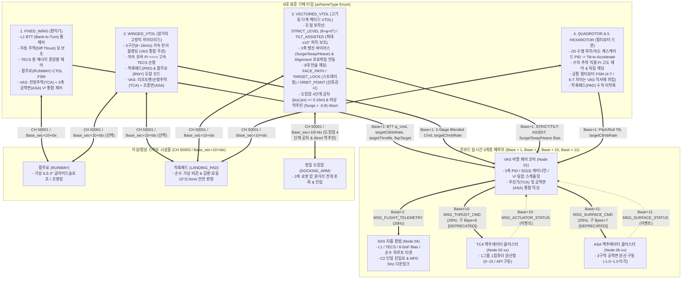
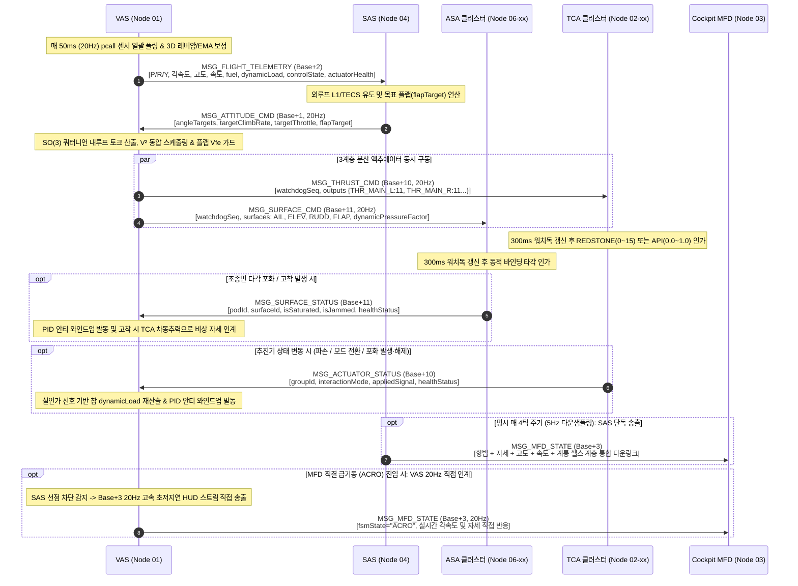
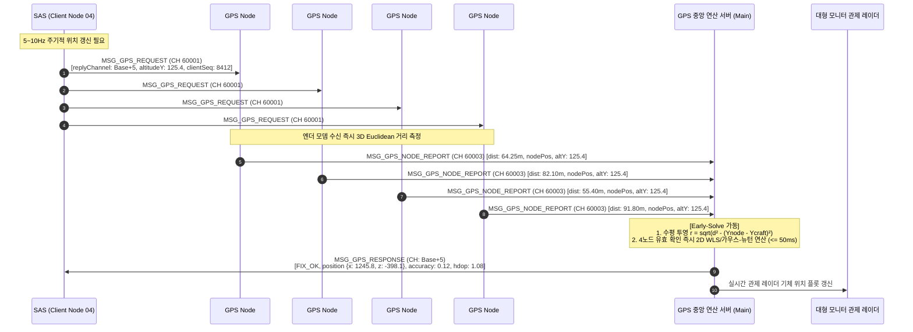
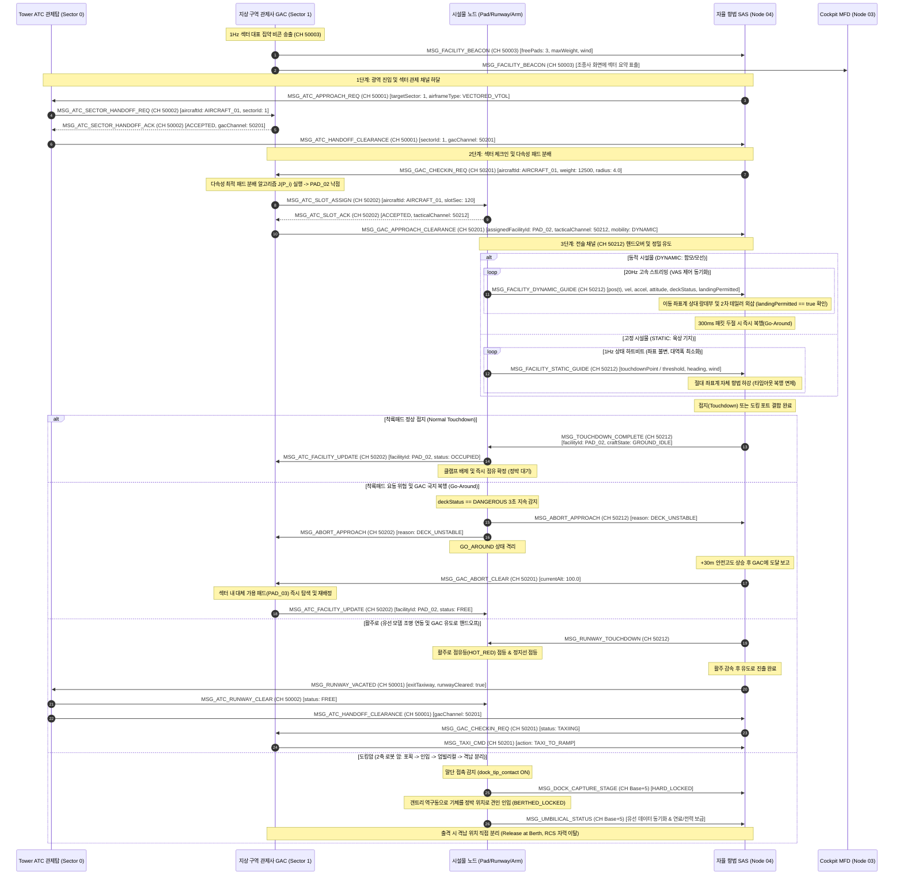
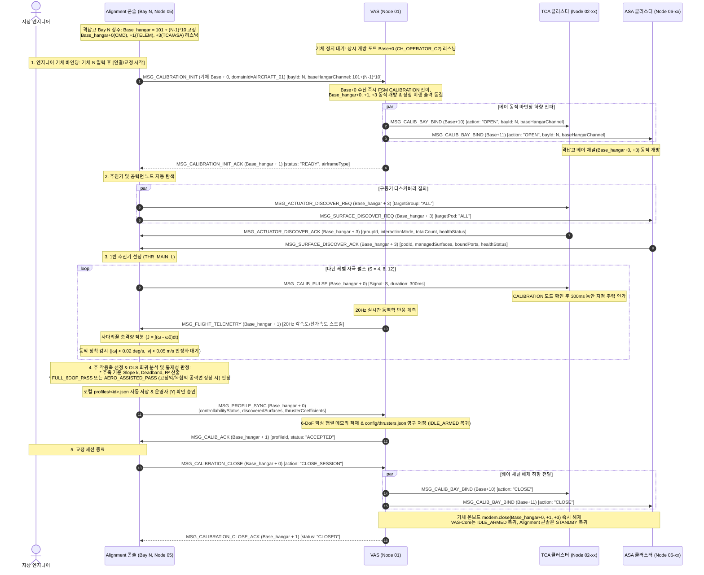
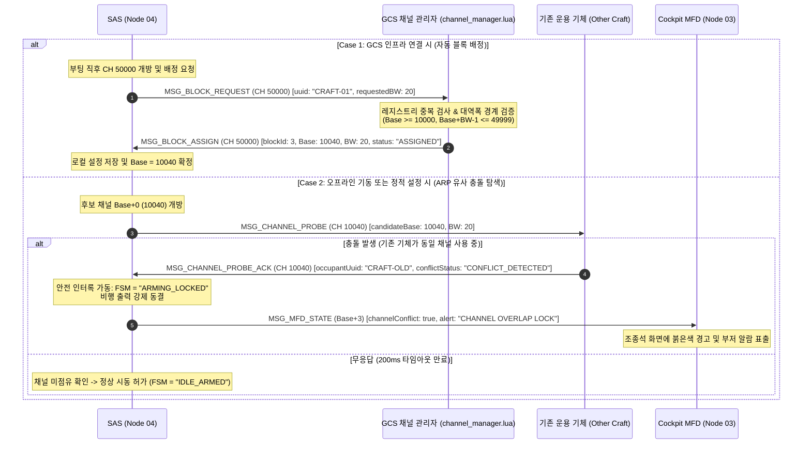
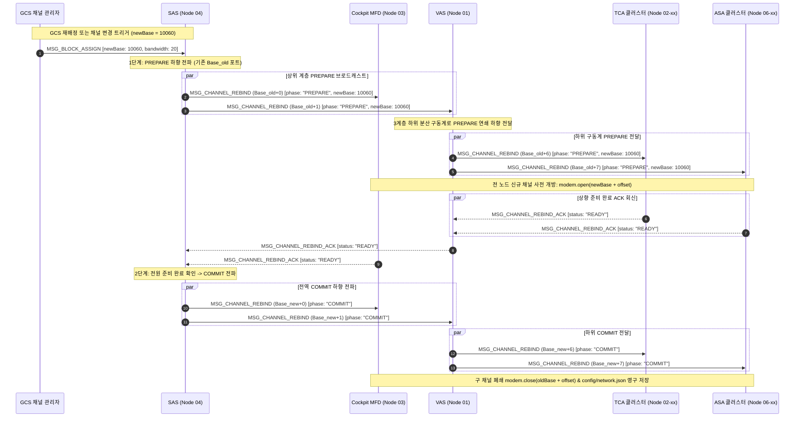

# 전체 프로그램 간 관계 및 교환 패킷 구조도 규격서 (Architecture & Packet Flow Diagram)
> **Autonomous Flight & Ground Infrastructure Interaction Map & Master Channel Specification**  
> **프로젝트**: Universal Autonomous Flight Stack (SAS · VAS · Alignment · TCA · ASA · GPS · ATC & GAC & Facility Swarm · GCS)  
> **문서 버전**: v2.7.0 (4대 핵심 비행 프로그램 최신 실측 구현 데이터 반영: CORE v1.1.5 16개 슬라이스, TCA v1.2.20 24개 슬라이스, SAS v1.2.2 31개 슬라이스, Alignment v2.3.4 21개 슬라이스 전원 Gate 0~6 PASS 및 번들 동기화, 온보드 4대 비행 프로그램 SAS · VAS · TCA · ASA 위계, C2 단일 진입로 Base+0 및 MFD/GCS Base+1 직결 예외 E_STOP/ACRO 한정, Base+3 MFD 다운링크 단일화 SAS 5Hz/Core Acro 20Hz, WAP의 VAS 산하 Base+11 편입 (구 Base+7 [DEPRECATED]) 및 Layer 3 드라이버 체계화, Alignment 격납고 동적 바인딩 MSG_CALIB_BAY_BIND 및 AERO_ASSISTED_PASS, MSG_CHANNEL_REBIND 연쇄 전파 규격화, Master ICD v1.20.0, VAS v1.11.0, SAS v1.9.0, TCA v1.8.0, ASA v1.2.1, Alignment v2.4.0, GAC v1.1.3, GPS v2.0.3, LANDING_PAD v2.2.3, RUNWAY v1.10.3, DOCKING_ARM v1.10.3 전역 동기화)  
> **최종 수정일**: 2026-11-07  
> **대상 환경**: Minecraft CC:Tweaked (Ender Modem), Create: Aeronautics, Create: Avionics  

### Revision History

| 버전 | 개정 일자 | 개정 요약 | 개정 사유 |
| :---: | :---: | :--- | :--- |
| `v2.7.0` | 2026-11-07 | 비행체 전용 40채널($BW=40$) 대역 확장 ($Base = 10000 + (N-1)\times 40$, $N=1\sim 1000$), 4대 Zone(Zone 1: 코어, Zone 2: 구동계, Zone 3: 탑재체, Zone 4: 편대/확장) 전면 재편, 구동계 버스 Zone 2 이관(`Base+10`: TCA, `Base+11`: ASA, `Base+12~19`: 구동계 예비), 구버전 20채널 및 `Base+6`, `Base+7`에 `[DEPRECATED]` 배지 부여, 하위 사양서 5종 `approved/` 승격 전이 상대 링크 동기화 | 서브채널 대역폭 확장 및 기능 영역별 직교성 확보, 1000대 수용량 확립 |

> **연관 규격서**: 
> - [AUTONOMOUS_FLIGHT_SYSTEM_ARCHITECTURE_AND_ICD.md](AUTONOMOUS_FLIGHT_SYSTEM_ARCHITECTURE_AND_ICD.md) (마스터 ICD v1.20.0)
> - [GAC_PROGRAM_SPECIFICATION_AND_ICD.md](../specs/approved/0_infra/gac/GAC_PROGRAM_SPECIFICATION_AND_ICD.md) (GAC 관제사 규격서 v1.1.3)
> - [SAS_PROGRAM_SPECIFICATION.md](../specs/approved/2_guidance/sas/SAS_PROGRAM_SPECIFICATION.md) (SAS 자율 항법 규격서 v1.9.0)
> - [ASA_PROGRAM_SPECIFICATION.md](../specs/approved/1_control/asa/ASA_PROGRAM_SPECIFICATION.md) (ASA 공력 날개 및 조종면 규격서 v1.2.1)
> - [VAS_PROGRAM_SPECIFICATION.md](../specs/approved/1_control/vas/VAS_PROGRAM_SPECIFICATION.md) (VAS 상세 규격서 v1.11.0)
> - [TCA_PROGRAM_SPECIFICATION.md](../specs/approved/1_control/tca/TCA_PROGRAM_SPECIFICATION.md) (TCA 클러스터 규격서 v1.8.0)
> - [GPS_PROGRAM_SPECIFICATION_AND_ICD.md](../specs/approved/0_infra/gps/GPS_PROGRAM_SPECIFICATION_AND_ICD.md) (GPS 규격서 v2.0.3)
> - [ALIGNMENT_PROGRAM_SPECIFICATION.md](../specs/approved/0_development/alignment/ALIGNMENT_PROGRAM_SPECIFICATION.md) (Alignment 상세 규격서 v2.4.0)
> - [RUNWAY_SPECIFICATION_AND_ICD.md](../specs/approved/0_ground/runway/RUNWAY_SPECIFICATION_AND_ICD.md) (활주로 규격서 v1.10.3)
> - [LANDING_PAD_SPECIFICATION_AND_ICD.md](../specs/approved/0_ground/landing_pad/LANDING_PAD_SPECIFICATION_AND_ICD.md) (착륙 패드 규격서 v2.2.3)
> - [DOCKING_ARM_SPECIFICATION_AND_ICD.md](../specs/approved/0_ground/docking_arm/DOCKING_ARM_SPECIFICATION_AND_ICD.md) (도킹암 규격서 v1.10.3)

---

## 1. 개요 (Overview)

본 문서는 자율 비행체 시스템과 지상 인프라를 구성하는 **모든 독립 소프트웨어/하드웨어 프로그램 노드의 상호 관계망, 무선 엔더 모뎀 채널 할당 마스터 맵, 그리고 노드 간에 교환되는 모든 데이터 패킷의 흐름과 스키마를 단일 시각화 체계로 정의한 종합 구조도**입니다.

특히 본 개정판(v2.4.0)에서는 분산 무선 컴퓨팅 환경의 안정성과 확장성을 극대화하기 위해 **전역 RF 스펙트럼 전면 개편(Overhaul)**을 완결하였습니다. GCS 부트스트랩을 `50000`으로 이전하고, 기체 블록을 `10000 ~ 49999` ($Base = 10000 + (N-1) \times 40$, $BW=40$)의 1,000대 완전 연속 수납 구조로 재편하고(구 20채널 [DEPRECATED]), 구형 $N=1000$ 도약 예외를 영구 폐지하였습니다. 또한 광역 관제 및 공용 인프라(Sector 0, `50001 ~ 50200`), GAC 섹터별 200채널 독립 블록($Base_{\text{sec}} = 50001 + S \times 200$), 고정밀 GPS 60001번대 순차 배치(`60001 ~ 60004`), 그리고 Alignment 격납고 10채널 블록군(`101 ~ 200`, $Base_{\text{hangar}} = 101 + (\text{BayID} - 1) \times 10$, Bay 1~10 완결) 및 기체 `Base + 0` 직결 바인딩 체계를 수립하여 시스템의 단일 진실 공급원(SSOT)으로 기능합니다.

### 1.1 코드 경량화 및 Deprecated 운영 정책 (Code Lightweighting & Deprecation Policy)
1. **사양서 명세 원칙 (Specification-First)**: 프로토콜 패킷 타입명 또는 페이로드 필드가 개정될 경우, 구버전 명칭은 사양서에 `[DEPRECATED]` 배지를 부여하고 대체 신규 명칭을 명시하여 설계 이력을 보존합니다.
2. **코드베이스 경량화 원칙 (Zero-Fallback)**: CC:Tweaked Lua 자원 한계(RAM, 20Hz 루프 오버헤드, 바이트 절약)를 고려하여, 코드베이스는 사전 이중 호환(Fallback 래퍼, `payload.new or payload.old` 등)을 일체 작성하지 않고 **최신 표준 필드명/패킷명만을 단일 채택**합니다.
3. **런타임 오류 시 복구 원칙 (송신 노드 즉시 패치)**: 구버전 필드/패킷을 전송하는 미갱신 노드로 인해 통신 오류 발생 시, 수신 측에 폴백 코드를 추가하지 않고 **구버전 패킷을 송신한 발신 노드의 코드를 최신 사양으로 즉시 패치 및 재배포**하여 시스템 전역 일원화를 달성합니다.

---

## 2. 전체 시스템 프로그램 배치 및 도메인 관계도 (System Architecture Diagram)

전체 시스템은 **4대 인프라 도메인(지상 관제, GPS 측위 스웜, 스마트 시설물 및 ATC/GAC 관제탑, 격납고 지상 시험국)**과 **비행체 내부 도메인(온보드 20채널 서브시스템)**으로 명확히 구획 연동됩니다.

```mermaid
flowchart TD
    %% ==========================================
    %% Domain 1: Ground Control Station (GCS)
    %% ==========================================
    subgraph DOMAIN_GCS["[인프라] GCS 지상 관제 센터"]
        GCS_CHAN["GCS 채널 관리자<br/>(channel_manager.lua)<br/>* CH 50000 게이트웨이<br/>* 10000~49999 연속 블록 배정"]
        GCS_C2["GCS 비행 지휘 콘솔<br/>(gcs_terminal.lua)<br/>* 원격 C2 오버라이드 / RTH / 비상 E-Stop"]
    end

    %% ==========================================
    %% Domain 2: High-Precision GPS Infrastructure
    %% ==========================================
    subgraph DOMAIN_GPS["[인프라] 고정밀 GPS 측위 체계 (60001 ~ 60020)"]
        GPS_SRV["GPS 중앙 연산 서버 & GCS UI<br/>(gps/server.lua)<br/>* 2D WLS / 가우스-뉴턴 조기 연산 (<=50ms)<br/>* 3-코루틴 슈퍼바이저 격리"]
        GPS_MON["GPS 4탭 Advanced Monitor<br/>(monitor_ui.lua)<br/>* 79x36 터치 대시보드 & 2D 레이더"]
        subgraph GPS_SWARM["분산 GPS 스웜 노드 군 (10+ 개소)"]
            NODE_01["GPS 노드 #01 (gps/node.lua)<br/>* 3초 부팅 FSM & 10s 하트비트"]
            NODE_02["GPS 노드 #02 (gps/node.lua)"]
            NODE_K["GPS 노드 #K..."]
        end
    end

    %% ==========================================
    %% Domain 3: 3-Tier Smart Facility & Ground Apron Control (GAC)
    %% ==========================================
    subgraph DOMAIN_FAC["[인프라] 3-Tier 스마트 시설물 및 계층 관제 체계 (50001 ~ 59999)"]
        ATC_NODE["Tier 1: 공항/광역 Tower ATC 관제탑 (Sector 0)<br/>(atc_node.lua / CH 50001, 50002)<br/>* 광역 공역 스케줄링 & 섹터 GAC 핸드오프 지시"]
        GAC_NODE["Tier 2: 지상 구역 관제사 GAC Node 07 (Sector S)<br/>(gac_node.lua / Base_sec = 50001 + S*200)<br/>* 1Hz 섹터 대표 비콘(CH 50003) & 디스패치(CH 50004)<br/>* 섹터 관제(Base+0) & 로컬 백본(Base+1) & 다속성 최적 분배"]
        subgraph TIER3_FAC["Tier 3: 개별 시설물 노드 (Individual Facilities)"]
            FAC_RUNWAY["활주로 제어 노드 (runway_node.lua)<br/>* Base_sec + 10 + Idx ILS 정밀 글라이드슬로프"]
            FAC_PAD["착륙 패드 제어 노드 (pad_node.lua)<br/>* Base_sec + 10 + Idx 수직 착륙 전술 유도"]
            FAC_DOCK["도킹암 제어 노드 (docking_node.lua)<br/>* Base_sec + 10 + Idx 2축 로봇 암 원거리 포획"]
        end
    end

    %% ==========================================
    %% Domain 4: Engineering & Hangar Facility
    %% ==========================================
    subgraph DOMAIN_CALIB["[인프라/정비] 격납고 베이 시험 시설 콘솔군 (101 ~ 200)"]
        ALIGNMENT["격납고 콘솔 Alignment<br/>(startup.lua / Node 05 / 실측 v2.3.4 PASS 21개 슬라이스)<br/>* Bay 1~10 독립 10채널 블록 (Base_hangar = 101+(BayID-1)*10)<br/>* Base_hangar+0(CMD), +1(TELEM), +2(FACILITY), +3(TCA 진단)<br/>* 기체 Base+0 직접 바인딩 & 3x2 대형 HUD"]
    end

    %% ==========================================
    %% Domain 5: Onboard Aircraft Subsystems
    %% ==========================================
    subgraph DOMAIN_AIRCRAFT["[비행체 온보드] 전용 40채널 블록 (Base = 10000 + (N-1)*40, BW = 40)"]
        direction TB
        MFD["조종석 MFD 단말<br/>(cockpit_mfd.lua / Node 03)<br/>* C2 명령 및 비상조치 입력<br/>* 평시 5Hz 계기판 렌더링 / ACRO 시 20Hz 고속 HUD 수신"]
        SAS["자율 항법 컴퓨터 SAS<br/>(startup.lua / Node 04 / 실측 v1.2.2 PASS 31개 슬라이스)<br/>* FSM / 경로 계획 / 외루프 유도 & C2 단일 진입로(Base+0)<br/>* 평시 5Hz MFD 계기 다운링크 (Base+3)"]
        CORE["비행 제어 코어 VAS<br/>(Node 01 / 실측 v1.1.5 PASS 16개 슬라이스)<br/>* SO(3) 내루프 & 전 구동계(TCA/ASA) 통합 믹싱<br/>* V² 동압 스케줄링 & 단일 스톨 가드"]
        TCA["추력 어댑터 TCA 클러스터<br/>(Node 02-xx / 실측 v1.2.20 PASS 24개 슬라이스)<br/>* 1그룹 1컴퓨터 분산형 (상호작용 모드: API 0.0~1.0 / REDSTONE 0~15)"]
        ASA["공력 어댑터 ASA 클러스터<br/>(Node 06-xx / 규격 v1.2.1)<br/>* VAS 산하 3구역 조종면/플랩 분산 구동 (Base+11, 구 Base+7 [DEPRECATED])"]
    end

    %% Connections - GCS
    SAS <==>|"CH 50000<br/>[I-8] 부트스트랩 (요청/배정)"| GCS_CHAN
    GCS_C2 -->|"Base + 0<br/>[I-6] 원격 C2 명령/임무/RTH/HOLD/LAND"| SAS
    GCS_C2 -.->|"Base + 1<br/>[I-2] 하드 비상차단 직결 (E_STOP)"| CORE

    %% Connections - GPS
    SAS -.->|"CH 60001<br/>[I-7] 측위 핑 브로드캐스트 (고도 주입)"| GPS_SWARM
    GPS_SWARM -->|"CH 60003<br/>[I-7] 3D Euclidean 거리 보고"| GPS_SRV
    GPS_SRV ==>|"Base + 5 (replyChannel)<br/>[I-7] 최종 2D 좌표 응답"| SAS
    GPS_SRV -.->|"실시간 트래픽 피드"| GPS_MON
    GPS_SRV <==>|"CH 60001/60004<br/>상호 교정 루프"| GPS_SWARM

    %% Connections - 3-Tier Facility & ATC/GAC
    ATC_NODE <==>|"CH 50002 (광역 백본)<br/>[I-5] 섹터 관제 이양 협상"| GAC_NODE
    GAC_NODE -.->|"CH 50003 (1Hz 대표 집약 비콘)<br/>[I-5] 집약 가용 시설물 비콘"| SAS
    GAC_NODE -.->|"CH 50003 (1Hz 대표 비콘)<br/>비콘 정보 표시"| MFD
    GAC_NODE -.->|"CH 50004<br/>지상 관제 안내 디스패치"| SAS
    SAS <==>|"CH 50001 (대공 관제)<br/>광역 진입 요청 / GAC 채널 인가"| ATC_NODE
    SAS <==>|"Base_sec + 0 (섹터 관제)<br/>체크인 / 패드 배정 인가 / 로컬 복행"| GAC_NODE
    GAC_NODE <==>|"Base_sec + 1 (섹터 로컬 백본)<br/>슬롯 배정 및 시설물 상태 동기화"| FAC_RUNWAY
    GAC_NODE <==>|"Base_sec + 1 (섹터 로컬 백본)<br/>슬롯 배정 및 시설물 상태 동기화"| FAC_PAD
    GAC_NODE <==>|"Base_sec + 1 (섹터 로컬 백본)<br/>슬롯 배정 및 시설물 상태 동기화"| FAC_DOCK
    FAC_RUNWAY ==>|"Base_sec + 10 + Idx<br/>전술 ILS 유도 벡터"| SAS
    FAC_PAD ==>|"Base_sec + 10 + Idx<br/>전술 착륙 유도 벡터"| SAS
    FAC_DOCK ==>|"Base_sec + 10 + Idx<br/>전술 도킹 유도 벡터"| SAS
    SAS <==>|"Base + 5 / 전술채널<br/>[I-5] 접지/결합/이탈 완료 통보"| FAC_PAD
    SAS <==>|"Base + 5 / 전술채널<br/>[I-5] 활주로 접지 통보"| FAC_RUNWAY
    SAS <==>|"Base + 5 / 전술채널<br/>[I-5] 래치/엄빌리컬 결합 통보"| FAC_DOCK

    %% Connections - Cockpit C2 & MFD Downlink
    MFD -->|"Base + 0<br/>[I-6] 조종사 명령/모드변경/RTH/HOLD/LAND"| SAS
    MFD -.->|"Base + 1<br/>[I-2] 직결 선점 바이패스 (E_STOP / MFD_ACRO 20Hz)"| CORE
    SAS -->|"Base + 3 (5Hz 다운샘플)<br/>[I-6] 평시 계층 통합 MFD 다운링크"| MFD
    CORE -.->|"Base + 3 (20Hz 실시간)<br/>[I-6] ACRO 진입 시 고속 HUD 직접 송출"| MFD

    %% Connections - Core Realtime Loop (3-Tier Hierarchy)
    CORE ==>|"Base + 2 (20Hz)<br/>[I-1] 고도/속도/방위 텔레메트리 & 구동기 헬스"| SAS
    SAS ==>|"Base + 1 (20Hz)<br/>[I-2] 외루프 유도명령 (MSG_ATTITUDE_CMD)"| CORE
    CORE -.->|"Base + 1 (공중 셧다운 시)<br/>[I-2] 비상 경보 (MSG_EMERGENCY_ALERT)"| SAS
    CORE <==>|"Base + 10 (20Hz 지령 / 이벤트 피드백)<br/>[I-3] 내루프 추력 및 상태 피드백 (구 Base+6 [DEPRECATED])"| TCA
    CORE <==>|"Base + 11 (20Hz 지령 / 이벤트 피드백)<br/>[I-10] 공력 조종면 및 플랩 지령 (구 Base+7 [DEPRECATED])"| ASA

    %% Connections - Calibration (Hangar Bay 1~10 Channels & Base+0 Direct Binding & Dynamic Cascade)
    ALIGNMENT ==>|"기체 Base + 0 (교정 바인딩)<br/>[I-4] 기체 직결 바인딩 (MSG_CALIBRATION_INIT, domainId=AIRCRAFT_01)"| CORE
    CORE -.->|"Base_hangar + 1<br/>[I-4] 바인딩 수락 (MSG_CALIBRATION_INIT_ACK)"| ALIGNMENT
    CORE ==>|"Base + 10 / Base + 11<br/>[I-4] 베이 동적 바인딩 (MSG_CALIB_BAY_BIND)"| TCA
    CORE ==>|"Base + 10 / Base + 11<br/>[I-4] 베이 동적 바인딩 (MSG_CALIB_BAY_BIND)"| ASA
    ALIGNMENT <==>|"Base_hangar + 3<br/>[I-4] TCA 개별 펄스 진단 (MSG_CALIBRATION_TAP_CMD/ACK)"| TCA
    ALIGNMENT <==>|"Base_hangar + 3<br/>[I-4] ASA 공력면 탐색/진단"| ASA
    CORE -.->|"Base_hangar + 1 (동적 FSM 텔레메트리)<br/>[I-4] 펄스 반응 텔레메트리 (20Hz MSG_FLIGHT_TELEMETRY)"| ALIGNMENT
    ALIGNMENT ==>|"Base_hangar + 0<br/>[I-4] 6-DoF/공력 프로파일 동기화 (MSG_PROFILE_SYNC)"| CORE
    CORE ==>|"Base_hangar + 1<br/>[I-4] 프로파일 저장/반영 확인 (MSG_CALIB_ACK)"| ALIGNMENT
    ALIGNMENT ==>|"Base_hangar + 0 (세션 종료)<br/>[I-4] 교정 종료 및 채널 해제 (MSG_CALIBRATION_CLOSE)"| CORE

    %% Connections - Channel Collision Probe & Dynamic Rebind
    SAS -.->|"Base + 0 (기동 전 선점 탐색)<br/>[I-9] 채널 충돌 프로브"| SAS
    SAS ==>|"Base+0/1 -> Base+10/11<br/>[I-9] 계층형 채널 전파 (MSG_CHANNEL_REBIND)"| CORE
```



---

### 2.1 5대 표준 기체 타입별 유도-내루프-액추에이터 제어 흐름 구조도

비행체의 물리적 공력 및 추진기 배치에 따라 SAS(외루프) $\leftrightarrow$ VAS(내루프) $\leftrightarrow$ {TCA, ASA}(액추에이터) 간의 제어 신호 인가 방식과 시설물 상호작용은 다음의 5대 기종별 특화 흐름도로 규정됩니다.



---

## 3. 프로그램 간 패킷 교환 인터페이스 매트릭스 (Packet Exchange Matrix)

전 시스템에서 운용되는 **표준 패킷 인터페이스**의 송수신 주체, 사용 통신 채널, 주기 및 데이터 스키마 요약입니다.

| 인터페이스 | 패킷 타입 식별자 (`type`) | 발신 프로그램 (Sender) | 수신 프로그램 (Receiver) | 전송 채널 | 동작 주기 / 조건 | 핵심 페이로드 필드 |
| :---: | :--- | :--- | :--- | :---: | :---: | :--- |
| **I-1** | `MSG_FLIGHT_TELEMETRY` | `VAS` (Node 01) | `SAS` (Node 04)<br>`Alignment` (Node 05) | `Base + 2` (비행)<br>$Base_{\text{hangar}} + 1$ (교정) | 20Hz (50ms) | `attitude` (P/R/Y), `angularRates` (P/R/Y), `dynamics` (altY, vSpeed, velocity `{vx,vy,vz}`), `fuel`, `dynamicLoad`, `controlState`, `activeSource` (`"SAS"`/`"MFD_ACRO"`/`"EMERGENCY_DIRECT"`), `sensorOk`, `sensorHealth`, `actuatorHealth` (`{tap, wap}`) |
| **I-2** | `MSG_ATTITUDE_CMD` | `SAS` (Node 04)<br>`MFD` (급기동 시) | `VAS` (Node 01) | `Base + 1`<br>(`CH_FLIGHT_GUIDANCE`) | 20Hz (50ms) | `source` (`"SAS"`/`"MFD_DIRECT"`), `arm`, `flightActive`, `flightMode`, `commandType`, `angleTargets`, `rateTargets`, `targetClimbRate` ($-5.0\sim +5.0\text{ m/s}$ Heave PI 구동), `targetThrottle` (전방 서지 추진), `flapTarget` ($0.0\sim 1.0$), `acroActive`, `translationBias` |
| **I-2** | `MSG_EMERGENCY_ALERT` | `VAS` (Node 01) | `SAS` (Node 04) | `Base + 1`<br>(`CH_FLIGHT_GUIDANCE`) | 공중 셧다운 시 즉시 | `reason` (사유 문자열), `isAirborne` (`true`), `fsmState` (발생 시점 FSM), `altitude` (발생 시점 CoM 고도) |
| **I-2** | `MSG_EMERGENCY_OVERRIDE` | `Cockpit MFD` (Node 03)<br>`GCS Console` | `VAS` (Node 01) | `Base + 1`<br>(`CH_FLIGHT_GUIDANCE`) | 하드 킬스위치 발동 시 | `action` (`"E_STOP"` 하드 비상차단), `authKey` (`"ESTOP_CONFIRM_KEY"`), `source` (`"MFD"`/`"GCS"`). *(비상착륙/긴급홀드는 SAS Base+0 진입)* |
| **I-3** | `MSG_THRUST_CMD` | `VAS` (Node 01) | `TCA 클러스터` (Node 02-xx) | `Base + 10`<br>(`CH_THRUST_ACTUATION`, 구 `Base+6` `[DEPRECATED]`) | 20Hz (50ms)<br>*(폐루프 검증 PASS)* | `watchdogSeq`, `controlState` (`DISARMED`, `ARMING`, `IDLE_ARMED`, `NORMAL`, `CALIBRATION`, `FAILSAFE_HOLD`, `EMERGENCY_LAND`, `E_STOP`), `outputs` (`[groupId] = 0~15`) |
| **I-3** | `MSG_ACTUATOR_STATUS` | `TCA 클러스터` (Node 02-xx) | `VAS` (Node 01) | `Base + 10`<br>(`CH_THRUST_ACTUATION`, 구 `Base+6` `[DEPRECATED]`) | 이벤트 발생 시 즉시<br>*(폐루프 검증 PASS)* | `groupId`, `interactionMode` (`mode` `[DEPRECATED]`), `appliedSignal`, `isSaturated`, `activeCount`, `totalCount`, `healthStatus` (`REDSTONE_NOMINAL`/`API_NOMINAL` 등) |
| **I-3** / **I-4** | `MSG_ACTUATOR_DISCOVER_REQ` | `VAS` (Node 01)<br>`Alignment` (Node 05) | `TCA 클러스터` (Node 02-xx) | `Base + 10` /<br>$Base_{\text{hangar}} + 3$ | 부팅/Arming/교정 전 1회<br>*(폐루프 검증 PASS)* | `targetGroup` (`"ALL"` 또는 특정 `groupId`) |
| **I-3** / **I-4** | `MSG_ACTUATOR_DISCOVER_ACK` | `TCA 클러스터` (Node 02-xx) | `VAS` (Node 01)<br>`Alignment` (Node 05) | 요청자 채널 (`Base+10` / $Base_{\text{hangar}}+3$) | 요청 수신 즉시 (1:1)<br>*(폐루프 검증 PASS)* | `groupId`, `interactionMode` (`mode` `[DEPRECATED]`), `activeCount`, `totalCount`, `healthStatus` (`REDSTONE_NOMINAL`/`API_NOMINAL` 등) |
| **I-4** | `MSG_CALIBRATION_INIT` | `Alignment` (Node 05) | `VAS` (Node 01) | 기체 `Base + 0`<br>(`CH_OPERATOR_C2`) | 엔지니어 바인딩 실행 시 | `stationId`, `bayId` (1~10), `baseHangarChannel` ($101 + (\text{BayID}-1)\times 10$), `targetCraftDomain` (`envelope.domainId = "AIRCRAFT_01"`) |
| **I-4** | `MSG_CALIBRATION_INIT_ACK` | `VAS` (Node 01) | `Alignment` (Node 05) | $Base_{\text{hangar}} + 1$<br>(`CH_CALIBRATION_TELEM`) | 바인딩 수신 즉시 (1:1) | `aircraftDomainId`, `hardwareUuid`, `bayId`, `status` (`"READY"` / `"BUSY"`), `airframeType` |
| **I-4** | `MSG_CALIB_BAY_BIND` | `VAS` (Node 01) | `TCA & ASA 클러스터` | `Base + 10` / `Base + 11` (구 `Base+6/7` `[DEPRECATED]`) | 교정 개시 및 종료 시 | `action` (`"OPEN"`/`"CLOSE"`), `stationId`, `bayId`, `baseHangarChannel`, `bayCalibrationTap`, `bayCalibrationCmd` |
| **I-4** | `MSG_CALIB_START` | `Alignment` (Node 05) | `VAS` (Node 01) | $Base_{\text{hangar}} + 0$<br>(`CH_CALIBRATION_CMD`) | 교정 개시 시 1회 | `action` (`ENTER_CALIBRATION`/`ABORT_CALIBRATION`), `targetThruster` (`"ALL"`), `timeoutSec` |
| **I-4** | `MSG_CALIB_PULSE` | `Alignment` (Node 05) | `TCA 클러스터` (Node 02-xx) | $Base_{\text{hangar}} + 0$<br>(`CH_CALIBRATION_CMD`) | 교정 시퀀스 중 | `targetThrusterId`, `stepIndex` (1~3), `pulseLevel` (4, 8, 12), `pulseDurationMs` (300), `safetyMaxTiltDeg` (12.0) |
| **I-4** | `MSG_PROFILE_SYNC` | `Alignment` (Node 05) | `VAS` (Node 01) | $Base_{\text{hangar}} + 0$<br>(`CH_CALIBRATION_CMD`) | 교정 완료 시 1회 | `profileId`, `calibratedBy`, `totalDryMass`, `controllabilityStatus` (`"FULL_6DOF_PASS"`/`"AERO_ASSISTED_PASS"`), `discoveredSurfaces`, `thrusterCoefficients` |
| **I-4** | `MSG_CALIB_ACK` | `VAS` (Node 01) | `Alignment` (Node 05) | $Base_{\text{hangar}} + 1$<br>(`CH_CALIBRATION_TELEM`) | 프로파일 반영 직후 1회 | `profileId` (수신 반영 ID), `status` (`"ACCEPTED"` / `"REJECTED"`) |
| **I-4** | `MSG_CALIBRATION_CLOSE` | `Alignment` (Node 05) | `VAS` (Node 01) | $Base_{\text{hangar}} + 0$<br>(`CH_CALIBRATION_CMD`) | 교정 세션 종료 시 | `bayId`, `action` (`"CLOSE_SESSION"`), `reason` |
| **I-4** | `MSG_CALIBRATION_CLOSE_ACK` | `VAS` (Node 01) | `Alignment` (Node 05) | $Base_{\text{hangar}} + 1$<br>(`CH_CALIBRATION_TELEM`) | 세션 종료 즉시 | `bayId`, `status` (`"CLOSED"`) |
| **I-5** | `MSG_FACILITY_BEACON` | `GAC Node` (대표 송신) | `SAS` (Node 04)<br>`MFD` (Node 03) | `50003`<br>(`CH_FACILITY_BEACON`) | 1Hz 주기 브로드캐스트 | `sectorId`, `gacChannel`, `totalPads`, `freePads`, `maxSupportedWeight`, `maxClearanceRadius`, `surfaceWind` |
| **I-5** | `MSG_ATC_APPROACH_REQ` | `SAS` (Node 04) | `Tower ATC Node` | `50001`<br>(`CH_ATC_COMM`) | 광역 진입 시 (또는 재요청) | `aircraftId`, `targetSector`, `airframeType`, `estimatedArrivalTime`, `retryCount` |
| **I-5** | `MSG_ATC_SECTOR_HANDOFF_REQ` | `Tower ATC Node` | `GAC Node` | `50002`<br>(`CH_ATC_FACILITY`) | 광역 진입 협상 | `aircraftId`, `sectorId`, `airframeType`, `eta` |
| **I-5** | `MSG_ATC_SECTOR_HANDOFF_ACK` | `GAC Node` | `Tower ATC Node` | `50002`<br>(`CH_ATC_FACILITY`) | 협상 즉시 응답 | `aircraftId`, `status` (`ACCEPTED`/`DENIED`), `gacChannel` ($Base_{\text{sec}} + 0$) |
| **I-5** | `MSG_ATC_HANDOFF_CLEARANCE` | `Tower ATC Node` | `SAS` (Node 04) | `50001`<br>(`CH_ATC_COMM`) | 섹터 관제 채널 하달 | `aircraftId`, `sectorId`, `gacChannel` ($Base_{\text{sec}} + 0$), `status` |
| **I-5** | `MSG_GAC_CHECKIN_REQ` | `SAS` (Node 04) | `GAC Node` | $Base_{\text{sec}} + 0$<br>(`CH_GAC_COMM`) | 섹터 진입 즉시 체크인 | `aircraftId`, `sectorId`, `airframeType`, `grossWeight`, `clearanceRadius` |
| **I-5** | `MSG_GAC_APPROACH_CLEARANCE`| `GAC Node` | `SAS` (Node 04) | $Base_{\text{sec}} + 0$<br>(`CH_GAC_COMM`) | 최적 시설물 배정 인가 | `aircraftId`, `assignedFacilityId`, `tacticalChannel` ($Base_{\text{sec}} + 10 + \text{Idx}$), `approachHeading`, `safeDescentRate`, `slotDurationSec` |
| **I-5** | `MSG_ATC_SLOT_ASSIGN` | `GAC Node` | `Facility Node` (Pad/Runway) | $Base_{\text{sec}} + 1$<br>(`CH_SECTOR_BACKBONE`) | 착륙 인가 전 패드 슬롯 배정 | `facilityId`, `aircraftId`, `airframeType`, `slotDurationSec`, `tacticalChannel` |
| **I-5** | `MSG_ATC_SLOT_ACK` | `Facility Node` (Pad/Runway) | `GAC Node` | $Base_{\text{sec}} + 1$<br>(`CH_SECTOR_BACKBONE`) | 슬롯 요청 즉시 응답 | `facilityId`, `aircraftId`, `status` (`ACCEPTED`/`REJECTED`), `tacticalChannel` |
| **I-5** | `MSG_ATC_FACILITY_UPDATE` | `Facility Node` $\leftrightarrow$ `GAC Node` | `GAC Node` / `Facility Node` | $Base_{\text{sec}} + 1$<br>(`CH_SECTOR_BACKBONE`) | 점유/개방/복행 상태 갱신 | `facilityId`, `status` (`FREE`/`RESERVED`/`OCCUPIED`/`MAINTENANCE`), `currentCraft` |
| **I-5** | `MSG_FACILITY_STATIC_GUIDE` | `Facility Node` (고정 시설물) | `SAS` (Node 04) | $Base_{\text{sec}} + 10 + \text{Idx}$<br>(`CH_TACTICAL_GUIDANCE`) | 1Hz 주기 브로드캐스트 | `facilityId`, `targetAircraft`, `touchdownPoint`, `approachHeading`, `safeDescentRate`, `surfaceWind`, `abortAlert` |
| **I-5** | `MSG_FACILITY_DYNAMIC_GUIDE`| `Facility Node` (동적 시설물) | `SAS` (Node 04) | $Base_{\text{sec}} + 10 + \text{Idx}$<br>(`CH_TACTICAL_GUIDANCE`) | 20Hz 주기 스트리밍 | `facilityId`, `targetAircraft`, `touchdownPoint`/`thresholdPoint`, `velocity`, `acceleration`, `attitude`, `deckStatus`, `landingPermitted`, `abortAlert` |
| **I-5** | `MSG_ABORT_APPROACH` | `Facility` / `GAC` | `SAS` (Node 04) | 전술채널 / $Base_{\text{sec}} + 1$ | 위험 요동/장애물 감지 시 | `facilityId`, `aircraftId`, `reason` (`DECK_UNSTABLE` 등), `recommendedClimbAltitude` |
| **I-5** | `MSG_GAC_ABORT_CLEAR` | `SAS` (Node 04) | `GAC Node` | $Base_{\text{sec}} + 0$<br>(`CH_GAC_COMM`) | 복행 안전고도 도달 보고 | `aircraftId`, `currentAltitude`, `climbRate` |
| **I-5** | `MSG_TOUCHDOWN_COMPLETE` | `SAS` (Node 04) | `Facility Node` / `GAC` | 전술채널 / `Base + 5` | 접지 확정 시 | `facilityId`, `touchdownTime`, `craftState` (`GROUND_IDLE`) |
| **I-5** | `MSG_GAC_DEPARTURE_REQ` | `SAS` (Node 04) | `GAC Node` | $Base_{\text{sec}} + 0$<br>(`CH_GAC_COMM`) | 지상 출발/이륙 요청 | `aircraftId`, `facilityId` |
| **I-5** | `MSG_GAC_DEPARTURE_CLEARANCE`| `GAC Node` | `SAS` (Node 04) | $Base_{\text{sec}} + 0$<br>(`CH_GAC_COMM`) | 이륙 허가 및 상향 안내 | `aircraftId`, `assignedAltitude`, `towerAtcChannel` (50001) |
| **I-5** | `MSG_DOCK_CAPTURE_STAGE` | `Docking Arm Node` | `SAS` (Node 04) | `CH Base + 5` / 전술채널 | 도킹 단계별 전이 시 | `facilityId`, `stage` (`SOFT_LATCH`, `HARD_LOCKED`, `RETRACTING`, `BERTHED`, `RELEASED`), `lockPinEngaged` |
| **I-5** | `MSG_UMBILICAL_STATUS` | `Docking Arm Node` | `SAS` (Node 04) | `CH Base + 5` | 정박 후 1Hz 주기 | `facilityId`, `umbilicalEngaged`, `berthLocationSecured`, `highSpeedDataLink`, `fuelService`, `powerRecharge` |
| **I-6** | `MSG_OPERATOR_CMD` | `Cockpit MFD` (Node 03)<br>`GCS Console` | `SAS` (Node 04) | `Base + 0`<br>(`CH_OPERATOR_C2`) | 버튼/명령 입력 시 | `authority` (`PILOT_PRIMARY`/`GCS_OVERRIDE`), `flightMode`, `params`, `emergencyAction` (`NONE`, `RTH`, `HOVER_HOLD`, `EMERGENCY_LAND`) *(E_STOP은 Base+1 직결)* |
| **I-6** | `MSG_MFD_STATE` | `SAS` (평시 5Hz)<br>`VAS` (ACRO 20Hz) | `Cockpit MFD` (Node 03) | `Base + 3`<br>(`CH_MFD_STATE`) | 평시 5Hz / ACRO 20Hz 직접 송출 | `source`, `fsmState`, `flightMode`, `attitude`, `angularRates`, `dynamics`, `nav` (SAS 평시), `fuel`, `dynamicLoad`, `sensorHealth`, `actuatorHealth` |
| **I-7** | `MSG_GPS_REQUEST` | `SAS` (Node 04) | `GPS Swarm Nodes` | `60001`<br>(`CH_GPS_PING`) | 5~10Hz 간격 측위 시 | `replyChannel` (`Base + 5`), `altitudeY` (실측 고도 필수), `clientType` (`AIRCRAFT`), `clientSeq` |
| **I-7** | `MSG_GPS_STATUS_REQ` | `SAS` / `GCS Console` | `GPS Central Server` | `60002`<br>(`CH_GPS_SERVICE`) | 필요 시/진단 시 | `reqType`, `replyChannel` |
| **I-7** | `MSG_GPS_STATUS_RESP`| `GPS Central Server` | `SAS` / `GCS Console` | `Base + 5` / `60002` | 요청 즉시 응답 | `activeNodes`, `uptime`, `totalSolved`, `version` |
| **I-7** | `MSG_GPS_NODE_REPORT`| `GPS Swarm Nodes` | `GPS Central Server` | `60003`<br>(`CH_GPS_NODE_IN`) | 핑 수신 즉시 (0-tick) | `targetClient`, `clientSeq`, `nodeId`, `nodePos`, `measuredDistance` (3D Euclidean), `clientAltitudeY`, `replyChannel` |
| **I-7** | `MSG_GPS_RESPONSE` | `GPS Central Server` | `SAS` (Node 04) | `Base + 5`<br>(클라이언트 `replyChannel`) | $\le 50\text{ms}$ 조기 연산 | `targetClient`, `clientSeq`, `status` (`FIX_OK`), `position` `{x, z}`, `accuracy`, `hdop`, `nodeCount`, `selectedNodes` |
| **I-8** | `MSG_BLOCK_REQUEST` | `SAS` (Node 04) | `GCS Channel Mgr` | `50000`<br>(`CH_BOOTSTRAP`) | 기체 첫 부팅 시 1회 | `hardwareUuid`, `domainId`, `requestedBandwidth` (기본 20) |
| **I-8** | `MSG_BLOCK_ASSIGN` | `GCS Channel Mgr` | `SAS` (Node 04) | `50000`<br>(`CH_BOOTSTRAP`) | 요청 즉시 응답 | `blockId` ($N$), `baseChannel` ($10000 + (N - 1) \times 20$), `bandwidth` (40, 구버전 20 `[DEPRECATED]`), `status` (`ASSIGNED`/`REASSIGNED`/`REJECTED`) |
| **I-9** | `MSG_CHANNEL_PROBE` | `SAS` (Node 04) | 인접 비행체 / GCS | `Base + 0`<br>(기체 후보 C2 포트) | Arming 전 또는 오프라인 기동 시 | `hardwareUuid`, `candidateBase`, `bandwidth` (40, 구버전 20 `[DEPRECATED]`), `probeSeq` |
| **I-9** | `MSG_CHANNEL_PROBE_ACK` | 기 선점 비행체 (`SAS`) | 프로브 발신 비행체 | `Base + 0`<br>(프로브 채널) | 충돌 감지 즉시 회신 | `existingDomain`, `occupiedBase`, `status` (`CONFLICT_DETECTED`) |
| **I-9** | `MSG_CHANNEL_REBIND` | `SAS` (Node 04) | `MFD`, `VAS` $\rightarrow$ `TCA`, `ASA` | `Base+0/1` $\rightarrow$ `Base+10/11` (구 `Base+6/7` `[DEPRECATED]`) | 채널 블록 동적 변경 시 | `phase` (`"PREPARE"`/`"COMMIT"`/`"ROLLBACK"`), `oldBase`, `newBase`, `bandwidth` (40, 구버전 20 `[DEPRECATED]`), `switchTimeoutMs` |
| **I-10** | `MSG_SURFACE_CMD` | `VAS` (Node 01) | `ASA 클러스터` (Node 06-xx) | `Base + 11`<br>(`CH_SURFACE_ACTUATION`, 구 `Base+7` `[DEPRECATED]`) | 20Hz (50ms) 상시 브로드캐스트 | `watchdogSeq`, `controlState`, `surfaces` (`AIL_L`, `AIL_R`, `ELEV`, `RUDD`, `FLAP_L`, `FLAP_R`), `dynamicPressureFactor` |
| **I-10** | `MSG_SURFACE_STATUS` | `ASA 클러스터` (Node 06-xx) | `VAS` (Node 01) | `Base + 11`<br>(`CH_SURFACE_ACTUATION`, 구 `Base+7` `[DEPRECATED]`) | 타각 포화/고착 시 즉시 발신 | `podId`, `surfaceId`, `boundSide`, `mode` (`API`/`REDSTONE`), `appliedDeflection`, `isSaturated`, `isJammed`, `healthStatus` |
| **I-10** | `MSG_SURFACE_DISCOVER_REQ` | `VAS` (Node 01) | `ASA 클러스터` (Node 06-xx) | `Base + 11`<br>(`CH_SURFACE_ACTUATION`, 구 `Base+7` `[DEPRECATED]`) | 시동(Arming) 전 1회 | `targetPod` (`"ALL"` 또는 특정 ASA 노드 ID) |
| **I-10** | `MSG_SURFACE_DISCOVER_ACK` | `ASA 클러스터` (Node 06-xx) | `VAS` (Node 01)<br>`Alignment` (Node 05) | 요청자 채널 (`Base+11` / $Base_{\text{hangar}}+3$) | 요청 수신 즉시 (1:1) | `podId`, `managedSurfaces`, `boundPorts` (`{ side, mode }`), `healthStatus` |

---

## 4. 핵심 생명주기별 교환 패킷 시퀀스 (Lifecycle Interaction Sequences)

### 4.1 시퀀스 1: 20Hz 실시간 비행 제어 루프 (Realtime Control Loop)
센서 계측에서 추력 인가 및 공력 날개 조작까지 1틱(50ms) 내에 완결되는 3계층 폐루프 데이터 파이프라인입니다.



---

### 4.2 시퀀스 2: 고정밀 중앙 연산 2D GPS 측위 시퀀스 (GPS Triangulation)
비행체 실측 고도 주입 기반의 2D 정밀 수평 투영 및 조기 연산(Early-Solve $\le 50\text{ms}$) 시퀀스입니다.



---

### 4.3 시퀀스 3: 시설물 착륙 및 점유 3-Tier 핸드셰이크 (Facility & 3-Tier ATC/GAC Handshake)
광역 관제탑(Tower ATC, Sector 0: 50001/50002)의 공역 스케줄링, 지상 구역 관제사(GAC, Sector S: 50001+S*200)의 섹터 최적 분배 및 로컬 복행 중재, 그리고 시설물 노드의 1:1 전술 정밀 유도($Base_{\text{sec}}+10+\text{Idx}$)를 연계한 3계층 착륙 절차입니다.



---

### 4.4 시퀀스 4: 격납고 상주 콘솔 베이 블록(101~200) 및 기체 Base+0 직결 바인딩 동역학 식별 (Alignment Hangar Profiling)
격납고/정비 시험장 상주 콘솔이 기체 고유 C2 채널(`Base + 0`)로 직결 바인딩 지령(`MSG_CALIBRATION_INIT`)을 발송하여 기체가 지정된 베이 전용 10채널 블록($Base_{\text{hangar}} = 101 + (\text{BayID}-1)\times 10$)을 동적으로 개방하고, 사다리꼴 적분, 주 작용축 OLS 회귀 분석, 불감대 도출 및 VAS 프로파일 동기화를 완결한 후 안전하게 채널을 닫고 복귀하는 절차입니다. 기체는 CALIBRATION 상태에서만 해당 Bay 채널을 동적 개방하므로 비행 중 무선 간섭이 원천 차단됩니다.



---

### 4.5 시퀀스 5: 채널 블록 부트스트랩 및 선점 충돌 탐색 시퀀스 (Channel Bootstrap & Conflict Probe)
GCS 채널 배정과 독립 기체 시동 전 선점 충돌을 사전에 방지하는 2단계 검증 시퀀스입니다.



---

### 4.6 시퀀스 6: 기체 내부 계층형 채널 재할당 전파 (Hierarchical Channel Rebind Protocol)
GCS 명령 또는 충돌 회피로 기체의 `baseChannel`이 동적 변경될 때 온보드 전 서브시스템 간 분할 상태(Split-Brain)를 방지하는 원자적 2단계(Prepare $\to$ Commit) 트랜잭션 시퀀스입니다.



---

## 5. 전체 통신 채널 마스터 맵 및 스펙트럼 배치 (Master Communication Channel Architecture)

### 5.1 전체 프로그램별 채널 매핑 총괄표 (Master Program Channel Matrix)

시스템을 구성하는 모든 소프트웨어 프로그램과 노드가 사용하는 통신 채널, 전송 매체 및 역할을 완전 집대성한 총괄표입니다.

| 프로그램 명칭 | 파일명 | 소속 도메인 | 송신 채널 (Tx) | 수신(개방) 채널 (Rx) | 통신 매체 및 포트 | 핵심 프로토콜 및 역할 |
| :--- | :--- | :--- | :---: | :---: | :---: | :--- |
| **GCS 채널 관리자** | `channel_manager.lua` | 지상 관제 | `50000` | `50000` | 무선 모뎀 (Ender) | 기체별 고유 채널 블록($N$, $Base = 10000 + (N - 1) \times 40$, $BW=40$, $N=1\sim 1000$, 구 $BW=20$ [DEPRECATED]) 배정, 중복 검증, 레지스트리 영구 관리 |
| **GCS 비행 콘솔** | `gcs_terminal.lua` | 지상 관제 | `Base + 0`, `Base + 1` | `Base + 2` (옵션) | 무선 모뎀 (Ender) | 조종사 C2 명령 원격 오버라이드, 비상 착륙/정지(`RTH`, `HOVER_HOLD`), 하드 킬스위치(`E_STOP` on Base+1) 송출 |
| **GPS 중앙 연산 서버** | `gps/server.lua` | 고정밀 GPS | `Base + 5`, `60004` | `60002`, `60003`, `60004` | 무선 모뎀 (Ender) & 유선 모니터 | 4+ 노드 거리 취합, 2D WLS/가우스-뉴턴 조기 연산($\le 50\text{ms}$), Advanced Monitor 4탭 터치 GCS 및 자동 피팅 레이더 |
| **GPS 스웜 노드 군** | `gps/node.lua` (#01~#K)| 고정밀 GPS | `60003`, `60004` | `60001`, `60004` | 무선 모뎀 (Ender) | 3초 핫키 부팅, 핑 수신 즉시 3D 거리 보고(`MSG_GPS_NODE_REPORT`), 경량 콘솔 로깅 데몬 |
| **GPS 클라이언트 API** | `gps/client.lua` | 고정밀 GPS | `60001` | `Base + 5` (지정 채널) | 무선 모뎀 (Ender) | 하이브리드 측위 API: 동기식 `locate()`(500ms, 1회 재전송) + 20Hz 비동기 `request()`/`poll()` |
| **공항 ATC 관제탑** | `atc_node.lua` | 스마트 시설 (Tier 1) | `50001`, `50002`, `Base+5`| `50001`, `50002` | 무선 모뎀 (Ender) | 광역 공역 스케줄링, GAC 섹터 핸드오프 협상, 공역 이탈 관제 |
| **지상 구역 관제사 GAC** | `gac_node.lua` (Node 07)<br>[GAC_PROGRAM_SPECIFICATION_AND_ICD.md](../specs/approved/0_infra/gac/GAC_PROGRAM_SPECIFICATION_AND_ICD.md) | 스마트 시설 (Tier 2) | `50003`, `50004`, $Base_{\text{sec}}+0$, $Base_{\text{sec}}+1$ | `50002`, `50004`, $Base_{\text{sec}}+0$, $Base_{\text{sec}}+1$ | 무선 모뎀 (Ender) | 1Hz 섹터 대표 비콘 브로드캐스트, 다속성 최적 패드 분배, 국지 복행 중재, 함선 비행갑판 요동 총괄 감시 ($Base_{\text{sec}} = 50001 + S \times 200$) |
| **활주로 제어 노드** | `runway_node.lua` | 스마트 시설 (Tier 3) | `50002`, $Base_{\text{sec}}+1$, $Base_{\text{sec}}+10+\text{Idx}$ | `50001`, `50002`, $Base_{\text{sec}}+1$, `Base+5` | 무선 모뎀 (Ender) | ILS 전술 정밀 글라이드슬로프 유도 벡터($Base_{\text{sec}}+10+\text{Idx}$) 송출, GAC 유도로 관제 연동 |
| **착륙 패드 제어 노드** | `pad_node.lua` | 스마트 시설 (Tier 3) | $Base_{\text{sec}}+1$, $Base_{\text{sec}}+10+\text{Idx}$ | $Base_{\text{sec}}+1$, $Base_{\text{sec}}+10+\text{Idx}$, `Base+5` | 무선 모뎀 (Ender) | 순수 소프트웨어 비콘, 수직 착륙 전술 유도 벡터($Base_{\text{sec}}+10+\text{Idx}$) 송출, 직속 GAC 로컬 백본 연동 |
| **도킹암 제어 노드** | `docking_arm_node.lua` | 스마트 시설 (Tier 3) | $Base_{\text{sec}}+1$, $Base_{\text{sec}}+10+\text{Idx}$ | `50001`, $Base_{\text{sec}}+1$, $Base_{\text{sec}}+10+\text{Idx}$, `Base+5` | 무선 모뎀 (Ender) | 2축 로봇 암 원거리 전개 포획, 정밀 전술 유도($Base_{\text{sec}}+10+\text{Idx}$), 엄빌리컬/래치 제어, GAC 에이프런 연동 |
| **Alignment 격납고 콘솔**| `startup.lua` (Node 05)<br>[ALIGNMENT_PROGRAM_SPECIFICATION.md](../specs/approved/0_development/alignment/ALIGNMENT_PROGRAM_SPECIFICATION.md) | 지상 시설 | 기체 `Base+0`, $Base_{\text{hangar}}+0/3$ | $Base_{\text{hangar}}+1/3$ | 무선 모뎀 (Ender) | 베이별 10채널 블록($Base_{\text{hangar}} = 101 + (\text{BayID}-1)\times 10$, Bay 1~10), 기체 `Base+0` 직결 바인딩(domainId=AIRCRAFT_01), 다단 펄스 인가, 주 작용축 OLS 6-DoF/공력 통제성(`AERO_ASSISTED_PASS`) 식별, 3x2 대형 HUD |
| **조종석 MFD 단말** | `cockpit_mfd.lua` (Node 03) | 기체 온보드 | `Base + 0`, `Base + 1` | `Base + 3`, `50003` | 무선 모뎀 (Ender) | 조종사 C2 명령(Base+0), 하드 킬(`E_STOP` on Base+1), 20Hz 수동 급기동(`ACRO` on Base+1), 평시 5Hz 계기판 렌더링 / ACRO 20Hz 고속 HUD 수신 |
| **자율 항법 컴퓨터 SAS** | `uap_main.lua` (Node 04)<br>[SAS_PROGRAM_SPECIFICATION.md](../specs/approved/2_guidance/sas/SAS_PROGRAM_SPECIFICATION.md) | 기체 온보드 | `50000`, `Base+0/1/3`, `50001`, `60001`, $Base_{\text{sec}}+0$, $Base_{\text{sec}}+10+\text{Idx}$ | `50000`, `Base+0/2/5`, `50001`, `50003`, `50004`, $Base_{\text{sec}}+0$, $Base_{\text{sec}}+10+\text{Idx}$ | 무선 모뎀 (Ender) | 외루프 FSM 항법 제어, C2 단일 진입로(Base+0) 총괄, 평시 5Hz 계층 통합 MFD 다운링크(Base+3), GPS 핑 송출(60001), 관제 2단계 핸드오프, 채널 재할당 전파 |
| **비행 제어 코어 VAS**| `startup.lua` (Node 01)<br>[VAS_PROGRAM_SPECIFICATION.md](../specs/approved/1_control/vas/VAS_PROGRAM_SPECIFICATION.md) | 기체 온보드 | `Base + 10`, `Base + 11`, `Base + 2`, `Base + 3` (ACRO 시), `Base + 1`, $Base_{\text{hangar}}+1$ (CALIB 시) | `Base + 1`, `Base + 10`, `Base + 11`, `Base + 0` (CALIB INIT 시), $Base_{\text{hangar}}+0$ (CALIB 시) | 무선 모뎀 / 탑재 센서 버스 | VICD-Spec 3계층 드라이버(`actuator_adapter_tca` + `actuator_adapter_asa`), 단위 쿼터니언 SO(3) 제어, V² 동압 스케줄링, Base+1 선점 중재, ACRO 시 Base+3 20Hz HUD 직접 송출, 동적 베이 바인딩 하향 전파 |
| **추력 어댑터 TCA 클러스터**| `tap_daemon.lua / main.lua` (Node 02-xx)<br/>[TCA_PROGRAM_SPECIFICATION.md](../specs/approved/1_control/tca/TCA_PROGRAM_SPECIFICATION.md) | 기체 온보드 | `Base + 10`, $Base_{\text{hangar}}+3$ (CALIB 시) | `Base + 10`, $Base_{\text{hangar}}+0/+3$ (CALIB 시) | 무선 모뎀 & 추진기 상호작용 모드(API/REDSTONE) | 동적 타이머 300ms 워치독, REDSTONE(0~15)/API(0.0~1.0) 인가, 단선/포화 회신, `MSG_CALIB_BAY_BIND` 동적 베이 개폐, `MSG_CHANNEL_REBIND` 처리 |
| **공력 조종면 ASA 클러스터**| `wap_daemon.lua` (Node 06-xx)<br/>[ASA_PROGRAM_SPECIFICATION.md](../specs/approved/1_control/asa/ASA_PROGRAM_SPECIFICATION.md) | 기체 온보드 | `Base + 11`, $Base_{\text{hangar}}+3$ (CALIB 시) | `Base + 11`, $Base_{\text{hangar}}+0/+3$ (CALIB 시) | 무선 모뎀 & 조종면 액추에이터 | VAS 산하 3구역 노드(06-L/R/T), 20Hz 타각 제어(`MSG_SURFACE_CMD`), 300ms 안전 활공 트림, `MSG_CALIB_BAY_BIND` 동적 베이 개폐, `MSG_CHANNEL_REBIND` 처리 |

---

### 5.2 전역 RF 통신 스펙트럼 맵 (Global RF Spectrum Map, 0 ~ 65535)

CC:Tweaked 모뎀의 물리 주파수 대역(`0 ~ 65535`)을 체계적으로 분할하여 상호 간섭을 원천 차단합니다.

```mermaid
flowchart LR
    subgraph SPEC_0["0 ~ 100 : 예약 및 로컬 대역"]
        S0["0 ~ 100<br/>[RESERVED]<br/>* 유선 네트워크 전용<br/>* 내부 IPC / 루프백"]
    end

    subgraph SPEC_CALIB["101 ~ 200 : 격납고 지상 교정 블록군 (Bay 1 ~ 10)"]
        direction TB
        C_BASE["Base_hangar = 101 + (BayID - 1) * 10<br/>(BayID = 1 ~ 10, 총 10개 베이 완결)"]
        C_CMD["+0 : CH_CALIBRATION_CMD (교정 지령/시퀀스)"]
        C_TLM["+1 : CH_CALIBRATION_TELEM (20Hz 동역학 텔레메트리)"]
        C_FAC["+2 : CH_HANGAR_FACILITY (설비/엄빌리컬 인터록)"]
        C_TAP["+3 : CH_CALIBRATION_TAP (TCA 추진기 및 ASA 직결 진단)"]
        C_RES["+4 ~ +9 : 격납고 내부 예약 대역 (6개 채널)"]
    end

    subgraph SPEC_RES200["201 ~ 9999 : 시스템 예약 대역"]
        S_RES["201 ~ 9999<br/>[RESERVED]<br/>* 시스템 예약 대역"]
    end

    subgraph SPEC_CRAFT["10000 ~ 49999 : 기체 동적 전용 연속 블록"]
        direction TB
        C1["기체 #01 : 10000 ~ 10039 (BW=40)"]
        C2["기체 #02 : 10040 ~ 10079 (BW=40)"]
        C3["기체 #03 : 10080 ~ 10119 (BW=40)"]
        CN["기체 #N... : 10000+(N-1)*40 ~ +39<br/>(N = 1 ~ 1000, 4만개 채널 연속 수납, BW=40)"]
    end

    subgraph SPEC_BOOT["50000 : 부트스트랩 게이트웨이"]
        S1["50000<br/>[CH_BOOTSTRAP]<br/>* GCS 채널 관리자 포트<br/>* 신규 기체 블록 배정 및 검증"]
    end

    subgraph SPEC_SEC0["50001 ~ 50200 : Sector 0 광역 관제 및 인프라 공용"]
        direction TB
        F1["50001 : CH_ATC_COMM (대공 광역 진입/이탈 관제)"]
        F2["50002 : CH_ATC_FACILITY (Tower ATC-GAC 광역 백본)"]
        F0["50003 : CH_FACILITY_BEACON (1Hz 섹터 대표 비콘)"]
        F3["50004 : CH_GAC_DISPATCH (GAC 섹터 디렉터리 안내)"]
        F_RES["50005 ~ 50200 : Sector 0 확장 예비"]
    end

    subgraph SPEC_SECS["50201 ~ 59999 : Sector S 지상 관제 및 시설물 (200블록)"]
        direction TB
        GS["Base_sec = 50001 + S*200 (S >= 1)"]
        G_COM["+0 : CH_GAC_COMM (섹터 국지 관제)"]
        G_FAC["+1 : CH_SECTOR_FACILITY (로컬 백본)"]
        G_BCN["+2 : CH_SECTOR_BEACON (섹터 비콘)"]
        G_TAC["+10 ~ +199 : CH_TACTICAL_GUIDANCE<br/>* 소속 시설물 전술 정밀 유도 P2P"]
    end

    subgraph SPEC_GPS["60001 ~ 60020 : 고정밀 GPS 스웜 전용 대역"]
        direction TB
        G1["60001 : CH_GPS_PING (기체 거리 측정 핑)"]
        G2["60002 : CH_GPS_SERVICE (GPS 서비스 다이렉트 포트)"]
        G3["60003 : CH_GPS_NODE_IN (노드 거리 보고 & 하트비트)"]
        G4["60004 : CH_GPS_MGMT (서버-스웜 상호 교정 포트)"]
        G_RES["60005 ~ 60020 : GPS 확장 예비"]
    end

    subgraph SPEC_EXT["60021 ~ 65535 : 확장 및 고용량 스웜 대역"]
        EXT["60021 ~ 65535<br/>[EXTENDED_SPECTRUM]<br/>* 대규모 전술 데이터링크<br/>* 특수 미션 확장"]
    end

    SPEC_0 --- SPEC_CALIB --- SPEC_RES200 --- SPEC_CRAFT --- SPEC_BOOT --- SPEC_SEC0 --- SPEC_SECS --- SPEC_GPS --- SPEC_EXT
```



---

### 5.3 기체 전용 40채널 블록 내부 구조도 (Aircraft 40-Channel Block Sub-Allocation)

각 비행체에는 **폭 40채널($BW=40$)의 전용 독립 블록**이 배정되며($Base = 10000 + (N - 1) \times 40$, $N=1\sim 1000$), 내부 서브포트는 10채널 단위 4대 기능 영역(Zone 1~4)으로 다음과 같이 엄격히 구획됩니다 (구버전 $BW=20$ `[DEPRECATED]`).

| 포트 오프셋 | 채널 식별 상수 | 소속 영역 | 송신 주체 (Tx) | 수신 주체 (Rx) | 갱신 주기 | 용도 및 트래픽 특성 |
| :---: | :--- | :---: | :--- | :--- | :---: | :--- |
| **`Base + 0`** | `CH_OPERATOR_C2` | Zone 1 | MFD, GCS 콘솔, SAS(프로브) | SAS, VAS(교정) | 이벤트 구동 | **오퍼레이터 C2 단일 진입로**: 조종사/GCS 비행명령, 일반 모드, `RTH`, `HOVER_HOLD`, `EMERGENCY_LAND`, 기동 전 선점 프로브, 지상 교정 바인딩(`MSG_CALIBRATION_INIT`) |
| **`Base + 1`** | `CH_FLIGHT_GUIDANCE` | Zone 1 | SAS, MFD (급기동), GCS (하드킬), VAS | VAS, SAS | 20Hz / 이벤트 | **상위 외루프 유도 및 직결 선점 버스**: SAS 외루프 20Hz 지령(`MSG_ATTITUDE_CMD`), MFD 직결 급기동(`MFD_ACRO` 20Hz), MFD/GCS 하드 비상차단(`E_STOP`), Core 공중비상알림(`MSG_EMERGENCY_ALERT`) |
| **`Base + 2`** | `CH_TELEMETRY` | Zone 1 | VAS | SAS, GCS | 20Hz (50ms) | **비행 동역학 스트림**(`MSG_FLIGHT_TELEMETRY`): 자세, 각속도, 고도, 속도, 부하율, 능동소스(`activeSource`), 구동기 헬스(`actuatorHealth`) |
| **`Base + 3`** | `CH_MFD_STATE` | Zone 1 | SAS (평시), VAS (ACRO 시) | Cockpit MFD | 5Hz (평시) / 20Hz (ACRO) | **조종석 계기판 다운링크**: 평시 SAS 5Hz 통합본(항법+계측), MFD_ACRO 급기동 진입 시 VAS 20Hz 고속 초저지연 HUD 직접 송출 (Core 평시 침묵) |
| **`Base + 4`** | `CH_NAV_SENSOR` | Zone 1 | 센서 버스 / 짐벌 | VAS, SAS | 20Hz | **온보드 항법 센서 버스**: 짐벌/대기/관성 센서 전용 버스 (구버전 지상교정 채널 `[DEPRECATED]` 후 센서 버스로 재편) |
| **`Base + 5`** | `CH_FACILITY_P2P` / `CH_CLIENT_REPLY` | Zone 1 | GPS 서버, 시설물, ATC | SAS | 측위 시 / 도킹 시 | **1:1 회신 전용 포트**: GPS 측위 응답(`MSG_GPS_RESPONSE`), ATC 접근 허가, 시설물 ACK |
| **`Base + 6 ~ 9`** | `CH_RESERVED_CORE_06 ~ 09` | Zone 1 | 예비 | 예비 | 미배정 | **코어 제어망 확장 예비** (구버전 `Base+6` 추진기, `Base+7` 공력면 `[DEPRECATED]`) |
| **`Base + 10`** | `CH_THRUST_ACTUATION` | Zone 2 | VAS, TCA | TCA, VAS | 20Hz (50ms) | **추진기 전용 버스** (구버전 `Base+6` `[DEPRECATED]`에서 Zone 2로 이관): Core 추력지령(`MSG_THRUST_CMD`), TCA 상태 회신(`MSG_ACTUATOR_STATUS`), 베이 바인딩 전파(`MSG_CALIB_BAY_BIND`), 디스커버리 |
| **`Base + 11`** | `CH_SURFACE_ACTUATION`| Zone 2 | VAS, ASA | ASA, VAS | 20Hz (50ms) | **공력 조종면 전용 버스** (구버전 `Base+7` `[DEPRECATED]`에서 Zone 2로 이관): Core 공력지령(`MSG_SURFACE_CMD`, V² 스케줄링), ASA 상태/포화 회신(`MSG_SURFACE_STATUS`), 베이 바인딩 전파, 디스커버리 |
| **`Base + 12 ~ 19`** | `CH_RESERVED_ACT_12 ~ 19` | Zone 2 | 예비 | 예비 | 미배정 | **구동계 확장 예비 (총 8개 채널)**: 틸트, 착륙장치, 역추진 등 필요 시 확장 |
| **`Base + 20`** | `CH_PAYLOAD_BUS` | Zone 3 | 미션 컴퓨터 | 탑재체/화물 | 이벤트/주기 | **통합 탑재체 버스**: 화물 적재 센서, 엄빌리컬 충전/급유, 마그넷/릴리즈 클램프 제어 |
| **`Base + 21`** | `CH_WEAPON_BUS` | Zone 3 | 화력제어 / MFD | 터렛/무장 | 이벤트 | **통합 무장 버스**: CC:Radars 연동 화력제어, 자동 터렛 조준, 무장 트리거 |
| **`Base + 22 ~ 29`** | `CH_RESERVED_PAYLOAD_22 ~ 29` | Zone 3 | 예비 | 예비 | 미배정 | **탑재체 확장 예비 (총 8개 채널)** |
| **`Base + 30`** | `CH_FORMATION_LINK` | Zone 4 | SAS / 편대장기 | 편대원 기체 | 5~10Hz | **통합 편대 데이터링크**: 편대원 간 실시간 위치/속도 벡터 공유 및 충돌 회피 |
| **`Base + 31 ~ 39`** | `CH_RESERVED_EXP_31 ~ 39` | Zone 4 | 예비 | 예비 | 미배정 | **시스템 전술 확장 예비 (총 9개 채널)** |


---

## 6. 채널 중복(Overlap) 및 충돌 감지 체계 (Channel Duplicate & Conflict Detection Protocol)

### 6.1 GCS 레지스트리 기반 채널 블록 중복 감지 알고리즘 (Static Block Overlap Detection)

GCS 채널 관리자(`channel_manager.lua`)는 신규 기체 등록 요청 수신 시, 기 등록된 모든 기체의 채널 블록과 구간 교집합(Interval Intersection) 검사를 수행하여 중복을 수학적으로 차단합니다.

#### 수학적 중복 판정 조건
기체 $i$의 채널 블록 구간이 $[Base_i, Base_i + BW_i - 1]$이고, 기체 $j$의 채널 블록 구간이 $[Base_j, Base_j + BW_j - 1]$일 때, 두 블록 간 중복 충돌(Overlap Collision)의 필요충분조건은 다음과 같습니다.

$$\text{Collision}(i, j) \iff \max(Base_i, Base_j) \le \min(Base_i + BW_i - 1, Base_j + BW_j - 1)$$

이 조건이 참($\text{true}$)이면 두 채널 블록은 최소 1개 이상의 무선 채널을 공유하게 되어 패킷 혼선이 발생합니다.

#### GCS 채널 배정 및 중복 검증 의사코드 (Pseudocode)

```lua
-- GCS 채널 관리자: 중복 검증 및 자동 재할당 로직
local MAX_CRAFT_LIMIT = 2000

function handleBlockRequest(requestPacket)
    local craftUuid = requestPacket.payload.hardwareUuid
    local reqBW = requestPacket.payload.requestedBandwidth or 40
    
    -- 1. 기존 영구 레지스트리 확인 (스티키 매핑)
    local existingCraft = registry:findByUuid(craftUuid)
    if existingCraft and not checkCollision(existingCraft.baseChannel, reqBW, craftUuid) then
        return sendAssignResponse(craftUuid, existingCraft.blockId, existingCraft.baseChannel, reqBW, "ASSIGNED")
    end

    -- 2. 신규 가용 블록 탐색 (1 ~ 2000 순차 검색)
    local candidateN = 1
    local assignedBase = nil
    
    while candidateN <= MAX_CRAFT_LIMIT do
        local candidateBase = 10000 + (candidateN - 1) * 20
        
        -- 경계 조건 및 기존 모든 할당 블록과의 중복 검사
        if isBandwidthValid(candidateBase, reqBW) and not checkAnyCollision(candidateBase, reqBW) then
            assignedBase = candidateBase
            break
        end
        candidateN = candidateN + 1
    end

    -- 3. 검증 결과 판정
    if assignedBase then
        registry:save(craftUuid, candidateN, assignedBase, reqBW)
        return sendAssignResponse(craftUuid, candidateN, assignedBase, reqBW, "ASSIGNED")
    else
        -- 스펙트럼 포화 시 거절 회신
        return sendAssignResponse(craftUuid, nil, nil, nil, "REJECTED_SPECTRUM_FULL")
    end
end

function checkCollision(baseA, bwA, baseB, bwB)
    local startA, endA = baseA, baseA + bwA - 1
    local startB, endB = baseB, baseB + bwB - 1
    return math.max(startA, startB) <= math.min(endA, endB)
end
```

---

### 6.2 독립 운용 기체의 선점 충돌 탐색 프로토콜 (ARP 유사 채널 충돌 프로브)

GCS 인프라가 부재한 독립 기동(Standalone) 환경이거나 로컬 캐시된 채널로 재시동하는 경우, 기체는 비행 시동(Arming) 전에 **ARP 유사 채널 충돌 프로브(Channel Collision Probe)**를 실행하여 채널 선점 여부를 자율 판정합니다.

1. **프로브 패킷 송출**:
   - UAP는 할당 예정인 자신의 `Base + 0` 포트로 `MSG_CHANNEL_PROBE` 패킷을 브로드캐스트합니다.
   - 패킷 내에 자신의 `hardwareUuid`, 후보 `candidateBase`, 및 `bandwidth`를 포함합니다.
2. **청취 및 충돌 감시 대기 (200ms)**:
   - UAP는 200ms(4틱) 동안 `Base + 0` 포트를 리스닝합니다.
3. **충돌 응답(`MSG_CHANNEL_PROBE_ACK`) 수신 시 판정**:
   - 만약 동일 대역을 선점 중인 다른 기체로부터 `CONFLICT_DETECTED` 패킷이 수신되면, 채널 충돌로 즉시 확정합니다.
4. **침묵(Silence) 확인 시 승인**:
   - 200ms 동안 아무런 응답이 없으면 해당 대역이 안전하게 비어있는 것으로 간주하고 정규 비행 FSM 시동을 허가합니다.

---

### 6.3 안전 인터록 및 페일세이프 대응 매트릭스 (Fail-safe Action Matrix)

채널 중복 또는 충돌이 감지되었을 때 시스템의 안전을 보장하는 자동 대응 매트릭스입니다.

| 감지 시점 및 위치 | 충돌 감지 조건 | 시스템 페일세이프 대응 조치 (Fail-safe Action) | 최종 안전 상태 (Safe State) |
| :--- | :--- | :--- | :--- |
| **GCS 부트스트랩 시** | 요청된 블록 구간이 기존 등록 기체 또는 예약 대역과 교집합 발생 | GCS가 요청을 즉시 반려하지 않고, 다음 미사용 연속 블록($N+1$)을 자동 탐색하여 0-tick으로 안전 대역 재할당 (`status = "REASSIGNED"`) | 신규 안전 블록 정상 획득 |
| **온보드 기동 시 (ARP 프로브)** | `MSG_CHANNEL_PROBE_ACK` 수신 또는 동일 채널에서 타 기체 `domainId` 패킷 수신 | **비행 시동 강제 차단 (`ARMING_LOCKED`)**:<br>1. VAS 추진기 출력 영구 0 고정<br>2. SAS FSM 비행 개시 거부<br>3. MFD 계기판 화면에 적색 충돌 경고 및 부저 알람 표출 | 지상 대기 강제 잠금 (사고 방지) |
| **비행 중 채널 침범 감지** | 기체 전용 채널(`Base+1~7`)에서 등록되지 않은 타 기체 `domainId` 패킷 유입 | **1. 패킷 필터링**: 이종 `domainId` 패킷 즉시 드롭<br>**2. C2 오버라이드 잠금**: GCS C2 채널에 패킷 충돌 경고 송출<br>**3. 긴급 체공**: 이상 신호 지속 시 30초 후 `HOVER_HOLD` 또는 `RTH` 자동 트리거 | 안전 고도 정지 체공 |

---

## 7. 통신 채널 블록 대역폭(Bandwidth) 및 경계 검증 규격 (Channel Block Bandwidth & Boundary Detection Specification)

### 7.1 통신 채널 블록 대역폭(Bandwidth, BW)의 정의

본 시스템에서 **통신 채널 블록 대역폭(Bandwidth, $BW$)**은 네트워크 전송 속도(bps)가 아닌, **단일 비행체 또는 서브시스템이 배타적으로 점유하도록 할당된 무선 모뎀 채널의 개수 및 주파수 구간 폭**을 의미합니다.

- **표준 기체 기본 대역폭**: $BW_{\text{craft}} = 20$ (채널 20개 점유)
- **블록 점유 구간**: $[Base, Base + BW - 1]$
- **서브시스템 오프셋**: $Base + k \quad (k \in \{0, 1, \dots, BW-1\})$

---

### 7.2 대역폭 경계 유효성 검증 수학적 모델 (Boundary Verification Rules)

GCS 및 비행체 온보드 시스템은 채널 블록 확정 전 다음 **4대 경계 검증 규칙(Boundary Rules)**을 100% 통과해야만 채널을 활성화합니다.

#### [Rule 1] 하한선 경계 검증 (Lower Bound Rule)
시스템 예약 대역(`0 ~ 999`) 및 격납고 교정 대역(`1000 ~ 9999`)과의 간섭을 차단하기 위해, 기체 블록의 최하단 채널은 반드시 10000 이상이어야 합니다.

$$Base \ge 10000 \quad (\text{즉, 블록 인덱스 } N \ge 1)$$

#### [Rule 2] 상한선 경계 검증 (Upper Bound Rule)
기체 전용 대역(`10000 ~ 49999`, 최대 2,000대 수용)을 초과하여 GCS 부트스트랩 채널(`50000`) 및 상위 지상 인프라 대역으로 오버플로우되는 것을 차단합니다.

$$Base + BW - 1 \le 49999 \quad (\text{즉, 블록 인덱스 } N \le 2000)$$

#### [Rule 3] 인프라 및 전술 예약 대역 침범 차단 (Infrastructure & Tactical Isolation Rule)
GCS 부트스트랩(`50000`), Sector 0 광역 관제(`50001 ~ 50200`), Sector $S$ 지상 시설물 관제(`50201 ~ 59999`), 및 고정밀 GPS 스웜(`60001 ~ 60020`)을 포함하는 공용 지상 인프라 및 전술 통합 대역(`50000 ~ 60020`)과의 어떠한 주파수 침범도 금지합니다.

$$[Base, Base + BW - 1] \cap [50000, 60020] = \emptyset$$

수학적 조건으로 표현하면 다음과 같습니다:
$$(Base + BW - 1 < 50000) \quad \lor \quad (Base > 60020)$$

#### [Rule 4] 서브포트 오프셋 유효성 검증 (Port Offset Validity)
모든 온보드 노드가 사용하는 포트 오프셋 $k$는 할당된 대역폭 내에 완전히 수납되어야 합니다.

$$0 \le k < BW$$

만약 서브노드가 $k \ge BW$ 포트를 개방하려 할 경우, 대역폭 초과(Bandwidth Overflow) 오류를 발생시킵니다.

---

### 7.3 채널 블록 대역폭 건전성 검사기 의사코드 (Bandwidth Sanity Checker Pseudocode)

```lua
-- 통신 채널 블록 대역폭 및 경계 검증 모듈 (channel_validator.lua)
local ChannelValidator = {}

ChannelValidator.MIN_CRAFT_BASE = 10000  -- N >= 1
ChannelValidator.MAX_CRAFT_BASE = 49980  -- N <= 2000 (Base + 19 <= 49999)
ChannelValidator.MAX_CRAFT_CHAN = 49999
ChannelValidator.INFRA_SPECTRUM_START = 50000  -- 공용 지상 인프라/관제/GPS 통합 보호 [50000, 60020]
ChannelValidator.INFRA_SPECTRUM_END = 60020

function ChannelValidator.validateBlock(baseChannel, bandwidth)
    bandwidth = bandwidth or 20
    local startChan = baseChannel
    local endChan = baseChannel + bandwidth - 1

    -- Rule 1: 하한선 검증 (N >= 1)
    if startChan < ChannelValidator.MIN_CRAFT_BASE then
        return false, "ERR_BASE_TOO_LOW: Base must be >= 10000 (N must be >= 1)"
    end

    -- Rule 2: 상한선 검증 (N <= 2000)
    if baseChannel > ChannelValidator.MAX_CRAFT_BASE or endChan > ChannelValidator.MAX_CRAFT_CHAN then
        return false, "ERR_END_OVERFLOW: Block exceeds craft allocation boundary 49999 (N must be <= 2000)"
    end

    -- Rule 3: 공용 지상 인프라/관제/GPS 대역 [50000~60020] 격리
    local hasReservedOverlap = math.max(startChan, ChannelValidator.INFRA_SPECTRUM_START) <= 
                               math.min(endChan, ChannelValidator.INFRA_SPECTRUM_END)
    if hasReservedOverlap then
        return false, "ERR_SPECTRUM_CONFLICT: Block overlaps reserved infra/ATC/GPS band [50000~60020]"
    end

    return true, "VALID_BLOCK"
end

function ChannelValidator.validatePortOffset(offset, bandwidth)
    bandwidth = bandwidth or 20
    if offset < 0 or offset >= bandwidth then
        return false, "ERR_PORT_OUT_OF_BANDWIDTH: Offset exceeds allocated bandwidth"
    end
    return true, "VALID_PORT"
end

return ChannelValidator
```

---

### 7.4 대역폭 초과 및 인프라 침범 시 안전 인터록 정책

1. **대역폭 오버플로우 감지 시**:
   - 기체 설정에서 $Base + BW - 1 > 49999$가 발생할 경우, 부팅 단계에서 즉시 `FATAL_CONFIG_ERROR`를 발생시키며 프로그램을 기동하지 않습니다.
2. **인프라 대역 침범 감지 시**:
   - $Base$ 값이 지상 인프라 예약 대역(`50000 ~ 60020`)을 침범할 경우, GCS 채널 관리자는 해당 블록 할당을 영구 거부하며 오류 패킷(`status = "REJECTED_SPECTRUM_FULL"`)을 반환합니다. (구버전의 $N \ge 1100$ 주파수 도약 예외 처리는 영구 폐지됨)

---

## 8. 결론 및 운용 보증 (Operational Assurance)

본 구조도 규격서는 분산 컴퓨팅 환경에서 발생하기 쉬운 **채널 중복, 대역폭 경계 침범, 신호 간섭 및 상태 불일치 문제를 사전에 완벽히 차단**하기 위해 수립되었습니다.

1. **단일 진실 공급원(SSOT)**: 모든 프로그램(SAS, VAS, Alignment, TCA, ASA, GPS, Tower ATC, GAC, Facility, GCS)은 본 문서의 **채널 매핑 총괄표, 중복 감지 알고리즘, 대역폭 경계 검증 규칙**을 최종 진실 공급원으로 준수해야 합니다.
2. **양방향 동기화 무결성**: 본 문서의 채널 정의는 [AUTONOMOUS_FLIGHT_SYSTEM_ARCHITECTURE_AND_ICD.md](AUTONOMOUS_FLIGHT_SYSTEM_ARCHITECTURE_AND_ICD.md) 및 각 세부 규격서와 100% 정합성을 유지합니다.
3. **확장성 보장**: 기체당 40채널의 대역폭 중 29개의 예비 채널(Zone 1~4 확장 예비)을 사전에 확보함으로써, 향후 터렛, 특수 화물 어댑터, 편대 비행 P2P 데이터링크 등의 확장을 무수정 수용할 수 있습니다.
4. **실환경 폐루프 통합 검증 완료 (`VAC_TAP_Integration`)**: CraftOS-PC 네이티브 가상머신 환경에서 VAS(Node 01, 실측 v1.1.5)와 TCA 클러스터(Node 02-xx, 실측 v1.2.20) 간의 `Base+10` (구 `Base+6` [DEPRECATED]) 액추에이터 통신 버스 및 이벤트 피드백 루프가 4단계(Discovery $\to$ 20Hz 동시 인가 $\to$ 단선 보상 및 부하 갱신 $\to$ 300ms 워치독 차단)에 걸쳐 100% 무결하게 작동함을 실증하였습니다.
